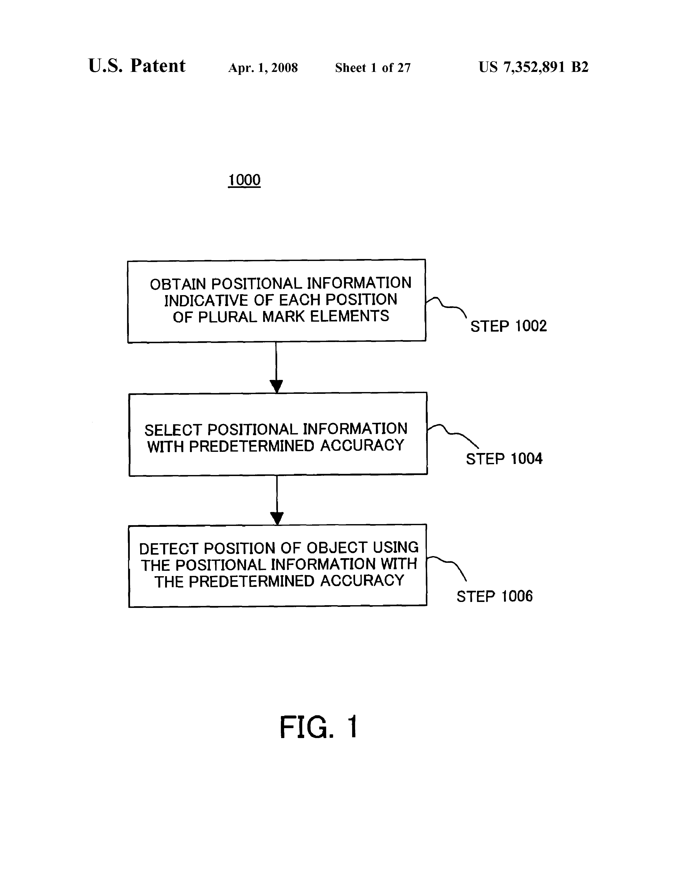
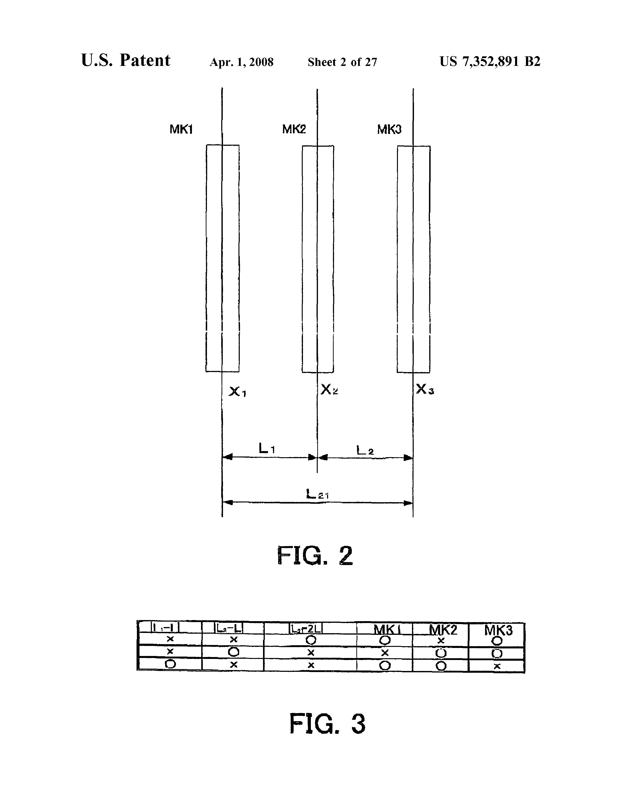
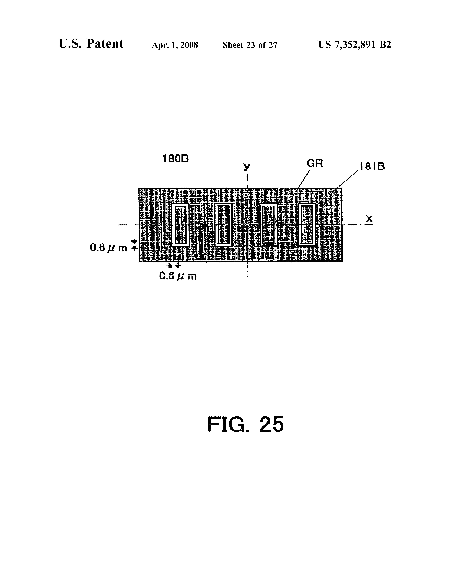

# US7352891B2 — 위치 검출 방법 (Canon)

| 항목 | 내용 |
|---|---|
| 원문 | `US7352891.pdf`(등록, 2008-04-01) · `US20050025352.pdf`(공개, 2005-02-03) |
| 출원인 | Canon Kabushiki Kaisha |
| 우선일 | 2003-06-19 (JP 2003-174263) |
| 핵심 | 얼라인 마크를 이루는 여러 마크 요소의 중심을 각각 재고, **요소 사이 간격을 설계 간격과 비교**해 틀린 요소를 찾아낸다. 틀린 요소는 버리거나 정상 요소로부터 위치를 다시 만들어 넣은 뒤 마크 중심을 계산한다. 마크 전체의 간격 잔차 RMS(sq)가 기준(δp)을 넘으면 이상으로 보고 재측정·대체 샷·경보로 넘어간다. |
| 관련도 | ◎ 문제를 직접 해결하는 구성 |
| 해결 P# | **P6**(측정 신뢰도 판정·기각·재측정), **P1**(한 요소의 큰 어긋남 검출), P2(평균 대신 선별로 계통 오차 차단) |
| 본 과제와의 관계 | 강체 판 위의 QR 점들은 서로의 간격이 설계(또는 center 영상)로 정해져 있다. 이 특허의 "간격 vs 설계 간격" 검정을 536점에 그대로 옮기면, 위치가 잘못 잡힌 점과 판 전체의 측정 실패를 보정값 출력 전에 걸러낼 수 있다. |
| 링크 | [Google Patents](https://patents.google.com/patent/US7352891B2/en) |

---

## 상세 요약 (번역본 기준)

### 1. 해결하려는 문제
- 노광 장치는 웨이퍼의 얼라인 마크 위치를 광학적으로 재어 레티클과 맞춘다. 중첩 정밀도 요구가 높다(예: 0.18 μm 룰에 60 nm 이하).
- CMP 등 공정 때문에 마크 모양이 웨이퍼·샷마다 흩어지고, 웨이퍼 기인 시프트(WIS: 레지스트·마크 비대칭)가 얼라인먼트 신호를 비대칭으로 만들어 중심 검출을 틀어지게 한다.
- 마크 요소 하나에 입자가 붙거나 레지스트 두께가 국부적으로 바뀌면 **그 요소 하나만** 파형이 왜곡된다(도 25~27). 종래 방법은 마크 요소 4개의 중심을 **평균**하므로 이 한 요소의 오차가 마크 전체 위치로 들어간다.
- 종래 AGA는 샷 단위 이상값 제거만 하고, 노광 후 중첩 검사로 오프셋 보정을 하는데 이는 느리고 보정값이 일정하지 않으면 맞지 않는다.

### 2. 핵심 구성
| 구성 | 부호·수식 | 내용 |
|---|---|---|
| 얼라인먼트 광학계 | 150 (151~157) | 약 100배 결상, X·Y 각각 CCD 센서(156, 157). 1 화소 = 웨이퍼 위 240 nm (Px 24 μm, M 100) |
| 얼라인 마크 | 180A / 180B | 4 μm × 20 μm 직사각 요소 4개를 20 μm 피치로 배치 / 같은 윤곽을 선폭 0.6 μm로 그린 요소 4개 |
| 신호 처리기 | 160 (161~165) | A/D, 잡음 제거·저장, 마크 중심 검출기(163)가 방법 1000 실행 |
| 요소 중심 측정 | 식 (1) | 템플릿 매칭 E(X)=1/Σ[S(X+J)−T(J)]², 피크 주변 무게중심으로 1/10~1/50 화소 분해능. 스플라인·가우스 보간도 가능 |
| 마크 중심 | 식 (2), (3) | Xa = 요소 중심 평균, Xw = Xa/(Px·M) |
| 간격 검정 | 식 (4)~(6) | 인접 3요소의 간격 L1, L2, L21에 대해 \|L1−L\|<δL, \|L2−L\|<δL, \|L21−2L\|<δL. L은 장치 배율로 미리 교정한 설계 간격 |
| 이상 요소 식별 | 도 3 | 세 식의 ○/× 조합으로 어느 요소가 틀렸는지 결정(If-Then-Else) |
| 대체 위치 | 식 (7)~(12) | 틀린 요소 위치를 정상 이웃으로 재생성: X3'=(X2+X4)/2, X4'=(X2+X3)/2+1.5L 또는 (3X3−X1)/2 |
| 마크 전체 판정 | 식 (16), (17) | sq=√(Σ(Li−L)²/N), sq>δp이면 이상. 실시예 δp=1.5 |

### 3. 동작 순서 (도 1)
1. 단계 1002: 얼라인먼트 신호에서 각 마크 요소의 중심을 구하고, 요소 사이 간격(L1, L2, …)을 계산한다.
2. 단계 1004: 간격을 설계 기준값과 비교해 소정 정확도를 만족하는 위치 정보만 고른다.
   - 인접 3요소씩 식 (4)~(6)을 적용. 8요소 마크는 (L1, L2, L21)~(L6, L7, L76) 6개 조합을 검사.
   - 실시예: 잔차 1.5 이상(δL≧1.5)이면 "×". 웨이퍼 W6의 MK3, W5의 MK4를 이상으로 찾음(도 5~9).
3. 단계 1006: 이상 요소를 빼거나 정상 이웃으로 만든 위치(식 7~12)로 바꾼 뒤 마크 중심을 계산한다.
   - 결과: W6의 \|L2−L\|가 2.832 → 0.075로 줄어듦(도 9 → 도 10).
4. 마크 전체 검사: 4요소 간격 잔차의 RMS sq(식 16)를 계산해 sq>δp(=1.5)면 이상(도 15·16, W6 sq=2.378). 이상이면 식 (14)·(15)로 해당 요소를 찾아 인접 요소 측정값이나 설계 기준값으로 대체.
5. 샷 단위 처리: 측정 샷(예: 5, 21, 29, 39)이 이상이면 대체 샷(예: 28)을 측정하고, 그것도 이상이면 측정을 반복, 정해진 횟수(예: 3회) 뒤에도 이상이면 경보로 작업자에게 알림(도 14).
6. 판별 결과를 데이터베이스로 저장해 공정 관리·WIS 정량화에 씀.

### 4. 청구항 요지
- 청구항 1(독립): 마크 요소 위치 검출 → 요소 간격 획득 → 간격과 설계값 기반 기준 간격의 오프셋 계산 → 오프셋으로 요소 이상 판정 → 이상 요소의 위치를 정상 요소 위치로부터 생성 → 정상 요소 + 생성된 요소 위치로 얼라인 마크 위치 계산.
- 청구항 2: 인접 3요소의 간격 조합으로 3요소의 이상 판정.
- 청구항 3: 이상으로 판정된 요소의 위치를 반복 검출.
- 청구항 4: 오프셋의 평균 제곱 오차로 각 요소의 정상·이상 판정.
- 청구항 5~10: 위 방법을 쓰는 위치 검출 장치, 노광 장치(대상이 웨이퍼 또는 레티클), 디바이스 제조 방법, 노광 방법.
- 총 10개 청구항.

### 5. 대표 도면

*도 1 — 요소별 위치 획득(1002) → 소정 정확도 위치만 선택(1004) → 물체 위치 검출(1006)*

*도 2 — 3요소 간격 L1, L2, L21, 도 3 — 식 (4)~(6)의 ○/× 조합으로 틀린 요소 식별*

*도 25 — 세 번째 요소 에지에 입자(GR)가 붙은 마크: 한 요소만 신호가 왜곡되는 경우*

### 6. 본 과제(Y·Θ 얼라인먼트)와 비교
- 같은 점:
  - 여러 개의 같은 모양 요소(마크 요소 ↔ QR 모듈·구조점)로 위치를 재고, 요소 사이 배치가 설계로 알려져 있다.
  - 요소 하나가 오염·반사로 틀어지면 평균에 그대로 섞인다는 문제 인식이 같다(논문 결과서 P6, P1).
- 다른 점:
  - 1차원 신호(요소 4~8개)를 다루고, 판정 기준이 "설계 간격"이다. 우리는 2차원 536점이고, 판이 움직이면 점 위치가 원근·2차 변형으로 바뀐다(P12 성분). 간격 기준을 고정 설계값 대신 **center 영상에서의 간격 + P12 예측**으로 바꿔야 한다.
  - 노광 장치의 위치 보정(오프셋)이 목적이고, Y·Θ 분리는 다루지 않는다.
- 참고할 점 (논문 결과서 4장 할 일과 연결):
  - **P6-1 품질 게이트**: 식 (16)·(17)처럼 "점 간격(또는 P12 맞춤) 잔차의 RMS > 임계 → 측정 불가"를 판 단위 게이트로 둔다. 특허는 임계 δp=1.5(마크 간격 단위)를 고정값으로 썼다 → 우리는 정상 341장의 잔차 분포에서 임계를 정한다.
  - **P1-2 이웃 검정**: 식 (4)~(6)의 인접 3요소 조합 판정은 이웃 중앙값 검정(06번)과 같은 역할. 한 점의 모듈 피치 단위 어긋남은 이웃 간격 두 개를 동시에 깨뜨리므로 ○/× 조합으로 어느 점인지 특정된다.
  - **이상 점 처리**: 버리거나(나머지만 사용) 이웃으로 재생성(식 7). 우리는 P12 맞춤이 최소제곱이므로 "버림"이 단순하다. 재생성은 점 수를 유지해야 할 때만.
  - **재측정 흐름**: 이상 → 대체 측정 → 반복 → 정해진 횟수(예: 3회) 뒤 경보. 본 과제의 20턴 보정 루프에서 "측정 불가 → 재촬영, n회 실패 → 사용자 알림"(P6-1, P6-3)의 근거로 쓸 수 있다.
  - **P2·P3-2**: 평균보다 선별이 낫다는 주장, 그리고 sq가 √N으로 줄어든다는 서술은 점 수와 정확도의 관계(논문 05번)와 같다. 점별 신뢰도로 가중하는 P3-2와 함께 쓴다.
  - 판별 결과를 DB로 남겨 공정 관리에 쓰는 구성 → P6-3 신뢰도 출력(기각 사유 로그)의 근거.
