# 위치 검출 방법 및 장치, 그리고 노광 방법 및 장치 (US7019836B2)
- 원제: Position detection method and apparatus, and exposure method and apparatus
- 원문: 같은 폴더의 PDF(`US7019836.pdf` 등록본, `US20030053057.pdf` 공개본), https://patents.google.com/patent/US7019836B2/en
- 번역 기준: USPTO 등록 PDF 스캔 본문을 직접 읽어 옮김 (Google Patents 접근 제한). 요약은 등록본 표지, 청구범위·상세한 설명은 본문 19~20단, 정정 증명서는 마지막 2쪽. 원문 오기는 고치지 않고 옮긴 뒤 "(원문 …)"으로 표시함(정정 증명서가 고친 항목은 문서 끝에 따로 옮김).
- 도면: 원문 PDF 도면 시트 25장(도 1A~도 25)을 도면/ 폴더에 넣고 본문에서 처음 설명되는 곳에 삽입함

## 요약

조명 조건을 바꿀 수 있는 조명계로 관찰 대상 물체를 조명하여 위치 검출계로 관찰 대상 물체의 위치를 검출하는 위치 검출 방법으로서, 관찰 대상 물체 위에 배열된 복수의 얼라인 마크 사이의 마크 간격 각각을 측정하는 단계와, 측정 결과로 얻은 마크 간격 정보를 바탕으로 조명 조건을 선택하는 단계를 포함한다.

## 청구범위

청구하는 것은 다음과 같다.

1. 위치 검출계로 관찰 대상 물체의 위치를 검출하는 위치 검출 방법으로서,

상기 관찰 대상 물체 위에 배열된 복수의 얼라인 마크를 위치 검출계에 대해 상대적으로(원문 "relatively") 초점 방향으로 이동시키는 단계;

복수의 상대 위치에서 마크 간격을 계산하고, 상기 복수의 상대 위치에서의 마크 간격 정보로부터 변동량을 계산하는 단계; 및

상기 변동량을 이용하여 상기 위치 검출계의 오프액시스 텔레센트리시티를 조정하는 단계를 포함하는 위치 검출 방법.

2. 제1항에 있어서, 상기 오프액시스 텔레센트리시티는 상기 위치 검출계에서 상기 관찰 대상 물체에 대해 대략 푸리에 변환 위치에 배치된 부재에 의해 조정되고, 상기 부재는 상기 위치 검출계에 대해 조정될 수 있는 방법.

3. 제1항에 있어서, 상기 오프액시스 텔레센트리시티를 조정하는 부재는 상기 위치 검출계에서 상기 관찰 대상 물체에 대해 대략 푸리에 변환 위치에 있는(원문 "at") 광학 부재인 방법.

4. 얼라인(원문 "an alignment") 마크가 형성된 피노광 물체를 상기 얼라인 마크의 측정 결과를 바탕으로 정렬하고, 상기 피노광 물체를 투영 노광하는 노광 장치로서,

상기 피노광 물체 위에 배열된 복수의 얼라인 마크를, 상기 피노광 물체의 위치를 검출하는 위치 검출계에 의해(원문 "by") 상기 위치 검출계에 대해 상대적으로(원문 "relatively") 초점 방향으로 이동시키고, 복수의 상대 위치에서 마크 간격을 계산하고, 상기 복수의 상대 위치에서의 마크 간격 정보로부터 변동량을 계산하며,

상기 변동량을 이용하여 상기 위치 검출계의 오프액시스 텔레센트리시티를 조정하는 노광 장치.

5. 제4항에 정의된 노광 장치를 사용하여 피노광 물체를 노광하는 단계 후에 상기 피노광 물체 위에 회로 패턴을 형성하는 디바이스 제조 방법.

6. 얼라인 마크가 형성된 피노광 물체를 상기 얼라인 마크의 측정 결과를 바탕으로 정렬하고, 상기 피노광 물체를 투영 노광하는 노광 방법으로서, 상기 방법은,

상기 피노광 물체 위에 배열된 복수의 얼라인 마크를, 상기 피노광 물체의 위치를 검출하는 위치 검출계에 의해(원문 "by") 상기 위치 검출계에 대해 상대적으로(원문 "relatively") 초점 방향으로 이동시키는 단계;

복수의 상대 위치에서 마크 간격을 계산하고, 상기 복수의 상대 위치에서의 마크 간격 정보로부터 변동량을 계산하는 단계; 및

상기 변동량을 이용하여 상기 위치 검출계의 오프액시스 텔레센트리시티를 조정하는 단계를 포함하는 노광 방법.

## 상세한 설명

### 발명의 분야 (FIELD OF THE INVENTION)

본 발명은 반도체 IC, LSI, CCD, 액정 패널, 자기 헤드와 같은 다양한 디바이스를 제조할 때 웨이퍼 등에 형성된 검출 대상 상을 관찰하여 웨이퍼의 위치를 검출하고 웨이퍼를 고정밀로 정렬할 수 있는 위치 검출 방법 및 장치, 그리고 노광 방법 및 장치에 관한 것이다.

### 발명의 배경 (BACKGROUND OF THE INVENTION)

최근 반도체 소자 제조 기술의 눈부신 발전과 함께 미세 패턴 가공 기술의 진보도 두드러진다. 광 가공 기술로는 일반적으로 스테퍼라 불리는, 서브미크론 해상도를 갖는 축소 투영 노광 장치가 주류이다. 더 높은 해상도를 위해 광학계의 개구수(NA)를 키우고 노광 파장을 짧게 하는 것이 실현되고 있다.

노광 파장이 짧아짐에 따라 노광 광원은 g선·i선의 고압 수은등에서 KrF 및 ArF 엑시머 레이저로 옮겨가고 있다.

투영 패턴의 해상도가 높아짐에 따라 투영 노광 장치에서 웨이퍼와 마스크(레티클) 사이의 상대 정렬에도 높은 정밀도가 요구된다. 투영 노광 장치는 고해상도 노광 장치로서뿐 아니라 고정밀 위치 검출 장치로서도 기능해야 한다.

이를 위해, 웨이퍼 등의 얼라인 마크를 검출하는, 얼라인먼트 스코프라고도 불리는 위치 검출 장치에 높은 성능이 요구된다.

얼라인먼트 스코프의 형태로는 크게 두 가지 방법이 제안되어 있다. 얼라인먼트 스코프의 한 형태는 투영 노광 광학계를 거치지 않고 별도로 배치되어 얼라인 마크를 광학적으로 검출하는, 이른바 오프액시스 얼라인먼트 검출계(Off-Axis Auto Alignment; 이하 "OA"라 함)이다.

i선 노광 장치를 쓰는 종래 얼라인먼트 방법 중 하나는 TTL-AA(Through The Lens Auto Alignment)라 불리는, 비노광광의 얼라인먼트 파장을 이용하여 투영 광학계를 거쳐 웨이퍼 상의 얼라인 마크를 검출하는 방법이다.

현재 어느 검출계에서든, 관찰할 얼라인 마크의 상(화상 데이터)을 광전 변환 소자로 전기 신호로 변환하고 그 전기 신호를 바탕으로 얼라인 마크의 위치를 계산하는 방법이, 다양한 반도체 공정에 대한 정밀도와 유연성의 관점에서 주류가 되었다.

종래의 OA 검출계를 갖는 투영 노광 광학계를 도 4의 개략도를 참조하여 설명한다.

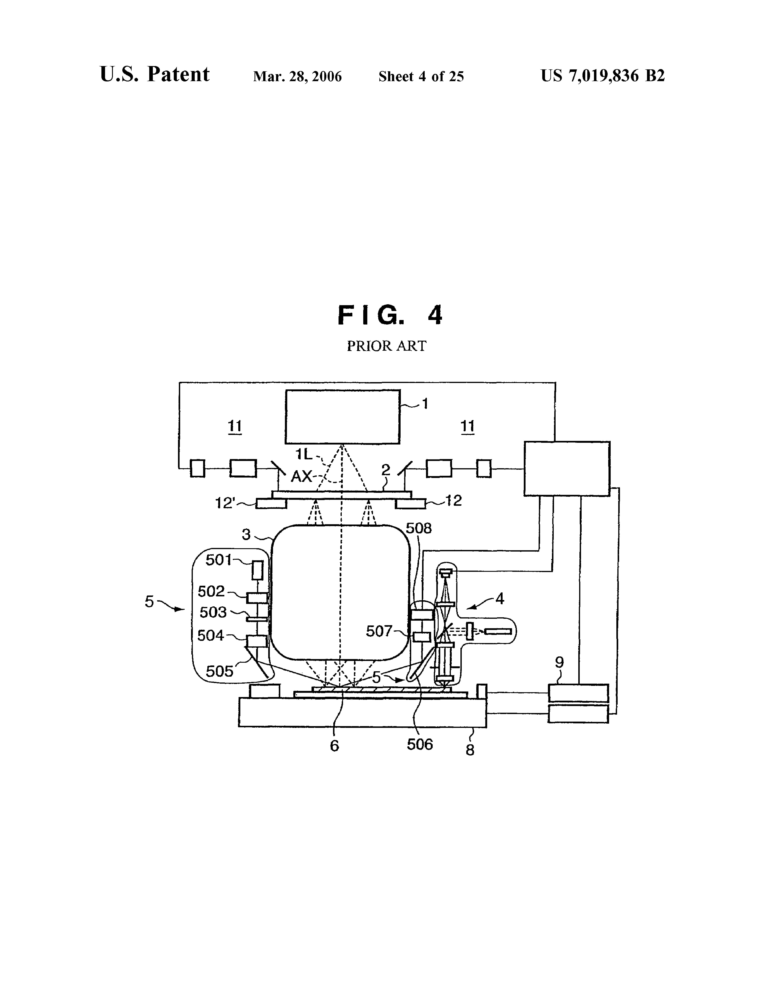
*도 4 — 종래 OA 검출계를 갖는 투영 노광 장치(종래 기술)*

노광 광원(광원으로서 수은등, KrF 엑시머 레이저, ArF 엑시머 레이저 등)을 포함하는 노광 조명 광학계(1)에서 방출된 광(IL)은 패턴을 갖는 마스크(레티클)(2)를 조명한다. 이때 레티클(2)은, 레티클(2) 위(또는 아래)의 얼라인먼트 검출계(11)가 레티클 패턴의 중심을 투영 노광 광학계(3)의 광축(AX)에 일치시키도록 레티클 홀더(12, 12')에 의해 미리 정렬된다.

레티클 패턴을 통과한 광은 투영 노광 광학계(3)를 거쳐 웨이퍼 스테이지(8)에 유지된 웨이퍼(6) 위에 레티클 패턴의 상을 소정 배율로 전사한다. 레티클(2) 위에서 조사광으로 레티클(2)을 조사하고 투영 노광 광학계(3)를 거쳐 고정 위치에서 웨이퍼(6)를 레티클 패턴으로 순차 노광하는 노광 장치를 스테퍼라 한다. 레티클(2)과 웨이퍼(6)를 상대적으로 구동하는(레티클(2)의 구동량은 웨이퍼(6)의 구동량과 투영 배율의 곱이다) 노광 장치를 스캐너(주사형 노광 장치)라 한다.

웨이퍼(6)의 일종으로, 이미 패턴을 갖는 웨이퍼를 제2 웨이퍼라 한다. 이 웨이퍼 위에 다음 패턴을 형성하려면 웨이퍼의 위치를 검출해야 한다. 이 위치 검출 방법에는 앞서 설명한 TTL-AA 방법과 OA 검출 방법이 있다.

OA 검출계를 갖는 얼라인먼트 방식을 도 4를 바탕으로 설명한다.

도 4에 도시된 바와 같이, OA 검출계(4)는 투영 노광 광학계(3)와 별도로 배치된다. 웨이퍼 스테이지(8)는 횡방향 거리를 측정할 수 있는 간섭계(9)를 기준으로 구동된다. 웨이퍼(6)는 OA 검출계(4)의 관찰 영역에 정렬된다. OA 검출계(4)는 간섭계(9)를 기준으로 정렬된 웨이퍼(6)에 형성된 얼라인 마크의 위치를 검출하여, 웨이퍼(6)에 형성된 칩(소자)의 배열 정보를 얻는다.

웨이퍼 스테이지(8)는 칩(소자) 배열 정보를 바탕으로 투영 광학계(3)의 노광 영역(레티클의 전사 영역)으로 구동된다. 그 후 웨이퍼(6)가 순차 노광된다.

투영 광학계(3)의 초점 방향을 측정하는 초점 검출계(5)는 일반적으로 투영 노광 광학계(3)의 노광 영역에 위치한다. 초점 검출계(5)에서는 조명 광원(501)이 방출한 광으로 조명 렌즈(502)를 거쳐 슬릿 패턴(503)을 조명한다. 슬릿 패턴(503)을 통과한 광은 조명 광학계(504)와 미러(505)를 거쳐 웨이퍼(6) 위에 슬릿 패턴을 형성한다.

웨이퍼(6) 위에 투영된 슬릿 패턴은 웨이퍼(65)의 표면에서 반사되어, 초점 검출계(5)의 반대쪽에 배치된 미러(506)와 검출 광학계(507)로 들어간다. 검출 광학계(507)는 웨이퍼(6)의 슬릿 상을 광전 변환 소자(508) 위에 다시 형성한다. 웨이퍼(6)가 상하로 움직이면 광전 변환 소자(508) 위의 슬릿 상이 움직인다. 이 이동량으로부터 웨이퍼(6)의 초점 방향 거리를 측정할 수 있다. 이러한 슬릿(웨이퍼 6 위의 점(6))을 여러 개 마련하고 각 슬릿의 초점 위치를 검출한다(웨이퍼(6) 위의 점들을 측정한다). 그 결과 투영 노광 광학계(3)의 레티클 상의 상면에 대한 웨이퍼(6)의 기울기를 측정할 수 있다.

위와 같은 투영 노광 장치에서, 웨이퍼(6)로서의 실제 공정 웨이퍼에 형성된 얼라인 마크(AM)는 서로 다른 종·횡 구조를 갖는다. 또한 이러한 다양한 얼라인 마크(AM)를 고정밀로 검출하기 위해, 조명 조건(이하 "조명 모드"라 함)을 가변(예: 파장 선택, 가변 NA)할 수 있는 얼라인먼트 검출계가 채용된다.

TTL-AA 방법의 설명은 생략하지만, TTL-AA 방법에서도 웨이퍼는 기본적으로 투영 노광 광학계(3)를 거쳐 OA 검출계로 관찰된다. 조명 조건을 바꾸면서 다양한 얼라인 마크를 검출할 수 있다.

그러나 위의 얼라인먼트 스코프로 웨이퍼 상의 얼라인 마크를 관찰하여 위치를 검출할 때, 얻어지는 얼라인먼트 검출 신호는 얼라인 마크의 구조(종·횡 구조)와 종류에 따라 달라진다. 따라서 이러한 신호를 고정밀로 검출하려면 조명 모드의 최적화가 필요하다. 이 때문에 장치 쪽에서 다양한 웨이퍼 공정에 대해 최적의 얼라인먼트 구조와 조명 모드를 선택하여 사용자에게 추천할 필요가 있다.

종래에는 이러한 다양한 공정에 대해, 얻어지는 얼라인먼트 검출 신호 파형의 콘트라스트만을 고려하여 최적 조명 모드를 선택하였다. 그 결과 경우에 따라서는 최적 조명 모드와 최종 얼라인먼트 정밀도 사이에 불일치가 생길 수 있다.

또한 얼라인먼트 스코프의 성능을 평가할 때, 웨이퍼 스테이지 위에 형성된(웨이퍼 위의 배치를 포함) 얼라인 마크를 연속 측정하여 얻은 반복 재현성(예: 3σ 또는 범위)으로 판단한다. 그러나 이 경우 웨이퍼 스테이지 자체의 안정성/불안정성(예: 간섭계의 안정성/불안정성)의 영향 때문에 얼라인먼트 검출계의 원하는 성능을 만족스럽게 평가할 수 없다.

더욱이 얼라인먼트 검출계 특성의 하나인 선형성(얼라인 마크를 측정 방향으로 구동할 때 측정값의 선형성)이 규정되어 있지 않고, 게다가 선형성으로부터의 어긋남(이하 "선형성 잔차"라 함)이 발생한다. 그 원인은 특정되지 않았으며, 이러한 어긋남을 조정하는 방법도 확립되어 있지 않다.

측정 방향에서 얼라인 마크 위치의 측정 정밀도(선형성)가 저하되면, 얼라인 마크를 얼라인먼트 검출계에 대해 소정 위치로 이송해야 하므로 처리량이 감소한다.

### 발명의 요약 (SUMMARY OF THE INVENTION)

본 발명은 위의 문제를 고려하여 이루어진 것으로, 마크의 위치를 정확히 검출하는 데 있어 검출 성능을 평가할 수 있는 위치 검출 방법 및 장치, 그리고 노광 방법 및 장치를 제공하는 것을 목적으로 한다.

본 발명에 따르면, 위와 같은 얼라인먼트 검출계의 문제에 대처하기 위해, 관찰 대상 물체 위에 배열된 복수의 얼라인 마크 사이의 마크 간격 각각을 관찰 대상 물체의 위치를 검출하는 얼라인먼트 검출계로 측정하고, 그 측정 결과로 얻은 마크 간격 정보를 바탕으로 얼라인먼트 검출계의 측정 반복 재현성을 평가한다. 이로써 웨이퍼 스테이지의 안정성/불안정성의 영향 때문에 불가능했던, 얼라인먼트 검출계의 순수한 성능을 정확히 평가할 수 있다.

마크 간격 정보는, 얼라인 마크가 정지한 상태의 마크 간격 위치를 연속 측정하여 얻은 마크 간격의 반복 재현성(이하 "마크 간격 반복 재현성"이라 함), 또는 얼라인 마크를 측정 방향으로 구동하면서 복수 위치에서 마크 간격을 측정하여 얻은 마크 간격의 변동량(이하 "마크 간격 안정성/불안정성"이라 함)으로 정의된다.

또한 마크 간격 반복 재현성과 마크 간격 안정성/불안정성에 주목함으로써, 실제 공정 웨이퍼에 대해 최적의 얼라인 마크와 최적 조명 조건(조명 σ, NA, 파장 등)을 선택할 수 있다. 이로써 실제 공정 웨이퍼에서 얼라인먼트 정밀도를 높일 수 있다.

나아가, 관찰 대상 물체 위에 배열된 복수의 얼라인 마크를 관찰 대상 물체를 검출하는 얼라인먼트 검출계에 대해 초점 방향으로 이동시키고, 복수의 상대 위치에서 마크 간격을 계산한다. 또한 복수 상대 위치에서의 마크 간격 정보를 바탕으로 변동량을 계산하고, 그 변동량을 바탕으로 디포커스 상태에서 얼라인먼트 검출계의 배율 및 왜곡 변화(이하 "오프액시스 텔레센트리시티"라 함)를 조정한다. 이 동작으로 디포커스 상태에서 얼라인 마크 측정의 선형성 정밀도를 향상시킬 수 있다.

위와 같이 마크 간격을 불변의 기준으로 삼아 평가를 수행하므로, 종래 시스템보다 높은 정밀도의 얼라인먼트 검출계를 제공할 수 있다.

추가로, 얼라인먼트 검출계를 반도체 노광 장치와 액정 노광 장치에 적용함으로써, 위치를 고정밀로 검출할 수 있는, 예컨대 반도체 등의 디바이스 제조 방법을 제공한다.

웨이퍼 스테이지의 안정성/불안정성에 영향을 받지 않는 측정값인 마크 간격을 사용하면 마크 검출 성능을 정확히 평가할 수 있다. 또한 마크 간격의 반복 재현성과 마크 구동 시 마크 간격 변동을 측정하면 최적 얼라인 마크와 조명 모드를 선택할 수 있다. 나아가 얼라인 마크를 디포커스하면서 마크 간격의 변화를 관찰함으로써, 얼라인먼트 검출계의 텔레센트리시티를 관찰하면서 오프액시스 텔레센트리시티가 최선이 되도록 조정할 수 있다. 이 동작으로 얼라인 마크를 디포커스 상태에서 측정하더라도 측정 방향의 선형성이 보장되고 고정밀 위치 검출을 달성할 수 있다.

위에서 논한 것 외의 다른 목적과 이점은 이어지는 본 발명의 바람직한 실시예의 설명으로부터 당업자에게 명백할 것이다. 설명에서는 그 일부를 이루며 본 발명의 예를 도시하는 첨부 도면을 참조한다. 그러나 이러한 예는 본 발명의 다양한 실시예를 망라하는 것이 아니므로, 본 발명의 범위를 정하기 위해서는 설명 뒤의 청구범위를 참조한다.

### 도면의 간단한 설명 (BRIEF DESCRIPTION OF THE DRAWINGS)

도 1A 및 도 1B는 각각 얼라인 마크에서의 간격 측정과 검출 신호의 파형을 나타내는 개략도이다.

도 2A 내지 도 2F는 제1 얼라인 마크와, 조명 모드를 바꾸어 얻은 검출 신호의 파형을 나타내는 개략도이다;

도 3A 내지 도 3F는 제2 얼라인 마크와, 조명 모드를 바꾸어 얻은 검출 신호의 파형을 나타내는 개략도이다;

도 4는 얼라인먼트 검출계를 갖는 투영 노광 장치의 개략도이다;

도 5A 및 도 5B는 각각 얼라인 마크의 위치에 대한 디지털 오차를 나타내는 개략 그래프이다;

도 6A 내지 도 6C는 얼라인 마크 검출 신호의 파형과 디지털 오차의 발생 메커니즘을 나타내는 개략도이다;

도 7은 얼라인 마크의 위치에 대한 디지털 오차를 나타내는 개략 그래프이다;

도 8은 오프액시스 얼라인먼트 검출계를 나타내는 개략도이다;

도 9는 얼라인 마크 위치에 대한 마크 간격의 변동을 나타내는 개략 그래프이다;

도 10은 측정 반복 재현성과 콘트라스트를 나타내는 개략 그래프이다;

도 11은 디지털 오차와 콘트라스트를 나타내는 개략 그래프이다;

도 12는 최적 얼라인 마크와 조명 모드를 선택하는 절차를 나타내는 흐름도이다;

도 13은 최적 얼라인 마크와 조명 모드를 선택하는 절차를 나타내는 흐름도이다;

도 14는 오프액시스 텔레센트리시티가 양호한 경우를 나타내는 개략도이다;

도 15는 오프액시스 텔레센트리시티가 불량한 경우를 나타내는 개략도이다;

도 16은 디포커스 상태에서 오프액시스 텔레센트리시티가 불량한 측정에서의 얼라인 마크 측정 위치를 나타내는 개략 그래프이다;

도 17은 동공의 구면 수차를 나타내는 개략도이다;

도 18은 디포커스 상태에서 오프액시스 텔레센트리시티가 불량한 측정에서의 마크 간격 변동을 나타내는 개략 그래프이다;

도 19A 내지 도 19C는 각각 대물 조리개 PL 위치와 오프액시스 텔레센트리시티의 관계를 나타내는 개략도이다;

도 20은 동공의 구면 수차 보정의 예를 나타내는 개략도이다;

도 21은 실시예에 따른 장치를 이용한 반도체 디바이스 생산 시스템을 한 각도에서 본 개념도이다;

도 22는 실시예에 따른 장치를 이용한 반도체 디바이스 생산 시스템을 다른 각도에서 본 개념도이다;

도 23은 사용자 인터페이스의 구체적인 예이다;

도 24는 디바이스 제조 공정을 나타내는 흐름도이다; 그리고

도 25는 웨이퍼 공정을 나타내는 흐름도이다.

### 바람직한 실시예의 상세한 설명 (DETAILED DESCRIPTION OF THE PREFERRED EMBODIMENTS)

이하 첨부 도면을 참조하여 본 발명의 실시예를 상세히 설명한다.

#### 제1 실시예 (First Embodiment)

도 4에 도시된 투영 노광 장치의 OA 검출계(얼라인먼트 검출계)(4)를 그 상세도인 도 8을 참조하여 설명한다.

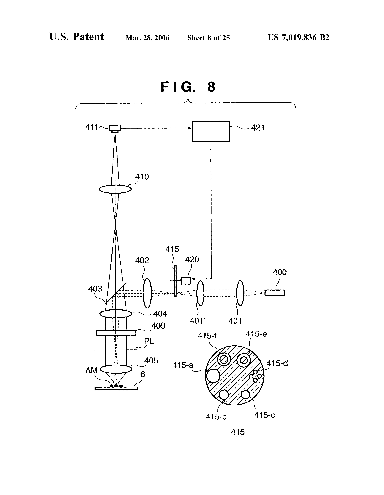
*도 8 — 오프액시스 얼라인먼트 검출계와 회전 개구 조리개(415)*

도 8을 참조하면, 조명 광원(400)(예: 파이버)에서 안내된 광은 조명 릴레이 광학계(401, 401')를 통과한다. 조명 릴레이계(401, 401')에 의해 파이버의 끝면 상이 회전 개구 조리개(415)(후술) 위에 형성된다. 파이버의 끝면과 개구 조리개(415)는 대물 렌즈(후술)의 동공 위치(PL)와 공액이다. 회전 개구 조리개(415)를 통과한 광 중 특정 광 성분은 다시 조명 광학계(402)를 통과하여 편광 빔 스플리터(403)로 안내된다. 편광 빔 스플리터(403)에서 도 8의 지면에 수직한 방향으로 반사된 S 편광은 릴레이 렌즈(404)와 λ/4 판(409)을 통과한다. 그 후 S 편광은 원편광으로 변환되어 대물 렌즈(405)를 거쳐 웨이퍼(6)에 형성된 얼라인 마크(AM)를 쾰러 조명한다.

얼라인 마크(AM)로부터의 반사광, 회절광, 산란광은 대물 렌즈(405), λ/4 판(원문 "plage")(409), 릴레이 렌즈(404)로 되돌아가 도 8의 지면에 평행한 P 편광으로 변환된다. P 편광은 편광 빔 스플리터(403)를 통과하고 결상 광학계(410)를 거쳐 광전 변환 소자(411)(예: CCD 카메라) 위에 얼라인 마크(AM)의 상을 형성한다. 광전 변환된 얼라인 마크 상의 위치를 바탕으로 웨이퍼(6)의 위치가 검출된다.

이때 웨이퍼(6) 위의 얼라인 마크(AM)를 고정밀로 검출하려면 얼라인 마크(AM)의 상이 선명하게 검출되어야 한다. 다시 말해 OA 검출계(4)의 초점이 얼라인 마크(AM)에 맞추어져야 한다.

이를 위해 일반적으로 AF 검출계(도시하지 않음)가 채용된다. 얼라인 마크는 AF 검출계의 검출 결과를 바탕으로 OA 검출계의 최적 초점면으로 구동되어 검출된다.

이제 회전 개구 조리개(415)의 역할을 상세히 설명한다. 도 8의 회전 개구 조리개(415)의 판 부재에는 광의 특정 성분이 통과하는 복수의 공간 조리개가 형성되어 있다. 회전 개구 조리개(415)는 회전 구동계(420)에 배치된다. 제어계(421)의 지시에 따라 회전 개구 조리개(415)를 회전시키면 다양한 조리개 형상(415-a 내지 415-f) 중 하나를 다른 것으로 바꾸어 광로에 삽입할 수 있다. 도 8에서 비어 있는 부분은 광을 투과하는 영역을, 해칭된 영역은 차광 영역을 나타낸다. 회전 개구 조리개(415)는 기계적 판 부재로 구성되거나(원문 "comprises of"), 유리 부재 위에 크롬 패턴을 형성한 구성을 가질 수 있다. 조리개(415-a 내지 415-f) 각각의 크기는 대물 조리개 PL의 위치에서 대물 조리개 PL의 크기 이하이다. 파이버 끝면과 각 조리개(415-a 내지 415-f)의 관계에 대해서는, 회전 개구 조리개(415) 위에서 파이버 끝면의 크기가 각 조리개의 크기보다 크다.

회전 개구 조리개(415)의 조리개들은 다양한 형상을 갖는 대신 같은 형상을 가질 수도 있으며, 그중 하나는 확산판처럼 면 내 광 강도 분포가 균일한 부재로 구성될 수도 있다.

이 구성으로 회전 개구 조리개(415)의 조리개(415-a 내지 415-f) 각각을 선택할 수 있어, OA 검출계의 이른바 조명 σ 또는 변형 조명을 가변으로 할 수 있다. 조명 a(원문 그대로)를 바꾸는 효과를 아래에서 설명한다.

조리개(415-a)의 크기는 대물 조리개 PL의 크기와 같으며 σ1이라 한다. 조리개(415-b)(이하 중간 σ라 함)의 크기는 대물 조리개 PL보다 작고, 조리개(415-c)(이하 작은 σ라 함)의 크기는 그보다 더 작다. 조리개(415-d)는 4중극 조명으로, 조리개(415-e)는 링 조명 1로, 조리개(415-f)는 링 조명 2로 형성된다. 실제 σ(조리개 형상)의 배치는 위에 설명한 배치에 한정되지 않으며, OA 검출계에 최적인 어떠한 배치도 가질 수 있다.

위 구성에서 조명 광원(400)(파이버)은 파장을 선택할 수 있는 기구를 갖지 않는다. 조명 광원(400)에 파장 전환 필터(도시하지 않음)를 마련하면 OA 검출계의 파장을 선택할 수 있다.

파장과 조명 σ를 가변으로 하는 효과를 도 2A 내지 도 2F 및 도 3A 내지 도 3F를 참조하여 더 설명한다.

도 2A와 도 3A는 서로 다른 얼라인 마크를 위에서 관찰한 개략도이다. 측정은 도 2A와 도 2B의 각 지면의 가로 방향으로 수행된다. 도 2B와 도 3B는 얼라인 마크의 사시 단면 구조를 나타내며, 두 구조 모두에 같은 다층 공정이 수행되었다고 가정한다. 또한 해칭된 부분은 각각 얼라인먼트 파장에 대해 투명한 층을 나타낸다고 가정한다. 도 2C 내지 도 2F와 도 3C 내지 도 3F는 각각 조명 σ와 사용 파장을 바꾸어 얻은 얼라인 마크 검출 신호를 나타낸다. 선택할 조명 σ와 파장의 조합을 이하 "조명 모드"라 한다.

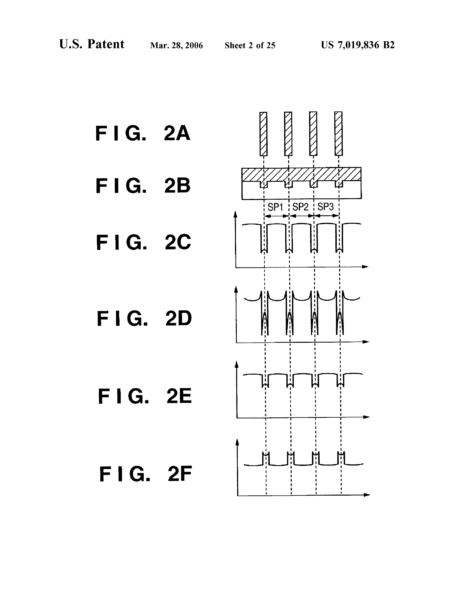
*도 2A~2F — 제1 얼라인 마크와 조명 모드별 검출 신호 파형*

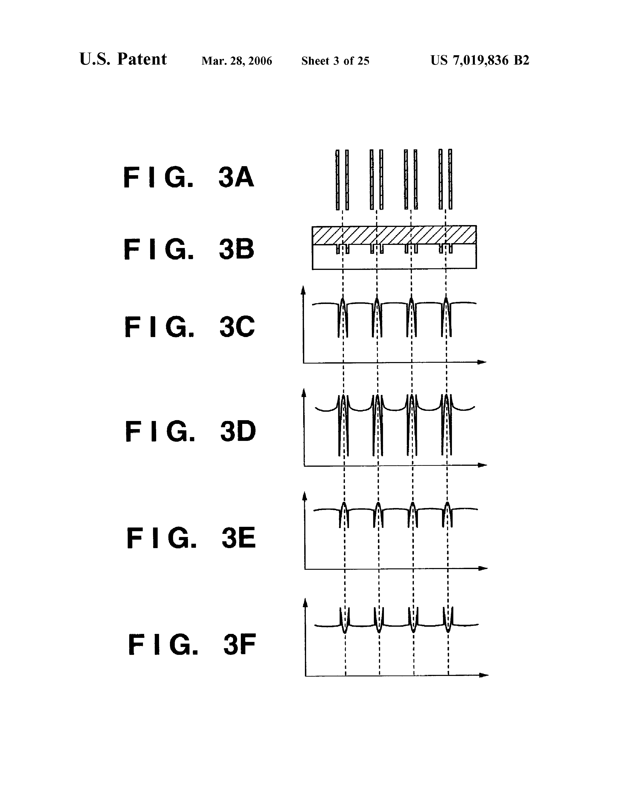
*도 3A~3F — 제2 얼라인 마크와 조명 모드별 검출 신호 파형*

도 2C와 도 3C는 제1 중심 파장에서 σ1로 관찰한 얼라인먼트 검출 신호를, 도 2D와 도 3D는 같은 파장에서 작은 σ로 관찰한 얼라인먼트 검출 신호를 나타낸다. 도 2E와 도 3E, 도 2F와 도 3F는 각각 제2, 제3 중심 파장에서 σ1로 관찰한 얼라인먼트 신호를 나타낸다. 이처럼 조명 모드를 바꾸면 하나의 마크에 대해 검출 신호 파형을 바꿀 수 있다. 또한 하나의 조명 모드에서 마크 형상이 바뀌면 얻어지는 얼라인먼트 신호 파형이 바뀐다.

OA 검출계는 도 8에 도시된 구성에 한정되지 않는다. 본 발명은 예컨대 조명계의 광 안내 위치가 다르거나, 결상 광학계(410)와 광전 변환 소자(411)를 여러 개 갖는 검출계에도 적용할 수 있다.

이 예에서는 투영 광학계와 별도로 배치된 OA 검출계만 설명하였다. 그러나 본 발명은 이에 한정되지 않는다. 투영 노광 광학계를 거쳐 웨이퍼를 관찰하는 TTL-AA 방법에서도 비슷한 구성을 실현할 수 있으며, 본 발명을 그 비슷한 구성에 적용할 수 있다.

종래에는 얼라인먼트 검출계의 성능을 평가하기 위해, 웨이퍼 스테이지 위의 얼라인 마크(AM)(웨이퍼 위에 형성될 수 있음)를 얼라인먼트 검출계로 연속 측정하고, 얻어진 측정 반복 재현성을 사용한다. 실제 공정 웨이퍼의 여러 종류의 얼라인 마크(AM) 중 일부는, 웨이퍼 스테이지 위의 각 얼라인 마크(AM)를 마찬가지로 평가(원문 "similarly evaluation")하여 얻은 반복 재현성 정보를 얼라인먼트 검출계의 반복 재현성으로 삼아 그것을 바탕으로 선택된다.

그러나 웨이퍼 스테이지 위에 형성된 얼라인 마크(AM)의 측정 반복 재현성은 스테이지 위치의 안정성/불안정성의 영향을 받을 수 있어, 얼라인먼트 검출계나 얼라인먼트 신호의 평가에 쓰지 못할 수 있다. 이는 정지 상태에서 웨이퍼 스테이지의 안정성/불안정성이 일반적으로 실제 노광 성능에 그다지 중요한 요소가 아니기 때문이다. 더 구체적으로, 간섭계 등은 실제 노광에서 쉽(원문 "ships", 칩의 오기로 보임)이 순차 노광되는(스테이지가 구동되는) 동안 안정해야 한다. 따라서 어떤 의미에서 얼라인 마크(AM)의 측정 반복 재현성은 일반적으로 요구되는 것과 다른 사용 상태에서 평가되는 것이다.

그래서 얼라인 마크의 측정 반복 재현성을 마크 간격의 반복 재현성으로 평가하면, 얼라인먼트 검출계로서의 순수한 성능을 평가할 수 있다.

마크 간격은 얼라인 마크 자체가 팽창하거나 수축하지 않는 한 안정하며 항상 일정하다. 얼라인 마크가 팽창하거나 수축하더라도 그 팽창/수축은 열 변형에 의한 것이다. 따라서 짧은 측정, 즉 여러 번의 측정 동안 마크 간격은 변하지 않는다. 또한 마크 간격은 수 μm에서 수십 μm 길이이므로 열 팽창/수축에 의한 마크 간격의 변동은 무시할 수 있다.

따라서 마크 간격의 반복 재현성을 조사하면 얼라인먼트 검출계의 성능을 정확히 평가할 수 있다. 더욱이 여러 종류의 얼라인 마크를 마크 간격 반복 재현성 면에서 서로 비교하면 그중에서 우수한 얼라인 마크를 선택할 수 있다.

다른 관점에서, 웨이퍼(6) 위의 얼라인 마크(AM)는 도 8에 도시된 것과 같은 얼라인먼트 검출계에 의해 광전 변환된 전기 신호로 검출된다. 도 1A는 웨이퍼(6) 위에 형성된 얼라인 마크(AM)의 개략도이다. 도 1A는 웨이퍼(6) 위에서 본 얼라인 마크(AM)의 상태를 나타낸다. 도 1B는 얼라인 마크(AM)를 광전 변환하여 얻은 검출 신호를 나타낸다. 이 실시예에서는 4개의 마크로 이루어진 얼라인 마크를 사용하지만, 본 발명에 따르면 얼라인 마크(AM)가 2개 이상의 마크로 이루어지기만 하면 이 실시예와 비슷한 효과를 얻을 수 있다. 얼라인 마크는 마크(M1 내지 M4)의 길이 방향에 수직한 방향으로 측정된다.

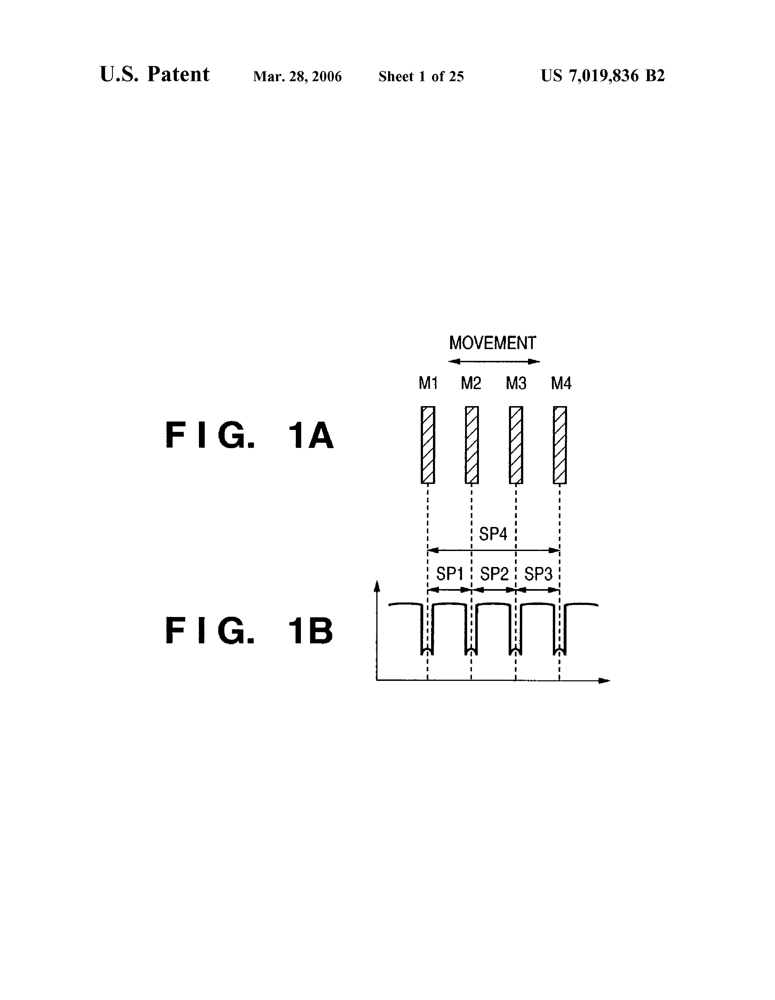
*도 1A, 도 1B — 마크 M1~M4와 마크 간격 SP1~SP4(도 1A), 검출 신호 파형(도 1B)*

이러한 얼라인 마크를 측정 방향으로 구동하면서 측정을 수행하면 이른바 디지털 오차가 발생한다. 이 디지털 오차가 발생하면 측정값이 비선형으로 변하여 얼라인먼트 검출 오차를 일으킨다. 이 현상을 도 5A, 도 5B 및 도 6A 내지 도 6C를 참조하여 설명한다.

도 5A는 마크를 측정 방향으로 구동했을 때의 측정 결과를 개략적으로 나타낸다. 검출계에서 디지털 오차가 발생하면 측정값은 마크의 위치에 따라 주기적으로 변한다. 도 5A의 가로축은 얼라인먼트 검출계에 대한 마크 위치(예: 웨이퍼 스테이지 간섭계의 판독값)를, 세로축은 얼라인먼트 검출계에서 얻은 마크의 측정값을 나타낸다. 이상적으로는 측정값이 선형으로 변하는 것이 바람직하다. 도 5A의 RD는 측정값의 원시 데이터를, LD는 원시 데이터(주기적 변화)를 직선으로 근사한 것이다. 도 5B는 LD를 기준으로 한 선형 성분으로부터의 잔차를 나타내며, ΔL로 표시된다. 도 5B에 도시된 바와 같이 마크 위치에 대해 측정 오차 ΔL이 발생하면, 얼라인 마크가 얼라인먼트 검출계에 대해 어느 위치에 있느냐에 따라 측정값의 오차가 변한다. 이 경우 고정밀 얼라인먼트 검출을 수행할 수 없다.

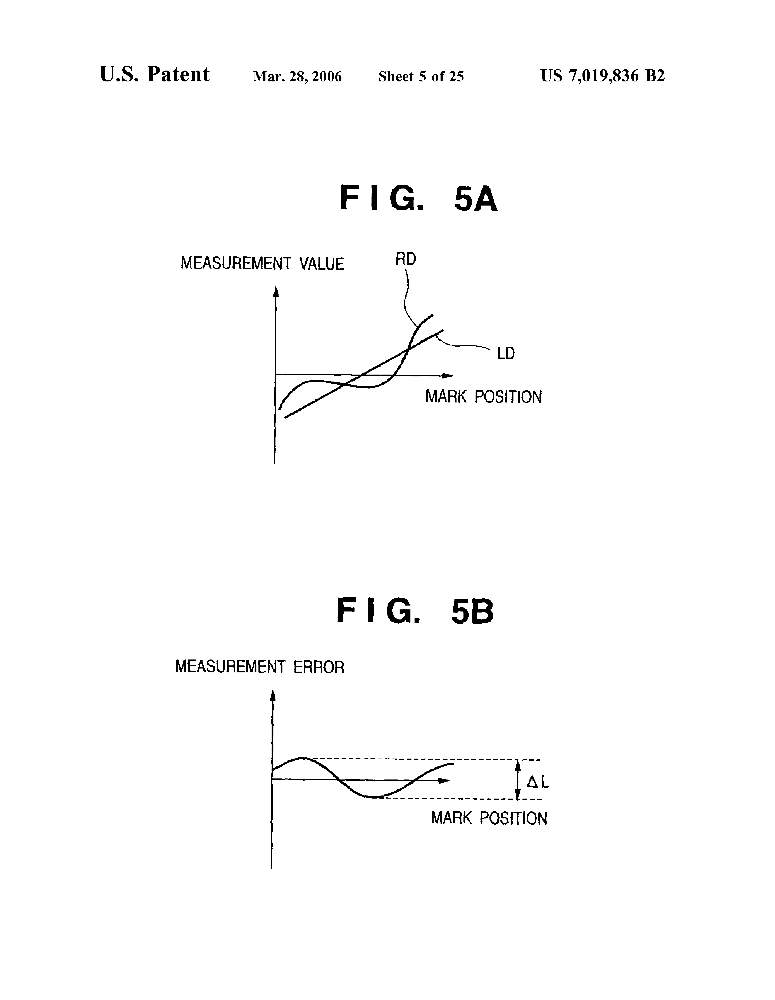
*도 5A, 도 5B — 마크 구동 시 측정값의 원시 데이터 RD와 직선 근사 LD(도 5A), 선형 성분으로부터의 잔차 ΔL(도 5B)*

디지털 오차가 발생하는 메커니즘을 도 6A와 도 6B를 참조하여 더 자세히 설명한다.

도 6A 내지 도 6C는 도 1B에 도시된 얼라인 마크 중 하나의 마크에 대한 검출 신호의 파형을 나타낸다. 도 6A 내지 도 6C의 점선 D는 검출계의 샘플링 점을 나타낸다. 검출계로 CCD 카메라 등을 사용하면 이 샘플링 점 각각은 화소 크기에 해당한다. 레이저 빔 주사처럼 신호를 시간으로 샘플링·검출하면 샘플링 점 각각은 샘플링 시간에 해당한다. 이제 샘플링 점이 CCD 카메라의 화소 크기에 해당하는 경우를 설명한다. CCD 카메라로 촬상한 얼라인먼트 상에서 생성된 검출 신호가 검출되고, 그 파형은 ΔD의 샘플링 간격(상 크기) 간격으로 표시된다. 도 6A는 위치가 CCD 카메라의 어떤 위치와 일치하는 얼라인 마크(AM)의 검출 신호 파형을 나타낸다. 도 6B와 도 6C는 각각 CCD 카메라의 위치로부터 1/4 화소만큼 어긋난 위치에 있는 얼라인 마크(AM)의 검출 신호 파형을 나타낸다. 이 예에서는 얼라인 마크(AM)의 위치는 바꾸지 않고 화소의 위치를 바꾼다. 따라서 이상적으로는 측정이 수행될 위치(예: 파형의 무게중심)는 바뀌지 않는다.

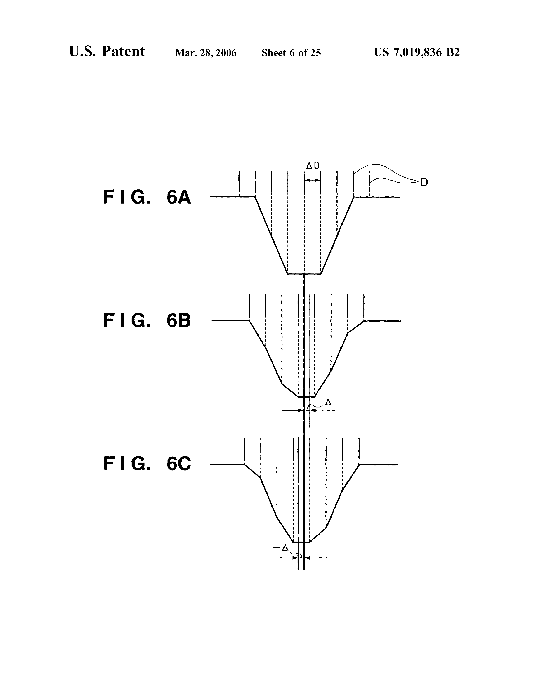
*도 6A~6C — 샘플링 점 D(화소)에 대한 마크 신호 파형과 1/4 화소 어긋남에 따른 측정 오차 Δ*

그러나 도 6B와 도 6C의 신호 파형은 도 6A의 파형에 대해 1/4 화소만큼 서로 반대 방향으로 어긋나 있다. 이 때문에 얼라인 마크의 위치가 바뀌지 않았는데도 측정값은 각각 어긋난 방향으로 A(원문 표기 그대로, 도 6의 Δ)만큼 오차를 갖는다. 다시 말해 얼라인 마크의 위치가 한 화소 안에서 바뀌면 측정값이 주기적으로 어긋난다. 따라서 이러한 디지털 오차를 정확히 평가할 필요가 있다. 종래에는 이러한 디지털 오차를 측정하기 위해, 가로축에 스테이지 간섭계를, 세로축에 측정값을 플롯하면서 웨이퍼 스테이지(8) 위에 형성된 얼라인 마크를 계산하였다. 그러나 실제 간섭계에는 공기의 요동 등이 있고, 게다가 간섭계 자체도 요동한다.

이러한 상황에서 본 발명에 따르면, 여러 마크로 이루어진 얼라인 마크를 사용하여 그 마크 사이의 간격에 주목함으로써 디지털 오차를 평가한다. 이 실시예에서는 4개의 마크를 사용하며, 도 1A에 도시된 바와 같이 마크 사이의 간격 SP1, SP2, SP3, SP4를 사용하여 디지털 오차를 평가한다. 얼라인먼트 검출계에 대한 마크 위치에서 디지털 오차가 발생한다고 가정한다. 마크 측정값의 변동과 마크 간격의 변동을 각각 도 7과 도 9에 개략적으로 나타낸다. 도 7에서 알 수 있듯이 각 마크의 측정값은 독립적으로 변한다. 실제 얼라인 마크와 얼라인먼트 검출계를 고려하면, 얼라인 마크의 기하학적 오차, 얼라인먼트 검출계의 배율 오차 등 때문에 CCD 카메라 화소 위의 마크 검출 영역은 마크마다 달라진다. 따라서 도 7에 도시된 바와 같이 디지털 오차의 발생을 나타내는 각 마크의 위상은 서로 다르다. 화소 분해능은 일반적으로 약 0.1 μm 이하이며, 마크 간격의 절대값도 같은 크기의 오차를 가질 것이다. 또는 화소 분해능과 얼라인 마크 사이 간격이 서로 동기하지 않도록 설계값을 제어한다. 이로써 디지털 오차가 무작위로 발생하게 되어 전체 측정값(4개 마크 측정값의 평균값)에 영향을 주지 않게 된다. 그러나 실제 검출계는 제조 오차를 가질 수 있으므로(원문 문장 그대로), 이러한 오차의 평가가 필요하다.

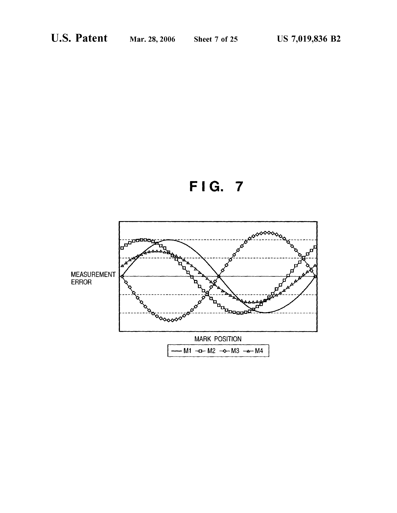
*도 7 — 마크 위치에 대한 마크 M1~M4 각각의 디지털 오차(위상이 서로 다름)*

도 9는 4개 마크 각각이 비교적 독립적인 디지털 오차를 갖는 경우의 마크 간격 변동을 나타낸다. 도 9에서 알 수 있듯이 마크 간격(SP1 내지 SP4) 각각은 주기적으로 변한다.

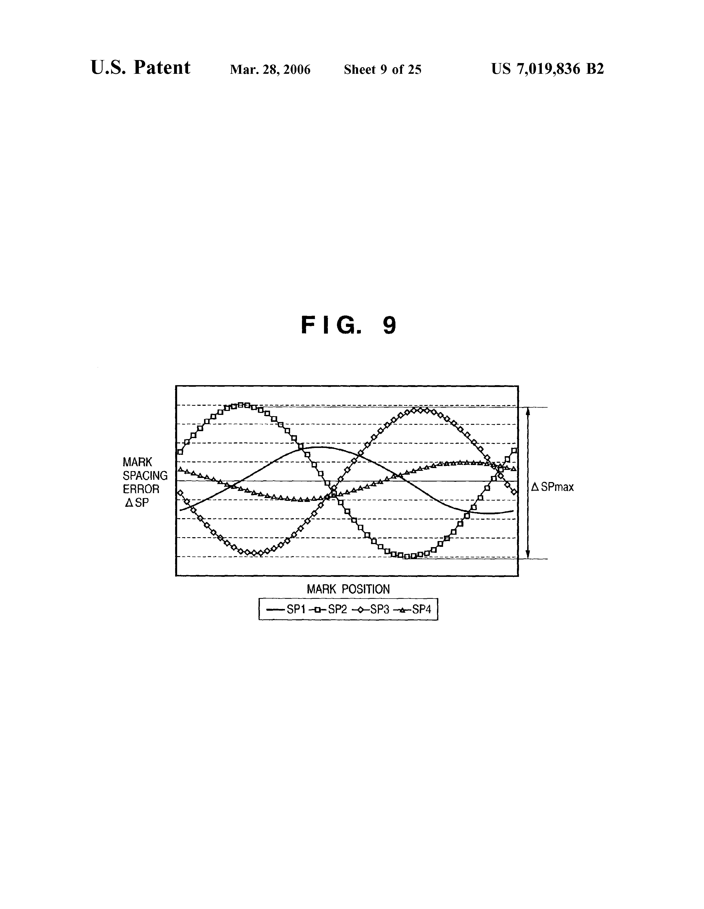
*도 9 — 마크 위치에 대한 마크 간격 오차 ΔSP(SP1~SP4)의 주기적 변동과 최대 변동 ΔSPmax*

측정 결과는 일정한 기준인 마크 간격을 사용하여 얻으므로 스테이지 간섭계의 오차가 포함되지 않는다. 따라서 디지털 오차를 정확히 측정할 수 있다.

위와 같이 스테이지를 구동할 때 마크 간격의 변동량과, 마크 위치를 고정한 상태에서 마크 간격 반복 재현성을 확인하면 얼라인먼트 검출계로서의 정밀도 또는 얼라인먼트 신호의 정밀도를 순수하게 평가할 수 있다.

#### 제2 실시예 (Second Embodiment)

얼라인 마크의 여러 마크 사이 마크 간격의 측정 결과를 이용한, 실제 공정 웨이퍼의 얼라인 마크 또는 조명 모드의 최적화를 도 10과 도 11을 참조하여 설명한다.

도 10은 어떤 얼라인 마크의 마크 간격 반복 재현성과 콘트라스트(예: 신호 강도의 최소/최대 비)의 관계를 나타낸다. 도 10에서 알 수 있듯이 콘트라스트가 높아질수록 마크 간격의 반복 재현성이 향상된다. 이는 여러(4개) 마크의 중심 위치의 측정 반복 재현성이 향상됨을 뜻한다. 그 한 가지 이유는, 광전 변환 소자에서 광전 변환된 신호에 전기 처리 기반의 잡음 성분이 섞이므로 콘트라스트가 높을수록 S/N 비가 커지기 때문일 수 있다. 따라서 가능한 한 높은 콘트라스트를 갖는 조명 모드나 얼라인 마크를 선택하면(원문 "as selected") 측정 반복 재현성의 향상이 기대된다.

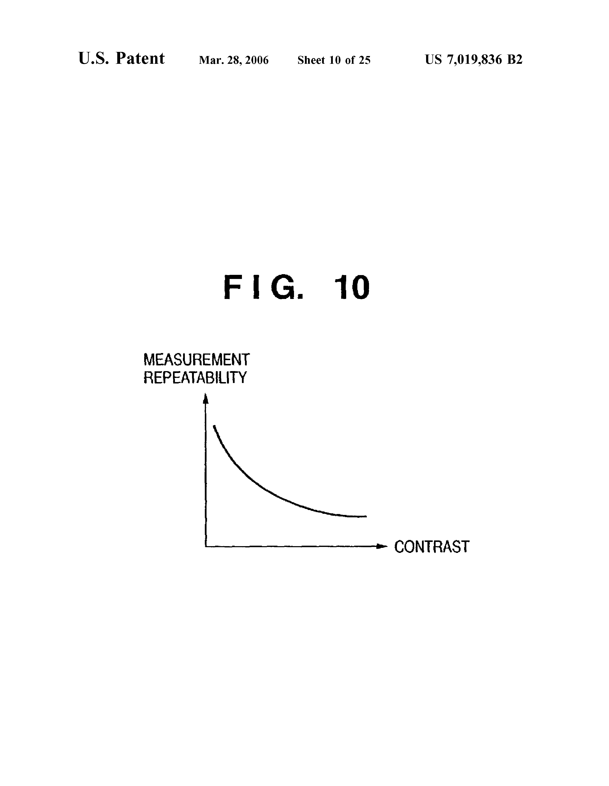
*도 10 — 콘트라스트에 대한 측정 반복 재현성*

도 11은 콘트라스트와 디지털 오차의 관계를 나타내는 그래프이다. 디지털 오차에 관해서는, 신호가 한 화소 안에서 급격히 변하면(콘트라스트가 높아지면) 화소 사이 경계 영역에서 신호의 크기가 커진다. 따라서 콘트라스트가 극단적으로 높아지면 도 11에 도시된 바와 같이 디지털 오차가 증가한다.

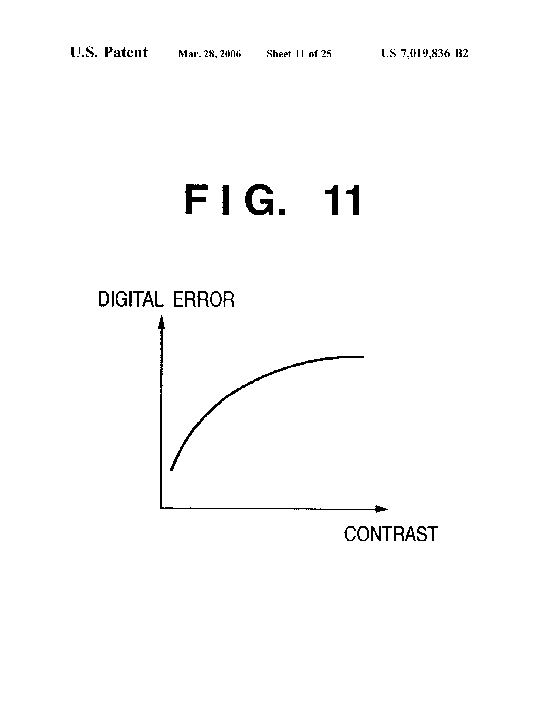
*도 11 — 콘트라스트에 대한 디지털 오차*

다시 말해 마크의 반복 재현성과 디지털 오차는 콘트라스트에 대해 측정 정밀도가 서로 반대가 되는 방향으로 작용한다.

따라서 최적 얼라인 마크나 조명 모드는 마크 위치의 측정 반복 재현성(마크 간격 반복 재현성)과 디지털 오차의 발생량 둘 다를 고려하여 선택해야 한다.

위와 같이 마크 간격의 반복 재현성, 디지털 오차 등의 성능은 CCD 카메라처럼 얼라인 마크(AM)를 상으로 검출하는 대상에 한정되지 않는다.

예컨대 슬릿 모양 조명 빔을 주사하고 얼라인 마크(AM)로부터의 산란광과 회절광으로 마크의 위치를 검출하는 레이저 빔 주사형 얼라인먼트 검출계에도 적용할 수 있다. 레이저 빔 주사를 수행할 때는 CCD 카메라의 화소 크기가 샘플링 시간에 해당한다. 마크 간격을 어떤 마크의 검출 시점에서 다른 마크의 검출 시점까지의 시간으로 평가하면 본 발명과 비슷한 효과를 얻을 수 있음이 명백할 것이다.

또한 위 실시예에서는 웨이퍼 위의 얼라인 마크(AM)를 검출하는 얼라인먼트 검출계를 설명하였다. 그러나 본 발명은 이에 한정되지 않는다. 예컨대 본 발명은 명백히, 레티클을 정렬하는 얼라인먼트 검출계(도 4의 11로 표시된 계에 해당)와, 레티클(2)과 투영 광학계(3)를 거쳐 레티클(2)과 웨이퍼 위의 각 마크를 동시에 보는 이른바 TTR-AA(Through the Reticle-Auto Alignment) 방식의 얼라인먼트 검출계(도시하지 않음)에도 적용할 수 있다.

실제 공정 웨이퍼의 얼라인 마크 최적화(원문 "optimization fo")와 최적 조명 모드를 선택하는 방법을 도 12와 도 13을 참조하여 설명한다.

도 12를 참조하면, 웨이퍼 공정이 시작되면 웨이퍼의 거친 정렬(기계적 사전 정렬)이 수행된다(단계 S12). 이 거친 정렬은 나중에 실행할 미세 정렬(이른바 글로벌 얼라인먼트)에 충분한 정밀도로 수행된다. 미세 정렬에서는 얼라인먼트 검출계와 웨이퍼 스테이지의 간섭계로 웨이퍼의 샷 배열을 측정하고, 샷(칩)의 배열 정보를 계산한다(단계 S13).

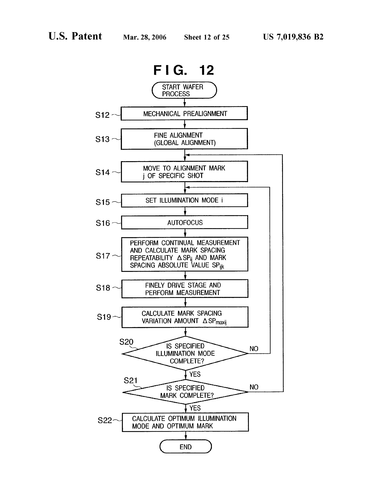
*도 12 — 최적 얼라인 마크와 조명 모드를 선택하는 절차(S12~S22)*

그 후 미리 설정된 특정 샷의 제1 얼라인 마크(j=1)를 얼라인먼트 검출 위치로 구동한다(단계 S14). 이 구동은 얻어진 샷 배열 정보를 바탕으로 수행된다.

얼라인먼트 검출계는 제1 조명 모드(i=1; 조명 σ와 사용 파장)를 설정한다(단계 S115(원문 그대로; 도 12의 S15)). 사용자는 사용할 조명 모드의 종류 수와 얼라인 마크의 종류 수를 미리 설정할 수 있다. 이 설정에서 제1 얼라인 마크는 제1 조명 모드에서 측정되도록 배정된다.

제1 얼라인 마크를 제1 조명 모드로 관찰하면서, 이어서 웨이퍼의 Z 방향 측정(초점 측정)을 수행한다. 얼라인먼트 검출계의 최적 초점 위치를 계산한 뒤 웨이퍼를 그 위치로 구동한다(단계 S16). 이 자동 초점은 신호 파형의 미분값과, 얼라인 마크 검출 신호 파형의 콘트라스트가 최대가 되는 위치에 초점을 두고 측정된다. 위의 처리로 제1 얼라인 마크를 제1 조명 모드에서 높은 콘트라스트 단계(원문 "stage")로 측정할 수 있다.

다음으로, 제1 얼라인 마크의 상을 광전 변환하여 얻은 검출 신호를 여러 번 수신한다. 매번의 검출 신호로부터 마크 간격을 계산하고, 측정값들로부터 반복 재현성 ΔSP_ij(i=1, j=1)와 마크 간격의 절대값 SP_ijk(i=1, j=1, k=1)를 계산한다(단계 S17). 마크 간격 반복 재현성은 통계적 3σ 또는 범위로 평가할 수 있다. 마크 간격의 절대값 SP_ijk는 여러 번 수신한 측정값의 평균값으로 정한다. 측정 횟수는 사용자가 미리 설정하거나 장치 고유의 횟수일 수 있다.

상태를 미세 구동한 뒤, 단계 S17과 같은 방식으로 마크 간격의 절대값 SP_ijk(i=1, j=1, k=2)를 계산한다(단계 S18).

이때 측정 반복 재현성은 계산할 수도 있고 계산하지 않을 수도 있다. 측정 반복 재현성을 계산하지 않으면, 단계 S17에서 계산한 마크 간격 반복 재현성을 제1 조명 모드에서 제1 얼라인 마크의 반복 재현성으로 정한다. 계산하면, 측정 반복 재현성 값들의 평균값을 제1 조명 모드에서 제1 얼라인 마크의 반복 재현성으로 쓸 수 있다. 즉 ΔSP_ij = ΣΔSP_ijk/k(max)이며, k(max)는 스테이지 구동 횟수이다.

스테이지 미세 구동과 마크 간격 변동의 계산 과정(단계 S17 내지 S19)을 도 13을 참조하여 상세히 설명한다.

도 13을 참조하면, 단계 S17에서 측정을 시작한 뒤 광전 변환 소자가 신호를 수신하고 4개 마크 각각의 위치를 계산한다. 이때 위에서 설명한 바와 같이 신호 수신을 여러 번 수행한다(단계 S102). 각 마크 위치에서 마크 간격(SP_ijk; i=1, j=1, k=1)을 계산한 뒤(단계 S1103(원문 그대로; 도 13의 S103)), 웨이퍼 스테이지를 미세 구동한다(단계 S104). 구동량은 설계값으로 미리 정하거나 사용자가 설정할 수 있다. 어느 경우든 구동은 상 분해능보다 작은 양으로 수행하는 것이 바람직하다. 그 후 소정 횟수의 구동 측정이 완료되었는지 판단한다. 완료되지 않았으면 흐름은 단계 S102로 돌아가 마크 간격(SP_ijk; i=1, j=1, k=2 이상)을 계산한다(단계 S105).

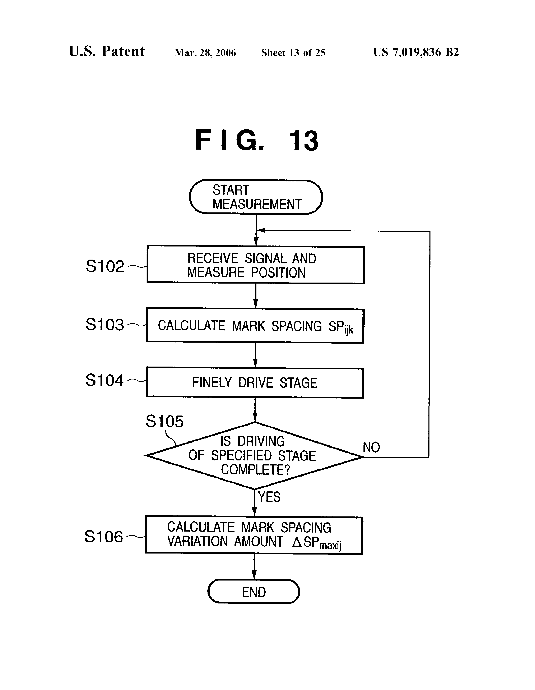
*도 13 — 스테이지를 미세 구동하며 마크 간격 SP_ijk와 변동량 ΔSP_max를 계산하는 절차(S102~S106)*

위와 같이 특정 스테이지 구동 범위 안에서 스테이지를 미세 구동하면서 마크 간격의 변동량 ΔSP_maxij를 계산한다. 스테이지 구동 범위도 사용자가 설정하거나 설계값으로 정할 수 있다. 스테이지를 구동하면서 얻은 마크 간격의 변동량 ΔSP_maxij를 제1 조명 모드에서 제1 얼라인 마크의 값으로 정한다(단계 S106 및 S19). 다시 도 12를 참조하면, 제1 조명 모드에서 제1 얼라인 마크에 대해 마크 간격 반복 재현성 ΔSP_ij(i=1, j=1)와 마크 간격 변동량 ΔSP_maxij(i=1, j=1)의 두 값이 얻어진다.

그 후 지정된 조명 모드에서의 측정이 완료되었는지 판단한다(단계 S20). 완료되지 않았으면 흐름은 단계 S15로 돌아가 조명 모드를 다른 조명 모드로 바꾸고, ΔSP2_j와 ΔSPM2_j를 마찬가지로 계산한다.

지정된 조명 모드에서의 평가가 완료되면, 여러 종류의 얼라인 마크에 대한 평가가 완료되었는지 판단한다(단계 S21). 완료되지 않았으면 스테이지를 다음 얼라인 마크 위치로 구동하고 ΔSP_ij와 ΔSP_maxij를 마찬가지로 계산한다.

위 절차로 여러 얼라인 마크와 조명 모드에 대한 ΔSP_ij와 ΔSP_maxij를 얻을 수 있다. ΔSP_ij와 ΔSP_maxij를 바탕으로 최적 얼라인 마크와 조명 모드(최적 계산)를 계산할 수 있다(단계 S22).

최적 조건을 계산할 때 ΔSP_ij와 ΔSP_maxi(원문 그대로)의 균형을 미리 설정할 수 있다. 예컨대 ΔSP_ij = ΔSP_maxij라는 조건에서 계산하거나, ΔSP_ij 대 ΔSP_maxij의 비(원문 "ration")를 바꿀 수 있다. 요컨대 본 발명은 마크 간격 반복 재현성과 마크 간격 변동을 바탕으로 최적 조건을 계산하는 것을 특징으로 한다. 이 예에서는 마크 간격의 변동량 ΔSP_maxij를 변동량의 범위로부터 계산한다. 본 발명은 이에 한정되지 않는다. 변동량 ΔSP_maxij는 3σ 등으로 평가할 수도 있다.

위와 같이 얻은 최적 얼라인 마크와 최적 조명 모드를 사용하여 통상의 얼라인먼트 동작과 노광을 시작한다.

이 실시예에서는 한 장의 웨이퍼와 특정 샷을 사용하여 평가를 수행하지만, 여러 웨이퍼와 샷을 사용하여 마찬가지로 평가하고 그 평가 결과를 바탕으로 최적 조건을 선택할 수도 있다. 이 측정은 웨이퍼 사이의 공정 편차가 클 때, 그리고 샷 사이의 편차가 클 때 효과적이다. 편차가 크면 특정 웨이퍼와 특정 샷에 대해 최대값을 얻을 수 있더라도 최적 조건이 모든 웨이퍼에 대해 최적은 아니다. 따라서 여러 정보를 이용하면 모든 웨이퍼에 대해 평균적으로 안정한 최적 조건을 계산할 수 있다.

#### 제3 실시예 (Third Embodiment)

다음으로 마크 간격을 이용하는 다른 실시예를 설명한다. 도 14와 도 15는 각각 도 8에서 뽑아낸 얼라인먼트 검출계의 대물 렌즈(405)와 대물 조리개 PL(물체면의 푸리에 변환면; 동공)을 나타낸다. 또한 도 14와 도 15는 웨이퍼(6) 위에 형성된 얼라인 마크(AM1 내지 AM4)와 얼라인 마크로부터의 각 주광선(I1 내지 I4)을 개략적으로 나타낸다. 도 14는 얼라인 마크로부터의 각 주광선(I1 내지 I4)이 서로 평행하고 웨이퍼 면에 수직하게 검출되는 모습(이른바 오프액시스 텔레센트리시티가 양호함)을 나타낸다.

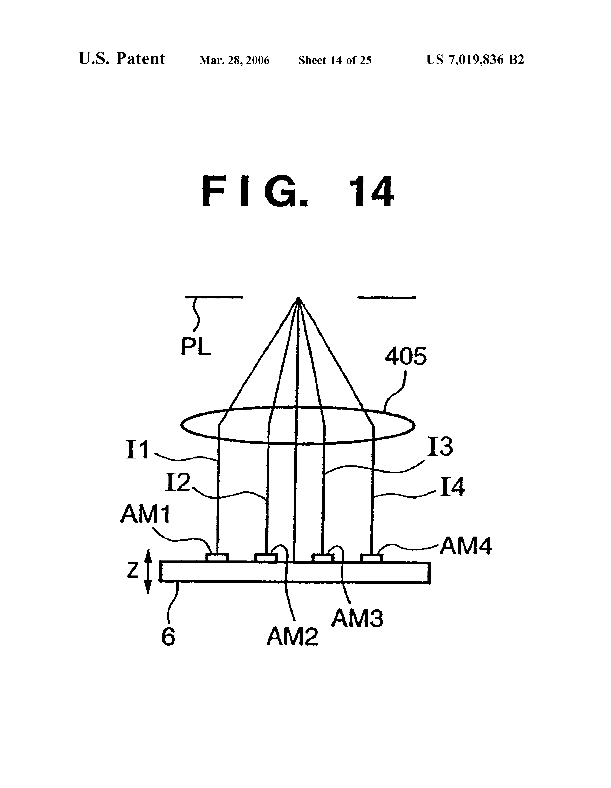
*도 14 — 오프액시스 텔레센트리시티가 양호한 경우: 주광선 I1~I4가 서로 평행하고 웨이퍼에 수직*

도 15는 대물 렌즈(405)의 제조 오차, 조명계(도시하지 않음)의 입사 광축 기울기, 개구 조리개(415)의 초점 방향 Z 위치 어긋남 등으로 오프액시스 텔레센트리시티가 불량한 것을 나타낸다. 이 경우 얼라인 마크로부터의 주광선(I1 내지 I4)은 서로 평행하지 않고 웨이퍼에 수직하지 않다.

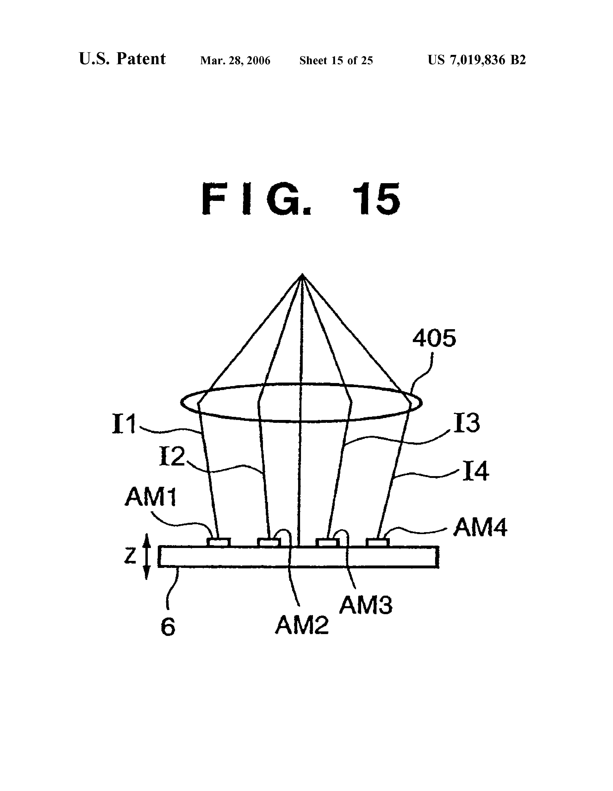
*도 15 — 오프액시스 텔레센트리시티가 불량한 경우: 주광선 I1~I4가 비평행*

이 경우 마크 간격은 초점 방향 Z의 웨이퍼 위치에 따라 변한다. 도 14의 경우에는 웨이퍼가 디포커스 상태여도 마크 간격의 변화가 생기지 않는다. 웨이퍼가 디포커스 상태이고 마크가 측정 방향으로 이동하더라도 마크 간격의 변동은 생기지 않는다(선형성 잔차가 생기지 않는다).

반면 도 15의 경우에는 웨이퍼가 디포커스되면 마크 간격이 변한다. 오프액시스 위치에서 각 주광선의 기울기가 서로 다르므로(상 높이에 따라), 마크를 측정 방향으로 구동하면 마크 간격이 변한다(선형성 잔차가 생긴다).

오프액시스 텔레센트리시티가 불량한 디포커스 상태에서 마크를 측정 방향으로 구동하는 경우의 측정 오차(선형성)를 도 16을 참조하여 설명한다. 오프액시스 텔레센트리시티가 불량한 디포커스 상태는 검출 범위 안에서 왜곡이 생기는 상태, 즉 화각에 따라 검출 범위 안에서 배율이 변하는 상태에 해당한다. 이 경우 도 16에 도시된 바와 같이 마크 측정 방향의 구동 위치를 가로축에, 마크 간격의 변동을 세로축에 플롯하면 마크 간격(원문 "mar spacing")이 좁아지거나 넓어진다. 이러한 변동이 있는 검출계에서는 검출계 안에서 마크가 어디에 있느냐에 따라 4개 마크의 중심 위치에 대한 측정값이 어긋나, 선형 위치의 측정이 불가능해진다(선형성 잔차가 생긴다).

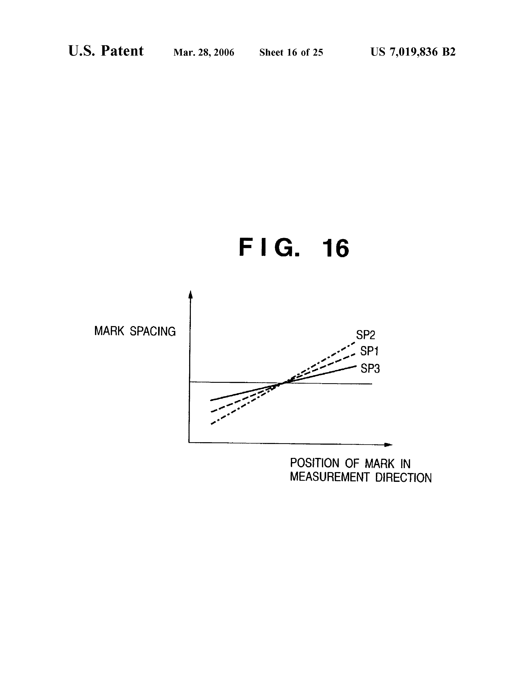
*도 16 — 텔레센트리시티 불량·디포커스 상태에서 측정 방향 마크 위치에 대한 마크 간격의 변화*

이 경우 마크를 검출계에 대해 정확히 이송하지 않으면 잔차만큼 측정 어긋남이 생겨 얼라인먼트 정밀도가 저하된다.

이를 피하기 위해, 마크를 항상 소정의 오프액시스 위치로 이송하여 측정하는 방법(근접 이송 측정)을 쓸 수 있다. 그러나 이 방법은 처리량 감소를 일으켜 장치의 단점이 된다. 따라서 선형성 잔차를 가능한 한 작게 하는 측정이 중요하다.

도 15에 도시된 것과 같은 오프액시스 텔레센트리시티 불량의 한 가지 이유는, 도 17에 도시된 바와 같이 대물 렌즈의 동공에 대해 결상 추적을 수행할 때 동공면에서 구면 수차가 생기는 것이다(동공의 구면 수차가 원인이다). 상 높이들로부터의 평행 주광선은 동공면에 초점을 맺지 않고 구면 수차를 갖는다. 다른 이유로는 예컨대 조명계로서의 동공에 구면 수차가 있는 것과, 동공의 위치가 초점 방향으로 어긋나는 것(개구 조리개(415)의 위치가 초점 방향으로 어긋나는 것)이 있다.

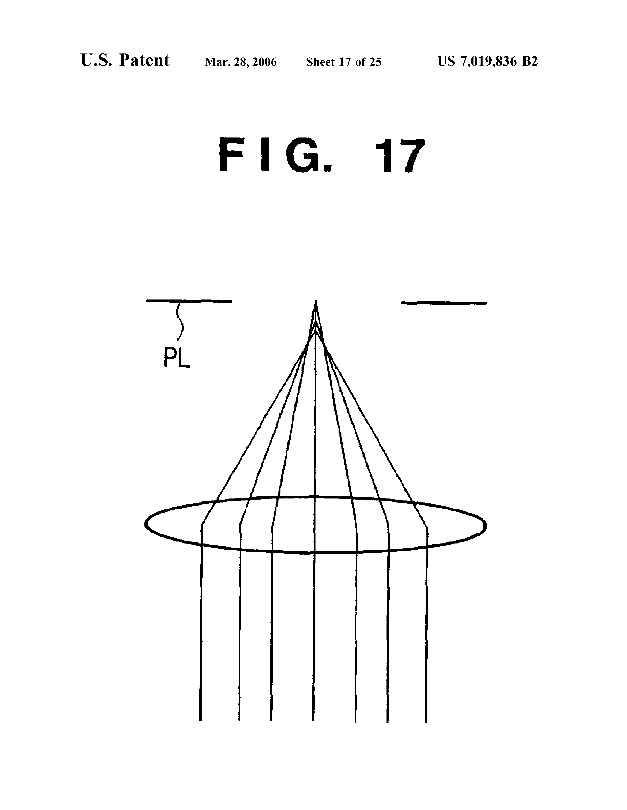
*도 17 — 동공의 구면 수차*

위와 같이 오프액시스 텔레센트리시티가 불량한 검출계에 대해 디포커스 상태에서 얼라인 마크를 측정하면 선형성 잔차가 생겨 얼라인먼트 정밀도가 저하된다. 이 때문에 오프액시스 텔레센트리시티를 측정하고 조정할 필요가 있다.

이는 여러 마크(이 실시예에서는 4개 마크)로 이루어진 얼라인 마크를 사용하여 웨이퍼를 초점 방향 Z로 구동하고 Z 위치마다 마크 간격을 측정하는 것만으로 달성할 수 있다. 그 예를 도 18에 나타낸다. 도 18에는 4개의 주광선(I1 내지 I4)이 모두 각각 기울기를 가지며 서로 평행하지 않은 경우가 나타나 있다. 또한 주광선 12(원문 그대로; I2)의 기울기 양의 절대값은 주광선 13(원문 그대로; I3)의 그것과 다르다. 가로축은 웨이퍼의 Z 위치를, 세로축은 최적 초점 위치의 마크 간격을 기준으로 한 마크 간격의 변화를 나타낸다. 이와 같이 오프액시스 텔레센트리시티가 불량하면 마크 간격은 Z 위치에 따라 변한다. 이렇게 조정된 검출계로 디포커스 위치에서 선형성을 측정하면, 검출계에 대한 마크 위치로부터(원문 "fro") 측정 선형성의 잔차 성분이 생긴다.

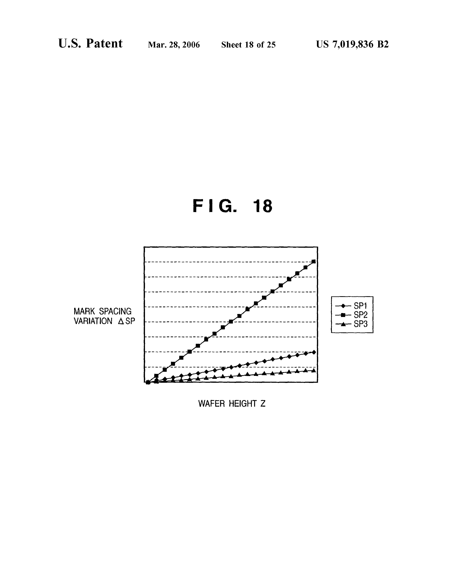
*도 18 — 웨이퍼 높이 Z에 대한 마크 간격 변동 ΔSP(SP1~SP3)*

실제 노광 장치의 얼라인먼트 검출계를 생각해 보자. 실제 공정 웨이퍼의 레지스트 막 두께 편차 때문에 최적 초점 위치는 웨이퍼와 칩에 따라 조금 변할 수 있다. 이 경우 결국 디포커스 상태에서 측정이 수행되므로, 위에서 설명한 것과 같은 오차 성분은 최소화되어야 한다.

도 18에 도시된 바와 같이 웨이퍼를 초점 방향 Z로 흔들면서 마크 간격을 측정하면 오프액시스 텔레센트리시티를 관찰할 수 있다. 얼라인먼트 검출계는 마크 간격의 변동이 생기지 않도록 조정된다.

이를 조정하기 위해 대물 조리개 PL(원문 "object to stop PL")의 위치를 초점 방향 Z나 광축에 수직한 방향 등으로 조정하는 방법을 쓸 수 있다. 조명계에 형성된 개구 조리개(도 8의 개구 조리개(415))의 초점을 조정하거나, 대물 렌즈 자체에 마련된 조정 기구로 동공의 구면 수차를 조정해도 비슷한 효과를 얻을 수 있다. 어느 방법이든 쓸 수 있다. 본 발명은 웨이퍼를 초점 방향 Z로 흔들면서 마크 간격을 측정하는 것을 특징으로 한다.

대물 조리개 PL의 위치를 조정하여 오프액시스 텔레센트리시티를 조정하는 방법을 도 19A 내지 도 19C를 참조하여 설명한다. 이 예에서는 위에서 설명한 동공의 구면 수차가 존재하지 않으며 얇은 광학계를 사용한다. 도 19A는 이상적인 얼라인 마크 위치, 대물 렌즈(405), 대물 조리개 PL의 위치 관계를 나타낸다. 대물 렌즈(405)의 초점 거리를 f라 하자. 대물 조리개 PL이 대물 렌즈로부터 f 거리에 위치하면 모든 화각의 주광선(I1 내지 I4)이 서로 평행하다. 즉 오프액시스 텔레센트리시티가 양호해진다. 그러나 대물 조리개 PL의 위치가 대물 렌즈로부터 f 거리의 위치에서 어긋나면(도 19B 및 도 19C), 주광선(I1' 내지 I4')은 더 이상 서로 평행하지 않다. 즉 오프액시스 텔레센트리시티가 불량하다. 이 경우 얼라인 마크(AM)가 디포커스되면 마크 간격이 변한다. 또한 디포커스 상태에서 선형성을 측정하면 선형성 잔차가 생긴다.

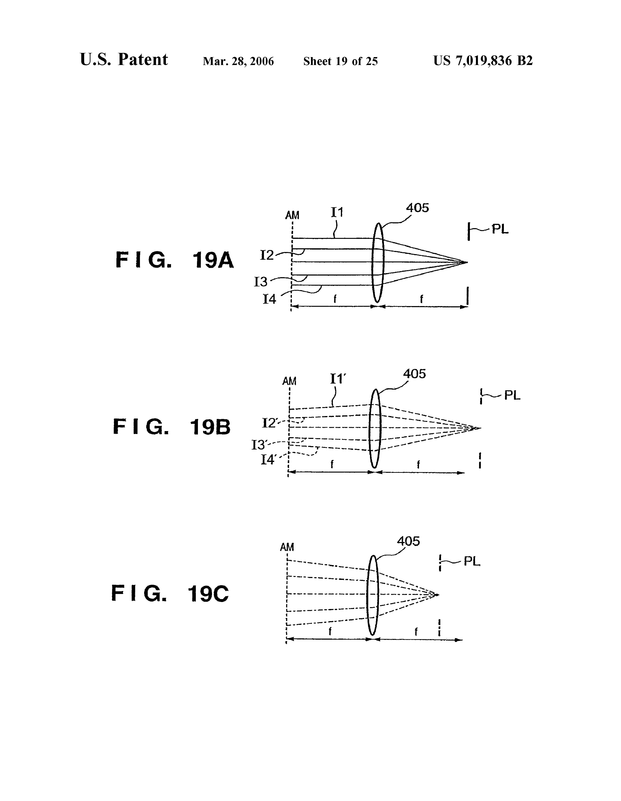
*도 19A~19C — 대물 조리개 PL 위치와 오프액시스 텔레센트리시티의 관계(PL이 초점 거리 f에 있을 때 주광선 평행)*

대물 조리개 PL의 위치는 이상적인 f 위치가 되도록 조정된다. 이때 디포커스 상태에서 마크 간격의 변동(도 18)을 관찰하면 오프액시스 텔레센트리시티를 관찰할 수 있다. 바람직하게는 모든 마크 간격 변동의 기울기를 없애도록 대물 조리개 PL의 위치를 조정한다.

위 설명에서는 대물 조리개 PL을 초점 방향 Z로 조정하는 예를 나타냈다. 그러나 본 발명은 이에 한정되지 않는다. 대물 조리개 PL과 공액인 위치에 배치된 다른 조리개를 초점 방향으로 조정해도 같은 효과를 얻을 수 있다. 더 구체적으로는 도 8에 도시된 회전 개구 조리개(415)를 초점 방향으로 조정해도 같은 효과를 얻을 수 있다.

동공에 구면 수차가 생기는 예를 도 20에 나타낸다.

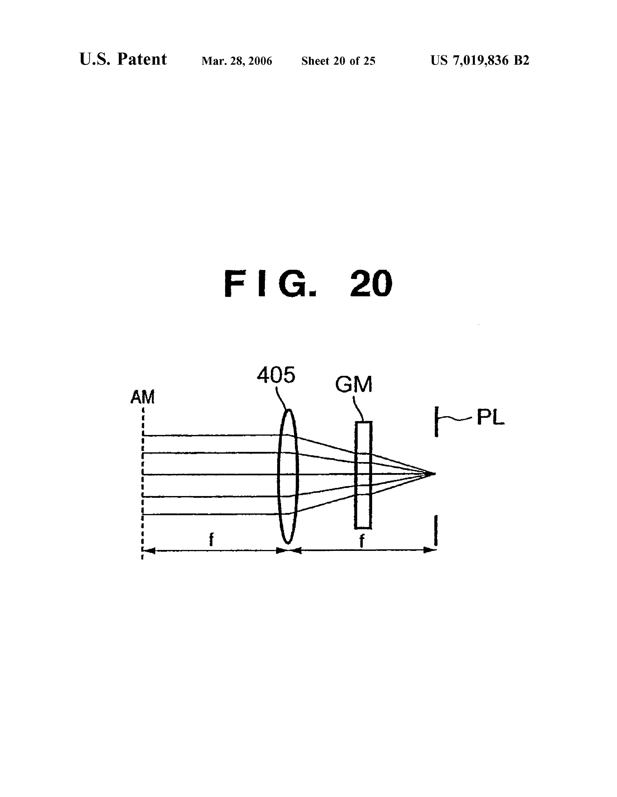
*도 20 — 대물 렌즈(405)와 대물 조리개 PL 사이에 유리 부재 GM을 두어 동공의 구면 수차를 보정하는 예*

이 예에서는 대물 렌즈(405)와 대물 조리개 PL 사이에 유리 부재 GM을 배치한다. 이 유리 부재는 대물 렌즈(405)의 설계값(동공에 구면 수차가 어떻게 생기는지)에 따라 다양한 형태를 취할 수 있다. 유리 부재는 단순한 유리판으로 이루어질 수도 있고, 구면 수차를 보정하기 위해 곡률을 갖는 유리 부재(이른바 렌즈)를 삽입할 수도 있다. 어느 경우든 이러한 광학 부재를 대물 조리개 부근에 둠으로써 구면 수차를 보정할 수 있어, 오프액시스 텔레센트리시티의 보정과 조정이 가능해진다. 실제 조정에서는 마크 간격의 변동량을 관찰하면서 유리판의 두께나 곡률을 바꾼다. 이로써 제조 중에 생기는 동공의 구면 수차를 보정할 수 있다.

위와 같이 얼라인 마크를 초점 방향 Z로 구동하고 각 Z 위치에서 마크 간격을 플롯하면 이른바 오프액시스 텔레센트리시티를 관찰할 수 있다. 오프액시스 텔레센트리시티의 개선(모든 화각의 주광선이 마크에 수직으로 입사)은 선형성 잔차의 발생을 피하여 고정밀 위치 검출을 가능하게 한다.

물론 위에서 설명한 실시예들은 OA 검출계에 한정되지 않는다. 즉 이 실시예들은 투영 광학계를 거쳐 웨이퍼 위의 얼라인 마크(AM)를 관찰하는 얼라인먼트 검출계, 레티클의 위치를 검출하는 얼라인먼트 검출계, 그리고 투영 광학계를 거쳐 레티클과 웨이퍼를 검출하는 TTR-AA 계에 적용할 수 있다.

또한 본 발명은 위와 같은 얼라인먼트 검출계를 반도체 노광 장치와 액정 노광 장치에 적용함으로써 고정밀 위치 검출이 가능한 장치를 제공한다.

#### 반도체 생산 시스템의 실시예 (Embodiment of a Semiconductor Production System)

다음으로 본 발명의 장치를 이용하는 반도체 디바이스(예: IC, LSI 등의 반도체 칩, 액정 패널, CCD, 박막 자기 헤드, 마이크로머신 등) 생산 시스템의 예를 설명한다. 이 시스템은 제조 공장 밖의 컴퓨터 네트워크를 이용하여, 반도체 제조 공장에 설치된 제조 장치에 대한 문제 해결, 정기 유지보수, 소프트웨어 배포와 같은 유지보수 서비스를 수행한다.

도 21은 전체 시스템을 한 각도에서 잘라 본 것이다. 도면에서 부호 101은 반도체 디바이스 제조 장치의 벤더(장치 제조사) 사무소를 나타낸다. 반도체 제조 장치로는 반도체 제조 공장에서 다양한 공정을 수행하는 장치, 예컨대 전공정 장치(예: 노광 장치를 포함하는 리소그래피 장치, 레지스트 처리 장치, 식각 장치, 열처리 장치, 성막 장치, 평탄화 장치 등)와 후공정 장치(예: 조립 장치, 검사 장치 등)가 사용된다. 사무소(101)는 제조 장치용 유지보수 데이터베이스를 제공하는 호스트 관리 시스템(108), 여러 대의 조작 단말 컴퓨터(110), 이들을 연결하여 인트라넷 등을 구축하는 근거리 통신망(LAN)(109)을 갖는다. 호스트 관리 시스템(108)은 LAN(109)과 외부 네트워크인 인터넷(105) 사이의 연결을 위한 게이트웨이와, 외부로부터의 접근을 제한하는 보안 기능을 갖는다.

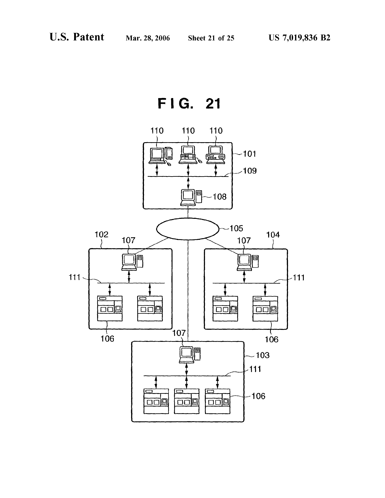
*도 21 — 반도체 디바이스 생산 시스템(벤더 사무소 101, 공장 102~104, 인터넷 105)*

한편 부호 102 내지 104는 제조 장치의 사용자인 반도체 제조사의 제조 공장을 나타낸다. 제조 공장(102 내지 104)은 서로 다른 제조사에 속하거나 같은 제조사에 속할 수 있다(예: 전공정 공장과 후공정 공장). 각 공장(102 내지 104)에는 여러 대의 제조 장치(106), 장치들을 연결하여 인트라넷 등을 구축하는 근거리 통신망(LAN)(111), 각 제조 장치(106)의 가동 상태를 감시하는 감시 장치로서의 호스트 관리 시스템(107)이 마련된다. 각 공장(102 내지 104)에 마련된 호스트 관리 시스템(107)은 LAN(111)과 외부 네트워크인 인터넷(105) 사이의 연결을 위한 게이트웨이를 갖는다. 이 구성에서 각 공장의 LAN(111)으로부터 인터넷(105)을 거쳐 벤더 쪽의 호스트 관리 시스템(108)에 접근할 수 있으며, 호스트 관리 시스템(108)의 보안 기능에 의해 한정된 사용자만 시스템에 접근할 수 있다. 더 구체적으로, 각 제조 장치(106)의 가동 상태를 나타내는 상태 정보(예: 문제가 생긴 제조 장치의 문제)가 인터넷(105)을 거쳐 공장 쪽에서 벤더 쪽으로 통지되고, 그 통지에 대한 응답 정보(예: 문제에 대한 조치를 나타내는 정보, 또는 해결 소프트웨어나 데이터), 최신 소프트웨어, 도움말 정보 등의 유지보수 정보가 인터넷을 거쳐 벤더 쪽에서 수신된다. 각 공장(102 내지 104)과 벤더(101) 사이의 데이터 통신과 각 공장의 LAN(111) 안의 데이터 통신은 일반 통신 프로토콜(TCP/IP)을 사용하여 수행된다. 외부 네트워크로는 인터넷 대신, 외부인의 접근에 대한 보안성이 높은 전용선 네트워크(ISDN 등)를 사용할 수도 있다.

또한 호스트 관리 시스템은 벤더가 제공하는 것에 한정되지 않으며, 사용자가 구축한 데이터베이스를 외부 네트워크 위에 두어 여러 사용자 공장이 그 데이터베이스에 접근하도록 할 수도 있다.

도 22는 본 실시예의 전체 시스템을 도 21과 다른 각도에서 잘라 본 개념도이다. 위 예에서는 각각 제조 장치를 갖는 여러 사용자 공장과 장치 벤더의 관리 시스템이 외부 네트워크로 연결되고, 각 공장의 생산 관리와 적어도 하나의 제조 장치에 관한 정보 전송을 위한 데이터 통신이 수행된다. 이 예에서는 여러 벤더의 제조 장치를 갖는 공장이 외부 네트워크를 거쳐 제조 장치의 각 벤더 관리 시스템과 연결되고, 각 제조 장치의 유지보수 정보 전송을 위한 데이터 통신이 수행된다. 도면에서 부호 201은 제조 장치 사용자(예: 반도체 디바이스 제조사)의 제조 공장을 나타낸다. 공장의 제조 라인에서는 다양한 공정을 수행하는 제조 장치로 노광 장치(202), 레지스트 처리 장치(203), 성막 장치(204)가 사용된다. 도 22에는 제조 공장(201)만 나타냈지만 실제로는 여러 공장이 네트워크를 구성한다. 공장의 각 장치는 LAN(206)으로 서로 연결되어 인트라넷을 구성하며, 호스트 관리 시스템(205)이 제조 라인의 운전 관리를 수행한다.

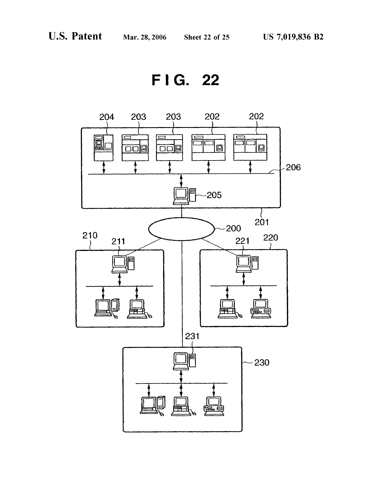
*도 22 — 사용자 공장(201)과 장치 벤더(210·220·230)를 외부 네트워크(200)로 연결한 구성*

한편 벤더(장치 제조사)의 각 사무소, 즉 노광 장치 제조사(210), 레지스트 처리 장치 제조사(220), 성막 장치 제조사(230)는 장치의 원격 유지보수를 위한 호스트 관리 시스템(211, 221, 231)을 가지며, 위에서 설명한 바와 같이 이 시스템들은 유지보수 데이터베이스와 외부 네트워크 연결용 게이트웨이를 갖는다. 사용자 제조 공장의 각 장치를 관리하는 호스트 관리 시스템(205)은 외부 네트워크(200)인 인터넷 또는 전용선 네트워크를 거쳐 각 벤더 관리 시스템(211, 221, 231)과 연결된다. 이 시스템에서 제조 라인의 제조 장치 중 하나에 문제가 생기면 제조 라인의 운전이 정지된다. 그러나 인터넷(200)을 거쳐 장치 벤더로부터 원격 유지보수 서비스를 받아 문제를 신속히 제거할 수 있으므로 제조 라인의 정지를 최소화할 수 있다.

반도체 제조 공장에 설치된 각 제조 장치는 디스플레이, 네트워크 인터페이스, 그리고 메모리에 저장된 네트워크 접속 소프트웨어와 장치 운전 소프트웨어를 실행하는 컴퓨터를 갖는다. 메모리로는 내부 메모리, 하드 디스크 또는 네트워크 파일 서버를 사용할 수 있다. 전용 또는 범용 웹 브라우저를 포함하는 네트워크 접속 소프트웨어는 도 23에 도시된 것과 같은 사용자 인터페이스 화면을 디스플레이에 제공한다. 공장에서 제조 장치를 관리하는 조작자는 화면을 확인하고, 제조 장치의 정보인 기종(301), 일련번호(302), 문제 사례명(303), 문제 발생일(304), 긴급도(305), 문제(306), 조치(307), 진행 상황(308)을 화면의 입력란에 입력한다. 입력된 정보는 인터넷을 거쳐 유지보수 데이터베이스로 전송되고, 그 결과로 적절한 유지보수 정보가 유지보수 데이터베이스로부터 회신되어 디스플레이에 제공된다. 또한 도면의 웹이 제공하는 사용자 인터페이스와 조작자 접근은(원문 문장 그대로) 각 항목의 더 상세한 정보이며, 벤더가 제공하는 소프트웨어 라이브러리에서 제조 장치에 사용할 최신 버전 소프트웨어를 내려받고, 조작자 참고용 운전 안내(도움말 정보)를 내려받는다. 유지보수 데이터베이스가 제공하는 유지보수 정보에는 위에서 설명한 본 발명에 관한 정보가 포함되며, 소프트웨어 라이브러리는 본 발명을 실현하는 최신 버전 소프트웨어를 제공한다.

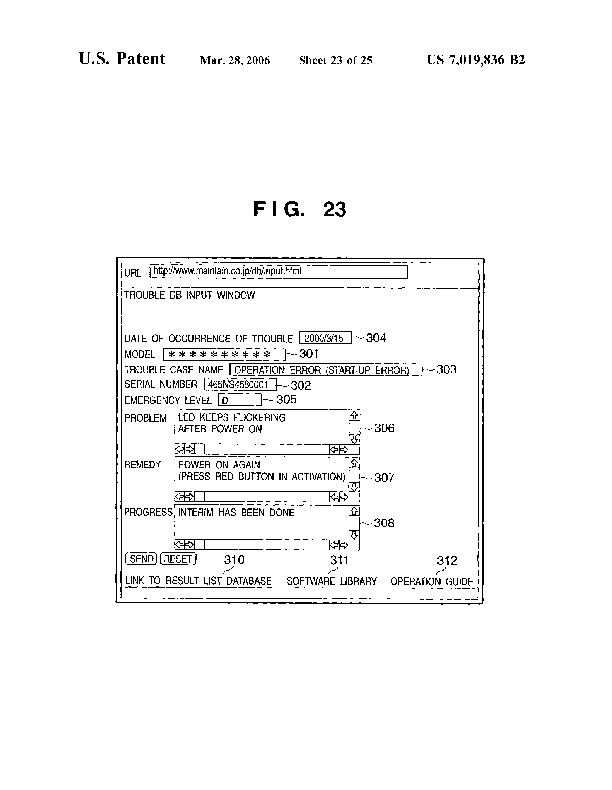
*도 23 — 문제 DB 입력 창(사용자 인터페이스)의 예*

다음으로 위에서 설명한 생산 시스템을 이용하는 반도체 디바이스 제조 공정을 설명한다. 도 24는 반도체 제조 공정 전체의 흐름을 나타낸다. 단계 S201(회로 설계)에서 반도체 디바이스의 회로 설계를 수행한다. 단계 S202(마스크 제작)에서 설계한 회로 패턴이 형성된 마스크를 제작한다. 한편 단계 S203(웨이퍼 제조)에서 실리콘 등을 사용하여 웨이퍼를 제조한다. 전공정이라 불리는 단계 S204(웨이퍼 공정)에서는 위의 마스크와 웨이퍼를 사용한다. 리소그래피로 웨이퍼 위에 실제 회로를 형성한다. 후공정이라 불리는 단계 S205(조립)에서는 단계 S204의 웨이퍼를 사용하여 반도체 칩을 형성한다. 후공정은 조립 공정(다이싱과 본딩)과 패키징 공정(칩 봉지) 같은 처리를 포함한다. 단계 S206(검사)에서는 단계 S205에서 조립된 반도체 디바이스에 대해 동작 시험과 내구성 시험 같은 검사를 수행한다. 이러한 공정을 거쳐 반도체 디바이스가 완성되고 출하된다(단계 S207). 전공정과 후공정은 전문 공장에서 독립적으로 수행되며, 이 공장들에 대한 유지보수는 위에서 설명한 원격 유지보수 시스템으로 이루어진다. 또한 전공정 공장과 후공정 공장 사이에서 인터넷 또는 전용선 네트워크를 거쳐 생산 관리 및/또는 장치 유지보수를 위한 데이터 통신이 수행된다.

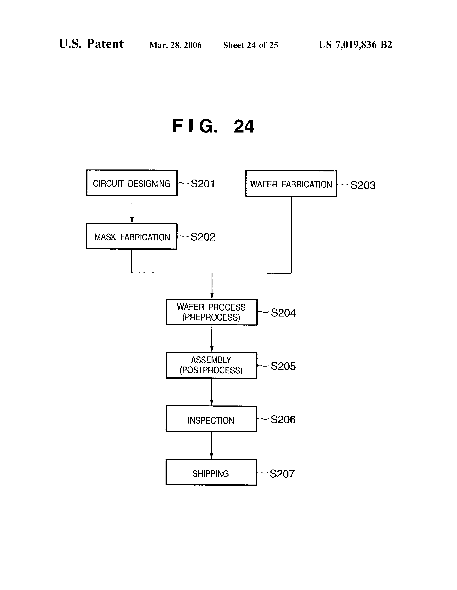
*도 24 — 디바이스 제조 공정 흐름(S201~S207)*

도 25는 웨이퍼 공정의 더 상세한 흐름을 나타낸다. 단계 S211(산화)에서 웨이퍼 표면을 산화한다. 단계 S212(CVD)에서 웨이퍼 표면에 절연막을 형성한다. 단계 S213(전극 형성)에서 증착으로 웨이퍼 위에 전극을 형성한다. 단계 S214(이온 주입)에서 웨이퍼에 이온을 주입한다. 단계 S215(레지스트 처리)에서 웨이퍼에 포토레지스트를 도포한다. 단계 S216(노광)에서 위에서 설명한 노광 장치가 마스크의 회로 패턴(원문 "patter")을 웨이퍼 위에 노광 전사한다. 단계 S217(현상)에서 노광된 웨이퍼를 현상한다. 단계 S218(식각)에서 레지스트 상 이외의 부분을 식각한다. 단계 S219(레지스트 박리)에서 식각 후 불필요해진 레지스트를 제거한다. 단계 S220에서 노광이 완료되었는지 판단한다. 완료되지 않았으면 흐름은 단계 S211, S212, S213 또는 S214로 돌아간다. 이 단계들을 반복하여 웨이퍼 위에 여러 회로 패턴이 형성된다. 각 단계에서 쓰이는 제조 장치에 대해 위에서 설명한 원격 유지보수 시스템으로 유지보수를 수행하므로 문제가 예방되고, 문제가 생기더라도 신속히 복구할 수 있다. 종래 기술과 비교하여 반도체 디바이스의 생산성을 향상시킬 수 있다.

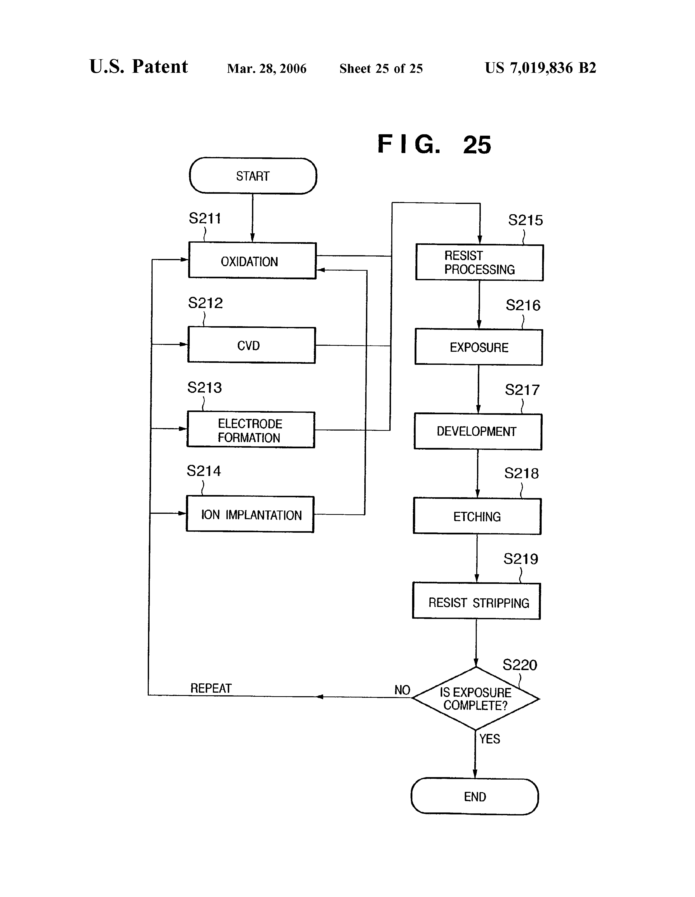
*도 25 — 웨이퍼 공정 흐름(S211~S220)*

본 발명은 위의 실시예에 한정되지 않으며, 본 발명의 정신과 범위 안에서 다양한 변경과 수정이 가능하다. 따라서 이하 발명(원문 그대로)의 범위를 공중에 알리기 위해 다음 청구항을 둔다.

### 정정 증명서 (CERTIFICATE OF CORRECTION)

미국 특허상표청 정정 증명서. 특허 번호 7,019,836 B2, 출원 번호 10/231279, 일자 2006년 3월 28일, 발명자 Kazuhiko Mishima.

위에 표시한 특허에 오류가 있으며 해당 특허증을 아래와 같이 정정함을 증명한다:

- 표지: 항목 "(56) 인용 문헌"의 "외국 특허 문헌"에서 "JP 08339951 A * 12/1996"은 -- JP 08-339951 A * 12/1996 --로 읽어야 한다.
- 1단: 53행 "is"는 -- has --로 읽어야 한다.
- 2단: 51행 "on 6 the"는 -- on the --로 읽어야 한다.
- 3단: 16행 "te"는 -- the --로 읽어야 한다.
- 6단: 43행 "comprises"는 -- comprised --로, 60행 "illumination a"는 -- illumination σ --로 읽어야 한다.
- 8단: 1행 "ships"는 -- chips --로 읽어야 한다.
- 11단: 6행 "fo"는 -- for --로, 25행 "S115)."는 -- S15). --로 읽어야 한다.
- 12단: 7행 "(step S1103),"은 -- (step S103), --으로, 44행 "ΔSP_maxi"는 -- ΔSP_maxij --로, 46행 "ration"은 -- ratio --로 읽어야 한다.
- 13단: 1행 "is averagely"는 -- is on average --로, 48행 "mar"는 -- mark --로 읽어야 한다.
- 14단: 30행 "fro"는 -- from --으로 읽어야 한다.
- 17단: 19행 "maker 220, a"는 -- maker 220, and a --로, 51행 "downloads"는 -- download of --로, 54행 "downloads"는 -- download of --로 읽어야 한다.
- 18단: 27행 "patter"는 -- pattern --으로, 51행 "relatively"는 -- relative --로, 66행 "at"은 -- arranged at --로 읽어야 한다.
- 19단: 8행 "relatively"는 -- relative --로 읽어야 한다.
- 20단: 9행 "relatively"는 -- relative --로 읽어야 한다.

2007년 5월 29일 서명 날인. JON W. DUDAS, 미국 특허상표청장.
