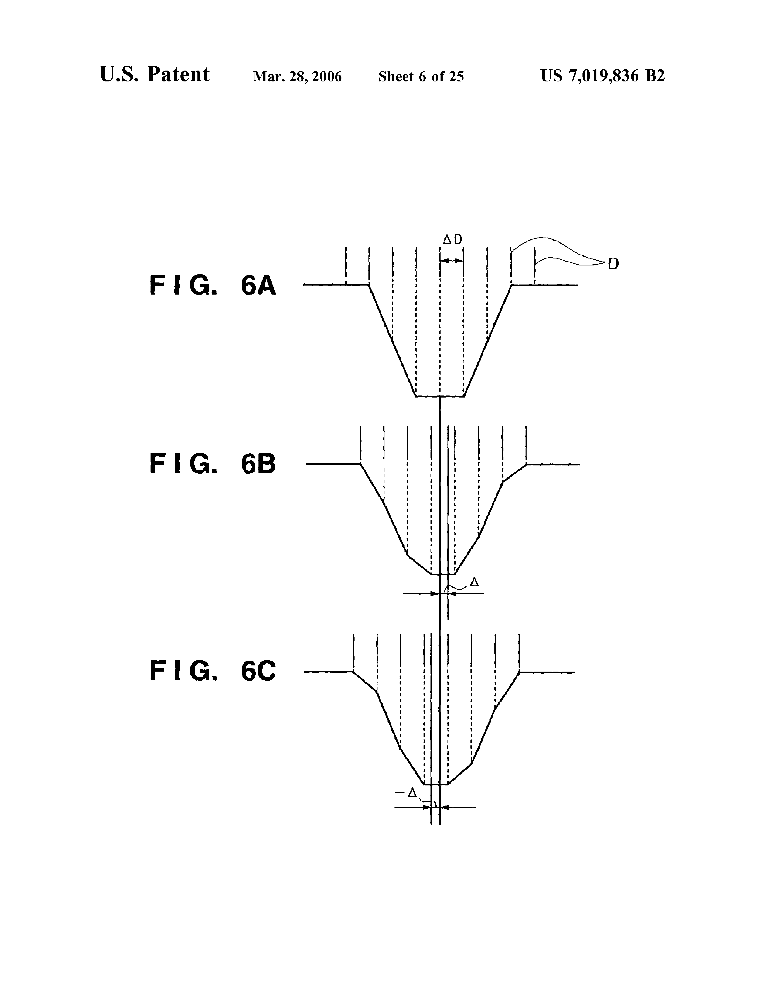
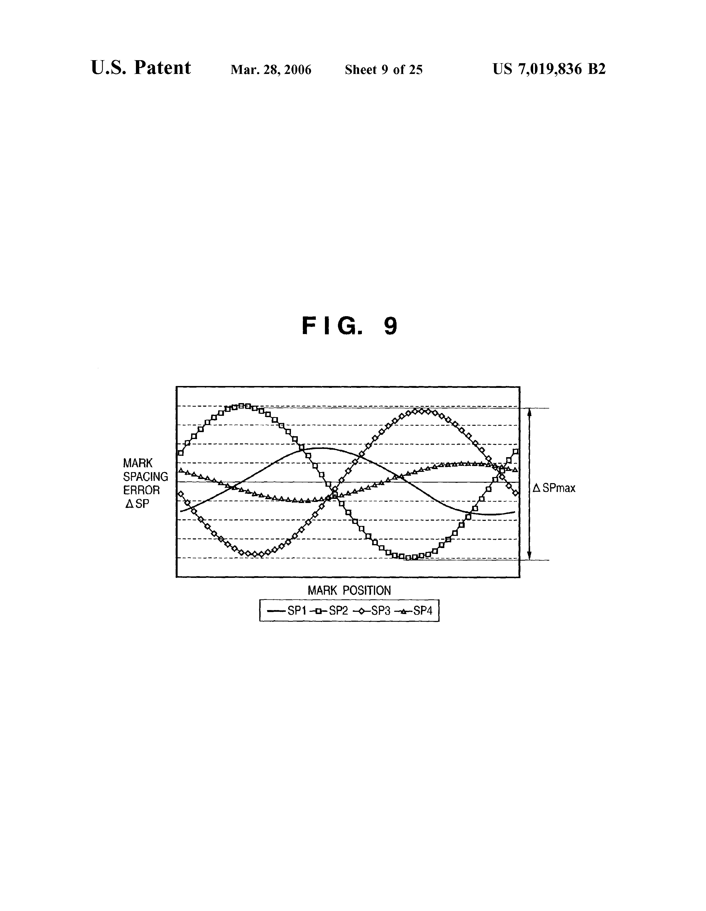
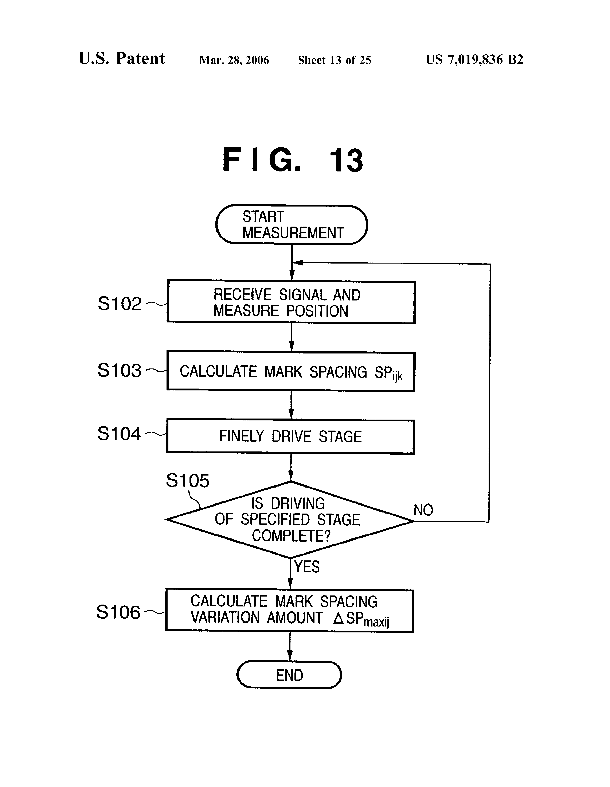

# US7019836B2 — 위치 검출 방법 및 장치, 노광 방법 및 장치 (Canon)

| 항목 | 내용 |
|---|---|
| 원문 | `US7019836.pdf`(등록, 2006-03-28) · `US20030053057.pdf`(공개, 2003-03-20) |
| 출원인 | Canon Kabushiki Kaisha (발명자 Kazuhiko Mishima) |
| 우선일 | 2001-09-03 (JP 2001-266440) |
| 핵심 | 한 마크 안의 여러 줄(M1~M4) 사이 **간격**은 스테이지가 흔들려도 변하지 않는 기준이다. 이 간격을 반복 측정해 검출계의 순수 반복 재현성을 재고, 스테이지를 **상 분해능보다 작은 양**씩 미세 구동하며 간격의 주기적 변동(ΔSP_max)으로 화소 양자화에 의한 "디지털 오차"를 잰다. 두 값으로 최적 마크·조명 모드를 고르고, 웨이퍼를 초점 방향으로 흔들며 간격 변화로 디포커스 때 배율·왜곡 변화(오프액시스 텔레센트리시티)를 찾아 조정한다. |
| 관련도 | ◎ 문제를 직접 해결하는 구성 (부화소 주기 편향을 외부 기준 없이 재는 방법) |
| 해결 P# | **P2**(디지털 오차 = pixel-locking 측정), **P4**(조명·콘트라스트 선택, 디포커스 왜곡), **P6**(측정계 자체 성능 평가) |
| 본 과제와의 관계 | QR 판의 점 사이 거리는 판이 강체이므로 일정하다. 판을 0.05 mm(0.71 px)씩 옮긴 1014 Y 단독 80장은 이 특허의 "미세 구동"과 같은 실험이며, 점 간격의 주기 성분이 곧 측정기의 부화소 편향이다. 등록 청구항은 디포커스 텔레센트리시티 조정만 다루고, 디지털 오차 평가·조명 선택은 실시예에만 있다. |
| 링크 | [Google Patents](https://patents.google.com/patent/US7019836B2/en) |

---

## 상세 요약 (번역본 기준)

### 1. 해결하려는 문제
- 얼라인먼트 검출계 성능을 스테이지 위 마크의 연속 측정 반복 재현성(3σ 또는 범위)으로 평가하면 **스테이지·간섭계 자체의 흔들림**(공기 요동, 간섭계 요동)이 섞여 검출계 순수 성능을 알 수 없음.
- 마크를 측정 방향으로 움직이면 측정값이 직선에서 벗어나는 "선형성 잔차"가 생기는데 원인이 특정되지 않았고 조정법도 없음.
- 그 한 원인이 **디지털 오차**: 마크 위치가 한 화소 안에서 바뀌면 측정값이 주기적으로 어긋남(도 6: 1/4 화소 어긋난 두 경우가 서로 반대 방향으로 Δ만큼 오차).
- 조명 모드를 신호 콘트라스트만으로 고르면 최종 얼라인먼트 정밀도와 어긋날 수 있음.
- 레지스트 두께 편차로 실제로는 디포커스 상태에서 측정하게 되며, 이때 텔레센트리시티가 나쁘면 위치마다 배율이 달라 선형성 잔차가 생김.

### 2. 핵심 구성
| 구성 | 부호 | 위치·역할 |
|---|---|---|
| OA 검출계 | 4 | 투영 광학계와 별도인 오프액시스 얼라인먼트 스코프 |
| 회전 개구 조리개 | 415 (415-a~f) | σ1·중간 σ·작은 σ·4중극·링 조명 1·2를 바꿔 끼움 → 조명 모드 가변 |
| 대물 렌즈 / 대물 조리개 | 405 / PL | PL이 초점 거리 f에 있으면 주광선 평행(텔레센트리시티 양호) |
| 광전 변환 소자 | 411 | CCD 카메라. 화소 = 샘플링 점 D, 간격 ΔD |
| 얼라인 마크 | AM (M1~M4) | 4줄 마크, 간격 SP1~SP4 (2줄 이상이면 같은 효과) |
| 유리 부재 | GM | 대물 렌즈와 PL 사이에서 동공 구면 수차 보정 |

- 정의: 마크 간격 반복 재현성 ΔSP_ij(정지 상태 연속 측정의 3σ 또는 범위), 마크 간격 변동량 ΔSP_maxij(미세 구동 중 간격의 범위 또는 3σ). i = 조명 모드, j = 마크 종류, k = 구동 횟수.
- 근거: 마크 간격은 수 μm~수십 μm라 측정 중 열 팽창을 무시할 수 있고, 스테이지 간섭계 오차가 들어가지 않음.

### 3. 동작 순서 (도 12, 도 13)
1. S12 기계적 사전 정렬 → S13 글로벌 얼라인먼트로 샷 배열 계산.
2. S14 특정 샷의 제1 얼라인 마크를 검출 위치로 구동.
3. S15 제1 조명 모드(σ, 파장) 설정 → S16 콘트라스트 최대 위치로 자동 초점.
4. S17(=S102~S103) 신호를 여러 번 받아 4줄 위치와 간격 SP_ijk 계산 → 반복 재현성 ΔSP_ij, 절대값(평균) 계산.
5. S104 웨이퍼 스테이지를 **상 분해능보다 작은 양**으로 미세 구동 → S105 소정 횟수까지 반복 → S106·S19 간격 변동량 ΔSP_maxij.
   - 반복 재현성을 매 위치에서 구하면 ΔSP_ij = ΣΔSP_ijk / k(max).
6. S20 다음 조명 모드, S21 다음 마크 종류로 반복.
7. S22 ΔSP_ij와 ΔSP_maxij의 균형(예: 같은 가중, 또는 비율 변경)으로 최적 마크·조명 모드 결정 → 통상 얼라인먼트·노광.
- 웨이퍼 간·샷 간 편차가 크면 여러 웨이퍼·샷으로 평가해 평균적으로 안정한 조건을 고름.
- 제3 실시예: 웨이퍼를 Z로 흔들며 Z마다 간격 측정(도 18) → 간격이 Z에 따라 변하지 않도록 PL 위치(또는 조리개 415, 유리 부재 GM)를 조정.

### 4. 청구항 요지
- 청구항 1(방법): 물체 위 복수 얼라인 마크를 검출계에 대해 **초점 방향**으로 상대 이동 → 여러 상대 위치에서 마크 간격과 그 변동량 계산 → 변동량으로 검출계의 **오프액시스 텔레센트리시티 조정**.
- 청구항 2·3: 조정 부재는 물체에 대해 대략 푸리에 변환 위치(동공)에 있는 조정 가능한 부재·광학 부재.
- 청구항 4(노광 장치), 6(노광 방법): 청구항 1과 같은 단계를 노광 정렬에 적용. 청구항 5: 디바이스 제조 방법.
- 총 6항. 디지털 오차 측정과 조명 모드 선택(제1·2 실시예)은 청구항에 들어가지 않았음. 2007-05-29 정정 증명서로 오기 20여 곳 정정.

### 5. 대표 도면

*도 6A~6C — 화소(샘플링 점 D)에 대해 마크가 1/4 화소 어긋나면 측정값이 반대 방향으로 Δ만큼 어긋남(디지털 오차의 원리)*

*도 9 — 마크 위치에 대한 마크 간격 오차 ΔSP(SP1~SP4)의 주기적 변동과 ΔSPmax*

*도 13 — 스테이지를 미세 구동하며 간격 SP와 변동량 ΔSPmax를 구하는 흐름*

### 6. 본 과제(Y·Θ 얼라인먼트)와 비교
- 같은 점:
  - 측정 대상이 화소 안 부화소 위치이고, 화소 양자화로 측정값이 **화소 주기로 흔들리는 계통 오차**(논문 결과서 P2의 pixel/peak-locking)를 다룸.
  - 여러 점(마크 줄)의 상대 위치를 쓰므로 스테이지 자체의 오차와 분리 가능 — 본 과제의 QR 판도 점 간 거리가 일정한 강체.
- 다른 점:
  - 1차원 줄 마크·현미경 정렬계(화소 분해능 약 0.1 μm 이하)이며, QR 2차원 구조점이나 회전(Θ)은 다루지 않음.
  - 목적이 측정기 평가·조건 선택이고, 측정값을 보정하는 식은 없음.
- 본 과제에서 할 일 (논문 결과서 4장 연결):
  - **P2-3 실영상 편향 검증**: 1014 Y 단독 80장(0.05 mm = 0.71 px 간격)은 이 특허의 "상 분해능보다 작은 미세 구동"과 같다. 판 이동 잔차 대신, 이 특허처럼 **점 쌍 간격**(같은 QR 안·QR 사이)의 변동을 부화소 위치에 대해 그리면 스테이지 오차 없이 편향만 남는다. 주기 1 px 성분 진폭 ≤ 0.005 px 기준을 그대로 적용.
  - **P2-1 편향 곡선**: 합성 이동 실험에서도 개별 점 위치 대신 간격 ΔSP의 범위(ΔSP_max)를 측정기별 지표로 함께 보고.
  - **P4-3 조명 내성**: 콘트라스트를 높이면 반복 재현성은 좋아지고(도 10) 디지털 오차는 커진다(도 11). gain·offset 변경 시험에서 점 잡음과 편향을 **함께** 보고 한쪽만으로 판단하지 않음.
  - **P6-1 품질 게이트**: 정지 상태 반복 촬영의 점 간격 3σ(ΔSP_ij)를 "측정계 자체 상태" 지표로 게이트에 추가할 수 있음(스테이지·로봇 흔들림과 분리).
  - P4-4 렌즈 왜곡: 이 특허의 텔레센트리시티 문제는 "위치에 따라 배율이 달라지는 왜곡"과 같은 꼴이며, 간격 변화로 관찰한다는 점에서 점 간격을 화면 위치별로 비교하는 왜곡 점검에 참고.
