# 위치 검출 방법 (US7265841B2)
- 원제: Position detecting method
- 원문: 같은 폴더의 PDF(`US7265841.pdf` 등록본, `US20040257573.pdf` 공개본), https://patents.google.com/patent/US7265841B2/en
- 번역 기준: USPTO 등록 PDF 스캔 본문을 직접 읽어 옮김 (Google Patents 접근 제한). 수식은 원문 표기를 텍스트로 옮겼고, 원문의 오기(예: 수학식 2의 "Xb 1(n)", 수학식 8의 "Xy", 수학식 9의 "Rx·Ry", "X4(i)")는 고치지 않음.
- 도면: 원문 PDF 도면 시트 17장을 도면/ 폴더에 넣고 본문에서 처음 설명되는 곳에 삽입함

## 요약

피검출 물체 위에 형성된 얼라인 마크의 상(image)의 위치를 산출하는 방법은, 검출 신호에 기초하여 얼라인 마크의 중심 위치를 나타내는 제1 정보를 얻는 단계, 검출 신호의 파형 특성을 제2 정보로서 얻는 단계, 및 얻어진 제2 정보에 기초하여 제1 정보를 보정하는 단계를 포함하며, 그리고 얼라인 마크를 검출하는 광학계에서 비롯되는 얼라인 마크의 중심 위치의 측정 오차를 포함한다.

## 청구범위

청구하는 것은 다음과 같다.

1. 레티클의 패턴을 플레이트 위에 노광하는 노광 방법으로서, 상기 노광 방법은,

상기 플레이트 위의 복수의 쇼트 중에서 쇼트를 선택하는 단계;

얼라인먼트 검출 광학계를 이용하여 선택된 쇼트 내 얼라인 마크의 마크 상을 촬영하는 단계;

상기 마크 상의 위치를 산출하는 단계;

상기 마크 상의 콘트라스트를 얻는 단계;

보정식에 기초하여 상기 얼라인 마크의 위치를 결정하는 단계,

결정된 상기 얼라인 마크의 위치에 기초하여 상기 플레이트를 정렬하는 단계; 및

정렬된 플레이트 위에 상기 레티클의 패턴을 노광하는 단계를 포함하며,

상기 보정식은 Mi=M1i−a·Ei를 만족하고(meet), 여기서 i는 선택된 쇼트이고, M1i는 상기 마크 상의 산출된 위치이며, Ei는 상기 마크 상의 얻어진 콘트라스트이고, a는 보정 계수인, 노광 방법.

2. 레티클의 패턴을 플레이트 위에 노광하는 노광 방법으로서, 상기 노광 방법은,

상기 플레이트 위의 복수의 쇼트 중에서 쇼트를 선택하는 단계;

얼라인먼트 검출 광학계를 이용하여 선택된 쇼트 내 얼라인 마크의 마크 상을 촬영하는 단계;

상기 마크 상의 위치를 산출하는 단계;

상기 마크 상의 평가값을 얻는 단계;

얻어진 평가값을 이용하여 상기 마크 상의 산출된 위치를 보정함으로써 상기 얼라인 마크의 위치를 결정하는 단계;

결정된 상기 얼라인 마크의 위치에 기초하여 상기 플레이트를 정렬하는 단계; 및

정렬된 플레이트 위에 상기 레티클의 패턴을 노광하는 단계를 포함하며,

상기 얻는 단계는 제1 측정 조건 하에서 상기 얼라인먼트 검출 광학계를 이용하여 상기 마크 상을 촬영하고, 상기 산출하는 단계는 상기 제1 측정 조건과 다른 제2 측정 조건 하에서 상기 얼라인먼트 검출 광학계를 이용하여 상기 마크 상을 촬영하는, 노광 방법.

3. 제2항에 있어서, 상기 제1 및 제2 측정 조건 사이의 차이는 상기 얼라인먼트 검출 광학계의 코히런스 팩터(σ)에 있는, 노광 방법.

4. 제2항에 있어서, 상기 제1 측정 조건은 상기 얼라인먼트 검출 광학계의 조명 조건이 단일 파장을 사용하는 것이고, 반면 상기 제2 측정 조건은 상기 얼라인먼트 검출 광학계의 조명 조건이 광대역 광을 사용하는 것인, 노광 방법.

## 상세한 설명

### 위치 검출 방법 (POSITION DETECTING METHOD)

본 출원은 2003년 6월 18일 출원된 일본 특허출원 제2003-174081호에 기초한 외국 우선권의 이익을 주장하며, 그 전체 내용은 본 명세서에 완전히 기재된 것처럼 참조로 포함된다.

### 발명의 배경 (BACKGROUND OF THE INVENTION)

본 발명은 위치 검출 방법에 관한 것으로, 보다 구체적으로는 반도체 노광 장치에서 웨이퍼의 얼라인먼트에 사용되는 위치 검출 방법에 관한 것이다. 본 발명은, 예를 들어, IC 및 LSI와 같은 반도체 칩, 액정 패널과 같은 표시 디바이스, 자기 헤드와 같은 감지 디바이스, 및 CCD와 같은 촬상 디바이스를 포함하는 다양한 디바이스를 제조하는 데 사용되는 위치 검출 방법에 적합하다.

최근의 고성능이면서 저렴한 전자 기기는 그 안에 탑재되는 반도체를 보다 경제적이고 정밀하게 제조할 것을 필요로 하며, 감광성 재료(이하 "레지스트"라 함)가 도포된 웨이퍼 및 유리판(이하 통틀어 "웨이퍼"라 함) 위에 레티클 또는 마스크(이하 통틀어 "레티클"이라 함)의 회로 패턴을 전사하는 공정에서 반도체 회로 패턴을 노광하는 노광 장치가 정밀도와 효율을 가질 것을 요구한다. 일반적으로, 회로 패턴의 정밀한 노광은 레티클과 웨이퍼 사이의 정밀한 얼라인먼트를 필요로 한다.

종래의 얼라인먼트 방법은 레티클 위의 회로 패턴을 노광할 때 동시에 웨이퍼 위에 얼라인 마크를 노광하고, 얼라인먼트 검출 광학계를 이용하여 모든 쇼트에 대해 얼라인 마크들 중 미리 설정된 복수의 얼라인 마크의 위치를 순차적으로 측정한다. 위치 측정 결과를 통계 처리하여 전체 쇼트 배열을 산출한 후, 그 산출 결과에 기초하여 웨이퍼를 레티클에 대해 위치 결정한다.

얼라인 마크는 레티클과 웨이퍼를 고정밀도로 정렬하기 위한 지표이다. 미세한 회로 패턴은 레티클과 웨이퍼 사이의 정밀한 얼라인먼트를 필요로 하며, 필요한 정밀도는 회로 임계 치수의 약 ⅓, 예를 들어 현재의 설계 폭 180 nm의 ⅓인 60 nm이다. 최근 도입된 화학적 기계적 연마("CMP") 공정과 같은 특수한 반도체 제조 기술은 웨이퍼 사이 및 쇼트 사이에서 얼라인 마크 형상의 산포를 일으키고, 얼라인먼트 정밀도를 저하시킨다. 조명 광학계의 경사 오차 및 코마와 같이 장치의 성능에서 비롯되는 다른 요인들도 얼라인먼트 정밀도를 저하시킨다. 이 경우, 얼라인 마크와 회로 패턴 모두에 적합한 조건을 설정하기 위해 장치에서 프로세스 조건이 달라진다. 노광 평가를 위해 서로 다른 폭을 갖는 복수 종류의 얼라인 마크가 만들어지고, 어떤 프로세스 조건에 대해 가장 높은 정밀도를 제공할 것으로 여겨지는 어떤(certain is) 얼라인 마크가 선택된다.

위치 검출 방법에 관한 종래 기술로는, 예를 들어, 일본 특허출원 공개 제05-062879호 및 제09-186222호가 있다.

반도체 디바이스 제조 공정의 최적 조건은 수작업으로 산출되며 긴 시간을 필요로 한다. 파라미터가 결정된 후에도, 프로세스 오차가 발생하면 제조 공정을 수작업으로 다시 산출하고 변경할 필요가 있다. 이 수정 역시 긴 시간을 필요로 한다. 따라서 종래의 얼라인먼트 공정은 극히 긴 시간을 필요로 하여 반도체 디바이스 제조의 수율을 떨어뜨린다.

회로 패턴의 더 미세한 가공이 요구되고, 새로운 반도체 공정이 도입되며, 웨이퍼 직경이 예를 들어 300 mm로 커질 것으로 예측된다. 따라서 수율 문제에 더하여, 웨이퍼 전체 면에 걸쳐 회로 패턴과 얼라인 마크를 결함 없이 정밀하게 제조하는 것이 점점 더 어려워질 것이다.

### 발명의 간단한 요약 (BRIEF SUMMARY OF THE INVENTION)

따라서, 본 발명의 예시적인 목적은 얼라인 마크의 형상이 산포하는 경우에도 정밀도를 유지하고 수율을 향상시키는 위치 검출 방법을 제공하는 것이다.

피검출 물체 위에 형성된 얼라인 마크의 상(image)의 위치를 산출하는 방법은, 검출 신호에 기초하여 얼라인 마크의 중심 위치를 나타내는 제1 정보를 얻는 단계, 검출 신호의 파형 특성을 제2 정보로서 얻는 단계, 및 얻어진 제2 정보에 기초하여 제1 정보를 보정하는 단계를 포함하며, 그리고 얼라인 마크를 검출하는 광학계에서 비롯되는 얼라인 마크의 중심 위치의 측정 오차를 포함한다.

본 발명의 다른 목적 및 추가 특징은 첨부 도면을 참조한 이하의 실시예 설명으로부터 쉽게 명백해질 것이다.

### 도면의 간단한 설명 (BRIEF DESCRIPTION OF THE DRAWINGS)

도 1은 본 발명에 따른 일 실시예의 발명적 위치 검출 방법을 이용하는 노광 장치의 개략도이다.

도 2는 얼라인먼트 검출 광학계의 개략 단면도이다.

도 3은 도 2에 도시된 얼라인먼트 검출 광학계에 의해 측정되는 얼라인 마크의 일례를 나타내는 개략 평면도이다.

도 4는 도 3에 도시된 것과 다른 얼라인 마크의 다른 예를 나타내는 평면도이다.

도 5는 도 1에 도시된 얼라인먼트 검출 광학계에 의해 측정된 얼라인먼트 신호의 일례를 나타내는 그래프이다.

도 6은 도 3에 도시된 얼라인 마크에서 위치 중심을 측정하기 위한 템플릿 매칭 방법에 의해 얻어진 그래프이다.

도 7은 도 1에 도시된 노광 장치의 웨이퍼 스테이지 위의 xy 좌표계에서 웨이퍼 위 쇼트 배열의 오프셋을 나타내는 개략도이다.

도 8은 좌표 변환과 보정 잔차 사이의 관계를 나타내는 개략도이다.

도 9는 얼라인 마크를 나타내는 개략 단면도이다.

도 10은 도 9에 도시된 얼라인 마크의 단차 의존성을 나타내는 그래프이다.

도 11은 마크 상 콘트라스트와 측정 오차 사이의 관계를 나타내는 그래프이다.

도 12는 얼라인먼트 측정값과 중첩 검사 장치에 의해 측정된 값 사이의 측정 오차 관계를 나타내는 개략도이다.

도 13은 트릭(trick) 성분과 파형 평가값 사이의 관계를 나타내는 그래프이다.

도 14는 얼라인먼트 시퀀스의 흐름도이다.

도 15는 도 5에 도시된 마크 상에서 신호의 일부를 확대한 그래프로, 좌측 절반 신호를 접은(folding) 템플릿을 나타낸다.

도 16은 비대칭 마크의 계산 모델을 나타내는 개략 단면도이다.

도 17은 본 발명에 따른 제2 실시예의 파형 평가값의 그래프이다.

도 18은 본 발명에 따른 제2 실시예의 측정 오차와 파형 평가값 사이의 관계를 나타내는 그래프이다.

도 19는 도 2에 도시된 얼라인먼트 검출 광학계의 변형예를 나타내는 개략 단면도이다.

도 20은 본 발명에 따른 제3 실시예의 측정 오차와 파형 평가값 사이의 관계를 나타내는 그래프이다.

도 21은 레지스트로 덮인 하지 마크(primary mark)의 예를 나타내는 개략도이다.

도 22는 도 21에 도시된 얼라인 마크 상의 변화를 계산하여 얻은 그래프이다.

도 23은 본 발명에 따른 제4 실시예의 측정 오차와 파형 평가값 사이의 관계를 나타내는 그래프이다.

도 24는 디바이스(IC, LSI 등과 같은 반도체 칩, LCD, CCD 등)를 제조하는 방법을 설명하기 위한 흐름도이다.

도 25는 도 24에 도시된 웨이퍼 프로세스의 단계 4에 대한 상세 흐름도이다.

### 바람직한 실시예의 상세한 설명 (DETAILED DESCRIPTION OF THE PREFERRED EMBODIMENTS)

이제 첨부 도면을 참조하여 발명적 위치 검출 방법을 설명한다. 각 도면에서 같은 요소는 같은 참조 부호로 표시하고, 그 설명은 생략한다. 도 1은 발명적 위치 검출 방법을 이용하는 노광 장치(10)의 개략도이다.

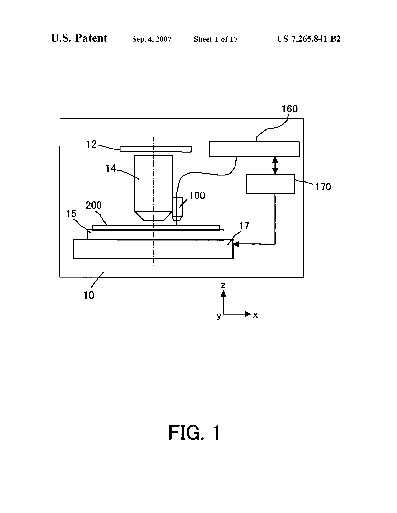
*도 1 — 발명적 위치 검출 방법을 이용하는 노광 장치(10)*

노광 장치(10)는 조명 광학계(도시되지 않음)를 이용하여 레티클(12)을 조명하고, 레티클(12)로부터의 회절광을 투영 광학계(14)를 통해 웨이퍼 스테이지(17) 위에 놓인 웨이퍼(200) 위로 전사함으로써 웨이퍼(200)를 노광한다. 노광 장치(10)는 소정의 회로 패턴을 형성하는 레티클(12), 레티클(12)을 투영하는 투영 광학계(14), 이전 단계에서 하지 패턴과 얼라인 마크가 형성된 웨이퍼(200), 웨이퍼(200)를 유지하는 웨이퍼 척(15), 웨이퍼 척(15)과 웨이퍼(200)를 소정 위치에 위치시키는 웨이퍼 스테이지(17), 웨이퍼 위 얼라인 마크의 위치를 측정하는 얼라인먼트 검출 광학계(100) 등을 포함한다.

이제 노광 장치(10)에 사용되는 얼라인먼트 검출 광학계(100)의 원리를 설명한다. 도 2는 도 1에 도시된 얼라인먼트 검출 광학계(100)의 개략 단면도를 나타낸다. 도 2는 X 방향의 위치를 검출하기 위한 얼라인먼트 검출 광학계("X 얼라인먼트 검출 광학계")의 실시예를 나타낸다. Y 방향의 위치를 검출하기 위한 얼라인먼트 검출 광학계는 X 얼라인먼트 검출 광학계를 z축을 중심으로 90° 도(degrees) 회전시켜 구성되며, 그 설명은 생략한다.

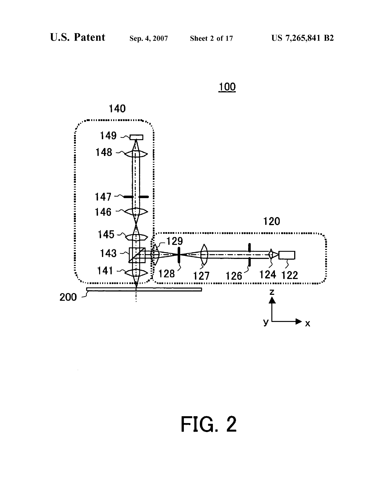
*도 2 — 얼라인먼트 검출 광학계(100): 조명 광학계(120)와 결상계(140), 라인 센서(149)*

얼라인먼트 검출 광학계(100)는 조명 광학계(120)와 결상계(140)를 포함한다. 렌즈(124)는 조명 광학계의 광원(122)으로부터의 조명광을 확대하고 평행광으로 만들며, 렌즈(127)는 그 결과의 광을 다시 집광한다. 가변 개구 조리개(126)는 조명광의 가간섭성 또는 코히런스 팩터(σ)를 조정한다. 개구(128)는 웨이퍼(200)와 공액인 위치에 놓이며, 불필요한 광이 웨이퍼(200) 위 얼라인 마크 주변 영역을 조명하는 것을 막는 시야 조리개로 작용한다. 렌즈(127)에 의해 집광된 광은 렌즈(129)에 의해 다시 평행광이 되고, 빔 스플리터(143)에서 반사되어 렌즈(141)를 통과하고, 웨이퍼(200) 위의 얼라인 마크(210)를 조명한다. 얼라인 마크(210)에서 반사된 광은 렌즈(141), 빔 스플리터(143), 결상계(140)의 렌즈(145, 146, 148)를 통과하여 라인 센서(149)에 수광된다. 가변 개구 조리개(147)는 결상계(140)의 개구수("NA")를 조정할 수 있다. 얼라인 마크(210)는 약 100배의 결상 배율로 확대되면서 라인 센서(149) 위에 결상된다.

얼라인 마크(210)로는 예시적으로 도 3 및 도 4에 도시된 대략 직사각형의 마크를 사용할 수 있다. 여기서, 도 3은 도 2에 도시된 얼라인먼트 검출 광학계(100)에 의해 측정되는 얼라인 마크(210)의 일례를 나타내는 개략 평면도이다. 도 4는 도 3에 도시된 것과 다른 얼라인 마크(210)의 다른 예를 나타내는 개략 평면도이다. 도 3에서, 얼라인 마크(210)는 에칭에 의해 단면 구조가 오목한 형상으로 형성되며, 측정 방향 X로 4 μm, 비측정 방향 Y로 20 μm의 크기를 각각 갖는 직사각형 얼라인 마크(210) 4개가 X 방향으로 20 μm의 피치로 배열된다. 얼라인 마크(210)는 그 표면에 레지스트(도시되지 않음)를 도포한다. 도 4의 얼라인 마크(210a)는 도 3의 마크 요소(210)의 윤곽을 선폭 0.6 μm의 선으로 대체한 것이다. 얼라인 마크(210)와 210a 중 어느 것을 사용하든, 얼라인먼트 검출 광학계(100)에서 NA 밖의 렌즈 가장자리에서 산란광이 발생하고 간섭하기 때문에, 라인 센서(149)는 일반적으로 도 5에 도시된 것과 같은 상을 얻는다. 여기서, 도 5는 도 1에 도시된 얼라인먼트 검출 광학계(100)에 의해 측정된 예시적인 얼라인먼트 신호를 나타내는 그래프이다.

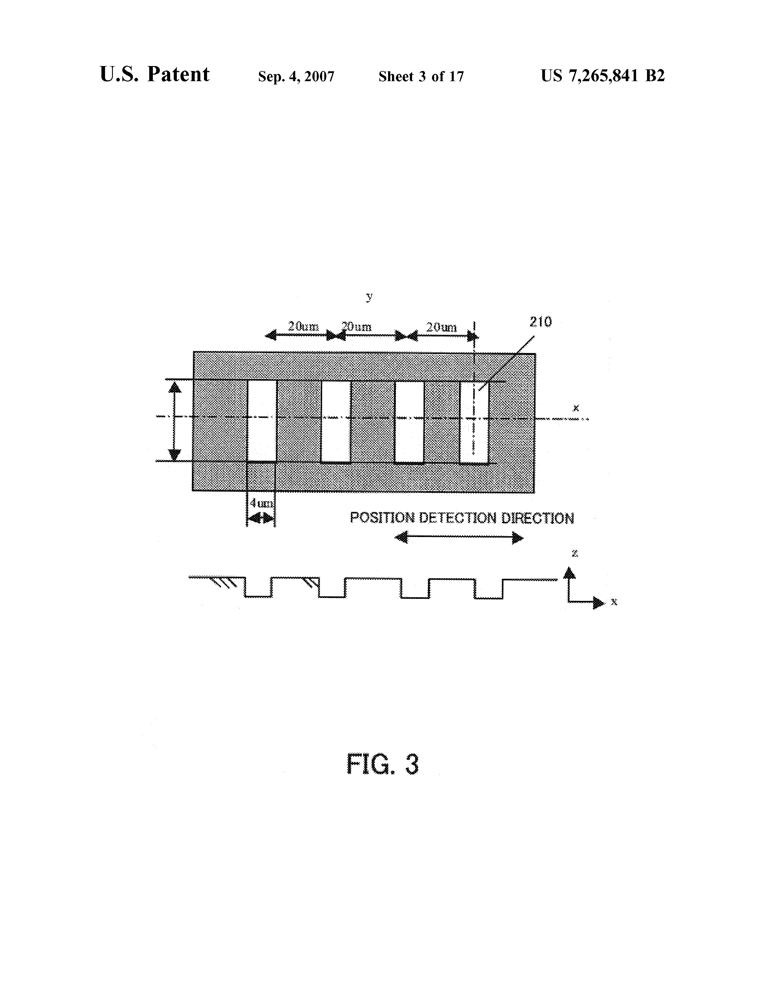
*도 3 — 에칭으로 형성한 4 μm × 20 μm 직사각형 얼라인 마크(210) 4개, 피치 20 μm*

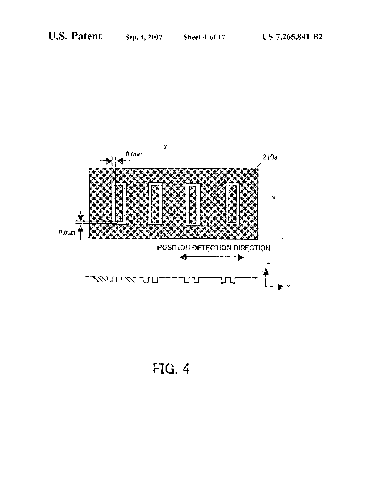
*도 4 — 마크 요소의 윤곽을 선폭 0.6 μm 선으로 바꾼 얼라인 마크(210a)*

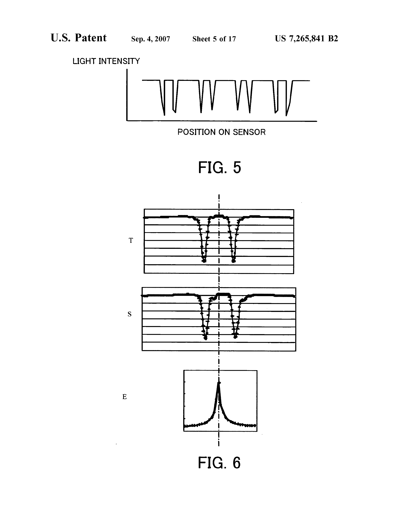
*도 5 — 라인 센서가 얻은 얼라인먼트 신호, 도 6 — 템플릿 매칭으로 얻은 신호(S)·템플릿(T)·상관값(E)*

얼라인먼트 검출 광학계(100)에 의해 촬영된 상은 명시야 상 방식을 사용한다. 얼라인 마크(210)는 어두운 윤곽을 가지며, 얼라인 마크(210a)는 어둡거나 밝은 오목부를 갖는다.

얼라인먼트 신호 처리기(160)는 이와 같이 촬영된 얼라인 마크(210 또는 210a)의 상을 처리한다.

얼라인먼트 신호 처리기(160)에 의한 처리를 설명한다. 본 실시예는 얼라인 마크(210)의 위치를 산출하기 위해 템플릿 매칭을 사용한다. 템플릿 매칭은 얻어진 신호 S를 도 6의 템플릿 T(장치에 저장되어 있음)와 상관시키고, 가장 높은 상관을 갖는 위치를 얼라인 마크의 중심으로 검출한다. 여기서, 도 6은 도 3에 도시된 얼라인 마크(210)의 중심 위치를 템플릿 매칭으로 측정하여 얻은 그래프이다. 도 6에 도시된 상관값 E의 함수를 이용하여 피크 화소로부터 좌우로 수 화소에 이르는 영역에서 무게중심 화소 위치를 산출함으로써 1/10 내지 1/50의 분해능을 얻을 수 있다. 수학식 1은 S가 센서에 의해 얻어진 신호이고 T가 템플릿일 때 상관 결과 E를 결정한다.

E(X) = 1 / Σ_{J=−k}^{k} [S(X+J) − T(J)]²    (1)

도 6은 4개의 얼라인 마크(210) 중 하나에 대한 처리를 나타낸다. 템플릿 매칭은 마찬가지로 상의 위치(positions)를 다른 세 개의 얼라인 마크에 대해 센서 위에서 검출한다. 템플릿 매칭은 마크 상의 위치 X1(n), X2(n), X3(n) 및 X4(i)(화소 단위)를 산출하며, 여기서 "n"은 쇼트 번호이다. 수학식 2는 각 마크 상의 평균 위치 Xa를 결정한다.

Xa(n)=[Xb 1(n)+X2(n)+X3(n)+X4(n)]/4    (2)

수학식 3은 마크 상의 위치 오프셋 Xw(n)을 산출하며, 여기서 Xa는 각 템플릿에 대해 얻어진 웨이퍼 위 마크 상의 평균값이고, M은 얼라인먼트 검출 광학계(100)의 결상 배율이며, Px는 얼라인먼트 측정 방향에서 영역 센서(area sensor)의 화소 피치이다.

Xw(n)=Xa(n)/(Px·M)    (3)

수학식 3에 기초하여, 얼라인먼트 신호 처리기(160)는 라인 센서(149)에 의해 얻어진 마크 상 신호로부터 얼라인 마크의 위치 오프셋 양 Xw를 산출한다.

위 마크에 대한 파형 평가값은 일정한 평가 기준에 기초하여 산출된다. 뒤에서 상세히 설명하는 바와 같이, 얼라인먼트 위치 X는 파형 평가값과 위치 오프셋 양 Xw를 이용하여 최종적으로 결정된다.

이제 얼라인먼트 신호 처리기(160)에 의해 산출된 위치 측정값에 기초한 웨이퍼(200)의 얼라인먼트 방법을 설명한다. 본 발명은 어드밴스드 글로벌 얼라인먼트("AGA")를 채용하는데, 이는 웨이퍼 위 모든 쇼트 또는 칩 중 일부 쇼트(이렇게 선택된 쇼트를 "샘플 쇼트"라 함)를 선택하고, 그 쇼트들에서 얼라인 마크의 위치를 검출한다.

도 7에 도시된 바와 같이, 웨이퍼의 오프셋은 x 방향의 시프트 Sx, y 방향의 시프트 Sy, x축에 대한 경사 θx, y축에 대한 경사 θy, x 방향의 배율 Bx, 및 y 방향의 배율 By를 포함하는 6개의 파라미터로 기술된다. 여기서, 도 7은 도 1에 도시된 노광 장치(10)의 웨이퍼 스테이지 위 xy 좌표계에서 오프셋된 쇼트 배열을 나타내는 개략도이다. Bx 및 By(도시되지 않음)는 노광 장치에서 웨이퍼 스테이지 이송을 기준으로 한 웨이퍼의 팽창과 수축을 나타내며, 반도체 공정에서의 막 형성과 에칭에 의해 발생한다.

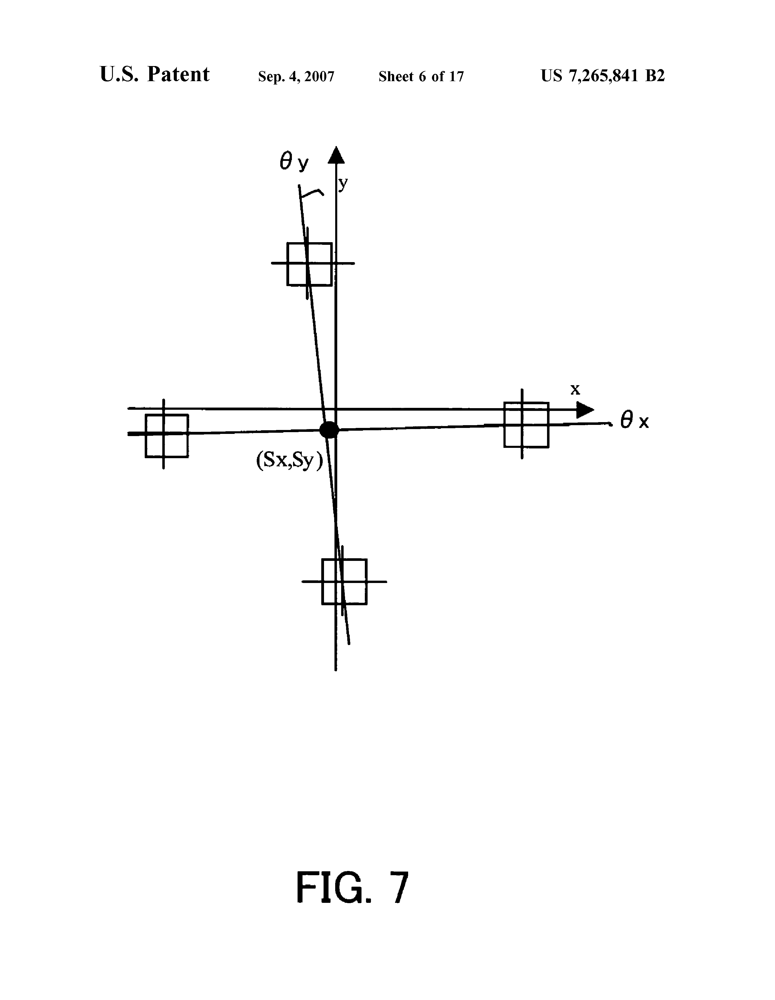
*도 7 — 웨이퍼 스테이지 xy 좌표계에서 쇼트 배열의 오프셋(시프트 Sx·Sy, 경사 θx·θy)*

수학식 4는 위 방법으로 측정된 AGA 샘플 쇼트의 측정값 Ai를 결정한다(여기서 "i"는 측정 쇼트 번호).

Ai = [xi; yi]    (4)

수학식 5는 샘플 쇼트에 대한 얼라인 마크의 설계 위치 좌표 Di를 결정한다.

Di = [Xi; Yi]    (5)

AGA는 웨이퍼의 위치 오프셋을 나타내는 위 6개의 파라미터(Sx, Sy, θx, θy, Bx, By)를 이용하여 다음의 1차 좌표 변환 D'i를 수행한다. 수학식 6은 좌표 변환 D'i를 정의한다.

D'i = [Bx −θy; θx By] Di + [Sx; Sy]    (6)

수학식 6은 θx와 θy가 미소(0)하고 Bx=By1, cos θ=1, sin θ=0, θx·Bx=θx, θy·By=θy 등으로 근사하였다.

도 8에 도시된 바와 같이, 얼라인 마크(210)는 설계 위치 M으로서의 위치 M으로부터 Ai만큼 오프셋된 웨이퍼(12) 위의 위치 W에 위치하며, 좌표 변환 D'i 후 웨이퍼 위 얼라인 마크(210)의 위치 오프셋(또는 잔차) Ri를 일으킨다. 도 8은 좌표 변환 D'i와 보정 잔차 Ri를 개략적으로 나타낸다. 수학식 7은 잔차 Ri를 결정한다.

Ri=(Di+Ai)−Di'    (7)

AGA는 각 샘플 쇼트에 대한 잔차 Ri를 최소화하기 위해 최소제곱법을 적용하며, 즉 잔차 Ri의 평균 제곱합을 최소화하는 (Sx, Sy, θx, θy, Bx, By)를 산출한다. 수학식 8 및 9는 V를 결정한다.

V = (1/n) Σ_{i=1}^{i=n} | [xi; yi] − [Bx−1 −θy; θx By−1] [Xi; Yi] − [Sx; Xy] |²    (8)

[δV/δSx; δV/δSy; δV/δRx; δV/δRy; δV/δBx; δV/δBy] = 0    (9)

AGA 파라미터(Sx, Sy, θx, θy, Bx, By)는 각 샘플 쇼트에 대한 측정값(xi, yi)과 얼라인 마크 설계 위치(Xi, Yi)를 수학식 8 및 9에 대입하여 얻어진다. CPU(170)는 웨이퍼(200) 위 각 쇼트의 얼라인먼트를 위해 AGA 파라미터에 기초하여 웨이퍼 스테이지(17)를 작동시킨다. 그 후 노광이 이어진다.

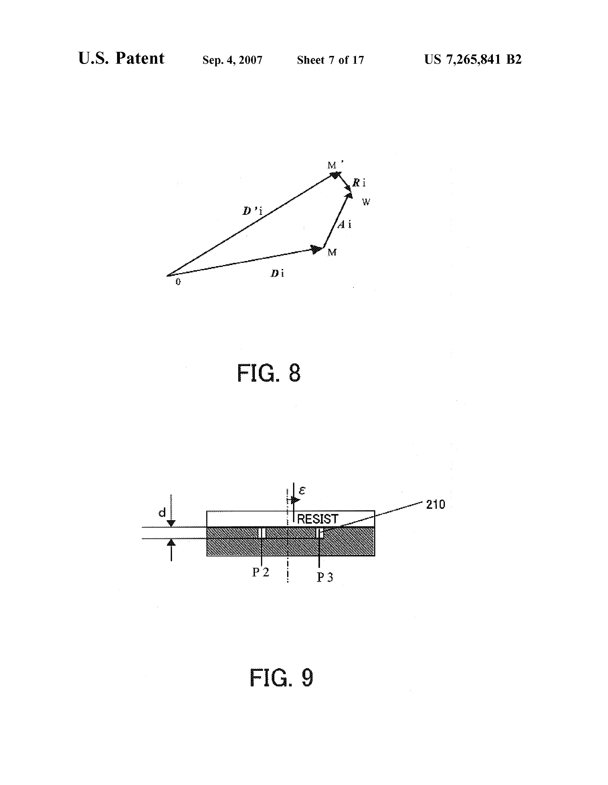
*도 8 — 좌표 변환 D'i와 보정 잔차 Ri, 도 9 — 레지스트로 덮인 얼라인 마크(210)의 단면(단차 d)*

이제 얼라인먼트 검출 광학계(100)가 코마를 갖고 얼라인 마크(210)의 단차가 변할 때 위치 오프셋 측정값과 신호 파형의 변화를 설명한다.

도 10은 도 9의 마크 단차 d가 d=60 nm, 70 nm, 80 nm 및 110 nm일 때 얼라인먼트 신호의 파형을 나타낸다. 여기서, 도 9는 얼라인 마크(210)를 나타내는 개략 단면도이다. 도 10은 얼라인 마크(210)의 단차 의존성을 나타내는 그래프이다. 얼라인먼트 검출 광학계(100)는 NA 0.4, s(σ) 0.9, 원편광, He—Ne 레이저의 파장 633 nm, 코마 0.1 λ를 갖는다. 도 10에 도시된 바와 같이, 신호의 콘트라스트는 마크의 단차에 따라 변한다. 각 단차에 대응하는 마크 상이 계산된다. 위의 템플릿 매칭을 이용한 수학식 3의 계산 결과로서, 도 11에 도시된 바와 같이 신호 콘트라스트와 측정 오차 사이에는 강한 상관이 있다. 여기서, 도 11은 마크 상의 콘트라스트(ILb/ILm)와 측정 오차 사이의 관계를 나타내는 그래프이다. 따라서, 마크 상의 콘트라스트(ILb/ILm)와 측정 오차 사이의 관계가 주어지면, 얼라인(alignment) 마크(210)는, 얼라인먼트 검출 광학계(100)의 수차, 얼라인 마크(210)의 단차 변화, 마크 폭 변화와 같은 비대칭 오차가 있더라도 신호의 콘트라스트를 이용하여 측정값을 보정함으로써 정밀하게 검출된다. 수학식 10은 진짜 위치 오프셋 양 M(도 9에서 P2와 P3 사이 중점의 오프셋 양)을 결정하며, 여기서 M1은 마크 상 위치의 측정값, E는 마크 상의 파형 평가값인 신호 콘트라스트, a는 보정 계수이다.

M=M1−a·E    (10)

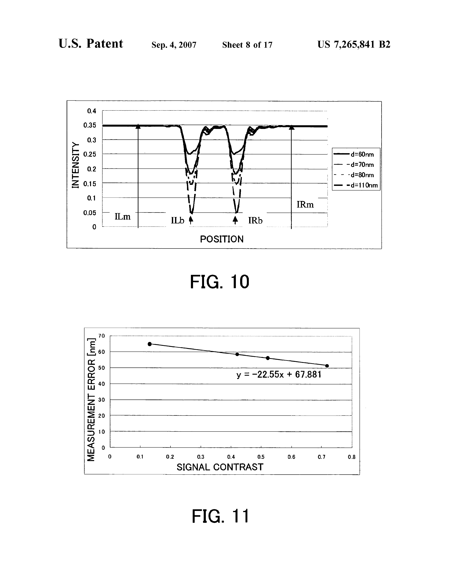
*도 10 — 마크 단차 d=60·70·80·110 nm에서의 얼라인먼트 신호 파형, 도 11 — 신호 콘트라스트와 측정 오차의 관계(근사선 y = −22.55x + 67.881)*

본 실시예는 예시적으로 파형 평가값으로서의 신호 콘트라스트를 ILb/ILm으로 산출하지만, 파형 평가값은 ILb의 강도 또는 좌우 신호의 평균 콘트라스트를 사용할 수 있다.

다음은 보정 계수 a의 산출에 대한 설명이다. 제1 방법은, 위 AGA에서 제1 및 제2 측정 조건으로 샘플 쇼트를 측정하는 단계, 각 쇼트에 대한 측정값과 잔차 Ri를 저장하는 단계, 제1 측정 조건에서 측정된 측정값만을 사용하여 각 샘플 쇼트에 대한 측정값(xi, yi)과 얼라인 마크 설계 위치(Xi, Yi)를 수학식 8 및 9에 대입하여 AGA 파라미터(Sx, Xy, θx, θy, Bx, By)를 산출하는 단계, 및 AGA 파라미터에 기초하여 CPU(170)를 통해 웨이퍼 스테이지(17)를 작동시키는 단계를 이용하여 웨이퍼(200) 위 각 쇼트에 대한 얼라인먼트를 제공한다. 그 후 노광이 이어진다. 도 12에 도시된 바와 같이 웨이퍼(200) 위에 얼라인 마크와 함께 제1 중첩 검사 마크가 형성되고, AGA 얼라인먼트 후 제1 중첩 평가 마크 위의 레지스트에 제2 중첩 검사 마크가 노광된다. 여기서, 도 12는 얼라인먼트 측정값과 중첩 검사 장치에 의해 측정된 값 사이의 측정 오차 관계를 나타내는 개략도이다. 중첩 검사 장치(도시되지 않음)는 AGA 샘플 쇼트에서 제1 및 제2 중첩 평가 마크의 위치 오프셋 양을 측정한다. AGA에 의해 측정된 보정 잔차 Ri(i는 쇼트 번호)는 부호는 반대이지만 중첩 검사 장치에 의해 측정된 측정값 Ki(i는 쇼트 번호)와 일치해야 한다. 그러나 얼라인먼트 검출 광학계가 코마와 같은 비대칭 오차를 포함하면, 이들은 얼라인 마크들 사이의 단차와 마크 폭 변화로부터 생기는 트릭 성분 ei에 따라 달라진다. 트릭 성분 ei는 ei=Ri+Ki(i는 쇼트 번호)로 산출할 수 있다.

다음으로, 트릭 성분 ei와 측정값 M1i 사이의 마크 상 콘트라스트 관계를 얻는다. 도 13은 각 쇼트에 대한 트릭 성분 ei와 파형 평가값 E 사이의 상관도, 및 최소제곱법으로 산출한 근사선이다. 여기서, 도 13은 트릭 성분과 파형 평가값 사이의 관계를 나타내는 그래프이다. 근사선은 파형 평가값 E와 트릭 성분 ei에 기초하여 최소제곱법으로 산출되며, 그 직선의 기울기를 a로 설정한다. 이 방법은 중첩 검사 장치를 이용하여 보정 계수 a의 값을 결정한다. 중첩 검사 장치를 사용하는 대신, 전기 측정이라 불리는 전기 특성을 이용하는 방법 및 측장 SEM을 이용하여 노광된 오프셋 양 Ki를 산출할 수 있다. 도 13은 파형 평가값 E와 트릭 성분 ei 사이의 관계를 선형으로 근사하지만, 그 관계를 표현하는 데 2차 또는 고차 함수를 사용할 수도 있다. 제1 방법은 얼라인먼트 후 노광하고, 중첩 검사 장치와 같은 검사 장치를 이용하여 노광된 웨이퍼를 검출하여 보정 계수 a를 산출하는 방법이다. 또는, 제2 방법은 보정 계수 a의 임의의 값을 설정하고 수학식 10을 이용하여 각 쇼트에 대한 얼라인 마크의 위치 오프셋 양을 설정하는 단계, 이 값들을 수학식 8 및 9에 대입하여 AGA 파라미터(Sx, Xy, θx, θy, Bx, By)를 산출하는 단계, 수학식 7을 이용하여 보정 잔차 Ri와 그 표준편차(s)(또는 최대값)를 산출하는 단계를 이용하여, AGA 잔차 Ri를 최소화하는 보정 계수 a를 산출할 수 있다. 이와 같이, 보정 계수 a의 값을 바꾸어 가며 비슷한 처리를 반복하여 최소 잔차 Ri를 제공하는 값을 얻는다.

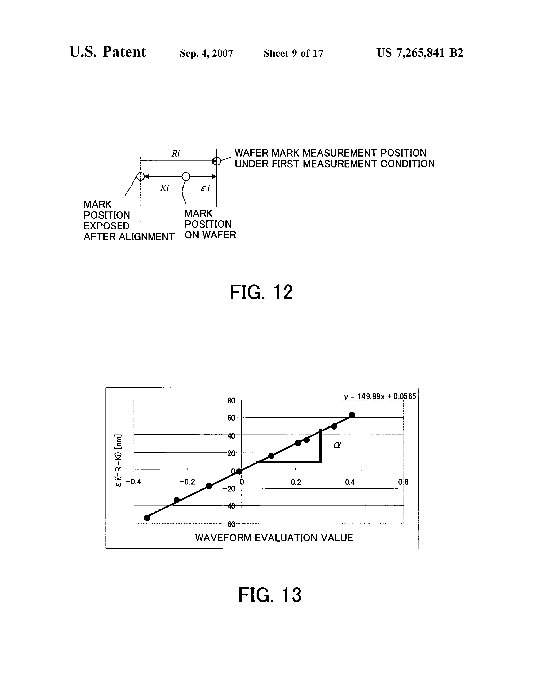
*도 12 — 얼라인먼트 측정값과 중첩 검사 장치 측정값 사이의 측정 오차 관계, 도 13 — 트릭 성분 ei와 파형 평가값 E의 상관과 최소제곱 근사선(기울기 α, y = 149.99x + 0.0565)*

최소 잔차 Ri를 제공하는 조합이 사용되는 이유는, 잔차량이 반도체 공정에 의한 비선형 왜곡과 얼라인먼트 측정 오차(얼라인먼트 정밀도에서 웨이퍼 스테이지 배열 정밀도의 합)의 합이고, 비선형 왜곡 성분은 같은 웨이퍼에서 일정하므로, 잔차가 작을수록 얼라인먼트 측정 정밀도가 높기 때문이다.

보정 계수 a를 결정하는 제3 방법은, 3차원 형상 측정 장치를 이용하여 3차원 형상을 측정해 얼라인 마크의 형상 변화량을 얻는 단계, 얼라인먼트 검출 광학계(100)의 코마와 같은 오차 정보를 입력하는 단계, 시뮬레이션을 통해 마크 상을 계산하는 단계, 및 파형 평가값 E와 측정 오차 e 사이의 관계를 얻는 단계를 포함한다.

보정 계수 a는 반도체 제조 공정에서 로트의 첫 번째 웨이퍼에 대해 중첩 검사 장치와 같은 검사 장치, 및 위 세 가지 방법의 조합을 이용하여 결정된다. 또는, 시뮬레이션이 얼라인 마크 형상의 측정 결과에 기초하여 보정 계수 a를 결정하고, 결정된 a 값 근처에서 잔차 Ri가 최소가 되도록 보정 계수를 미세 조정한다.

도 14에 도시된 흐름도를 참조하여 발명적 얼라인먼트 시퀀스를 설명한다. 여기서, 도 14는 얼라인먼트 시퀀스의 흐름도이다. 단계 50은 웨이퍼(200) 위의 AGA 측정 쇼트를 선택한다. 그런 다음, 단계 51은 위 방법으로 산출된 보정 계수의 값을 설정한다. 그런 다음, 단계 52는 웨이퍼 스테이지(17)에 탑재된 웨이퍼(200) 위 샘플 쇼트의 얼라인 마크(210)를 얼라인먼트 검출 광학계(100) 아래의 제자리에 배치한다. 단계 53은 얼라인먼트 검출 광학계(100)를 통해 얼라인 마크(210)의 상을 얻는다. 단계 54는 얻어진 마크 상으로부터 위치 오프셋 양 M1을 산출하여 노광 장치(10)에 저장한다. 단계 55는 얼라인 마크(210)의 상의 파형 평가값 E를 산출하여 노광 장치(10)에 저장한다. 다음으로, 단계 56은 단계 50에서 설정된 정보에 기초하여 측정할 다른 샘플 쇼트가 있는지 판단한다. 단계 56이 있다고 판단하면, 모든 샘플 쇼트의 측정과 신호 처리를 위해 절차는 단계 52로 돌아간다.

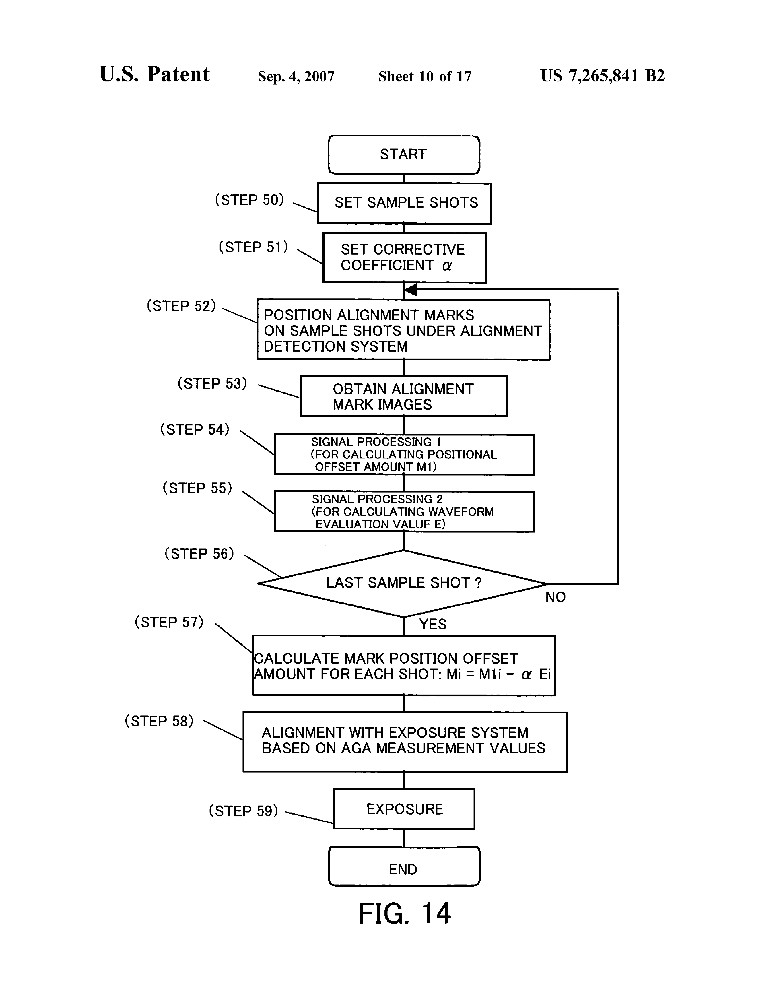
*도 14 — 얼라인먼트 시퀀스 흐름도(단계 50~59)*

단계 57은 Mi=M1i−a·E 식을 이용하여 마크 위치 오프셋 양 Mi(i는 쇼트 번호)를 산출하며, 여기서 M1은 단계 54의 제1 측정값, E는 단계 55의 파형 평가값이다. 노광 장치는 단계 58에서 산출된 AGA 측정값에 기초하여 얼라인먼트를 실행하고, 단계 59는 레티클(12) 위의 패턴을 웨이퍼(200) 위로 노광하여 전사한다.

템플릿 매칭 외에, 마크 상의 위치를 산출하는 처리는 도 15에 도시된 방법을 사용할 수도 있다. 여기서, 도 15는 도 5에 도시된 마크 상에서 신호의 일부를 확대한 그래프로, 좌측 절반 신호를 접은 템플릿을 나타낸다. 수학식 11은 좌측 절반 신호 파형을 템플릿으로 간주할 때의 상관값을 결정한다.

E(x) = 1 / Σ_{J=a}^{b} |S(X−J) − S(X+J)|    (11)

가장 상관이 높은 위치가 얼라인 마크들 사이의 중심으로 검출된다. 상관값 E의 함수를 이용하여 피크 화소로부터 좌우로 수 화소에 이르는 영역에서 무게중심 화소 위치를 산출함으로써 1/10 내지 1/50의 분해능을 얻을 수 있다. 센서 위 각 마크 상의 위치는 다른 세 개의 얼라인 마크에 대해서도 마찬가지로 검출된다. 그런 다음, 수학식 2가 각 마크의 평균 위치 Xa(n)를 결정하고, 수학식 3이 웨이퍼 위 얼라인 마크(30)의 위치 오프셋 Xw(n)을 산출한다.

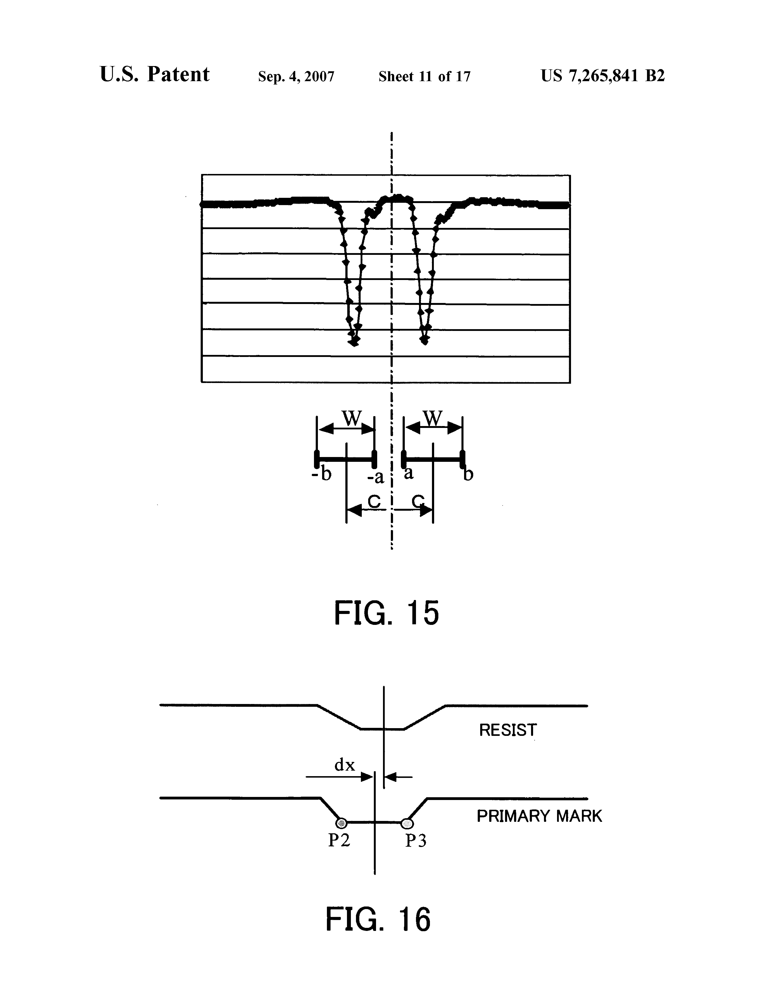
*도 15 — 마크 상 신호 일부 확대(좌측 절반 신호를 접은 템플릿, 폭 W·범위 a~b), 도 16 — 레지스트가 dx만큼 치우친 비대칭 마크의 계산 모델*

이제 본 발명의 제2 실시예를 설명한다. 제1 실시예는 얼라인 마크의 파형 평가값 E와 마크 상의 위치를 얻기 위해 얼라인먼트 검출 광학계(100)를 사용하는 반면, 본 실시예는 파형 평가값과 얼라인 마크 상의 위치를 얻기 위해 얼라인 마크(210)의 형상 변화에 민감한 얼라인먼트 검출 광학계를 사용한다. 보다 구체적으로, 도 2에 도시된 얼라인먼트 검출 광학계(100)에서 가변 개구 조리개(126)를 구동할 때, 파형 평가값을 얻기 위해서는 조명 광학계의 코히런스 팩터(s)를 0.3으로 설정하고, 얼라인 마크 상의 위치를 얻기 위해서는 조명 광학계의 코히런스 팩터(s)를 0.9로 설정한다.

도 16은 비대칭 마크의 계산 모델을 나타내는 개략 단면도이다. 보다 구체적으로, 이는 고르지 않은 도포로 인해 기판 위의 얼라인 마크(또는 하지 마크) 위의 레지스트가 하지 마크 중심으로부터 위치 측정 방향으로 dx만큼 치우친 비대칭 마크의 계산 모델의 개략 단면도이다. 도 17은 본 발명에 따른 제2 실시예의 파형 평가값을 나타내는 그래프로, 레지스트 시프트 양 dx를 dx=0, 0.2 μm 및 0.4 μm로 설정한 것이다. 파형 평가값 산출에 사용되는 얼라인먼트 검출 광학계는 NA 0.4, s 0.3, 원편광, He—Ne 레이저의 파장 633 nm를 갖는다.

도 17을 참조하면, 본 실시예의 파형 평가값 E의 산출 방법은, 먼저 마크의 에지 부분에 대응하는 극소 위치 XL과 XR을 설정하고, XL을 중심으로 접은 신호의 소정 범위 k에서의 차분값과 XR을 중심으로 접은 신호의 소정 범위 k에서의 차분값을 산출하며, 이 차분값들의 차이로서 파형 평가값 E를 얻는다. 수학식 12는 파형 평가값 E를 결정하며, 여기서 F는 얼라인 마크 상의 수(number)의 함수이다.

E = Σ_{n=0}^{k} {|F(XL+n)| − |F(XL−n)|} − Σ_{n=0}^{k} {|F(XR−n)| − |F(XR+n)|}    (12)

도 18은 파형 평가값 E와 측정 오차(또는 위치 오프셋 양 e) 사이의 관계를 나타낸다. P2와 P3 사이의 중심 위치로부터의 위치 오프셋 양 e는, 도 16에 도시된 얼라인 마크 형상을 NA 0.4, s 0.9, 원편광, He—Ne 레이저의 파장 633 nm를 갖는 얼라인먼트 검출 광학계로 측정할 때, 템플릿 매칭을 이용한 수학식 3으로 산출된다. 여기서, 도 18은 본 발명에 따른 제2 실시예의 측정 오차와 파형 평가값 사이의 관계를 나타내는 그래프이다. 도 18에 도시된 바와 같이, 파형 평가값 E와 측정 오차 사이의 관계는 1차 함수(direct function)로 근사된다. 파형 평가값 E와 측정 오차 e 사이의 관계가 주어지면, 수학식 12로부터 파형 평가값 E를 산출하고 얼라인 마크 상의 측정값을 보정함으로써 얼라인 마크의 비대칭 오차의 영향 없이 정밀한 얼라인먼트가 실행된다.

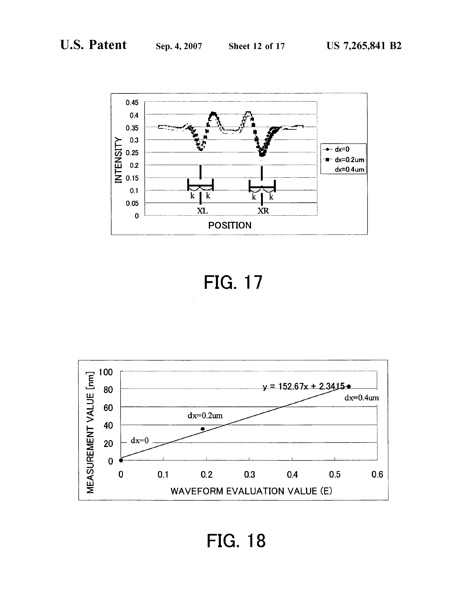
*도 17 — 제2 실시예의 파형 평가값(dx=0·0.2·0.4 μm, 에지 극소 위치 XL·XR), 도 18 — 파형 평가값 E와 측정값의 관계(y = 152.67x + 2.3415)*

보정 계수 a의 산출과 AGA는 제1 실시예와 같으므로, 그 설명은 생략한다.

이제 본 발명에 따른 제3 실시예를 설명한다. 본 실시예는 파형 평가값을 얻기 위해 얼라인 마크의 형상 변화에 민감한 단일 파장의 얼라인먼트 검출 광학계를 사용하고, 마크 상의 위치를 검출하기 위해 약 150 nm의 파장 범위를 갖는 광대역("BB") 광의 얼라인먼트 검출 광학계(100A)를 사용한다. 단일 파장은 레지스트와 같은 반투과막에서 다중 간섭을 일으키며, 마크 상은 도포 두께의 변화에 따라 민감하게 변한다. 반면, BB 광은 다중 간섭의 영향을 억제하며 마크 상은 도포 두께의 변화에 따라 거의 변하지 않는다.

도 19는 도 2에 도시된 얼라인먼트 검출 광학계(100)의 변형예의 개략 단면도이다. 도 19에 도시된 얼라인먼트 검출 광학계(100A)는 조명 광학계(120)에서 도 2에 도시된 것과 다르다. 조명 광학계(120A)는 He—Ne 레이저(123)와 BB 광원(121)(할로겐 램프)과 같은 두 광원을 사용하며, 두 광원으로부터의 광선은 빔 스플리터(125)에 의해 같은 광로를 지나도록 구성된다.

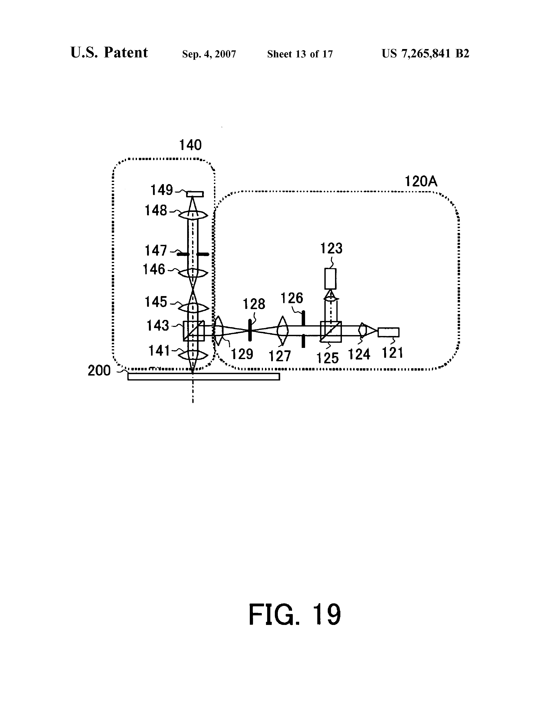
*도 19 — 얼라인먼트 검출 광학계 변형예(100A): He—Ne 레이저(123)와 BB 광원(121)을 빔 스플리터(125)로 합침*

전환 수단(도시되지 않음)은, 파형 평가 취득 단계에서는 He—Ne 레이저(123)만 웨이퍼(200)에 조사되고 마크 상 위치 검출 단계에서는 BB 광(121)만 웨이퍼(200)에 조사되도록, He—Ne 레이저(123)와 BB 광원(121)을 전환한다. 가변 개구 조리개(126)는 He—Ne 레이저(123)가 조사될 때 조명 광학계 s가 0.3으로, BB 광(121)이 조사될 때 s가 0.9로 설정되도록 가변 개구 크기를 갖는다.

빔 스플리터(125) 이후의 광학계는 도 1에 도시된 것과 같은 구조를 가지므로, 그 설명은 생략한다.

이제 본 실시예에서 파형 평가값과 측정값의 계산 결과를 설명한다. 대상 계산 모델은 도 16에 도시된 것과 같으며, 고르지 않은 도포로 인해 기판 위의 얼라인 마크(또는 하지 마크) 위의 레지스트가 위치 측정 방향으로 하지 마크의 중심으로부터 dx만큼 치우쳐 있다.

도 20은 파형 평가값 E와 측정 오차(또는 위치 오프셋 양 e) 사이의 관계를 나타낸다. P2와 P3 사이의 중심 위치로부터의 위치 오프셋 양 e는, 도 16에 도시된 얼라인 마크 형상을 NA 0.4, s 0.9, 원편광, 550 nm부터 700 nm까지 150 nm의 파장 범위를 갖는 얼라인먼트 검출 광학계(100A)로 측정할 때, 템플릿 매칭을 이용한 수학식 3으로 산출된다. 여기서, 도 20은 본 발명에 따른 제3 실시예의 측정 오차와 파형 평가값 사이의 관계를 나타내는 그래프이다. 파형 평가값을 산출하기 위한 얼라인먼트 검출 광학계는 NA 0.4, s 0.3, 원편광, He—Ne 레이저(123)의 파장 633 nm를 가지며, 파형 평가값 E는 제2 실시예와 같은 값으로 수학식 12로 산출된다. NA 0.4, s 0.9, 원편광, He—Ne 레이저(123)의 파장 633 nm를 갖는 얼라인먼트 검출 광학계(100A)는, 얼라인 마크의 상을 계산하는 데 사용될 때 도 20에 도시된 계산 결과를 제공할 것이다. 파형 평가값 E의 변화율(또는 얼라인 마크의 비대칭 변화)에 대한 측정 오차의 변화율은 He—Ne 레이저(123)에 의한 조명과 BB 광(121)에 의한 조명 사이에서 크게 다르다. 도 20으로부터 BB 광(121)에 의한 조명이 얼라인 마크의 비대칭에 둔감하다는 것을 알 수 있을 것이다.

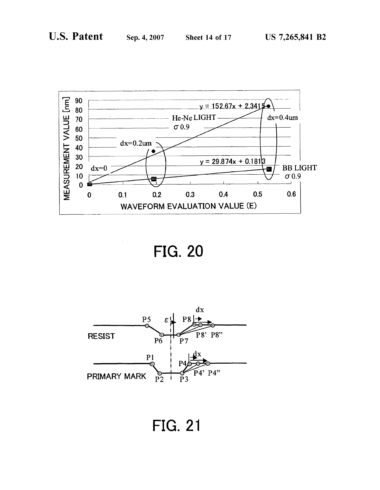
*도 20 — 제3 실시예의 측정값과 파형 평가값의 관계(He—Ne 광 y = 152.67x + 2.3415, BB 광 y = 29.874x + 0.1813), 도 21 — 레지스트로 덮인 하지 마크의 꼭짓점 변화(P4→P4'·P4", P8→P8'·P8")*

이와 같이, 일단 마크 상의 위치가 검출되면, 마크의 비대칭에 둔감한 얼라인먼트 검출 광학계를 사용하는 것은 파형 평가값 E가 측정 오차를 포함하는 경우에도 보정 오차를 더 효과적으로 줄일 수 있다.

보정 계수 a의 산출과 AGA 방법은 제1 실시예와 같으므로, 그 설명은 생략한다.

이제 본 발명에 따른 제4 실시예를 설명한다. 본 실시예는 하지 마크의 형상이 비대칭 오차를 포함하는 경우에도 마크 상의 파형 평가값 E에 기초하여 얼라인먼트 검출 광학계를 보정함으로써 얼라인 마크(210)의 원하는 위치를 가능하게 한다. 도 21은 레지스트로 덮인 하지 마크의 예를 나타내는 개략도이다. 도 21은 하지 마크의 꼭짓점 P4의 위치가 P4' 및 P4"처럼 dx=0, 0.2 μm 및 0.4 μm만큼 변하고, 레지스트의 꼭짓점 P8의 위치가 P8' 및 P8"처럼 dx=0, 0.2 μm 및 0.4 μm만큼 변하는 모델을 나타낸다. 도 22는 도 21에 도시된 얼라인 마크 상의 변화를 계산하여 얻은 그래프이다. 얼라인먼트 검출 광학계는 파형 평가값을 산출하는 데 사용되며, NA 0.4, s 0.3, 원편광, He—Ne 레이저의 파장 633 nm를 갖는다. 수학식 13은 좌측 신호의 최대값 ILp, 좌측 신호의 최소값 ILb, 우측 신호의 최대값 IRp, 및 우측 신호의 최소값 IRP를 (바람직하게는 극값과 인접한 좌우 화소들의 화소 평균값을 사용하여) 산출하고, 도 22에 도시된 바와 같이 파형 변화를 다루어 본 실시예의 파형 평가값 E를 결정한다.

E=(ILp−ILb)−(IRp−IRb)    (13)

도 23은 수학식 13에 기초하여 산출된 파형 평가값 E와, 템플릿 매칭 방법을 이용한 수학식 3과 마크 상의 시뮬레이션으로부터 산출된 도 21의 P2와 P3 사이 중심 위치로부터의 위치 오프셋 값 e 사이의 관계를 나타낸다. 시뮬레이션은 NA 0.4, s 0.9, 원편광, He—Ne 레이저의 파장 633 nm를 갖는 얼라인먼트 검출 광학계에 의해 촬영된 상을 상정한다. 여기서, 도 23은 본 발명에 따른 제4 실시예의 측정 오차 e와 파형 평가값 E 사이의 관계를 나타내는 그래프이다.

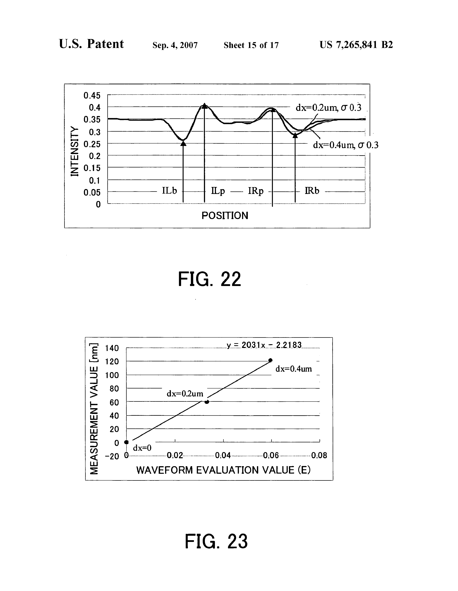
*도 22 — 도 21 마크 상의 변화 계산 결과(ILb·ILp·IRp·IRb), 도 23 — 제4 실시예의 측정값과 파형 평가값의 관계(y = 2031x − 2.2183)*

따라서, 수학식 13으로 기술되는 파형 평가값 E와 측정 오차 사이에는 선형 관계가 있으며, 얼라인 마크가 대칭 오차(symmetrical error)를 갖는 경우에도, 얼라인먼트 검출 광학계에 의해 촬영된 마크 상으로부터 파형 평가값 E를 산출하고 수학식 10과 같은 보정식을 이용하여 마크 상 위치 측정값을 보정함으로써 얼라인 마크의 원하는 위치(도 21에서 P2와 P3 사이의 중심)를 정밀하게 검출할 수 있다.

이제 같은 반도체 공정의 웨이퍼를 복수의 노광 장치의 얼라인먼트 검출 광학계(100)에 적용하는 방법을 설명한다. 이 경우, 얼라인먼트 검출 광학계에 의해 생기는 측정 오차 TIS(Tool Induced Shift)를 관리할 필요가 있다. TIS의 주된 원인은 코마와 같은 비대칭 수차, 및 조명 광학계의 텔레센트리시티(웨이퍼에 대한 주광선의 수직성)에서 비롯된다. TIS가 큰 얼라인먼트 검출 광학계(100)는 얼라인 마크의 비대칭을 확대하여 큰 측정 오차를 일으킬 수 있다. 따라서 복수의 노광 장치를 사용할 때는 노광 장치에서 얼라인먼트 검출 광학계의 TIS를 관리하고, TIS가 소정 임계 범위 안에 있는 얼라인먼트 검출 광학계를 갖는 노광 장치에는 같은 비대칭 오차 보정 계수 a를 적용한다. TIS가 임계값 밖에 있는 얼라인먼트 검출 광학계를 갖는 노광 장치에 대해서는 위 방법으로 보정 계수 a를 산출하는 것이 바람직하다.

이제 도 24 및 도 25를 참조하여 위 노광 장치(10)를 이용한 디바이스 제조 방법의 실시예를 설명한다. 도 24는 디바이스(즉, IC 및 LSI와 같은 반도체 칩, LCD, CCD 등)의 제조를 설명하기 위한 흐름도이다. 여기서는 반도체 칩의 제조를 예로 설명한다. 단계 1(회로 설계)은 반도체 디바이스 회로를 설계한다. 단계 2(마스크 제작)는 설계된 회로 패턴을 갖는 마스크를 형성한다. 단계 3(웨이퍼 준비)은 실리콘과 같은 재료를 사용하여 웨이퍼를 제조한다. 전처리라고 불리는 단계 4(웨이퍼 프로세스)는 마스크와 웨이퍼를 이용한 포토리소그래피를 통해 웨이퍼 위에 실제 회로를 형성한다. 후처리라고도 불리는 단계 5(조립)는 단계 4에서 형성된 웨이퍼를 반도체 칩으로 만들며, 조립 단계(예: 다이싱, 본딩), 패키징 단계(칩 봉지) 등을 포함한다. 단계 6(검사)은 단계 5에서 만들어진 반도체 디바이스에 대해 유효성 시험 및 내구성 시험과 같은 다양한 시험을 수행한다. 이러한 단계를 통해 반도체 디바이스가 완성되어 출하된다(단계 7).

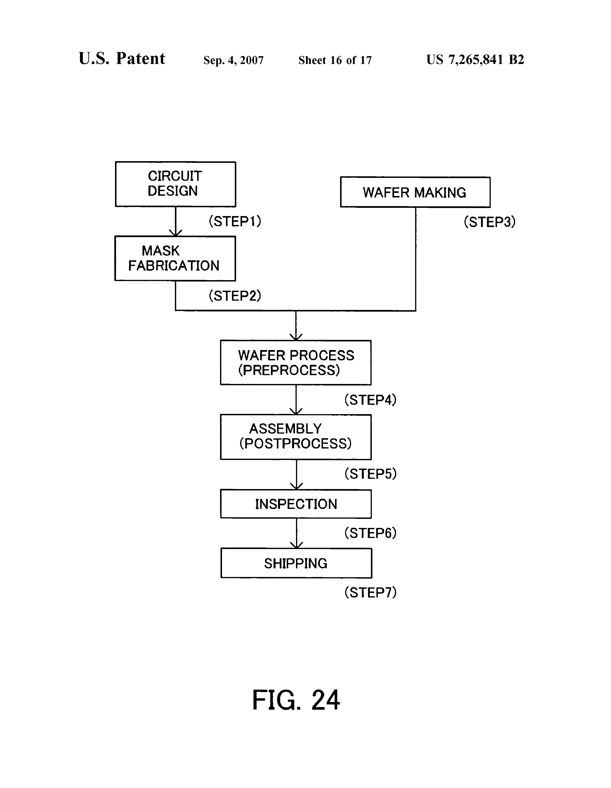
*도 24 — 디바이스 제조 흐름도(단계 1~7)*

도 25는 단계 4의 웨이퍼 프로세스의 상세 흐름도이다. 단계 11(산화)은 웨이퍼 표면을 산화시킨다. 단계 12(CVD)는 웨이퍼 표면에 절연막을 형성한다. 단계 13(전극 형성)은 증착 등으로 웨이퍼 위에 전극을 형성한다. 단계 14(이온 주입)는 웨이퍼에 이온을 주입한다. 단계 15(레지스트 프로세스)는 웨이퍼 위에 감광성 재료를 도포한다. 단계 16(노광)은 노광 장치(200)를 사용하여 마스크 위의 회로 패턴을 웨이퍼 위에 노광한다. 단계 17(현상)은 노광된 웨이퍼를 현상한다. 단계 18(에칭)은 현상된 레지스트 상 이외의 부분을 에칭한다. 단계 19(레지스트 박리)는 에칭 후 쓸모없어진 레지스트를 제거한다. 이 단계들이 반복되어 웨이퍼 위에 다층 회로 패턴이 형성된다. 본 실시예의 디바이스 제조 방법은 종래의 것보다 더 높은 품질의 디바이스를 제조할 수 있다.

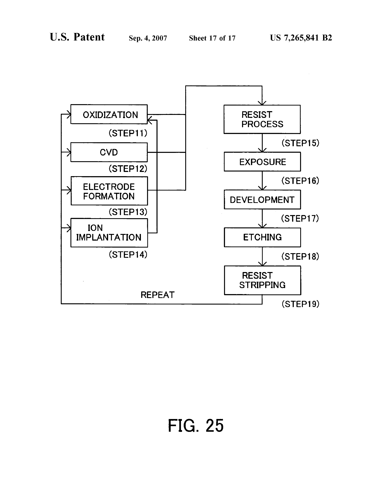
*도 25 — 웨이퍼 프로세스(단계 4) 상세 흐름도(단계 11~19)*

이와 같이, 본 발명은 얼라인 마크의 형상이 산포하는 경우에도 반도체 디바이스 제조 공정에서 정밀도를 유지하고 수율을 향상시킬 수 있다. 또한, 본 발명은 얼라인 마크의 형상을 안정시키는 데 필요한 반도체 공정의 조건 설정에 필요한 시간을 단축하고 반도체 디바이스 제조의 생산성을 향상시킬 수 있다.
