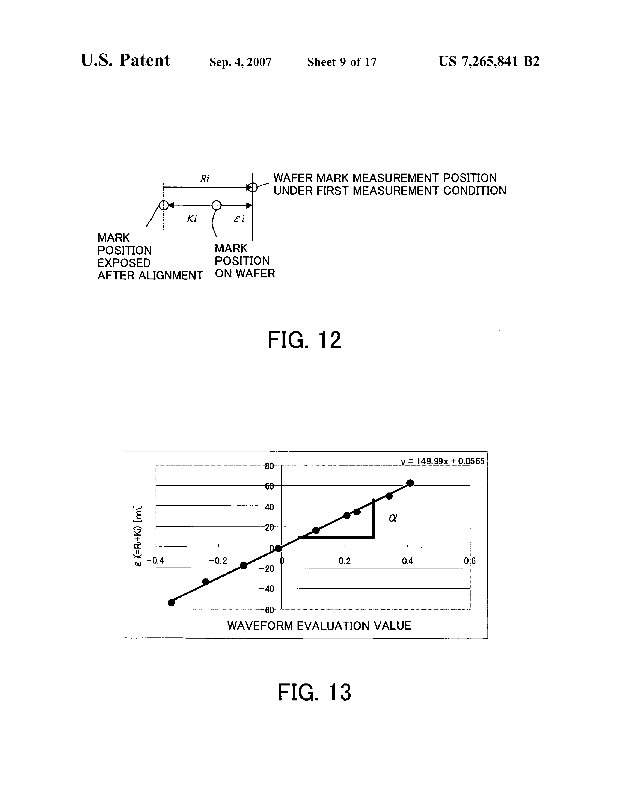
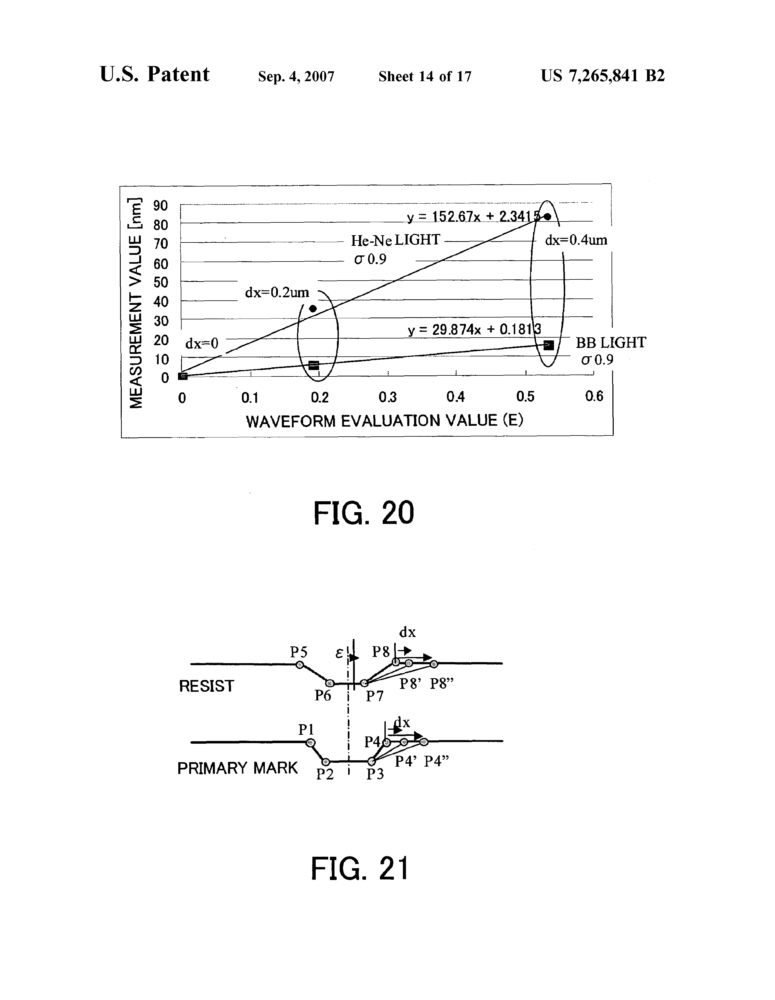

# US7265841B2 — 위치 검출 방법 (Canon)

| 항목 | 내용 |
|---|---|
| 원문 | `US7265841.pdf`(등록, 2007-09-04) · `US20040257573.pdf`(공개, 2004-12-23) |
| 출원인 | Canon Kabushiki Kaisha |
| 우선일 | 2003-06-18 (JP 2003-174081) |
| 핵심 | 얼라인 마크 상의 위치 측정값 M1에, 같은 상에서 구한 **파형 평가값 E**(신호 콘트라스트 또는 좌우 비대칭량)를 곱한 보정량을 빼서 진짜 위치를 구한다: **M = M1 − a·E**. 보정 계수 a는 샘플 쇼트의 (트릭 성분, E) 직선 맞춤 기울기, 또는 AGA 잔차를 최소로 하는 값으로 정한다. |
| 관련도 | ○ 부분 해결 (노광 장치 얼라인 마크, 위치 측정의 **계통 오차**를 영상 특징으로 보정하는 구성) |
| 해결 P# | P2(계통 편향 보정), P4(초점·조명·형상 변화에 따른 위치 오차) |
| 본 과제와의 관계 | 반복 잡음이 아니라 **영상 모양에 따라 달라지는 계통 오차**를, 같은 영상에서 재는 파형 지표로 1차 보정한다는 구성. 우리 측정기의 편향이 블러·조명 지표와 상관이 있는지 보고, 있으면 같은 꼴(편향 = a × 지표)로 빼는 근거가 된다. |
| 링크 | [Google Patents](https://patents.google.com/patent/US7265841B2/en) |

---

## 상세 요약 (번역본 기준)

### 1. 해결하려는 문제
- 노광 장치의 얼라인먼트는 회로 임계 치수의 약 ⅓(예: 180 nm 설계 폭에서 60 nm) 정밀도가 필요함.
- CMP 같은 공정이 웨이퍼·쇼트마다 얼라인 마크 형상의 산포를 만들고, 검출 광학계의 코마·조명 경사 같은 장치 요인이 겹쳐 마크 중심 측정에 비대칭 오차가 생김.
- 종래에는 공정마다 최적 마크·조건을 사람이 찾아 시간이 오래 걸리고 수율이 떨어짐.

### 2. 핵심 구성
| 구성 | 부호 | 위치·역할 |
|---|---|---|
| 얼라인먼트 검출 광학계 | 100 / 100A | 명시야, 결상 배율 약 100배, 라인 센서(149)로 마크 상 수광. NA 조리개(147), σ 조리개(126) |
| 조명 광학계(변형) | 120A | He—Ne 레이저(123, 633 nm)와 BB 광원(121, 할로겐, 약 150 nm 대역)을 빔 스플리터(125)로 합치고 전환 |
| 얼라인 마크 | 210 / 210a | 4 μm × 20 μm 직사각 요소 4개, 피치 20 μm (210a는 윤곽선 0.6 μm) |
| 얼라인먼트 신호 처리기 | 160 | 템플릿 매칭(수학식 1) 또는 좌우 접기 자기상관(수학식 11)으로 중심 산출, 피크 주변 무게중심으로 1/10~1/50 화소 분해능 |
| 파형 평가값 E | — | 제1 실시예: 콘트라스트 ILb/ILm. 제2·3 실시예: 에지 극소점 XL·XR 주변 접기 차분의 좌우 차(수학식 12). 제4 실시예: (ILp−ILb)−(IRp−IRb)(수학식 13) |
| 보정식 | 수학식 10 | M = M1 − a·E |
| AGA | 수학식 4~9 | 샘플 쇼트 측정값으로 6 파라미터(Sx, Sy, θx, θy, Bx, By) 최소제곱, 잔차 Ri |

### 3. 동작 순서 (도 14)
1. 단계 50: AGA 측정 쇼트 선택.
2. 단계 51: 미리 구한 보정 계수 a 설정.
3. 단계 52~53: 샘플 쇼트의 얼라인 마크를 광학계 아래로 옮겨 상 취득.
4. 단계 54: 마크 상에서 위치 오프셋 M1 산출·저장.
5. 단계 55: 같은 상에서 파형 평가값 E 산출·저장.
6. 단계 56: 남은 샘플 쇼트가 있으면 52로.
7. 단계 57: Mi = M1i − a·E로 쇼트별 위치 보정.
8. 단계 58~59: AGA로 정렬 후 노광.
- 보정 계수 a를 정하는 방법 3가지
  - 제1 방법: 노광 후 중첩 검사로 Ki를 재고 트릭 성분 ei = Ri + Ki와 E의 직선 맞춤 기울기를 a로 함(도 13, 2차 이상 함수도 가능).
  - 제2 방법: a를 바꿔 가며 AGA 잔차 Ri의 표준편차(또는 최대값)가 최소가 되는 a를 고름. 근거: 공정 비선형 왜곡은 같은 웨이퍼에서 일정하므로 잔차가 작을수록 측정 정확.
  - 제3 방법: 3차원 형상 측정 + 광학계 코마 정보로 마크 상을 시뮬레이션해 E–오차 관계를 구함.
  - 실무: 로트 첫 웨이퍼에서 조합해 정하고, 시뮬레이션 값 근처에서 잔차 최소가 되도록 미세 조정.
- 여러 노광 장치: 광학계의 TIS(Tool Induced Shift)가 임계 범위 안인 장치끼리는 같은 a를 쓰고, 밖이면 따로 구함.

### 4. 청구항 요지 (4항)
- 청구항 1: 쇼트 선택 → 마크 상 촬영 → 위치 산출 → 콘트라스트 취득 → **Mi = M1i − a·Ei** 보정식으로 마크 위치 결정 → 정렬·노광.
- 청구항 2: 평가값으로 위치를 보정하되, **평가값은 제1 측정 조건, 위치는 다른 제2 측정 조건**에서 찍은 상으로 구함.
- 청구항 3: 두 조건의 차이는 코히런스 팩터 σ(실시예: 평가 0.3, 위치 0.9).
- 청구항 4: 제1 조건은 단일 파장, 제2 조건은 광대역 광.

### 5. 대표 도면

*도 12 — 얼라인먼트 측정값과 중첩 검사값의 관계, 도 13 — 트릭 성분 ei와 파형 평가값 E의 직선 맞춤(y = 149.99x + 0.0565, 기울기 = 보정 계수)*

*도 20 — 같은 비대칭(dx 0~0.4 μm)에서 He—Ne 조명은 기울기 152.67, BB 조명은 29.874로 오차 민감도가 약 1/5, 도 21 — 레지스트·하지 마크 비대칭 모델*

- 도면에 나온 수치(시뮬레이션)
  - 도 11: 콘트라스트 0.1→0.7에서 측정 오차 약 65→51 nm (y = −22.55x + 67.881). 콘트라스트(단차)에 따라 위치 오차가 체계적으로 변함.
  - 도 18: 레지스트 치우침 dx 0→0.4 μm에서 측정값 0→약 83 nm, E와 1차 관계(y = 152.67x + 2.3415).
  - 도 23: 제4 실시예 E와 측정값 y = 2031x − 2.2183 (dx 0.4 μm에서 약 120 nm).

### 6. 본 과제(Y·Θ 얼라인먼트)와 비교
- 같은 점:
  - 마크 상의 부화소 위치를 템플릿 매칭 + 피크 주변 무게중심(1/10~1/50 화소)으로 재고, 여러 마크 위치를 맞춤(AGA 6 파라미터 최소제곱)해 보정값을 만든다. 우리 흐름(536점 → P12 맞춤)과 구조가 같다.
  - 영상 모양 변화(단차·초점·조명 조건)가 위치에 **계통 오차**로 들어간다는 문제 인식이 논문 결과서 P2·P4와 같다.
- 다른 점:
  - 대상은 노광 장치의 1차원 라인 센서 신호이고, 오차 원인은 마크 단면 비대칭·광학 수차다. 우리는 2차원 QR 패치이고 주 원인은 부화소 위치 의존 편향·블러·조명이다.
  - 보정 계수는 외부 기준(중첩 검사, 측장 SEM) 또는 잔차 최소화로 정한다. 우리는 외부 기준 대신 스테이지 지령값(Y·T 라벨)이 있다.
- 참고할 점 (논문 결과서 4장 항목과 연결):
  - **P2-1·P2-3 (편향 곡선·실영상 편향)**: 편향을 "보정 가능한 계통 성분"으로 보고, 같은 영상에서 재는 지표 E와의 회귀로 빼는 구성. P2-3에서 사인 진폭이 기준(0.005 px)을 넘으면, 부화소 위치를 지표로 한 보정표(편향 = f(부화소 위치))를 빼는 근거가 된다.
  - **P4-1 (블러 내성)**: 블러 σ를 바꾼 합성 영상에서 점 오차와 "영상 선명도 지표"(코너 대비 등)의 기울기 a를 구하면, 이 특허의 M = M1 − a·E 꼴로 블러 계통 오차를 보정할 수 있다. 도 11처럼 콘트라스트–오차가 직선이면 1차 보정으로 충분하다.
  - **P4-3 (조명 내성)**: 청구항 2~4의 "평가용 조건과 위치 측정용 조건을 분리" — 위치는 비대칭에 둔감한 조건(BB, σ 0.9)에서 재고, 지표는 민감한 조건(단일 파장, σ 0.3)에서 잰다. 도 20에서 BB 조명은 He—Ne보다 오차 민감도가 약 1/5. 우리에겐 조명·노출 설정 선택 실험의 근거.
  - **a를 정하는 제2 방법(잔차 최소)**: 외부 기준 없이 맞춤 잔차가 최소가 되는 보정 계수를 고른다 → P12 맞춤 잔차를 기준으로 보정 파라미터(가중·전처리 σ)를 고르는 방식에 그대로 쓸 수 있다.
  - **TIS 관리**: 장비마다 광학계 고유 편향이 다르면 같은 보정 계수를 쓰지 않는다 → 카메라·렌즈가 바뀌면 편향 곡선(P2-1)을 다시 재야 한다는 운영 규칙의 근거.
