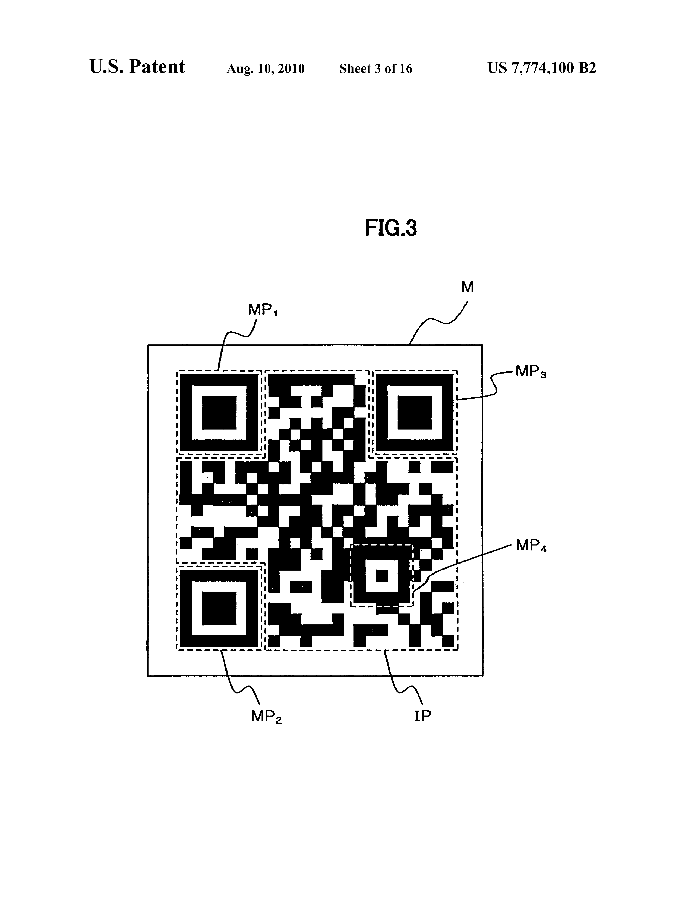
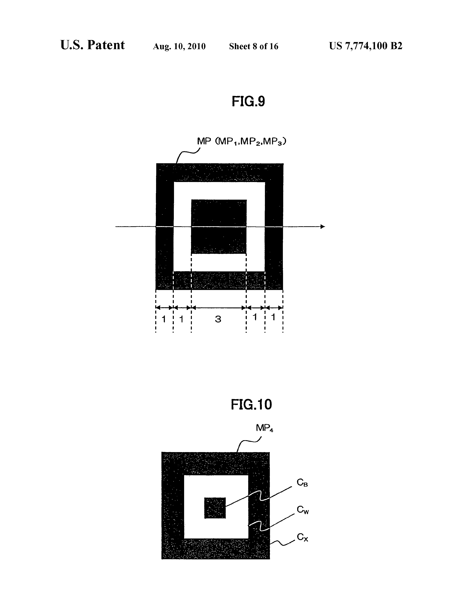
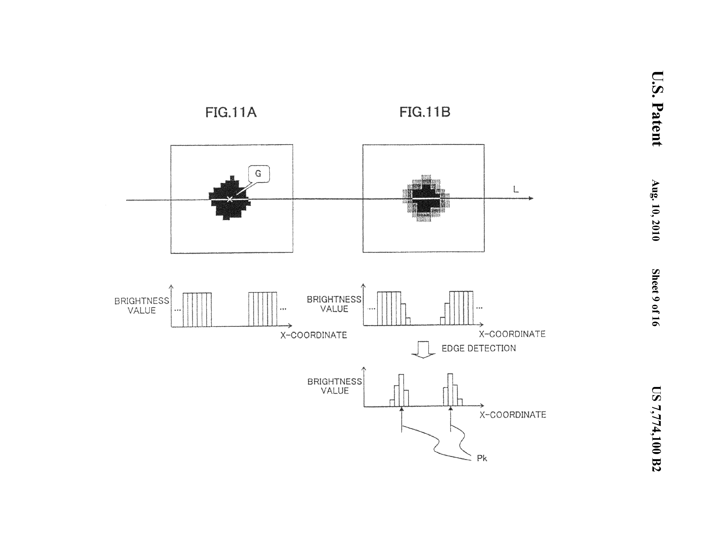
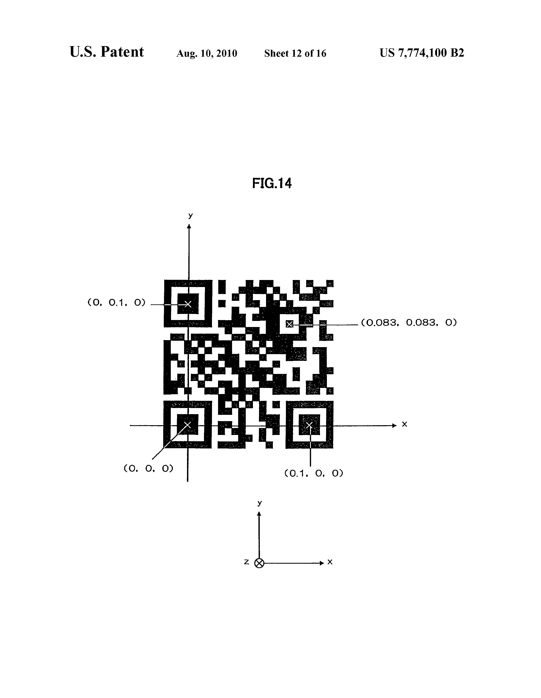

# 로봇 제어 정보 생성 장치 및 로봇 (US7774100B2)

- 원제: ROBOT CONTROL INFORMATION GENERATION APPARATUS AND ROBOT
- 원문: 같은 폴더의 `US7774100.pdf`, https://patents.google.com/patent/US7774100B2/en
- 출원인: 혼다 기연 공업 주식회사 (Honda Motor Co., Ltd., 발명자 Chiaki Aoyama)
- 번역 기준: USPTO 등록본 PDF 직접 판독 및 국문 번역 수록
- 도면: `도면/` 폴더 내 도면 삽입

---

## 요약

로봇 제어 정보 생성 장치는 물체 상에 부착된 2차원 코드(예: QR 코드)의 촬상 화상에 근거하여 로봇을 제어하기 위한 제어 정보를 생성한다. 2차원 코드는 사전에 정해진 상대 위치에 배치된 복수의 위치 식별 패턴(파인더 패턴 및 얼라인먼트 패턴)과 데이터 정보 패턴을 포함한다. 본 장치는 화상으로부터 각 패턴의 중심 위치를 1화소 이하(서브픽셀) 정밀도로 검출하고, 검출된 위치들로부터 2차원 코드의 3차원 위치 및 자세(Position & Orientation)를 계산한다. 나아가 정보 패턴으로부터 디코딩된 파지 위치 오프셋 정보와 결합하여 로봇이 대상 물체를 정확히 파지하고 조작할 수 있도록 하는 로봇 제어 명령을 생성한다.

---

## 청구범위

청구하는 발명은 다음과 같다.

1. 로봇 제어 정보를 생성하기 위한 장치로서,
대상 물체 상에 표시된 2차원 코드에 근거하여 상기 대상 물체를 조작하기 위한 로봇 제어 정보를 생성하도록 구성되며, 상기 2차원 코드는 상기 2차원 코드 내에서 사전에 결정된 상대 위치를 갖는 복수의 위치 식별 패턴 및 정보 패턴을 포함하고,
상기 장치는:
상기 2차원 코드를 포함하는 화상을 수신하도록 구성된 영상 수신부;
상기 화상 내에서 상기 복수의 위치 식별 패턴을 검출하도록 구성된 패턴 검출부;
상기 패턴 검출부에 의해 검출된 상기 복수의 위치 식별 패턴의 화상 내 2차원 위치들에 근거하여, 상기 2차원 코드의 3차원 위치 및 3차원 자세를 계산하도록 구성된 위치 및 자세 계산부;
상기 화상 내의 상기 정보 패턴에 포함된 정보를 디코딩하도록 구성된 디코딩 장치;
상기 위치 및 자세 계산부에 의해 계산된 상기 3차원 위치 및 3차원 자세와, 상기 디코딩 장치에 의해 디코딩된 정보에 근거하여, 상기 로봇이 상기 대상 물체를 조작하기 위한 로봇 제어 정보를 생성하도록 구성된 제어 정보 생성부; 및
상기 생성된 로봇 제어 정보를 상기 로봇으로 출력하도록 구성된 로봇 인터페이스부를 포함하는, 장치.

2. 제1항에 있어서,
상기 정보 패턴에 포함된 상기 정보는 상기 2차원 코드의 위치에 대한 상기 대상 물체의 파지 위치의 상대적 위치 정보를 포함하고,
상기 제어 정보 생성부는 상기 계산된 3차원 위치 및 3차원 자세와 상기 상대적 위치 정보에 근거하여 상기 대상 물체의 3차원 파지 위치를 계산하는, 장치.

3. 로봇 시스템으로서,
물체를 파지하기 위한 핸드를 구비한 로봇; 및
상기 로봇을 제어하기 위한 제1항에 기재된 로봇 제어 정보 생성 장치를 포함하는, 로봇 시스템.

4. 제3항에 있어서,
상기 정보 패턴에 포함된 상기 정보는 상기 2차원 코드에 대한 상기 대상 물체의 파지 위치의 상대 위치 정보를 포함하고,
상기 제어 정보 생성부는 상기 계산된 3차원 위치 및 3차원 자세와 상기 상대 위치 정보에 근거하여 상기 파지 위치를 계산하며, 상기 로봇의 핸드가 상기 계산된 파지 위치로 이동하도록 상기 로봇을 제어하는, 로봇 시스템.

---

## 상세한 설명

### 기술 분야 및 해결 과제

산업용 로봇 및 서비스 로봇이 대상 물체를 인식하고 파지(grasping)하기 위해서는 대상 물체의 3차원 공간 내 위치 및 자세(위치 3자유도, 회전 3자유도)를 정확히 파악해야 한다. 물체 표면에 2차원 매트릭스 코드(QR 코드)를 부착하는 방식은 물체의 식별자(ID)와 기하 정보를 동시에 전달할 수 있는 우수한 수단이다.

그러나 종래의 단순 이진화 기반 2D 코드 판독 방식은 정수 픽셀 단위로만 패턴 중심을 검출하므로, 카메라와의 거리나 각도에 따라 위치 및 자세 추정에 상당한 오차가 발생한다. 본 발명은 2D 코드의 위치 검출 패턴(파인더 패턴)과 얼라인먼트 패턴의 중심을 1화소 이하(서브픽셀)의 고정밀도로 추출하고, 이를 기반으로 투영 변환 행렬을 풀어 물체의 정밀한 3차원 위치·자세 및 파지 좌표를 실시간 산출하는 기술을 개시한다.

*도 3 — 로봇 제어 정보 생성 시스템의 구성 블록도. 카메라(C), 영상 입력부(2), 화상 처리 및 해석부(4), 위치·자세 계산부(44), 제어 정보 생성부(5), 및 로봇 본체(1)의 연결 관계를 보여준다.*

### QR 코드 패턴 구조 및 특징 검출

QR 코드는 네 모서리 중 세 모서리에 배치된 위치 검출 패턴(Position Detection Pattern, 일명 파인더 패턴 42a)과 내부에 배치된 얼라인먼트 패턴(Alignment Pattern 42b)을 포함한다.

*도 9 및 도 10 — QR 코드의 위치 검출 패턴(파인더 패턴)의 흑-백-흑-백-흑 모듈 주파수 비율(1:1:3:1:1) 및 얼라인먼트 패턴(1:1:1:1:1)의 기하학적 구조.*

화상 해석부(4)는 입력 화상을 정규화(41a)하고 이진화(41b) 및 라벨링(41c)하여 위치 검출 패턴의 1:1:3:1:1 비율을 만족하는 영역을 검출한다.

### 1화소 이하(서브픽셀) 중심 추정 알고리즘

단순 이진화 화상에서 무게중심을 구하면 조명 변화나 픽셀 양자화에 의해 경계 왜곡이 발생한다. 따라서 본 발명에서는 회색조 원본 화상에서의 에지 피크를 활용한다.

*도 11A 및 11B — 이진 화상 경계(11A)의 양자화 오차를 극복하기 위해, 무게중심 G를 지나는 수평/수직 탐색선 L 상에서 회색조 화상의 1차 미분(에지 강도)이 극대가 되는 정밀 서브픽셀 에지점 Pk를 결정하고, 양 에지의 중앙을 패턴 중심으로 확정하는 방식(11B).*

1. 검출된 영역의 대략적 무게중심 $G$를 통과하는 수평선 및 수직선 $L$을 설정한다.
2. 선 $L$을 따라 원본 회색조 화상의 화소 밝기 변화 구배(gradient)를 계산한다.
3. 밝기 변화율이 극대가 되는 경계 지점 $P_k$를 서브픽셀 보간으로 결정한다.
4. 마주보는 두 에지 지점 $P_1$과 $P_2$의 중간 지점 $(P_1 + P_2)/2$를 해당 패턴의 서브픽셀 중심 좌표로 최종 결정한다.

### 3차원 위치 및 자세 계산 원리

QR 코드 평면 상에서 각 패턴의 실제 물리 좌표를 $Q_i = (X_i, Y_i, 0)^T$ ($i=1, 2, 3, 4$)라 하고, 카메라 촬상면 상의 대응 영상 좌표를 $S_i = (u_i, v_i)^T$라 하자. 3차원 회전 행렬 $R$과 평행이동 벡터 $t$로 구성된 투영 변환 관계:

$$s_i \begin{bmatrix} u_i \\ v_i \\ 1 \end{bmatrix} = K \begin{bmatrix} r_{11} & r_{12} & r_{13} & t_x \\ r_{21} & r_{22} & r_{23} & t_y \\ r_{31} & r_{32} & r_{33} & t_z \end{bmatrix} \begin{bmatrix} X_i \\ Y_i \\ 0 \\ 1 \end{bmatrix}$$

4개의 비공선(non-collinear) 점 좌표로부터 호모그래피 행렬 및 외부 파라미터 $(R, t)$를 유일하게 산출한다.

*도 14 — 로봇 카메라 좌표계와 물체 및 QR 코드 좌표계 사이의 공간 기하학적 변환 관계도.*

### 제어 정보 생성 및 동작 시퀀스

1. **디코딩 게이트**: 화상 내 데이터 패턴을 디코딩하여 물체 ID 및 파지 오프셋을 읽는다. 만약 디코딩에 실패하거나 오인식이 발생하면 위치·자세 계산을 즉각 중단하고 오류를 반환한다(안전 게이트 기능).
2. **파지 위치 산출**: QR 코드의 3차원 좌표계 $(R, t)$에 디코딩된 상대 파지 벡터를 결합하여 로봇 베이스 좌표계 기준의 최종 핸드 목표 위치 $P_{\text{target}}$을 산출한다.
3. **로봇 구동**: 로봇 컨트롤러는 핸드를 $P_{\text{target}}$으로 서보 이동시켜 물체를 안정적으로 파지한다.
