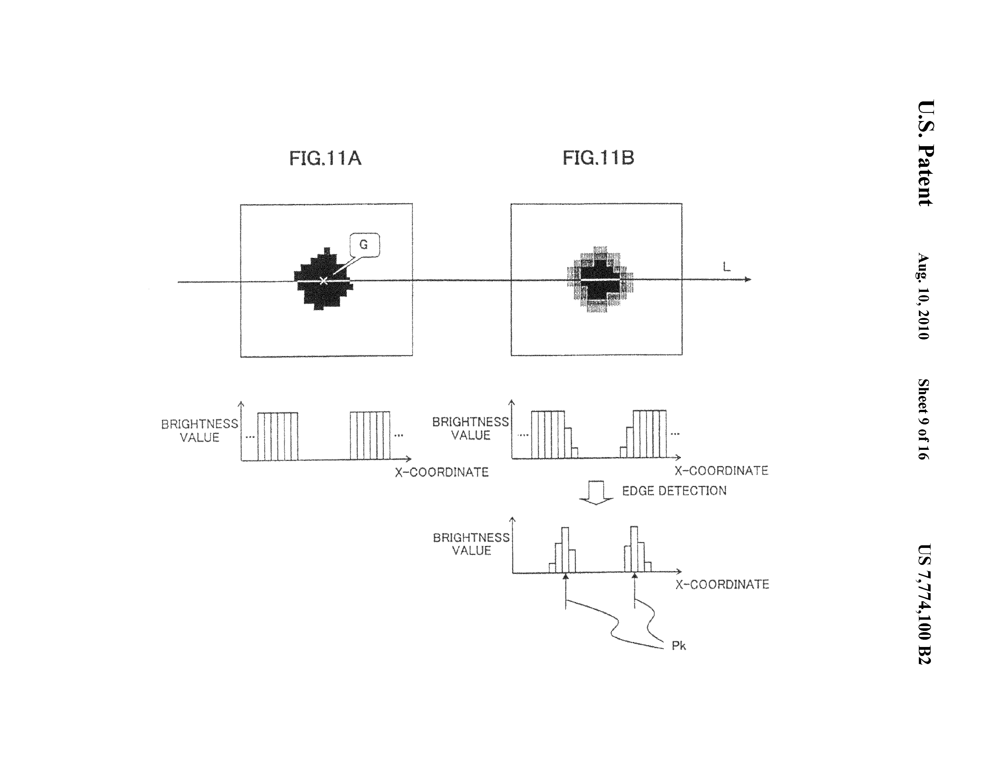
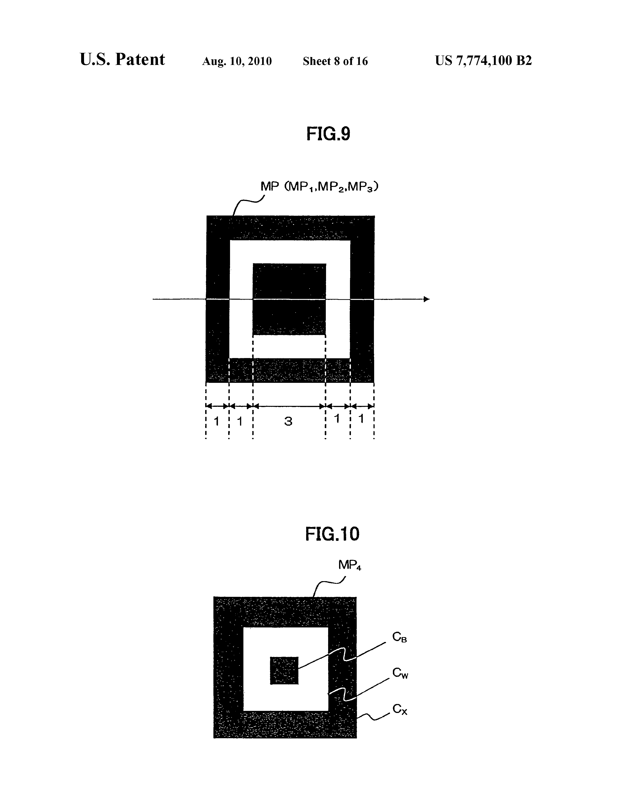

# US7774100B2 — 로봇 제어 정보 생성 장치 및 로봇 (Honda)

| 항목 | 내용 |
|---|---|
| 원문 | `US7774100.pdf`(등록, 2010-08-10) · `US20080249663.pdf`(공개, 2008-10-09). 분할 출원(원출원 US 11/524,166 → US7407104) |
| 출원인 | Honda Motor Co., Ltd. (발명자 Chiaki Aoyama) |
| 우선일 | 2005-09-27 (JP 2005-279179) · 출원 2008-06-06 |
| 청구항 | 4항 (독립 1·3) |
| 핵심 | 물체에 붙은 QR 코드를 로봇 카메라로 찍어, 위치 검출 패턴 3개(파인더)와 얼라인먼트 패턴 1개의 **중심을 1화소 이하 정밀도로 구하고**, 이 4점으로 코드의 3차원 위치·자세를 계산한다. 디코딩한 정보(파지 위치의 상대 좌표)와 합쳐 로봇 제어 정보를 만든다. |
| 관련도 | △ 참고 (QR 파인더 4점으로 위치·자세를 구하는 기본 구성. 부화소 정밀도 수치·편향 분석 없음) |
| 해결 P# | P3(어떤 점으로 자세를 구하는가 — 파인더·얼라인먼트 패턴 중심 4점), P6(디코딩 실패 시 계산하지 않음) |
| 본 과제와의 관계 | 본 과제의 "파인더 66점" 단계보다 더 적은 4점 방식이다. 논문 결과서 P3에서 파인더만 쓰면 Y 65/80에 그친 결과와 같은 맥락의 종래 구성으로 인용할 수 있다. |
| 링크 | [Google Patents](https://patents.google.com/patent/US7774100B2/en) · [USPTO PDF](https://image-ppubs.uspto.gov/dirsearch-public/print/downloadPdf/7774100) |

---

## 상세 요약 (원문 PDF 기준, 번역본 없음)

### 1. 해결하려는 문제
- 로봇이 물체를 잡으려면 물체의 3차원 위치·자세와 파지 위치를 알아야 한다. 로봇과 2D 코드의 위치·자세가 바뀌어도 코드의 위치·자세를 특정하고, 코드에 넣은 정보로 여러 제어 정보를 만들고자 한다(원문 21단 17~27행).

### 2. 핵심 구성
| 구성 | 부호 | 역할 |
|---|---|---|
| 영상 입력부 | 2 | 카메라 C 영상 입력 |
| 영상 해석부 | 4 | 밝기 정규화(41a)·이진화(41b)·라벨링(41c) → 위치 검출 패턴 검출(42a)·얼라인먼트 패턴 검출(42b) → 정보 패턴 디코딩(43) |
| 위치·자세 계산 장치 | 44 | 패턴 위치 추정부(44a): 패턴 중심을 1화소 이하 정밀도로 결정 / 3차원 위치·자세 계산부(44b) |
| 제어 정보 생성부 | 5 | 파지 위치 계산부(51) 포함 |

- 중심 추정(도 11A·11B): 이진 영상의 경계 정확도는 화소 크기에 묶이므로, 군집 무게중심 G를 지나는 가로·세로 직선 L 위에서 **회색조 영상의 에지(밝기 변화)가 최대가 되는 위치 Pk**를 경계로 잡고, 양쪽 경계의 중간을 중심으로 한다(원문 12단 25~53행).
- 자세 계산(도 12·13): 기지 좌표 Q(X, Y, Z=0)의 패턴 4점이 회전·이동 행렬 P(3×4)로 T가 되고, T가 영상 좌표 S(u, v)로 투영된다는 관계로 P를 구한다(원문 식 (2)·(3)).

### 3. 동작 순서 (도 16)
1. S1 영상 입력 → S2 밝기 정규화 → S3 이진화 → S4 라벨링
2. S5 위치 검출 패턴 검출 → S6 얼라인먼트 패턴 검출 → S7 정보 패턴 디코딩
3. S8 디코딩 성공? 아니면 종료(위치·자세 계산 안 함)
4. S9 패턴 중심 추정 → S10 위치·자세 계산 → S11 제어 정보 생성·출력 → S12 로봇 동작

### 4. 청구항 요지
- 청구항 1: 위치 식별 패턴(코드 안 위치가 미리 정해짐)과 정보 패턴을 가진 2D 코드에 기반해 로봇 제어 정보를 만드는 장치. 영상 수신부, 패턴 검출부, 패턴의 영상 내 2차원 위치로 코드의 3차원 위치·자세를 계산하는 계산부, 디코딩 장치, 제어 정보 생성부, 로봇 인터페이스.
- 청구항 2·4: 정보 패턴에 파지 위치의 상대 위치를 부호화, 위치·자세와 합쳐 파지 위치 계산.
- 청구항 3: 이 장치를 가진 로봇.

### 5. 대표 도면

*도 11A·11B — 이진 영상 경계(11A) 대신 회색조 에지 피크 Pk로 패턴 경계를 잡아 중심을 1화소 이하로 추정(11B)*

*도 9·10 — 위치 검출 패턴의 1:1:3:1:1 비율과 얼라인먼트 패턴*

### 6. 본 과제(Y·Θ 얼라인먼트)와 비교
- 같은 점: QR의 파인더(위치 검출 패턴)를 기준점으로 써서 위치·자세를 구한다. 디코딩 성공을 계산 진행의 전제 조건으로 둔다.
- 다른 점: 점 4개로 6자유도를 구하는 판독·파지용 구성이다. 정밀도 수치가 없고, 에지 피크 위치를 정수 화소에서 찾는지 보간하는지 밝히지 않는다. 본 과제는 536점 + 템플릿 GN으로 0.03 px 이하를 목표로 한다.
- 본 과제에서 할 일
  - P3: 결과서에 "파인더 중심 4점(본 특허) → 파인더 66점 → 내부 536점" 순으로 점 수와 정밀도를 비교하는 근거로 쓴다.
  - P6-1: 게이트 ①단계(QR별 디코딩 성공)를 본 특허 S8과 같은 "실패 시 계산 중단" 규칙으로 둔다.
