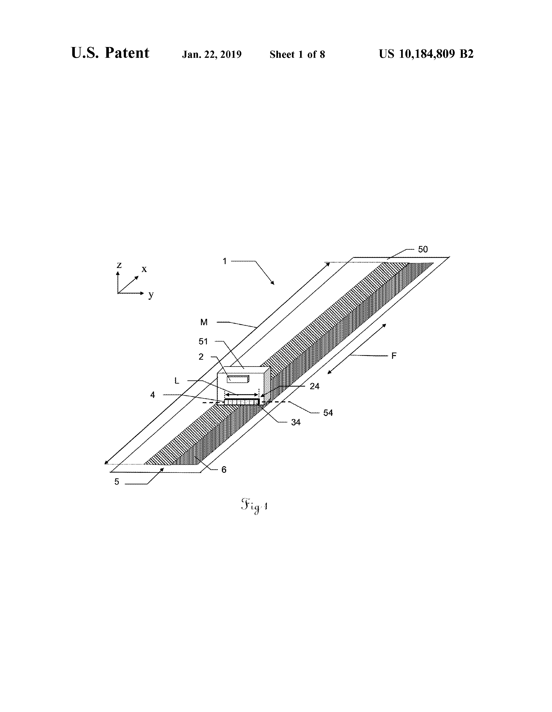
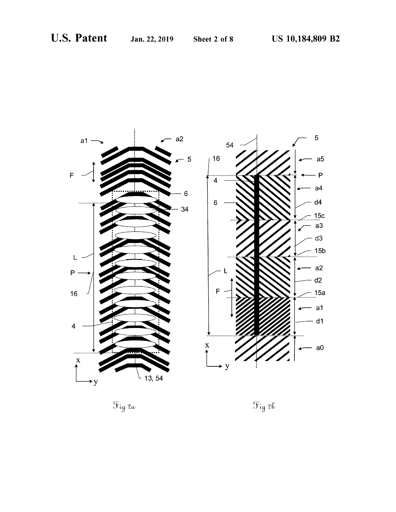

# 2D 코드 패턴으로 이상 상태로부터의 편차까지 구하는 위치 결정 시스템 (US10184809B2)

- 원제: DETERMINATION OF POSITION
- 원문: 같은 폴더의 `US10184809.pdf`, https://patents.google.com/patent/US10184809B2/en
- 출원인: 헥사곤 테크놀로지 센터 (Hexagon Technology Center GmbH, 발명자 Robert Fritsch, Knut Siercks)
- 우선일: 2015-03-06 (EP 15157967) · 등록일: 2019-01-22
- 번역 기준: USPTO 등록본 PDF 직접 판독 및 국문 번역 수록
- 도면: `도면/` 폴더 내 도면 삽입

---

## 요약

본 발명은 기준 축(이동 방향)을 따른 절대 위치를 고정밀도로 결정함과 동시에, 이상적인 정렬 상태로부터의 자세 및 간격 편차까지 동시에 산출하는 위치 측정 시스템에 관한 것이다. 측정 스케일 상에는 이동 방향을 따라 뻗어 있는 2차원(2D) 광학 패턴이 배치된다. 이 2D 패턴은 서로 다른 기하학적 형태(기울기, 주기, 모듈 폭 등)를 갖는 패턴 요소 영역들이 연속적으로 이어져 위치마다 고유한 코드 워드(code word)를 형성하는 절대 위치 트랙을 구성한다. 라인 센서를 포함하는 검출 헤드가 패턴의 일부를 주사하여 단일 주사 신호를 취득한다. 제어·평가부는 해당 주사 신호로부터 코드 워드를 복호화하여 주 이동 방향의 절대 위치를 특정함과 동시에, 주사 신호에 포함된 패턴 요소의 주기 및 위상 왜곡으로부터 횡방향 오프셋, 롤/피치/요(Roll/Pitch/Yaw) 회전 각도, 및 스탠드오프(센서-스케일 간격) 편차를 동시에 정밀하게 계산한다.

---

## 청구범위

청구하는 발명은 다음과 같다.

1. 위치를 결정하기 위한 측정 장치로서,
상기 측정 장치는 기준 축을 따라 규정된 위치 측정을 위해 상기 기준 축을 따라 서로에 대해 이동 가능한 제1 주사 헤드 및 제1 2차원(2D) 패턴을 포함하고;
상기 제1 2D 패턴은 상기 기준 축을 따라 뻗어 있으며 복수의 상이한 패턴 요소 영역을 갖고, 상기 복수의 상이한 패턴 요소 영역은 상기 기준 축을 따른 연속적인 순서로 배치되어 상기 기준 축을 따른 서로 다른 위치에서 서로 다른 코드 워드를 형성하며;
상기 제1 주사 헤드는 상기 기준 축을 따라 주사 길이를 갖는 제1 광학 센서를 포함하고, 상기 제1 센서는 상기 제1 2D 패턴의 일부를 주사하여 상기 주사 길이에 걸쳐 변하는 1차원 주사 신호를 생성하도록 구성되며;
상기 측정 장치는 제어 및 평가 유닛을 포함하고, 상기 제어 및 평가 유닛은:
상기 생성된 1차원 주사 신호에 근거하여 상기 기준 축을 따른 상기 제1 주사 헤드와 상기 제1 2D 패턴 사이의 절대 위치를 결정하기 위한 복호 정보; 및
상기 생성된 1차원 주사 신호에 근거하여, 상기 제1 주사 헤드와 상기 제1 2D 패턴 사이의 이상적인 정렬 상태로부터 벗어난 적어도 하나의 추가 자유도에서의 편차를 결정하기 위한 편차 결정 정보를 저장하고 있는, 측정 장치.

2. 제1항에 있어서,
상기 제1 광학 센서는 선형 라인 센서(linear line sensor) 또는 1차원 포토다이오드 어레이로 구성되는, 측정 장치.

3. 제1항에 있어서,
상기 패턴 요소 영역들은 패턴 라인들의 공간 주기, 패턴 라인들의 경사 각도, 또는 패턴 라인들의 광학적 투과율/반사율 프로파일 중 적어도 하나에 의해 서로 구별되는, 측정 장치.

4. 제1항에 있어서,
상기 코드 워드는 상기 주사 길이에 걸쳐 포착된 패턴 요소 영역들의 종류의 순서(sequence) 및 각각의 영역 길이에 의해 정의되는, 측정 장치.

5. 제1항에 있어서,
상기 추가 자유도에서의 편차는 상기 기준 축에 수직인 횡방향 변위 오프셋, 상기 기준 축에 수직인 축 둘레의 회전 각도, 또는 상기 주사 헤드와 패턴 사이의 이격 거리(간극) 편차 중 적어도 하나를 포함하는, 측정 장치.

6. 제1항에 있어서,
상기 제1 주사 헤드로부터 미리 정해진 알려진 거리만큼 이격 배치된 제2 주사 헤드를 더 포함하며, 상기 제1 주사 헤드와 제2 주사 헤드의 주사 신호들을 결합하여 상기 제1 2D 패턴에 대한 모든 6자유도 공간 변위 및 자세 편차를 산출하도록 구성된, 측정 장치.

---

## 상세한 설명

### 배경 기술 및 기술적 과제

좌표측정기(CMM), 공작기계, 반도체 제조 설비의 정밀 스테이지에서는 나노미터~마이크로미터 단위의 고정밀 위치 측정이 요구된다. 증분형(incremental) 스케일은 전원 투입 시 원점 복귀(homing) 동작이 필수적이며 간헐적 펄스 카운팅 누락에 취약하다. 이를 극복하기 위해 절대형(absolute) 2D 코드 패턴을 스케일에 패터닝하는 방식이 연구되어 왔다.

그러나 기존의 절대형 광학 인코더는 센서 헤드가 이동 레일의 기계적 공차나 열변형으로 인해 이상적인 안내 궤적으로부터 롤/피치/요 방향으로 기울어지거나 횡방향으로 흔들릴 때(아베 오차 등), 이를 감지하지 못하고 잘못된 위치값을 출력하는 치명적 한계가 있었다.

*도 1 — 기준 축(이동 방향 F)을 따라 연장된 2D 코드 스케일(5)과 이를 주사하는 라인 센서(4)를 탑재한 검출 헤드(2)의 개략적 구성도.*

### 2D 코드 패턴 및 코드 워드 구조

본 발명의 2D 패턴은 단순한 반복 격자가 아니며, 이동 축 방향 $F$를 따라 고유한 공간 주기와 경사 각도를 갖는 이산적 영역들이 연속적으로 배열된 구조를 갖는다.

*도 2a 및 도 2b — 서로 다른 경사각과 라인 패턴을 갖는 패턴 영역(a0~a5, d1~d4)의 배치도(2a) 및 주사 길이 L을 갖는 라인 센서가 해당 영역을 가로지르며 취득하는 1차원 광학 신호 프로파일(2b).*

센서의 주사 길이 $L$은 적어도 2개 이상의 서로 다른 패턴 영역을 동시에 포함할 수 있는 길이로 설계된다. 센서가 특정 위치에 정지해 있을 때 취득되는 1차원 신호는 영역들의 시퀀스(예: $a_2 - d_1 - a_3$)를 나타내며, 이 시퀀스 자체가 해당 지점의 고유한 **절대 위치 코드 워드**가 된다.

### 6자유도 정렬 편차 동시 산출 알고리즘

단일 주사 신호로부터 주 이동 방향 위치뿐만 아니라 부가적인 정렬 편차를 추출하는 원리는 다음과 같다:
1. **절대 위치 $X$**: 패턴 영역의 경계 위치 및 코드 워드 복호화를 통해 나노미터급 분해능으로 절대 위치를 결정한다.
2. **횡방향 변위 $Y$**: 경사진 패턴 라인($d_i$)이 센서에 맺히는 위상 변위는 횡방향 오프셋 $\Delta Y$에 민감하게 반응하므로, 신호의 위상차로부터 $\Delta Y$를 산출한다.
3. **요(Yaw) 회전 각도 $\theta_z$ 및 피치 $\theta_y$**: 패턴 요소의 주파수 변조(Chirp) 현상 및 신호 피크 간격의 비대칭성을 해석하여 센서 헤드의 미세 회전 각도를 도출한다.
4. **간극(Standoff $Z$)**: 신호의 전반적인 대비(contrast)와 에지 기울기로부터 광학계의 디포커스 및 높이 변위를 추정한다.

본 기술은 추가적인 변위 센서나 외부 레이저 간섭계 없이도, 단일 광학 스케일과 라인 센서 신호만을 통해 측정 대상체의 다자유도 기구학적 오차를 실시간으로 모니터링하고 능동적으로 보정할 수 있는 탁월한 산업적 효과를 제공한다.
