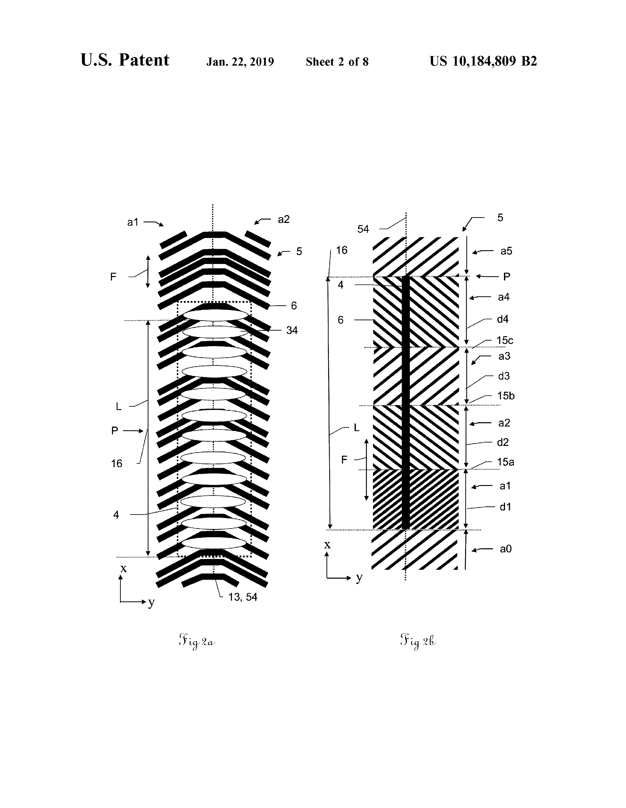
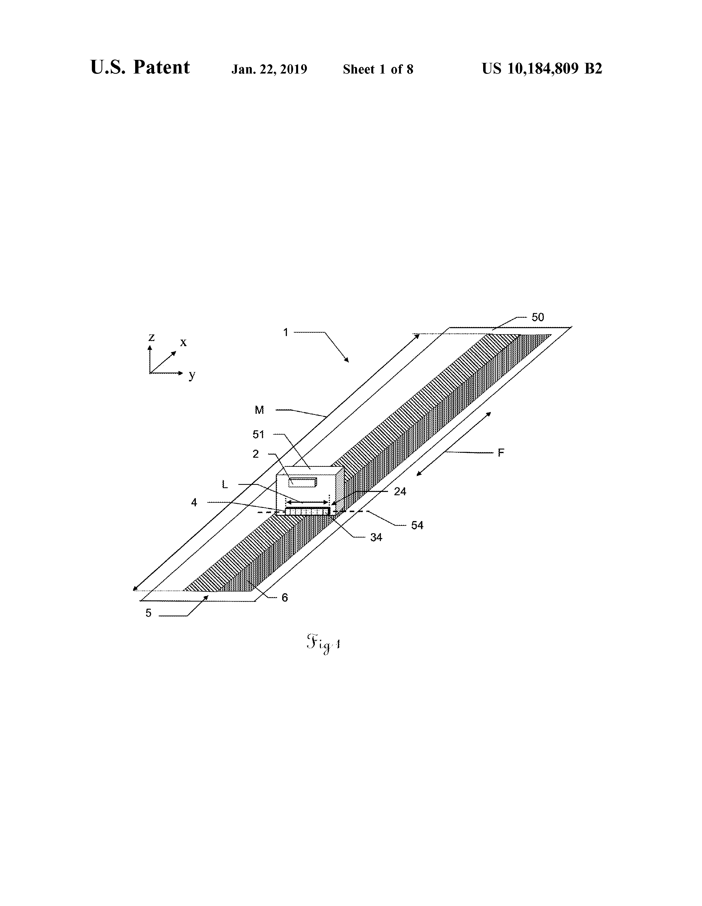

# US10184809B2 — 2D 코드 패턴으로 이상 상태로부터의 편차까지 구하는 위치 결정 시스템 (Hexagon)

| 항목 | 내용 |
|---|---|
| 원문 | `US10184809.pdf`(등록, 2019-01-22) · `US20160258786.pdf`(공개, 2016-09-08) |
| 출원인 | Hexagon Technology Center GmbH (발명자 Robert Fritsch, Knut Siercks) |
| 우선일 | 2015-03-06 (EP 15157967) · 출원 2016-02-23 · 유럽 대응 EP3064902B1 |
| 분류 | CPC G01D 5/34746, G01D 5/2449, G01D 5/24476 |
| 청구항 | 20항 |
| 핵심 | 이동 방향을 따라 뻗은 2D 패턴의 요소들이 위치마다 서로 다른 **코드 워드**를 이루어 위치를 절대값으로 부호화한다(절대 위치 코드 트랙). 라인 센서가 읽은 신호로 절대 위치를 얻고, 같은 코드 워드로 **센서가 패턴에 대해 이상 상태(정렬)에서 벗어난 편차**(오프셋·기울어짐 등 자유도)도 구한다. 좌표측정기(CMM)·선형 인코더에 적용. |
| 관련도 | △ 참고 (센서가 라인 센서이고 대상이 인코더 스케일. 반복 무늬의 절대 부호화 원리만 같음) |
| 해결 P# | P1(반복 무늬 대신 위치마다 다른 코드 워드 → 대응 모호성 없음), P4 일부(정렬 편차를 같은 신호로 추정) |
| 본 과제와의 관계 | 논문 결과서 05번(PuzzleBoard)과 같은 "주기 패턴 + 절대 부호" 원리의 산업용 인코더 사례. QR 판을 바꾸지 않는 본 과제에는 직접 적용하지 않고 원리 근거로만 쓴다. |
| 링크 | [Google Patents](https://patents.google.com/patent/US10184809B2/en) · [USPTO PDF](https://image-ppubs.uspto.gov/dirsearch-public/print/downloadPdf/10184809) |

---

## 상세 요약 (원문 PDF 기준, 번역본 없음)

### 1. 해결하려는 문제
- 증분형 위치 측정은 재시작 때 기준 위치로 다시 가야 한다. 절대형은 이 문제가 없지만, 실제로는 센서가 패턴에 대해 이동 방향 외 다른 자유도(오프셋, 기울어짐, 비틀림)로도 어긋나 측정 오차가 생긴다(배경기술, 원문 1단).
- 종래(US6333511)는 이 편차를 구하려면 별도 패턴·센서가 필요했다.

### 2. 핵심 구성
| 구성 | 부호 | 역할 |
|---|---|---|
| 제1 센서(라인 센서) | 4 | 주사 길이 L, 제1 주사 헤드(2)에 내장 |
| 제1 2D 패턴 | 5·6 | 이동 방향 F로 뻗음, 기울기·주기·형태가 다른 패턴 요소 영역(a0~a5, d1~d4)이 이어져 코드 워드를 형성 |
| 제어·평가부 | — | 주사 신호 ↔ 절대 위치 복호 정보, 주사 신호로 이상 상태 대비 편차를 구하는 정보를 저장 |

### 3. 동작 순서
1. 센서가 현재 위치의 패턴 일부(최소 두 영역)를 읽어 주사 신호를 만든다.
2. 영역 종류의 순서(와 영역 길이)로 코드 워드를 구성 → 절대 위치 복호.
3. 같은 신호에서 패턴 요소의 기울기·간격 변화로 센서의 정렬 편차(자유도별)를 계산.
4. 센서 둘을 정해진 거리로 두면 모든 자유도의 편차를 구한다(청구항 6~8).

### 4. 청구항 요지
- 청구항 1: 이동 방향 위치마다 다른 코드 워드를 이루는 2D 패턴, 이를 읽는 센서, 주사 신호로 절대 위치를 정하는 복호 정보와 이상 상태로부터의 편차를 정하는 정보를 저장한 제어·평가부.
- 청구항 2: 라인 센서. 3~5: 영역 종류·길이의 순서로 코드 워드 형성. 6~8: 두 번째 센서로 모든 자유도 편차. 9~10: 선형 인코더 형태의 측정 장치.

### 5. 대표 도면

*도 2a·2b — 기울기가 다른 패턴 요소 영역(a·d)이 이어져 위치마다 다른 코드 워드를 이루는 2D 패턴과 센서 주사 길이 L*

*도 1 — 이동 방향 F를 따라 뻗은 패턴(5)과 라인 센서(4)를 가진 주사 헤드(2)*

### 6. 본 과제(Y·Θ 얼라인먼트)와 비교
- 같은 점: 반복적인 패턴 요소에서 위치를 절대값으로 얻기 위해 국소 패턴 자체에 부호를 넣는다(QR 디코딩 기반 536점과 같은 원리).
- 다른 점: 1차원 이동(인코더)용, 라인 센서. 부화소 정밀도 수치 없음.
- 본 과제에서 할 일: P1-3(디코딩 실패 대비 경로)의 설계 원칙 근거 — "점의 ID는 국소 무늬가 아닌 부호에서 온다"는 원칙을 유지하고, 디코딩이 안 될 때만 파인더 호모그래피로 ID를 옮긴다.
