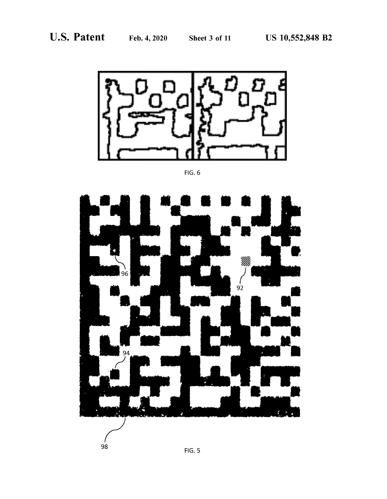

# 이상 격자로부터의 편차로 바코드 진위를 판정하는 방법 (US10552848B2)

- 원제: METHOD AND SYSTEM FOR AUTHENTICATING A PRINTED ITEM
- 원문: 같은 폴더의 `US10552848.pdf`, https://patents.google.com/patent/US10552848B2/en
- 출원인: 시스테크 솔루션즈 (Sys-Tech Solutions, Inc., 발명자 Michael L. Soborski)
- 등록일: 2020-02-04 (미국 특허 US 10,552,848 B2)
- 번역 기준: USPTO 등록본 PDF 직접 판독 및 국문 번역 수록
- 도면: `도면/` 폴더 내 도면 삽입

---

## 요약

본 발명은 인쇄된 바코드(예: 2차원 DataMatrix 또는 QR 코드)의 미세한 인쇄 오차를 고유한 물리적 복제 불가능 기능(PUF) 서명으로 활용하여 제품의 진위를 판정하는 방법 및 시스템에 관한 것이다. 인쇄 공정(잉크젯, 열전사 등)에서 발생하는 미세한 물리적 변동으로 인해 바코드 내부 각 모듈(module)의 실제 위치는 수학적으로 이상적인 격자(idealized grid) 위치로부터 미세하게 벗어나게 된다. 본 발명은 원본 바코드 화상으로부터 각 모듈의 중심 위치를 정밀 검출하고, 이상 격자와의 위치 편차 벡터들을 추출하여 암호화된 기준 서명(signature) 데이터로 등록한다. 이후 유통 또는 검사 과정에서 촬상된 후보 바코드로부터 동일한 방식으로 모듈별 격자 편차를 추출하고, 등록된 기준 서명과 통계적 상관 비교를 수행함으로써 위조품이나 무단 복제 라벨을 100%에 가까운 신뢰도로 판별한다.

---

## 청구범위

청구하는 발명은 다음과 같다.

1. 인쇄된 물품의 진위를 판정하기 위한 방법으로서,
제1 물품 상에 인쇄된 원본 2차원 바코드의 제1 화상을 획득하는 단계로서, 상기 원본 2차원 바코드는 복수의 모듈을 포함하고 상기 복수의 모듈은 식별 데이터를 인코딩하는, 단계;
프로세서에 의해, 상기 원본 2차원 바코드의 상기 제1 화상으로부터 상기 복수의 모듈 각각의 실제 위치와 이상적인 격자(idealized grid) 상의 대응하는 공칭 위치 사이의 차이에 근거하는 제1 고유 편차 특성을 도출하는 단계;
상기 도출된 제1 고유 편차 특성을 상기 식별 데이터와 연계된 기준 서명 데이터로서 저장하는 단계;
검사 대상인 제2 물품 상의 후보 2차원 바코드의 제2 화상을 획득하는 단계;
상기 프로세서에 의해, 상기 후보 2차원 바코드의 상기 제2 화상으로부터 상기 후보 2차원 바코드의 모듈들의 실제 위치와 상기 이상적인 격자 상의 대응하는 공칭 위치 사이의 차이에 근거하는 제2 편차 특성을 도출하는 단계;
상기 후보 2차원 바코드로부터 디코딩된 식별 데이터에 근거하여 상기 저장된 기준 서명 데이터를 조회하는 단계; 및
상기 제2 편차 특성을 상기 조회된 제1 고유 편차 특성과 비교하여 상기 제2 물품의 진위를 판정하는 단계를 포함하는, 방법.

2. 제1항에 있어서,
상기 원본 2차원 바코드는 의약품 포장, 반도체 부품, 또는 보안 라벨 상에 인쇄되는, 방법.

3. 제1항에 있어서,
상기 이상적인 격자는 상기 바코드의 외곽 정렬 경계(L-자형 파인더 패턴 또는 타이밍 패턴)에 근거하여 호모그래피 투영 변환을 적용함으로써 구성되는, 방법.

4. 제1항에 있어서,
상기 제1 고유 편차 특성은 상기 모듈 중심들의 이상 격자 교점 대비 수평(X) 및 수직(Y) 변위 편차 벡터들을 포함하는, 방법.

5. 제1항에 있어서,
상기 후보 2차원 바코드의 제2 화상은 모바일 통신 단말기의 카메라에 의해 촬상되는, 방법.

6. 제1항에 있어서,
상기 바코드의 리드-솔로몬(Reed-Solomon) 에러 정정 복호화 결과 국부적 오염이나 손상이 식별된 경우, 상기 손상된 영역에 위치하는 모듈들의 편차 데이터는 상기 비교 단계에서 제외되는, 방법.

7. 제1항에 있어서,
상기 비교는 상기 제1 고유 편차 특성과 상기 제2 편차 특성 간의 정규화 상관 계수(NCC) 또는 평균 제곱 오차(MSE)를 계산하여 미리 설정된 진위 판정 임계값과 비교하는 것을 포함하는, 방법.

---

## 상세한 설명

### 기술 배경 및 과제

의약품, 전자부품, 정밀 기계 부품 등에서 위조품 유통을 방지하기 위해 2차원 바코드(DataMatrix, QR 코드)가 널리 사용되고 있다. 그러나 일반적인 바코드는 상용 스캐너로 데이터를 복사한 후 고해상도 프린터로 재인쇄하면 외형 및 디코딩 데이터가 완벽히 복제되는 취약점을 갖는다. 특수 보안 잉크(형광, 자기 잉크)나 홀로그램을 추가하는 방식은 단가가 높고 전용 판독 장비가 필요하다.

본 발명은 인쇄 헤드의 기계적 진동, 잉크젯 노즐의 미세 분사 편차, 용지 섬유질의 불균일성 등으로 인해 인쇄되는 모든 2D 바코드가 미시적으로는 완전히 고유한 모듈 위치 편차(인쇄 지문)를 갖는다는 점에 착안하였다.

*도 5 및 도 6 — 2D 바코드 모듈의 위치 및 형상이 수학적으로 이상적인 직교 격자 좌표로부터 미세하게 편차를 일으키는 현상을 확대한 설명도.*

### 이상 격자 수립 및 모듈 편차 추출 원리

1. **외곽 테두리 검출 및 투영 보정**: 바코드의 외곽 파인더 패턴(예: DataMatrix의 실선 L-패턴 또는 QR 코드의 3개 파인더)을 서브픽셀 정밀도로 검출한다. 이를 기반으로 원근 왜곡이 보정된 정규화 평면 상의 **이상적인 직교 격자(Idealized Grid)**를 수학적으로 수립한다.
2. **모듈 중심 좌표 추출**: 바코드 내부의 각 데이터 모듈(흑색 및 백색 셀)에 대하여 서브픽셀 무게중심 또는 2차 표면 피팅을 통해 실제 중심 좌표 $(x_{i,j}, y_{i,j})$를 산출한다.
3. **편차 벡터(Residual) 산출**: 이상 격자 상의 이론적 교점 좌표 $(X_{i,j}^{\text{ideal}}, Y_{i,j}^{\text{ideal}})$와의 차이 벡터를 계산한다:
   $$\Delta x_{i,j} = x_{i,j} - X_{i,j}^{\text{ideal}}$$
   $$\Delta y_{i,j} = y_{i,j} - Y_{i,j}^{\text{ideal}}$$
   이 편차는 인쇄 설비의 불완전성에 기인한 0.05~0.5 화소 수준의 미세한 물리적 고유 특성(인쇄 지문)을 형성한다.

### 진위 판정 알고리즘

- 추출된 2차원 편차 배열은 고유 해시 또는 벡터 서명(Signature)으로 압축되어 중앙 데이터베이스에 바코드 시리얼 번호와 함께 등록된다.
- 현장 검사자가 스마트폰이나 검사 카메라로 바코드를 촬상하면, 동일한 알고리즘을 거쳐 후보 편차 배열이 추출된다.
- 중앙 서버에서 조회된 기준 서명과 후보 편차 간의 상관도를 비교한다. 진품인 경우 95% 이상의 높은 상관 계수를 나타내지만, 복제 인쇄된 가짜 바코드는 인쇄 과정이 달라 전혀 무관한 편차 분포를 보이므로 즉각 위조로 판정된다.

### 반도체 정렬 및 QR 정밀도에의 시사점

본 발명이 개시하는 "모듈 중심과 이상 격자 간의 잔차(Residual) 분석"은 ISO/IEC 15415 규격의 격자 불균일성(Grid Nonuniformity) 평가와 일맥상통한다. 본 과제(SEMES Y-Theta 얼라인먼트) 관점에서 볼 때:
1. QR 마커 판 자체의 인쇄 오차는 위치마다 고정된 모듈 잔차로 존재하므로, 영점(Center) 영상과 변위 영상의 차분을 취함으로써 인쇄 고정 오차를 상쇄시킬 수 있다.
2. QR 모듈들의 이상 격자 피팅 잔차의 평균제곱근(RMS) 크기를 모니터링함으로써, 마커의 기울어짐, 국부적 오염, 또는 광학계 디포커스를 진단하는 강력한 신뢰도 게이트 지표로 활용할 수 있다.
