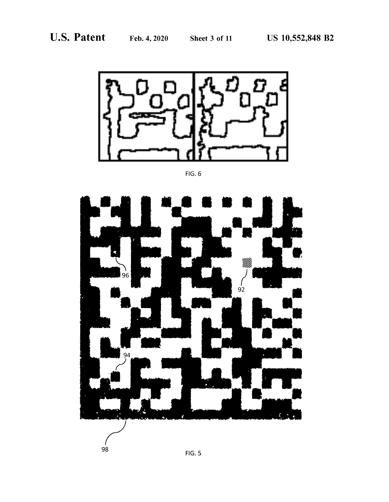

# US10552848B2 — 이상 격자로부터의 편차로 바코드 진위를 판정하는 방법 (Sys-Tech Solutions)

| 항목 | 내용 |
|---|---|
| 원문 | `US10552848.pdf`(등록, 2020-02-04) · `US20190354994.pdf`(공개, 2019-11-21) |
| 출원인 | Sys-Tech Solutions, Inc. (발명자 Michael L. Soborski) |
| 출원 | 2019-08-01. US 15/491,523(US10380601, 2017-04-19 출원)의 계속 출원이며 그 앞 계열은 표지 "Related U.S. Application Data (Continued)"에 이어짐(최초 우선일은 Google Patents 접근 제한으로 미확인) |
| 청구항 | 7항 (독립 1) |
| 핵심 | 2D 바코드(DataMatrix 등) 영상에서 **각 모듈의 위치가 이상 격자(idealized grid)에서 벗어난 편차**를 재어 서명 데이터로 저장하고, 후보 바코드의 편차와 비교해 진품 여부를 판정한다. |
| 관련도 | △ 참고 (목적이 위조 판별. 모듈 위치를 격자 모델에 맞추고 잔차를 재는 측정 단계만 관련) |
| 해결 P# | P3·P6 (모듈 격자 맞춤 잔차를 품질·식별 지표로 사용) |
| 본 과제와의 관계 | 논문 결과서 P6에서 인용한 ISO/IEC 15415 grid nonuniformity와 같은 "모듈 중심 ↔ 이상 격자 편차" 측정을 특허 청구항으로 확인한 사례. 인쇄 오차로 생긴 모듈 편차가 바코드마다 고유하다는 점은, 본 과제에서 QR 판 자체의 인쇄 편차가 점별 고정 오프셋으로 남는다는 근거가 된다. |
| 링크 | [Google Patents](https://patents.google.com/patent/US10552848B2/en) · [USPTO PDF](https://image-ppubs.uspto.gov/dirsearch-public/print/downloadPdf/10552848) |

---

## 상세 요약 (원문 PDF 기준, 번역본 없음)

### 1. 해결하려는 문제
- 인쇄된 표식(바코드)의 위조를 별도 보안 인쇄 없이 가려내야 한다. 인쇄 과정에서 생기는 미세 결함(모듈 위치 편차, 색·모양 등)은 원본마다 고유하고 복제가 어렵다.

### 2. 핵심 구성
| 구성 | 부호 | 역할 |
|---|---|---|
| 영상 획득 장치 | 58 | 원본(20)·후보(30) 바코드 촬영 |
| 서명 추출·부호화 프로세서 | 74 | 모듈 위치의 이상 격자 대비 편차 등 특징을 서명 데이터로 부호화 |
| 서명 저장소·조회 엔진 | 76·78 | 바코드 식별자로 색인 |
| 서명 비교 프로세서 | 80 | 원본·후보 서명 비교 → 진위 판정 |

### 3. 동작 순서
1. 원본 바코드 촬영 → 모듈별 위치의 이상 격자 대비 편차 측정 → 서명 저장(식별자로 색인).
2. 후보 바코드 촬영 → 같은 방식으로 편차 측정 → 저장된 서명과 비교 → 진품/위조 판정.
3. 오류 정정이 일부 영역 손상을 알려 주면 그 영역의 서명은 무시할 수 있다(원문 28단 1~4행).

### 4. 청구항 요지
- 청구항 1: 원본 바코드 영상에서 모듈 위치의 이상 격자 대비 편차를 구해 서명으로 저장하고, 후보 바코드의 같은 편차와 비교해 진위를 판정.
- 청구항 2~4: 원본을 물품·라벨에 부착. 5: 휴대폰 영상. 6·7: 바코드 판독 식별자로 서명 색인·조회.

### 5. 대표 도면

*도 5·6 — 2D 바코드 모듈의 위치·형상 편차(인쇄 결함) 예*

### 6. 본 과제(Y·Θ 얼라인먼트)와 비교
- 같은 점: QR·DataMatrix 모듈 위치를 이상 격자에 맞추고 그 잔차를 다룬다.
- 다른 점: 목적이 위조 판별, 정밀도 수치 없음.
- 본 과제에서 할 일
  - P6-1: 게이트 ①단계에 "QR별 이상 격자(호모그래피) 맞춤 잔차"를 품질 지표로 넣는 근거.
  - P3 참고: 인쇄 편차는 판마다 고정이라 center 영상 대비 상대 변위를 쓰는 현재 방식에서는 상쇄된다. 판을 교체하면 center를 다시 찍어야 한다는 운용 조건으로 결과서에 남긴다.
