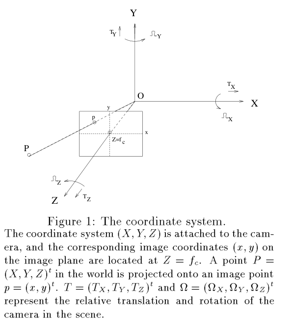
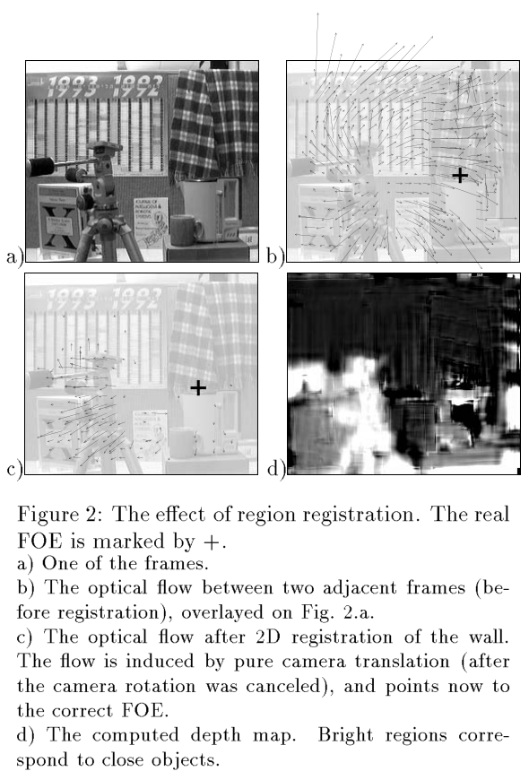
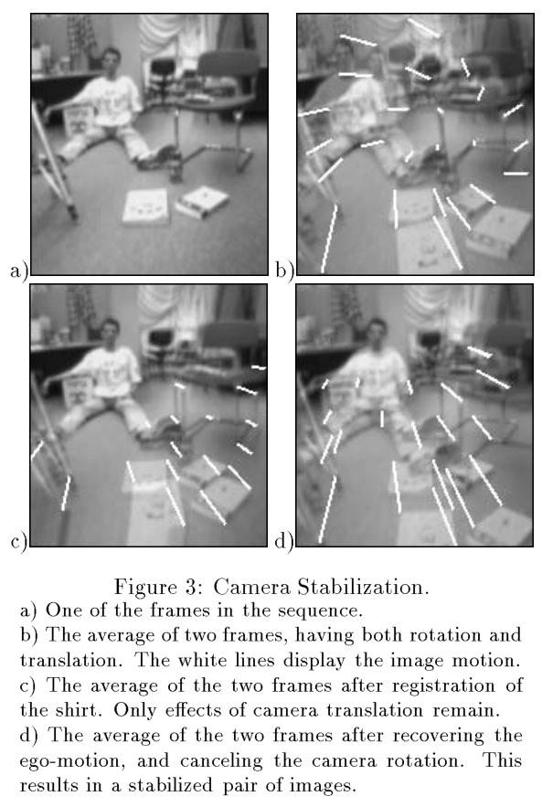

# 영상 안정화를 이용한 자기 운동 복원 (Irani 1994)

- 원제: Recovery of Ego-Motion Using Image Stabilization
- 원문: 같은 폴더의 `Irani1994_CVPR_ego-motion_image_stabilization.pdf` (Michal Irani, Benny Rousso, Shmuel Peleg, Hebrew University of Jerusalem / CVPR 1994)
- 번역 범위: 전문 (초록, 1~5장, 감사의 글, 각주. 참고문헌은 원문 그대로)
- 비고: 원인분석/논문/03번과 같은 원문(학회판)의 번역
- 그림: 원문 그림 3개를 `그림/`에 넣고 본문에서 처음 언급되는 곳에 삽입

## 초록 (Abstract)

정적 장면에서 3차원 카메라 운동(자기 운동, ego-motion)을 계산하는 방법을 소개한다. 이 방법은 영상 밝기값(image intensity)으로부터 단일 영상 영역의 2차원 영상 운동을 직접 계산하는 데 기반한다. 계산된 이 영상 영역의 영상 운동으로 영상들을 정합(register)하여, 검출된 영상 영역이 정지해 보이도록 한다. 그 결과 정합된 프레임 사이에서 장면 전체의 변위장(displacement field)은 카메라의 3차원 평행이동(translation)에만 영향을 받는다. 이러한 2차원 영상 정합으로 카메라 회전(rotation)의 영향을 상쇄한 뒤, 평행이동만 남은 정합 프레임 집합에서 확장 초점(focus-of-expansion, FOE)을 찾아 3차원 카메라 평행이동을 계산한다. 이어서 카메라 회전을 계산하여 자기 운동 계산을 완료한다.

제시한 방법은 광류(optical flow) 계산과 특징 매칭(feature matching)에 내재한 문제를 피하며, 사전 특징 검출이나 특징 대응을 전혀 가정하지 않는다.

## 1. 서론 (Introduction)

영상 시퀀스에서 관측되는 운동은 카메라 운동(자기 운동)과 장면 안에서 움직이는 물체의 운동으로 생길 수 있다. 이 논문은 정적 장면에서 카메라가 움직이는 경우를 다룬다. 각 화소의 영상 운동은 카메라 운동의 여섯 파라미터 외에도 대응하는 장면 점의 깊이에 의존하므로, 완전한 3차원 운동 추정은 어렵다. 이 어려움을 극복하기 위해 보통 운동 모델이나 환경 모델에 추가 제약을 둔다.

3차원 운동은 흔히 두 프레임 사이에서 얻은 광류나 법선 흐름(normal flow)으로부터 [1, 12, 22], 또는 연속 프레임에서 추출한 두드러진 특징(점, 선, 윤곽)의 대응으로부터 [10, 13, 7] 추정된다. 두 접근 모두 특징 검출의 정확도에 의존하는데, 이 정확도는 언제나 보장되지는 않는다. 영상 밝기값에서 자기 운동을 직접 계산하는 방법도 제안되었다 [11, 14].

카메라 회전과 평행이동은 비슷한 영상 운동을 유발할 수 있어 [2, 8] 해석에 모호성(ambiguity)을 일으킨다. 그러나 깊이 불연속(depth discontinuity)에서는 카메라 회전의 효과와 평행이동의 효과를 구별하기가 훨씬 쉽다. 깊이가 다른 이웃 화소들의 영상 운동은 회전 성분은 비슷하지만 평행이동 성분은 다르기 때문이다. 운동 시차(motion parallax) 방법은 이 효과를 이용해 3차원 카메라 운동을 구한다 [18, 17, 7]. 다른 방법들은 운동 시차를 형상 표현과 분석에 사용한다 [23, 6, 9].

이 논문에서는 영상 밝기값으로부터 자기 운동을 직접 계산하는 방법을 소개한다. 먼저 2차원 영상 운동만 추출하고, 이후 이 2차원 운동을 이용해 3차원 자기 운동 계산을 단순화한다.

단일 영상 영역을 검출·추적하고 그 2차원 파라메트릭(parametric) 영상 운동을 계산하는 데에는 앞서 개발한 방법 [15, 16]을 사용한다. 단일 영상 영역의 2차원 파라메트릭 영상 운동만으로는 3차원 카메라 운동을 복원할 수 없다는 점을 강조해 둔다. 그러한 3차원 해석이 두어 개 존재하기 때문이다 [20]. 평면 곡면의 3차원 운동은 영상에서의 2차원 아핀(affine) 운동과 운동 미분(motion derivative)으로부터 계산할 수 있음이 밝혀졌으나 [21], 운동 미분은 잡음에 대한 민감성을 끌어들인다. 더욱이 영상 운동장으로부터 3차원 카메라 운동을 직접 복원하는 문제는 조건이 나쁜(ill-conditioned) 문제이다. 2차원 흐름장의 작은 오차가 보통 3차원 운동의 큰 섭동으로 이어지기 때문이다 [2].

자기 운동 계산의 어려움과 모호성을 극복하기 위해 다음 방식을 도입한다. 검출된 영상 영역에서 계산한 2차원 영상 운동을 사용해 첫 프레임을 둘째 프레임 쪽으로 워핑(warp)한다. 이 정합은 *장면 전체*에 대해 카메라 회전의 효과를 상쇄하며, 두 *정합된* 프레임 사이에 남는 영상 변위는 오직 카메라의 3차원 평행이동 때문이다. 이 평행이동은 두 *정합된* 프레임 사이의 FOE(확장 초점)를 찾아 계산한다. 3차원 평행이동을 알면, 이를 검출된 영상 영역의 2차원 운동 파라미터와 함께 사용해 *선형* 방정식 집합을 풀어 카메라의 3차원 회전을 계산할 수 있다.

이 연구에서 쓴 2차원 영상 영역 정합 기법은 정합 뒤에 운동 시차 정보만 남으므로 평행이동 운동과 회전 운동을 쉽게 분리(decoupling)할 수 있게 한다. 운동 시차를 쓰는 다른 방법들 [18, 19, 17, 7]과 달리, 이 방법은 깊이 불연속 부근에서 계산되어 부정확한 2차원 운동 정보에 의존하지 않고 영상 전체에서 계산한 운동에 의존한다. 운동 시차의 효과는 정합된 영상 영역에 해당하는 3차원 곡면의 *연장면* 위에 있지 않은 모든 장면 점에서 얻어진다. 이 장면 점들은 정합된 3차원 곡면에 인접할 필요가 *없으므로*, *조밀한(dense)* 시차 데이터가 얻어진다.

이 기법의 장점은 단순성과 강건성에 있다. 사전 검출과 매칭을 가정하지 않고, 작은 선형 방정식 집합만 풀면 되며, 각 계산 단계는 수치적으로 안정한 과결정(overdetermined) 문제로 세워진다.

> 각주: 이 연구는 미국 해군연구청(U.S. Office of Naval Research)의 지원(Grant N00014-93-1-1202, R&T Project Code 4424341---01)을 받았다.
> 각주 †: M. Irani는 현재 David Sarnoff Research Center에 있다.

## 2. 2차원 영상 운동으로부터의 자기 운동 (Ego-Motion from 2D Image Motion)

이 절에서는 단일 영상 영역의 2차원 파라메트릭 운동이 주어졌을 때 3차원 자기 운동을 계산하는 기법을 설명한다. 단일 영상 영역의 2차원 운동을 자동으로 계산하는 방법은 4장에서 간략히 설명한다.

### 2.1 기본 모델과 표기 (Basic Model and Notations)

$(X, Y, Z)$를 카메라 기준 장면 점의 직교 좌표라 하고(그림 1 참고), $(x, y)$를 영상 평면에서의 대응 좌표라 하자. 영상 평면은 초점 거리 $Z = f_c$에 놓인다. 장면 점 $P = (X, Y, Z)^t$가 영상 평면의 점 $p = (x, y)^t$로 투영되는 원근 투영(perspective projection)은 다음과 같다.

*그림 1 — 좌표계. 좌표계 $(X, Y, Z)$는 카메라에 붙어 있고, 영상 평면 위의 대응 영상 좌표 $(x, y)$는 $Z = f_c$에 놓인다. 세계의 점 $P = (X, Y, Z)^t$는 영상 점 $p = (x, y)^t$로 투영된다. $T = (T_X, T_Y, T_Z)^t$와 $\Omega = (\Omega_X, \Omega_Y, \Omega_Z)^t$는 장면 안에서 카메라의 상대 평행이동과 회전을 나타낸다.*

$$
p = \begin{bmatrix} x \\ y \end{bmatrix} = \begin{bmatrix} \frac{X}{Z} f_c \\ \frac{Y}{Z} f_c \end{bmatrix} \qquad (1)
$$

카메라 운동은 두 성분, 즉 평행이동 $T = (T_X, T_Y, T_Z)^t$와 회전 $\Omega = (\Omega_X, \Omega_Y, \Omega_Z)^t$를 가진다.

카메라 운동 때문에 장면 점 $P = (X, Y, Z)^t$는 카메라에 대해 회전 $-\Omega$와 평행이동 $-T$로 움직이는 것처럼 보이며, 따라서 새로운 세계 좌표 $P' = (X', Y', Z')^t$에서 관측된다.

$$
\begin{bmatrix} X' \\ Y' \\ Z' \end{bmatrix} = M_{-\Omega} \cdot \begin{bmatrix} X \\ Y \\ Z \end{bmatrix} - T \qquad (2)
$$

여기서 $M_{-\Omega}$는 $-\Omega$만큼의 회전에 해당하는 행렬이다.

시야(field of view)가 아주 넓지 않고 카메라 운동의 회전이 비교적 작을 때 [1], 영상 평면에서 영상 점 $(x, y)$의 2차원 변위 $(u, v)$는 다음과 같이 표현할 수 있다 [20, 3].

$$
\begin{bmatrix} u \\ v \end{bmatrix} = \begin{bmatrix} -f_c\left(\frac{T_X}{Z} + \Omega_Y\right) + x\frac{T_Z}{Z} + y\,\Omega_Z - x^2\frac{\Omega_Y}{f_c} + xy\frac{\Omega_X}{f_c} \\ -f_c\left(\frac{T_Y}{Z} - \Omega_X\right) - x\,\Omega_Z + y\frac{T_Z}{Z} - xy\frac{\Omega_Y}{f_c} + y^2\frac{\Omega_X}{f_c} \end{bmatrix} \qquad (3)
$$

식 (3)에서 다음을 알 수 있다.

- 모든 평행이동 항이 미지의 깊이 $Z$로 나누어져 있으므로, 평행이동의 방향만 복원할 수 있고 크기는 복원할 수 없다.
- 카메라 *회전*이 영상 점의 변위에 기여하는 부분은 대응 장면 점의 깊이 $Z$와 *무관*하다.

3차원 장면에서 평면 곡면 위의 모든 점 $(X, Y, Z)$는 평면 방정식 $Z = A + B\cdot X + C\cdot Y$를 만족하며, 식 (1)을 이용해 영상 좌표로 다음과 같이 나타낼 수 있다.

$$
\frac{1}{Z} = \alpha + \beta\cdot x + \gamma\cdot y. \qquad (4)
$$

[1]과 비슷한 조작으로, 식 (4)를 식 (3)에 대입하면 다음을 얻는다.

$$
\begin{bmatrix} u \\ v \end{bmatrix} = \begin{bmatrix} a + b\cdot x + c\cdot y + g\cdot x^2 + h\cdot xy \\ d + e\cdot x + f\cdot y + g\cdot xy + h\cdot y^2 \end{bmatrix} \qquad (5)
$$

여기서

$$
\begin{aligned}
a &= -f_c\alpha T_X - f_c\Omega_Y & e &= -\Omega_Z - f_c\beta T_Y \\
b &= \alpha T_Z - f_c\beta T_X & f &= \alpha T_Z - f_c\gamma T_Y \\
c &= \Omega_Z - f_c\gamma T_X & g &= -\frac{\Omega_Y}{f_c} + \beta T_Z \\
d &= -f_c\alpha T_Y + f_c\Omega_X & h &= \frac{\Omega_X}{f_c} + \gamma T_Z
\end{aligned} \qquad (6)
$$

식 (5)는 여덟 파라미터 $(a, b, c, d, e, f, g, h)$로 표현되는 영상 평면의 2차원 파라메트릭 운동을 기술하며, 작은 시야와 작은 회전을 가정할 때 장면 안 평면 곡면의 일반적인 3차원 운동에 대응한다. 이 가정 아래에서 식 (5)는 2차원 사영 변환(projective transformation)의 좋은 근사이므로, 이를 *의사 2차원 사영(pseudo 2D projective)* 변환이라 부른다.

### 2.2 알고리즘의 전체 틀 (General Framework of the Algorithm)

이 절에서는 2차원 운동 계산의 강건성을 활용해 연속한 두 프레임 사이의 3차원 운동을 계산하는 방식을 제시한다.

1. 단일 영상 영역을 자동으로 검출하고, 그 2차원 *파라메트릭* 영상 운동을 계산한다(4장).
2. 검출된 영상 영역의 계산된 2차원 파라메트릭 운동에 따라 두 프레임을 정합한다. 이 영상 영역 안정화는 *장면 전체*에 대해 카메라 운동의 회전 성분을 상쇄하며(2.3절), 이제 두 *정합된* 프레임 사이의 확장 초점으로부터 카메라 평행이동을 계산할 수 있다(2.4절).
3. 이어서 검출된 영상 영역의 2차원 운동 파라미터와 카메라의 3차원 평행이동이 주어진 상태에서 카메라의 3차원 회전을 계산한다(2.5절).

### 2.3 카메라 회전의 제거 (Eliminating Camera Rotation)

이 단계에서는 파라메트릭 2차원 영상 운동을 가진 단일 영상 영역이 검출되었고, 그 영역의 2차원 영상 운동이 계산되었다고 가정한다. *평면* 3차원 곡면에 대한 2차원 영상 운동의 자동 검출과 계산은 4장에서 설명한다.

$(u(x, y), v(x, y))$를 프레임 $f_1$에서 프레임 $f_2$로의 장면 전체의 2차원 영상 운동이라 하고, $(u_s(x, y), v_s(x, y))$를 두 프레임 사이 단일 영상 영역(*검출된* 영상 영역)의 2차원 영상 운동이라 하자. 2.1절에서 언급했듯이, 영상 영역이 3차원 장면의 *평면* 곡면의 영상이면 $(u_s, v_s)$는 영상 평면의 2차원 파라메트릭 변환(식 (5))으로 표현할 수 있다. $s$를 검출된 영상 영역의 3차원 곡면이라 하고, 그 깊이를 $Z_s(x, y)$라 하자. 평면 곡면의 2차원 운동 파라미터 $(u_s(x, y), v_s(x, y))$만 알려져 있다는 점에 유의한다. 평면 곡면의 3차원 위치나 운동 파라미터는 여전히 미지이다. $f_1^R$을 *전체 프레임으로 확장한* 2차원 파라메트릭 변환 $(u_s, v_s)$에 따라 프레임 $f_1$ 전체를 프레임 $f_2$ 쪽으로 워핑하여 얻은 프레임이라 하자. 이 워핑으로 검출된 평면 곡면의 영상 영역과 그와 공면(coplanar)인 장면 부분은 $f_1^R$과 $f_2$ 사이에서 정지해 보이게 된다. 워핑 과정에서 $f_1$의 각 화소 $(x, y)$는 $(u_s(x, y), v_s(x, y))$만큼 이동하여 $f_1^R$을 이룬다. 곡면 $s$ 위에 있지 않은 3차원 점(즉 $Z(x, y) \neq Z_s(x, y)$)은 $f_1^R$과 $f_2$ 사이에서 정합되지 *않는다*.

이제 정합된 프레임($f_1^R$과 $f_2$) 사이의 2차원 영상 운동이 카메라 평행이동 $T$에만 영향을 받음을 보인다.

$P_1 = (X_1, Y_1, Z_1)^t$를 $f_1$의 $p_1 = (x_1, y_1)^t$로 투영되는 3차원 장면 점이라 하자. 식 (1)에 따라 $P_1 = (x_1\frac{Z_1}{f_c}, y_1\frac{Z_1}{f_c}, Z_1)^t$이다. 프레임 $f_1$에서 $f_2$로의 카메라 운동 $(\Omega, T)$ 때문에 점 $P_1$은 프레임 $f_2$에서 $p_2 = (x_2, y_2)^t$에 관측되며, 이는 3차원 장면 점 $P_2 = (X_2, Y_2, Z_2)^t$에 대응한다. 식 (2)에 따라

$$
P_2 = \begin{bmatrix} X_2 \\ Y_2 \\ Z_2 \end{bmatrix} = M_{-\Omega}\cdot P_1 - T. \qquad (7)
$$

$f_1$을 $(u_s, v_s)$로 워핑해 $f_1^R$을 만드는 것은, 모든 3차원 점이 곡면 $s$ 위에 있다고(즉 깊이 $Z_s(x, y)$를 가진다고) 보고 카메라 운동 $(\Omega, T)$를 적용하는 것과 같다. $P_s$를 깊이 $Z_s(x, y)$를 가진 화소 $(x, y)$에 대응하는 곡면 $s$ 위의 3차원 점이라 하자. 그러면

$$
P_s = \begin{bmatrix} x_1\frac{Z_s}{f_c} \\ y_1\frac{Z_s}{f_c} \\ Z_s \end{bmatrix} = \frac{Z_s}{Z_1}\cdot\begin{bmatrix} X_1 \\ Y_1 \\ Z_1 \end{bmatrix} = \frac{Z_s}{Z_1}\cdot P_1 . \qquad (8)
$$

영상 워핑 뒤 $P_s$는 $f_1^R$에서 $p^R = (x^R, y^R)^t$에 관측되며, 이는 3차원 장면 점 $P^R$에 대응한다. 따라서 식 (2)와 식 (8)에 따라

$$
P^R = M_{-\Omega}\cdot P_s - T = \frac{Z_s}{Z_1}\cdot M_{-\Omega}\cdot P_1 - T ,
$$

이고, 그러므로

$$
P_1 = \frac{Z_1}{Z_s}\cdot M_{-\Omega}^{-1}\cdot(P^R + T) .
$$

식 (7)을 이용하면

$$
\begin{aligned}
P_2 &= M_{-\Omega}\cdot P_1 - T \\
&= \frac{Z_1}{Z_s}\cdot M_{-\Omega}\cdot M_{-\Omega}^{-1}\cdot(P^R + T) - T \\
&= \frac{Z_1}{Z_s}\cdot P^R + \left(1 - \frac{Z_1}{Z_s}\right)\cdot(-T) ,
\end{aligned}
$$

이고, 그러므로

$$
P^R = \frac{Z_s}{Z_1}\cdot P_2 + \left(1 - \frac{Z_s}{Z_1}\right)\cdot(-T) . \qquad (9)
$$

식 (9)는 $P^R$과 $P_2$ 사이의 3차원 운동이 카메라 회전 $\Omega$의 영향을 받지 않고 평행이동 $T$의 영향만 받는다는 것을 보여 준다. 또한 $P^R$이 $P_2$와 $-T$를 지나는 직선 위에 있음을 보여 준다. 따라서 $P^R$의 영상 평면 투영($p^R$)은 $P_2$의 영상 평면 투영(즉 $p_2$)과 $-T$의 영상 평면 투영(FOE)을 지나는 직선 위에 있다. 이는 $p^R$이 FOE에서 $p_2$ 쪽으로 뻗은 방사선(radial line) 위에 있음을 뜻한다. 다시 말해, 정합된 프레임 $f_1^R$과 $f_2$ 사이의 운동(즉 $p^R - p_2$)은 FOE를 향하거나 FOE에서 멀어지는 방향이며, 따라서 카메라 평행이동 $T$에 의해 유발된다.

그림 2에는 장면 뒤쪽 벽에 해당하는 영상 영역의 계산된 2차원 운동 파라미터로 두 프레임을 정합하기 전과 후의 광류를 표시했다. 광류는 표시 목적으로만 제시했으며 정합에는 사용하지 *않았다*. 정합 뒤에는 *장면 전체*에서 광류의 회전 성분이 상쇄되었고, 모든 흐름 벡터가 실제 FOE를 가리킨다(그림 2.c). 정합 전(그림 2.b)에는 FOE가 엉뚱한 곳(프레임 가운데)에 있는 것처럼 잘못 보인다. 이는 Y축 회전이 시각적으로 X축 방향 평행이동처럼 보여 생기는 모호성 때문이다. 이 모호성은 2차원 정합으로 해소된다.

*그림 2 — 영역 정합의 효과. 실제 FOE는 +로 표시했다. a) 프레임 중 하나. b) 인접한 두 프레임 사이의 광류(정합 전)를 그림 2.a 위에 겹쳐 그린 것. c) 벽을 2차원 정합한 뒤의 광류. 이 흐름은 순수한 카메라 평행이동으로 생기며(카메라 회전이 상쇄된 뒤), 이제 올바른 FOE를 가리킨다. d) 계산된 깊이 지도. 밝은 영역은 가까운 물체에 해당한다.*

### 2.4 카메라 평행이동의 계산 (Computing Camera Translation)

검출된 영상 영역의 정합으로 회전이 상쇄되면, 3차원 회전으로 생긴 영상 운동과 3차원 평행이동으로 생긴 영상 운동 사이의 모호성은 더 이상 존재하지 않는다. 카메라 평행이동만 남으므로 흐름장은 FOE를 향하거나 FOE에서 멀어지는 방향을 가진다. 미지수가 영상 평면에서 FOE의 위치를 나타내는 두 개뿐이므로, 3차원 평행이동 계산은 과결정되고 수치적으로 안정해진다.

FOE를 찾기 위해 *정합된* 프레임 사이의 광류를 계산하고, [18]에 기술된 것과 비슷한 탐색 방법으로 FOE를 찾는다. FOE 후보를 반구(half sphere) 위에서 표본 추출하여 영상 평면에 투영한다. 각 후보에 대해, 후보 FOE에서 뻗어 나온 방사선으로부터 흐름장이 국소적으로 벗어난 정도를 모아 전역 오차 척도를 계산한다. 좋은 FOE 후보 주변에서 (구 위의) 표본 추출을 세분화하며 탐색 과정을 반복한다. 몇 차례 세분화 반복 뒤에 오차가 가장 작은 후보를 FOE로 취한다.

*순수 평행이동* 흐름장에서 FOE를 찾는 문제는 고도로 과결정된 문제이므로, 계산된 흐름장이 정확할 필요는 *없다*. 이는 흐름장에서 자기 운동을 계산하려는 대부분의 방법이 회전-평행이동 모호성을 해소하기 위해 *정확한* 흐름장을 요구하는 것과 대조된다.

### 2.5 카메라 회전의 계산 (Computing Camera Rotation)

$(a, b, c, d, e, f, g, h)$를 식 (5)로 표현된, 검출된 영상 영역에 대응하는 3차원 평면 곡면의 2차원 운동 파라미터라 하자. 이 2차원 운동 파라미터와 카메라의 3차원 평행이동 파라미터 $(T_X, T_Y, T_Z)$가 주어지면, 카메라의 3차원 회전 파라미터 $(\Omega_X, \Omega_Y, \Omega_Z)$(그리고 평면 곡면 파라미터 $(\alpha, \beta, \gamma)$)는 *미지수 여섯 개*에 대한 *여덟 개*의 선형 방정식 집합인 식 (6)을 풀어 얻을 수 있다.

경험상, 4장에서 설명한 방법으로 계산한 의사 2차원 사영 변환의 파라미터 $g$와 $h$는 다른 여섯 파라미터 $(a, b, c, d, e, f)$만큼 신뢰할 수 없다. $g$와 $h$는 식 (5)에서 2차 항이기 때문이다. 따라서 가능할 때마다(식 (6)의 집합이 수치적으로 과결정일 때), 마지막 두 방정식($g$와 $h$에 대한 것)은 사용하지 않고 처음 여섯 개만 사용한다. 이렇게 하면 더 정확한 결과를 얻는다.

사실 카메라 회전을 복원하는 데 식 (6)의 여덟 방정식을 모두 써야 하는 유일한 경우는 카메라 평행이동이 영상 평면에 평행한 경우(즉 $\vec{T} \neq 0$이고 $T_Z = 0$)이다. 이것이 식 (6)의 처음 여섯 방정식만으로 회전 파라미터를 구할 수 없는 유일한 카메라 운동 구성이다. 그런데 이 경우 식 (6)의 처음 여섯 방정식만 쓰면(즉 신뢰할 수 있는 파라미터 $a, b, c, d, e, f$만 쓰고 신뢰할 수 없는 $g, h$는 버리면) $\Omega_Z$만 복원할 수 있다. 나머지 두 회전 파라미터 $\Omega_X$와 $\Omega_Y$를 복원하려면 2차 항 $g$와 $h$를 써야 한다. 이는 $T_Z = 0$인 평행이동이 존재하는 경우, 평행이동 파라미터 $(T_X, T_Y, T_Z)$와 회전 파라미터 하나 $\Omega_Z$(광축 둘레의 회전)만 정확히 복원할 수 있음을 뜻한다. 다른 두 회전 파라미터 $\Omega_X$와 $\Omega_Y$는 근사적으로만 구할 수 있다.

그 밖의 모든 카메라 운동 구성에서는 카메라 회전을 신뢰성 있게 복원할 수 있다.

### 2.6 실험 결과 (Experimental Results)

그림 2의 두 프레임 사이 카메라 운동(cm 단위)은 $(T_X, T_Y, T_Z) = (1.7, 0.4, 12)$, $(\Omega_X, \Omega_Y, \Omega_Z) = (0°, -1.8°, -3°)$였다. ($T_Z = 12$로 설정한 뒤) 카메라의 3차원 운동 파라미터를 계산한 결과는 $(T_X, T_Y, T_Z) = (1.68, 0.16, 12)$, $(\Omega_X, \Omega_Y, \Omega_Z) = (-0.05°, -1.7°, -3.25°)$였다.

카메라의 3차원 운동 파라미터를 계산하고 나면, [11]에서 제안한 것과 비슷한 방식으로 3차원 장면 구조를 재구성할 수 있다. 작은 영상 패치(현재 5 × 5 화소) 사이의 대응을 FOE에서 뻗어 나온 방사선을 따라서만(회전을 고려하여) 계산한다. 깊이 지도는 이 변위의 크기로부터 계산한다. 그림 2.d에 계산된 장면의 역깊이 지도($\frac{1}{Z(x,y)}$)를 표시했다.

## 3. 카메라 안정화 (Camera Stabilization)

카메라의 자기 운동이 결정되면, 이 정보를 이용해 마치 카메라가 자이로 안정화 장치(gyroscopic stabilizer)에 장착되었던 것처럼 촬영 후(post-imaging) 시퀀스 안정화를 할 수 있다.

예를 들어 완전한 안정화를 위해, 계산된 3차원 회전을 상쇄하도록 영상들을 첫 영상의 원래 자세로 되돌려 워핑할 수 있다. 회전은 깊이와 무관하므로 이러한 영상 워핑은 쉽게 수행할 수 있으며, 그 결과 3차원 평행이동만 담겨 마치 안정화된 플랫폼에서 찍은 것처럼 보이는 새 시퀀스가 얻어진다. 이러한 안정화의 예를 그림 3.d에 보였다. 또는 회전을 저역 통과 필터(low-pass filter)로 걸러, 결과 시퀀스가 떨림(jitter) 없이 부드러운 회전만 가진 것처럼 보이게 할 수도 있다.

*그림 3 — 카메라 안정화. a) 시퀀스의 프레임 중 하나. b) 회전과 평행이동을 모두 가진 두 프레임의 평균. 흰 선은 영상 운동을 나타낸다. c) 셔츠를 정합한 뒤 두 프레임의 평균. 카메라 평행이동의 효과만 남는다. d) 자기 운동을 복원하고 카메라 회전을 상쇄한 뒤 두 프레임의 평균. 그 결과 안정화된 영상 쌍이 얻어진다.*

## 4. 평면 곡면의 2차원 운동 계산 (Computing 2D Motion of a Planar Surface)

장면 안의 평면 곡면에 해당하는 영상 영역과 그 의사 2차원 사영 변환을 검출하기 위해 앞서 개발한 방법 [15, 16]을 사용한다. 이 방법들은 여러 개의 움직이는 *평면* 물체가 있다고 가정한 동적 장면을 다루었다. 영상 평면을 서로 다르게 움직이는 물체들로 분할(segmentation)하고, 그 2차원 영상 운동 파라미터를 계산했다.

이 연구에서는 2차원 검출 알고리즘을 사용해 단일 평면 곡면과 그 2차원 영상 운동 파라미터를 검출한다. 카메라 평행이동 때문에 깊이나 방향이 다른 평면들은 영상 평면에서 서로 다른 2차원 운동을 가지므로, 서로 다르게 움직이는 평면 물체로 식별된다. 장면이 조각별 평면(piecewise planar)이 아니더라도 평면 곡면을 포함하고 있으면, 2차원 검출 알고리즘은 여전히 그 평면 영역의 영상 운동을 검출한다.

이 절에서는 여러 움직이는 평면 물체를 검출하는 기법이 어떻게 하나의 평면 물체와 그 2차원 운동 파라미터에 고정(lock onto)되는지를 아주 간략히 설명한다. 자세한 내용은 [15, 16]에 있다.

장면에서 움직이는 평면 물체의 투영된 2차원 영상 운동 $(u(x, y), v(x, y))$는 식 (5)의 2차원 파라메트릭 변환으로 근사할 수 있다. 이 평면 물체의 지지 영역(region of support) $R$이 영상 평면에서 알려져 있다면, 연속한 두 프레임 $I(x, y, t)$와 $I(x, y, t+1)$ 사이 그 물체의 2차원 파라메트릭 영상 운동 $(u, v)$를 추정하는 것은 간단하다. 지지 영역 $R$에 대해 다음 오차 함수를 최소화하는 변환 $(u, v)$(식 (5) 참고)의 여덟 파라미터 $(a, b, c, d, e, f, g, h)$를 계산하면 된다 [16].

$$
Err^{(t)}(a, b, c, d, e, f, g, h) = \sum_{(x,y)\in R} (u I_x + v I_y + I_t)^2 . \qquad (10)
$$

오차 최소화는 가우시안 피라미드(Gaussian pyramid)를 이용해 반복적으로 수행한다 [4, 15, 16].

불행히도 평면 물체의 지지 영역 $R$은 미리 알려져 있지 않다. 오차 최소화 기법을 *영상 전체*에 적용하면 보통 무의미한 결과가 나온다.

그러나 2차원 운동이 $(u(x, y), v(x, y)) = (a, d)$로 표현되는 단순한 2차원 *평행이동*에 대해서는 그렇지 않다. [5]에서는 오차 함수 $Err^{(t)}(a, d) = \sum_{(x,y)}(u I_x + v I_y + I_t)^2$를 *영상 전체*에 대해 $a$와 $d$에 관해 최소화하여(역시 다해상도 자료 구조에서의 반복을 이용하여) 단일 *평행이동* 영상 영역의 운동 파라미터를 정확히 복원할 수 있음을 보였다. 이는 분석 영역 안에 다른 움직이는 물체가 있어도, 그리고 그들의 지지 영역에 대한 사전 지식이 없어도 가능하다. 이 물체를 *지배적 평행이동 물체(dominant translating object)*, 그 2차원 평행이동을 *지배적 2차원 평행이동(dominant 2D translation)*이라 부른다.

[15, 16]에서는 이 방법을 확장하여, 서로 다르게 움직이는 물체들 사이에서 단일 평면 물체의 *고차* 2차원 운동(2차원 아핀, 2차원 사영)을 계산했다. 계산된 지배적 2차원 운동에 해당하는 영역을 표시하는 분할 단계가 추가되었다. 이것이 영상에서 지배적 평면 물체의 영역이다.

단일 평면 물체와 그 2차원 영상 운동에 고정하는 방식은 점진적이다. 각 계산 단계에서 2차원 운동 모델의 복잡도를 높이고, 그에 따라 평면 물체의 분할을 세분화한다. 자세한 내용은 [16]에 있다. 평면 물체에 점진적으로 고정하는 데 사용하는 2차원 운동 모델을 복잡도가 증가하는 순서로 나열하면 다음과 같다.

1. **평행이동(Translation)**: 파라미터 2개, $u(x, y) = a$, $v(x, y) = d$. 초기 운동 추정을 얻기 위해 이 모델을 *영상 전체*에 적용한다. 이 계산 뒤에 분할을 수행해 물체 위치의 대략적인 추정을 얻는다.
2. **아핀(Affine)**: 파라미터 6개, $u(x, y) = a + bx + cy$, $v(x, y) = d + ex + fy$. 이 모델은 평행이동 계산 단계에서 얻은 분할 영역에만 적용하여 물체 운동의 아핀 근사를 얻는다. 이전 분할을 그에 따라 세분화한다.
3. **움직이는 평면 곡면(A Moving planar surface)** (의사 2차원 사영 변환): 파라미터 8개 [1, 3] (식 (5) 참고), $u(x, y) = a + bx + cy + gx^2 + hxy$, $v(x, y) = d + ex + fy + gxy + hy^2$. 이 모델은 앞서 분할한 영역에 적용하여 평면 물체의 2차원 운동 추정과 그 분할을 더 세분화한다.

## 5. 맺음말 (Concluding Remarks)

정적 장면에서 자기 운동을 계산하는 방법을 소개하였다. [역주: 원문 첫 문장 "A method is for computing ..."에 오기가 있다.] 먼저 장면의 평면 곡면에 해당하는 영상 영역을 검출하고, 연속 프레임 사이 그 영역의 2차원 운동 파라미터를 계산한다. 이어서 이 2차원 변환으로 영상 워핑을 수행하는데, 이는 *장면 전체*에 대해 3차원 카메라 운동의 회전 성분을 상쇄하고 문제를 순수한 3차원 평행이동으로 축소한다. 정합된 프레임에서 3차원 평행이동(FOE)을 계산하고, 이어서 작은 선형 방정식 집합을 풀어 3차원 회전을 계산한다.

자기 운동은 두 경우를 제외한 모든 경우에 신뢰성 있게 복원할 수 있음을 보였다. 두 경우는 장면 전체가 평면인 경우와, 자기 운동의 평행이동이 x-y 평면에만 있는 경우이다. 첫째 경우는 시각적 모호성 때문에 사람도 유일하게 해석할 수 없다. 둘째 경우에는 카메라의 평행이동 파라미터와 광축 둘레의 회전만 정확히 복원할 수 있음을 보였다. 이 특수한 경우에 패닝(panning) 파라미터(x축과 y축 둘레의 회전)는 대략적으로만 추정할 수 있다. 그 밖의 모든 카메라 운동 구성에서는 자기 운동을 신뢰성 있게 복원할 수 있다.

제시한 기법의 장점은 단순성, 그리고 각 계산 단계의 강건성과 안정성에 있다. 초기 2차원 운동 모델의 선택은 효율적인 운동 계산과 수치적 안정성을 가능하게 한다. 자기 운동이나 환경의 구조에 대한 심한 제약이 없다. 대부분의 단계는 영상 밝기값만 사용하며, 광류는 순수 3차원 평행이동의 경우 FOE를 추출하는 데에만 쓰이는데, 이때는 정확한 광류가 필요하지 않다. 따라서 광류와 특징 매칭에 내재한 문제를 피할 수 있다.

## 감사의 글 (Acknowledgment)

이 논문의 첫 판에 있던 오류를 지적해 준 R. Kumar에게 감사한다.

## 참고문헌

- [1] G. Adiv. Determining three-dimensional motion and structure from optical flow generated by several moving objects. IEEE Trans. on PAMI, 7(4):384–401, July 1985.
- [2] G. Adiv. Inherent ambiguities in recovering 3D motion and structure from a noisy flow field. IEEE Trans. on PAMI, 11:477–489, May 1989.
- [3] J.R. Bergen, P. Anandan, K.J. Hanna, and R. Hingorani. Hierarchical model-based motion estimation. In ECCV, pages 237–252, 1992.
- [4] J.R. Bergen, P.J. Burt, R. Hingorani, and S. Peleg. A three-frame algorithm for estimating two-component image motion. IEEE Trans. on PAMI, 14:886–895, September 1992.
- [5] P.J. Burt, R. Hingorani, and R.J. Kolczynski. Mechanisms for isolating component patterns in the sequential analysis of multiple motion. In IEEE Workshop on Visual Motion, pages 187–193, 1991.
- [6] S. Carlsson and J.O. Eklundh. Object detection using model based prediction and motion parallax. In ECCV, pages 297–306, April 1990.
- [7] R. Chipolla, Y. Okamoto, and Y. Kuno. Robust structure from motion using motion paralax. In ICCV, pages 374–382, Berlin, May 1993.
- [8] K. Daniilidis and H.-H. Nagel. The coupling of rotation and translation in motion estimation of planar surfaces. In CVPR, pages 188–193, June 1993.
- [9] W. Enkelmann. Obstacle detection by evaluation of optical flow fields from image sequences. In O. Faugeras, editor, ECCV, pages 134–138, 1990.
- [10] O.D. Faugeras, F. Lustman, and G. Toscani. Motion and structure from motion from point and line matching. In ICCV, pages 25–34, 1987.
- [11] K. Hanna. Direct multi-resolution estimation of ego-motion and structure from motion. In IEEE Workshop on Visual Motion, pages 156–162, Princeton, Oct. 1991.
- [12] D.J. Heeger and A. Jepson. Simple method for computing 3d motion and depth. In ICCV, pages 96–100, 1990.
- [13] B.K.P. Horn. Relative orientation. Int. J. of Computer Vision, 4(1):58–78, June 1990.
- [14] B.K.P. Horn and E.J. Weldon. Direct methods for recovering motion. Int. J. of Computer Vision, 2(1):51–76, June 1988.
- [15] M. Irani, B. Rousso, and S. Peleg. Detecting and tracking multiple moving objects using temporal integration. In ECCV, pages 282–287, 1992.
- [16] M. Irani, B. Rousso, and S. Peleg. Computing occluding and transparent motions. Int. J. of Computer Vision, 12(1):5–16, January 1994.
- [17] J. Lawn and R. Chipolla. Epipole estimation using affine motion parallax. Technical Report CUED/F-INFENG/TR-138, Cambridge, July 1993.
- [18] D.T. Lawton and J.H. Rieger. The use of difference fields in processing sensor motion. In ARPA IU Workshop, pages 78–83, June 1983.
- [19] C.H. Lee. Structure and motion from two perspective views via planar patch. In ICCV, pages 158–164, 1988.
- [20] H.C. Longuet-Higgins. Visual ambiguity of a moving plane. Proceedings of The Royal Society of London B, 223:165–175, 1984.
- [21] F. Meyer and P. Bouthemy. Estimation of time-to-collision maps from first order motion models and normal flows. In ICPR, pages 78–82, 1992.
- [22] S. Negahdaripour and S. Lee. Motion recovery from image sequences using first-order optical flow information. In IEEE Workshop on Visual Motion, pages 132–139, Princeton, NJ, October 1991.
- [23] A. Shashua. Projective depth: a geometric invariant for 3d reconstruction from two perspective/orthographic views and for visual recognition. In ICCV, pages 583–590, Berlin, May 1993.
