# 2½D 시각 서보 (Malis 1999)

- 원제: 2 1/2 D Visual Servoing
- 저자: Ezio Malis, François Chaumette, Sylvie Boudet
- 원문: 같은 폴더의 `Malis1999_TRA_2.5D_visual_servoing.pdf` (IEEE Transactions on Robotics and Automation, 15(2), pp. 238-250, 1999. IRISA 공개본 13쪽)
- 번역 범위: 전문 (초록, I~IX절, 참고문헌, 저자 소개). 원문에 부록은 없다.
- 그림: 원문 그림 17개를 `그림/`에 넣고 본문에서 처음 언급되는 곳에 삽입
- 원문 PDF의 텍스트 층이 깨져 있어(Type3 글꼴) 쪽 이미지를 직접 보고 번역했다.

## 초록

초록(Abstract)— 본 논문에서는 2½D 시각 서보(2 1/2 D visual servoing)라 부르는, 시각 기반 로봇 제어의 새로운 접근법을 제안한다. 이 방법은 고전적인 위치 기반(position-based) 시각 서보와 영상 기반(image-based) 시각 서보 각각의 단점을 피한다. 위치 기반 시각 서보와 달리, 우리의 기법은 물체의 기하학적 3D 모델을 전혀 필요로 하지 않는다. 또한 영상 기반 시각 서보와 달리, 우리의 접근법은 작업 공간 전체에서 제어 법칙의 수렴을 보장한다. 2½D 시각 서보는 제어 법칙의 매 반복마다 현재 카메라 자세에서 목표 카메라 자세까지의 부분적 카메라 변위(partial camera displacement)를 추정하는 데 기반한다. 부분 변위에서 추출한 시각 특징과 데이터를 이용해 카메라의 6자유도를 제어하는 분리된(decoupled) 제어 법칙을 설계할 수 있다. 카메라 보정(캘리브레이션, calibration) 오차에 대한 우리 시각 서보 기법의 강건성도 분석한다. 국소 점근 안정(local asymptotic stability)의 필요충분조건을 쉽게 얻을 수 있다. 이어서 시스템의 구조가 단순하기 때문에 전역 점근 안정(global asymptotic stability)의 충분조건을 확립한다. 마지막으로, 아이인핸드(eye-in-hand) 로봇 시스템을 이용한 실험 결과는 고전적인 위치 기반 및 영상 기반 시각 서보에 비해 2½D 시각 서보의 안정성과 수렴 영역이 개선되었음을 확인해 준다.

색인어(Index Terms)— 아이인핸드 시스템, 척도화된 유클리드 재구성(scaled Euclidean reconstruction), 시각 서보.

(원문 1쪽 각주) 원고 접수 1998년 4월 3일, 수정 1999년 2월 12일. 본 논문은 INRIA와 프랑스 국영 전력회사 EDF의 지원을 받았다. 부편집장 H. Zhuang과 편집장 V. Lumelsky가 심사위원 의견을 평가하여 게재를 추천하였다. E. Malis는 IRISA/INRIA Rennes(35042 Rennes, France)에 있었으며 현재는 University of Cambridge(Cambridge, U.K.)에 있다. F. Chaumette는 IRISA/INRIA Rennes(35042 Rennes, France)에 있다. S. Boudet는 DER-EDF Chatou cedex 78401, France에 있다. Publisher Item Identifier S 1042-296X(99)03918-X.

## I. 서론 (Introduction)

시각 피드백 제어 루프는 로봇 시스템의 유연성과 정확도를 높이기 위해 도입되었다 [12], [13]. 예를 들어 표적(target)에 대한 아이인핸드 시스템의 고전적 위치 결정 작업을 생각해 보자. 목표 카메라 위치에 해당하는 영상을 학습한 뒤 카메라 및/또는 표적이 움직이면, 표적의 두 시점(view)으로부터 오차 제어 벡터를 추출할 수 있다. 오차가 0이면 보정 오차와 무관하게 로봇 엔드이펙터가 목표 위치에 정확히 도달했음을 뜻한다. 그러나 이 오차들은 시스템이 수렴하는 방식에 영향을 준다. 많은 경우, 특히 초기 카메라 위치가 목표 위치에서 멀리 떨어져 있을 때, 서보 도중 표적이 카메라 시야를 벗어날 수 있고 그러면 실패하게 된다. 이 때문에 보정 오차에 대한 시각 서보의 강건성을 연구하는 것이 중요하다.

아이인핸드 시스템을 이용한 시각 기반 로봇 제어는 두 부류로 나뉜다 [19], [12], [13]: *위치 기반(position-based)* 제어 시스템과 *영상 기반(image-based)* 제어 시스템이다. *위치 기반* 제어 시스템에서는 입력이 3D 데카르트 공간에서 계산된다 [20] (이 때문에 이 접근법을 *3D 시각 서보*라 부를 수 있다). 카메라에 대한 표적의 자세는 영상 안 표적의 원근 투영에 해당하는 영상 특징으로부터 추정된다. 물체의 자세를 복원하는 방법은 많다(예로 [6] 참조). 이들은 모두 물체의 완벽한 기하 모델을 안다는 것에 기반하며, 편향(bias) 없는 결과를 얻으려면 보정된 카메라가 필요하다. 보정 오차가 있어도 시스템이 수렴할 수 있게 해 주는 폐루프 제어를 쓰더라도, 시스템의 안정성을 분석하는 것은 불가능해 보인다. 반면 *영상 기반* 제어 시스템에서는 입력이 2D 영상 공간에서 계산된다(이 때문에 이 접근법을 *2D 시각 서보*라 부를 수 있다) [7]. 일반적으로 영상 기반 시각 서보는 카메라 보정 오차뿐 아니라 로봇 보정 오차에도 강건하다고 알려져 있다 [8]. 그러나 그 수렴은 이론적으로 목표 위치 주변의 (해석적으로 결정하기 꽤 어려운) 영역 안에서만 보장된다. 매우 단순한 경우를 제외하면, 시스템이 결합되어(coupled) 있고 비선형이므로 보정 오차에 대한 안정성 분석은 불가능해 보인다.

앞의 접근법들과 달리, 2D와 3D 시각 서보의 장점을 결합하고 각각의 단점을 피하는 새로운 접근법을 쓰면 해석적 결과를 얻을 수 있음을 보일 것이다. 이 새 접근법은 사용하는 입력이 일부는 3D 데카르트 공간에서, 일부는 2D 영상 공간에서 표현되므로 *2½D 시각 서보*라 부른다 [14]. 더 정확히 말하면, 이 방법은 물체의 현재 시점과 목표 시점 사이의 카메라 변위(카메라의 회전과 척도화된 평행이동, scaled translation)를 추정하는 데 기반한다. 3D 시각 서보와 달리, 부분적 카메라 변위 추정에는 표적의 3D 모델이 전혀 필요 없으며, 이는 시각 서보의 범용성과 응용 영역을 넓힌다는 점을 강조해야 한다. 두 시점 사이의 카메라 회전은 매 반복마다 계산되므로 회전 제어 루프가 바로 얻어진다. 카메라의 평행이동 자유도를 제어하기 위해, 표적의 기준점에 대한 *확장 영상 좌표(extended image coordinates)* 를 도입한다. 이로써 매우 만족스러운 분리(decoupling) 특성을 갖는 삼각형 상호작용 행렬(interaction matrix)을 얻는다. 이 야코비 행렬은 작업 공간 전체에서 특이점이 없다는 점이 흥미롭다. 이 덕분에 카메라 내부 파라미터를 알면 어떤 초기 카메라 위치에서든 위치 결정 작업의 수렴을 얻을 수 있다. 카메라 내부 파라미터를 완벽히 알지 못하면, 추정된 제어 벡터를 카메라 보정 오차의 함수로 해석적으로 계산할 수 있다. 그러면 카메라 보정 오차가 있을 때 국소 점근 안정의 필요충분조건을 쉽게 얻는다. 더 나아가 시스템 구조가 단순하므로 전역 점근 안정의 충분조건을 제시한다. 적응 제어 법칙(adaptive control law)을 쓰면 표적이 항상 카메라 시야 안에 머물도록 보장할 수 있다. 실험 결과는 2½D 시각 서보가 기존 제어 기법보다 더 효율적임을 확인해 준다.

논문의 구성은 다음과 같다. II절과 III절에서는 각각 3D 및 2D 시각 서보를 간단히 되짚는다. IV절에서는 유클리드 부분 재구성(Euclidean partial reconstruction)에서 추출한 정보를 이용해 2½D 시각 서보 기법을 설계하는 방법을 보인다. 카메라 보정 오차에 대한 강건성은 V절에서 분석한다. 실험 결과는 VI절에 제시한다. VII절에서는 더 강건한 적응 제어 법칙을 제시하고, 카메라 및 핸드-아이 보정 오차에 대한 강건성을 실험으로 보인다.

## II. 3D 시각 서보 (3D Visual Servoing)

$\mathcal{F}_0$를 표적에 부착된 좌표계, $\mathcal{F}^*$와 $\mathcal{F}$를 각각 목표 위치와 현재 위치의 카메라에 부착된 좌표계라 하자(그림 1 참조).

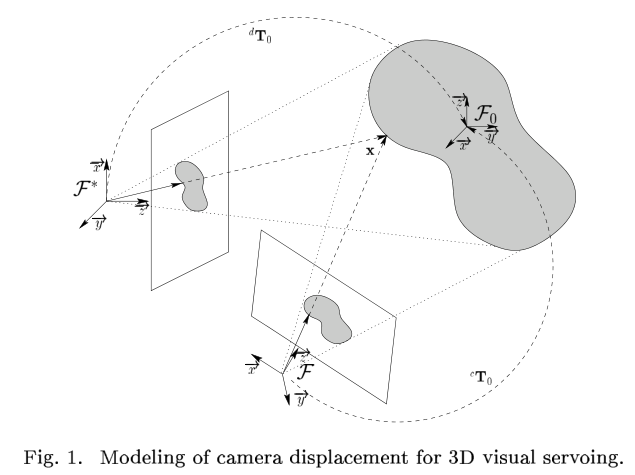
*그림 1 — 3D 시각 서보를 위한 카메라 변위의 모델링.*

$\mathcal{F}_0$에서 표현된 표적의 점 최소 4개의 좌표를 알면 [6] (즉, 표적의 3D 모델을 완벽히 안다고 가정하면), 그 투영으로부터 목표 카메라 자세와 현재 카메라 자세를 계산할 수 있다. 따라서 목표 위치에 도달하기 위한 카메라 변위를 쉽게 얻을 수 있고, 로봇 엔드이펙터 제어는 개루프로, 또는 더 강건하게 폐루프로 수행할 수 있다. 이 접근법의 주된 장점은 데카르트 공간에서 카메라 궤적을 직접 제어한다는 것이다. 그러나 영상 안에서는 아무 제어도 하지 않으므로, 자세 추정에 쓰인 영상 특징이 영상 밖으로 나갈 수 있고(특히 로봇이나 카메라가 거칠게 보정된 경우), 그러면 서보가 실패한다. 또한 카메라가 거칠게 보정되었거나 표적의 3D 모델에 오차가 있으면, 현재 및 목표 카메라 자세가 정확히 추정되지 않는다는 점에 유의하라. 마지막으로, 자세 추정에서 생기는 오차를 카메라 보정 오차의 함수로 해석적으로 계산할 수 없으므로, 시스템의 안정성을 분석하는 것은 불가능해 보인다 [5].

## III. 2D 시각 서보 (2D Visual Servoing)

이제 제어 오차 함수는 2D 영상 공간에서 직접 표현된다(그림 2 참조).

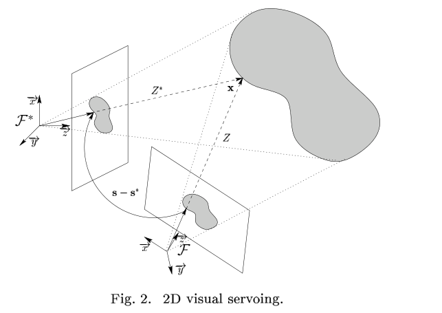
*그림 2 — 2D 시각 서보.*

$\mathbf{s}$를 카메라가 관측한 시각 특징의 현재 값, $\mathbf{s}^*$를 영상에서 도달해야 할 $\mathbf{s}$의 목표 값이라 하자. $\mathbf{s}$의 시간 변화는 카메라 속도 $\mathbf{v} = [\,\boldsymbol{v}^T \;\; \boldsymbol{\omega}^T\,]^T$와 다음과 같이 관련된다 [7]:

$$\dot{\mathbf{s}} = \mathbf{L}(\mathbf{s}, Z)\mathbf{v} \tag{1}$$

여기서 $\mathbf{L}(\mathbf{s}, Z)$는 $\mathbf{s}$에 관련된 상호작용 행렬(영상 야코비 행렬, image Jacobian matrix라고도 함)이다. $\mathbf{L}$은 선택된 각 특징의 깊이 Z에 의존한다는 점에 유의하라.

다양한 영상 특징에 대한 상호작용 행렬은 [7]에서 찾을 수 있다. $\mathbf{s}$를 $\mathbf{s}^*$로 조절하는 것에 해당하는 시각 기반 작업 $\mathbf{e}$ (0으로 조절해야 할 것)는 다음과 같이 정의된다:

$$\mathbf{e} = \mathbf{C}(\mathbf{s} - \mathbf{s}^*) \tag{2}$$

여기서 $\mathbf{C}$는 제어 법칙의 전역 안정성을 보장하기 위해 $\mathbf{C}\mathbf{L}(\mathbf{s}, Z) > 0$이 되도록 선택해야 하는 행렬이다. 최적의 선택은 $\mathbf{C}$를 상호작용 행렬의 의사역행렬 $\mathbf{L}(\mathbf{s}, Z)^+$로 두는 것이다. 그러면 행렬 $\mathbf{C}$는 시각 서보에 쓰이는 각 표적 점의 깊이 $Z$에 의존한다. 깊이의 추정값은 3D 시각 서보에서처럼 자세 결정 알고리즘(표적의 3D 모델이 있는 경우)을 쓰거나, 알려진 운동으로부터의 구조 복원(structure from known motion) 알고리즘(카메라 운동을 측정할 수 있는 경우)을 써서 얻을 수 있다. 그러나 $\mathbf{C}$를 이렇게 선택하면 시스템이 상호작용 행렬의 특이점 가까이 가거나 심지어 특이점에 도달할 수 있다. 더욱이 제어 법칙이 영상에서 실현 불가능한 운동을 계산하여 국소 최솟값(local minima)에 도달하므로 수렴하지 못할 수도 있다 [5].

또 다른 선택은 $\mathbf{C}$를 상수 행렬 $\mathbf{L}(\mathbf{s}^*, Z^*)^+$, 즉 $\mathbf{s} = \mathbf{s}^*$와 $Z = Z^*$에서 계산한 상호작용 행렬의 의사역행렬로 두는 것이다. 여기서 $Z^*$는 목표 카메라 위치에서 $Z$의 근사값이다. 이 단순한 경우 수렴 조건은 목표 위치 근방에서만 만족되는데, 이는 초기 카메라 위치가 목표 위치에서 너무 멀면 수렴이 보장되지 않을 수 있다는 뜻이다. 여기서도 실패로 이어지는 몇 가지 예가 [5]에 제시되어 있다.

## IV. 2½D 시각 서보 (2 1/2 D Visual Servoing)

3D 시각 서보의 주된 단점은 영상 안에서 제어가 없어서 표적이 카메라 시야를 벗어날 수 있다는 것이다. 게다가 카메라 자세를 계산하려면 표적의 모델이 필요하다. 2D 시각 서보는 이 모델을 명시적으로 필요로 하지 않는다. 그러나 제어 법칙 설계에 깊이의 추정 또는 근사가 필요하다. 더욱이 이 접근법의 주된 단점은 수렴이 목표 위치의 근방(그 영역을 해석적으로 결정하는 것은 불가능해 보인다)에서만 보장된다는 것이다. 이 절의 목적은 이러한 단점을 피하는 제어 기법을 제시하는 것이다. 영상 특징과 3D 데이터를 결합하는 것이 만족스러운 해법임을 보게 될 것이다. 이 3D 정보는 다음 소절에서 설명하듯 부분적 자세 추정을 수행하여 얻을 수 있다.

### A. 척도화된 유클리드 재구성 (Scaled Euclidean Reconstruction)

기준 평면 $\pi$를 정의하는 세 개의 3D 표적 점 $\mathcal{P}_i$를 생각하자(그림 3 참조). 현재 카메라 좌표계 $\mathcal{F}$에서 얻어지는 영상점 $\mathbf{p}_i$는 목표 카메라 좌표계 $\mathcal{F}^*$의 대응 영상점 $\mathbf{p}_i^*$와 사영 호모그래피(projective homography) $\mathbf{G}$로 $\mathbf{p}_i = \mathbf{G}\mathbf{p}_i^*$ $(i = 1,2,3)$와 같이 관련된다는 것은 잘 알려져 있다 [9]. 한편 표적이 평면임을 알면, 이 평면의 점 최소 4개를 써서 선형 시스템을 풀어 $\mathbf{G}$를 추정할 수 있다. 다른 한편 표적이 평면이 아니면 $\mathbf{G}$의 추정은 비선형 문제가 된다. 점이 최소 8개(π를 정의하는 3개와 π에 속하지 않는 5개) 있으면, 예컨대 [16]에 제시된 선형화 알고리즘을 써서 비디오 속도로 호모그래피 행렬을 추정할 수 있다. 에피폴라 기하(epipolar geometry)의 복원을 통해 카메라 변위를 계산하는, 고전적이지만 덜 강건한 다른 선형화 방법은 [11]과 [4]에서 찾을 수 있다. 이러한 고전적 방법은 최근 시각 기반 제어에 쓰였다 [10], [2]. [10]에서는 스테레오 비전 시스템을 사용한다. 우리 연구와 밀접히 관련된 [2]의 연구는 뒤에서 논의한다.

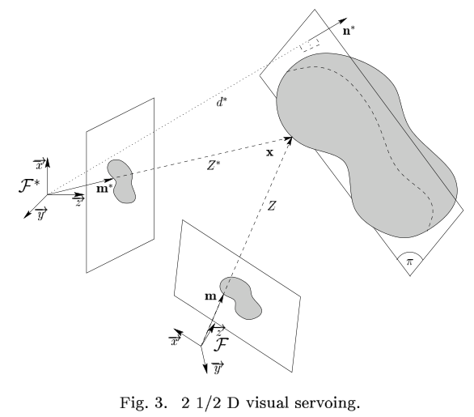
*그림 3 — 2½D 시각 서보.*

$\mathbf{A}$를 카메라의 내부 파라미터 행렬이라 하자.

$$\mathbf{A} = \begin{bmatrix} fk_u & fk_u\cot(\phi) & u_0 \\ 0 & \dfrac{fk_v}{\sin(\phi)} & v_0 \\ 0 & 0 & 1 \end{bmatrix} = \begin{bmatrix} \alpha_u & \alpha_{uv} & u_0 \\ 0 & \alpha_v & v_0 \\ 0 & 0 & 1 \end{bmatrix} \tag{3}$$

여기서 $u_0$와 $v_0$는 주점(principal point)의 화소 좌표, $k_u$와 $k_v$는 $\vec{x}$축과 $\vec{y}$축 방향의 척도 인자(화소/미터), $\phi$는 이 두 축 사이의 각, $f$는 초점 거리다. $\mathbf{A}$는 영상점의 화소 좌표 $\mathbf{p}$와 정규화 좌표 $\mathbf{m}$ 사이의 변환 행렬이다.

$$\mathbf{p} = \mathbf{A}\mathbf{m}. \tag{4}$$

카메라 보정을 안다고(즉 $\mathbf{A}$를 안다고) 가정하면, 유클리드 호모그래피 $\mathbf{H}$는 다음과 같이 계산된다.

$$\mathbf{H} = \mathbf{A}^{-1}\mathbf{G}\mathbf{A}. \tag{5}$$

$\mathbf{H}$를 계산한 뒤에는 이를 회전 행렬과 계수(rank) 1 행렬의 합으로 분해할 수 있다 [9].

$$\mathbf{H} = \mathbf{R} + \mathbf{t}_{d^*}\mathbf{n}^{*T} \tag{6}$$

여기서 $\mathbf{R}$은 좌표계 $\mathcal{F}$와 $\mathcal{F}^*$ 사이의 회전 행렬(즉 무한원 평면의 호모그래피 $\mathbf{R} = \mathbf{H}_\infty$), $\mathbf{n}^*$는 $\mathcal{F}^*$에서 표현된 $\pi$의 단위 법선 벡터, $\mathbf{t}_{d^*}$는 $\mathbf{t}/d^*$로 정의되며 $\mathbf{t}$는 $\mathcal{F}$와 $\mathcal{F}^*$ 사이의 평행이동 벡터, $d^*$는 $\pi$에서 $\mathcal{F}^*$까지의 거리다. 따라서 $\mathbf{H}$와 영상 특징으로부터 운동 파라미터와 기준 평면의 구조를 결정할 수 있다. 예를 들어 거리 $d$와 $d^*$는 알 수 없지만($d$는 $\mathcal{F}$와 $\pi$ 사이의 현재 거리), 비 $r = d/d^*$는 쉽게 추정할 수 있다. 실제로 $\mathcal{F}$에서 표현된 $\pi$의 법선 벡터를 $\mathbf{n} = \mathbf{R}\mathbf{n}^*$로 두면 다음을 얻는다 [15].

$$r = \frac{d}{d^*} = 1 + \mathbf{n}^T\mathbf{t}_{d^*} = \det(\mathbf{H}). \tag{7}$$

또한 $\pi$ 위에 있는 점의 미지 깊이 $Z$와 $d^*$의 비 $\rho_1$은 다음과 같이 계산할 수 있다.

$$\rho_1 = \frac{Z}{d^*} = \frac{r}{\mathbf{n}^T\mathbf{m}}. \tag{8}$$

끝으로 다음도 얻을 수 있다.

$$\rho_2 = \frac{Z}{Z^*} = r\frac{\mathbf{n}^{*T}\mathbf{m}^*}{\mathbf{n}^T\mathbf{m}} = \rho_1\,\mathbf{n}^{*T}\mathbf{m}^*. \tag{9}$$

이 파라미터들은 우리 제어 기법의 설계에 쓰이므로 중요하다. V절에서는 카메라 보정 오차가 있어도 추정된 운동 파라미터의 해석적 형태를 여전히 얻을 수 있음을 보일 것이다.

### B. 제어 기법 (Control scheme)

카메라의 자세(orientation)를 제어하기 위해, 자연스럽게 $\mathcal{F}$와 $\mathcal{F}^*$ 사이의 3D 추정 회전 $\mathbf{R}$(단위 행렬에 도달해야 함)을 사용한다. $\mathbf{u}$를 $\mathbf{R}$에서 얻은 회전축, $\theta$를 회전각이라 하자. 고전적인 제어 벡터 $\mathbf{u}\sin(\theta)$나 $\mathbf{u}\sin(\frac{\theta}{2})$ 대신 벡터 $\mathbf{u}\theta$를 택했는데, 아래에 보이듯 이 표현은 작업 공간 전체에서 특이점이 없기 때문이다. $\mathbf{u}\theta$의 시간 미분은 카메라 속도 스크루 $\mathbf{v}$의 함수로 다음과 같이 표현할 수 있다.

$$\frac{d(\mathbf{u}\theta)}{dt} = [\,\mathbf{0} \;\; \mathbf{L}_\omega\,]\,\mathbf{v} \tag{10}$$

여기서 야코비 행렬 $\mathbf{L}_\omega$는 다음과 같다 [15].

$$\mathbf{L}_\omega(\mathbf{u},\theta) = \mathbf{I}_3 - \frac{\theta}{2}[\mathbf{u}]_\times + \left(1 - \frac{\mathrm{sinc}(\theta)}{\mathrm{sinc}^2(\frac{\theta}{2})}\right)[\mathbf{u}]_\times^2 \tag{11}$$

여기서 $\mathrm{sinc}(\theta) = \sin(\theta)/\theta$이고, $[\mathbf{u}]_\times$는 벡터 $\mathbf{u}$에 대응하는 반대칭 행렬이다. $\mathbf{L}_\omega$의 행렬식은

$$\det(\mathbf{L}_\omega) = 1/\mathrm{sinc}^2(\frac{\theta}{2}) \tag{12}$$

이므로 $\theta = 2k\pi,\ \forall k \in \mathbb{Z}^*$ 일 때(즉 가능한 작업 공간 밖)에만 특이하다. 또한 $\theta$가 작을 때 $\mathbf{L}_\omega \approx \mathbf{I}_3$임에 주목할 수 있다.

이제 위치 제어 벡터를 설계한다. 표적에서 선택한 기준 평면 $\pi$ 위에 놓인 점 $\mathcal{P}$(기준점, reference point라 부름)를 생각하자. 현재 카메라 좌표계에서 표현한 그 좌표의 시간 미분은 다음과 같이 쓸 수 있다.

$$\dot{\mathbf{x}} = [\,-\mathbf{I}_3 \;\; [\mathbf{x}]_\times\,]\,\mathbf{v}. \tag{13}$$

*확장 영상 좌표(extended image coordinates)* $\mathbf{m}_e$를 다음과 같이 정의하자.

$$\mathbf{m}_e = [\,x \;\; y \;\; z\,]^T = [\,\tfrac{X}{Z} \;\; \tfrac{Y}{Z} \;\; \log(Z)\,]^T \tag{14}$$

여기서 $z = \log(Z)$는 보조 정규화 좌표다. 확장 영상 좌표의 시간 미분은 다음과 같이 쓸 수 있다.

$$\dot{\mathbf{m}}_e = \frac{1}{Z}\begin{bmatrix} 1 & 0 & -\frac{X}{Z} \\ 0 & 1 & -\frac{Y}{Z} \\ 0 & 0 & 1 \end{bmatrix}\begin{bmatrix}\dot X\\ \dot Y\\ \dot Z\end{bmatrix} = -\frac{1}{d^*}\mathbf{L}_v\dot{\mathbf{x}} \tag{15}$$

여기서 $d^*$는 미지이고 $\mathbf{L}_v$는 다음과 같은 상삼각 행렬이다.

$$\mathbf{L}_v = \frac{1}{\rho_1}\begin{bmatrix} -1 & 0 & x \\ 0 & -1 & y \\ 0 & 0 & -1 \end{bmatrix} \tag{16}$$

여기서 $\rho_1$은 (8)로 주어진다. 그러면 식 (13)과 (15)를 써서 최종적으로 다음을 얻는다.

$$\dot{\mathbf{m}}_e = [\,\tfrac{1}{d^*}\mathbf{L}_v \;\; \mathbf{L}_{(v,\omega)}\,]\,\mathbf{v} \tag{17}$$

여기서 $\mathbf{L}_{(v,w)}$는 다음 행렬이다.

$$\mathbf{L}_{v,\omega} = \begin{bmatrix} xy & -(1+x^2) & y \\ (1+y^2) & -xy & -x \\ -y & x & 0 \end{bmatrix}. \tag{18}$$

위치 결정 작업은 다음 작업 함수(task function) $\mathbf{e}$를 0으로 조절하는 것으로 기술할 수 있다.

$$\mathbf{e} = [\,(\mathbf{m}_e - \mathbf{m}_e^*)^T \;\; \theta\mathbf{u}^T\,]^T \tag{19}$$

여기서 $\mathbf{m}_e - \mathbf{m}_e^*$의 처음 두 성분은 현재 영상과 목표 영상에서 직접 계산되고, $\log(\rho_2)$와 같은 마지막 성분은 (9)를 써서 추정된다. 작업 함수의 시간 미분은 카메라 속도 $\mathbf{v}$와 다음과 같이 관련된다.

$$\dot{\mathbf{e}} = \mathbf{L}\mathbf{v} \tag{20}$$

여기서 $\mathbf{L}$은 다음과 같은 상삼각 행렬이다.

$$\mathbf{L} = \begin{bmatrix} \frac{1}{d^*}\mathbf{L}_v & \mathbf{L}_{(v,\omega)} \\ \mathbf{0} & \mathbf{L}_\omega \end{bmatrix}. \tag{21}$$

이 행렬은 카메라 광학 중심이 기준 평면 $\pi$ 위에 있을 때(그 경우 $d = r = \rho_1 = 0$)에만 특이하다. 다른 퇴화 경우는 $Z = 0$, $1/Z = 0$, $1/d = 0$일 때, 또는 이미 말했듯 $\theta = \pm 2\pi$일 때 생긴다. 따라서 특이점이 없는 작업 공간은 $\pi$ 앞쪽 영역으로 이루어진다. 사실 표적이 평면이 아님을 알면, 특이점에 가까워질 때 $\pi$를 정의하는 데 쓰는 점들을 바꿔서 이 작업 공간을 더 넓힐 수도 있다.

마지막으로 $\dot{\mathbf{e}} = -\lambda\mathbf{e}$ ($\lambda$는 수렴 속도를 조정)를 부과하여 $\mathbf{m}_e$가 $\mathbf{m}_e^*$로, $\mathbf{u}\theta$가 0으로 지수적으로 수렴하게 할 수 있다. 표적이 정지해 있다고 알려져 있으면(그렇지 않은 경우는 [3], [1], [17] 참조), 대응하는 제어 법칙은 다음과 같다 [7].

$$\mathbf{v} = -\lambda\,\widehat{\mathbf{L}}^{-1}\,\mathbf{e} \tag{22}$$

여기서 $\mathbf{v}$는 로봇 제어기로 보내는 카메라 속도이고, $\widehat{\mathbf{L}}^{-1}$은 $\mathbf{L}^{-1}$의 근사이다. $\mathbf{L}$은 미지의 거리 $d^*$(우리 방법에서 측정하거나 추정할 수 없는 유일한 값)에 의존하므로, 오프라인 학습 단계(목표 영상을 획득할 때)에서 근사값 $\widehat{d^*}$를 골라 $\widehat{\mathbf{L}}^{-1}$에 넣어야 한다. 그러나 $\widehat{d^*}$는 시스템 안정성에 미치는 영향이 작으므로 정밀하게 결정할 필요는 없다(다음 실험에서는 손으로 정했다). 더 정확히 말하면, 이는 평행이동 속도의 수렴 시간과, 회전 운동의 잘못된 보상으로 생길 수 있는 추종 오차(tracking error)의 크기에 영향을 준다. 추종 오차는 회전 속도에 비례하므로 카메라 자세가 바르게 맞춰지면 사라진다. 다음 절에서 시스템의 전역 안정성이 보장되도록 $\widehat{d^*}/d^*$의 한계를 정할 수 있음을 보게 될 것이다. 결국 제어 법칙은 다음과 같다.

$$\mathbf{v} = -\lambda\begin{bmatrix} \widehat{d^*}\mathbf{L}_v^{-1} & -\widehat{d^*}\mathbf{L}_v^{-1}\mathbf{L}_{(v,\omega)} \\ \mathbf{0} & \mathbf{I}_3 \end{bmatrix}\begin{bmatrix} \mathbf{m}_e - \mathbf{m}_e^* \\ \mathbf{u}\theta \end{bmatrix}. \tag{23}$$

실제로 행렬 $\mathbf{L}_\omega^{-1}$의 특별한 형태 때문에 $\mathbf{L}_\omega^{-1} = \mathbf{I}_3$로 둘 수 있다. 왜냐하면 [15]

$$\mathbf{L}_\omega^{-1}\mathbf{u}\theta = \left(\mathbf{I}_3 + \frac{\theta}{2}\mathrm{sinc}^2\left(\frac{\theta}{2}\right)[\mathbf{u}]_\times + (1 - \mathrm{sinc}(\theta))[\mathbf{u}]_\times^2\right)\mathbf{u}\theta = \mathbf{u}\theta. \tag{24}$$

대응하는 블록선도는 그림 4에 있다. $\widehat{\mathbf{L}}^{-1}$이 작업 공간 전체에서 특이점이 없는 상삼각 정방 행렬임을 강조해 둔다. 이렇게 분리된(decoupled) 시스템은 데카르트 공간에서도 만족스러운 카메라 궤적을 제공한다. 실제로 회전 제어 루프는 평행이동 제어 루프와 분리되어 있고, 선택한 기준점은 카메라의 평행이동 자유도로 제어되어 그 궤적이 상태 공간에서, 따라서 영상에서도 직선이 된다. 완벽한 모델이 있으면 기준점은 초기 카메라 위치와 상관없이 항상 카메라 시야 안에 머문다. 물론 이 성질이 표적의 모든 점이 보이는 상태로 남는다는 것을 보장하지는 않는다. 그러나 실제로는 서보 중에 선택한 기준점을 바꿀 수 있고, 영상 평면의 경계에 가장 가까운 표적 점을 기준점으로 고를 수 있을 것이다. 실제로 ($\pi$ 위에 놓인 점뿐 아니라) 표적의 어떤 점이든 기준점으로 삼을 수 있다. 사실 $\pi$ 밖에 놓인 점의 경우, 앞의 계산에서 유일한 차이는 $\rho_1$과 $\rho_2$의 값이 (8)과 (9)로 주어지지 않고 다른 형태를 가진다는 것이다(해당 식은 [15] 참조).

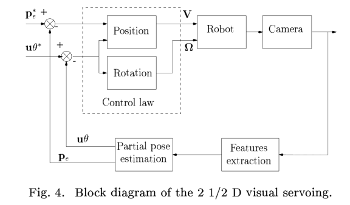
*그림 4 — 2½D 시각 서보의 블록선도.*

실제로는 서보 도중 기준점을 바꾸는 가능성을 고려하지 않았는데, 바꿀 때마다 카메라 속도의 평행이동 성분에 불연속이 생기기 때문이다. 또 다른 전략은 영상에서 표적의 무게중심에 가장 가까운 점을 기준점으로 고르는 것이다. 이렇게 하면 표적이 카메라 시야 안에 머물 확률은 높아지지만 완전히 보장되지는 않는다. 그래서 이 문제를 다루기 위해 VII절에서 설명하는 적응 제어 법칙을 쓰는 쪽을 택했다.

끝으로, 2D 및 3D 시각 서보와 달리, 카메라 보정 오차가 있을 때 국소 점근 안정의 필요충분조건과 전역 점근 안정의 충분조건을 얻을 수 있음을 다음 절에서 보일 것이다.

*비고(Remark):* 데카르트 공간에서 직접 제어 법칙을 설계할 수도 있다($\mathbf{t}_{d^*}$가 0에 도달해야 하며, 이는 곧 위치 결정 작업의 달성을 의미한다). 그러므로 표적의 3D 구조를 몰라도 고전적인 3D 시각 서보와 매우 비슷한 기법을 수행할 수 있다. [2]에서는 이러한 기법을 쓰되, 평행이동 방향을 호모그래피 행렬 대신 기본 행렬(essential matrix)에서 얻는다. 그러나 3D 시각 서보와 마찬가지로, 이러한 제어 벡터는 특히 카메라나 로봇의 보정 오차가 클 때 대상 물체가 항상 카메라 시야 안에 머문다는 것을 보장하지 않는다.

카메라 위치를 영상 공간에서 직접 제어할 수도 있다(2D 시각 서보에서 하듯이. 주된 차이는 자세를 운동 추정 결과로 제어한다는 것이다). 2D 시각 서보와 달리, 이 경우 카메라 자세의 분리된 제어 덕분에 시스템이 국소 최솟값을 피할 수 있다. 그러나 안정성 분석은 2D 시각 서보만큼 어렵다. 게다가 최소 2개의 영상점이 필요하고, 관련 상호작용 행렬의 결합 때문에 카메라 궤적을 예측할 수 없다. 실험 결과에 따르면, 카메라 변위가 매우 클 때 이 접근법을 쓰면 불행히도 로봇이 관절 한계에 도달하거나, 표적이 영상에서 너무 작아져 시각 서보를 멈춰야 할 수 있다.

## V. 카메라 보정 오차가 있을 때의 시스템 안정성 (System stability in presence of camera calibration errors)

카메라가 완벽하게 보정되지 않아 $\mathbf{A}$ 대신 $\widehat{\mathbf{A}}$((3) 참조)를 쓰면, 측정된 영상점 $\widehat{\mathbf{p}}$는 실제 영상점 $\mathbf{p}$의 함수로 다음과 같이 쓸 수 있다.

$$\widehat{\mathbf{p}} = \widehat{\mathbf{A}}\mathbf{m} = \delta\mathbf{A}\mathbf{p} \tag{25}$$

여기서 $\delta\mathbf{A} = \widehat{\mathbf{A}}^{-1}\mathbf{A}$이다. 또한 추정된 호모그래피 행렬은 다음과 같다.

$$\widehat{\mathbf{H}} = \widehat{\mathbf{A}}^{-1}\mathbf{G}\widehat{\mathbf{A}} = \delta\mathbf{A}\mathbf{H}\delta\mathbf{A}^{-1}. \tag{26}$$

이는 회전 행렬과 닮은(similar) 행렬과 계수 1 행렬의 합으로 분해할 수 있다.

$$\widehat{\mathbf{H}} = \widehat{\mathbf{H}}_\infty + \widehat{\mathbf{t}}_{d^*}\widehat{\mathbf{n}}^{*T} \tag{27}$$

여기서 $\widehat{\mathbf{H}}_\infty = \delta\mathbf{A}\mathbf{R}\delta\mathbf{A}^{-1}$, $\widehat{\mathbf{t}}_{d^*} = \|\mathbf{n}^{*T}\delta\mathbf{A}^{-1}\|\delta\mathbf{A}\mathbf{t}_{d^*}$, $\widehat{\mathbf{n}}^{*T} = \frac{\mathbf{n}^{*T}\delta\mathbf{A}^{-1}}{\|\mathbf{n}^{*T}\delta\mathbf{A}^{-1}\|}$ 이다 [15]. $\mathbf{R}$의 고유값은 회전각 $\theta$에 의존하고, 단위 고유값에 대응하는 고유벡터는 회전축 $\mathbf{u}$이다. 행렬 $\widehat{\mathbf{H}}_\infty$는 회전 행렬은 아니지만 $\mathbf{R}$과 닮았으므로, 두 행렬은 같은 고유값을 가지며 $\widehat{\mathbf{H}}_\infty$의 고유벡터는 $\mathbf{R}$의 고유벡터에 행렬 $\delta\mathbf{A}$를 곱한 것이다. 따라서 $\widehat{\mathbf{H}}_\infty$에서 직접 추출한 추정 회전각 $\widehat{\theta}$와 추정 회전축 $\widehat{\mathbf{u}}$는 실제 파라미터와 보정 오차의 함수로 다음과 같이 쓸 수 있다.

$$\widehat{\theta} = \theta \quad\text{and}\quad \widehat{\mathbf{u}} = \frac{\delta\mathbf{A}\mathbf{u}}{\|\delta\mathbf{A}\mathbf{u}\|}. \tag{28}$$

회전각 $\theta$뿐 아니라 비 $r$과 $\rho_2$도 오차 없이 계산된다는 점을 강조해야 한다.

$$\widehat{r} = \det(\widehat{\mathbf{H}}) = \det(\mathbf{H}) = r\ ,\quad \widehat{\rho_2} = \frac{Z}{Z^*} = \rho_2. \tag{29}$$

끝으로 $\widehat{\mathbf{n}} = \widehat{\mathbf{R}}^{-T}\widehat{\mathbf{n}}^* = \frac{\delta\mathbf{A}^{-T}\mathbf{n}}{\|\delta\mathbf{A}^{-T}\mathbf{n}^*\|}$ 이므로 $\widehat{\rho_1}$은 다음과 같다.

$$\widehat{\rho_1} = \frac{\widehat{r}}{\widehat{\mathbf{n}}^T\widehat{\mathbf{p}}} = \frac{r}{\widehat{\mathbf{n}}^T\widehat{\mathbf{p}}} = \|\delta\mathbf{A}^{-T}\mathbf{n}^*\|\,\rho_1. \tag{30}$$

따라서 작업 함수는 다음과 같이 재구성할 수 있다.

$$\widehat{\mathbf{e}} = \begin{bmatrix} \mathbf{E}_v & 0 \\ 0 & \mathbf{E}_\omega \end{bmatrix}\mathbf{e} \tag{31}$$

여기서

$$\mathbf{E}_v = \begin{bmatrix} \delta\mathbf{A}_{11} & 0 \\ 0 & 1 \end{bmatrix},\quad \mathbf{E}_\omega = \mu\,\delta\mathbf{A} = \mu\begin{bmatrix} \delta\mathbf{A}_{11} & \delta\mathbf{p}_0 \\ 0 & 1 \end{bmatrix}$$

이며, $\delta\mathbf{A}_{11}$은 화소 길이 오차를 담은 $\delta\mathbf{A}$의 $(2\times2)$ 부분 행렬((3) 참조), $\delta\mathbf{p}_0$는 주점 오차를 담은 $(2\times1)$ 부분 벡터, $\mu = \frac{1}{\|\delta\mathbf{A}\mathbf{u}\|}$이다. 추정 작업 함수 $\widehat{\mathbf{e}}$는 실제(그러나 미지인) 작업 함수 $\mathbf{e}$에 선형으로 의존하므로, $\mathbf{e} = \mathbf{0}$일 때 그리고 그때에만 $\widehat{\mathbf{e}} = 0$이라는 점이 흥미롭다. 물론 여기서는 목표 영상을 오프라인으로 획득한 뒤 카메라 내부 파라미터가 바뀌지 않는다고 가정한다. 다시 말해 $\widehat{\mathbf{e}}$는 현재 영상과 목표 영상으로부터 측정되므로, 영상점으로부터 $\widehat{\mathbf{e}}$를 계산하는 함수가 전단사(bijective)여서, 표적 점들이 영상에서 목표 위치에 도달했을 때 그리고 그때에만 $\widehat{\mathbf{e}} = 0$이다. 따라서 카메라 보정 오차를 고려한 폐루프 시스템은 다음과 같이 쓸 수 있다.

$$\dot{\mathbf{e}} = \mathbf{f}(\mathbf{e}) = -\lambda\mathbf{Q}(\mathbf{e})\mathbf{e} = -\lambda\mathbf{L}\,\widehat{\mathbf{L}}^{-1}\,\mathbf{E}\,\mathbf{e}. \tag{32}$$

함수 $\mathbf{f}$는 $SE_3$의 열린 부분집합 $S$ 위에 정의된 $C^\infty$ 벡터장이다. 평형점의 존재와 유일성은 쉽게 보일 수 있다.

*명제 1(Proposition 1):* $\mathbf{f}$의 유일한 평형점, 즉 $\mathbf{f}(\mathbf{e}^\circ) = 0$을 만족하는 점 $\mathbf{e}^\circ \in S$는 $\mathbf{e}^\circ = 0$이다.

*증명(Proof):* $\mathbf{e} = 0$이면 $\mathbf{f}(\mathbf{e}) = \mathbf{Q}(\mathbf{e})\mathbf{e} = 0$이므로 평형점의 존재는 자명하다. 이 평형점은 $\det(\mathbf{Q}(\mathbf{e})) \neq 0,\ \forall\mathbf{e} \in S$일 때 그리고 그때에만 유일하다. 행렬 $\mathbf{Q}$는 상삼각이므로 행렬식을 쉽게 계산할 수 있다.

$$\det(\mathbf{Q}) = \det(\mathbf{L})\det(\widehat{\mathbf{L}}^{-1})\det(\mathbf{E}) = \nu^3\mu^3\frac{\alpha_u^2\,\alpha_v^2}{\widehat{\alpha}_u^2\,\widehat{\alpha}_v^2}\frac{1}{\mathrm{sinc}^2(\frac{\theta}{2})} \tag{33}$$

여기서 $\nu = \frac{\widehat{Z}}{Z} = \frac{\widehat{d^*}}{d^*}\|\delta\mathbf{A}^{-T}\mathbf{n}^*\|$이다. 따라서 퇴화하지 않은 경우(예컨대 $Z = 0$ 또는 $d = 0$인 경우가 아니면) $\nu \neq 0$, $\mu \neq 0$이므로 $\det(\mathbf{Q}) \neq 0,\ \forall\mathbf{e} \in S$이다. ■

그러므로 작업 공간에 특이점이 없으며, 작업 함수가 감소한다면 0을 향해 감소한다. 이제 시스템의 국소 점근 안정을 보장하는 조건을 제시한다.

*정리 1(Theorem 1)* (국소 점근 안정) 미분 시스템 (32)는 다음 조건이 성립할 때 그리고 그때에만 평형점 $\mathbf{e}^\circ$ 주변에서 국소 점근 안정이다.

$$\frac{\widehat{\alpha}_u}{\alpha_u} > 0,\quad \frac{\widehat{\alpha}_v}{\alpha_v} > 0 \quad\text{and}\quad \frac{\widehat{d^*}}{d^*} > 0. \tag{34}$$

이 조건들은 자세(orientation) 제어 부시스템의 전역 점근 안정에 대해서도 필요충분조건임에 유의하자. 이 정리의 증명은 [15]에 있다. 실제로 이 조건들은 물론 쉽게 만족된다. 그러나 오차가 0으로 수렴하기 전에 상당히 커질 수 있다는 것은 잘 알려져 있다. 따라서 매 반복마다 $\|\mathbf{e}\|$의 감소를 보장하는, 즉 시스템의 전역 점근 안정을 보장하는 충분조건을 찾는 것이 더 흥미롭다.

그러한 충분조건이 행렬 $\mathbf{Q}(\mathbf{e}),\ \forall\mathbf{e}$의 양정치성(positiveness)이라는 것은 잘 알려져 있다. $\mathbf{Q}(\mathbf{e})$의 특별한 형태(상삼각 행렬) 덕분에 다음 결과를 얻을 수 있었다.

*정리 2(Theorem 2)* (전역 점근 안정) 미분 시스템 (32)는 조건 (34)가 만족되고 다음이 성립할 때에만 전역 점근 안정이다.

$$\sigma = \frac{\alpha_u}{\widehat{\alpha}_u} + \frac{\alpha_v}{\widehat{\alpha}_v} - \sqrt{\left(\frac{\alpha_u}{\widehat{\alpha}_u} - \frac{\alpha_v}{\widehat{\alpha}_v}\right)^2 + \left(\frac{\alpha_{uv}}{\widehat{\alpha}_u} - \frac{\widehat{\alpha}_{uv}\,\alpha_v}{\widehat{\alpha}_u\,\widehat{\alpha}_v}\right)^2} > 0 \tag{35}$$

$$\sigma_1 = \sigma + 1 - \sqrt{(\sigma-1)^2 + \|\mathbf{I}_3 - \delta\mathbf{A}\|^2(1+\overline{\gamma}^2)} > 0 \tag{36}$$

$$\sigma_2 = \sigma + 1 - \sqrt{(\sigma-1)^2 + \|\delta\mathbf{p}_0\|^2} > 0 \tag{37}$$

$$\mu(\nu\|\mathbf{I}_3 - \delta\mathbf{A}\| + |1-\nu|)^2\|\delta\mathbf{A}\|^2 g^2(\overline{\gamma}) < \nu\sigma_1\sigma_2 \tag{38}$$

여기서 $\overline{\gamma} = \tan(\psi)$는 시야각 $\psi$의 탄젠트이며($\overline{\gamma}$는 $\gamma = \sqrt{x^2+y^2}$의 최댓값),

$$g^2(\overline{\gamma}) = \frac{2 + \overline{\gamma}^2 + \sqrt{\overline{\gamma}^2(\overline{\gamma}^2+4)}}{2}(1+\overline{\gamma}^2). \tag{39}$$

증명은 [15]에 있다. 이 충분조건들은 매 반복마다 $\|\mathbf{e}\|$의 감소를 보장하지만, 표적이 카메라 시야 안에 머문다는 것은 보장하지 않는다는 점에 유의하자. 그러한 제약은 행렬 $\mathbf{Q}(\mathbf{e})$의 양정치성에서 고려되지 않기 때문이다. 사실 $\|\mathbf{e}\|$의 감소가 반드시 $\|\mathbf{m}_e - \mathbf{m}_e^*\|$의 감소를 의미하지는 않으므로, 기준점이 항상 보일 것이라고도 확신할 수 없다. 이미 말했듯 가시성 제약은 VII절에서 고려한다. 그래도 전역 점근 안정은 $\|\mathbf{e}\|$, 따라서 $\|\mathbf{v}\|$가 진동하지 않는다는 것을 의미하므로 흥미롭다. 우리가 아는 한, 정리 1과 2는 카메라 보정 오차가 있을 때 카메라 6자유도를 제어할 수 있는 시각 서보 기법의 안정성에 관한 최초의 해석적 결과다.

조건 (35-38)을 분석하여 수렴 영역에 대한 대략적인 생각을 얻을 수 있다. 그러나 이 조건들은 $\delta\mathbf{A}$와 $\mu$(회전축 $\mathbf{u}$, 따라서 현재 카메라 위치에 의존)에 의존한다. 분석을 단순화하기 위해, 증명이 [15]에 있는 다음 따름정리를 제시한다.

*따름정리 1(Corollary 1)* (전역 점근 안정) 미분 시스템 (32)는 조건 (34)가 만족되고 다음이 성립할 때에만 전역 점근 안정이다.

$$\sigma > 0 \tag{40}$$

$$\sigma_3 = \sigma + 1 - \sqrt{(\sigma-1)^2 + k_1^2(1+\overline{\gamma}^2)} > 0 \tag{41}$$

$$\frac{\sqrt{2}\,(\nu k_1 + |1-\nu|)^2 k_2^2 g^2(\overline{\gamma})}{\sqrt{\sigma' + 1 - \sqrt{(\sigma'-1)^2 + 4\|\delta\mathbf{A}_{11}\|^2\|\delta\mathbf{p}_0\|^2}}} < \nu\sigma_2\sigma_3 \tag{42}$$

여기서

$$\sigma' = \frac{1}{2}\left(k_3 + k_4 - \sqrt{(k_3+k_4)^2 - 4\frac{\alpha_u^2\,\alpha_v^2}{\widehat{\alpha}_u^2\,\widehat{\alpha}_v^2}}\right)$$
$$k_1 = \|\mathbf{I}_2 - \delta\mathbf{A}_{11}\| + \|\delta\mathbf{p}_0\|$$
$$k_2 = \|\delta\mathbf{A}_{11}\| + \sqrt{1 + \|\delta\mathbf{p}_0\|^2}$$
$$k_3 = \frac{\alpha_u^2}{\widehat{\alpha}_u^2} + \frac{\alpha_v^2}{\widehat{\alpha}_v^2}$$
$$k_4 = \left(\frac{\alpha_{uv}}{\widehat{\alpha}_u} - \frac{\widehat{\alpha}_{uv}\,\alpha_v}{\widehat{\alpha}_u\,\widehat{\alpha}_v}\right)^2.$$

이 충분조건들은 정리 2가 부과하는 조건보다 더 제한적이다. 그러나 이 새 조건들은 회전축 $\mathbf{u}$에 의존하지 않으며, 주점의 오차 $\delta\mathbf{p}_0$가 화소 길이의 오차 $\delta\mathbf{A}_{11}$과 분리되어 있다. 따라서 조건이 더 복잡해 보이더라도 분석은 단순해진다.

먼저 조건 (40)을 더 자세히 분석하자. 이 조건은 다음과 동치이다.

$$\left(\frac{\alpha_{uv}}{\alpha_u}\frac{\alpha_u}{\widehat{\alpha}_u} - \frac{\widehat{\alpha}_{uv}}{\widehat{\alpha}_u}\frac{\alpha_v}{\widehat{\alpha}_v}\right)^2 < 4\frac{\alpha_u}{\widehat{\alpha}_u}\frac{\alpha_v}{\widehat{\alpha}_v}. \tag{43}$$

$\cot(\phi) = \frac{\alpha_{uv}}{\alpha_u}$ ((3) 참조)이므로 다음을 얻는다.

$$\left(\cot(\phi)\frac{\alpha_u}{\widehat{\alpha}_u} - \cot(\widehat{\phi})\frac{\alpha_v}{\widehat{\alpha}_v}\right)^2 < 4\frac{\alpha_u}{\widehat{\alpha}_u}\frac{\alpha_v}{\widehat{\alpha}_v} \tag{44}$$

각 $\phi$의 추정에서 생긴 오차를 $\delta\phi = \widehat{\phi} - \phi$로 나타내자. 일반적으로 추정 각 $\widehat{\phi}$는 $\pi/2$로 둔다. 이제 이 선택이 시스템 안정성에 큰 영향을 주지 않음을 보인다. 실제로 $\cot(\widehat{\phi}) = 0$, $\cot(\phi) = \cot(\widehat{\phi} - \delta\phi) = \cot(\pi/2 - \delta\phi) = \tan(\delta\phi)$이므로 조건 (44)는 다음과 같이 쓸 수 있다.

$$\tan^2(\delta\phi) < 4\frac{\widehat{\alpha}_u}{\widehat{\alpha}_v}\frac{\alpha_v}{\alpha_u} \Rightarrow |\delta\phi| < \arctan\left(2\sqrt{\frac{\alpha_v}{\widehat{\alpha}_v}/\frac{\alpha_u}{\widehat{\alpha}_u}}\right). \tag{45}$$

그림 5에는 x축의 비 $\alpha_u/\widehat{\alpha}_u$와 y축의 비 $\alpha_v/\widehat{\alpha}_v$에 대해 $|\delta\phi|$의 한계를 그렸다. 이 그림에서, 비들이 잘 추정되면 $|\delta\phi| < 63°$를 얻는다. 고려한 최악의 경우, 즉 추정 비가 $\widehat{\alpha}_u/\widehat{\alpha}_v = 1/5$이고 실제 비가 $\alpha_u/\alpha_v = 5$일 때(x 길이가 y 길이의 다섯 배인 직사각형 화소에 해당) $|\delta\phi| < 22°$이다. 더 흔한 카메라인 $\alpha_u/\alpha_v = 3/4$의 경우, $\widehat{\alpha}_u/\widehat{\alpha}_v = 4/3$이면 $|\delta\phi| < 56°$이며, 이를 만족하지 못하기란 불가능해 보인다.

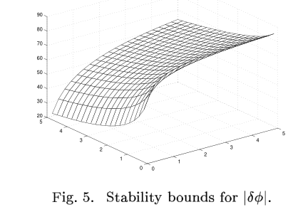
*그림 5 — $|\delta\phi|$에 대한 안정 한계.*

이제 조건 (41)을 분석하자. 이 조건은 다음과 같이 쓸 수 있다.

$$\|(\mathbf{I}_2 - \delta\mathbf{A}_{11})\| + \|\delta\mathbf{p}_0\| < 2\sqrt{\sigma}/\sqrt{1+\overline{\gamma}^2} \tag{46}$$

이는 다음을 의미한다.

$$\|\delta\mathbf{p}_0\| < 2\sqrt{\sigma}/\sqrt{1+\overline{\gamma}^2} - \|(\mathbf{I}_2 - \delta\mathbf{A}_{11})\|. \tag{47}$$

그림 6에는 x축의 비 $\alpha_u/\widehat{\alpha}_u$와 y축의 비 $\alpha_v/\widehat{\alpha}_v$에 대해 $\|\delta\mathbf{p}_0\|$의 한계를 그렸다(이 결과를 얻기 위해 시야각 20°인 카메라에 해당하는 $\overline{\gamma} = 0.364$와 $\delta\phi = 20°$로 두었다). 고려한 최악의 경우인 $\alpha_u/\widehat{\alpha}_u = 0.5$, $\alpha_v/\widehat{\alpha}_v = 2$일 때 $\|\delta\mathbf{p}_0\| < 0.44$이다. $\|\delta\mathbf{p}_0\| = \sqrt{\widehat{x}_0^2 + \widehat{y}_0^2}$이므로, 이는 추정 주점에 대응하는 3D 벡터가 각 $\psi_0 < 24°$인 원뿔 안에 있어야 함을 뜻한다.

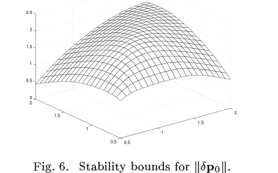
*그림 6 — $\|\delta\mathbf{p}_0\|$에 대한 안정 한계.*

앞의 조건들은 만족시키기 꽤 쉽다. 그러나 조건 (42)도 만족되어야 하므로 안정 영역이 그리 넓지는 않다. 이 마지막 조건은 2차 부등식으로 쓸 수 있다.

$$c_2\nu^2 + c_1\nu + c_0 < 0 \tag{48}$$

여기서

$$c_2 = \sqrt{2}\frac{(k_1 - sign(1-\nu))^2 k_2^2 g^2(\overline{\gamma})}{\sqrt{\sigma' + 1 - \sqrt{(\sigma'-1)^2 + 4\|\delta\mathbf{A}_{11}\|^2\|\delta\mathbf{p}_0\|^2}}}$$
$$c_1 = \frac{2\sqrt{2}\,sign(1-\nu)(k_1 - sign(1-\nu))k_2^2 g^2(\overline{\gamma})}{\sqrt{\sigma' + 1 - \sqrt{(\sigma'-1)^2 + 4\|\delta\mathbf{A}_{11}\|^2\|\delta\mathbf{p}_0\|^2}}} - \sigma_2\sigma_3$$
$$c_0 = \sqrt{2}\frac{(\|\delta\mathbf{A}_{11}\| + \sqrt{1 + \|\delta\mathbf{p}_0\|^2})^2 g^2(\overline{\gamma})}{\sqrt{\sigma' + 1 - \sqrt{(\sigma'-1)^2 + 4\|\delta\mathbf{A}_{11}\|^2\|\delta\mathbf{p}_0\|^2}}}.$$

(48)의 해는 다음과 같다.

$$\frac{-c_1 - \sqrt{c_1^2 - 4c_0c_2}}{2c_0} < \nu < \frac{-c_1 + \sqrt{c_1^2 - 4c_0c_2}}{2c_0}. \tag{49}$$

[역주] (49)의 분모는 원문대로 $2c_0$이다(2차 부등식 (48)의 근이라면 통상 $2c_2$).

*예 1(Example 1):* 먼저 완벽한 카메라 보정을 고려하여 $\widehat{d^*}/d^*$의 가능한 한계를 구한다. 이 단순한 경우 $\delta\mathbf{A}_{11} = \mathbf{I}_2$, $\delta\mathbf{p}_0 = \mathbf{0}$, $\sigma = \sigma_1 = \sigma_2 = 2$, $\sigma' = 1$, $\nu = \frac{\widehat{d^*}}{d^*}$이다. 따라서 조건 (42)는 다음과 같이 쓸 수 있다.

$$(1 - \frac{\widehat{d^*}}{d^*})^2 g^2(\overline{\gamma}) < 4\frac{\widehat{d^*}}{d^*}. \tag{50}$$

(49)의 대응하는 해는 다음과 같다.

$$1 + 2\frac{1 - \sqrt{g^2(\overline{\gamma}) + 1}}{g^2(\overline{\gamma})} < \frac{\widehat{d^*}}{d^*} < 1 + 2\frac{1 + \sqrt{g^2(\overline{\gamma}) + 1}}{g^2(\overline{\gamma})}. \tag{51}$$

두 한계를 $\overline{\gamma}$에 대해 그림 7에 그렸다. 이 그림에서, 예컨대 시야각 20°인 카메라(그러면 $\overline{\gamma} = 0.364$)를 생각하면 $0.24 < \widehat{d^*}/d^* < 4.22$일 때 안정 조건이 만족된다. 실제 거리 $d^*$가 50 cm이면, $\widehat{d^*}$를 12~211 cm 사이에서 고를 경우 작업 공간의 어떤 초기 위치에서든 시스템은 점근적으로 수렴한다. 이 결과는 카메라 보정 오차가 없을 때 우리 제어 기법의 강건성을 확실히 입증한다.

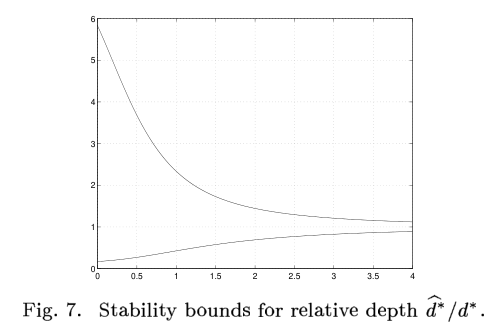
*그림 7 — 상대 깊이 $\widehat{d^*}/d^*$에 대한 안정 한계.*

또한 카메라 보정 오차를 고려해도 비슷한 결과를 얻을 수 있다. 조건 (42)는 카메라 내부 파라미터 다섯 개에 의존하므로, 먼저 $\delta\mathbf{A}_{11}$을 고정하고 $\delta\mathbf{p}_0$를 바꾸면서 안정성을 살피고, 이어서 $\delta\mathbf{A}_{11}$을 바꾸고 $\delta\mathbf{p}_0$를 고정해 살핀다. $\mathbf{n}^* \approx [\,0\;\;0\;\;1\,]^T$이면 $\nu \approx \widehat{d^*}/d^*,\ \forall\delta\mathbf{A}$임에 유의해야 한다.

*예 2(Example 2):* $\alpha_u/\widehat{\alpha}_u = \alpha_v/\widehat{\alpha}_v = 1.5$(각 화소 길이에 50% 오차가 있음을 뜻함)와 $\delta\phi = 5°$를 고려하면, 대응하는 두 한계는 그림 8에 그려져 있다. 예를 들어 $\|\delta\mathbf{p}_0\| = 0.0875$(각 5°인 원뿔에 해당)이면 $0.45 < \nu < 1.7$이다. 이 조건을 더 간단히 해석하기 위해 이제 $\nu \approx \widehat{d^*}/d^*$(기준 평면의 법선이 $\mathbf{n}^* \approx [\,0\;\;0\;\;1\,]^T$임을 뜻함)라고 가정하자. 실제 거리 $d^*$가 다시 50 cm이면, $\widehat{d^*}$를 23~85 cm 사이에서 고를 경우 어떤 초기 카메라 위치에서든 시스템은 점근적으로 수렴한다.

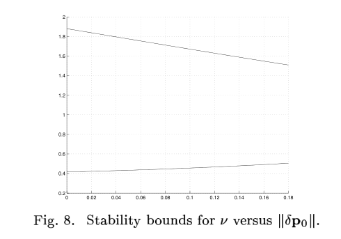
*그림 8 — $\|\delta\mathbf{p}_0\|$에 대한 $\nu$의 안정 한계.*

*예 3(Example 3):* 이제 $\|\delta\mathbf{p}_0\| = 0.0875$(각 $10^circ$인 원뿔에 해당)와 다시 $\delta\phi = 5^circ$로 고정한다. [역주: 원문에 "10$^c$irc", "5$^c$irc"로 조판 오류가 있으며, 예 2에서는 같은 값 0.0875를 5° 원뿔이라 했다. 원문 그대로 둔다.] $\nu$의 상한과 하한을 x축의 비 $\alpha_u/\widehat{\alpha}_u$와 y축의 비 $\alpha_v/\widehat{\alpha}_v$에 대해 그림 9에 그렸다. $\alpha_u/\alpha_v = 3/4$인 흔한 카메라에서 $\widehat{\alpha}_u/\widehat{\alpha}_v = 4/3$이면 $0.53 < \nu \approx d^*/\widehat{d^*} < 1.51$을 얻는다. 실제 거리 $d^*$가 다시 50 cm이면, $\widehat{d^*}$를 26~76 cm 사이에서 고를 경우 어떤 초기 위치에서든 시스템은 점근적으로 수렴한다.

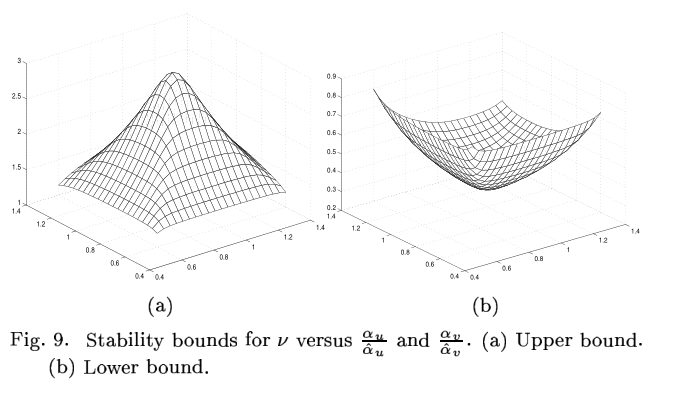
*그림 9 — $\frac{\alpha_u}{\widehat{\alpha}_u}$와 $\frac{\alpha_v}{\widehat{\alpha}_v}$에 대한 $\nu$의 안정 한계. (a) 상한. (b) 하한.*

더 완전한 분석은 [15]에 있다. 조건 (40-42)가 조건 (35-38)보다 더 제한적이라는 점을 강조해 둔다. 이 조건들이 보장되면 작업 공간 전체의 어떤 초기 카메라 위치에서든 오차 $\|\mathbf{e}\|$는 매 반복마다 감소한다. 초기 위치가 항상 알려진 영역 안에 있다면, 작업 공간의 제약을 고려해 조건 (35-38)로 안정성 분석을 할 수 있고, 그러면 더 넓은 안정 영역을 얻는다. 더 일반적으로, 이 조건들은 모두 충분조건일 뿐이며 더 큰 오차에서도 수렴이 이루어질 수 있다. 다음 절에서는 우리 방법이 핸드-아이 보정 오차가 있을 때도 강건함을 보게 될 것이다(이러한 추가 오차가 있을 때 시스템의 전역 점근 안정 충분조건은 [15]에서 찾을 수 있다).

## VI. 실험 결과 (Experimental results)

제어 법칙을 7자유도 산업용 로봇 MITSUBISHI PA10(EDF DER Chatou 소재)과 6자유도 직교 로봇 AFMA(IRISA 소재)에서 시험했다. 카메라는 로봇 엔드이펙터에 장착되어 있다. 제시한 실험에서 $\widehat{d^*}$는 50 cm로 두었고 실제 값 $d^*$는 60 cm이다. 보정에 관해서는 서로 다른 두 파라미터 집합을 사용했다.

1) 거친 보정(coarse calibration): 카메라 제조사가 제공한 화소 길이와 초점 거리를 사용한다. 주점으로는 영상 중심을 사용했다. 카메라와 로봇 엔드이펙터 좌표계 사이의 변환 행렬은 평행이동 1 cm, 회전 5° 이내의 정확도로 설정했다.
2) 나쁜 보정(bad calibration): 카메라 내부 파라미터(20%)와, 카메라와 로봇 엔드이펙터 사이 변환 행렬의 평행이동(각 축 5 cm) 및 회전(각 축 5°)에 추가 오차를 더한다.

먼저 3D 시각 서보와 2D 시각 서보에 대해 거친 보정으로 얻은 결과를 제시한다. 그다음 거친 보정과 나쁜 보정을 쓴 2½D 시각 서보 결과를 제시한다. 목표 및 초기 카메라 위치에 해당하는 영상은 각각 그림 10a와 10b에 있다. 표 I에서 보듯 대응하는 카메라 변위는 매우 크다.

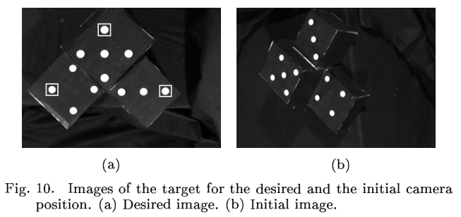
*그림 10 — 목표 및 초기 카메라 위치에서의 표적 영상. (a) 목표 영상. (b) 초기 영상.*

표 I — 운동 파라미터 (MOTION PARAMETERS)

| 보정(calibration) | $\mathbf{u}\theta$ (deg) | | | $\mathbf{t}/\|\mathbf{t}\|$ | | |
|---|---:|---:|---:|---:|---:|---:|
| exact (정확) | 28.1 | −33.8 | 96.1 | −0.11 | 0.99 | 0.10 |
| coarse (거친) | 33.0 | −32.8 | 96.3 | −0.20 | 0.97 | 0.13 |
| bad (나쁜) | 26.9 | −26.6 | 99.0 | −0.25 | 0.96 | 0.04 |

표적은 서로 다른 세 평면 위에 놓인 흰 표시(mark) 12개로 이루어진다(그림 10 참조). 추출하는 시각 특징은 각 표시의 무게중심의 영상 좌표다. 이처럼 단순한 영상이면 제어 루프를 비디오 속도(즉 25 Hz)로 쉽게 구현할 수 있다. 여기서 고려하는 것처럼 카메라 변위가 클 때, 초기 영상과 목표 영상 사이의 점 정합(point matching)은 중요한 컴퓨터 비전 문제다. 고려한 표적이 단순하므로 이 문제는 여기서 다루지 않는다. 물론 이 문제는 2D 시각 서보에서도 생기며, 3D 시각 서보에서도 영상과 표적의 3D 모델 사이의 점 정합이 필요하므로 마찬가지로 생긴다는 점에 유의할 수 있다.

### A. 3D 시각 서보 (3D visual servoing)

이 실험에서는 카메라 위치를 데카르트 공간에서 제어한다. 그림 11.a에서 보듯 표적이 카메라 시야를 벗어난다(안전상의 이유로, 표적 점 중 하나라도 영상에서 더 이상 보이지 않으면 즉시 제어를 멈춘다. 물론 12개보다 적은 점으로 서보를 계속할 수 있고, 시스템이 수렴에 성공한다면 잃어버린 점이 영상 안으로 돌아온다는 뜻이다. 그러나 우리는 점을 하나라도 잃으면 만족스럽지 않은 거동으로 간주했다). 이 실패는 이 기법이 영상 안에서 아무런 제어도 하지 않기 때문에 일어난다. 나쁜 카메라 보정을 쓰거나 핸드-아이 보정 오차가 있으면 실패 확률이 상당히 커진다.

### B. 2D 시각 서보 (2D visual servoing)

이 실험에서는 고전적인 영상 기반 시각 서보로 카메라를 완전히 제어한다. 따라서 보정 오차에 대한 높은 강건성을 기대할 수 있다. 그러나 서로 다른 시각 특징 사이의 결합 때문에 데카르트 공간에서의 카메라 궤적은 만족스럽지 않다. 그림 11.b에서 보듯 표적 점 하나가 영상을 벗어나므로, 이번에도 서보가 실패한다. 이는 초기 자세에서 목표 자세까지의 카메라 변위가 너무 크기 때문이다.

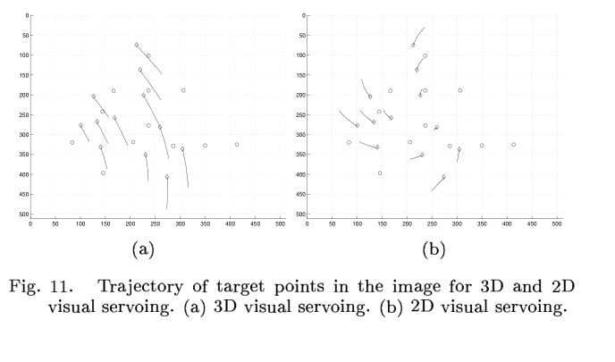
*그림 11 — 3D 및 2D 시각 서보에서 영상 안 표적 점들의 궤적. (a) 3D 시각 서보. (b) 2D 시각 서보.*

### C. 2½D 시각 서보 (2 1/2 D visual servoing)

이제 2½D 시각 서보로 얻은 결과를 제시한다. 기준 평면을 정의하는 표적의 세 점은 그림 10a에 사각형으로 표시했고, 선택한 기준점은 영상 위쪽에 가장 가까운 점이다. 다른 기준점을 골라도 비슷한 결과를 얻을 수 있다. 추정된 호모그래피로부터 카메라 변위의 부분 추정을 얻는다. 예를 들어 초기 영상과 목표 영상을 써서 추정한 회전 $\mathbf{R}$과 평행이동 방향 $\mathbf{t}/\|\mathbf{t}\|$를 카메라 보정에 따라 표 I에 제시했다. 거친 보정을 썼음에도 추정은 꽤 정밀하다(최대 회전 오차는 약 5°이며, 평행이동 방향의 각도 오차도 마찬가지다). 나쁜 보정을 쓰면 회전 오차와 평행이동 오차가 각각 약 7°와 9°에 이를 수 있다.

처음 두 실험에서는 제어 법칙 (23)의 이득 $\lambda$를 상수로 택했다. 이 때문에 수렴이 매우 느리다(약 100 s). 이는 서보 초기에 카메라 속도가 너무 크지 않도록 $\lambda$를 작은 값으로 두어야 하기 때문이다. 세 번째 실험에서 보이겠지만, 수렴 시간을 줄이기 위해 $\lambda$를 자동으로 적응시킬 수 있다.

*1) 거친 보정(Coarse calibration).* $\mathbf{m}_e - \mathbf{m}_e^*$의 오차와 추정 회전을 각각 그림 12a와 그림 12b에 그렸다. 계산된 제어 법칙은 그림 12c와 그림 12d에 있다. 작업 함수가 0으로 수렴하는 것을 볼 수 있다. 각 표적 점 좌표의 오차는 그림 12e에 있다. 좌표가 목표 값으로 수렴하는 것을 볼 수 있으며, 이는 작업이 올바르게 수행되었음을 보여 준다. 끝으로 대응하는 영상 내 궤적은 그림 12f에 있다. 기준점의 궤적은 영상에서 직선처럼 보이므로 쉽게 식별할 수 있다.

*2) 나쁜 보정(Bad calibration).* 이제 앞에서 설명한 나쁜 보정에 대한 우리 접근법의 강건성을 시험한다. 얻은 결과는 그림 13에 있다. 그림 13a에서 보듯 오차의 수렴은 더 이상 완벽한 지수 형태가 아니다. 이는 카메라의 나쁜 보정과 $\widehat{d^*}$의 거친 근사(거친 보정에서는 영향이 매우 작았음) 때문이다. 그러나 이 더 나쁜 경우에도 제어 법칙의 안정성과 강건성을 확인할 수 있다. 앞의 실험과 달리, 카메라뿐 아니라 카메라와 로봇 엔드이펙터 좌표계 사이의 동차 변환 행렬도 나쁘게 보정되어 있으므로 영상 안 기준점의 궤적은 더 이상 직선이 아니다. 그러나 영상점 좌표가 목표 값으로 수렴한다는 것은 작업이 올바르게 수행되었음을 보여 준다.

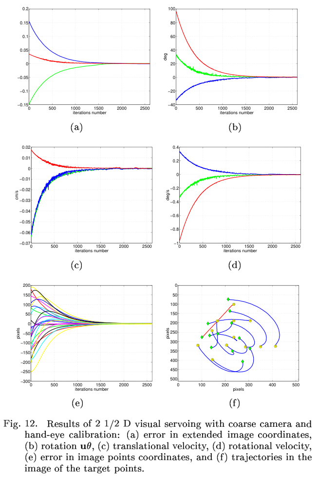
*그림 12 — 거친 카메라 보정 및 핸드-아이 보정에서의 2½D 시각 서보 결과: (a) 확장 영상 좌표의 오차, (b) 회전 $\mathbf{u}\theta$, (c) 평행이동 속도, (d) 회전 속도, (e) 영상점 좌표의 오차, (f) 표적 점들의 영상 내 궤적.*

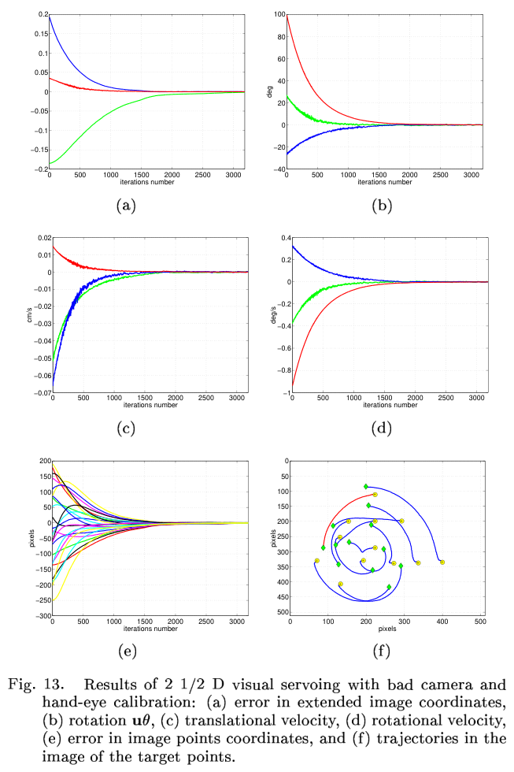
*그림 13 — 나쁜 카메라 보정 및 핸드-아이 보정에서의 2½D 시각 서보 결과: (a) 확장 영상 좌표의 오차, (b) 회전 $\mathbf{u}\theta$, (c) 평행이동 속도, (d) 회전 속도, (e) 영상점 좌표의 오차, (f) 표적 점들의 영상 내 궤적.*

*3) 나쁜 보정과 적응 이득 λ (Bad calibration and adaptive gain λ).* 이 실험에서는 오차가 줄어들면 이득 $\lambda$를 자동으로 키운다. 그림 14에서 보듯, 초기 카메라 위치가 목표 위치에서 매우 멀었음에도 수렴 시간[역주: 원문은 "convergence rate"]이 3분의 1로 줄었다(그림 13.ab와 14.ab의 초기값 비교). 수렴에는 약 30 s가 걸렸는데, 수행해야 할 큰 변위와 시각 특징의 올바른 영상 추적에 필요한 제한된 카메라 운동을 생각하면 그리 큰 값이 아니다. 물론 시스템의 수렴이 더 이상 지수적이지 않으며, 이득 증가로 인해 시스템 수렴 부근에서 제어 법칙에 (영상 특징에는 아니지만) 약간의 잡음이 더해졌음을 알 수 있다.

수행한 수많은 실험([15] 참조)으로부터, 2D 또는 3D 시각 서보가 성공할 때는 우리 기법으로도 수렴하되 더 만족스러운 거동을 보인다고 결론 내릴 수 있다. 더욱이 2½D 시각 서보의 수렴 영역은 실제로 다른 두 기법보다 더 넓다. 그러나 우리 기법이 때때로 실패한다는 점은 밝혀 두어야 한다. 이는 표적의 일부가 하나 이상의 영상점을 가릴 때(평면 표적을 쓰면 이 문제는 생기지 않는다)나 일부 점이 영상 평면을 벗어날 때(다시 말하지만, 필요하지 않더라도 점 하나가 보이지 않게 되면 실험을 항상 즉시 멈춘다) 일어난다.

## VII. 적응 이득 (Adaptive gains)

이제 표적이 카메라 시야 안에 머물러야 한다는 제약을 고려하는 적응 제어 법칙을 제시한다. 다른 접근법은 영상 평면에서 이 제약을 보장하는 데카르트 좌표계상의 지정 궤적을 오프라인으로 결정하는 것이다. 이러한 경로 계획 문제는 매우 복잡해 보이며 여기서는 고려하지 않았다. 적응 제어에 관해서는 두 종류의 방법을 구별할 수 있다 [18]:

1) 이득 적응(gains adaptation): 이 종류의 제어는 보정 오차에 대한 강건성을 개선하는 것이 목적이다. 적응은 폐루프 시스템의 안정성 분석에 기반하며, 시스템에 관여하는 기하 파라미터에 대해 추가 지식을 주지 않는다(이 파라미터들은 상수로 남는다).
2) 시스템 파라미터 적응(system parameters adaptation): 이 종류의 제어는 관여하는 기하 파라미터를 추정하여 시스템의 안정성뿐 아니라 동적 거동(따라서 성능)도 개선하는 것이 목적이다.

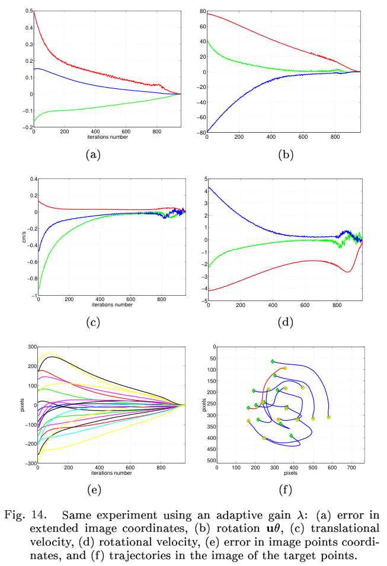
*그림 14 — 적응 이득 λ를 쓴 같은 실험: (a) 확장 영상 좌표의 오차, (b) 회전 $\mathbf{u}\theta$, (c) 평행이동 속도, (d) 회전 속도, (e) 영상점 좌표의 오차, (f) 표적 점들의 영상 내 궤적.*

우리는 첫 번째 종류의 적응 제어를 사용했다. 작업 함수의 지수적 감소를 다시 부과하되,

$$\dot{\mathbf{e}} = -\lambda\,\mathbf{D}\,\mathbf{e} \tag{52}$$

원소가 영상점 위치의 함수인 양의 대각 행렬 $\mathbf{D}$를 쓴다. 더 정확히 말하면, 상호작용 행렬의 특별한 형태 덕분에 $\mathbf{D}$를 다음과 같이 고를 수 있다.

$$\mathbf{D} = \begin{bmatrix} 1 & 0 & 0 & 0 \\ 0 & f_u(u) & 0 & 0 \\ 0 & 0 & f_u(u)f_v(v) & 0 \\ 0 & 0 & 0 & \mathbf{I}f_u(u)f_v(v)f_w(w) \end{bmatrix} \tag{53}$$

여기서 $0 \le f(x) \le 1$은 $x_m = \frac{x_1 + x_2}{2}$에 대해 대칭인 종 모양 곡선(bell-curve)이다.

$$f(x) = \begin{cases} e^{-\dfrac{(x - x_m)^{2n}}{(x - x_1)^m(x_2 - x)^m}}, & \text{if } x_1 < x < x_2 \\ 0, & \text{otherwise} \end{cases} \tag{54}$$

$m$과 $n$은 종 모양 곡선의 형태를 설계하는 데 쓰는 두 파라미터다(예로 그림 15의 함수 $f(u)f(v)$ 참조).

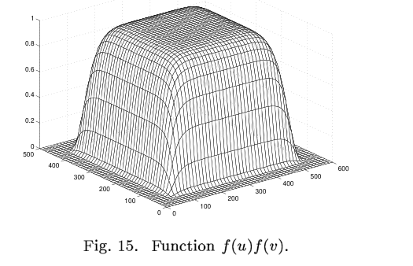
*그림 15 — 함수 $f(u)f(v)$.*

우리의 경우 시스템은 다음과 같이 제약된다.

$$\begin{aligned} u &\in [u_{min}, u_{max}] \\ v &\in [v_{min}, v_{max}] \\ w &\in [w_{min}, w_{max}] \\ \mathbf{u}\theta &\in SO_3 \end{aligned} \tag{55}$$

회전은 $SO_3$에서 자유롭게 변할 수 있으므로 상태의 첫 부분만 제약된다. 한계 $[u_{min}, u_{max}]$와 $[v_{min}, v_{max}]$는 CCD 크기로 정해지며, $u$와 $v$는 각각 이 한계에 가장 가까운 영상점의 $x$ 및 $y$ 좌표다. 마찬가지로 $[w_{min}, w_{max}]$는, 예컨대 영상이 흐려지지 않도록 실험적으로 정할 수 있다.

행렬 $\mathbf{D}$의 원소들은 대역통과 필터처럼 작동한다. 예를 들어 회전의 잘못된 추정 때문에 $w$의 오차가 커지면, $\mathbf{D}$의 마지막 세 원소가 작아지고 회전 제어 법칙이 감소한다. $v$(또는 $u$)의 오차가 커질 때도 같은 일이 일어나 $\mathbf{D}$의 마지막 네(또는 다섯) 원소가 작아지고, 제어 법칙의 안정된 부분만 고려된다. 이 제어 법칙을 쓰면, 큰 카메라 및 핸드-아이 보정 오차가 있어도 기준점이 결코 영상을 벗어나지 않음을 [15]에서 증명했다(강건 영역의 분석 제공). 이 제어 법칙은 3D 시각 서보에서도 쓸 수 있지만, 이론적 안정성 분석은 불가능하다. 또한 우리 기법은 2D 시각 서보에서는 쓸 수 없는데, 그 기법에서는 회전 제어 루프가 평행이동 제어 루프와 분리되어 있지 않기 때문이다.

이제 적응 제어 법칙을 쓸 때 시스템의 거동을 보여 주는 실험을 제시한다. 이번에 쓴 표적은 평면이며(그림 16 참조), 선택한 기준점은 영상에서 사각형으로 표시했다. 다른 표적으로도 비슷한 결과를 얻을 수 있다 [15].

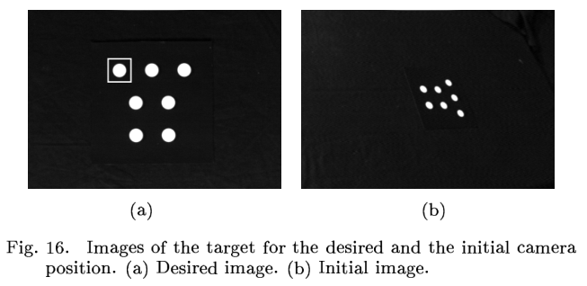
*그림 16 — 목표 및 초기 카메라 위치에서의 표적 영상. (a) 목표 영상. (b) 초기 영상.*

적응 제어 법칙이 더 넓은 강건 영역을 허용함을 입증하기 위해, 카메라와 로봇 엔드이펙터 사이 변환 행렬의 평행이동(각 축 20 cm)과 회전(각 축 20°)에 추가 오차를 더했다. 이렇게 나쁜 보정과 큰 초기 카메라 변위에서는, 고전적인 2D 및 3D 시각 서보와 $\mathbf{D} = \mathbf{I}_6$인 2½D 시각 서보를 쓰면 표적이 카메라 시야를 벗어난다. 거리 $\widehat{d^*}$는 다시 50 cm로 두었고 실제 값 $d^*$는 60 cm이다.

적응 제어 법칙으로 얻은 결과는 그림 17에 있다. 서보 시작 시에는 표적이 영상 중심에 있으므로 이득들이 1이다. 시각 서보가 시작되면 표적이 영상 위쪽으로 빠르게 움직인다. 처음 50회 반복 동안 이득 $f_v$가 감소한다. 따라서 회전 속도가 줄고 표적은 영상을 벗어나지 않는다.

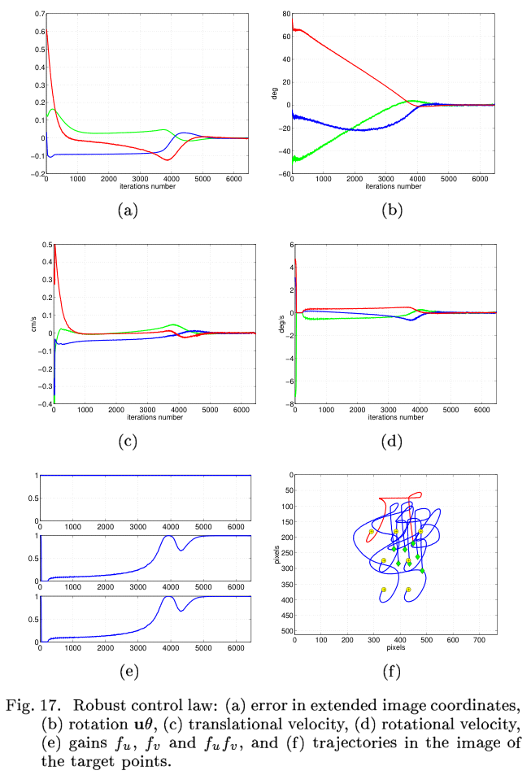
*그림 17 — 강건 제어 법칙: (a) 확장 영상 좌표의 오차, (b) 회전 $\mathbf{u}\theta$, (c) 평행이동 속도, (d) 회전 속도, (e) 이득 $f_u$, $f_v$ 및 $f_uf_v$, (f) 표적 점들의 영상 내 궤적.*

그다음 표적은 ($u$에 대한 제어가 안정하므로) 왼쪽으로 움직이기 시작하여 중심으로 돌아온다. 이득은 점차 1까지 증가한다(4000번째 반복). 이때 시스템이 나쁘게 보정되어 있어 목표 위치를 지나쳐 갔던 영상 아래쪽의 두 점이 영상 아래쪽으로 움직인다. 이득 $f_v$는 약 0.6까지 다시 감소하기 시작한다. 동시에 회전은 계속 0을 향해 감소한다. 그러므로 오차가 감소하고, 수렴할 때까지 이득은 1로 증가할 수 있다.

이 실험에서는 $\mathbf{D}$의 원소만 바꿨을 때 시스템의 거동을 보여 주려 했을 뿐이므로 수렴 속도가 느렸다. 여기서도 오차가 감소할 때 이득 $\lambda$를 키우면 수렴 속도를 개선할 수 있다.

## VIII. 결론 (Conclusion)

본 논문에서는 고전적인 위치 기반 및 영상 기반 시각 서보에 비해 많은 장점을 갖는, 시각 기반 로봇 제어의 새로운 접근법을 제안했다. 이 새 방법은 표적의 3D 모델도, 정밀한 카메라 보정도 필요 없으며, 매우 흥미로운 분리 특성과 안정성 특성을 갖는다. 구조가 단순하므로 보정 오차에 대한 강건성에 관한 해석적 결과를 얻었다. 실험 결과는 우리 접근법의 타당성과, 카메라 보정 오차뿐 아니라 핸드-아이 보정 오차에 대한 강건성을 보여 준다. 더 많은 실험 결과는 [15]에서 찾을 수 있다. 우리 방법의 단점 하나는, 평면이 아닌 표적의 경우 호모그래피 행렬을 추정하는 데 최소 8개의 점이 필요한 반면 다른 기법은 이론적으로 최소 4개의 점이 필요하다는 것이다. 또 다른 단점은, 2D 시각 서보는 추가 추정 단계 없이 시각 특징을 제어 법칙의 입력으로 직접 쓰므로, 우리 방법이 2D 시각 서보보다 영상 잡음에 더 민감하다는 것이다. 따라서 향후 연구는 영상 잡음에 대한 우리 방법의 강건성을 개선하고, 실제 물체와 복잡한 영상에 2½D 시각 서보를 적용하는 데 바칠 것이다.

## IX. 감사의 글 (Acknowledgment)

저자들은 참여와 도움을 준 DER Chatou 원격조작/로봇 그룹의 팀장과 연구원들, 귀중한 의견을 준 C. Samson과 익명의 심사위원들, 그리고 꼼꼼히 읽어 준 T. Drummond에게 감사한다.

## 참고문헌 (References)

[1] P. K. Allen, A. Timcenko, B. Yoshimi, and P Michelman, "Automated tracking and grasping of a moving object with a robotic hand-eye system," *IEEE Trans. on Robotics and Automation*, 9(2):152-165, April 1993.
[2] R. Basri, E. Rivlin, and I. Shimshoni, "Visual homing: Surfing on the epipoles," in *IEEE Int. Conference on Computer Vision, ICCV'98*, pp. 863-869, Bombay, India, January 1998.
[3] F. Bensalah and F. Chaumette, "Compensation of abrupt motion changes in target tracking by visual servoing," in *IEEE/RSJ Int. Conf. on Intelligent Robots and Systems, IROS'95*, vol. 1, pp. 181-187, Pittsburgh, Pennsylvania, August 1995.
[4] B. Boufama and R. Mohr, "Epipole and fundamental matrix estimation using the virtual parallax property," in *IEEE Int. Conference on Computer Vision, ICCV'95*, pp. 1030-1036, Cambridge, USA, 1995.
[5] F. Chaumette, "Potential problems of stability and convergence in image-based and position-based visual servoing," in *The confluence of vision and control*, D. Kriegman, G. Hager, and A. Morse, Eds., vol. 237 of *LNCIS Series*, pp. 66-78. Springer Verlag, 1998.
[6] D Dementhon and L. S. Davis, "Model-based object pose in 25 lines of code," *Int. Journal of Computer Vision*, 15(1/2):123-141, June 1995.
[7] B. Espiau, F. Chaumette, and P. Rives, "A new approach to visual servoing in robotics," *IEEE Trans. on Robotics and Automation*, 8(3):313-326, June 1992.
[8] B. Espiau, "Effect of camera calibration errors on visual servoing in robotics," in *3rd Int. Symposium on Experimental Robotics*, Kyoto, Japan, October 1993.
[9] O. Faugeras and F. Lustman, "Motion and structure from motion in a piecewise planar environment," *Int. Journal of Pattern Recognition and Artificial Intelligence*, 2(3):485-508, 1988.
[10] G.D. Hager, "A modular system for robust positioning using feedback from stereo vision," *IEEE Trans. on Robotics and Automation*, 13(4):582-595, August 1997.
[11] R. I. Hartley, "In defense of the eight-point algorithm," *IEEE Trans. on Pattern Analysis and Machine Intelligence*, 19(6):580-593, June 1997.
[12] K. Hashimoto, Ed., *Visual Servoing: Real Time Control of Robot manipulators based on visual sensory feedback*, vol. 7 of *World Scientific Series in Robotics and Automated Systems*, World Scientific Press, Singapore, 1993.
[13] S. Hutchinson, G. D. Hager, and P. I. Corke, "A tutorial on visual servo control," *IEEE Trans. on Robotics and Automation*, 12(5):651-670, October 1996.
[14] E. Malis, F. Chaumette, and S. Boudet, "Positioning a coarse-calibrated camera with respect to an unknown planar object by 2D 1/2 visual servoing," in *5th IFAC Symposium on Robot Control (SYROCO'97)*, vol. 2, pp. 517-523, Nantes, France, September 1997.
[15] E. Malis, *Contributions à la modélisation et à la commande en asservissement visuel*, Ph.D. thesis, Université de Rennes I, IRISA, November 1998.
[16] E. Malis, F. Chaumette, and S. Boudet, "Camera displacement through the recovery of a homography: application to 2 1/2 D visual servoing," *Int. Journal of Computer Vision*, To appear 1999.
[17] N. P. Papanikolopoulos, P. K. Kosla, and T. Kanade, "Visual tracking of a moving target by a camera mounted on a robot: a combination of control and vision," *IEEE Trans. on Robotics and Automation*, 9(1):14-35, February 1993.
[18] C. Samson, M. Le Borgne, and B. Espiau, *Robot Control: the Task Function Approach*, vol. 22 of *Oxford Engineering Science Series*, Clarendon Press, Oxford, England, 1991.
[19] L. E. Weiss, A. C. Sanderson, and C. P. Neuman, "Dynamic sensor-based control of robots with visual feedback," *IEEE Journal of Robotics and Automation*, 3(5):404-417, October 1987.
[20] W. J. Wilson, C. C. W. Hulls, and G. S. Bell, "Relative end-effector control using cartesian position-based visual servoing," *IEEE Trans. on Robotics and Automation*, 12(5):684-696, October 1996.

## 저자 소개 (원문 13쪽)

**Ezio Malis**는 1970년 이탈리아 고리치아에서 태어났다. 밀라노 공과대학(Politecnico di Milano)과 프랑스 파리의 Ecole Supérieure d'Electricité(Supélec)를 1995년에 졸업했고, 1998년 프랑스 렌 대학교(University of Rennes)에서 박사 학위를 받았다. 영국 케임브리지 대학교 공학과의 연구원(Research Associate)이다. 연구 관심사는 로봇공학, 컴퓨터 비전, 시각 기반 제어다.

**François Chaumette**는 1963년 프랑스 낭트에서 태어나 1987년 낭트의 Ecole Nationale Supérieure de Mécanique를 졸업했다. 렌 대학교에서 1990년 컴퓨터과학 박사 학위를, 1998년 "Habilitation à Diriger des Recherches"를 받았다. 1990년부터 렌의 IRISA/INRIA에 있다. 연구 관심사는 로봇공학, 컴퓨터 비전, 특히 이 두 분야의 결합(시각 기반 제어, 능동 비전, 목적 지향 비전)이다. 1991년 자동제어 분야 최우수 프랑스 박사논문에 수여하는 AFCET/CNRS 상을 받았다.

**Sylvie Boudet**는 1971년 프랑스 그르노블에서 태어났다. 1994년 프랑스 파리의 Ecole Supérieure d'Electricité(Supélec)를 졸업했다. 샤투(Chatou)의 프랑스 전력공사(EDF) 연구센터에서 연구 엔지니어로 일한다. EDF는 전기를 생산·송전·배전하는 프랑스 회사다. 원자력 발전소나 기타 열악한 환경에서 로봇 정비를 쉽게 하기 위해 힘 제어와 시각 기반 제어를 포함한 로봇 제어기를 개발하는 데 관심이 있다. 심장 질환의 의료 진단 개선을 위한 의료 로봇 Hippocrate 프로젝트도 이끌었다.
