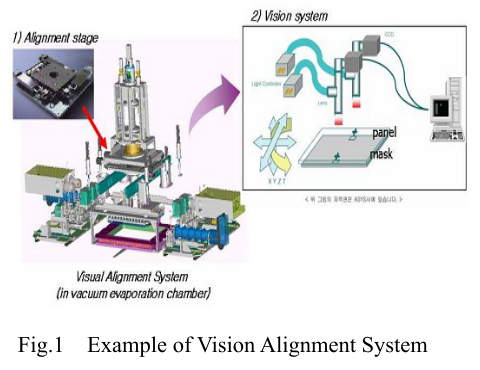
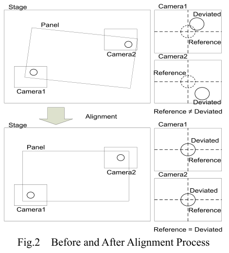
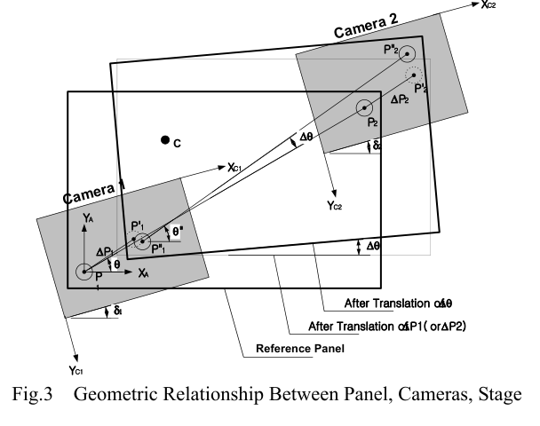
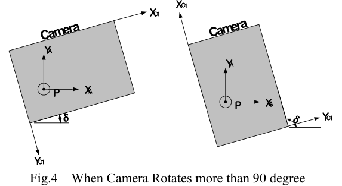
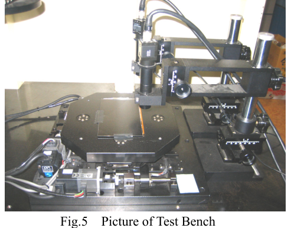

# 평판디스플레이 비전정렬장비의 자동 Calibration에 대한 연구 (하현철 2008)

- 원제: 평판디스플레이 비전정렬장비의 자동 Calibration에 대한 연구 (A Study on the Automatic Calibration of Vision Aligner for Flat Panel Display)
- 저자: 하현철¹, 신동원²(교신), 권보철³, 권영록⁴ — ¹금오공대 기계공학과, ²·³·⁴금오공대 기계공학부
- 원문: 같은 폴더의 `Ha2008_KSPE_vision_aligner_auto_calibration.pdf` (한국정밀공학회 2008년도 춘계학술대회논문집, pp. 13-14)
- 번역 범위: 국문 원문 정리(전문 2쪽). 원문이 국문이므로 번역하지 않고 본문을 그대로 옮겨 정리했다. 원문에는 영문 초록이 없고 영문 제목과 Key words만 있다(아래에 그대로 둠). 2쪽 분량의 **학술대회 요약 논문(초록집 수준)** 이므로 실험 조건·오차 분석이 짧게만 적혀 있다.
- 그림: 원문 그림 5개(Fig.1~5)를 `그림/`에 넣고 본문에서 처음 언급되는 곳에 삽입. 표 1은 마크다운으로 옮김.
- 원문 텍스트 층이 깨져 있어(한글 글꼴 인코딩) 쪽 이미지를 보고 옮겼다. 원문의 `filp`(flip의 오기)는 그대로 두었다.

Key words : Automatic Calibration, Vision Aligner, Flat Panel Display, Camera, xyθ Stage

## 초록

원문에 초록이 없다.

## 1. 서론

디스플레이 및 반도체 산업을 중심으로 전자산업의 수요가 급증하고 있는 가운데 생산성 향상을 위한 생산 공정의 자동화가 지속적으로 일어나고 있다. 특히 대형화되고 있는 평판 디스플레이의 경우 제품의 고품질화를 위해서는 아래 그림과 같이 평판디스플레이를 정밀하게 정렬해 주는 장비가 필수적이다. 정렬장비는 그림과 같이 평판디스플레이 패널과 마스크의 기점마크의 영상을 획득하는 2 대의 카메라와 조명장치, 획득된 영상으로부터 정렬오차를 계산하는 영상처리장치, 정렬오차를 보정해주는 xyθ 정렬스테이지 등으로 구성되어있다.

*그림 1 — Fig.1 Example of Vision Alignment System (비전 정렬 시스템의 예: 1) 정렬 스테이지, 2) 비전 시스템, 진공 증착 챔버 내 Visual Alignment System)*

비전정렬장비는 패널의 기점마크와 마스크의 기점마크 간의 거리를 측정하여 이를 기초로 하여 평판이 xyθ방향으로 얼마만큼 정렬오차가 발생하였는지 계산하게 된다. 이러한 계산에 앞서 카메라의 기울어진 각도, 픽셀당 실제 거리, xyθ Stage 의 회전중심 위치 등을 구해야 하는데 이러한 값들을 구하는 과정을 비전정렬장비의 Calibration 이라고 한다. 이러한 Calibration 인자들의 정확도는 비전정렬장비의 성능을 좌우할 정도로 중요한 요소이다.

기존에 PCB 의 정렬 및 평판디스플레이의 정렬에 대한 연구가 진행되었으나 대부분 정렬과정 자체에 집중하여 언급하였다 ^1,2,3,4^. 이에 본 연구에서는 평판디스플레이의 비전정렬장비의 자동 Calibration 에 관해서 연구를 진행하였다. 정렬 테스트장비를 구축하고 이를 통하여 Calibration 성능 및 정렬성능을 평가하였다.

## 2. 비전정렬

전체적인 정렬과정은 Fig.2 와 같다. 먼저 정렬의 기준위치(Reference position)가 화면의 중심에 설정되어 있다고 하고, 패널(Panel)이 입력되면 벗어난 마크의 위치(Deviated position)와 기준위치와의 오차 값을 측정하고 정렬오차(Δx, Δy, Δθ)를 계산한다. 이어 정렬오차의 반대방향으로 정렬스테이지를 구동하여 그림과 같이 마크의 위치와 기준위치가 일치하게 된다. 기준위치와 벗어난 마크위치간의 오차로부터 정렬오차를 구하는 관계식은 Fig.3 의 기하학적 관계에서 알 수 있다.

*그림 2 — Fig.2 Before and After Alignment Process (정렬 전후: 위는 Reference ≠ Deviated, 아래는 Reference = Deviated)*

일단 정렬오차가 없는 상태에 있을 때의 패널의 위치를 기준위치라 명하고, 기준위치로부터 패널의 일정량의 정렬오차는 병진변위(Δx, Δy) 와 회전변위(Δθ)로 표현할 수 있다. 그림에서 음영 처리가 된 사각형은 카메라 두 대의 영상을 나타내고 스테이지 회전 중심은 C 점에 있다. 또한 기준 위치에 놓여진 Panel 을 기준 Panel 이라 하고 카메라 영상 안의 기점마크가 기준 위치에 있는 경우를 P₁, P₂라 한다. 이러한 Panel 에 병진변위를 부여하고 회전 변위를 부여하면 기점 마크는 $P_1 \rightarrow P_1' \rightarrow P_1''$ 로 기준위치를 벗어나며 이동한다. 그림에서 기준 좌표계는 X_A-Y_A frame 으로 X_A 축 방향은 기준위치에 있는 스테이지의 X 방향과 일치하며 X_A-Y_A frame 의 원점은 점 P₁ 과 일치한다. 그리고 카메라 좌표계는 X_C-Y_C frame 이며 이는 카메라 영상의 좌측 상단이 원점이다. 기준위치와 벗어난 마크위치의 오차로부터 정렬오차를 구하는 방정식은 참고문헌[1]에 자세히 기술되어 있다.

*그림 3 — Fig.3 Geometric Relationship Between Panel, Cameras, Stage (패널·카메라·스테이지의 기하 관계)*

상기의 방정식에서 미지수로 남아있는 값들은 P₂ 의 위치와 회전 중심 C, 그리고 카메라의 기울어진 각도 δ₁, δ₂ 값들이고 이러한 값들은 Calibration 을 통하여 구하게 된다.

## 3. 자동 Calibration

먼저 두 개의 카메라의 기울어진 각도 δ₁, δ₂ 를 알아내기 위해 의도적으로 스테이지에 병진변위 $\Delta_s=[\Delta x_s, \Delta y_s]^T$ 를 가하면 아래와 같은 식으로 카메라의 기울어진 정도를 알 수 있다.

$$\delta_i = \tan^{-1}(\Delta y_s / \Delta x_s) - \tan^{-1}(\Delta y_i^d / \Delta x_i^d) \tag{1}$$

여기서 $\Delta x_i^d$, $\Delta y_i^d$ 는 i 번째 카메라상에서 측정한 기점마크의 위치 변화량 이다.

$\Delta x_i^d$, $\Delta y_i^d$ 을 구할 때 Fig. 4 의 좌측과 같이 카메라가 기준좌표계에 대하여 일정각도 범위 내에서 회전되어 있을 경우에 식(1)은 쉽게 적용되나, 카메라가 90 도 이상의 회전하거나 카메라의 좌표축이 뒤집어진 경우에는 적용이 어렵다. 만약 90 도 이상 회전이 되었을 경우를 생각해 보면 Fig.4 의 우측에서 보는 것과 같이 카메라 좌표축 방향이 좌측과 비교하여 완전히 바뀌게 된다.

*그림 4 — Fig.4 When Camera Rotates more than 90 degree (카메라가 90도 이상 회전한 경우)*

그림의 좌측과 같이 90 도가 넘어가지 않은 경우 스테이지에서 +X 변위를 주면 카메라 상에서도 +X 로 변위가 생기고 스테이지에서 +Y 변위를 주면 카메라 상에서는 –Y 로 변위가 생긴다. 또한 90 도 이상이 되면 스테이지에서 +X 변위를 주면 카메라 상에서도 +Y 로 변위가 생기고 스테이지에서 +Y 변위를 주면 카메라 상에서는 +X 로 변위가 생긴다. 이처럼 카메라가 회전된 정도에 따라 스테이지 좌표와 카메라 좌표간에 상관관계가 달라지는데 경우의 수는 (+X, +Y) 축이 (+X, -Y), (-X, +Y), (–X, -Y), (+Y, +X), (+Y, -X), (-Y, +X), (–Y, -X)이 될 수도 있으므로 총 8 가지의 경우에 수가 있다. 이렇게 좌표축이 바뀌었을 경우에는 그에 맞는 행렬을 곱해 줌으로써 해결 할 수 있다.

$$\begin{bmatrix}\Delta x\\ \Delta y\end{bmatrix} = filp \begin{bmatrix}\Delta x\\ \Delta y\end{bmatrix} \tag{2}$$

여기서 filp 행렬은 2x2 행렬 (a₁₁, a₁₂, a₂₁, a₂₂)이다. 예를 들어, 스테이지와 카메라상의 X 축의 크기와 방향이 같으며 Y 축은 크기는 같지만 방향이 반대일 경우는 (1,0,0,-1)의 행렬을 사용하며, 스테이지의 Y 축와 카메라상의 X 축의 값이 같고 스테이지의 X 축와 카메라상의 Y 축의 값이 같을 경우는 (0,1,1,0)의 행렬이 사용된다.

이렇게 카메라의 기울기 각도를 구한 뒤에는 기점마크 P₂ 와 회전중심 C 를 구하기 위해서 의도적으로 회전변위를 가하면 아래와 같은 식으로 구할 수 있다.

여기서 Δθ_s 는 회전변위를 $\Delta x_1^a$ 와 $\Delta y_1^a$ 는 기점마크 1 의 변위량으로 카메라 1 에서, $\Delta x_2^a$ 와 $\Delta y_2^a$ 는 기점마크 2 의 변위량으로 카메라 2 에서 측정할 수 있는 값이다. 또 $[C_x, C_y]^T$ 는 회전중심, $[x_2, y_2]^T$ 는 기점마크 2 의 위치이다.

$$\begin{bmatrix}C_x\\ C_y\end{bmatrix} = \rho\cdot\begin{bmatrix}1-\cos\Delta\theta_s & -\sin\Delta\theta_s\\ \sin\Delta\theta_s & 1-\cos\Delta\theta_s\end{bmatrix} Rot(\delta_1)\begin{bmatrix}\Delta x_1^a\\ \Delta y_1^a\end{bmatrix} \tag{3}$$

$$\begin{bmatrix}x_2\\ y_2\end{bmatrix} = \begin{bmatrix}C_x\\ C_y\end{bmatrix} - \rho\cdot\begin{bmatrix}1-\cos\Delta\theta_s & -\sin\Delta\theta_s\\ \sin\Delta\theta_s & 1-\cos\Delta\theta_s\end{bmatrix} Rot(\delta_2)\begin{bmatrix}\Delta x_2^a\\ \Delta y_2^a\end{bmatrix}$$

$$where,\ \rho = \frac{1}{2-2\cos\Delta\theta_s}$$

## 4. 실험 및 결론

본 연구로 개발된 Calibration 알고리즘을 검증하기 위해 test bench 를 구성하였다. 스테이지는 xyθ 스테이지와 동일하게 작동하는 uvw stage 를 사용하였으며 카메라 두 개를 가지고 90 도씩 회전을 줌으로써 스테이지 좌표와 카메라 좌표간에 뒤집어짐이 발생한 상태에서 실험을 하였다.

*그림 5 — Fig.5 Picture of Test Bench (시험 장치 사진)*

Table 1 에서는 기준좌표계에 대하여 카메라를 임의의 방향으로(8 종류) 위치시키고 X,Y 방향으로 1mm 씩 스테이지를 움직인 후에 정렬오차를 계산하고 1 회 보정한 후에 정렬오차를 측정한 평균값을 기록하였다 (총 5 회 반복). 모든 경우에서 정렬은 오류없이 실행되었고 정렬오차는 2 μm 이내로 들어옴을 알 수 있었다.

Table 1 Experimental Results

| xyθ stage | 카메라 1 | 카메라 2 | 오차(μm) |
|---|---|---|---:|
| +X,+Y | +X,+Y | -X,+Y | 1.40 |
| +X,+Y | +X,-Y | -Y,-X | 1.38 |
| +X,+Y | -X,+Y | +X,+Y | 1.78 |
| +X,+Y | -X,-Y | +Y,+X | 2.04 |
| +X,+Y | +Y,+X | +Y,-X | 1.09 |
| +X,+Y | +Y,-X | +X,-Y | 1.55 |
| +X,+Y | -Y,+X | -X,-Y | 1.65 |
| +X,+Y | -Y,-X | -Y,+X | 1.89 |

[정리자 주] 본문은 "정렬오차는 2 μm 이내"라고 했으나 표의 4번째 행은 2.04 μm로 2 μm를 약간 넘는다. 원문 그대로 둔다.

## 참고문헌

1. 신동원, "머신비전을 이용한 PCB 스크린인쇄기의 정렬오차측정 및 위치보정(1),(2)", 한국정밀공학회 논문집 제 20 권 제 6 호, pp. 88-104, 2003.
2. 신동원, "2 개의 헤드를 갖는 FPC 비전 정렬 장착기 개발", 한국정밀공학회 논문집, pp. 390-393, 2005.
3. 김종원, 서재용, 조현찬, 조태훈, 강흥석, "FPD 용 노광 스테이지의 통합 제어 시스템 구현", 반도체 및 디스플레이 장비학회지 제 5 권 제 4 호, pp. 11-15, 2006.12.
4. 조태훈, 서재용, "노광 시스템을 위한 자동 정렬 비전 시스템", 반도체 및 디스플레이 장비학회지 제 6 권 제 1 호, pp. 43-48, 2007.3.
