# 정밀 조작을 위한 비보정 시각 서보의 실험적 평가 (Jägersand 1997)

- 원제: Experimental Evaluation of Uncalibrated Visual Servoing for Precision Manipulation
- 원문: 같은 폴더의 `Jagersand1997_ICRA_uncalibrated_visual_servo.pdf` (Proceedings of the 1997 IEEE International Conference on Robotics and Automation, Albuquerque, New Mexico, April 1997, pp. 2874–2880. 저자 Martin Jägersand, Olac Fuentes, Randal Nelson, University of Rochester)
- 번역 범위: 전문 (PDF는 스캔본이라 텍스트 층이 부정확하여 쪽 이미지를 직접 읽어 번역했다)
- 그림: 원문 그림 11개를 `그림/`에 넣고 본문에서 처음 언급되는 곳에 삽입. 표 1은 마크다운 표로 옮겼다.

## 초록 (Abstract)

이 논문에서는 3, 6, 12 자유도(DOF)에서 적응형(adaptive)과 비적응형(non-adaptive) 시각 서보(visual servoing)를 실험적으로 평가하고 이를 전통적인 관절 피드백 제어와 비교한다. 다른 대부분의 연구에서 실험의 목적은 제시한 특정 알고리즘이 실제로도 동작함을 보이는 것이었지만, 우리는 알고리즘보다는 시각 서보 일반에 중요한 성질에 초점을 둔다. 주요 결과는 다음과 같다. 6축 PUMA 762 팔의 위치 결정은 시각 제어에서 관절 제어보다 최대 5배 정밀하다. Utah/MIT 다관절 손(dextrous hand)의 위치 결정은 시각 제어에서 관절 제어보다 2배 낫다. 또한 신뢰 영역(trust-region) 기반 적응형 시각 피드백 제어기가 매우 강건함을 발견했다. 추적하는 시각 특징이 $m$개일 때, 이 알고리즘은 3 DOF 조작 작업을 수행하면서 아무런 사전 정보 없이 $m \times 3$ ($m \ge 3$) 영상 자코비안($J$)을 온라인으로 성공적으로 추정할 수 있다. 6 DOF 이상의 조작에서는 $J$의 대략적인 초기 추정이 유익하다. 또한 중복(redundant) 시각 정보가 가치 있음을 확인했다. 시각 특징의 수 $m$을 늘리면 부정확한 추적과 목표 지정으로 인한 오차가 줄었다. 나아가 중복도가 높은 시스템에서는 특징 벡터의 이상치(outlier)를 검출하고 부분 가림(partial occlusion)에 대처할 수 있다.

## 1 서론 (Introduction)

시각 입력으로 로봇 매니퓰레이터를 제어하면 전통적인 위치 기반 제어보다 더 유연하고 강건한 로봇 동작이 가능하다. 최근 "비보정(uncalibrated)" 시각 서보 제어가 다양한 환경에서 시연되었다(예: [1, 3, 2, 5, 6, 7, 11, 14, 13, 18, 19, 21]¹). 단순한 시각 정렬을 지정하기에 적합한 시각 모델도 연구되었다[22, 9, 8]. [15]에서 우리는 이 논문에서 쓰는 강건한 시각 서보 제어기를 유도하는 방법을 보였다. [13, 14, 11]에서는 서로 다른 시각 서보 동작을 결합해 비구조화 환경에서 복잡한 실세계 작업을 푸는 방법을 보였다. 놀랍게도, 우리가 아는 한 시각 피드백 제어의 정확도 관련 성질에 대한 철저한 실험적 평가는 한 번도 수행된 적이 없다. 대부분 논문의 실험 결과는 특정 알고리즘이 실제로 동작함을 검증하는 몇 번의 실행에 그쳤다. 우리가 찾은 가장 가까운 일반적 실험 평가는 Wijesoma 등 [6]과 Chen 등 [17]의 연구다. Wijesoma 등은 2 DOF 구현에서 모델 오차가 클 때 개루프 제어 대비 시각 피드백의 이점을 보였다. Chen 등은 두 대의 대형 산업용 로봇 팔이 카메라 공간 제어(camera space control)를 써서 페그와 구멍 사이 틈새가 0.7 mm인 페그-인-홀(peg-in-hole) 부품 조립 작업을 수행할 수 있음을 보였다.

이 논문에서는 수많은 실제 위치 결정 실험에 기반한 시각 서보 평가를 제시하며, 다음 네 가지 주요 결과를 얻는다.

1. 전형적인 두 로봇 팔(PUMA 761과 762)에서 반복정밀도(repeatability)는 시각 서보 제어에서 전통적인 관절 제어보다 최대 5배 좋다.
2. 적응형 시각 서보 제어기는 매우 강건하다. 이 알고리즘은 3 DOF 조작 작업을 수행하면서 아무런 사전 정보 없이 $m \times 3$ ($m$ = 시각 측정의 수) 영상 자코비안을 성공적으로 추정할 수 있다.
3. 중복 시각 정보가 가치 있음을 확인할 수 있었다. $m$을 늘리면 부정확한 추적과 목표 지정으로 인한 오차가 모두 줄었다. 나아가 중복도가 높은 시스템에서는 시각 특징 측정 벡터 $\mathbf{y}$의 이상치를 검출하고 부분 가림에 대처할 수 있다.
4. 비보정 시각 서보는 제어하기 어려운 매니퓰레이터에서도 동작하게 할 수 있다. 16 DOF Utah/MIT 손을 쓴 미세 조작 결과를 보인다.

이 결과들 대부분은 특정 알고리즘 하나에만 국한되지 않고 더 넓은 부류의 알고리즘에 적용된다(4절 참조). 우리 비전 기반 조작 시스템의 전체 구조는 그림 1과 같다. 이어지는 두 절에서 온라인 모델 획득을 살펴본다. 제어는 2.2절에서 설명한다. 시각 목표 할당, 궤적 생성, 그리고 어떤 종류의 시각 특징을 쓸지는 이 논문에서 다루지 않는다. 시스템의 상위(작업) 수준 부분과, 이 시스템으로 모양 맞추기 퍼즐 풀기, 유연한 재료 다루기, 전구 교체 같은 실세계 조작 문제를 푸는 방법은 [13]을 참조하기 바란다. 이 논문의 주된 기여는 3절의 실험으로, 시각 제어의 하위 수준 측면을 연구하고 단순한 무작위 궤적을 써서 위치 결정과 모델 추정을 정량적으로 평가한다.

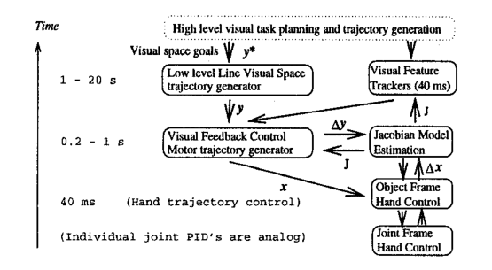
*그림 1 — 시스템 구조와 각 부분이 동작하는 시간 단위. 화살표는 정보 교환을 나타낸다.*

*(각주) \*NSF 과제 CDA-9401142, ONR 과제 N00014-93-0671, U of Maryland/ARPA 하도급 Z840902의 지원을 받았다.*
*(각주 1) 이 연구 분야의 개관은 [14] 또는 [18]을 참조하기 바란다.*

## 2 이론 (Theory)

이 절에서는 이 실험에서 쓴 능동 시각 모델 획득과 제어를 살펴본다. 자세한 설명은 [11, 15]에 발표했다.

능동 비전 에이전트는 자신의 행동을 제어할 수 있고, 시각적 외관의 변화를 관찰하여 행동의 결과를 지켜볼 수 있다. 우리는 비구조화 환경에 있는 로봇 에이전트(그림 2)를 연구한다. 로봇 행동의 기준 좌표계는 관절 공간이며, 원하는 관절각² $\mathbf{x} = (x_1 \ldots x_n)^T$와 그 시간 미분 $\dot{\mathbf{x}}, \ddot{\mathbf{x}}$로 기술된다. 시각적 외관의 변화는 *지각(perception)* 또는 *특징(feature)* 벡터 $\mathbf{y} = (y_1 \ldots y_m)^T$에 기록된다. 시각 특징은 넓은 부류의 시각 측정[1, 11]에서 얻을 수 있지만, 카메라 공간에서 점이나 점 벡터로 표현할 수 있는 것이 매끄러운 전달 함수 $f$[14]를 주므로 적합함을 발견했다. 우리는 경계 불연속(선, 모서리)과 표면 표시 같은 특징을 추적한다. 중복 시각 지각($m \gg n$)은 원시 시각 감각 정보를 구속하는 데 쓰이므로 바람직하다.

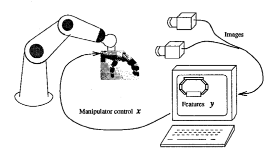
*그림 2 — 카메라 두 대를 쓰는 시각 제어 구성.*

시각 특징과 에이전트의 행동은 처음에는 알려지지 않은 비선형 시각-운동(visual-motor) 함수 $f$로 관계되며, $\mathbf{y} = f(\mathbf{x})$를 만족한다. 임의의 시각 $k$에서 우리는 현재 시스템 구성 $\mathbf{x}_k$ 주변에서 유효한 1차 모델 $f(\mathbf{x}) \approx f(\mathbf{x}_k) + J(\mathbf{x}_k)(\mathbf{x} - \mathbf{x}_k)$를 추정하고자 하며, 이 모델은 다음과 같이 정의되는 "영상(image)"[18] 자코비안 또는 시각-운동 자코비안으로 기술된다.

$$(J_{j,i})(\mathbf{x}_k) = \frac{\partial f_j(\mathbf{x}_k)}{\partial x_i} \tag{1}$$

영상 자코비안은 이전 시각 피드백 제어[2]에서 활용되었듯이 시각 변화를 운동 변화에 관계시킬 뿐 아니라, 가능한 시각 변화를 $\mathbf{y}_{k+1} = J\Delta\mathbf{x} + \mathbf{y}_k$의 가능한 해 $\mathbf{y}_{k+1}$의 집합으로 강하게 구속한다. 따라서 자코비안 $J$는 우리 로봇이 움직일 수 있는 자유도로 정확히 매개변수화된 시각 모델이기도 하다. ($m \gg n$이므로 해 집합은 $\Re^m$의 작은 부분공간일 뿐임을 기억하라.)

*(각주 2) 벡터는 굵게, 스칼라는 보통 글씨, 행렬은 대문자로 쓴다.*

### 2.1 모델 추정 (Model estimation)

대부분의 시각 서보 연구에서 자코비안은 (1) 해석적으로 유도하거나, (2) 일부는 해석적으로 유도하고 일부는 추정하거나(예: [2, 7]), (3) 직교 보정 이동 $\mathbf{e}_i$ 세트를 물리적으로 실행하여 실험적으로 결정하고(예: [9, 22]) 유한 차분으로 자코비안을 근사하였다.

$$\hat{J}(\mathbf{x}, \mathbf{d}) = (f(\mathbf{x}+d_1\mathbf{e}_1) - f(\mathbf{x}), \ldots, f(\mathbf{x}+d_n\mathbf{e}_n) - f(\mathbf{x}))D^{-1} \tag{2}$$

여기서 $D = \text{diag}(\mathbf{d}), \mathbf{d} \in \Re^n$이다.

우리는 대신 사전 모델이나 추가 "보정" 이동 없이 과정을 관찰하기만 하여 자코비안을 추정하는 온라인 방법을 쓴다. 물체의 움직임을 관찰하여 특정 제어기 명령 $\Delta\mathbf{x}$에 대응하는 시각적 외관 변화 $\Delta\mathbf{y}_{measured}$를 얻는다. 이것은 방향 $\Delta\mathbf{x}$를 따른 $f$의 미분의 할선(secant) 근사다. 우리는 가장 최근 관측을 만족하도록(할선 조건) 자코비안을 갱신하고자 한다: $\Delta\mathbf{y}_{measured} = \hat{J}_{k+1}\Delta\mathbf{x}$. 위 조건은 부족 결정(under-determined)이며, *Broyden* 갱신식 계열을 정의할 수 있다[26, 15]. 이전 연구에서 우리는 다음의 비대칭 보정식으로 가장 좋은 결과를 얻었다[11, 15, 27].

$$\hat{J}_{k+1} = \hat{J}_k + \frac{(\Delta\mathbf{y}_{measured} - \hat{J}_k\Delta\mathbf{x})\Delta\mathbf{x}^T}{\Delta\mathbf{x}^T\Delta\mathbf{x}} \tag{3}$$

이것은 *Broyden* 계층의 계수 1(rank 1) 갱신식이다. 한 점 주위의 직교 이동 집합 $\{\Delta\mathbf{x}_k, k = 1 \ldots n\}$에 대해 식 3은 회전된 좌표계에서의 유한 차분 갱신(식 2)과 같다. 그러나 이 추정은 임의 방향 $\Delta\mathbf{x}$의 이동을 받아들이므로, 우리가 풀려는 조작 작업의 일부로 얻을 수 있는 것 외에 추가 데이터가 필요 없다는 점에 주목하라. 도달(장거리 운반) 이동 동안 이 방식은 추정값 $\hat{J}_{k+1}$을 이동 방향으로는 정확하게 갱신하고, 다른 방향으로는 (과정 잡음 때문에) 적당히 근사된 상태로 유지한다. 미세 조작(작은 영역에서 많은 작은 독립 이동) 동안에는 $\hat{J}_{k+1}$이 결국 모든 방향에서 실제 자코비안 $J$를 정확하게 근사한다. 초기 자코비안 $J_0$는 무작위 행렬이어도 되지만, 고자유도 시스템(4 DOF 이상)의 미세 조작에서는 초기의 잘못된 이동을 피하기 위해 대략적인 초기 추정이 유익하다. 고자유도(예: 6 DOF)의 부분 초기 추정은 더 낮은 자유도(예: 3 DOF) 자코비안에서 얻을 수 있다. 이를 조작 작업에 자연스럽게 통합하는 방법은 우리의 시각 공간 작업 프로그래밍 논문 [13]을 참조하기 바란다.

### 2.2 제어 (Control)

능동 로봇 에이전트는 원하는 지각 $\mathbf{y}^*$로 자신의 행동을 지정한다. 이런 목표 지각을 운동 행동 $\mathbf{x}$로 바꿀 수 있는 제어 시스템이 필요하다. 이전 시각 서보 연구는 대부분 비례 제어를 썼고, 보통 일부 동역학을 고려하는 약간의 수정을 더했지만, 우리는 더 정교한 접근이 유익함을 발견했다. 우리는 최적화에서 두 가지 아이디어를 쓴다. (1) 신뢰 영역 방법[27]은 현재 모델의 유효성을 온라인으로 추정하고, 제어기 응답을 이 "신뢰 영역(region of trust)" 안으로 제한한다. (2) 호모토피(homotopy) 또는 경로 추종 방법[25]은 시각 공간에서 계획한 궤적을 따라 하위 목표를 만들어, 비볼록일 수 있는 문제를 여러 개의 더 작은 볼록 문제로 나눈다. 후자의 자세한 내용은 [13]을 참조하기 바라며, 여기서 우리는 상위 수준 시각 공간 작업 지정, 계획, 궤적 생성 방법을 설명한다. 신뢰 영역 방법은 제어기가 현재 자코비안 추정의 유효 영역을 결코 벗어나지 않도록 파라미터 $\alpha$를 조정한다. 이를 위해 비례 제어기의 뉴턴 스텝 전체를 밟는 대신 $\|\delta_k\| < \alpha$에 대한 제약 문제를 푼다.

$$\min_{\|\delta_k\| < \alpha_k} \|\mathbf{y}_k - \mathbf{y}^* + \hat{J}_k\delta_k\|^2 \tag{4}$$

모델 일치도를 $d_k = \frac{\|\hat{J}\delta\|}{\|\Delta\mathbf{y}_{measured}\|}$로 정의하고, $\alpha$를 다음에 따라 조정한다($d_{lower}$와 $d_{upper}$는 미리 정한 경계다).

$$\alpha_{k+1} = \begin{cases} \frac{1}{2}\alpha_k & \text{if } d_k \le d_{lower} \\ \alpha_k & \text{if } d_{lower} < d_k \le d_{upper} \\ \max(2\|\delta\|, \alpha) & \text{if } d_k > d_{upper} \end{cases} \tag{5}$$

영상 프레임 속도와 영상 처리 부담은 시각 제어 로봇의 최대 시각 피드백 대역폭을 제한한다. Feddema는 표준 프레임 속도(30 Hz)가 직접 관절 모터 피드백에는 너무 낮다고 지적하고, 관절 피드백을 함께 쓰면 이를 극복할 수 있다고 제안한다[2]. 우리는 2단계 접근을 쓴다. 모터 명령(위 식 4의 $\delta_k$)은 원하는 관절 공간 궤적을 생성하는 데 쓰이며, 하위 수준 관절 제어는 RCCL로 구현된다. 현재 궤적 구간이 끝나기 전에 다음 궤적 구간을 큐에 넣음으로써, *look and move*(Weiss의 용어[1]) 대신 매끄러운 *시각 서보* 운동을 얻는다(그림 3 참조). 식 4의 $\hat{J}_k$는 매 스텝 식 3으로 갱신된다는 점에 주목하라. 이는 모델 획득을 제어와 동기화하는 역할을 하며, 모델이 적응형 크기의 격자 위에서 추정되게 한다. 즉 시각-운동 사상이 어려운 곳에서는 조밀하고, 거의 선형인 곳에서는 성기다. 마찬가지로 시각 주기의 빈도도 변하여, 가능할 때마다 계산 부하를 줄인다.

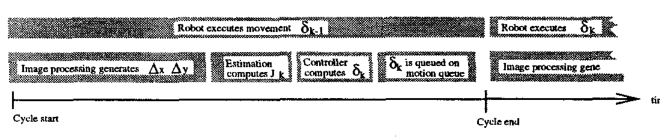
*그림 3 — 한 시각 주기 안의 시간 단위.* [역주: 그림 속 문구는 "Robot executes movement $\delta_{k-1}$", "Image processing generates $\Delta x\ \Delta y$", "Estimation computes $J_k$", "Controller computes $\delta_k$", "$\delta_k$ is queued on motion queue", "Robot executes $\delta_k$", "Cycle start", "Cycle end"이다.]

## 3 시각 서보 실험 (Experiments with visual servoing)

이 절에서는 이 논문의 주된 기여인, 여러 실제 매니퓰레이터(PUMA 761·762 6 DOF 로봇 팔과 Utah/MIT 16 DOF 다관절 손)에서의 시각 서보 실험 평가를 제시한다. 실험을 고를 때 다음 목표를 두었다. 위치 결정 작업을 수없이 반복하여 통계를 모음으로써 시각 서보가 어떻게 동작하는지 보이고자 했다. 이 실험들에서 궤적은 매니퓰레이터 작업 공간에서 균일 무작위로 샘플링하여 선택했다. 다른 대부분의 발표 결과는 한 번 또는 몇 번의 반복에서 얻은 것이다. [13]에서 우리는 시각 서보를 여러 실세계 시각 조작 작업(6 DOF 삽입, 어린이용 모양 맞추기 퍼즐 풀기, 전구 교체)을 푸는 시스템에 통합하는 방법을 보였다. 그 실험들에서 우리는 위치 결정 정확도의 한계가 시각 서보 하위 시스템의 목표 달성 능력이 아니라 시각 목표를 정확하게 생성하고 추적하는 어려움에서 비롯됨을 발견했다. 이 논문에서는 시각 서보만의 성능을 연구한다. 지정 오차는 정확도 대신 반복정밀도³를 측정하여 최소화하고, 추적 오차는 시험 물체에 부착한 특수 마커나 LED를 추적하여 줄인다.

시각 피드백의 위치 결정 반복정밀도를 평가하고, 3.1절의 로봇 팔 반복정밀도 실험 세트에서 전통적인 관절 피드백 위치 결정과 비교한다. 3.2절은 위치 결정 정확도가 시각 특징 측정의 수와 품질에 어떻게 의존하는지에 대한 결과를 제시한다. 제어기 수렴은 제어기 파라미터의 정확도와 관련된다. 3.3절에서는 적응형과 비적응형 제어기의 수렴을 실험으로 비교한다. 다관절 손의 반복정밀도는 3.5절에서 평가한다. 실험 조건과 결과에 대한 심층적인 다룸은 우리의 기술 보고서 [11]을 참조하기 바란다.

*(각주 3) 반복정밀도는 로봇이 이전에 도달했던 자세에 다시 도달하는 능력이다. 정확도는 미리 지정한 임의의 자세에 도달하는 능력을 측정한다[23].*

### 3.1 반복정밀도 (Repeatability)

폐루프 시각 제어에서 반복정밀도를 시험하고, 우리 자체 실험과 발표된 수치 모두로 전통적인 관절 제어와 결과를 비교했다.

위치는 로봇 엔드이펙터에 장착한 0.001" 정확도의 다이얼 게이지로 측정했다. 정확한 시각 측정은 로봇 엔드이펙터에 장착한 LED로 얻었다. 두 카메라를 약 60도 떨어지게 배치했으며, 목표 근처에서 1 화소 ≈ 0.25 mm의 로봇 이동에 해당했다. 반복정밀도는 로봇을 무작위 궤적으로 강체 기준 면을 향해 다이얼 게이지가 닿을 때까지 움직이고, 다이얼 값과 시각 또는 관절 값을 읽은 뒤, 두 번째 무작위 궤적으로 후퇴했다가 시각 또는 관절 목표에 다시 도달하려고 시도하여 측정했다. 알고리즘은 최종 접근을 매번 다른 무작위 방향에서 수행하도록 특별히 설계했다.

우리 실험실의 로봇 팔 두 대를 시험했다. Bill은 오래된 PUMA 762로, 수년에 걸쳐 기어에 상당한 백래시(backlash)와 약간의 스틱션(stiction)이 생겼다. Hillary는 PUMA 761로 더 최근에 들여왔으며 상태가 더 좋다. 표 1은 시각 피드백 반복정밀도에 대한 결과를 보여 준다. 결과는 부화소(subpixel) 정확도로 수렴함을 나타낸다. 우리는 고차원($m = 16$) 입력 공간에서 오는 "버니어 정확도(vernier accuracy)" 효과가 이를 설명할 수 있다고 생각한다. 같은 조건에서 측정한 관절 제어 반복정밀도와 비교하면, Bill에서 시각 공간 반복정밀도는 약 5배 좋다. Hillary의 결과는 기계적 상태가 좋은 로봇에서 시각 제어가 적어도 관절 제어만큼 좋음을 보여 준다.

**표 1** — 시각 피드백 제어와 관절 피드백 제어에서 우리의 Unimation PUMA 762·761 로봇의 측정 반복정밀도와 사양 반복정밀도.

| 로봇 (Robot) | 측정: 시각 피드백 (mm) | 측정: 완전 시각 정렬 (Perf. vis. alignment) (mm) | 측정: 관절 피드백 (mm) | 사양: 관절 피드백 (mm) |
|---|---|---|---|---|
| Bill | 0.13 | 0.079 | 0.64 | 0.2 |
| Hillary | 0.059 | 0.039 | 0.080 | 0.2 |

완전 시각 정렬은 시각 오차가 0일 때, 즉 카메라 공간에서 추적점이 목표점 위에 완벽히 정렬되었을 때의 반복정밀도를 보여 준다. 이것이 모든 시행에서 달성되지는 않는다. 예를 들어 Bill의 경우 50회 시행 중 22회가 시각 오차 0이었다. 모든 시행이 시각 오차 0에 도달하지 못하는 주된 이유는 매니퓰레이터를 관절 엔코더 분해능 한계(여기서는 약 0.12 mm) 근처나 그 아래에서 위치시키기 어렵기 때문이라고 생각한다. 목표에 매우 가까워지면 제어기의 잡음이 모터를 무작위로 앞뒤로 구동한다. 이것이 분해능 한계 아래의 많은 가능한 위치를 샘플링하게 하며, 화소 시각 오차 0에 도달할 때 멈추게 하면 때때로 분해능 한계 아래의 위치 결정을 달성할 수 있다.

Bill의 위치 결정 오차 분포는 그림 4에서 볼 수 있다. 개루프 분포에서 약 0.25 mm와 1 mm에 있는 두 봉우리는, 측정 동안 첫 번째 관절(j1)을 두 방향 중 하나로 구동함으로써 생기는 서로 다른 백래시 오차 때문일 가능성이 가장 크다. 시각 제어에서는 이봉성(bimodality)과 분산이 모두 크게 줄어든다는 점에 주목하라.

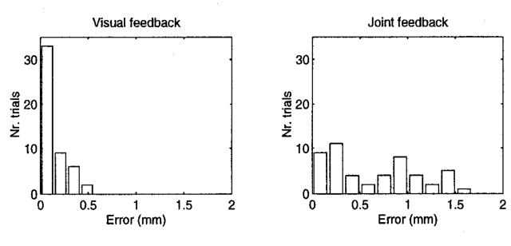
*그림 4 — 위치 결정 오차의 분포. **왼쪽:** 폐루프 시각 피드백. **오른쪽:** 관절 피드백.*

### 3.2 과결정 입력 공간의 효과 (Effects of over-determined input spaces)

이 실험에서는 중복 시각 정보를 더하여 시스템을 더 혹은 덜 과결정(over-determined) 상태로 만들 때 정확도가 어떻게 영향을 받는지 연구했다. 3차원 컴퓨터 비전에서 중복 정보의 가치는 오래전부터 인식되어 왔다. 관측 기하 모델과 완전 또는 부분 카메라 보정을 써서 중복 특징 측정을 연관시켜 자세 추정의 정확도를 높인다(예: [10] 참조). 그러나 우리 비전 시스템은 관측 기하에 대한 가정을 하지 않으며, 카메라는 보정되어 있지 않다. 하지만 이론 절에서 설명했듯이, 시각-운동 조작 모델은 시각 특징 벡터의 자유도를 더 작은 로봇 행동 공간으로 구속하는 새로운 방법을 제공한다.

중복 특징 벡터의 주된 이점 두 가지를 발견했다. 첫째는 시각 특징 추적이나 목표 생성의 부정확성으로 인한 오차를 줄일 수 있다는 것이다. 둘째 주된 이점은 하나 이상의 특징이 가려지거나 조건이 나쁜 측정을 줄 때 나머지 특징에 의존해 작업을 풀 수 있다는 것이다. 특징을 동적으로 추가할 수도 있다. 먼저 제어에 쓰지 않으면서 시스템이 그 특징의 시각-운동 모델을 식별하게 한 다음, 제어 루프 자코비안에 넣는 것이다. 가장 좋은 경우, 평균 0, 분산 $\sigma^2$인 잡음을 가진 신호 $m$개를 더하면(비전 시스템에서 보통 타당한 가정은 아니지만) 최종 신호의 분산, 따라서 잡음은 $\sigma^2/m$으로 줄어든다. 그러나 신호의 이 모델이 성립하지 않더라도, 시각 오차의 적어도 일부가 상관되어 있지 않은 한 중복 시각 특징을 써서 개선을 얻는다.

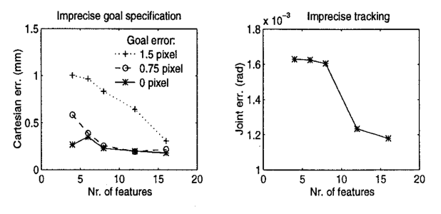
*그림 5 — 왼쪽: 시각 목표 지정의 오차와 사용하는 시각 특징의 수를 바꿔 가며 250회 실행한 결과는, 특히 부정확한 시각 지정에서 중복 특징이 도움이 됨을 보여 준다. 오른쪽: 카메라를 매우 멀리 두어 생긴 부정확한 추적에서 오는 오차로 한 비슷한 실험도 비슷한 결과를 보여 준다.*

그림 5는 추적점 수를 늘리는 효과를 보여 준다. 첫 번째 실험에서는 카메라를 로봇에서 0.5 m 떨어뜨려 정확한 특징 추적이 가능하게 했다. 각 시각 목표에 무작위 방향이고 크기가 0.0–1.5 화소 및 0.0–3.0 화소 범위에서 균일 분포(기댓값 0.75 및 1.5 화소)인 벡터를 더하여 시각 목표 지정에 다양한 크기의 오차를 넣었다. 최종 위치 결정 정확도는 반복정밀도 실험에서처럼 다이얼 게이지로 측정했다. 결과는 부정확한 시각 목표에 대해 중복 시각 정보를 쓰면 위치 결정이 크게 개선됨을 나타낸다.

두 번째 실험에서는 카메라를 로봇에서 6 m 떨어뜨려 추적 정확도를 낮췄다. 여기서는 오차를 관절 엔코더 값의 차이로 측정하는 것이 더 실용적이다. 특징 수를 늘리면 관절 공간 끝점 정확도가 개선됨을 관찰한다.

### 3.3 3 DOF와 6 DOF 적응형 대 비적응형 시각 제어 (3 and 6 DOF Adaptive v.s. Non-adaptive visual control)

이 실험에서는 3 DOF와 6 DOF에서 적응형과 비적응형 시각 제어기의 성능을 비교한다. 적응형 제어기는 2.1절의 방법을 써서 시간($k$)에 따른 환경과 구성의 변화, 그리고 시각-운동 함수 $f$의 다른 비선형성에 맞춰 내부 시각-운동 모델 $\{\hat{J}_k, \alpha_k\}$를 조정한다. 비적응형 제어기는 고정 모델 $\{\hat{J}, \alpha\}$를 가진다. 내부 모델의 정확도는 제어기 성능에 영향을 준다.

처음에는 적응형 제어기에 가장 적절한 평가 척도가 시각-운동 모델을 얼마나 정확하게 추정하느냐인 것처럼 보일 수 있다. 그러나 정확한 모델 추정은 효율과 맞바꿔야 하며, 이상적으로는 내부 모델($\hat{J}$)을 당면 작업에 필요한 만큼만 정밀하게 추정하는 것이 좋다. 이 정확도의 조정은 식 5의 $d_{lower}$와 $d_{upper}$를 바꿔서 한다. 3 DOF 작업에서는 미분값(자코비안의 원소 $j_{i,j}$)을 50%–80%의 정확도로 추정하면 충분함을 발견했다. 이 발견은 Hosoda와 Asada가 자신들의 시각 서보 제어기에 대해 [19]에서 관찰한 바와 일치한다.

적응형·비적응형 제어기의 내부 측면을 연구하는 대신, 우리는 내부 모델과 실제 세계 사이에 갑자기 들어온 불일치에 두 제어기가 얼마나 강건하게 반응하는지 비교하고자 했다. 실제 응용에서 이런 불일치는 초기 모델 추정의 오차, 모델 조정에 쓰는 시각 데이터의 오차, 그리고 비적응형의 경우 (선형화된) 모델과 (보통 비선형인) 실제 세계 사이의 나쁜 대응 등 다양한 원인에서 생길 수 있다.

실험 절차는 다음과 같다. 로봇의 목표는 미리 선택한 무작위 궤적을 따라 시각 목표 $\mathbf{y}^*$로 이동하는 것이다. 이동 도중 한 갱신 주기에서 무작위 행렬을 더해 자코비안을 교란한다: $\hat{J}_{dist} = a * \hat{J} + (1 - a) * J_{random}$. 여기서 $a \in [0, 1]$(모델 정확도)은 교란의 크기를 바꾸고, $J_{random}$은 구간 $[-|2\hat{J}_{i,j}|, |2\hat{J}_{i,j}|]$의 균일 분포에서 뽑은 원소를 갖는 무작위 $m \times n$ 행렬이다.

실험 동안 적응형과 비적응형 경우에 대해 수렴, 궤적 오차, 최종 끝점 위치 결정 오차를 연구했다. (궤적 오차는 초기 특징값 $\mathbf{y}_0$와 목표 $\mathbf{y}^*$ 사이의 계획 궤적에서 시각 공간상 벗어난 평균 편차다.) 각 시험은 궤적과 $a$ 값을 바꿔 가며 50회 실행으로 구성했다.

그림 6은 교란 크기 $a$를 바꾸면서 수렴 비율⁴(왼쪽)과 위치 결정 오차(오른쪽)를 나타낸다. 비적응형 알고리즘에서는 빠르게 수렴한 시행의 비율이 모델 정확도 $a$가 0.5 아래로 내려가면 0으로 떨어진다. 적응형 알고리즘은 $a = 1$일 때조차 목표에 도달하는 데 문제가 없었다. 이는 완전히 무작위인 내부 모델로부터도 회복할 수 있음을 뜻한다. [역주: 원문은 "$a = 1$"이라 적었으나, 정의상 $a = 1$은 교란이 없는 경우이고 완전 무작위 모델은 $a = 0$에 해당한다. 원문 그대로 옮겼다.] 교란이 클 때 적응형 알고리즘의 궤적 오차는 약간 증가했다. 이 증가는 모델이 정확하게 다시 추정되기 전, 교란 직후의 몇 번(대략 $n$ = 모터 자유도 수 정도)의 잘못된 이동에서 온다.

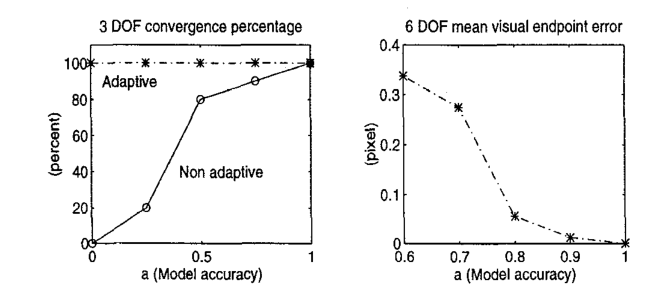
*그림 6 — 제어기의 내부 모델을 교란한 실험 50회 실행의 결과. **왼쪽:** 적응형과 비적응형 3 DOF 제어기의 수렴. **오른쪽:** 추적 특징 16개, 제어 자유도 6인 문제에 대해 $\Re^{16}$ 특징 공간(오른쪽)에서 특징당 평균 최종 끝점 오차.*

비적응형 알고리즘에서는 교란된 시행의 궤적 오차가 크게 증가함을 발견했다. 이는 발산한 시행 때문인데, 이 시행들에서 로봇은 완전히 잘못된 방향으로 가 버리고, 수렴과 발산 사이의 전환점($a = 0.25$ 근처)에서는 긴 진동 거동을 보인다. 전형적인 진동 이동의 예를 그림 7에 보였다.

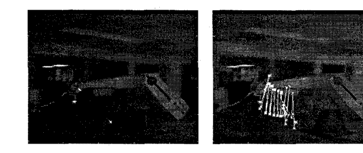
*그림 7 — **왼쪽:** 시각적으로 계획한 경로는 영상에 그린 흰 별 사이의 직선이다. **오른쪽:** 모델 정확도가 수렴 한계 근처일 때 비적응형 제어기가 택하는 전형적인 진동 경로.*

매니퓰레이터의 6 DOF 전체를 제어할 때는 3 DOF 경우만큼의 모델 오차 강건성을 얻지 못한다. $a = 0.6$보다 나쁜 교란에서는 발산 시행이 상당하고 점점 커지는 비율로 나타난다. 100%에 가까운 수렴을 얻으려면 모델 정확도 $a$를 0.6 이상으로 제한해야 했다. 이 범위에서 50회 시행한 시험에서 두 번이 수렴하지 않았다. 하나는 진동 거동을 보였고, 다른 하나는 즉시 발산했다. 일반적으로 그림 6에서 보듯이 평균 시각 끝점 오차와 궤적 오차는 낮은 모델 정확도에서도 낮게 유지된다.

*(각주 4) 수렴의 조건은 $(\|\mathbf{y}_{final} - \mathbf{y}^*\| \le 2pixel)$이다.*

### 3.4 비강체 폼 빔의 12 DOF 제어 (12 DOF control of a non-rigid foam beam)

비강체 물체의 조작을 포함하는 고자유도 제어 문제는 전통적인 모델 기반 로봇 제어 패러다임으로 풀기 매우 어렵다. 문제의 모델링이 지저분하거나 완전히 비실용적일 수 있어 제어 시스템 설계를 어렵게 만든다. 반면 우리 적응형 제어기는 정확한 사전 모델이 필요 없다. 대신 로봇은 실제 환경에서 작업을 수행하면서 시각-운동 함수의 연속적인 선형 모델을 학습하고 다듬는다.

이 실험에서는 6 DOF PUMA 매니퓰레이터 두 대를 썼으며, 각각 유연한 포장용 폼 한 조각의 양 끝에 하나씩 붙어 있다. 부착은 강체이므로 팔은 빔에 힘뿐 아니라 토크도 가할 수 있다. 시스템의 목적은 빔을 지정한 모양으로 구부리거나 접는 것이었다. 조작은 원하는 조작의 훈련 영상 시퀀스를 시스템에 보여 주어 지정한다. 교시 시퀀스의 각 영상에서 비강체 폼 빔의 모양을 나타내는 특징 벡터 $\mathbf{y}_k^*; k = 1..q$를 추출한다. $\mathbf{y}_q^*$는 최종 목표 모양이고, $\mathbf{y}_k^*; k = 1..q-1$은 시각 공간에서 원하는 궤적을 정하는 중간 목표, 즉 *경유점(way points)* 이다.

우리가 추적에 보통 쓰는 Oxford 스네이크 추적기[4]는 아핀 구속에 의존한다. 비강체 변형을 거치는 폼 모서리를 그것으로 추적할 수 없었다. 대신 그림 8에 보이는 마커 위의 특수 목적 추적기를 써서 폼 윤곽의 점 표현을 추적한다. 제어 관점에서 이것은 어려운 문제다. 우선 시각-운동 함수가 매우 비선형적이다. 또한 거의 특이한 상태(거의 곧은 빔)에서 시작한다. 수렴하는 (하위)목표 경유점 시퀀스 $\mathbf{y}_k$를 생성하려면 적어도 3장의 영상 시퀀스를 보여 줘야 했다. m-peg 동영상⁵에서 보듯이 두 로봇의 운동은 꽤 흔들린다. 이는 문제가 어렵기(조건이 나쁘고 매우 비선형적이기) 때문이다. 그럼에도 정확한 최종점 위치 결정이 달성되었다. 로봇은 폼 윤곽을 지정한 모양의 1 화소 이내로 위치시킬 수 있었다.

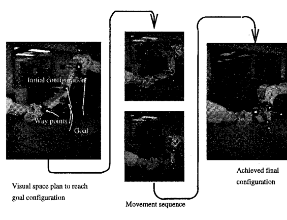
*그림 8 — 폼 접기 작업의 수행.* [역주: 그림 속 문구는 "Initial configuration(초기 구성)", "Way points(경유점)", "Goal(목표)", "Visual space plan to reach goal configuration(목표 구성에 도달하기 위한 시각 공간 계획)", "Movement sequence(이동 시퀀스)", "Achieved final configuration(달성한 최종 구성)"이다.]

*(각주 5) 이 절 실험의 전자 m-peg 동영상은 인터넷 WWW에서 볼 수 있다. 다음 주소의 메뉴를 이용하라: http://www.cs.rochester.edu/u/jag/PercAct/videos.html.*

### 3.5 Utah/MIT 다관절 손 실험 개관 (Review of Utah/MIT dextrous hand experiments)

다관절 고자유도 로봇 손은 잠재적으로 매우 다양한 물체의 미세 조작을 위한 다재다능한 운동을 제공한다(그림 9). 그러나 다지(multifinger) 손으로 쥔 물체의 미세 조작은 물체가 로봇 팔에 강체로 부착된 경우보다 훨씬 복잡하다. 쥘 수 있는 물체가 매우 다양하고 매니퓰레이터에 고유한 부정확성이 있기 때문에 정확한 조작 모델을 만들기는 불가능하지 않더라도 어렵다.

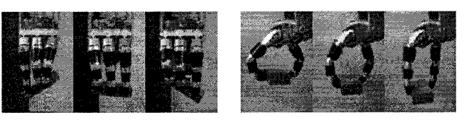
*그림 9 — Utah/MIT 손을 쓴 조작의 예.*

[16]에서 우리는 Utah/MIT 손의 미세 조작 능력으로 시각 모델 추정과 제어를 보강했다. 이 절은 그 논문의 실험을 개관한다. 폐루프 시각 제어에서 반복정밀도를 시험하고 결과를 전통적인 관절 제어와 비교했다. 시각 피드백은 마커 8개와 카메라 2대에서 얻은 $m = 16$개의 특징값으로 구성된다(그림 10 참조). 서보 알고리즘이 자기 보정(self calibrating)이므로 마커는 물체 위 임의의 곳에 둘 수 있었다. 모서리 근처에 두면 회전에 대해 조건이 더 좋은 시각 측정을 얻는다. 두 카메라는 약 90도 떨어지게 배치했다. 1 화소는 대략 0.3 mm의 물체 이동에 해당한다. 그림 10에서 $x$를 광선(optic ray), $y$를 영상의 행, $z$를 열이라 하자. 쥔 물체는 $x$, $y$, $z$축을 따라 각각 약 40 mm, 60 mm, 30 mm 평행이동(translation)할 수 있고, 각각 70, 45, 90도 회전(rotation)할 수 있다(그림 9 참조). 궤적 길이와 위치 결정 오차 사이의 상관관계를 시험했으나 찾지 못했다.

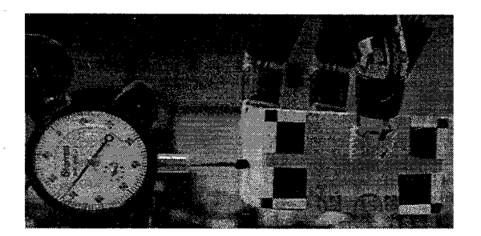
*그림 10 — 손 미세 조작 반복정밀도 실험의 구성.*

그림 11에서 세 가지 위치 결정 방법의 반복정밀도를 방법마다 50회 시행에 기반해 비교한다. 3 DOF 시각 피드백은 물체의 평행이동만 제어한다. 4 DOF 시각 피드백은 평행이동과 그림 10의 광축 주위 회전을 제어한다. 6 DOF에서는 특이점 문제가 좀 있어서, 아래에서 논의하는 약간 수정된 추적을 썼다. 두 관절 피드백 방법은, 하나는 관절 피드백만 쓰고 다른 하나인 직교 좌표(Cartesian) 방법은 오차 벡터를 파지 사면체(grasp tetrahedron)[20](네 손가락의 파지점이 이루는 사면체)로 정의한 6 DOF 공간에 투영한다는 점에서 다르다. 시각 피드백은 고자유도 시스템에서 더 어려워진다. 한 가지 이유는 자코비안에서 추정하는 파라미터의 수가 늘어나기 때문이다. 또 하나는 고자유도 작업이 흔히 조건이 더 나쁘기 때문이다. 특히 순수 평행이동(3 DOF)과 평행이동·회전의 조합(4–6 DOF) 사이에 차이가 있다. 5 DOF와 6 DOF 경우의 높은 조건수는 서로 다른 두 문제에서 비롯된다. 우리가 쓰는 두 카메라 구성에서는 z축 주위 회전이 (시각적으로) 조건이 나쁘다(광축 방향 평행이동과 미분적으로 비슷하다). 이 문제는 각 카메라에서 추적하는 점들이 동일 평면에 있을 때 두 카메라 구성에서 일어난다. 다른 문제는 조작 중 두 가지가 직교 좌표 모터 공간에서 미분적으로 매우 비슷하다는 것이다. 문제가 되는 두 자유도를 빼면 3 DOF와 4 DOF 조작의 낮은 조건수를 얻는다.

전체 6 DOF 자세 공간에서 시각 서보를 평가하기 위해, 시험 물체에 붙인 조절 가능한 나사 위에 장착한 LED를 추적하여 시각 측정을 개선했다. LED는 표면 표시보다 더 정밀한 추적을 가능하게 하며, 나사를 조절하여 LED를 동일 평면에 있지 않은 배치로 만들어 위에서 언급한 시각 특이점을 피했다. 이 구성으로 6 DOF 시각 서보를 할 수 있었다.

시각 서보 동작에서 시행들이 세 범주로 나뉨을 관찰했다. 시행의 약 절반은 매우 빠르게 수렴했다. 나머지 대부분은 수렴했지만, 처음에는 빠르다가 끝으로 갈수록 훨씬 느려졌다. 마지막으로 소수(약 2%)는 전혀 수렴하지 않았다. 같은 시각 피드백 제어기를 로봇 팔에 썼을 때는 수렴 속도의 이런 차이를 관찰하지 못했다. 손과 원격 구동 연결부(remotizer linkage)의 기계적 현상 때문에 어떤 위치는 다른 위치보다 도달하기 어려운 것이 부분적인 설명일 수 있다고 생각한다. 또한 시각 서보 제어기를 끄면, 관절 설정점이 그대로인데도 손이 같은 위치에 머물지 않고 상당히 표류하는 경우가 많음을 관찰했다.

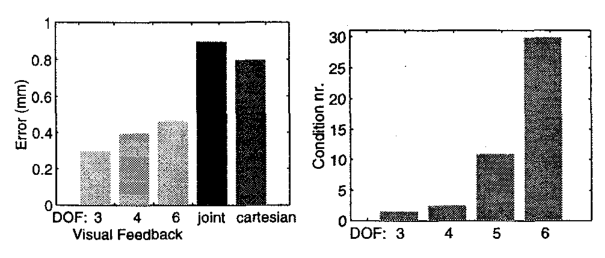
*그림 11 — **오른쪽:** 시각 또는 관절 센서 피드백을 쓴 반복정밀도. **왼쪽:** 서로 다른 자유도 자코비안의 조건수 $\kappa$.* [역주: 캡션의 좌우 설명이 그림과 반대로 보인다. 그림에서 반복정밀도 오차(mm) 막대그래프가 왼쪽, 조건수 막대그래프가 오른쪽에 있다. 원문 그대로 옮겼다.]

## 4 논의 (Discussion)

우리가 개발한 추정·제어 알고리즘은 강한 이론적 성질을 가진다([14, 15] 참조). 그래도 실제 과정 외란·잡음이 있는 실제 환경과, 실제 기계적 원인의 오차와 유한한 정밀도를 가진 매니퓰레이터에서 이 알고리즘이 어떻게 동작하는지 실험으로 평가하는 것은 여전히 매우 중요하다.

결과는 시각 피드백 제어가 부정확한 PUMA 로봇 팔에서 반복정밀도를 크게 개선하지만, Utah/MIT 손에서는 개선이 미미함을 보여 준다. 이는 매니퓰레이터들의 서로 다른 특성으로 설명된다. PUMA 팔의 위치 결정 부정확성은 주로 백래시에서 비롯되며, 이는 시각 피드백으로 보정할 수 있다. 손에서는 스틱션과 유연성의 조합 때문에 정확하게 제어하기가 훨씬 어렵다. 작은 이동을 하려고 하면 손은 처음에는 전혀 움직이지 않고, 제어기는 신호를 점점 키운다. 손이 마침내 풀려 움직이면 의도한 목표를 크게 오버슈트한다. 이 때문에 피드백 제어기로 제어하기가 매우 어렵고, 시각-운동 자코비안을 추정하기는 더욱 어렵다. 자코비안을 추정하려면, 이 스틱션의 상대적 효과가 작은 대규모 이동을 미세 조작 작업에 추가해야 한다.

비적응형 시각 서보 방법이 단순한 환경(예: 고정 카메라, 월드 좌표 로봇 제어[3, 9])에서 수렴함은 보였지만, 우리는 더 복잡한 경우에는 적응성이 결정적임을 발견했다. 예를 들어 eye-in-hand 방식의 조작은 온라인 자코비안 추정 없이는 잘 동작하지 않는다[13]. 우리가 제시한 Utah/MIT 손 제어와, 앞서 [12]에서 보인 물체의 큰 회전 제어에는 신뢰 영역 제어기가 필요했으며, 3.4절의 12 DOF 비강체 제어는 경유점과 호모토피 방법 없이는 동작하게 할 수 없었다. 또한 시각 공간 경유점 생성은 핸드-아이 시스템에서 궤적 계획을 하는 자연스러운 방법이다[13].

우리가 보인 결과는 시각 피드백 방법의 반복정밀도가 정확한 제어기 파라미터에 민감하지 않다는 점에서 일반적 가치가 있다고 믿는다. 수렴하기만 한다면 서로 다른 제어기들도 거의 같은 반복정밀도로 수렴할 것으로 기대할 수 있다. 다만 걸리는 시간과 택하는 궤적은 다를 수 있으며, 수렴 여부는 제어기에 크게 의존한다. 3.3절의 수렴 결과는 비적응형 방법들 사이에서 비슷할 것이며, 추정 정확도가 비슷한 한 다른 자코비안 추정 기법(예: [19])이나 (부분) 모델 기반 기법(예: [2])을 쓰는 적응형 방법에도 유용할 것이다.

## 참고문헌 (References)

- [1] Weiss L. E. Sanderson A. C. Neumann C. P. "Dynamic Sensor-Based Control of Robots with Visual Feedback" J. of Robotics and Aut. v. RA-3 1987
- [2] Feddema J. T. Lee G. C. S. "Adaptive Image Feature Prediction and Control for Visual Tracking with a Hand-Eye Coordinated Camera" IEEE Tr. on Systems, Man and Cyber., v 20, no 5 1990
- [3] Conkie A. Chongstitvatana P. "An Uncalibrated Stereo Visual Servo System" DAITR#475, Edinburgh 1990
- [4] Curwen R. Blake A. "Dynamic Contours: Real time active splines" Active Vision Blake, Yuille MIT Press 1992.
- [5] Espiau B. Chaumette F. Rives P. "A New Approach to Visual Servoing in Robotics" IEEE Tr. on Robotics and Automation p 313-326 v 8 no 3, 1992.
- [6] Wijesoma S. W. Wolfe D. F. H. Richards R. J. "Eye-to-Hand Coordination for vision guided Robot Control Applications" Int. J. of Robotics Research, v 12 No 1 1993
- [7] Papanikolopoulos N. P. Khosla P. K. "Adaptive Robotic Visual Tracking: Theory and Experiments" IEEE Tr. on Aut. Control Vol 38 no 3 1993
- [8] Harris M. "Vision Guided Part Alignment with Degraded Data" DAI TR #615, Edinburgh 1993
- [9] Hollinghurst N. Cipolla R. "Uncalibrated Stereo Hand-Eye Coordination" Brit. Machine Vision Conf 1993
- [10] Shapiro L. Zisserman A. Brady M. "Motion from Point Matches Using Affine Epipolar Geometry" Proc. ECCV 1994, p 73-84.
- [11] Jägersand M. Nelson R. Adaptive Differential Visual Feedback for uncalibrated hand-eye coordination and motor control TR# 579, U. of Rochester 1994.
- [12] Kutulakos K. Jägersand M. "Exploring objects by purposive viewpoint control and invariant-based hand-eye coordination" Workshop on vision for robots In conjunction with IROS 1995.
- [13] Jägersand M. Nelson R. "Visual Space Task Specification, Planning and Control" In Proc. IEEE Int. Symp. on Computer Vision, 1995.
- [14] Jägersand M. "Perception level control for uncalibrated hand-eye coordination and motor actions" Thesis proposal, University of Rochester, May 1995. ftp://ftp.cs.rochester.edu/pub/u/jag/lic.ps.gz
- [15] Jägersand M. "Visual Servoing using Trust Region Methods and Estimation of the Full Coupled Visual-Motor Jacobian" In Proc. IASTED Applications of Robotics and Control, 1996.
- [16] Jägersand M. Fuentes O. Nelson R. "Acquiring Visual-Motor Models for Preciion Manipulation with Robot Hands" In Proc. of ECCV, 1996.
- [17] W. Z. Chen U. A. Korde S. B. Skaar "Position Control Experiments Using Vision" Int. Journal of Robotics Research, v13 No 3 p199-208, 1994
- [18] Corke P. I. High-Performance Visual Closed-Loop Robot Control PhD thesis U of Melbourne 1994.
- [19] Hosoda K. Asada M. "Versatile Visual Servoing without Knowledge of True Jacobian" Proc. IROS 1994.
- [20] Fuentes O. Nelson R. "Experiments on Dextrous Manipulation without Prior Object Models" Proc. ISIC 1996.
- [21] B. H. Yoshimi P. K. Allen "Active, Uncalibrated Visual Servoing" Proc. of ICRA 1995.
- [22] Hager G. "Calibration-Free Visual Control Using Projective Invariance" In Proc. of 5th ICCV 1995.
- [23] Andersen J. N. "Specifications" In Int. Enc. of Robotics, Ed: Dorf R. C., Wiley 1988.
- [24] Broyden C. G. Mathematics of Computation, v 19 p 577-593, 1965.
- [25] Garcia, Zangwill Pathways to solutions, fixed points, and equilibria, Prentice-Hall, 1981.
- [26] Fletcher R. Practical Methods of Optimization Chichester, second ed. 1987
- [27] Dahlquist G. Björck Å. Numerical Methods Second Ed, Prentice Hall, 199x, preprint.
