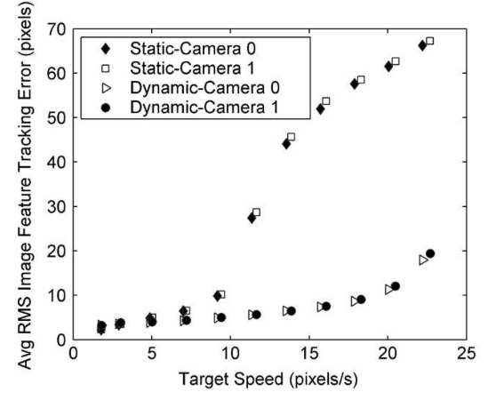
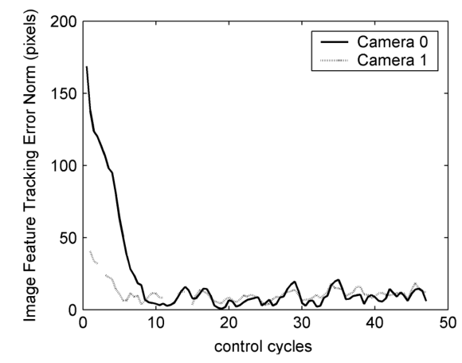
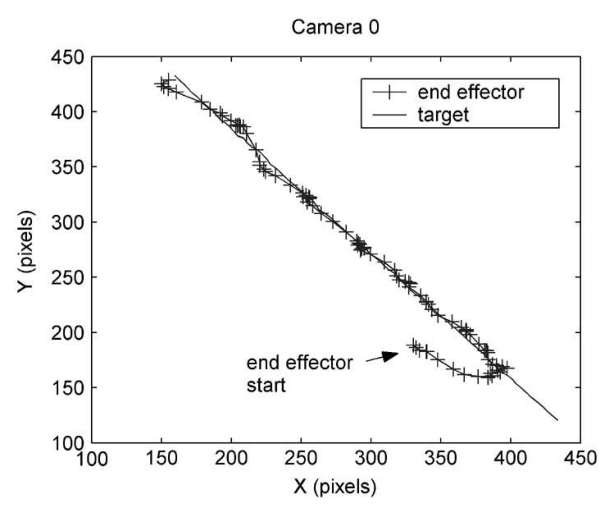
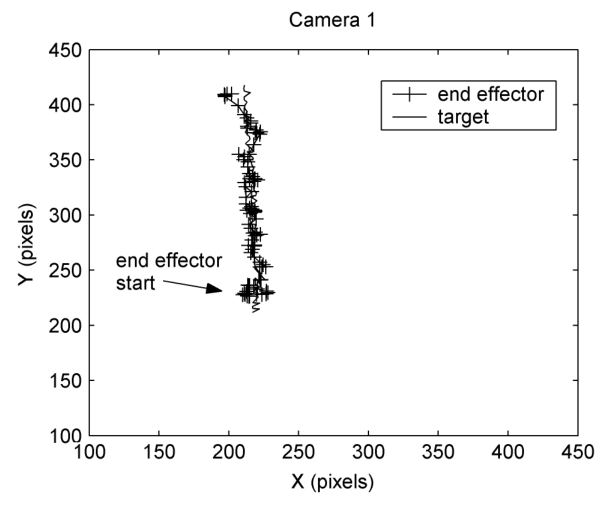
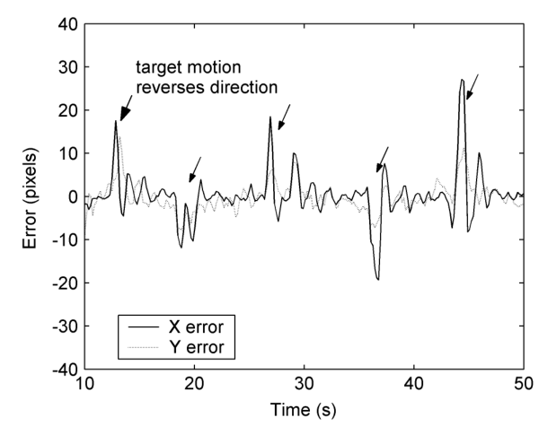

# 비보정 동적 시각 서보 (Piepmeier 2004)

- 원제: Uncalibrated Dynamic Visual Servoing
- 원문: 같은 폴더의 `Piepmeier2004_TRA_quasi_newton_visual_servo.pdf` (IEEE Transactions on Robotics and Automation, vol. 20, no. 1, pp. 143–147, Feb. 2004. 저자 J. A. Piepmeier, G. V. McMurray, H. Lipkin)
- 번역 범위: 전문
- 그림: 원문 그림 5개를 `그림/`에 넣고 본문에서 처음 언급되는 곳에 삽입

## 초록

고정 촬상계(fixed imaging)를 쓰는 비보정(uncalibrated) 시각 유도 로봇 추적 제어를 위한 동적 준뉴턴(dynamic quasi-Newton) 방법을 개발하고 시연한다. 이 방법은 보정된 기구학 모델과 카메라 모델을 요구하지 않는다. 매 단계 준뉴턴 스텝을 밟고 합성 자코비안(composite Jacobian)을 추정하면서 비선형 목적함수를 최소화하는 방식으로 로봇 제어를 수행한다. 자코비안은 동적 재귀 최소제곱(dynamic recursive least-squares) 알고리즘으로 추정한다. 실험 결과는 이 접근법의 타당성을 보여 준다.

**색인어(Index Terms)** — 동적 비선형 최소제곱, 자코비안 추정, 비보정 시각 서보(visual servoing).

## I. 서론 (INTRODUCTION)

이 논문은 고정 촬상계를 쓰는 비보정 시각 유도 로봇 제어 방법을 개발한다. 제어기는 비선형 최소제곱 최적화 방법에 기반한 동적 준뉴턴 방법이다. 시스템 모델은 동적 자코비안 추정 기법으로 근사한다. 이 제어기를 쓰면 로봇 기구학과 카메라 모델이 보정되지 않은 상태에서도 정지 표적과 움직이는 표적 모두로 로봇을 서보할 수 있다. 제어 방법은 로봇 종류, 카메라 종류, 카메라 위치와 완전히 무관하다. 다시 말해 시스템 모델과 무관하다.

모델 기반 패러다임을 버림으로써, 이 제어 알고리즘은 광범위한 시스템 모델링, 시스템 재보정(recalibration), 그리고 작업 공간을 제약하는 부속 하드웨어의 필요를 없앤다. 제조 현장에서 이런 일들은 부가가치가 없는 활동이며, 여기에 드는 시간을 줄이거나 없애면 제품의 전체 비용이 줄어든다.

구체적으로 이 논문의 기여는 다음과 같다.

- 고정 카메라를 쓰는 비보정 시각 서보로 움직이는 표적을 추적하는 알고리즘을 명시적으로 유도한다.
- 프로베니우스 노름(Frobenius norm)의 직접 최소화에 기반해 비보정 시각 유도 제어 알고리즘의 이론적 기초를 세운다.
- 개발한 알고리즘을 비보정 시각 유도 로봇 제어와 추적에 대해 실험으로 검증한다.

자코비안 추정을 구현한 준뉴턴 방법은 로봇을 정지 표적으로 서보하는 데 성공적으로 쓰여 왔다. 이 논문은 표적 추적을 위한 준뉴턴 제어 방법을 철저히 전개하고자 한다.

문헌에는 시각 서보에서 자코비안 추정을 쓴 사례가 여럿 있다. Hosoda와 Asada [1], Hosoda 등 [2]은 고정 카메라를 써서 정지 표적에 대한 비보정 시각 유도 로봇 제어를 제시했다. [1]에서 쓴 자코비안 추정 기법은 벡터에 대한 지수 가중 재귀 최소제곱(RLS) 갱신식과 비슷하다. 다만 이 벡터 형식을 자코비안 행렬 추정 문제에 적용했다. [3]에서 Asada 등은 자코비안 추정 기법을, 정적 기준점으로 표적 운동을 추정하는 방식으로 움직이는 물체의 eye-in-hand 스테레오 추적으로 확장했다.

Jagersand [4], [5]는 신뢰 영역(trust-region) 방법과 Broyden 추정을 쓰는 비선형 최소제곱 최적화 접근을 취했다. 움직이는 표적 상황은 다루지 않았다.

이전 연구들은 정지 표적에 대한 비보정 시각 서보 제어의 실현 가능성을 보였다. 그러나 움직이는 표적 상황에 대한 제어 법칙은 엄밀하게 전개되지 않았다.

*(각주) 원고 접수 2002년 7월 29일, 수정 2003년 1월 22일. 심사위원 의견 검토 후 부편집위원 F. Chaumette와 편집위원 S. Hutchinson이 게재를 추천했다. 이 논문의 일부는 IEEE International Conference on Robotics and Automation(미국 미시간주 디트로이트, 1999년 5월)에서 발표되었다. J. A. Piepmeier는 미 해군사관학교 시스템공학과(Annapolis, MD 21402 USA, e-mail: piepmeie@usna.edu) 소속이다. G. V. McMurray는 조지아공대 연구소(Georgia Tech Research Institute, Atlanta, GA 30318 USA, e-mail: gary.mcmurray@gtri.gatech.edu) 소속이다. H. Lipkin은 조지아공대 George Woodruff 기계공학부(Atlanta, GA 30332 USA, e-mail: harvey.lipkin@me.gatech.edu) 소속이다. Digital Object Identifier 10.1109/TRA.2003.820923*

## II. 비보정 동적 시각 서보 방법 (AN UNCALIBRATED DYNAMIC VISUAL SERVOING METHOD)

엔드이펙터와 표적의 특징을 충분히 감지해 두 물체의 공간 위치를 알 수 있는 *고정(stationary)* 비전 시스템을 가정한다. 그러면 표적 특징 $y^*(t)$는 시간 $t$만의 함수가 되고, 엔드이펙터 특징 $y(\theta)$는 로봇 관절각 $\theta \in R^n$만의 함수가 된다. $t$와 $\theta$가 독립 변수라는 점이 중요하다. 시간이 변하는 동안 관절각을 일정하게 유지할 수 있고, 반대로 어느 주어진 시각에도 관절각은 임의의 값을 가질 수 있기 때문이다. 아직 표적 추적에 대한 가정은 없다. 표적을 최적으로 추적하기 위해 $\theta$와 $t$ 사이에 구속 관계를 부과하여, 관절각을 시간의 함수 $\theta(t) = g(y^*(t))$로 선택한다. 이것이 움직이는 표적을 따라가는 최적 엔드이펙터 궤적 $y(\theta(t))$를 정한다. 구속은 영상 평면에서 본 추적 오차 $f \in R^m$을 최소화하여 정한다.

$$f(\theta, t) = y(\theta) - y^*(t). \tag{1}$$

순기구학과 촬상 기하의 결합 변환 때문에 $f(\theta, t)$는 매우 비선형적인 함수가 된다. 이 다변수 최적화 문제를 매 증분마다 동적 자코비안 추정기(II-B절)를 갖춘 동적 준뉴턴 제어기(II-A절)로 푼다.

### A. 동적 뉴턴 방법 (A Dynamic Newton's Method)

엔드이펙터가 표적을 따라가게 하는 부과 궤적 $\theta(t)$는 영상 오차 제곱

$$F(\theta, t) = \frac{1}{2} f^T(\theta, t) f(\theta, t)$$

을 최소화하여 정한다. 이것은 가중 행렬로 수정할 수도 있지만 단순화를 위해 생략한다. $(\theta, t)$ 주위의 테일러 급수 전개는

$$F(\theta + h_\theta, t + h_t) = F(\theta, t) + F_\theta h_\theta + F_t h_t + \cdots$$

이다. 여기서 $F_\theta$와 $F_t$는 편미분이고, $h_\theta$와 $h_t$는 $\theta$와 $t$의 증분이다. 고정된 샘플링 주기 $h_t$에 대해 $F$는 다음을 풀어 최소화된다.

$$0 = \frac{\partial F(\theta + h_\theta, t + h_t)}{\partial \theta} = F_\theta + F_{\theta\theta} h_\theta + F_{t\theta} h_t + O(h^2) \tag{2}$$

여기서 $O(h^2)$는 $h_t$와 $h_\theta$의 2차 항을 나타낸다. 이 항들을 버리고, 정리하고, 편미분을 전개하고, $\theta$를 더하면 여기서 동적 뉴턴 방법이라 부르는 식을 얻는다.

$$\theta + h_\theta = \theta - (J^T J + S)^{-1} J^T \left( f + \frac{\partial f}{\partial t} h_t \right) \tag{3}$$

여기서 $J$는 관절-영상 특징 오차 합성 자코비안이며,

$$J \equiv \frac{\partial f}{\partial \theta}, \quad S \equiv \frac{\partial J^T}{\partial \theta} f$$
$$F_\theta = J^T f, \; F_{\theta\theta} = J^T J + S, \quad F_{t\theta} = J^T \frac{\partial f}{\partial t}.$$

$S$와 $J$ 항을 해석적으로 계산하려면 보정된 시스템 모델이 필요하다. $S$ 항은 추정하기 어렵지만, $\theta$가 해에 가까워지면 0에 가까워지므로 흔히 생략되며, 그러면 가우스-뉴턴(Gauss–Newton) 방법이라고도 부르는 것이 된다. 시간 증분 $h_t$가 충분히 작으면 이 방법은 모든 $\theta$에 대해 잘 정의되고 유한한 정상상태 오차로 선형 수렴함을 보일 수 있다 [6]. 추정 자코비안 $\hat{J}$를 쓰면 알고리즘은 동적 준(가우스-)뉴턴 방법이 되며, $k$번째 증분에서

$$\theta_{k+1} = \theta_k - \left( \hat{J}_k^T \hat{J}_k \right)^{-1} \hat{J}_k^T \left( f_k + \frac{\partial f_k}{\partial t} h_t \right) \tag{4}$$

이다. 여기서 $h_\theta = \theta_{k+1} - \theta_k$이다.

"동적(dynamic)"이라는 수식어는 구체적으로 오차 속도 항 $(\partial f_k / \partial t)$가 있다는 것을 가리킨다. 이 항은 로봇이 현재 위치에 머문다고 가정할 때 다음 시간 증분의 오차 벡터를 $f_{k+1} \approx f_k + (\partial f_k / \partial t) h_t$로 선형 예측하는 데 쓰인다. 물론 더 복잡한 예측기도 가능하지만, 선형 예측기는 단순하다는 매력이 있다. 예측기가 없을 때 이 방법을 여기서는 "정적(static)"이라 부르며, 그러면 (4)는

$$\theta_{k+1} = \theta_k - \left( \hat{J}_k^T \hat{J}_k \right)^{-1} \hat{J}_k^T f_k \tag{5}$$

가 된다. 이것이 [1], [5], [7]의 이전 연구의 기초다. 오차가 관절각만의 함수 $f(\theta)$라면 유도는 동적인 경우와 비슷하다.

정적 방법과 동적 방법은 두 가지 경우에 일치한다. 첫째, 시간 스텝 $h_t$를 $(\partial f_k / \partial t)$에 비해 충분히 작게 하면 오차 $f_k$가 일정, 즉 정적인 것처럼 보인다(이를 준정적(quasi-static) 조건이라고도 한다). 이는 동적 방법이 정적 방법에 비해 더 느린 샘플링 속도로도 추적하고, 더 까다로운 오차 함수도 추적할 것으로 기대해야 함을 시사한다. 둘째, $(\partial f / \partial t) = (\partial / \partial t)(y(\theta) - y^*(t)) = -(\partial y^* / \partial t)$이므로, 표적이 고정되어 있으면($\dot{y}^* = 0$) $(\partial f / \partial t)$는 사라진다. 따라서 표적 운동을 보상하려는 예측 항은 움직이는 표적에 대해 정적 방법보다 더 나은 추적을 낳아야 한다.

### B. 동적 준뉴턴 방법 (A Dynamic Quasi-Newton Method)

뉴턴 방법과 마찬가지로, 움직이는 표적 상황에서는 자코비안 $\hat{J}_k$를 추정할 때 적절한 미분 항을 포함해야 한다. 정지 표적 서보에서 Jagersand [4], [5]는 자코비안 추정에 Broyden 방법을 썼다. 이 절에서는 동적 Broyden 방법을 유도한다. 다음으로 RLS 알고리즘을 쓰며 잡음이 있을 때 더 안정적인 비슷한 자코비안 추정 기법을 전개한다. 끝으로 RLS 추정을 쓰는 준뉴턴 방법의 정상상태 성능을 논의한다.

*1) 동적 자코비안 추정 기법의 유도 (Derivation of a Dynamic Jacobian Estimation Scheme):* [1]–[5]에서 논의했듯이 Broyden 방법이나 비슷한 변형을 쓰는 자코비안 추정 기법이 여럿 구현되었다. 제어기와 마찬가지로, 제안하는 동적 Broyden 갱신에는 추가 항 $(\partial f_k / \partial t) h_t$가 들어 있다. 이 동적 Broyden 갱신은 [8]에 주어진 정적 Broyden 갱신의 유도를 확장하여 움직이는 표적 상황에 대해 유도한다.

오차 함수 $f(\theta, t)$의 아핀 모델(affine model, 원점을 반드시 지나지는 않는 선형 모델 [8])은 1차 테일러 급수 근사이며 $m(\theta, t)$로 표기한다. 모델은 매 반복마다 갱신되며, $k$번째에서

$$m_k(\theta, t) = f_k + \hat{J}_k (\theta - \theta_k) + \frac{\partial f_k}{\partial t}(t - t_k). \tag{6}$$

$k$번째 아핀 모델이 $(k-1)$번째 증분에서의 오차를 올바르게 지정하도록, 즉 $m_k(\theta_{k-1}, t_{k-1}) = f_{k-1} = (f(\theta_{k-1}, t_{k-1}))$가 되도록 요구하면 이른바 할선 방정식(secant equation)을 얻는다.

$$\hat{J}_k h_\theta + \frac{\partial f_k}{\partial t} h_t = \Delta f \tag{7}$$

여기서 $\Delta f = f_k - f_{k-1}$이다. Broyden 방법은 (7)이 성립할 것을 요구한다. 양변에서 $\hat{J}_{k-1} h_\theta$를 빼고, 정리하고, 전치하면

$$h_\theta^T \Delta \hat{J}^T = \left( \Delta f - \frac{\partial f_k}{\partial t} h_t - \hat{J}_{k-1} h_\theta \right)^T \tag{8}$$

를 얻는다. 여기서 $\Delta \hat{J} = \hat{J}_k - \hat{J}_{k-1}$이다. 자코비안 갱신 $\Delta \hat{J}$는 구속 (8) 아래에서 프로베니우스 노름 $\|\Delta \hat{J}\|_F = (\sum (\Delta \hat{J})_{ij}^2)^{(1/2)}$을 최소화하도록 선택한다. 여기서 $(\Delta \hat{J})_{ij}$는 $\Delta \hat{J}$의 원소를 가리킨다. 원소들을 벡터로 쌓고 (8)을 그에 맞게 다시 쓰면, 문제는 최소 노름 해를 갖는 익숙한 형태가 된다. 결과를 다시 행렬로 풀면 동적 Broyden 갱신을 얻는다(자세한 내용은 [6]과 [9] 참조).

$$\hat{J}_k = \hat{J}_{k-1} + \frac{\left( \Delta f - \hat{J}_{k-1} h_\theta - \frac{\partial f_k}{\partial t} h_t \right) h_\theta^T}{h_\theta^T h_\theta}. \tag{9}$$

"동적"이라는 수식어는 구체적으로 오차 속도 항 $(\partial f_k / \partial t)$가 있다는 것을 가리킨다. 아핀 모델이 관절각만의 함수 $m(\theta)$라고 가정하면 "정적" Broyden 갱신이 된다.

$$\hat{J}_k = \hat{J}_{k-1} + \frac{\left( \Delta f - \hat{J}_{k-1} h_\theta \right) h_\theta^T}{h_\theta^T h_\theta}. \tag{10}$$

정적·동적 Broyden 방법은 정적·동적 뉴턴 방법과 완전히 대응한다. 시간 증분이 매우 작거나 표적이 정지해 있을 때 둘은 일치한다. 동적 방법은 더 느린 샘플링 속도에서 더 효과적이고 움직이는 표적을 더 잘 추적할 것으로 기대해야 한다.

할선 조건의 결과로 아핀 모델들은 구간별로 연속(piecewise continuous)이며, 따라서 $(k-1)$번째 증분에서

$$m_k(\theta_{k-1}, t_{k-1}) - m_{k-1}(\theta_{k-1}, t_{k-1}) = 0$$

이다. 이는 $(\theta_{k-1}, t_{k-1})$에서 $m_k$와 $m_{k-1}$에 대해 (6)과 (7)을 쓰면 쉽게 확인된다. $k$번째 아핀 모델은 점 $f_{k-1}$과 $f_k$를 포함해야 하고 할선 방정식도 만족해야 한다. 그런데 시스템에 잡음이 있는 경우를 생각해 보자. 측정값 $f_k$에는 오차 함수의 공칭값 $\tilde{f}_k$와 시스템 잡음 $\delta_{\text{noise}}$가 함께 들어 있어 $f_k = \tilde{f}_k + \delta_{\text{noise}}$이다. $\delta_{\text{noise}}$가 큰 경우 할선 방정식이 성립하도록 요구하면 $\hat{J}_k$에 큰 오차를 들이는 아핀 모델 $m_k$가 나올 수 있다. $\hat{J}_k$의 큰 오차는 나쁜 추적으로 이어진다. 따라서 동적 Broyden 방법은 잡음이 많은 시스템에서 성능이 나쁠 수 있으며, 필터링 작용을 하는 재귀 정식화로 개선할 수 있다.

*2) 동적 자코비안 추정: RLS (A Dynamic Jacobian Estimation: RLS):* 아핀 모델의 변화에 기반한 비용 함수 $G_k$를 최소화하는 지수 가중 RLS 알고리즘 [10]을 쓰면 안정성을 높일 수 있다.

$$G_k = \sum_{i=1}^{k} \lambda^{k-i} \| m_k(\theta_{i-1}, t_{i-1}) - m_{i-1}(\theta_{i-1}, t_{i-1}) \|^2. \tag{11}$$

(11)의 목적함수는 현재 아핀 모델과 과거 아핀 모델들 사이 차이의 지수 가중 합이며, $0 < \lambda \le 1$이다. $G_k$를 최소화하면 할선 방정식 (7)은 더 이상 성립하지 않고, 아핀 모델들도 구간별로 연속이 아니다. $G_k$를 최소화하는 것은 항 $(\Delta M)^T \Lambda (\Delta M)$의 프로베니우스 노름을 최소화하는 것과 같다. 여기서 $\Delta M$은 $k \times m$ 행렬로 그 $i$번째 열은 $m_k(\theta_{i-1}, t_{i-1}) - m_{i-1}(\theta_{i-1}, t_{i-1})$이고, $\Lambda$는 $i$번째 대각 원소가 $\lambda^{k-i}$인 $k \times k$ 대각 행렬이다.

[9]의 접근을 따르면, (11)을 최소화하는 원하는 재귀 추정 기법이 다음과 같음을 보일 수 있다 [6].

$$\hat{J}_k = \hat{J}_{k-1} + \frac{\left( (f_k - f_{k-1}) - \hat{J}_{k-1} h_\theta - \frac{\partial f_k}{\partial t} h_t \right) h_\theta^T P_{k-1}}{\lambda + h_\theta^T P_{k-1} h_\theta} \tag{12}$$

$$P_k = \frac{1}{\lambda} \left( P_{k-1} - \frac{P_{k-1} h_\theta h_\theta^T P_{k-1}}{\lambda + h_\theta^T P_{k-1} h_\theta} \right). \tag{13}$$

앞에서와 같이 정적 버전은 $(\partial f_k / \partial t) h_t$ 항을 생략한다.

이 형태는 $\lambda$와 $P_k$를 빼면 (9)의 동적 Broyden 방법과 비슷하다. 가중 파라미터 $0 < \lambda \le 1$은 이전 정보를 더 많이 또는 더 적게 평균에 넣도록 조정할 수 있으며, 유효 항 수는 $1/(1-\lambda)$로 추정된다. [9]에서 보였듯이 정식화에 더 복잡한 가중 행렬을 쓰는 것도 가능하다. 그러나 구체적인 물리적 근거가 없고 가장 단순한 식을 원했기 때문에 여기서는 그렇게 하지 않았다.

RLS 알고리즘은 시스템 식별(system identification)에 자주 쓰인다 [11]. 실제로 여기서 제시한 정식화는 시각 유도 제어를 위한 시스템 모델(자코비안)을 식별한다. 문헌 [9], [10]에서 RLS 알고리즘은 보통 벡터 추정에 쓰이지만, 이 알고리즘이 행렬 추정으로도 확장됨을 보일 수 있다는 점 [6]은 흥미롭다. 식 (12)와 (13)은 $J_k$를 추정하는 재귀 갱신을 정의한다.

RLS 자코비안 추정 기법을 쓰는 동적 준뉴턴 방법은 다음과 같다.

*알고리즘 1 (Algorithm 1):* 주어진 것: $f : R^n \to R^m$; $\theta_0, \theta_1 \in R^n$; $\hat{J}_0 \in R^{m \times n}$, $P_0 \in R^{n \times n}$, $\lambda \in (0, 1)$

```
Do for k = 1, 2, ...
    Δf = f_k − f_{k−1}
    (∂f_k/∂t) h_t = −(y*_k − y*_{k−1})
    h_θ = θ_k − θ_{k−1}
    Ĵ_k = Ĵ_{k−1} + (λ + h_θ^T P_{k−1} h_θ)^{−1}
          · (Δf − Ĵ_{k−1} h_θ − (∂f_k/∂t) h_t) h_θ^T P_{k−1}
    P_k = (1/λ) ( P_{k−1} − (λ + h_θ^T P_{k−1} h_θ)^{−1} (P_{k−1} h_θ h_θ^T P_{k−1}) )
    θ_{k+1} = θ_k − (Ĵ_k^T Ĵ_k)^{−1} Ĵ_k^T ( f_k + (∂f_k/∂t) h_t )
End for
End
```

### C. RLS 자코비안 추정을 쓰는 동적 준뉴턴 방법의 수렴 해석 (Convergence Analysis of Dynamic Quasi-Newton Method Using RLS Jacobian Estimation)

앞 절은 자코비안 추정 기법을 RLS 알고리즘으로 정식화하는 명확한 근거를 제시했다. 이 절에서는 *알고리즘 1*을 쓸 때의 수렴 성질을 다룬다. $\theta_k^*$를 목적함수가 최소화되는 관절 위치라 하자. RLS 자코비안 추정을 쓰는 동적 준뉴턴 방법에 대해, 일정한 가정 아래에서 관절 오차의 노름 $\theta_k^* - \theta_k$가 유계임을 보인다. 이는 [12]에서 논의된 (12)와 (13)의 RLS 알고리즘의 정상상태 성질을 이용해 이루어진다.

동적 준뉴턴 방법 (4)가 다음과 같은 등가 형태로 표현될 수 있음은 쉽게 확인된다.

$$h_{\theta_{k+1}}^* = \hat{J}_k^+ \left( f_k + \frac{\partial f_k}{\partial t} h_t + J_k^* h_{\theta_k}^* + E_k h_{\theta_k}^* + \hat{J}_k \Delta \theta^* \right) \tag{14}$$

이때 치환 $h_{\theta_k}^* = \theta_k^* - \theta_k$, $\hat{J}_k^+ = (\hat{J}_k^T \hat{J}_k)^{-1} \hat{J}_k^T$, $J_k^* = J_k(\theta_k^*)$, $E_k = \hat{J}_k - J_k^*$, $\Delta \theta^* = \theta_{k+1}^* - \theta_k^*$와 항등식 $\hat{J}_k^+ \hat{J}_k = I$를 쓴다. $\theta_{k+1}^*$의 테일러 급수 전개로부터

$$\frac{\partial \theta_k^*(t)}{\partial t} h_t = \theta_{k+1}^* - \theta_k^* + O\left(h_t^2\right)$$

이고, $(\partial f_k / \partial t) h_t = -(\partial y_k^* / \partial t) h_t = -J_k^* (\partial \theta_k^*(t) / \partial t) h_t$이므로

$$\frac{\partial f_k}{\partial t} h_t = -J_k^* \Delta \theta^* - J_k^* O\left(h_t^2\right) \tag{15}$$

이다. 따라서 $f_k^* = f_k(\theta_k^*, t_k) = 0$이면 (14)는

$$h_{\theta_{k+1}}^* = \hat{J}_k^+ \left( f_k - f_k^* + J_k^* h_{\theta_k}^* + E_k h_{\theta_k}^* + E_k \Delta \theta^* - J_k^* O\left(h_t^2\right) \right). \tag{16}$$

가 된다. $J^*$가 립시츠 상수 $\gamma$로 립시츠 연속(Lipschitz continuous)이면, (16)의 노름을 취해

$$\|h_{\theta_{k+1}}^*\| \le \|\hat{J}_k^+\| \left( \frac{\gamma}{2} \|h_{\theta_k}^*\| + \|E_k\| \right) \|h_{\theta_k}^*\| + \|\hat{J}_k^+\| \|E_k\| \|\Delta \theta^*\| + c_1 O\left(h_t^2\right)$$

를 얻는다. 여기서 $c_1$은 어떤 상수다. $\hat{J}_k^+ = (\hat{J}_k^T \hat{J}_k)^{-1} \hat{J}_k^T$임을 상기하자. $c_2$를 어떤 상수, $\kappa$를 $\hat{J}_k^T \hat{J}_k$의 최소 고유값이라 할 때 $\|(\hat{J}_k^T \hat{J}_k)^{-1}\| \le (c_2/\kappa)$이고 $\|\hat{J}_k^T\| \le \alpha$라고 가정하면,

$$\|h_{\theta_{k+1}}^*\| \le \frac{c_2 \alpha}{\kappa} \left( \frac{\gamma}{2} \|h_{\theta_k}^*\| + \|E_k\| \right) \|h_{\theta_k}^*\| + \frac{c_2 \alpha}{\kappa} \|E_k\| \|\Delta \theta^*\| + c_3 \|h_t^2\|. \tag{17}$$

$\|h_{\theta_k}^*\|$와 $\|E_k\|$가 어떤 $0 < \alpha < 1$과 $\beta > 0$에 대해

$$\frac{c_2 \alpha}{\kappa} \left( \frac{\gamma}{2} \|h_{\theta_k}^*\| + \|E_k\| \right) \le \alpha \tag{18}$$

$$\frac{c_2 \alpha}{\kappa} \|E_k\| \|\Delta \theta^*\| + c_1 \|h_t^2\| \le \beta \tag{19}$$

를 만족하도록 유계라고 가정하자. 그러면 초기 오차가 $\|h_{\theta_0}^*\| \le \beta / (1 - \alpha)$를 만족하도록 요구하면, 수열 $h_{\theta_k}^*$가 모든 $k$에 대해 선형 수렴하고 유계임이 보장된다. [역주: 원문은 (17)에서 $c_3$, (19)에서 $c_1$을 쓰며 기호 $\alpha$를 $\|\hat{J}_k^T\|$의 상한과 수렴 계수에 겹쳐 쓴다. 원문 그대로 옮겼다.]

[12]와 [13]에서 논의했듯이, $\|E_k\|$의 상한은 $\lambda$, 시스템·측정 잡음, $J^*$의 변화량에 의존하므로 $\alpha < 1$에 대해 (18)이 성립하도록 $\|E_k\|$를 엄밀하게 규정하기는 어렵다. 그러나 병적이지 않은(nonpathological) 추적 문제에서는 $\|E_k\|$의 상한이 존재하여 준뉴턴 방법이 수렴하고 안정적일 것이라는 추정은 그럴듯하다. 실험 결과는 이 가정을 뒷받침하며, 추가 검증은 [6]을 참조하기 바란다.

### D. 비보정 정적·동적 제어기와 자코비안 추정기의 비교 (Comparison of Uncalibrated Static and Dynamic Controllers and Jacobian Estimators)

정적 제어기에 대한 수렴 해석도 II-C절과 비슷한 방식으로 할 수 있다. 그러나 $\|E_k\|$가 유계라는 요구 조건은 정적 자코비안 추정기로는 반드시 충족되지 않을 수 있다.

MATLAB으로 수행한 시뮬레이션은, 동적 자코비안 RLS 추정을 쓰는 동적 제어기(*알고리즘 1*)가 정적 자코비안 RLS 추정을 쓰는 정적 제어기(*알고리즘 1*에서 $(\partial y_k^*(t)/\partial t)$ 항을 뺀 것)보다 추적과 안정성이 개선됨을 보여 준다. 정적 제어기는 더 빨리 움직이는 표적에서 안정성 문제를 보인다.

실험 작업셀(III절 참조)을 Corke의 Robotics Toolbox와 Machine Vision Toolbox [14]로 시뮬레이션했다. AdeptOne 로봇의 처음 세 관절(회전 관절 둘, 직동 관절 하나)이 툴포인트를 서보하여 움직이는 표적을 따라가며, 툴포인트와 표적에 각각 특징점이 하나씩 있고 두 대의 카메라로 추적한다. 표적은 $x-y$ 평면에서 원운동을 하고 $z$ 방향으로 사인파 운동을 한다. 시뮬레이션은 여러 표적 속도에서 100 ms 샘플링 시간으로 25 s 동안 수행했다. 데이터에 균일 분포 $\pm 0.5$ 화소 잡음을 더했다. 각 제어기마다 각 속도에서 25회의 시뮬레이션을 수행했고, 두 카메라에 대한 평균 RMS(root mean square) 추적 오차(화소)를 그림 1에 나타냈다. 느린 속도에서는 시각 서보 문제가 준정적이어서, 예상대로 두 제어기가 비슷하게 동작한다. 표적 운동이 커지면 정적 제어기의 성능이 떨어져 추적이 크게 뒤처지고 자주 심하게 발산한다. 분명히 정적 제어기는 움직이는 표적 추적에 적합하지 않다.


*그림 1 — 3자유도 추적 문제에서 알고리즘 1을 쓰는 동적 제어기와 정적 제어기(알고리즘 1에서 $(\partial y_k^*(t)/\partial t)$ 항을 뺀 것)를 표적 속도를 높여 가며 비교했다. 정적 제어기는 로봇이 표적 운동에 뒤처지게 하며 표적 속도가 높을 때 자주 불안정해진다. 속도가 높아지면 추적 오차가 커지지만 동적 제어기는 안정을 유지한다.*

## III. 실험 시스템 (EXPERIMENTAL SYSTEM)

[6]에서는 소형 재구성형 Robix RCS-6 로봇(2자유도(DOF) 평면 구성), Pulnix 카메라 1대, MuTech 프레임 그래버, 개인용 컴퓨터 2대를 써서 동적 준뉴턴 방법과 동적 RLS 자코비안 추정을 처음 검증했다. 이 시스템은 움직이는 표적을 안정적으로 수렴하며 추적함을 보였다.

여기서 쓴 시스템은 스테레오 비전과 AdeptOne 로봇의 처음 3자유도를 쓴다. 영상 처리와 패턴 인식은 Windows 98을 구동하는 400 MHz Pentium II에서 Cognex의 PatQuick 도구를 포함한 MVS-8000 소프트웨어로 수행한다. 엔드이펙터는 나사를 붙든 공구를 쥐고 있다. 공구는 Cognex 소프트웨어가 쉽게 식별할 수 있는 작은 패턴으로 덮여 있다. 표적은 패턴을 그린 작은 종이 패드로, 산업용 컨베이어 벨트 위에서 움직인다. 로봇/비전 시스템은 패턴의 도심(centroid)으로 서보하며 벨트 위에서 이를 추적한다.

여러 하드웨어·소프트웨어 요소가 영상 획득, 영상 처리, 알고리즘 계산, 제어 명령 송신을 수행한다. 한 제어 주기 동안 영상 두 장을 캡처하며, 두 번째 영상은 제어 주기 끝에서 표적과 엔드이펙터의 위치를 추정하는 데 쓴다. 다음 갱신을 계산하기 전에 가장 최근 제어 신호의 결과를 감지하는 것이 알고리즘상 중요하기 때문이다. 로봇 제어기에는 속도 명령을 보내 부드러운 운동을 만든다.

(12)와 (13)의 망각 인자(forgetting factor) $\lambda$는 자코비안 추정의 기억을 조정하는 데 쓴다. 수렴할 때까지는 $\lambda = 0.5$를 쓰고, 그다음에는 $\lambda = 0.99$를 쓴다. 이렇게 하면 시스템이 자코비안을 학습하는 동안은 기억이 짧고, 정상상태 추적 동안은 기억이 길어진다.

표적 운동 모델은 쓰지 않으며, 스테레오 비전 시스템은 완전히 비보정 상태이고, 로봇의 기구학 파라미터는 어느 것도 제어 알고리즘에 쓰지 않는다. 하드웨어 한계 때문에 갱신 주기가 0.352 s(2.8 Hz)로 매우 느리지만, 시스템은 여전히 움직이는 표적에 대한 수렴과 정상상태 추적을 보여 준다.

## IV. 실험 결과 (EXPERIMENTAL RESULTS)

초기 자코비안은 동적 준뉴턴 방법으로 제어되는 세 관절 각각의 초기 이동 세 번으로 추정한다. 시야가 제한되어 있어 처음에는 표적을 정지시켜 둔다. 그다음 표적을 컨베이어 벨트로 2.5 cm/s로 움직이며, 이는 카메라 0과 1에서 각각 평균 26 pixels/s와 12 pixels/s의 운동에 해당한다.

그림 2–4는 제어 주기당 영상 캡처 두 번으로 얻은 실험 영상 특징 데이터다. 그림 2는 각 카메라의 추적 오차 노름을 보여 준다. 로봇은 표적에 부드럽게 수렴하며 오차는 공칭값으로 수렴한다. 수렴은 제어 주기 8회 만에 이루어지며, 그 후 추적 오차는 카메라 0에서 8.6 화소, 카메라 1에서 10.0 화소다. 추적 오차의 약간의 끊김은 비전 시스템이 표적이나 로봇 특징을 식별하지 못한 것을 나타낸다. 데이터가 부족한 경우에는 이동하지 않는다.


*그림 2 — 제어 주기 8회 후 수렴을 보여 주는 추적 오차(제어 주기당 영상 2장 촬영). 제어 주기 8회 후 추적 오차는 카메라 0에서 8.6 화소, 카메라 1에서 10.0 화소다.*

그림 3과 4는 카메라 0과 1에서 본 엔드이펙터와 표적점의 영상 특징을 보여 준다. 카메라나 로봇 모델을 모르는 상태에서도 엔드이펙터는 표적점을 추적한다. 추적에는 약간의 진동성이 나타난다. 이는 RLS 자코비안 추정에 내재한 기억의 결과일 수 있다.


*그림 3 — 카메라 0에서 본 엔드이펙터와 표적의 영상 특징은 움직이는 표적의 수렴 추적을 보여 준다. 평균 정상상태 추적 오차는 10 화소다.*


*그림 4 — 카메라 1에서 본 엔드이펙터와 표적의 영상 특징. 평균 정상상태 추적 오차는 8.6 화소다.* [역주: 본문은 수렴 후 오차를 카메라 0에서 8.6 화소, 카메라 1에서 10.0 화소로 적었으나 그림 3·4 캡션은 카메라 0에 10 화소, 카메라 1에 8.6 화소로 적어 서로 엇갈린다. 원문 그대로 옮겼다.]

그림 2–4는 알고리즘이 컨베이어 벨트 위에서 움직이는 표적에 수렴하고 이를 추적할 수 있음을 보여 준다. 표적 운동의 급격한 변화에 대한 알고리즘의 응답을 살펴보는 것도 흥미롭다. 그림 5는 표적이 카메라 시야 안에서 앞뒤로 움직일 때의 RMS 추적 오차(화소)를 자세히 보여 준다. 이 실험 동안 표적은 카메라 0과 1에서 각각 약 42 pixels/s와 25 pixels/s로 움직인다. 이는 각 카메라에서 제어 주기당 평균 약 15 화소와 9 화소의 이동에 해당한다. 그림의 화살표는 컨베이어 벨트를 역전시켜 표적 운동을 바꾼 지점을 나타낸다. 예상대로 알고리즘은 10–20 화소만큼 오버슈트하지만 대략 제어 주기 3회 안에 추적을 회복한다.


*그림 5 — 로봇이 컨베이어 벨트 위에서 움직이는 표적을 추적할 때 카메라 0의 오차(화소). 화살표는 컨베이어 벨트 운동의 역전을 나타낸다. 로봇이 표적 위치를 오버슈트할 때 10–20 화소의 오차가 있음에 주목하라. 추적은 대략 제어 주기 3회 안에 회복된다.*

카메라는 1 화소가 대략 1–2 mm에 해당하도록 배치되어 있다. 그림 2에 보인 일정하게 움직이는 표적의 추적에서 평균 영상 오차는 10 화소 이하 수준이다. 이는 10–20 mm 이하의 직교 좌표(Cartesian) 오차에 해당한다. 이런 시스템에서 카메라 위치 선택에는 상충 관계가 있다. 카메라가 멀리 있으면 5 화소의 오차가 카메라가 작업 영역에 가까이 있을 때의 5 화소 오차보다 직교 공간에서 더 큰 오차가 된다. 그러나 시야가 작아지면 작업 공간이 제약된다.

## V. 결론 (CONCLUSION)

이 논문은 고정 촬상을 쓰는 비보정 로봇 시스템의 시각 서보 제어를 위한 동적 준뉴턴 방법을 개발하고 시연했다. 알려지지 않은 촬상 모델과 로봇 기구학 모델을 나타내는 자코비안의 추정은 RLS 알고리즘으로 수행한다.

이 논문의 방법은 [1]–[5]의 연구와 밀접하게 관련되지만, 구체적인 기여는 세 가지다.

1) 움직이는 표적 문제를 명시적으로 다루고 이를 위한 알고리즘을 유도했다. 시뮬레이션은 정적 제어기가 움직이는 표적 문제에 부적합함을 확인한다.
2) 비보정 시각 유도 제어 알고리즘에 대한 견고한 이론적 기초를 세웠다.
3) 알고리즘을 실험으로 검증했으며, 하드웨어 한계 범위 안에서 모델과 무관한 시각 유도 로봇 제어와 추적을 시연했다.

## 참고문헌 (REFERENCES)

- [1] K. Hosoda and M. Asada, "Versatile visual servoing without knowledge of true Jacobian," in Proc. IEEE/RSJ/GI Int. Conf. Intelligent Robots and Systems, Munich, Germany, Sept. 1994, pp. 186–193.
- [2] K. Hosoda, K. Igarashi, and M. Asada, "Adaptive hybrid control for visual servoing and force servoing in an unknown environment," IEEE Robot. Automat. Mag., vol. 5, pp. 39–43, Dec. 1998.
- [3] T. Tanaka, M. Asada, and K. Hosoda, "Visual tracking of unknown moving object by adaptive binocular visual servoing," in Proc. IEEE Int. Conf. Multisensor Fusion and Integration for Intelligent Systems, Taipei, Taiwan, Aug. 1999, pp. 249–254.
- [4] M. Jagersand, "Visual servoing using trust region methods and estimation of the full coupled visual-motor Jacobian," in Proc. IASTED Applications of Robotics and Control, 1996.
- [5] M. Jagersand, O. Fuentes, and R. Nelson, "Experimental evaluation of uncalibrated visual servoing for precision manipulation," in Proc. Int. Conf. Robotics and Automation, Albuquerque, NM, Apr. 1997, pp. 2874–80.
- [6] J. A. Piepmeier, "A dynamic quasi-Newton method for model independent visual servoing," Ph.D. dissertation, Georgia Inst. Technol., Atlanta, GA, 1999.
- [7] J. A. Piepmeier, G. V. McMurray, and H. Lipkin, "Tracking a moving target with model independent visual servoing: A predictive estimation approach," in Proc. IEEE Int. Conf. Robotics and Automation, Leuven, Belgium, May 1998, pp. 2652–2657.
- [8] J. E. Dennis and R. B. Schnabel, Numerical Methods for Unconstrained Optimization and Nonlinear Equations. Englewood Cliffs, NJ: Prentice-Hall, 1983.
- [9] W. L. Brogan, Modern Control Theory. Englewood Cliffs, NJ: Prentice-Hall, 1985.
- [10] S. Haykin, Adaptive Filter Theory. Englewood Cliffs, NJ: Prentice-Hall, 1991.
- [11] P. Eykhoff, System Identification. London, U.K.: Wiley, 1974.
- [12] L. Ljung, L. Guo, and P. Priouret, "Performance analysis of the forgetting factor RLS algorithm," Int. J. Adaptive Control, Signal Processing, vol. 7, pp. 525–537, 1993.
- [13] E. Eleftheriou and D. D. Falconer, "Tracking properties and steady-state performance of RLS adaptive filter algorithms," IEEE Trans. Acoust, Speech, Signal Processing, vol. ASSP-34, pp. 1097–1109, Oct. 1986.
- [14] P. I. Corke, "A robotics toolbox for MATLAB," IEEE Robot. Automat. Mag., vol. 3, pp. 24–32, Mar. 1996.
