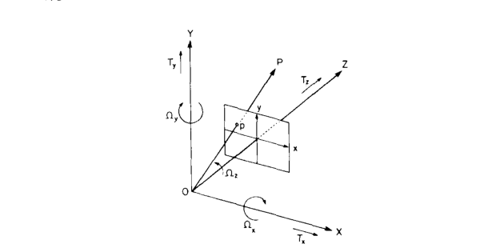
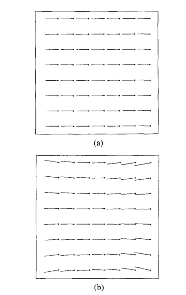
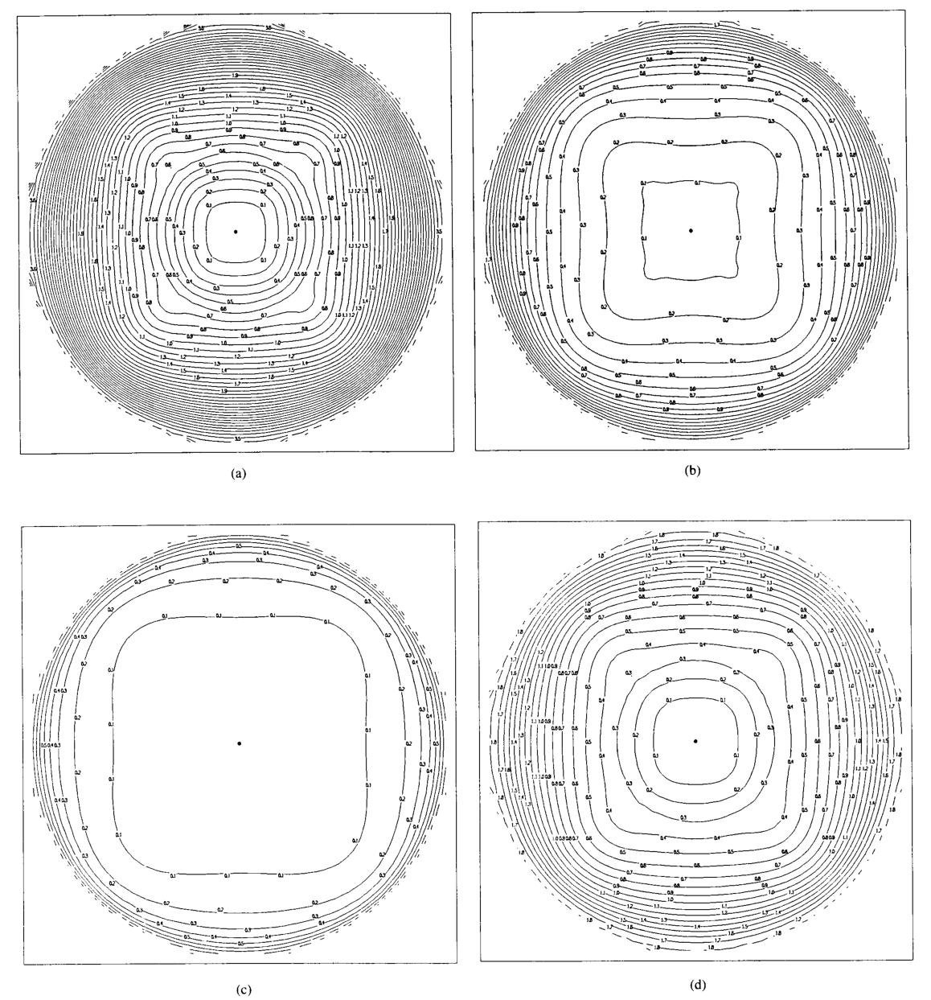
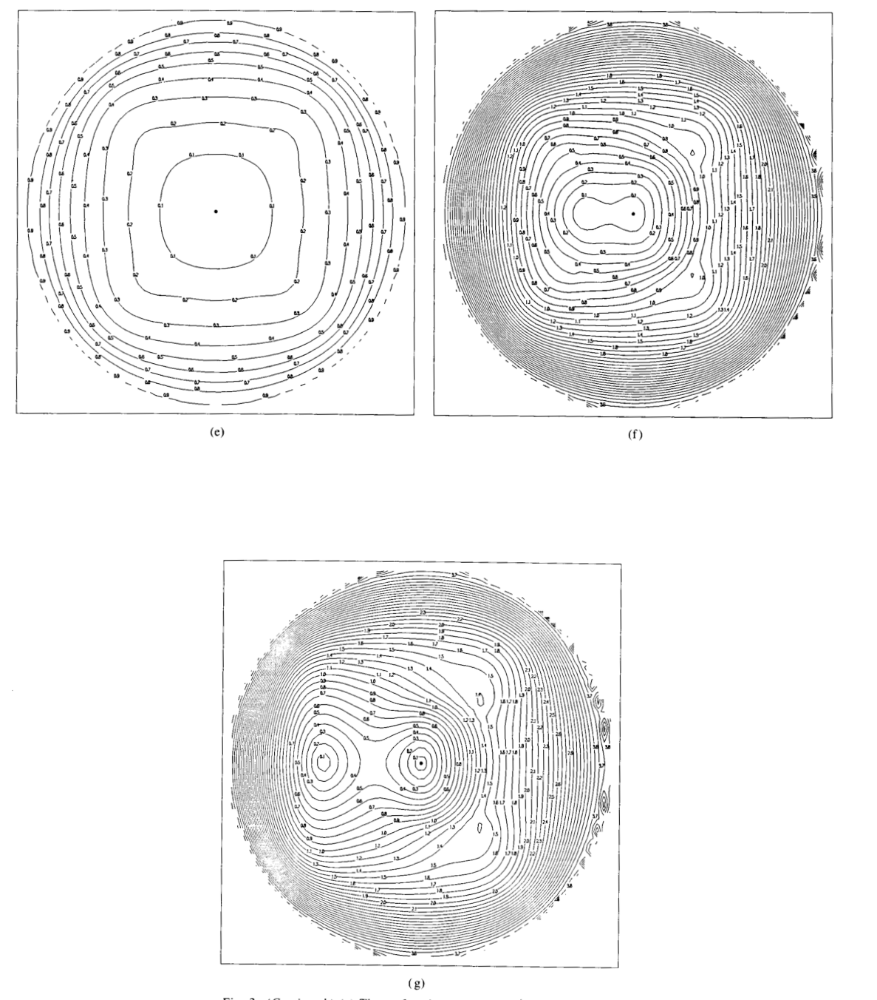
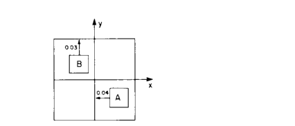
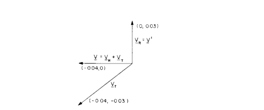

# 잡음이 있는 흐름장에서 3차원 운동과 구조를 복원할 때의 고유한 모호성 (Adiv 1989)

- 원제: Inherent Ambiguities in Recovering 3-D Motion and Structure from a Noisy Flow Field
- 원문: 같은 폴더의 `Adiv1989_PAMI_motion_ambiguity.pdf` (IEEE Transactions on Pattern Analysis and Machine Intelligence, vol. 11, no. 5, pp. 477–489, May 1989)
- 번역 범위: 전문 (본문, 각주, 그림 캡션, 감사의 글, 저자 소개 포함. 참고문헌은 원문 그대로)
- 비고: 원인분석/논문/04번과 같은 원문의 번역
- 그림: 원문 그림 5개(그림 3은 두 쪽에 걸쳐 있어 파일 2개)를 `그림/`에 넣고 본문에서 처음 언급되는 곳에 삽입

## 초록

동적 장면 분석(dynamic scene analysis) 연구의 주요 분야 중 하나는 광류(optical flow) 정보로부터 3차원 운동과 구조를 복원하는 것이다. 이 논문은 흐름장(flow field)에 잡음이 있기 때문에 생길 수 있는 두 가지 문제를 제시한다. 첫째, 센서 또는 강체 운동하는 물체의 운동 파라미터를 추정하기가 극히 어려울 수 있다. 올바른 해와 비슷한 흐름장을 만들어 내는, 상당히 틀린 해들의 큰 집합이 존재할 수 있기 때문이다. 둘째 문제는 환경을 독립적으로 움직이는 물체들로 분해하는 데 있다. 그런 두 물체가 같은 운동 파라미터와 양립하는 광류를 만들어 낼 수 있으며, 그러면 이 흐름들이 하나의 강체에서 생겼다는 가설을 반박할 방법이 없다. 이 모호성들은 알고리즘에 무관하다는 의미에서 고유(inherent)하다. 수학적 분석으로 이런 문제가 생기기 쉬운 상황을 특징짓는다. 몇 가지 예로 결론을 보인다. 모호한 상황에서도 복원할 수 있는 제약과 파라미터를 제시한다.

색인어(Index Terms) — 컴퓨터 비전, 동적 장면 분석, 동적 분할(dynamic segmentation), 확장 초점(focus of expansion), 운동 추정, 여러 개의 움직이는 물체, 광류, 강체성 가정(rigidity assumption), 충돌까지의 시간(time-to-collision).

## I. 서론 (Introduction)

동적 시각 정보는 환경 속을 움직이는 센서와/또는 시야 안에서 독립적으로 움직이는 물체에 의해 생길 수 있다. 이런 정보의 해석은 움직이는 물체를 검출하고, 센서와 각 움직이는 물체의 운동 파라미터를 복원하고, 구조를 결정하는 것으로 이루어진다. 이 해석 결과는 로봇공학이나 항법에서처럼 행동을 제어하는 데 쓸 수 있다. 또한 VISIONS 시스템[5] 같은 영상 이해 시스템에 추가 지식원으로 통합할 수도 있다.

시각 운동 분석에서 가장 흔한 접근은 두 단계, 즉 광류장 계산과 그 흐름장의 해석에 기반한다. 이 논의에서 "광류장(optical flow field)"이라는 용어는 영상 요소의 순간 속도를 기술하는 벡터들로 이루어진 "속도장(velocity field)"을 가리킨다. 둘째 단계, 즉 광류장의 해석이 이 논문의 주된 관심사이다. 그런 흐름장의 시간 열(time sequence)이 아니라 흐름장 하나의 정보만 주어진다고 가정한다.

> 원고 접수 1987년 2월 18일, 수정 1988년 9월 27일. W. B. Thompson의 추천으로 게재 승인. 이 연구는 미국 국방고등연구계획국(DARPA)의 Grant N00014-82-K-0464 지원을 받았다.
> 저자는 매사추세츠 대학교 컴퓨터정보과학과(Amherst, MA 01003)에 있었다. 현재 Rafael(POB 2250(34), Haifa 31021, Israel)에 있다.
> IEEE Log Number 8826288.

기존 기법으로 만든 흐름장은 잡음이 있고 부분적으로 틀리며, 특히 가림(occlusion) 경계나 운동 경계 근처에서 그렇다([14]의 논의 참조). 흐름장에 잡음이 있기 때문에 두 가지 문제가 생길 수 있다. 첫째, 센서나 움직이는 물체의 운동 파라미터를 추정하기가 극히 어려울 수 있다. 올바른 해와 비슷한 흐름장을 만들어 내는, 상당히 틀린 해들의 큰 집합이 존재할 수 있기 때문이다. 첫째 문제와 밀접히 관련된 둘째 문제는 환경을 독립적으로 움직이는 물체들로 분해하는 데 있다. 그런 두 물체가 같은 운동 파라미터와 양립하는 광류를 만들어 낼 수 있으며, 그러면 이 흐름들이 하나의 강체에서 생겼다는 가설을 반박할 방법이 없다. 이 모호성들은 알고리즘에 무관하다는 의미에서 고유하다.

이 논문에서는 수학적 분석을 써서 이런 문제가 생기기 쉬운 상황을 특징짓는다. 몇 가지 예로 결론을 보인다. 모호한 상황에서도 복원할 수 있는 제약과 파라미터, 그리고 해석 목표를 적절히 수정하는 방안을 제시한다.

## II. 광류를 3차원 운동 및 구조와 관련짓는 식 (Equations Relating the Optical Flow to 3-D Motion and Structure)

### A. 일반적인 경우 (The General Case)

$(X, Y, Z)$를 카메라에 고정된 직교 좌표계(그림 1 참조)라 하고, $(x, y)$를 평면 영상의 대응 좌표계라 하자. 영상은 정사각형이라고 가정하며, 시야(field of view, FOV)는 영상의 각 변에 대응하는 시각(visual angle)으로 정의한다. 따라서 영상 한 변은 $2\tan(\mathrm{FOV}/2)$ 초점 단위(focal unit)이다. 절점(nodal point) $O$에서 영상까지의 초점 거리는 알려져 있다고 가정하며, 일반성을 잃지 않고 1로 정규화할 수 있다. 따라서 환경의 점 $(X, Y, Z)$의 영상 위 원근 투영 $(x, y)$는 다음과 같다.

$$x = X/Z \tag{2.1a}$$
$$y = Y/Z. \tag{2.1b}$$

*그림 1 — 카메라에 붙은 좌표계 $(X, Y, Z)$와 대응 영상 좌표 $(x, y)$. 영상 위치 $\boldsymbol p$는 환경 속 점 $\boldsymbol P$의 원근 투영이다. $\boldsymbol T = (T_X, T_Y, T_Z)$와 $\boldsymbol\Omega = (\Omega_X, \Omega_Y, \Omega_Z)$는 장면 속 주어진 물체의 상대 평행이동과 회전을 나타낸다.*

장면 속 강체가 카메라에 대해 갖는 순간 공간 속도는 두 성분, 즉 평행이동(translation) $\boldsymbol T = (T_X, T_Y, T_Z)$와 원점을 지나는 축에 대한 회전(rotation) $\boldsymbol\Omega = (\Omega_X, \Omega_Y, \Omega_Z)$로 분해할 수 있다. 물체 위 점 $\boldsymbol P$의 속도는 다음과 같다.

$$\dot{\boldsymbol P} = \boldsymbol\Omega \times \boldsymbol P + \boldsymbol T. \tag{2.2}$$

$(X, Y, Z)$가 점 $\boldsymbol P$의 순간 카메라 좌표이면, 영상 위 대응 투영 $(x, y)$는 속도 $(\alpha, \beta)$로 움직이며, (2.1)과 (2.2)를 쓰면

$$\alpha = -\Omega_X xy + \Omega_Y(1 + x^2) - \Omega_Z y + (T_X - T_Z x)/Z \tag{2.3a}$$
$$\beta = -\Omega_X(1 + y^2) + \Omega_Y xy + \Omega_Z x + (T_Y - T_Z y)/Z. \tag{2.3b}$$

$(\alpha, \beta)$는 다음의 합으로 나타낼 수 있다.

$$(\alpha, \beta) = (\alpha_R, \beta_R) + (\alpha_T, \beta_T) \tag{2.4}$$

여기서 $(\alpha_R, \beta_R)$과 $(\alpha_T, \beta_T)$는 각각 속도장의 회전 성분과 평행이동 성분이다.

$$\alpha_R = -\Omega_X xy + \Omega_Y(1 + x^2) - \Omega_Z y \tag{2.5a}$$
$$\alpha_T = (T_X - T_Z x)/Z \tag{2.5b}$$
$$\beta_R = -\Omega_X(1 + y^2) + \Omega_Y xy + \Omega_Z x \tag{2.5c}$$
$$\beta_T = (T_Y - T_Z y)/Z. \tag{2.5d}$$

흐름장이 주어지면, 카메라에 대한 각 강체의 복원 가능한 운동 파라미터를 추정하고자 한다. 이 파라미터는 회전 파라미터 $(\Omega_X, \Omega_Y, \Omega_Z)$와, 단위 벡터 $\boldsymbol U = \boldsymbol T/r$($r$은 $\boldsymbol T$의 길이)로 정의되는 평행이동 벡터의 방향이다. 카메라가 정지한 환경 속을 움직이는 경우, 환경을 카메라에 대해 움직이는 하나의 강체로 본다. 운동 파라미터가 복원되면, 흐름 벡터가 정의된 각 화소 $(x, y)$에 대응하는 상대 깊이 $Z(x, y)/r$도 추정할 수 있다. 단, $r = 0$이거나 벡터의 위치가 정확히 확장 초점(focus of expansion, FOE)에 있는 경우는 예외이다.

### B. 평면인 경우 (The Planar Case)

이 절에서는 평면 표면의 강체 운동이 만드는 흐름장을 살펴본다. 같은 평면이 표면과 절점을 모두 포함하는(따라서 영상에서 대응 영역이 직선인) 퇴화(degenerate) 경우를 제외하면, 표면은 다음 식으로 나타낼 수 있다.

$$k_X X + k_Y Y + k_Z Z = 1. \tag{2.6}$$

계수 $k_X$, $k_Y$, $k_Z$는 모두 0인 경우를 제외하고 임의의 실수일 수 있다. 표기 $\boldsymbol k = (k_X, k_Y, k_Z)$와 $\boldsymbol l = r\boldsymbol k$를 도입하고 (2.1)을 쓰면 다음을 얻는다.

$$r/Z = l_X x + l_Y y + l_Z. \tag{2.7}$$

항등식 $\boldsymbol T = r\boldsymbol U$를 쓰고 (2.7)을 (2.3)에 대입하면, 상대 운동 $\{\boldsymbol T, \boldsymbol\Omega\}$가 주어졌을 때 흐름장은 다음과 같다.

$$\alpha = a_1 + a_2 x + a_3 y + a_7 x^2 + a_8 xy \tag{2.8a}$$
$$\beta = a_4 + a_5 x + a_6 y + a_7 xy + a_8 y^2 \tag{2.8b}$$

여기서

$$a_1 = \Omega_Y + l_Z U_X \tag{2.9a}$$
$$a_2 = l_X U_X - l_Z U_Z \tag{2.9b}$$
$$a_3 = -\Omega_Z + l_Y U_X \tag{2.9c}$$
$$a_4 = -\Omega_X + l_Z U_Y \tag{2.9d}$$
$$a_5 = \Omega_Z + l_X U_Y \tag{2.9e}$$
$$a_6 = l_Y U_Y - l_Z U_Z \tag{2.9f}$$
$$a_7 = \Omega_Y - l_X U_Z \tag{2.9g}$$
$$a_8 = -\Omega_X - l_Y U_Z. \tag{2.9h}$$

식 (2.8)을 $\Psi$ 변환($\Psi$ transformation)이라 부르기로 한다. 이 식은 여덟 파라미터 $a_1, \cdots, a_8$로 나타내는 영상 평면의 2차원 운동을 기술한다. 움직이는 평면 표면이 만드는 광류에 대한 비슷한 표현이 [15]에 소개되어 있다.

## III. 강체의 운동 파라미터 결정에서의 모호성 (Ambiguity in Determining Motion Parameters of a Rigid Object)

### A. 도입 논의 (Introductory Discussion)

강체가 만든 흐름장이 주어졌을 때, 어떤 상황에서는 완전히 틀린 운동과 구조가 만드는 흐름장이 올바른 흐름장과 비슷할 수 있음을 보일 것이다. 통계적으로 이 흐름장들의 차이보다 큰 잡음이 있으면, 운동 파라미터를 합리적으로 정확하게 추정하는 것이 불가능할 수 있다. 몇몇 요인이 이 모호성에 미치는 영향을 분석한다.

순수 회전과 순수 평행이동의 경우부터 살펴보자. 순수 회전 운동에서 흐름장은 (2.5a), (2.5c)로 나타나며, 이는 다음과 같이 다시 쓸 수 있다.

$$\begin{pmatrix}\alpha\\ \beta\end{pmatrix} = \begin{pmatrix}-xy\\ -1-y^2\end{pmatrix}\Omega_X + \begin{pmatrix}1+x^2\\ xy\end{pmatrix}\Omega_Y + \begin{pmatrix}-y\\ x\end{pmatrix}\Omega_Z. \tag{3.1}$$

따라서 각 회전 파라미터는 흐름장에서 뚜렷한 고유 패턴(signature)을 가지며, 대부분의 경우 신뢰성 있게 복원할 수 있다.

순수 평행이동 운동에서 평행이동 방향은 확장 초점(FOE)으로 나타나며, 이 경우 FOE는 흐름 벡터에 대응하는 직선들의 교점이다. 보통 FOE는 강건하게 복원할 수 있다[6]. 단, 평행이동의 절대값이 관측자로부터 표면까지의 거리에 비해 작으면 예외이다. 그 경우 흐름 벡터가 작고, 대응하는 교점을 결정하는 것이 잡음에 민감하다.

일반적인 경우에는 회전과 평행이동이 비슷한 흐름을 만들 수 있으므로, 운동 파라미터 결정의 모호성이 훨씬 심각한 문제가 된다. 이를 보이기 위해 영상 평면에 평행한 평면 표면의 경우를 살펴보고, 카메라로부터 이 평면까지의 거리를 $d$로 나타내자. 이제 순수 평행이동 운동 $(P_X, P_Y, 0)$이 만드는 흐름장과 순수 회전 운동 $(-P_Y/d, P_X/d, 0)$이 만드는 흐름장을 비교하고자 한다. 첫째 경우의 흐름장은

$$\begin{pmatrix}\alpha_T\\ \beta_T\end{pmatrix} = 1/d\begin{pmatrix}P_X\\ P_Y\end{pmatrix}, \tag{3.2}$$

이고, 둘째 경우의 흐름은 다음과 같다.

$$\begin{pmatrix}\alpha_R\\ \beta_R\end{pmatrix} = 1/d\begin{pmatrix}xyP_Y + (1+x^2)P_X\\ (1+y^2)P_Y + xyP_X\end{pmatrix}. \tag{3.3}$$

따라서

$$\begin{pmatrix}\alpha_R\\ \beta_R\end{pmatrix} - \begin{pmatrix}\alpha_T\\ \beta_T\end{pmatrix} = 1/d\begin{pmatrix}xyP_Y + x^2P_X\\ y^2P_Y + xyP_X\end{pmatrix}. \tag{3.4}$$

시야(FOV)가 작으면 영상 좌표 $x$와 $y$의 2차 항이 작고, 흐름장 사이의 차이도 작다(그림 2 참조). 이런 경우 잡음이 있으면 이 흐름장들을 구별하고, 운동이 순수 평행이동인지, 순수 회전인지, 둘의 조합인지 판정하기가 매우 어려울 수 있다. 그러나 FOV가 크면 흐름장의 2차 성분이 상대적으로 크므로 모호성이 해소될 가능성이 더 높다.

*그림 2 — (a)의 흐름장은 순수 평행이동이고 (b)의 흐름장은 순수 회전이다. 두 경우 모두 시야는 60°이다. $x$와 $y$ 값이 작은 영상 중앙부에서 두 흐름장이 비슷하다는 점에 주목하라. 반면 영상 경계 근처에서는 흐름장의 차이를 무시할 수 없다.*

운동 파라미터 결정의 모호성은 FOV뿐 아니라 표면 구조의 변화에도 영향을 받는다. 이는 깊이 지도(depth map)에 큰 불연속이 있는 경우를 다룬 Rieger와 Lawton[10]의 연구에서 결론지을 수 있다. 이 경우 가림 경계 근처 흐름 벡터들 사이의 차이는 평행이동 흐름장의 FOE를 향하므로, 평행이동 성분과 회전 성분을 구별하는 모호성을 해소할 수 있다.

또한 운동의 평행이동 성분이 센서로부터 물체까지의 거리에 비해 클 때 추정된 3차원 운동 파라미터의 정확도가 향상된다는 것이 실험적으로 보여졌다[8], [7], [4]. 결과는 많은 수의 흐름 벡터를 쓰거나[11], [12], 이 벡터들을 포함하는 영역의 크기를 키워서도 개선할 수 있다[8], [3].

요약하면, FOV, 깊이 변화, 그리고 카메라로부터 물체까지의 거리에 대한 평행이동의 비가 모두 작으면, 3차원 정보 결정에서 모호성(다른 말로 불안정성, instability)을 예상할 수 있다. 또한 영상의 작은 영역 정보만 쓰는 국소(local) 기법은 잡음에 더 민감하다. 다음 절에서는 수학적 분석을 써서, 이 조건들과 다른 조건들이 일반적으로 3차원 운동과 구조 복원의 모호성에 기여함을 보인다. 이 조건들이 함께 성립하면 그런 불안정성의 충분조건이 된다. 문헌에 있는 오차 분석들은 실험적이고 알고리즘에 의존하는 반면, 여기서는 수학적이고 알고리즘에 무관한 분석을 전개한다는 점에 유의하라.

### B. 수학적 분석 (Mathematical Analysis)

#### 1) 평면 표면 (A Planar Surface)

이 절에서는 (2.6) $k_X X + k_Y Y + k_Z Z = 1$로 주어지는 평면 표면의 강체 운동이 만드는 흐름장으로 범위를 한정한다.

$$Z = \frac{1}{k_Z} - \frac{k_X}{k_Z}X - \frac{k_Y}{k_Z}Y, \tag{3.5}$$

이므로, $d$로 나타내는 $1/k_Z$는 시선(line of sight)을 따라 카메라에서 표면까지의 거리이고, 각각 $s_X$와 $s_Y$로 나타내는 $-k_X/k_Z$와 $-k_Y/k_Z$는 영상 평면에 대한 표면의 기울기를 나타낸다.

이하 분석에서 영상은 정사각형이라고 가정하고, FOV는 영상의 각 변에 대응하는 시각으로 정의하므로 영상 한 변은 $2\tan(\mathrm{FOV}/2)$ 초점 단위이다. 평면 조각(planar patch)의 원근 투영에 대응하는 영상 위 영역 $\mathcal R$은, 그 변과 영상 변의 비가 $\gamma$($0 < \gamma \le 1$)인 정사각형 안에 포함된다. 간단히 하기 위해 이 정사각형의 중심을 $(0, 0)$으로 가정하지만, 그렇지 않더라도 흐름 식을 이 중심 주위로 전개하면 이 절에서 얻을 결과와 비슷한 결과를 유도할 수 있다. 국소성 인자(locality factor)라 부를 $\gamma$는, 카메라로부터의 거리에 대한 물체 크기의 비가 (초점 단위로 잰) 영상 크기에 비해 작거나, 흐름장의 국소 분석에 기반한 기법을 쓰는 경우에 작다.

운동 파라미터 $\{\boldsymbol T, \boldsymbol\Omega\}$가 만드는 흐름장은 (2.9)에 주어진 여덟 계수를 갖는 $\Psi$ 변환 (2.8)로 기술할 수 있다. 여기에 제약 $U_X^2 + U_Y^2 + U_Z^2 = 1$을 추가로 쓰면, 아홉 미지수 $\boldsymbol U$, $\boldsymbol\Omega$, $\boldsymbol l$에 대한 아홉 개의 비선형 방정식을 얻는다. 보통 이 방정식들은 두 개의 해 집합을 가지며[12], [15], 물론 그중 하나만 올바른 해이다. 이제 운동과 구조 파라미터 값의 추정치를 $\hat{\boldsymbol U}$, $\hat{\boldsymbol\Omega}$, $\hat{\boldsymbol l}$로 나타내자. 어떤 상황에서는 두 정확해 각각의 대응 값과 상당히 다른 벡터 $\hat{\boldsymbol U}$가, 적절한 $\hat{\boldsymbol\Omega}$와 $\hat{\boldsymbol l}$ 값과 결합되면, 올바른 흐름장과 매우 비슷한 흐름장을 만든다는 것을 보일 것이다.

기본 착상은 다음과 같다. 영역 $\mathcal R$이 (초점 단위로) 꽤 작고 $l_X$, $l_Y$가 크지 않으면, (2.8)과 (2.9g)–(2.9h)에 따라 $\boldsymbol U$의 변화는 흐름장의 2차 성분에 작은 영향만 준다. 따라서 임의의 $\hat{\boldsymbol U}$가 주어지면 저차 성분에 집중하여, 계수 $a_1, \cdots, a_6$의 올바른 값이 유지되도록 하는 $\hat{\boldsymbol\Omega}$와 $\hat{\boldsymbol l}$을 찾는다. 이렇게 하면 운동과 구조 파라미터의 가설 값을 얻는다. 이 파라미터들을 $a_7$과 $a_8$의 식에 대입하여, 얻은 값이 올바른 값에서 얼마나 벗어나는지 잴 수 있다. 이 편차가 오차장(error field), 즉 올바른 흐름장과 가설 파라미터로부터 예측된 흐름장 사이의 불일치를 결정한다. 이 오차장은 사실, $a_1, \cdots, a_6$ 대신 여덟 계수 전체에 걸쳐 $\hat{\boldsymbol\Omega}$와 $\hat{\boldsymbol l}$ 값을 최적화하여 같은 $\hat{\boldsymbol U}$에 대해 얻을 수 있는 "최소" 오차장의 상한(upper bound)이라는 점에 유의하라.

벡터 $\hat{\boldsymbol U}$가 주어지면, 계수 $a_1, \cdots, a_6$에 관한 (2.9a)–(2.9f)는 여섯 미지수 $\hat\Omega_X$, $\hat\Omega_Y$, $\hat\Omega_Z$, $\hat l_X$, $\hat l_Y$, $\hat l_Z$에 대한 여섯 개의 선형 방정식을 만든다. 이 방정식들은 다음과 같이 나타낼 수 있다.

$$F\boldsymbol u = \boldsymbol a \tag{3.6a}$$

여기서

$$F = \begin{bmatrix} -1 & 0 & 0 & 0 & 0 & \hat U_Y\\ 0 & 1 & 0 & 0 & 0 & \hat U_X\\ 0 & 0 & -1 & 0 & \hat U_X & 0\\ 0 & 0 & 1 & \hat U_Y & 0 & 0\\ 0 & 0 & 0 & \hat U_X & 0 & -\hat U_Z\\ 0 & 0 & 0 & 0 & \hat U_Y & -\hat U_Z \end{bmatrix} \tag{3.6b}$$

$$\boldsymbol u = \begin{bmatrix}\hat\Omega_X\\ \hat\Omega_Y\\ \hat\Omega_Z\\ \hat l_X\\ \hat l_Y\\ \hat l_Z\end{bmatrix} \tag{3.6c}$$

그리고

$$\boldsymbol a = \begin{bmatrix}a_4\\ a_1\\ a_3\\ a_5\\ a_2\\ a_6\end{bmatrix}. \tag{3.6d}$$

$D$로 나타내는 $F$의 행렬식이 0이 아니면 유일한 해가 보장된다. 쉽게 확인할 수 있듯이

$$D = \hat U_Z(\hat U_X^2 + \hat U_Y^2). \tag{3.7}$$

따라서 평행이동 벡터가 영상 평면에 정확히 수직($\hat U_X = \hat U_Y = 0$)이거나 평행($\hat U_Z = 0$)하지 않으면, $a_1, \cdots, a_6$의 올바른 값을 유지하는 $\hat{\boldsymbol\Omega}$와 $\hat{\boldsymbol l}$이 존재한다. 그러나 벡터 $\hat{\boldsymbol l}$이 예측하는 깊이 값 중 하나가 깊이 제약 $Z > 0$을 만족하지 않으면, 이 해는 여전히 물리적으로 실현 불가능할 수 있다. 이 문제는 이 절 끝에서 다시 다룬다.

$D \ne 0$이면 방정식 집합 (3.6)의 해는

$$\boldsymbol u = F^{-1}\boldsymbol a. \tag{3.8}$$

$F^{-1}$을 구하기 위해 [9]의 분해 기법을 쓴다. $F$를 다음과 같이 나타낸다.

$$F = \begin{pmatrix}F_1 & F_2\\ F_3 & F_4\end{pmatrix} \tag{3.9}$$

여기서 각 $F_i$ ($i = 1, 2, 3, 4$)는 $3 \times 3$ 행렬이다. 그러면

$$F^{-1} = \begin{pmatrix}G_1 & G_2\\ G_3 & G_4\end{pmatrix} \tag{3.10}$$

여기서

$$G_1 = F_1^{-1} - F_1^{-1}F_2G_3 \tag{3.11a}$$
$$G_2 = -F_1^{-1}F_2G_4 \tag{3.11b}$$
$$G_3 = -G_4F_3F_1^{-1} \tag{3.11c}$$

그리고

$$G_4 = (F_4 - F_3F_1^{-1}F_2)^{-1}. \tag{3.11d}$$

이 기법을 적용하기 위한 필요충분조건은 $F_1$과 $F_4 - F_3F_1^{-1}F_2$가 정칙(nonsingular) 행렬인 것이다. 이 조건은 $F$가 정칙이면 만족된다.

분해 기법을 써서 이제 다음을 얻을 수 있다.

$$F^{-1} = \frac{1}{D}\begin{bmatrix} -D & 0 & \hat U_X\hat U_Y^2 & \hat U_X\hat U_Y^2 & -\hat U_Y^3 & -\hat U_X^2\hat U_Y\\ 0 & D & -\hat U_X^2\hat U_Y & -\hat U_X^2\hat U_Y & \hat U_X\hat U_Y^2 & \hat U_X^3\\ 0 & 0 & -\hat U_Y^2\hat U_Z & \hat U_X^2\hat U_Z & -\hat U_X\hat U_Y\hat U_Z & \hat U_X\hat U_Y\hat U_Z\\ 0 & 0 & \hat U_Y\hat U_Z & \hat U_Y\hat U_Z & \hat U_X\hat U_Z & -\hat U_X\hat U_Z\\ 0 & 0 & \hat U_X\hat U_Z & \hat U_X\hat U_Z & -\hat U_Y\hat U_Z & \hat U_X\hat U_Z\\ 0 & 0 & \hat U_Z\hat U_Y & \hat U_X\hat U_Y & -\hat U_Y^2 & -\hat U_X^2 \end{bmatrix}. \tag{3.12}$$

$\boldsymbol u$와 $\boldsymbol a$의 정의를 (3.8)에 대입하면

$$\boldsymbol u = \begin{bmatrix}\hat\Omega_X\\ \hat\Omega_Y\\ \hat\Omega_Z\\ \hat l_X\\ \hat l_Y\\ \hat l_Z\end{bmatrix} = F^{-1}\begin{bmatrix}a_4\\ a_1\\ a_3\\ a_5\\ a_2\\ a_6\end{bmatrix} = F^{-1}\begin{bmatrix}-\Omega_X + U_Y l_Z\\ \Omega_Y + U_X l_Z\\ -\Omega_Z + U_X l_Y\\ \Omega_Z + U_Y l_X\\ U_X l_X - U_Z l_Z\\ U_Y l_Y - U_Z l_Z\end{bmatrix} \tag{3.13}$$

여기서 $\boldsymbol U$, $\boldsymbol\Omega$, $\boldsymbol l$은 운동과 구조 파라미터의 올바른 값이다. $F^{-1}$에 $\boldsymbol a$를 곱하고 표기 $\epsilon_{XY} = \hat U_X U_Y - \hat U_Y U_X$, $\epsilon_{XZ} = \hat U_X U_Z - \hat U_Z U_X$, $\epsilon_{YZ} = \hat U_Y U_Z - \hat U_Z U_Y$를 쓰면 다음을 유도할 수 있다.

$$\hat\Omega_X = \Omega_X + \frac{\hat U_Y\epsilon_{XY}(\hat U_Y l_X - \hat U_X l_Y)}{\hat U_Z(\hat U_X^2 + \hat U_Y^2)} + \frac{\epsilon_{YZ}}{\hat U_Z}l_Z \tag{3.14a}$$
$$\hat\Omega_Y = \Omega_Y + \frac{\hat U_X\epsilon_{XY}(\hat U_X l_Y - \hat U_Y l_X)}{\hat U_Z(\hat U_X^2 + \hat U_Y^2)} - \frac{\epsilon_{XZ}}{\hat U_Z}l_Z \tag{3.14b}$$
$$\hat\Omega_Z = \Omega_Z + \frac{\epsilon_{XY}(\hat U_X l_X + \hat U_Y l_Y)}{\hat U_X^2 + \hat U_Y^2} \tag{3.14c}$$
$$\hat l_X = \frac{(\hat U_X U_X + \hat U_Y U_Y)l_X - \epsilon_{XY}l_Y}{\hat U_X^2 + \hat U_Y^2} \tag{3.14d}$$
$$\hat l_Y = \frac{(\hat U_X U_X + \hat U_Y U_Y)l_Y + \epsilon_{XY}l_X}{\hat U_X^2 + \hat U_Y^2} \tag{3.14e}$$

그리고

$$\hat l_Z = \frac{U_Z}{\hat U_Z}l_Z + \frac{\epsilon_{XY}(\hat U_Y l_X - \hat U_X l_Y)}{\hat U_Z(\hat U_X^2 + \hat U_Y^2)}. \tag{3.14f}$$

값 $\hat{\boldsymbol U}$, $\hat{\boldsymbol\Omega}$, $\hat{\boldsymbol l}$에 대응하는 오차장은 이 값들로 예측한 흐름장과 올바른 흐름장 사이의 편차이다. (2.8)을 참조하면 $(x, y)$ 화소에서 그 값은

$$\begin{pmatrix}\Delta\alpha_\Psi\\ \Delta\beta_\Psi\end{pmatrix} = \begin{pmatrix}\Delta a_7 x^2 + \Delta a_8 xy\\ \Delta a_7 xy + \Delta a_8 y^2\end{pmatrix} \tag{3.15}$$

이며, 여기서 $\Delta a_7$과 $\Delta a_8$은 계수 $a_7$과 $a_8$에 생긴 오차이다. 이제 시선을 따라 카메라에서 표면까지의 거리 $d$는 $1/k_Z$이고, 영상 평면에 대한 표면의 기울기 $s_X$와 $s_Y$는 각각 $-k_X/k_Z$와 $-k_Y/k_Z$임을 상기하자. 따라서

$$r/d = l_Z \tag{3.16a}$$
$$s_X = -l_X/l_Z \tag{3.16b}$$

그리고

$$s_Y = -l_Y/l_Z. \tag{3.16c}$$

따라서 (2.9g), (2.9h)와 (3.14)를 써서 다음을 얻을 수 있다.

$$\begin{aligned}\Delta a_7 &= (\hat\Omega_Y - \hat U_Z\hat l_X) - (\Omega_Y - U_Z l_X)\\ &= \frac{\hat U_X\epsilon_{XZ} + \hat U_Y\epsilon_{YZ}}{\hat U_X^2 + \hat U_Y^2}l_X + \frac{-\hat U_X\hat U_Y l_X + (1 - \hat U_Y^2)l_Y}{\hat U_Z(\hat U_X^2 + \hat U_Y^2)}\epsilon_{XY} - \frac{\epsilon_{XZ}l_Z}{\hat U_Z}\\ &= \frac{-r}{d}\left[\frac{\hat U_X\epsilon_{XZ} + \hat U_Y\epsilon_{YZ}}{\hat U_X^2 + \hat U_Y^2}s_X + \frac{-\hat U_X\hat U_Y s_X + (1 - \hat U_Y^2)s_Y}{\hat U_Z(\hat U_X^2 + \hat U_Y^2)}\epsilon_{XY} + \frac{\epsilon_{XZ}}{\hat U_Z}\right]\end{aligned} \tag{3.17a}$$

그리고

$$\begin{aligned}\Delta a_8 &= (-\hat\Omega_X - \hat U_Z\hat l_Y) - (-\Omega_X - U_Z l_Y)\\ &= \frac{\hat U_X\epsilon_{XZ} + \hat U_Y\epsilon_{YZ}}{\hat U_X^2 + \hat U_Y^2}l_Y + \frac{(\hat U_X^2 - 1)l_X + \hat U_X\hat U_Y l_Y}{\hat U_Z(\hat U_X^2 + \hat U_Y^2)}\epsilon_{XY} - \frac{\epsilon_{YZ}l_Z}{\hat U_Z}\\ &= \frac{-r}{d}\left[\frac{\hat U_X\epsilon_{XZ} + \hat U_Y\epsilon_{YZ}}{\hat U_X^2 + \hat U_Y^2}s_Y + \frac{(\hat U_X^2 - 1)s_X + \hat U_X\hat U_Y s_Y}{\hat U_Z(\hat U_X^2 + \hat U_Y^2)}\epsilon_{XY} + \frac{\epsilon_{YZ}}{\hat U_Z}\right].\end{aligned} \tag{3.17b}$$

따라서 평행이동이 카메라로부터 표면까지의 거리에 비해 크지 않고(즉, $r/d$가 작고), 표면이 많이 기울어 있지 않으면(즉, $s_X$와 $s_Y$가 작으면), $\boldsymbol U$의 비교적 큰 근방 안의 벡터 $\hat{\boldsymbol U}$에 대해 $\Delta a_7$과 $\Delta a_8$은 크지 않다. 여기에 더해 영역 $\mathcal R$이 작으면 $x$와 $y$도 작고, 따라서 편차 $(\Delta\alpha_\Psi, \Delta\beta_\Psi)$는 매우 작다. 이 조건에서는 가능한 $\hat{\boldsymbol U}$ 값에 대응하는 어떤 오차 곡면도 올바른 해 $\boldsymbol U$ 주변에서 매우 평평할 것으로 예상할 수 있으며, 따라서 3차원 운동과 구조를 복원하는 과정은 매우 불안정하고 잡음에 민감할 것이다.

이 불안정성 문제가 카메라와 흐름장에 관련된 요인에 어떻게 의존하는지 더 정확히 결정하기 위해, (3.15)에 주어진 오차장을 잡음 수준으로 정규화하여, 각 벡터 $\hat{\boldsymbol U}$에 대해 신호 대 잡음비(signal-to-noise ratio, SNR)의 척도를 얻는다. 이 오차장의 값이 크면 모호성이 줄어들므로 오차장을 "신호" 척도로 쓴다는 점에 유의하라. 벡터 $\hat{\boldsymbol U}$가 올바른 해로 선택될 확률은 대응 SNR 값의 감소 함수이다. 따라서 이 값들이 평행이동 축의 큰 집합에 대해 작으면, 3차원 정보 복원에서 불안정성을 예상할 수 있다.

흐름장의 잡음은 가산적(additive)이고 기댓값이 0이며, 초점 단위로 표준편차가 다음과 같다고 가정한다.

$$\sigma_f = \sigma_p\frac{2\tan(\mathrm{FOV}/2)}{N} \tag{3.18}$$

여기서 영상은 $N \times N$ 화소이고 $\sigma_p$는 화소 단위의 표준편차이다. SNR 척도를 얻기 위해, 오차장을 두 축에 대한 (독립이라고 가정한) 잡음 표본의 2차 모멘트 합의 제곱근으로 나눈다. 따라서 흐름 벡터가 정의된 각 화소 $(x, y)$에 대해

$$\mathrm{SNR}(x, y) = \frac{\sqrt{(\Delta a_7 x^2 + \Delta a_8 xy)^2 + (\Delta a_7 xy + \Delta a_8 y^2)^2}}{2\sqrt2\,\sigma_p\tan(\mathrm{FOV}/2)/N}. \tag{3.19}$$

이 절 처음에 정의한 국소성 인자 $\gamma$를 쓰면 $x$와 $y$는 부등식

$$|x| \le \gamma\tan(\mathrm{FOV}/2) \tag{3.20a}$$
$$|y| \le \gamma\tan(\mathrm{FOV}/2) \tag{3.20b}$$

를 만족하므로,

$$\mathrm{SNR}(x, y) \le \frac{N\gamma^2\tan(\mathrm{FOV}/2)(|\Delta a_7| + |\Delta a_8|)}{2\sigma_p}. \tag{3.21}$$

SNR 값이 작더라도, 흐름 벡터가 많고 그에 연관된 잡음 표본이 독립이면 원하는 파라미터를 성공적으로 복원할 수 있을지 모른다. 그러나 많은 경우, 특히 $\gamma$와 $N$이 작고 흐름장이 성기면(sparse) 흐름 벡터의 수가 적다. 또한 흐름장이 조밀하면(dense) 보통 이웃 화소의 잡음 표본은 강하게 상관되어 있다. 예를 들어 잡음이 반올림 오차(roundoff error)로 생긴 경우가 그렇다.

이 절을 마치기 전에 아직 깊이 제약을 다뤄야 한다. 이 제약은 영역 $\mathcal R$의 모든 화소 $(x, y)$에서 추정된 $r/Z$ 값이 양수이면, 즉 (2.7)에서 유도한 다음 부등식이 성립하면 만족된다.

$$\hat l_Z + \hat l_X x + \hat l_Y y > 0. \tag{3.22}$$

$\hat l_X$, $\hat l_Y$, $\hat l_Z$를 (6.15)[역주: 원문 그대로. 문맥상 (3.14)를 가리키는 오기로 보인다]의 대응 식으로 바꾸고 $l_Z$로 나누면 다음의 동등한 제약을 얻는다.

$$\frac{U_Z}{\hat U_Z} + \frac{\epsilon_{XY}(\hat U_X s_Y - \hat U_Y s_X)}{\hat U_Z(\hat U_X^2 + \hat U_Y^2)} - \frac{(\hat U_X U_X + \hat U_Y U_Y)(s_X x + s_Y y) + \epsilon_{XY}(s_X y - s_Y x)}{\hat U_X^2 + \hat U_Y^2} > 0. \tag{3.23}$$

기울기 $s_X$와 $s_Y$가 작고 영역 $\mathcal R$이 작으면, 보통 (3.23)의 둘째와 셋째 항은 작으며, 이 부등식은 $\boldsymbol U$의 큰 근방 안의 벡터 $\hat{\boldsymbol U}$에 의해 만족된다. 어쨌든 이 조건들은 모호성에 기여하는 것으로 이미 명시한 조건들에 포함된다는 점에 유의하라.

결론적으로, 다음 조건들이 평면 표면의 3차원 운동과 구조 파라미터 복원의 모호성에 기여한다.

- FOV가 작다.
- 국소성 인자 $\gamma$가 작다.
- 평면 표면이 기껏해야 적당히 기울어 있다.
- 물체가 멀리 있다.
- 평행이동의 절대값이 작다.
- 영상의 해상도가 낮다(coarse).
- (화소 단위) 잡음 수준이 높다.
- 흐름장이 성기다.
- 인접 흐름 벡터의 잡음 값이 강하게 상관되어 있다.

#### 2) 임의의 표면 (An Arbitrary Surface)

표면 $Z$를 $Z = Z' + \Delta Z$로 나타내자. 여기서 $Z'$은 평면 표면이다. $(\alpha_T, \beta_T)$와 $(\alpha_T', \beta_T')$이 각각 표면 $Z$와 $Z'$의 같은 운동이 만드는 흐름장의 평행이동 성분이면,

$$\begin{pmatrix}\alpha_T\\ \beta_T\end{pmatrix} - \begin{pmatrix}\alpha_T'\\ \beta_T'\end{pmatrix} = (1/Z - 1/Z')\begin{pmatrix}T_X - T_Z x\\ T_Y - T_Z y\end{pmatrix} = -\Delta Z/Z'\begin{pmatrix}\alpha_T\\ \beta_T\end{pmatrix}. \tag{3.24}$$

흐름장의 회전 성분은 환경의 구조와 무관하다. 따라서 관련 영역 $\mathcal R$의 각 화소에서 $(\alpha_T, \beta_T)|\Delta Z|/Z'$이 작으면, 흐름장은 평면 표면이 만든 것으로 볼 수 있다. 따라서 흐름장의 평행이동 성분이 작거나, $|\Delta Z|/Z' \ll 1$인 평면 표면 $Z'$이 존재하면(또는 둘 다이면), 평면 경우의 분석과 결론을 적용할 수 있다.

조건 $|\Delta Z|/Z' \ll 1$은 $|\Delta Z|/Z \ll 1$과 동등하다는 점에 주목하라. 이 조건은 대부분의 표면이 만족할 수 있으며, 예를 들어 구(sphere)도 그 반지름이 카메라까지의 거리보다 훨씬 작으면 만족한다. 또한 이 조건은 보통 FOV나 국소성 인자가 충분히 작으면 만족될 수 있다. 단, 카메라까지의 거리에 비해 작지 않은 깊이 지도의 불연속이 있으면 예외이다. 평면 분석을 적용하기 위한 이 후자의 조건들은 이미 평면 표면이 만든 흐름장의 해석에서 모호성에 기여하는 조건들에 포함된다는 점에 유의하라. 결론적으로, 평면 경우의 분석과 결론은 평면이 아니거나 심지어 근사적으로도 평면이 아닌 많은 표면에 적용할 수 있다.

흐름장의 평행이동 성분이 작지도 않고 $|\Delta Z|/Z'$이 1보다 훨씬 작은 평면 표면 $Z'$도 존재하지 않으면, 흐름장으로부터 3차원 운동과 구조를 복원하는 데 모호성이 있을 것으로 예상하지 않는다. 이는 깊이 지도에 큰 불연속이 있는 경우에 대해 [10]에서 보여졌다.

### C. 예 (Examples)

이 절에서는 평면 표면의 강체 운동이 만드는 흐름장으로부터 3차원 정보를 복원할 때의 불안정성 정도에 세 파라미터가 미치는 영향을 보인다. 이 파라미터는 국소성 인자 $\gamma$, 시선을 따라 카메라에서 표면까지의 거리 $d$에 대한 평행이동 크기 $r$의 비 $r/d$, 그리고 평면 표면의 기울기 $s_X$이다. 이 시연은 여러 예에 기반하며, 각 예에서 조밀한 흐름장을 모사(simulate)한다. 그다음 [1], [2]에 제시된 3차원 운동과 구조 추정 기법을 적용한다. 이 기법에서 3차원 운동 파라미터 탐색은, 주어진 흐름장과 계산된 파라미터로부터 예측된 흐름장 사이의 편차를 최소화하는 최소제곱 절차에 기반한다.

최소화할 오차 함수는 다음과 같다.

$$M(\boldsymbol T, \boldsymbol\Omega, \{Z_i\}) = \sum_{i=1}^{K}\left[(\hat\alpha_i - \alpha_i)^2 + (\hat\beta_i - \beta_i)^2\right] \tag{3.25}$$

여기서 $\{(\hat\alpha_i, \hat\beta_i), i = 1, \cdots, K\}$는 측정된 흐름 벡터이고, $\{(\alpha_i, \beta_i), i = 1, \cdots, K\}$는 평행이동 $\boldsymbol T$, 회전 $\boldsymbol\Omega$, 깊이 값 $\{Z_i, i = 1, \cdots, K\}$에 대해 (2.3)으로 예측한 대응 벡터이다.

최소화 알고리즘은 영상 평면에서 FOE의 가능한 위치에 대응하는 새 오차 척도 $M'(x, y)$를 쓴다. 가설로 세운 각 FOE에 대해, (3.25)가 최소가 되도록 최적의 회전 파라미터, 평행이동 벡터의 부호, 깊이 값을 계산한다. 그 최솟값이 이 FOE에 대응하는 오차 척도 $M'(x, y)$이다. 결과 오차 함수 $M'$의 최솟값은 다중 해상도 표본화(multiresolution sampling) 기법으로 결정한다.

오차 함수 $M'$은 영상 평면과 동형(isomorphic)인 단위 반구 $\mathcal H = \{\boldsymbol U : |\boldsymbol U| = 1, U_Z \ge 0\}$ 위에서 정의할 수 있다. 구면 좌표계 $(r, \phi, \theta)$를 쓰면 — 여기서 $\phi$는 시선과 평행이동 벡터 사이의 각이고 $\theta$는 $x$축과 평행이동 벡터의 영상 평면 투영 사이의 각이다 — $\mathcal H$는 집합 $\{(\phi, \theta) : 0 \le \phi \le 90°, 0° \le \theta < 360°\}$로 나타낼 수 있다. 그림 3에서는 각 $(\phi, \theta)$를 극좌표로 쓴다. $\phi$는 중심의 0°에서 경계의 90°까지 변한다는 점에 유의하라.

*그림 3 — 예 1–7의 오차 함수. 인접 등고선 사이의 오차 값 차이는 0.1 화소이다. (a) 표면이 기울지 않음, $r/d = 0.1$, $\gamma = 1$. (b) 표면이 기울지 않음, $r/d = 0.1$, $\gamma = 0.5$. (c) 표면이 기울지 않음, $r/d = 0.1$, $\gamma = 0.25$. (d) 표면이 기울지 않음, $r/d = 0.05$, $\gamma = 1$. (계속) (e) 표면이 기울지 않음, $r/d = 0.025$, $\gamma = 1$. (f) 표면이 기울어 있음(22.5°), $r/d = 0.1$, $\gamma = 1$. 기울지 않은 표면과 시선을 따르지 않는 평행이동(평행이동 벡터와 시선 사이의 각이 22.5°)에 대응하는 둘째 해에 주목하라. (g) 표면이 기울어 있음(45°), $r/d = 0.1$, $\gamma = 1$. 둘째 해는 다시 기울지 않은 표면과 시선을 따르지 않는 평행이동에 대응한다(이번에는 평행이동 벡터와 시선 사이의 각이 45°).*

올바른 값 주변에서 오차 함수 $M'(\phi, \theta)$의 날카로움(sharpness)이 평행이동 축 추정의 잡음 민감도를 결정하며, 따라서 회전 파라미터와 환경 구조 추정의 잡음 민감도도 결정한다. 모든 예에서 FOV는 60°, 화소 수는 $128 \times 128$, 카메라 평행이동은 $\boldsymbol T = (0, 0, 10)$, 회전은 $(0, 0, 0)$이다. 처음 세 경우에서 식 $Z = 100$으로 정의되는 표면은 영상 평면에 평행하다. 반면 국소성 인자 $\gamma$는 각 실험마다 다르다. 첫째는 1, 둘째는 1/2, 셋째는 1/4이다. 그림 3(a)–(c)의 등고선 지도는 대응 오차 함수의 날카로움이 급격히 변하는 것을 보여 준다. 등고선에는 화소 단위의 대응 오차 값이 표시되어 있고, 올바른 해는 검은 점으로 표시되어 있다.

예 4–7에서는 다시 $\gamma = 1$로 두되 평면 표면을 바꾼다. 예 4와 5에서 표면은 여전히 영상 평면에 평행하지만, 카메라로부터의 거리가 예 4에서는 200, 예 5에서는 400이다. 따라서 상대 평행이동 크기 $r/d$의 영향은 $r/d$가 각각 0.1, 0.05, 0.025인 예 1, 4, 5로 보인다. 그림 3(a), (d), (e)의 결과는 $r/d$ 값이 작을수록 모호성 수준이 높다는 것을 분명히 보여 준다.

예 6과 7에서는 거리 $d$를 100으로 유지하지만, 각각 $Z = 100 + 0.414X$와 $Z = 100 + X$로 정의되는 표면은 기울어 있다. 예 6에서는 22.5°, 예 7에서는 45°이다. 그림 3(a), (f), (g)는 표면이 더 기울수록 오차 함수가 더 날카로워진다는 것을 보여 준다. 이 관계의 근본 이유는 기울어진 표면에 따르는 깊이 변화이다. 이 변화는 흐름장의 평행이동 성분과 회전 성분을 구별하는 모호성을 해소하는 데 도움이 된다. 앞의 성분은 깊이 변화의 영향을 받지만 뒤의 성분은 깊이 값과 무관하기 때문이다.

그림 3(f)와 (g)의 둘째 정확해에 주목하라. 이 해는 [15]에서 전개된 식에 따르면, 표면은 기울지 않았지만 평행이동 운동이 시선을 따르지 않고 이 선에서 각각 22.5°와 45° 벗어난 상황에 대응한다. 이 대안 해들에서도 시선 방향의 상대 평행이동, 즉 $T_Z/d$는 여전히 0.1이다. 이 경우 $X$축 방향 평행이동이 0이 아니므로 비 $r/d$는 0.1보다 크며, 구체적으로 실험 6에서는 0.1082, 실험 7에서는 0.1414이다.

실험 1의 해와 실험 6, 7의 대안 해는 표면이 영상 평면에 평행한 상황에 대응한다. 그런데도 이 해들 주변에서 오차 함수의 날카로움에는 큰 차이가 있다. 이 차이는 부분적으로 $r/d$의 변화 때문일 수 있다. 이 경우들에서 모호성 정도에 영향을 주는 것으로 보이는 둘째 요인은 시선과 평행이동 축 사이의 편차이다. 적어도 기울지 않은 평면 표면의 경우, 평행이동 벡터가 시선에서 더 많이 벗어날수록 불안정성이 줄어드는 것으로 보인다.

### D. 결정할 수 있는 제약과 파라미터 (Constraints and Parameters Which Can be Determined)

모호한 상황에서, 표면을 [III-B2)절에서 기술한 의미로] 평면으로 비교적 근사할 수 있으면, 운동과 구조 파라미터에 대한 부분 제약의 형태로 여전히 유용한 정보를 복원할 수 있다. 보통 흐름장의 0차와 1차 성분의 계수, 즉 $\Psi$ 변환의 계수 $a_1, \cdots, a_6$[(2.9a)–(2.9f) 참조]은 신뢰성 있게 추정할 수 있다. 흐름장의 시간 열에 걸쳐 이 제약들을 통합하면 결국 모호성을 해소하고 유일한 해석에 이를 수 있다.

평면 조각이 독립적으로 움직이고 카메라가 정지해 있으면, 모호성은 적어도 부분적으로 카메라 좌표계를 쓴 결과이다. 이 좌표계에서 $a_1$과 $a_4$는 ($X$와 $Y$ 방향) 평행이동(시선을 따라 카메라에서 물체까지의 거리 $d$로 정규화됨)과 회전의 합이다. 그러나 이를 회전 성분과 평행이동 성분으로 올바르게 분해하기는 매우 어려울 수 있다. 반면 카메라 좌표계와 평행하되 중심을 시선을 따라 표면으로 옮긴 "물체 좌표계(object coordinate system)"를 정의할 수 있다. 이 좌표계에서 $a_1$과 $a_4$는 각각 $d$로 정규화된 $X$와 $Y$ 평행이동이다. 따라서 이 정규화된 평행이동은 신뢰성 있게 복원할 수 있다. 불행히도 이런 좌표계 선택은 정지한 환경 속을 움직이는 카메라의 회전 운동과 평행이동 운동을 구별하는 데는 도움이 되지 않는다.

이제 다음 두 조건 중 적어도 하나가 만족되는 상황을 살펴보자. 1) 평행이동이 시선을 따른다, 즉 $U_X = U_Y = 0$. 2) 표면을 영상 평면에 평행한 평면 표면으로 비교적 근사할 수 있다, 즉 $l_X = l_Y = 0$. 이 상황은 실제 장면에서 매우 흔하다는 점에 유의하라. (2.9c), (2.9e)를 쓰면 이 경우 $a_3 = -a_5$이고, $\Omega_Z$는 $(a_5 - a_3)/2$로 추정할 수 있다. 또한 $a_2 = a_6$이고, 시선을 따라 물체까지의 거리로 정규화한 $T_Z$는 $(a_2 + a_6)/2$로 추정할 수 있다[역주: (2.9b), (2.9f)에 따르면 이때 $(a_2 + a_6)/2 = -l_Z U_Z = -T_Z/d$이므로 엄밀히는 부호가 반대이다. 원문 표현은 그대로 둔다]. 이 상황에서 이 값은 충돌까지의 시간(time-to-collision)의 역수이며, 따라서 3차원 정보 복원에 모호성이 존재하더라도 보통 이 중요한 파라미터의 합리적으로 정확한 추정치를 얻을 수 있다.

위에서 논한 상황을 어떻게 검출할 수 있는지 보이기 위해, $a_3 = -a_5$이고 $a_2 = a_6$이면 $U_X = U_Y = 0$이거나 $l_X = l_Y = 0$(또는 둘 다)임을 증명한다. 즉, 앞의 등식들은 뒤의 등식들의 필요조건일 뿐 아니라 충분조건이기도 하다. 이를 증명하기 위해, 등식 $a_3 = -a_5$와 $a_2 = a_6$을 (2.9b), (2.9c), (2.9e), (2.9f)와 결합하면 다음 등식에 이른다는 점에 주목하라.

$$l_Y U_X = -l_X U_Y \tag{3.25a}$$
$$l_X U_X = l_Y U_Y. \tag{3.25b}$$

[역주: 식 번호 (3.25a), (3.25b)는 앞의 (3.25)와 겹치지만 원문 그대로 둔다.]

$U_X$, $U_Y$, $l_X$, $l_Y$가 모두 0이 아니라고 가정하면, 첫째 식의 각 변을 둘째 식의 대응 변으로 나누어 $l_Y/l_X = -l_X/l_Y$를 얻고, 이는 모순 $(l_Y/l_X)^2 = -1$에 이른다. 따라서 $U_X$, $U_Y$, $l_X$, $l_Y$ 중 적어도 하나는 0이어야 한다. 이제 $U_X = 0$이라 하자. (3.25)를 살펴보면 $l_X U_Y = 0$이고 $l_Y U_Y = 0$이므로, $U_Y = 0$이거나 $l_X = l_Y = 0$(또는 둘 다)이다. 마찬가지로 조건 $U_Y = 0$, $l_X = 0$, $l_Y = 0$ 각각도 원하는 결과에 이른다.

운동 파라미터 복원의 불안정성을 다루기 위해 취할 수 있는 또 다른 접근은, 이 파라미터의 가능한 값을 확률 분포 함수로 나타내는 것에 기반한다. 그런 함수는 예를 들어 [1], [2]에서 계산한 대응 오차장 값을 써서 단위 반구 $\mathcal H$ 위에서 정의할 수 있다.

## IV. 흐름 벡터를 강체 운동 물체에 대응하는 집합으로 묶을 때의 모호성 (Ambiguity in Grouping Flow Vectors into Sets Corresponding to Rigidly Moving Objects)

### A. 도입 논의 (Introductory Discussion)

III절에서, 어떤 상황에서는 잡음이 있다고 가정할 때 강체 운동 물체가 만든 흐름장과 양립하는 운동 파라미터의 큰 집합이 존재함을 보였다. 이제 독립적으로 움직이는 두 물체가 주어졌다고 하자. 대응하는 두 운동 파라미터 해 집합이 크면, 이 집합들이 서로 교차할 가능성을 무시할 수 없다. 그런 교집합은 두 물체 모두와 양립하는 3차원 운동 파라미터에 대응한다. 이 경우 광류는 하나의 강체 운동 물체에서 생긴 것으로 해석될 수 있다. 우리가 아는 한 이 모호성은 아직 문헌에서 다뤄지지 않았다는 점에 유의하라.

흐름장을 강체에 대응하는 집합으로 분해하는 데 모호성이 있을 수 있음을 보이기 위해, 독립적으로 움직이는 두 물체가 만든 흐름과 양립하는 운동 파라미터를 찾을 수 있는 자명하지 않은 상황이 존재함을 보이고자 한다. 물체의 표면을 평면으로 비교적 근사할 수 있으면, III-B절에 따라 대응 $\Psi$ 변환의 계수 $a_1, \cdots, a_6$과 양립하는 운동과 구조 파라미터를 계산해 봄으로써 이 모호성의 가능성을 살펴볼 수 있다. 예를 들어 시야가 충분히 작으면, 광류의 2차 성분에 생기는 오차는 작을 것이다. 여섯 운동 파라미터 $\boldsymbol U$와 $\boldsymbol\Omega$는 두 물체에 대해 같아야 하지만 세 구조 파라미터는 다를 수 있으므로, 제약 $U_X^2 + U_Y^2 + U_Z^2 = 1$을 포함하면 12개의 미지수에 대한 13개의 방정식을 얻는다. 많은 상황에서 이 방정식들이 해를 가질 것으로 기대하는 것은 합리적이다.

### B. 특정 경우의 분석 (Analysis of a Specific Case)

도입 논의에 이어, III-D절에서 그랬던 것처럼, 두 물체 각각에 대해 다음 조건 중 적어도 하나(같은 조건일 필요는 없음)가 만족되어야 하는 흔한 상황을 살펴보자. 평행이동이 시선을 따르거나, 표면을 영상 평면에 평행한 평면 표면으로 비교적 근사할 수 있다. 이런 상황에서 $U_X = U_Y = 0$ 또는 $l_X = l_Y = 0$이고, $U_X' = U_Y' = 0$ 또는 $l_X' = l_Y' = 0$이다. 여기서 둘째 물체에 관련된 파라미터는 기호 "$'$"로 표시한다. 또한 $\Omega_Z = \Omega_Z'$이고, $U_Z$와 $U_Z'$의 부호가 같으며, $U_Z = 0$일 필요충분조건이 $U_Z' = 0$이라고 가정하자. 끝으로 해를 보장하기 위해, $U_Z \ne 0$이고 $l_Z U_Z = l_Z' U_Z'$이면 $\Omega_Y + l_Z U_X = \Omega_Y' + l_Z' U_X'$이고 $-\Omega_X + l_Z U_Y = -\Omega_X' + l_Z' U_Y'$이라고 가정한다.

(2.9a)–(2.9f)를 써서 첫째 물체에 관련된 다음 방정식들을 얻을 수 있다. 여기서 미지수는 기호 "$\hat{\ }$"로 표시한다.

$$\hat\Omega_Y + \hat l_Z\hat U_X = a_1(= \Omega_Y + l_Z U_X) \tag{4.1a}$$
$$\hat l_X\hat U_X - \hat l_Z\hat U_Z = a_2(= -l_Z U_Z) \tag{4.1b}$$
$$-\hat\Omega_Z + \hat l_Y\hat U_X = a_3(= -\Omega_Z) \tag{4.1c}$$
$$-\hat\Omega_X + \hat l_Z\hat U_Y = a_4(= -\Omega_X + l_Z U_Y) \tag{4.1d}$$
$$\hat\Omega_Z + \hat l_X\hat U_Y = a_5(= \Omega_Z) \tag{4.1e}$$

그리고

$$\hat l_Y\hat U_Y - \hat l_Z\hat U_Z = a_6(= -l_Z U_Z). \tag{4.1f}$$

둘째 물체에 대해서도 비슷한 방정식 집합을 얻을 수 있다.

해를 구하는 과정을 $\hat\Omega_Z = \Omega_Z$, $\hat l_X = \hat l_Y = 0$, $\hat l_X' = \hat l_Y' = 0$으로 택하는 것으로 시작하자. 이렇게 하면 (4.1c)와 (4.1e), 그리고 둘째 물체에 관련된 대응 방정식이 만족된다. $U_Z \ne 0$인 경우를 먼저 살펴보며, 이때 $\hat U_Z$를 0이 아니고 $U_Z$와 같은 부호를 갖도록 제약한다. 그러면 (4.1b)와 (4.1f)에서 다음을 얻을 수 있다.

$$\hat l_Z = l_Z\frac{U_Z}{\hat U_Z}. \tag{4.2}$$

이 식을 (4.1a)와 (4.1d)에 대입하면

$$\hat\Omega_Y + l_Z U_Z\hat m_x = a_1 \tag{4.3a}$$

그리고

$$-\hat\Omega_X + l_Z U_Z\hat m_y = a_4 \tag{4.3b}$$

여기서 $(\hat m_x, \hat m_y) = (\hat U_X/\hat U_Z, \hat U_Y/\hat U_Z)$는 대응 FOE이다. 마찬가지로 둘째 물체에 대응하는 다음 방정식들을 얻을 수 있다.

$$\hat\Omega_Y + l_Z' U_Z'\hat m_x = a_1' \tag{4.4a}$$

그리고

$$-\hat\Omega_X + l_Z' U_Z'\hat m_y = a_4'. \tag{4.4b}$$

(4.3)과 (4.4)를 결합하면

$$a_1 - l_Z U_Z\hat m_x = a_1' - l_Z' U_Z'\hat m_x \tag{4.5a}$$

그리고

$$a_4 - l_Z U_Z\hat m_y = a_4' - l_Z' U_Z'\hat m_y. \tag{4.5b}$$

$l_Z U_Z = l_Z' U_Z'$이면, 가정에 따라 $a_1 = a_1'$이고 $a_4 = a_4'$이므로, $\hat m_x$와 $\hat m_y$를 임의의 값으로 택할 수 있다. 그렇지 않으면

$$\hat m_x = \frac{a_1' - a_1}{l_Z' U_Z' - l_Z U_Z} \tag{4.6a}$$

그리고

$$\hat m_y = \frac{a_4' - a_4}{l_Z' U_Z' - l_Z U_Z}. \tag{4.6b}$$

이제 $\hat\Omega_X$와 $\hat\Omega_Y$의 값은 (4.3) 또는 (4.4)로부터 계산할 수 있다.

이제 $U_Z = 0$인 상보적 경우를 살펴보자. 이 경우 (4.1b)와 (4.1f)를 만족시키기 위해 $\hat U_Z = 0$으로 택한다. (4.1a)와 (4.1d)를 둘째 물체에 관련된 대응 방정식과 결합하면

$$a_1 - \hat l_Z\hat U_X = a_1' - \hat l_Z'\hat U_X \tag{4.7a}$$

그리고

$$a_4 - \hat l_Z\hat U_Y = a_4' - \hat l_Z'\hat U_Y. \tag{4.7b}$$

따라서

$$(\hat l_Z' - \hat l_Z)\hat U_X = a_1' - a_1 \tag{4.8a}$$

그리고

$$(\hat l_Z' - \hat l_Z)\hat U_Y = a_4' - a_4. \tag{4.8b}$$

그러므로 $\hat U_X^2 + \hat U_Y^2 = 1$이므로

$$\hat l_Z' - \hat l_Z = \pm\sqrt{(a_1' - a_1)^2 + (a_4' - a_4)^2}. \tag{4.9}$$

$a_1 = a_1'$이고 $a_4 = a_4'$이면 $\hat l_Z = \hat l_Z'$이고, $\hat U_X^2 + \hat U_Y^2 = 1$을 만족하는 어떤 $\hat U_X$와 $\hat U_Y$도 정당한 해이다. 그렇지 않으면, 즉 $a_1 \ne a_1'$ 또는 $a_4 \ne a_4'$이면

$$\hat U_X = \frac{a_1' - a_1}{\pm\sqrt{(a_1' - a_1)^2 + (a_4' - a_4)^2}} \tag{4.10a}$$

그리고

$$\hat U_Y = \frac{a_4' - a_4}{\pm\sqrt{(a_1' - a_1)^2 + (a_4' - a_4)^2}}. \tag{4.10b}$$

해를 구하는 과정을 마치려면, 제약 (4.9)를 만족하는 $\hat l_Z$와 $\hat l_Z'$을 택한 다음, (4.1a)와 (4.1d)를 써서 $\hat\Omega_X$와 $\hat\Omega_Y$의 값을 결정해야 한다. $\Psi$ 변환의 계수 $a_7$과 $a_8$에 생기는 오차가 최소가 되도록 $\hat l_Z$와 $\hat l_Z'$의 값을 택하는 것이 최적이다.

### C. 예 (An Example)

서로 다른 운동이 어떻게 하나의 강체 운동으로 해석될 수 있는지 보이기 위해, 영상 평면에 평행한 두 평면 조각이 독립적으로 평행이동하는 경우를 살펴보자. 두 평행이동 모두 영상 평면에 평행하다고 가정하지만, 한 물체는 $X$축에 평행하게 평행이동하여 (초점 단위로) $(-0.04, 0)$의 흐름 값을 만들고, 둘째 물체는 $Y$축에 평행하게 평행이동하여 $(0, 0.03)$의 흐름 값을 만든다(그림 4 참조). $a_1 = -0.04$, $a_4' = 0.03$이고, 물체들에 연관된 $\Psi$ 변환의 다른 계수는 0이라는 점에 유의하라.

*그림 4 — 두 물체의 평행이동이 만드는 광류.*

두 흐름 벡터 집합과 모두 양립하고, 각각 첫째와 둘째 물체에 대응하는 구조 파라미터 $\hat{\boldsymbol l}$, $\hat{\boldsymbol l}'$과도 양립하는 운동 파라미터 $\hat{\boldsymbol U}$와 $\hat{\boldsymbol\Omega}$를 복원하고자 한다. $U_Z = 0$인 경우의 IV-B절 결과 (4.10)을 쓰면 $\hat{\boldsymbol U} = (\pm0.8, \pm0.6, 0)$, $\hat\Omega_Z = 0$, $\hat l_X = \hat l_Y = 0$, $\hat l_X' = \hat l_Y' = 0$, $\hat l_Z' - \hat l_Z = \pm0.05$를 얻는다. 또한 (4.1a)와 (4.1d)를 쓰면 $\hat\Omega_X = \pm0.6\hat l_Z$이고 $\hat\Omega_Y = -0.04 \mp 0.8\hat l_Z$이다.

$\hat\Omega_X$와 $\hat\Omega_Y$는 정확히 $\Psi$ 변환의 계수 $a_7$과 $a_8$의 오차이므로, 다음을 최소화하고자 한다.

$$\chi(\hat l_Z) \overset{\mathrm{def}}{=} \hat\Omega_X^2 + \hat\Omega_Y^2 = 0.36\hat l_Z^2 + (0.04 \pm 0.8\hat l_Z)^2. \tag{4.11}$$

이제 $\hat l_Z' > \hat l_Z$인 경우와 $\hat l_Z' < \hat l_Z$인 경우를 구별하자. 첫째 경우에 $\hat{\boldsymbol U} = (0.8, 0.6, 0)$이고 $\chi(\hat l_Z)$의 1계 도함수는 $2\hat l_Z + 0.064$이다. $\hat l_Z$는 양수로 제약되므로, 이 경우 $\chi(\hat l_Z)$의 최솟값은 $\hat l_Z = 0$에서 얻어지며 0.0016이다. $\hat l_Z = 0$은 물체가 무한히 멀리 있다는 뜻이므로 물론 비현실적이지만, 카메라로부터 물체까지의 거리를 충분히 크게 잡으면 $\hat l_Z$를 0에 얼마든지 가깝게 할 수 있다는 점에 유의하라.

둘째 경우에 $\hat{\boldsymbol U} = (-0.8, -0.6, 0)$이고, $\chi(\hat l_Z)$의 도함수는 $2\hat l_Z - 0.064$이며, $\hat l_Z$는 적어도 0.05여야 한다. 따라서 이 경우 $\chi(\hat l_Z)$의 최솟값은 $\hat l_Z = 0.05$에서 얻어지며 0.0009이다. 그러므로 최적해는 $\hat{\boldsymbol U} = (-0.8, -0.6, 0)$, $\hat{\boldsymbol l} = (0, 0, 0.05)$, $\hat{\boldsymbol l}' = (0, 0, 0)$, $\hat{\boldsymbol\Omega} = (-0.03, 0, 0)$이다. 회전 성분의 2차 항이 작다고 가정하면, 이 해는 그림 5처럼 도식적으로 나타낼 수 있다.

*그림 5 — 최적해의 도식적 표현. 첫째와 둘째 물체에 대응하는 흐름 벡터를 각각 $\boldsymbol v$와 $\boldsymbol v'$으로 나타낸다. 최적해의 회전 성분은 $\boldsymbol v_R$이고, 첫째 물체에 대응하는 평행이동 성분은 $\boldsymbol v_T$, 둘째 물체에 대응하는 평행이동 성분은 $(0, 0)$이다.*

$\hat\Omega_Y = 0$이므로 $a_7$에는 오차가 없다. 반면 $a_8$에는 오차가 있으며 그 값은 $-\hat\Omega_X = 0.03$이다. 올바른 흐름장과 위 파라미터로 예측한 흐름장 사이의 대응 불일치는, FOV가 작거나, 물체의 크기와 시선으로부터의 거리가 모두 카메라로부터의 거리에 비해 작으면 작다.

### D. 강체성 가정에 대한 결론적 언급 (Concluding Remarks on the Rigidity Assumption)

방금 보인 바와 같이, Ullman[13]이 제안한 것과 비슷한 강체성 가정은 흐름장에 잡음이 있을 때 적절하지 않다. 즉, 한 흐름 벡터 집합이 같은 3차원 운동 파라미터와 양립한다는 것이 그 벡터들이 실제로 하나의 강체 운동 물체에서 생겼다는 것을 합리적으로 보장하지 않는다. 또한 흐름 벡터가 다섯 개보다 적은 집합은 거의 모두 어떤 $\Psi$ 변환과 양립한다는 점을 관찰하여, 다음의 수정된 가정을 제안한다. *추정된 잡음 수준 이내에서 평면 조각의 강체 운동과 양립하는, 인접한 흐름 벡터 다섯 개 이상의 집합은 하나의 강체 운동 물체에서 생긴 것으로 가정한다.* 이 가정은 잡음이 있는 흐름장을 분할하는 데 성공적으로 적용되었다[1], [2].

그러나 어떤 상황에서는, 두 흐름 벡터 집합이 같은 운동 파라미터와 양립한다는 것이 여전히 이 집합들이 하나의 강체 운동 물체에서 생겼다는 가설의 강한 증거가 된다. 예를 들어 각 집합에 대해 정확한 운동 파라미터를 따로 복원할 수 있을 때가 그렇다. 그런 상황에서는 결과의 유사성이 우연일 가능성이 낮다.

그럼에도 일반적으로는 흐름 벡터를 강체 운동 물체에 대응하는 집합으로 묶는 데 모호성이 있을 가능성을 받아들여야 한다. 따라서 흐름장의 해석은 단 하나의 분해가 아니라 가능한 분해들의 *집합*을 결과로 내야 한다. 가설로 세운 각 물체에는, 그 물체의 흐름을 이루는 조각(segment)의 수와, 각 조각에 연관된 운동 파라미터를 따로 복원할 때의 모호성 정도에 기반하여 확률 값을 부여할 수 있다.

## V. 결론 (Conclusions)

잡음이 있는 흐름장의 해석에 고유한 모호성이 존재하는 상황을 특징짓고 시연했다. 첫째 모호성은 강체 운동이 만든 잡음 있는 흐름장에서 운동 파라미터를 복원하는 데 있다. 해석하는 흐름장을 포함하는 영역에 대응하는 시야가 작고, 깊이 변화와 평행이동 크기가 카메라로부터 물체까지의 거리에 비해 작으면, 3차원 운동과 구조의 결정은 잡음에 매우 민감할 것으로 예상되며, 현실적인 수준의 잡음이 있으면 사실상 불가능하다는 것을 발견했다. 실험적으로는 FOE의 위치와 모호성 정도 사이에도 관계가 있음을 발견했다. 이 관계는 향후 연구에서 수학적으로 조사해야 한다.

둘째 모호성은 흐름장을 독립적으로 움직이는 물체에 대응하는 집합으로 분해하는 데 있다. 강체성 가정이 잡음 있는 흐름장에 적절하지 않다는 것, 즉 한 흐름 벡터 집합이 추정된 잡음 수준 이내에서 같은 운동 파라미터와 양립한다는 것이 그 벡터들이 실제로 하나의 강체 운동에서 생겼다는 것을 합리적으로 보장하지 않는다는 것을 발견했다. 이 가정의 대안으로, [1], [2]에서는 평면 표면의 강체 운동과 양립하는 연결된 흐름 벡터 집합이 하나의 강체 운동에서 생겼다고 가정한다. 이 가정은 더 제한된 상황에서만 적용할 수 있다는 의미에서 강체성 가정의 첫째 형태보다 약하며, 따라서 옳을 가능성이 더 높다.

모호성 분석의 결과는 실세계 과제에 대해 운동 알고리즘의 효과를 평가할 때 쓸 수 있다. 어떤 알고리즘을 고를지, 그리고 그 알고리즘이 어떤 상황에서 효과적일 것으로 기대할 수 있는지 결정하는 데 도움이 될 수 있다.

모호한 상황에서도 추출할 수 있는 제약과 파라미터도 소개했다. 흐름장의 시간 열에 걸쳐 그런 부분 정보를 통합하면 결국 모호성을 해소하고 유일한 해석에 이를 수 있다. 또한 이 정보를 다른 지식원(예: 광섬유 회전 센서(fiber optic rotation sensor)[6])과 결합하는 것도 고려할 수 있다.

독립적으로 움직이는 물체의 운동과 구조를 복원하는 것은 특히 어려울 수 있으며, 이는 [2]의 둘째와 다섯째 실험에서 그런 물체에 대해 얻은 평평한 오차 곡면으로 보여졌다. 일반적으로 독립적으로 움직이는 물체의 3차원 운동과 구조 복원에서는 모호성을 예상할 수 있다. 유효 시야와, 물체와 카메라 사이 거리에 대한 깊이 변화의 비가 보통 작기 때문이다. 게다가 다른 지식원에서 추가 정보를 얻기 어려울 수 있다. 따라서 그런 경우 물체 좌표계(III-D절 참조)를 써서 모호성을 부분적으로 해소할 가능성은 특히 흥미로우며 향후 연구에서 조사해야 한다.

## 감사의 글 (Acknowledgment)

이 논문을 개선하는 데 유용한 의견을 준 E. Riseman과 A. Hanson에게 감사한다. 또한 그림 3의 등고선 지도 준비를 도와준 B. Burns와 그림 1을 수정해 준 H. Sawhney에게 신세를 졌다.

## 참고문헌

- [1] G. Adiv, "Determining 3-D motion and structure from optical flow generated by several moving objects," IEEE Trans. Pattern Anal. Machine Intell., vol. PAMI-7, pp. 384-401, July 1985.
- [2] —, "Interpreting optical flow," Ph.D. dissertation, Dep. Comput. Inform. Sci., Univ. Massachusetts, Amherst, 1985.
- [3] J.-Q. Fang and T. S. Huang, "Solving three dimensional small-rotation motion equations," in Proc. IEEE Conf. Comput. Vision Pattern Recognition, Washington, DC, 1983, pp. 253-258.
- [4] —, "Estimating 3-D movement of a rigid object: Experimental results," in Proc. Int. Joint Conf. Art. Intell., Karlsruhe, Germany, 1983, pp. 1035-1037.
- [5] A. Hanson and E. Riseman, Ed., Computer Vision Systems. New York: Academic, 1978, pp. 303-334.
- [6] D. T. Lawton, "Processing dynamic image sequences from a moving sensor," Ph.D. dissertation (TR 84-05), Dep. Comput. Inform. Sci., Univ. Massachusetts, Amherst, 1984.
- [7] H. C. Longuet-Higgins, "A computer algorithm for reconstructing a scene from two projections," Nature, vol. 293, pp. 133-135, Sept. 1981.
- [8] K. Prazdny, "Egomotion and relative depth map from optical flow," Biol. Cybern., vol. 36, pp. 87-102, 1980.
- [9] A. Ralston, A First Course in Numerical Analysis. New York: McGraw-Hill, 1965.
- [10] J. H. Rieger and D. T. Lawton, "Determining the instantaneous axis of translation from optic flow generated by arbitrary sensor motion," in Proc. Workshop Motion: Representation and Perception, Toronto, Ont., Canada, 1983, pp. 33-41.
- [11] J. W. Roach and J. K. Aggarwal, "Determining the movement of objects from a sequence of images," IEEE Trans. Pattern Anal. Machine Intell., vol. PAMI-2, pp. 554-562, Nov. 1980.
- [12] R. Y. Tsai, T. S. Huang, and W. L. Zhu, "Estimating three-dimensional motion parameters of a rigid planar patch, II: Singular value decomposition," IEEE Trans. Acoust., Speech, Signal Processing, vol. ASSP-30, pp. 525-534, Aug. 1982.
- [13] S. Ullman, The Interpretation of Visual Motion. Cambridge, MA: M.I.T. Press, 1979.
- [14] —, "Analysis of visual motion by biological and computer systems," Computer, vol. 14, pp. 57-69, Aug. 1981.
- [15] A. M. Waxman and S. Ullman, "Surface structure and 3-D motion from image flow: A kinematic approach," Cen. Automation Res., Univ. Maryland, College Park, CAR-TR-24, 1983.

## 저자 소개

Gilad Adiv는 1951년 이스라엘에서 태어났다. 예루살렘 히브리 대학교에서 1971년 수학·통계학 학사(B.S.), 1973년 수학 석사(M.S.) 학위를 받았다. 또한 매사추세츠 대학교 Amherst에서 1983년과 1985년에 각각 컴퓨터정보과학 석사와 박사 학위를 받았다.

1973년부터 이스라엘 Rafael에 재직하고 있다. 주요 연구 관심은 컴퓨터 비전, 특히 운동 분석과 영상 처리이다.
