# 평행이동 오프셋이 있는 회전 카메라의 자기 보정 (Ji 2004)

- 원제: Self-Calibration of a Rotating Camera With a Translational Offset
- 원문: 같은 폴더의 `Ji2004_TRA_revolute_camera_selfcalib.pdf` (Qiang Ji, Songtao Dai, IEEE Transactions on Robotics and Automation, Vol. 20, No. 1, pp. 1–14, February 2004, DOI 10.1109/TRA.2003.820921)
- 번역 범위: 전문(본문·각주·그림·표 캡션·저자 소개). 참고문헌은 원문 그대로 옮겼다.
- 그림: 원문 그림 13개를 `그림/`에 넣고 본문에서 처음 언급되는 곳에 삽입했다. 표 1개(표 I)는 마크다운 표로 옮겼다.

## 초록

순수 회전(purely rotational) 카메라 운동에 기반한 카메라 자기 보정(self calibration)은 알고리즘이 단순하여 여러 자기 보정 방법 가운데 가장 많은 관심을 받고 있다. 그러나 기존의 순수 회전 방법은 카메라가 광학 중심(optical center)을 중심으로 회전하여 평행이동 오프셋(translation offset)이 생기지 않는다고 가정한다. 실제로는 광학 중심의 정확한 위치를 모르는 경우가 많고, 회전은 광학 중심 근처의 알 수 없지만 고정된 점을 중심으로 수행되는 경우가 많으므로 이 가정은 현실적이지 않다. 기존 방법은 오프셋을 무시하는 경향이 있어 추정된 카메라 파라미터에 상당한 오차를 일으킬 수 있다. 이 논문에서는 알 수 없는 평행이동 오프셋을 명시적으로 고려하는 새로운 회전 기반 카메라 자기 보정 방법을 제안한다. 이를 위해 평행이동을 고려하여 문제를 수학적으로 다르게 정식화하고 푼다. 카메라 회전을 모르는 상태에서 카메라 파라미터를 얻기 위해, 제안 알고리즘은 카메라가 알 수 없지만 고정된 축을 중심으로 같은(그러나 알 수 없는) 각도만큼 두 번 회전할 것을 요구한다. 이는 능동 헤드(active head)에 장착된 카메라를 사전 보정하는 경우에 무리한 가정이 아니다. 합성 데이터와 실제 데이터를 이용한 실험은 평행이동 오프셋을 무시하여 생기는 계통 오차(systematic error)가 제안 방법으로 효과적으로 제거됨을 보여 준다.

색인어(Index Terms) — 카메라 보정, 호모그래피 행렬(homographic matrix), 순수 카메라 회전, 자기 보정.

> (첫 쪽 각주) 원고 접수 2002년 6월 6일, 수정 2002년 11월 29일. 이 논문은 심사위원 의견 평가를 거쳐 부편집위원 F. Chaumette와 편집위원 S. Hutchinson의 추천으로 게재되었다. 이 논문의 일부는 2001년 한국 서울에서 열린 IEEE International Conference on Robotics and Automation에서 발표되었다. Q. Ji는 미국 뉴욕주 트로이 렌셀러 폴리테크닉 대학교 전기·컴퓨터·시스템공학과 소속이다(e-mail: qji@ecse.rpi.edu). S. Dai는 미국 네바다주 리노 네바다 대학교 컴퓨터과학과 소속이었다. Digital Object Identifier 10.1109/TRA.2003.820921. 1042-296X/04$20.00 © 2004 IEEE

## I. 서론 (INTRODUCTION)

카메라 보정(calibration)은 컴퓨터 비전과 사진측량(photogrammetry)에서, 특히 3차원(3-D) 컴퓨터 비전과 로봇 응용에서 근본적인 문제이다. 카메라 보정은 초점 거리, 화소 비틀림(pixel skew), 주점(principal point)과 같은 내부 센서 파라미터를 결정하는 것으로 정의된다 [1]. 카메라 보정을 하면 월드 점이 영상의 어디에 나타날지 예측할 수 있고 [2], 2-D 영상으로부터 3-D 계량 정보를 추출하고 장면의 유클리드 구조를 복원할 수 있다 [3], [4]. 보정되지 않은 카메라로부터 장면의 3-D 정보를 추론하는 기법도 있지만, 효과적인 카메라 보정 절차가 있으면 카메라 파라미터에 대한 지식에 의존하는 기존의 다양한 3-D 복원·인식 알고리즘을 사용할 수 있게 된다 [5].

컴퓨터 비전에서 카메라를 보정하는 기본 방법은 두 가지이다. 전통적인 방법은 유클리드 치수를 미리 알고 있는 물체, 즉 보정 패턴(calibration pattern)을 사용하여 월드 좌표와 영상 좌표 사이의 관계를 구하고, 이로부터 카메라 내부 파라미터를 추출하는 것이다. 비교적 최근에 개발된 다른 방법은 카메라 자기 보정(camera self calibration)이라 불리며, 카메라가 움직일 것을 요구한다 [6]. 이 방법들은 보정 장면에 대한 3-D 사전 지식 없이 [12], 알려진 [7]–[9] 또는 알려지지 않은 [6], [10], [11] 카메라 운동 중에 얻은 여러 뷰에서의 2-D 점 대응만을 필요로 한다. 카메라 자기 보정은 특히 기반 시각 작업을 수행할 때 기준 물체를 사용할 수 없는 상황에서 중요하다 [13].

카메라 자기 보정을 수행하는 기본 접근은 세 가지이다. 1) 제한된 수 또는 임의 수의 뷰를 사용하는 일반 카메라 운동 접근 [10], [6], [14]–[22], 2) 순수 평행이동 접근 [9], 3) 순수 회전 접근 [7], [8], [23], [24]이다. 첫 번째 접근에서는 카메라가 일반 운동(회전과 평행이동)을 하여 서로 다른 시점에서 장면의 영상을 얻는다. 그런 다음 서로 다른 영상에서 대응된 2-D 점을 사용하여 보정을 수행한다. Maybank와 Faugeras [10], [6]가 처음 제안한 이 보정 방법은 영상 쌍의 에피폴라 구조(epipolar structure)를 이용한다. 세 쌍의 뷰가 주어지면, 그 결과로 얻는 6개의 이차 방정식을 호모토피 연속법(homotopy continuation) [10], [25]으로 풀어 카메라 파라미터를 얻을 수 있다.

그러나 Faugeras 등이 처음 제시한 방법은 극도로 정확한 계산을 요구하며 [23], [26], 계산량이 많고 잡음에 민감하다 [12]. 또한 에피폴라 구조를 사용하려면 두 뷰를 서로 다른 시점에서 촬영해야 하며, 영상은 먼저 복잡한 정류(rectification) 과정을 거쳐야 한다 [27]. 따라서 카메라가 움직일 때 필연적으로 생기는 가림(occlusion), 외관 변화, 조명 변화 때문에 서로 다른 시점에서 촬영한 영상에서 대응점을 찾는 문제가 이 방법들의 적용을 어렵게 한다. 많은 경우 장면의 모든 영상이 공간상 같은 점에서 촬영되어 에피폴라 구조가 존재하지 않으므로 Maybank와 Faugeras의 방법은 적용되지 않는다 [23]. 끝으로, 그들의 방법은 영상 두 장만 사용하므로 입력 섭동에 취약하다. 더 최근의 기법들 [17], [28], [21]은 더 많은 영상을 사용하여 성능을 크게 개선하였다.

Maybank와 Faugeras 방법에 내재된 문제를 극복하기 위해 그 뒤로 여러 자기 보정 방법이 개발되었다. 그중 상당수는 카메라가 특정 유형의 운동을 하도록 요구하고, 그 특수한 운동을 카메라 보정에 활용한다. 이러한 지식은 보정 작업을 크게 단순화하고 수치적으로 더 안정적이고 강건한 해를 준다. 가장 흔한 두 가지 카메라 자기 보정 접근은 카메라 파라미터가 고정된 순수 평행이동 접근 [9]과 순수 회전 접근 [7], [8], [23], 그리고 카메라 파라미터의 변화를 허용하는 최신 순수 회전 접근 [29]–[31]이다. 지금까지 개발된 여러 접근 가운데 순수 카메라 회전에 기반한 접근은 매우 실용적이고 조작이 간단함이 입증되었으며 가장 많은 관심을 받았다. 이 접근에서는 카메라가 같은 시점에 고정된 채 회전 운동만 하도록 하여 장면의 영상 여러 장을 얻는다. 그런 다음 이 영상들로 카메라 보정을 수행한다.

불행히도 그러한 연구 대부분은 회전 운동에 대해 특정한 *선험적(a priori)* 가정을 하였다. 기본 가정은 두 카메라 좌표계 사이에 상대 평행이동이 생기지 않는다는 의미에서 회전 운동이 *순수*하거나 *순수*에 가깝다는 것이다. 이를 보장하려면 카메라가 광학 중심을 중심으로 회전해야 한다.¹ 그러나 많은 실제 상황에서 광학 중심은 정확히 알려져 있지 않으며, 회전은 보통 지지 장치 위의 어떤 고정된 공간상의 점을 중심으로 수행된다. 그 결과 회전 뒤에 카메라 광학 중심은 상대적인 평행이동을 겪게 되고, 따라서 회전은 *순수*하지 않다. 실제로 어떤 응용에서는 이 평행이동이 물체 점과 카메라 사이의 거리에 비해 상대적으로 클 수 있다. 기존의 순수 회전 방법은 평행이동을 모두 무시하는 경향이 있으므로, 카메라가 보정 장면에 가까울 때 추정된 카메라 파라미터에 상당한 오차가 생길 수 있다 [32], [33]. Hayman 등은 카메라 광학 중심에 대한 순수 회전 가정이 위반될 때 생기는 오차를 해석적으로 연구하였다. 그들은 1차 선형 근사로 추정 카메라 파라미터의 오차와 평행이동 오프셋을 관계 짓는 식을 유도하였다. 합성 데이터 연구를 통해, 순수 회전 방법은 평행이동 오프셋이 보정 대상과 카메라 사이의 거리에 비해 작은 응용에서만 충분하다는 것을 보였다. 그들의 결론은 주로 회전 팔(rotation arm)의 길이가 고정된 경우, 즉 삼각대나 로봇 헤드에 장착된 많은 카메라의 경우에 대해 얻어진 것이다. 그러나 카메라 파라미터에 높은 정확도가 요구되는 응용에서는 평행이동 오프셋으로 생기는 오차를 무시할 수 없다. Li [34]의 최근 연구는 평행이동 오프셋을 풀어 이 문제를 극복하고자 하였다. 그러나 그의 방법은 특수한 보정 패턴을 사용해야 한다.

이 논문에서는 기존 회전 방법과 같은 영상을 사용하면서도 회전 중심과 광학 중심 사이의 알 수 없지만 고정된 상대 평행이동을 명시적으로 고려하는 새로운 회전 기반 카메라 자기 보정 방법을 제안한다. 이를 위해 제안 알고리즘은 카메라가 알 수 없지만 고정된 축을 중심으로 같은(그러나 알 수 없는) 각도만큼 두 번 회전할 것을 요구한다. 이러한 회전으로 얻은 영상을 사용하여 카메라 파라미터를 계산한다. 제안 방법은 두 단계로 이루어진다. 먼저, 카메라가 같지만 알 수 없는 평행이동과 회전을 겪는 조건에서 무한 호모그래피 행렬(infinite homography matrix)을 푼다. 이것이 이 논문의 새로운 부분이다. 그런 다음 기존 기법을 사용하여 무한 호모그래피 행렬로부터 카메라 내부 파라미터를 푼다.

> ¹ 한 점을 중심으로 한 회전은 그 점을 지나는 임의의 축을 중심으로 한 회전으로 정의한다.

## II. 수학적 투영 모델 (MATHEMATICAL PROJECTION MODELS)

$P$를 3-D 점이라 하고 $(x\ y\ z)^t$를 물체 좌표계 $C_o$에 대한 $P$의 좌표라 하자. $(c, r)$을 행-열 좌표계(row-column frame) $C_p$에 대한 $P$의 화소 좌표라 하자. $C_p$는 영상의 왼쪽 위 모서리에 있으며, $c$축은 왼쪽에서 오른쪽으로, $r$축은 아래쪽으로 향한다. 그림 1은 핀홀 카메라 모델과 관련 좌표계를 나타낸다.

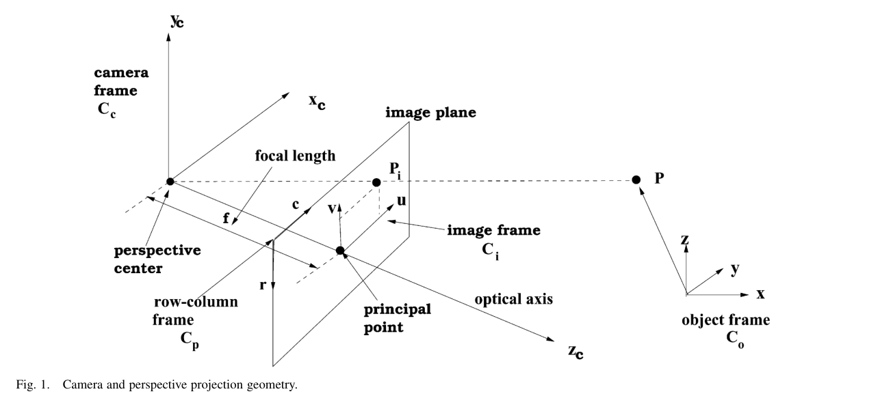
*그림 1 — 카메라와 원근 투영 기하.*

완전 원근 투영(full perspective projection) 이론에 따라, 영상 평면 위의 $(c, r)$과 물체 좌표계에서 대응하는 3-D 점 $(x, y, z)$를 관계 짓는 투영은 다음과 같이 기술된다.

$$\lambda\begin{pmatrix}c\\ r\\ 1\end{pmatrix} = K[R\quad T]\begin{pmatrix}x\\ y\\ z\\ 1\end{pmatrix} \tag{1}$$

여기서 $\lambda$는 스칼라, $K$는 카메라 내부 파라미터를 담은 $3\times3$ 행렬, $R$과 $T$는 각각 카메라 좌표계에 대한 물체 좌표계의 상대 자세를 지정하는 회전 행렬과 평행이동 벡터이다. $K$는 다음과 같이 매개변수화된다.

$$K = \begin{pmatrix} fs_x & 0 & u_0\\ 0 & fs_y & v_0\\ 0 & 0 & 1\end{pmatrix}$$

여기서 $f$는 카메라 초점 거리, $s_x$와 $s_y$는 축척 계수(pixels/mm)이다. $u_0$와 $v_0$는 $C_p$에 대한 주점의 화소 좌표이다. 여기서는 영상 비틀림(skew)과 렌즈 왜곡을 무시할 수 있다고 가정한다. $K$를 카메라 내부 보정 행렬(intrinsic camera calibration matrix)이라 한다. 핀홀 카메라 모델 식에 대한 자세한 내용은 [35]에 있다. 카메라 보정의 목표는 $K$의 원소를 결정하는 것이다.

## III. 제안 방법의 이론 (THEORY OF THE PROPOSED APPROACH)

### A. 문제 정의 (Problem Statement)

제안 방법에서는 카메라를 보정하기 위해 카메라가 처음 광학 중심이 아닌 고정점을 중심으로 회전할 수 있다. 회전을 통해 주어진 장면의 영상 뷰를 여러 장 얻는다. 이 연구의 목적은 회전이 광학 중심을 중심으로 하지 않는다는 사실 아래에서 이 영상들로부터 행렬 $K$를 계산하는 방법을 개발하는 것이다. 이어지는 절에서는 먼저 더 이상적인 순수 회전 경우의 이론을 논의하고, 다음으로 회전이 카메라 광학 중심에서 벗어난 고정점을 중심으로 하는 경우의 이론을 논의한다.

### B. 순수 회전의 이론 (Theory for Pure Rotation)

여기서는 먼저 Hartley [23]가 처음 제시한 순수 회전 접근을 다시 정식화한다. 하나의 구성 I에서 다른 구성 II로의 일반 카메라 운동에서, 장면의 물체 점 $(x, y, z)$가 영상 I과 II에 모두 나타나면, 같은 물체 점 $(x, y, z)$의 두 영상 점 $(c_1, r_1)$과 $(c_2, r_2)$는 다음 식으로 정해진다.

$$\lambda_1\begin{pmatrix}c_1\\ r_1\\ 1\end{pmatrix} = K[R_1\quad T_1]\begin{pmatrix}x\\ y\\ z\\ 1\end{pmatrix} \tag{2}$$

$$\lambda_2\begin{pmatrix}c_2\\ r_2\\ 1\end{pmatrix} = K[R_2\quad T_2]\begin{pmatrix}x\\ y\\ z\\ 1\end{pmatrix}. \tag{3}$$

순수 회전 접근에서는 회전의 고정점이 카메라 광학 중심과 일치하며 회전 전후에 같다. 편의상, 그리고 일반성을 잃지 않고, 물체 좌표계의 원점이 카메라 광학 중심에 놓이도록 물체 좌표계를 선택할 수 있다. 이렇게 선택하면 (2)와 (3)의 평행이동이 0이 되며, 아래와 같이 보정 작업이 크게 단순해진다. 그 결과 (2)와 (3)은 다음과 같이 된다.

$$\lambda_1\begin{pmatrix}c_1\\ r_1\\ 1\end{pmatrix} = KR_1\begin{pmatrix}x\\ y\\ z\end{pmatrix} \tag{4}$$

$$\lambda_2\begin{pmatrix}c_2\\ r_2\\ 1\end{pmatrix} = KR_2\begin{pmatrix}x\\ y\\ z\end{pmatrix}. \tag{5}$$

이 식 쌍에서 물체 점의 좌표 $(x, y, z)$를 소거하면 다음과 같은 영상-영상 변환(사상)을 얻는다.

$$\lambda_1 R_1^{-1}K^{-1}\begin{pmatrix}c_1\\ r_1\\ 1\end{pmatrix} = \lambda_2 R_2^{-1}K^{-1}\begin{pmatrix}c_2\\ r_2\\ 1\end{pmatrix}. \tag{6}$$

상대 회전

$$R_1 = RR_2$$

를 도입하면 (6)은 다음과 같이 단순화된다.

$$\begin{pmatrix}c_1\\ r_1\\ 1\end{pmatrix} = \frac{\lambda_2}{\lambda_1}KRK^{-1}\begin{pmatrix}c_2\\ r_2\\ 1\end{pmatrix} \tag{7}$$

이 식은 순수 회전 방식 카메라 자기 보정의 핵심 작업 방정식이다. 편의상 다음을 정의한다.

$$H = KRK^{-1}\quad\text{and}\quad \lambda = \frac{\lambda_1}{\lambda_2}.$$

이 두 정의로 (7)은 다음과 같이 다시 쓸 수 있다.

$$\lambda\begin{pmatrix}c_1\\ r_1\\ 1\end{pmatrix} = H\begin{pmatrix}c_2\\ r_2\\ 1\end{pmatrix}. \tag{8}$$

여기서 파라미터 $\lambda$는 물체 점의 위치에 따라 달라진다. 행렬 $H$는 컴퓨터 비전 문헌에서 보통 *무한 호모그래피(infinite homography)* 라 불린다 [18]. 따라서 이 식은 각 물체 점의 영상-영상 사상이 $H$ 행렬 원소에 대한 독립 선형 방정식 2개를 준다는 것을 뜻한다. 최소 4개의 대응 2-D 점이 주어지면 $H$를 축척 계수(scale factor)를 제외하고 풀 수 있다. 축척 계수는 이어서 $\det(H) = 1$이라는 사실을 이용하여 결정할 수 있다. Hartley [23]는 $H$를 푸는 선형 방법과 비선형 방법을 소개하였다.

### C. $K$의 해 (Solution to $K$)

$H$가 주어지면 내부 행렬 $K$를 풀 수 있다. $K$의 해는 회전 행렬 $R$을 아는지 모르는지에 따라 달라진다. 각 경우의 해를 논의한다.

*1) $R$을 아는 경우(R Is Known):* $R$을 알면 단일 $H$로부터 $K$를 해석적으로 유도할 수 있다. 여기서는 Stein [24]의 방법과 유사한 선형 해를 소개한다. $H = KRK^{-1}$로부터 다음을 얻는다.

$$HK = KR. \tag{9}$$

식 (9)는 4개의 미지 내부 파라미터에 대한 9개의 선형 방정식을 준다. 따라서 $K$의 원소는 연립 선형 방정식을 통해 해석적으로 풀 수 있다. 추가 회전으로 얻은 영상이 더 있으면 (9)와 같은 방정식을 더 만들어 쌓아 더 큰 연립 선형 방정식을 구성하고, 이를 바탕으로 $K$의 원소를 풀 수 있다. 추가 영상이 주는 중복성 덕분에 해가 더 정확해진다.

*2) $R$을 모르는 경우: 선형 해(R Is Unknown: Linear Solution):* 실제로는 회전 행렬 $R$을 모르는 경우가 많다. 그러면 위의 해는 적용할 수 없다. 여기서는 Hartley [23]의 방법과 유사한 선형 해를 도입하여 내부 행렬 $K$를 푼다. $C = KK^t$라 하면, $H = KRK^{-1}$과 $R$의 정규직교(orthonormality) 제약을 이용하여 $HCH^t = C$를 얻는다. 축척 계수를 제외한 $C$의 해는 최소 2개의 $H$ 행렬을 사용하는 선형 최소제곱 문제로 정식화된다. $C$ 원소의 해는 설계 행렬(design matrix)의 최소 고윳값에 대응하는 고유벡터이다. 축척 계수는 $C$의 마지막 원소(즉 C(3, 3))가 1이라는 제약을 부과하여 푼다.

$C$를 풀고 나면, Hartley는 $C$가 양의 정부호(positive definite)라고 가정하고 해가 상삼각 행렬이라는 제약 아래 숄레스키 분해(Cholesky Decomposition)를 사용하여 카메라 보정 행렬을 선형으로 결정할 것을 제안하였다. 우리는 이 방법으로는 비틀림 0(zero skew) 제약을 부과하기 어렵다는 것을 발견하였다. 이 제약을 부과하기 위해 이를 $K$ 행렬에 명시적으로 넣어 $KK^t$를 다음과 같이 얻는다.

$$KK^t = \begin{pmatrix} f^2s_x^2+u^2 & uv & u\\ uv & f^2s_y^2+v^2 & v\\ u & v & 1\end{pmatrix}.$$

따라서 $C$가 주어지면 다음으로부터 $K$의 원소를 얻을 수 있다.

$$u = C(3,1),\quad v = C(3,2),\quad fs_x = \sqrt{C(1,1)-u^2},\quad fs_y = \sqrt{C(2,2)-v^2}.$$

그러나 우리의 연구에 따르면 이 선형 해는 우아하기는 하지만 그림 2와 같이 화소 오차에 민감하다. 그림은 각 영상 점의 오차가 2화소를 넘으면 네 파라미터 모두 참값에서 상당히 벗어남을 보여 준다. 특히 파라미터 $u$와 $v$가 그러하며, 이들은 두 축척 계수보다 화소 오차에 두 배 민감하다.

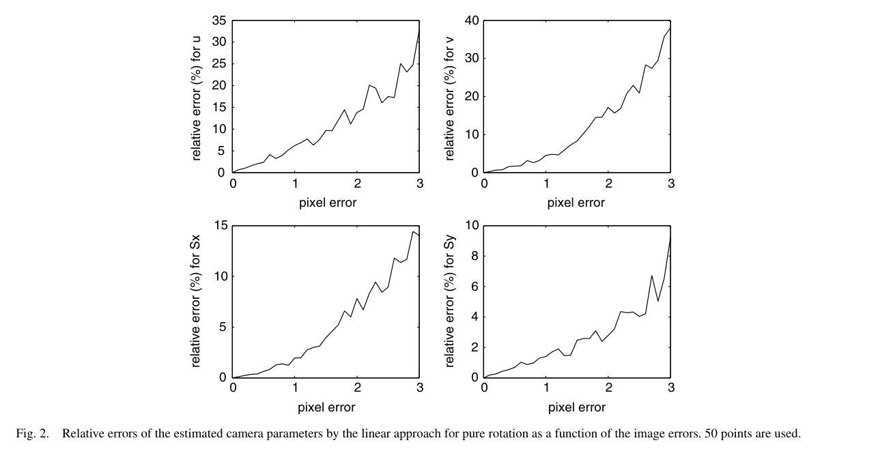
*그림 2 — 순수 회전에 대한 선형 방법으로 추정한 카메라 파라미터의 상대 오차를 영상 오차의 함수로 나타낸 것. 50개 점을 사용하였다.*

게다가 이 분해는 조건이 나쁜(poorly conditioned) $C$에 대해 수치적으로 매우 불안정하다. 해의 민감도를 개선하는 한 가지 방법은, De Agapito [31]와 Zisserman [36]의 연구에서 보인 것처럼 행렬 $C$를 계산하는 동안 비틀림 0 제약을 부과하는 것이다. 또한 민감도와 수치 불안정 문제는 번들 조정(bundle-adjustment) 방법 [37]으로 더 보정할 수 있다.

*3) $R$을 모르는 경우: 비선형 해(R Is Unknown: Nonlinear Solution):* $K$의 해를 더 개선하기 위해, $C$를 계산하지 않고 $H$로부터 $K$를 직접 계산하는 1단계 비선형 방법을 도입한다. 이 1단계 비선형 방법은 더 강건하고 정확한 추정을 준다는 것이 확인되었다.

$H$가 주어지면 $R$의 정규직교성을 이용하여 $R$을 포함하지 않는 식을 세울 수 있다. $H = KRK^{-1}$이므로 $R^{-t} = K^TH^{-t}K^{-t}$이다. 따라서 $R$의 정규직교 제약 $(R = R^{-t})$을 적용하면 다음을 얻는다.

$$(KK^t)H^{-t} = H(KK^t) \tag{10}$$

여기서

$$KK^t = \begin{pmatrix} s_x^2f^2+u_0^2 & u_0v_0 & u_0\\ u_0v_0 & s_y^2f^2+v_0^2 & v_0\\ u_0 & v_0 & 1\end{pmatrix}.$$

식 (10)은 회전 카메라에 대한 크루파 방정식(Kruppa equations)과 유사하다. 이 식은 영상 변환을 카메라 내부 파라미터와 연결한다.

이제 De Agapito [29]가 제안한 방법과 유사한 비선형 방법을 제시하여, $R$을 모른다고 가정하고 (10)을 이용해 $H$로부터 $K$를 푼다. 선형 해와 마찬가지로, 이 해도 $K$를 유일하게 결정하려면 서로 다른 $H$ 행렬 2개가 필요하다. (10)으로부터 행렬 $A^i$를 다음과 같이 정의한다.

$$A^i = (KK^t)H_i^{-t} - H_i(KK^t)\quad\text{where } i = 1, 2 \tag{11}$$

그러면 최소화할 기준 함수 $F$를 다음과 같이 정의한다.

$$F(K) = \sum_{i=1}^{2} {A^i_{00}}^2 + {A^i_{01}}^2 + {A^i_{02}}^2 + {A^i_{10}}^2 + {A^i_{11}}^2 + {A^i_{12}}^2 + {A^i_{20}}^2 + {A^i_{21}}^2 + {A^i_{22}}^2 \tag{12}$$

여기서 $A^i_{jk}$는 행렬 $A^i$의 $(j, k)$ 원소이다. $H$는 앞 단계에서 계산되었으므로, $F$는 4개의 내부 파라미터 $(s_xf, s_yf, u_0, v_0)$의 함수이다. 함수 $F$를 최소로 만드는 네 내부 파라미터가 (12)의 해이다.

이 비선형 최소화 문제의 구현에는 Matlab 함수 *lsqcurvefit()* 를 사용한다. 비선형 해의 초기 추정값은 III-B절과 III-C절에서 소개한, $H$로부터 $K$를 푸는 선형 해로 얻는다. 영상 시퀀스가 주어지면 $H$의 추정값은 기존 번들 조정 알고리즘 [37]으로 더 정밀화할 수 있다.

### D. 고정 평행이동이 있는 카메라 회전 (Camera Rotation With Fixed Translation)

많은 실제 환경에서는 카메라 광학 중심의 위치를 모르기 때문에 순수 카메라 회전을 수행하기가 매우 어렵다. 카메라 회전은 보통 카메라 지지 장치 위의 어떤 고정된 공간상의 점을 중심으로 수행된다. 따라서 회전 전후의 두 카메라 좌표계 사이에 상대 평행이동이 생긴다. 이 절에서는 상대 평행이동을 고려하여 문제를 수학적으로 다시 정식화한다. 이 정식화는 순수 회전을 특수한 경우로 다룰 수 있다는 점에서 더 일반적이다.

일반성을 잃지 않고, 그림 3과 같이 물체 좌표계가 회전 고정점에 위치하고 초기 카메라 좌표계와 정렬되어 있다고 가정하자.

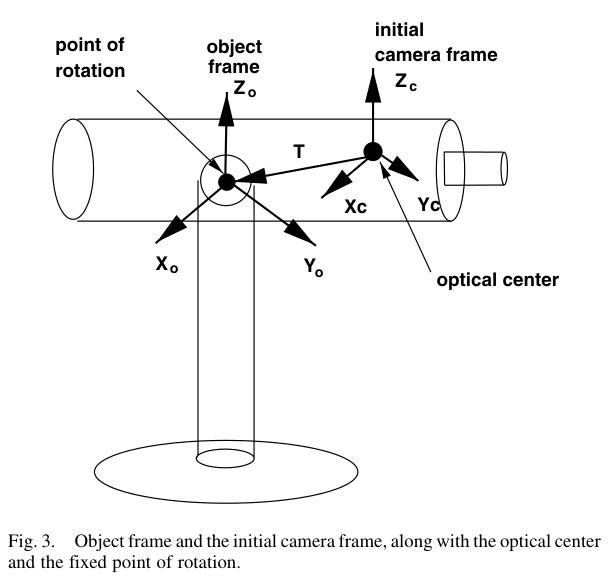
*그림 3 — 물체 좌표계와 초기 카메라 좌표계, 그리고 광학 중심과 회전 고정점.*

카메라 회전 중에 팬(panning)과 틸트(tilting)가 모두 허용되지만 회전점은 고정되어 있다는 점에 주목한다. 이로부터 중요한 사실이 나온다. 카메라 좌표계(회전 전이든 후이든)에 대한 회전 고정점의 위치는 변하지 않는다. 즉 $T_1 = T_2 = T$이다. 이 사실이 제안 방법의 핵심이 된다. 그 결과 (2)와 (3)은 그대로 성립한다. 즉,

$$\lambda_1\begin{pmatrix}c_1\\ r_1\\ 1\end{pmatrix} = K[R_1\quad T]\begin{pmatrix}x\\ y\\ z\\ 1\end{pmatrix} \tag{13}$$

$$\lambda_2\begin{pmatrix}c_2\\ r_2\\ 1\end{pmatrix} = K[R_2\quad T]\begin{pmatrix}x\\ y\\ z\\ 1\end{pmatrix}. \tag{14}$$

순수 회전의 경우 $T$를 0으로 선택할 수 있으며, 그러면 이 식들은 이상적인 순수 회전 경우의 식과 정확히 같다. 고정 평행이동이 있는 회전의 경우에는 회전할 때마다 광학 중심이 달라지므로 $T$는 0이 될 수 없다. 이는 영상-영상 사상을 크게 복잡하게 만들며, 순수 회전의 경우와 같은 $H$ 행렬 원소에 대한 연립 선형 방정식을 더 이상 얻을 수 없다.

다행히 이렇게 복잡하지만 (13)과 (14)에는 잠재적으로 유용한 특징, 즉 고정된 평행이동 $T$가 있다. 이 귀중한 특징을 이용하기 위해, 주어진 물체 점의 서로 다른 세 영상에 대응하는 세 가지 카메라 시스템 구성 I, II, III을 고려할 수 있으며, 이들은 다음과 같이 정해진다.

$$\lambda_1\begin{pmatrix}c_1\\ r_1\\ 1\end{pmatrix} = K[R_1\quad T]\begin{pmatrix}x\\ y\\ z\\ 1\end{pmatrix} \tag{15}$$

$$\lambda_2\begin{pmatrix}c_2\\ r_2\\ 1\end{pmatrix} = K[R_2\quad T]\begin{pmatrix}x\\ y\\ z\\ 1\end{pmatrix} \tag{16}$$

$$\lambda_3\begin{pmatrix}c_3\\ r_3\\ 1\end{pmatrix} = K[R_3\quad T]\begin{pmatrix}x\\ y\\ z\\ 1\end{pmatrix}. \tag{17}$$

(15)와 (16)에서 평행이동 $T$를 소거하면 다음을 얻는다.

$$\lambda_1\begin{pmatrix}c_1\\ r_1\\ 1\end{pmatrix} - \lambda_2\begin{pmatrix}c_2\\ r_2\\ 1\end{pmatrix} = K(R_1 - R_2)\begin{pmatrix}x\\ y\\ z\end{pmatrix}. \tag{18}$$

마찬가지로 (16)과 (17)로부터 다음을 얻는다.

$$\lambda_3\begin{pmatrix}c_3\\ r_3\\ 1\end{pmatrix} - \lambda_2\begin{pmatrix}c_2\\ r_2\\ 1\end{pmatrix} = K(R_3 - R_2)\begin{pmatrix}x\\ y\\ z\end{pmatrix}. \tag{19}$$

식 (18)과 (19)는 $K$를 식의 왼쪽으로 옮겨 다음과 같이 다시 쓸 수 있다.

$$K^{-1}\left(\lambda_1\begin{pmatrix}c_1\\ r_1\\ 1\end{pmatrix} - \lambda_2\begin{pmatrix}c_2\\ r_2\\ 1\end{pmatrix}\right) = (R_1 - R_2)\begin{pmatrix}x\\ y\\ z\end{pmatrix} \tag{20}$$

$$K^{-1}\left(\lambda_3\begin{pmatrix}c_3\\ r_3\\ 1\end{pmatrix} - \lambda_2\begin{pmatrix}c_2\\ r_2\\ 1\end{pmatrix}\right) = (R_3 - R_2)\begin{pmatrix}x\\ y\\ z\end{pmatrix}. \tag{21}$$

두 상대 회전 ${}^2_1R$과 ${}^3_2R$을 도입하면

$$R_2 = {}^2_1RR_1,\qquad R_3 = {}^3_2RR_2.$$

따라서 (20)과 (21)은 다음 형태가 된다.

$$K^{-1}\left(\lambda_1\begin{pmatrix}c_1\\ r_1\\ 1\end{pmatrix} - \lambda_2\begin{pmatrix}c_2\\ r_2\\ 1\end{pmatrix}\right) = \left({}^2_1R^t - I\right)R_2\begin{pmatrix}x\\ y\\ z\end{pmatrix} \tag{22}$$

$$K^{-1}\left(\lambda_3\begin{pmatrix}c_3\\ r_3\\ 1\end{pmatrix} - \lambda_2\begin{pmatrix}c_2\\ r_2\\ 1\end{pmatrix}\right) = \left({}^3_2R - I\right)R_2\begin{pmatrix}x\\ y\\ z\end{pmatrix}. \tag{23}$$

능동 헤드에 장착된 카메라를 사전 보정하는 경우와 같은 많은 응용에서는 카메라 회전을 정확히 제어할 수 있다. 따라서 카메라 보정을 위해 다음 조건을 만족하도록 카메라의 세 방향을 선택하는 것은 합리적이고 편리하다.

$${}^3_2R = {}^2_1R = R^t. \tag{24}$$

물리적으로 이 단순화는 좌표계 1–2 사이의 상대 방향이 좌표계 3과 좌표계 2 사이의 상대 방향과 같다는 뜻이다. 다시 말해, 좌표계 1과 좌표계 2가 주어지면, 좌표계 1에서 좌표계 2로의 회전과 같은 회전으로 카메라를 한 번 더 회전하여 좌표계 3을 얻을 수 있다. 이 단순화로 (22)와 (23)은 다음과 같이 된다.

$$K^{-1}\left(\lambda_1\begin{pmatrix}c_1\\ r_1\\ 1\end{pmatrix} - \lambda_2\begin{pmatrix}c_2\\ r_2\\ 1\end{pmatrix}\right) = -R(R^t - I)R_2\begin{pmatrix}x\\ y\\ z\end{pmatrix} \tag{25}$$

$$K^{-1}\left(\lambda_3\begin{pmatrix}c_3\\ r_3\\ 1\end{pmatrix} - \lambda_2\begin{pmatrix}c_2\\ r_2\\ 1\end{pmatrix}\right) = (R^t - I)R_2\begin{pmatrix}x\\ y\\ z\end{pmatrix}. \tag{26}$$

(25)와 (26)을 같게 놓고 $(R^t - I)R_2(x\ y\ z)^t$를 제거하면 다음을 얻는다.

$$\lambda_1\begin{pmatrix}c_1\\ r_1\\ 1\end{pmatrix} - \lambda_2\begin{pmatrix}c_2\\ r_2\\ 1\end{pmatrix} = KRK^{-1}\left[\lambda_2\begin{pmatrix}c_2\\ r_2\\ 1\end{pmatrix} - \lambda_3\begin{pmatrix}c_3\\ r_3\\ 1\end{pmatrix}\right]. \tag{27}$$

따라서 순수 회전 접근의 (7)과 유사한 핵심 작업 방정식을 얻는다. 차이는 (7)이 두 영상 프레임에서 유도되어 미지 스칼라 2개 $(\lambda_1, \lambda_2)$를 포함하는 반면, (27)은 세 영상 프레임에서 유도되어 미지 스칼라 3개 $\lambda_1, \lambda_2, \lambda_3$를 포함한다는 점이다. 이 절의 나머지에서는 이 작업 방정식의 해를 제시한다.

식 (27)은 각 대응 물체 점마다 추가 독립 파라미터 2개, 즉 $(\lambda_1/\lambda_2)$와 $(\lambda_3/\lambda_2)$, 그리고 방정식 3개가 있음을 보여 준다. 이 두 추가 파라미터를 소거하면 각 대응점마다 방정식 하나를 얻을 수 있다. 다음과 같이 두자.

$$H = KRK^{-1},\qquad \lambda_{12} = \frac{\lambda_1}{\lambda_2},\qquad \lambda_{32} = \frac{\lambda_3}{\lambda_2}.$$

그러면 (27)은 다음과 같이 쓸 수 있다.

$$\lambda_{12}\begin{pmatrix}c_1\\ r_1\\ 1\end{pmatrix} - \begin{pmatrix}c_2\\ r_2\\ 1\end{pmatrix} = H\left[\begin{pmatrix}c_2\\ r_2\\ 1\end{pmatrix} - \lambda_{32}\begin{pmatrix}c_3\\ r_3\\ 1\end{pmatrix}\right]. \tag{28}$$

$H = \begin{pmatrix}H_1^t\\ H_2^t\\ H_3^t\end{pmatrix}$ 표기를 사용하면(여기서 $H_i^t$는 행렬 $H$의 $i$번째 행), (28)은 다음 세 방정식이 된다.

$$\lambda_{12}c_1 - c_2 = H_1^t\begin{pmatrix}c_2-\lambda_{32}c_3\\ r_2-\lambda_{32}r_3\\ 1-\lambda_{32}\end{pmatrix} \tag{29}$$

$$\lambda_{12}r_1 - r_2 = H_2^t\begin{pmatrix}c_2-\lambda_{32}c_3\\ r_2-\lambda_{32}r_3\\ 1-\lambda_{32}\end{pmatrix} \tag{30}$$

$$\lambda_{12} - 1 = H_3^t\begin{pmatrix}c_2-\lambda_{32}c_3\\ r_2-\lambda_{32}r_3\\ 1-\lambda_{32}\end{pmatrix}. \tag{31}$$

(29)와 (31)에서 파라미터 $\lambda_{12}$를 소거하면 다음을 얻는다.

$$c_1 - c_2 = (H_1^t - c_1H_3^t)\begin{pmatrix}c_2-\lambda_{32}c_3\\ r_2-\lambda_{32}r_3\\ 1-\lambda_{32}\end{pmatrix}. \tag{32}$$

마찬가지로 (30)과 (31)로부터 다음을 얻는다.

$$r_1 - r_2 = (H_2^t - r_1H_3^t)\begin{pmatrix}c_2-\lambda_{32}c_3\\ r_2-\lambda_{32}r_3\\ 1-\lambda_{32}\end{pmatrix}. \tag{33}$$

(32)와 (33)에는 물체 점에 의존하는 스칼라 파라미터 $\lambda_{32}$ 하나만 남으며, (32)로부터 이를 다음과 같이 나타낼 수 있다.

$$\lambda_{32} = \frac{c_2 - c_1 + (H_1^t - c_1H_3^t)\begin{pmatrix}c_2\\ r_2\\ 1\end{pmatrix}}{(H_1^t - c_1H_3^t)\begin{pmatrix}c_3\\ r_3\\ 1\end{pmatrix}}. \tag{34}$$

마찬가지로 (33)으로부터 $\lambda_{32}$를 다음과 같이 나타낼 수 있다.

$$\lambda_{32} = \frac{r_2 - r_1 + (H_2^t - r_1H_3^t)\begin{pmatrix}c_2\\ r_2\\ 1\end{pmatrix}}{(H_2^t - r_1H_3^t)\begin{pmatrix}c_3\\ r_3\\ 1\end{pmatrix}}. \tag{35}$$

(34)와 (35)를 결합하여 $\lambda_{32}$를 소거하면 $H$ 행렬 원소에 대한 비선형 방정식을 다음과 같이 얻는다.

$$\frac{c_2 - c_1 + (H_1^t - c_1H_3^t)\begin{pmatrix}c_2\\ r_2\\ 1\end{pmatrix}}{(H_1^t - c_1H_3^t)\begin{pmatrix}c_3\\ r_3\\ 1\end{pmatrix}} = \frac{r_2 - r_1 + (H_2^t - r_1H_3^t)\begin{pmatrix}c_2\\ r_2\\ 1\end{pmatrix}}{(H_2^t - r_1H_3^t)\begin{pmatrix}c_3\\ r_3\\ 1\end{pmatrix}}. \tag{36}$$

따라서 추적하는 각 물체 점마다 $H$ 행렬 원소만으로 이루어진 비선형 방정식 하나를 얻는다. 점의 수가 충분하면 $H$를 수치적으로 풀 수 있다. 구체적으로, $U$와 $V$를 (36)의 좌변과 우변이라 하면, 세 뷰에서 대응된 각 점에 대해 이상적으로는 $U = V$이다.

$N$개의 대응점을 선택하면 $i = 1, 2, \ldots, N$에 대해 $U_i = V_i$이다. 따라서 대수적 오차 기준 함수 $f$를 다음과 같이 세울 수 있다.

$$f(H) = \sum_{i=1}^{N}(U_i - V_i)^2. \tag{37}$$

최소 8개(즉 $N \ge 8$)의 점이 주어지면 (37)을 최소화하여 축척 계수를 제외하고 $H$를 구할 수 있다. 이 최소화는 MATLAB 함수 *lsqcurvefit()* 로 구현하였다. 비선형 해의 초기 추정값은 평행이동 오프셋이 0이라고 가정하고 III-B절과 III-C절에서 논의한 선형 기법으로 제공하였다. 합성 데이터를 이용한 연구에서, 초기 추정값이 참값에서 약 $\pm15\%$ 벗어나 있으면 $H$ 행렬을 비교적 정확하게 추정할 수 있음을 확인하였다. 이어서 $H$의 행렬식이 1이라는 사실을 이용하여 $H$의 축척 계수를 풀었다. $H$가 주어지면 III-C절에서 소개한 해를 사용하여 $K$를 풀 수 있다.

### E. 카메라 자기 보정의 퇴화 (Degeneracy in Camera Self Calibration)

Sturm [20]의 연구는 흔히 *임계 운동(critical motion)* 이라 불리는 특정 유형의 카메라 운동이 카메라 자기 보정 해의 퇴화(degeneracy)를 일으킨다는 것을 밝혔다. 퇴화란 해가 여러 개 존재한다는 뜻이다. 내부 카메라 파라미터가 일정한 경우의 임계 운동 시퀀스에 대한 완전한 특성화는 [20]에 있다. 특히 그들은 평행한(또는 같은) 축을 중심으로 한 회전이나 평면 운동 등, 실제로 자주 일어나는 몇몇 퇴화 운동 시퀀스를 밝혔다. 그들은 내부 카메라 파라미터가 고정된 카메라에서, 임의의 평행이동과 함께 같은 축을 중심으로 한 회전으로 생기는 모든 카메라 운동이 임계적이며 따라서 다중 해를 낳는다는 것을 증명하였다. 이는 제안 기법에 사용하는 운동 시퀀스도 고정 평행이동과 함께 같은 축을 중심으로 한 회전을 포함하므로 임계적임을 시사하는 것처럼 보인다. 그러나 Kahl 등 [38]과 Zisserman 등 [36]의 추가 연구는 카메라 파라미터에 부과한 제약에 따라 고정축을 중심으로 한 회전이 항상 임계적인 것은 아님을 보여 준다. 예를 들어 Kahl은 비틀림을 0으로 가정하면, 카메라 파라미터가 일정할 때 축 $(0, *, *)$와 $(*, 0, *)$를 중심으로 한 회전만 임계적임을 증명하였다. 여기서 '*'는 임의의 실수를 뜻한다. 비틀림 0만 가정하면, 이 임계 축을 중심으로 한 회전을 피할 수 있는 한 제안 방법의 회전은 임계적이지 않다. 실제로 이는 먼저 팬 축을 중심으로 회전(같은 회전 2번, 영상 3장)한 다음 틸트 축을 중심으로 회전(역시 같은 회전 2번, 영상 3장)하여 달성할 수 있다. 이렇게 하면 더 이상 단일 축에 대한 것이 아닌 무한 호모그래피 2개를 얻어 알고리즘의 두 번째 단계에 입력할 수 있다. 위에서 언급한 임계 축이 아닌 축을 중심으로 카메라를 회전하여 네 내부 카메라 파라미터를 유일하게 결정할 수 있었으므로, 이는 우리 실험으로도 뒷받침된다.

## IV. 실험 (EXPERIMENTS)

이 절에서는 제안 자기 보정 알고리즘의 성능을 특성화하기 위한 실험 결과를 제시한다. 보정 알고리즘을 먼저 합성 데이터로 시험하여 잡음 양, 점의 수, 카메라 외부 방향을 바꾸어 가며 성능을 확인하였다. 다음으로 이 알고리즘을 실제 영상 집합에 적용하여 내부 카메라 파라미터를 복원하였다. 끝으로 제안 방법과 평행이동 오프셋을 무시하는 기존 방법의 비교 결과를 제시한다.

### A. 합성 데이터 시험 (Tests With Synthetic Data)

합성 데이터 실험에서 3-D 데이터(3-D 점)는 지정된 범위 안에서 무작위로 생성한다. 2-D 데이터(영상 좌표)는 고정된 내부 카메라 파라미터를 사용하여 3-D 데이터를 영상 평면에 투영하여 생성한다. 서로 다른 카메라 파라미터에서 제안 방법의 성능을 연구하기 위해 이상적인 카메라 파라미터 세 세트 $(fs_x, fs_y, u_0, v_0) = (1306, 1306, 160, 120)$, $(1306, 1206, 160, 120)$, $(263, 263, 157, 127)$을 각각 사용한다. 첫 번째 영상이 주어지면, 카메라를 어떤 축을 중심으로 $\theta$도 회전하여 두 번째 영상을 생성하고, 같은 축을 중심으로 다시 $\theta$도 회전하여 세 번째 영상을 생성한다. 대부분의 실험에서 기본 평행이동 오프셋은 20%로 설정한다. 그런 다음 2-D 영상 데이터에 평균 0, 표준편차 $\sigma$의 독립 동일 분포(i.i.d.) 가우스 잡음을 더한다. 잡음 수준은 $\sigma$로 정량화한다. 현실적인 잡음 수준은 약 1.5화소에 불과하지만 [23], $\sigma$는 0–4.0화소 범위에서 바꾼다. 생성한 2-D/3-D 데이터로부터 제안 알고리즘을 사용하여 내부 카메라 파라미터 $(fs_x, fs_y, u_0, v_0)$를 추정한다. 성능은 아래에서 논의하는 여러 조건에서 추정 파라미터와 참값 사이의 절대 상대 오차로 판단한다.

*1) 대응 물체 점 수와 영상 잡음의 영향(Influence of the Number of Matched Object Points and Image Noise):* 여기서는 영상 점 수와 영상 잡음 양을 바꾸어 가며 제안 자기 보정 방법의 성능을 요약한다. 각 경우 합성 영상의 크기는 $320\times240$이며, 회전은 두 일반 축 (0.2, 0.5, 0.59)와 (0.8, 0.5, 0.33)을 중심으로 한다. 첫 번째 실험에서는 영상 잡음을 표준편차 1.5화소로 고정하고 점의 수를 점차 바꾸었다. 결과는 그림 4에 요약하였으며, 계산에 참여하는 점의 수의 함수로 추정 카메라 파라미터의 상대 오차를 나타낸다. 두 번째 실험에서는 점의 수를 75개로 고정하고 영상 잡음 수준을 바꾸었다. 결과는 그림 5에 요약하였으며, 영상 잡음 수준의 함수로 추정 카메라 파라미터의 상대 오차를 나타낸다. 각 경우 내부 카메라 파라미터의 초기 추정값은 참값에서 20% 벗어나 있으며, 그림의 각 점은 같은 잡음 수준에서 100회 시행의 평균이다.

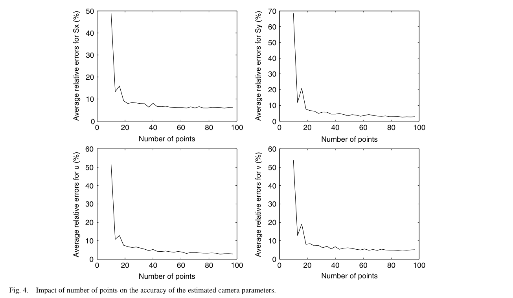
*그림 4 — 점의 수가 추정 카메라 파라미터의 정확도에 미치는 영향.*

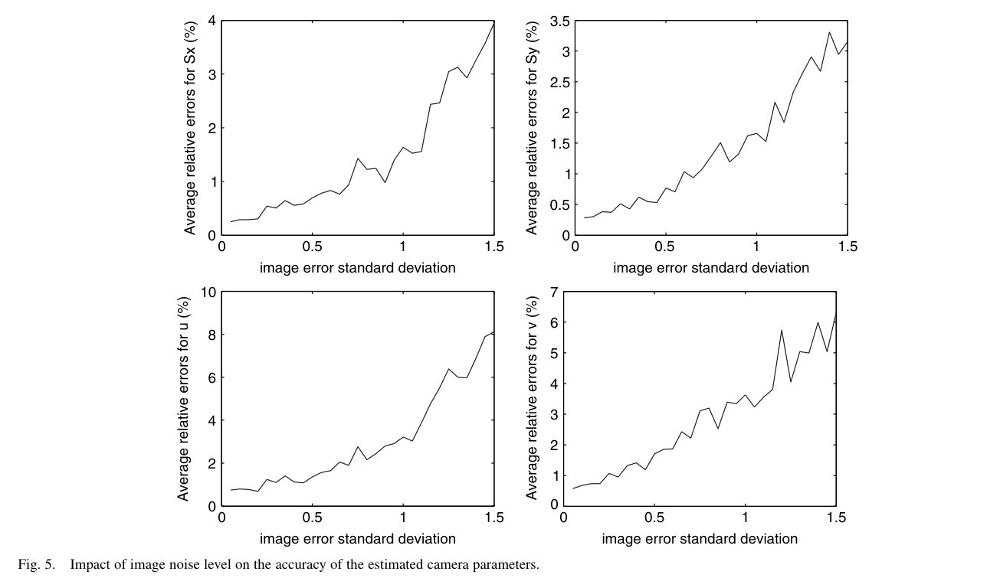
*그림 5 — 영상 잡음 수준이 추정 카메라 파라미터의 정확도에 미치는 영향.*

두 그림에서 점의 수를 늘리면 알고리즘의 잡음 내성이 크게 개선됨이 분명하다. 점 10개만 사용하면 알고리즘이 상당히 불안정하다. 그러나 점이 20개 이상이면 실제 영상 데이터에서 마주치는 현실적인 잡음 수준에 가까운 꽤 높은 잡음 수준($\sigma = 1.5$)도 견딜 수 있다. 점의 수가 100개로 늘면 알고리즘은 뚜렷한 개선을 보인다. 표준편차 2화소까지의 잡음 수준에서도 네 파라미터 모두 매우 정확한 결과를 낼 수 있다.

*2) 영상 수에 따른 정확도(Accuracy Versus the Number of Images):* 여기서는 사용한 영상(회전) 수의 함수로 제안 방법의 정확도를 연구한다. 이론적으로는 어떤 자기 보정 문제에든 긴 시퀀스에서 가능한 한 많은 영상을 입력하고 모든 데이터를 동시에 사용하여 해를 구해야 한다. 이렇게 하면 방법의 강건성과 정확도가 개선될 수 있다. 그러나 실제로는 부분적으로 가림 때문에 많은 영상을 얻기 어렵다. 이 문제를 피하기 위해 영상 3장(회전 2번)으로 호모그래피 하나를 계산한다. 그런 다음 다른 회전에서 영상 3장을 더 얻어 또 다른 호모그래피를 계산한다. 이를 반복하여 호모그래피 행렬 집합을 모으고, 이들을 쌓아 동시에 사용하여 내부 카메라 파라미터를 푼다. 우리가 수행한 실험에서는 호모그래피 행렬을 최대 15개까지 얻어, 사용한 호모그래피 행렬 수의 함수로 제안 방법의 정확도를 연구하였다. 결과는 그림 6에 요약하였으며, 사용한 3-D 점의 수는 100개, 각 화소의 잡음 수준은 0.8이었다. 그림의 각 점은 100회 시행의 평균이다. 사용하는 영상 수가 늘수록 추정 오차가 줄어든다고 결론지을 수 있다. 그러나 일부 카메라 파라미터(예: u와 Sy)에서는 회전 수가 어느 수준(예: 10)에 이르면 이 감소가 둔화되기 시작한다.

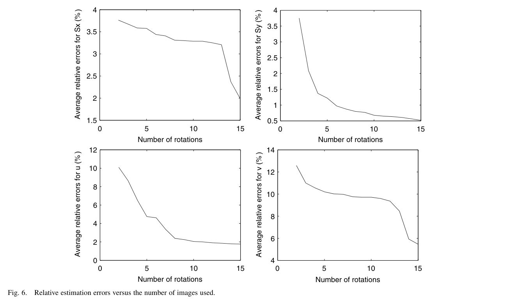
*그림 6 — 사용한 영상 수에 따른 상대 추정 오차.*

*3) 초기 추정값에 대한 강건성(Robustness Versus Initial Guesses):* 비선형 해를 계산하려면 내부 카메라 파라미터의 초기 추정값이 필요하다. 보정 알고리즘의 강건성을 시험하기 위해, 대응 물체 점 수가 100개인 경우에 참 내부 값에서 약 10%와 20% 벗어난 서로 다른 초기 추정값 두 개를 선택하였다. 결과는 그림 7에 나타내었으며, 서로 다른 두 초기 추정값으로 영상 잡음 양을 바꾸어 가며 추정 카메라 파라미터의 상대 오차를 나타낸다. 초기 추정값이 다르더라도 매우 큰 잡음 수준에서도 알고리즘이 매우 가까운 해를 따라감이 분명하다. 따라서 제안 자기 보정 알고리즘의 강건성이 분명히 입증된다.

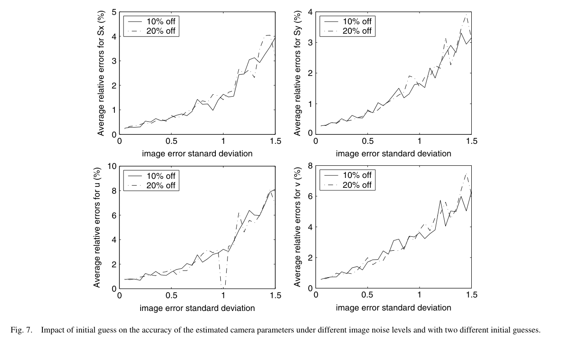
*그림 7 — 서로 다른 영상 잡음 수준과 서로 다른 두 초기 추정값에서 초기 추정값이 추정 카메라 파라미터의 정확도에 미치는 영향.*

*4) 카메라 평행이동 오프셋에 대한 강건성(Robustness in Terms of the Camera Translation Offset):* 제안 알고리즘의 주요 특징 하나는 평행이동 오프셋(회전점과 초기 카메라 광학 중심 사이의 거리)이 고정되어 있지만 알려져 있지 않다는 것이다. 여기서는 점의 수가 100개인 경우에 서로 상당히 다른 두 카메라 평행이동 오프셋 비율²(작은 평행이동 비율 0.2와 큰 평행이동 비율 0.5)을 연구하였다. 네 파라미터 모두 비슷한 결과를 얻었다. 결과는 그림 8에 나타내었다. 두 추정이 서로 밀접하게 따라감이 분명하다. 그러나 오프셋 비율이 큰 쪽이 추정 오차가 더 큰 경향이 있다. 이는 실제 영상에서 회전점이 카메라 광학 중심에서 너무 멀지 않아야 함을 뜻하며, 실제로도 대개 그렇다. 큰 평행이동 오프셋과 잡음에서 제안 방법의 추정 오차가 더 큰 것은 부분적으로 선형 방법이 제공하는 초기 추정값이 나쁘기 때문일 수 있다.

> ² 평행이동 오프셋과, 보정 장면에서 카메라까지의 거리의 비.

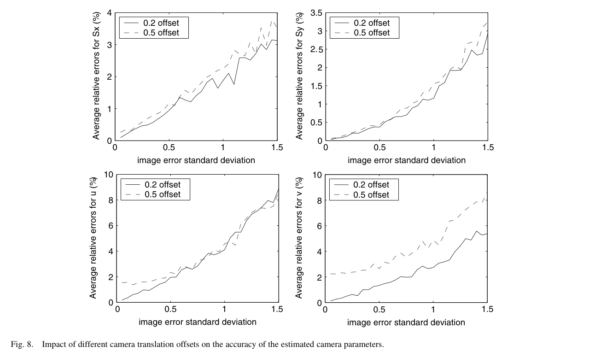
*그림 8 — 서로 다른 카메라 평행이동 오프셋이 추정 카메라 파라미터의 정확도에 미치는 영향.*

*5) 회전의 불균등에 따른 카메라 추정 정확도(Camera Estimation Accuracy Versus Inequality in the Rotations):* 실제로는 연속된 두 회전이 정확히 같도록 보장하기 어렵다. 두 회전 사이에 약간의 차이가 있을 것으로 예상된다. 여기서는 두 회전의 작은 불균등에 대한 제안 방법의 민감도를 연구한다. 불균등은 두 회전각 사이의 상대 차이로 나타낸다. 결과는 그림 9에 나타내었다. 이 실험에서 사용한 점의 수는 100개였고 잡음 수준은 표준편차 0.8화소로 고정하였다.

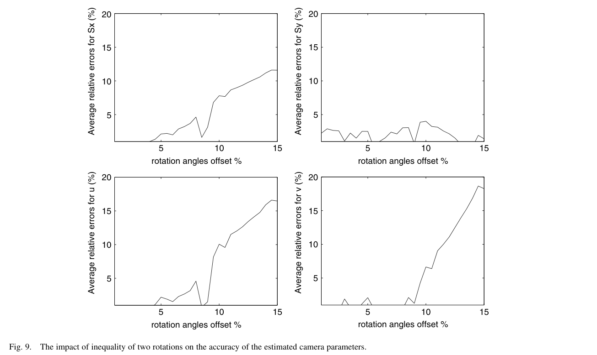
*그림 9 — 두 회전의 불균등이 추정 카메라 파라미터의 정확도에 미치는 영향.*

그림 9에서 상대 회전각 차이는 1%에서 15%까지이며, 추정 내부 파라미터의 최대 상대 오차는 20% 미만으로 유지된다. 이는 제안 알고리즘이 연속된 두 회전 사이의 적당한 불균등을 견딜 수 있음을 보여 준다. 이는 실용적으로 중요하다.

### B. 기존 순수 회전 방법과의 비교 (Comparison With Conventional Pure Rotational Approach)

이 절에서는 제안 방법과, 평행이동 오프셋을 고려하지 않는 순수 회전 자기 보정 방법을 정량적으로 비교한다. 실제 영상에는 참값(ground-truth) 데이터가 없고 서로 다른 평행이동 오프셋을 얻기 어렵기 때문에 성능 비교는 합성 데이터로 수행한다. 비교 대상으로 선택한 순수 회전 방법은 III-B절에서 소개한 선형 방법에 비틀림 0을 부과한 것이다.

영상 데이터를 만들기 위해, 점 (0, 0, 0)을 지나는 일반 축 $((1/\sqrt{3}), (1/\sqrt{3}), (1/\sqrt{3}))$을 중심으로 카메라를 각각 5, 10, 15도 회전하여 필요한 영상 3장을 만든다. 그런 다음 영상에 잡음 수준 0.5의 섭동을 가한다. 카메라와 3-D 점 사이의 평균 거리 $(T_z)$는 4 m로 고정한다. 오프셋(초기 카메라 광학 중심과 회전점 사이의 거리)을 바꾸어 가며 데이터를 만든다. 그림 10은 오프셋 비율의 함수로 추정 내부 카메라 파라미터의 오차를 보여 준다. 제안 방법은 네 파라미터 모두에서 더 큰 오프셋(비율 = 1.0)에서도 상당히 일관되고 정확한 결과(작은 오차)를 냄이 분명하다. 제안 방법은 카메라 광학 중심이 아닌 점을 중심으로 카메라를 회전하여 생기는 오차를 사실상 제거한다. 반면 기존 순수 회전 방법은 매우 작은 평행이동 오프셋 비율(0.1)에서도 불안정해진다. 오프셋 비율이 커지면 기존 방법의 추정 오차가 크게 증가한다. 그럼에도 오프셋이 매우 작으면, 예컨대 0.05 미만이면 기존 방법도 합리적인 결과를 낼 수 있다. 이는 Hayman의 연구 [33]의 결론과 같다. 이것이 오프셋 비율을 무시할 수 있는 일부 응용에서 순수 회전 방법이 꽤 잘 동작하는 이유이다. 이 연구는 오프셋 비율을 모르지만 클 것으로 예상되는 응용에서 제안 방법이 훨씬 낫다는 것을 보여 준다. 그러나 우리의 연구는 오프셋이 계속 커지면 제안 방법이 수치적으로 불안정해진다는 것도 드러낸다. 이는 제안 방법의 강한 비선형성 때문이거나, 큰 평행이동 오프셋에서 선형 방법이 제공하는 초기 추정값이 나쁘기 때문일 수 있다.

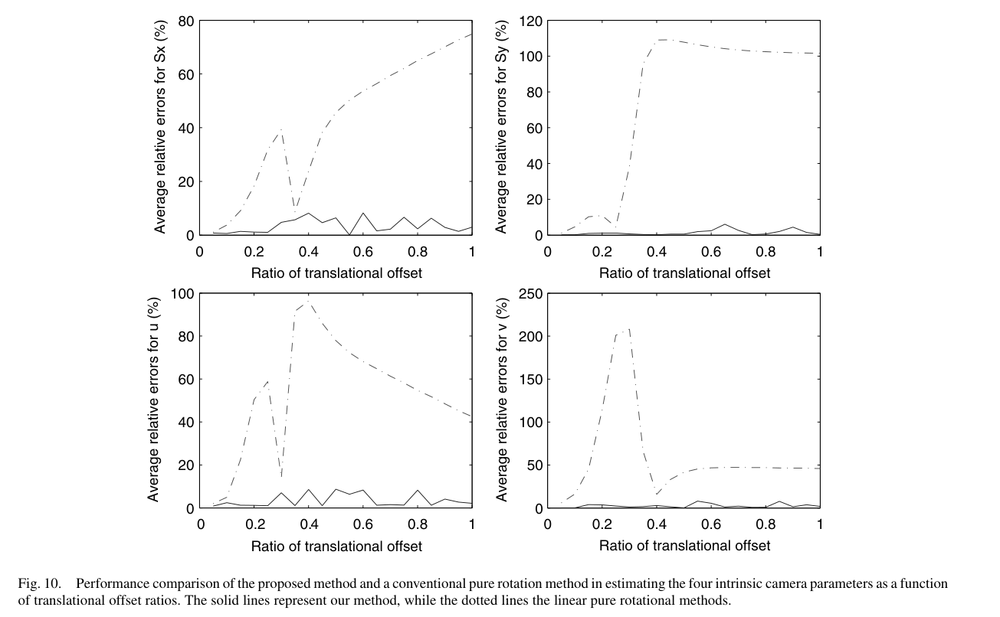
*그림 10 — 네 내부 카메라 파라미터 추정에서 제안 방법과 기존 순수 회전 방법의 성능을 평행이동 오프셋 비율의 함수로 비교한 것. 실선은 제안 방법, 점선은 선형 순수 회전 방법이다.*

### C. 실제 영상 시험 (Tests With Real Images)

제안 알고리즘의 궁극적인 시험은 실제 영상에서의 성능이다. 여기서는 실제 영상 데이터의 결과를 제시한다. 실험에는 지지대에 장착한 전하결합소자(CCD) 카메라를 사용하였고, 지지점을 중심으로 카메라를 팬·틸트하여 회전을 수행하였다. 카메라에서 약 1.2 m 떨어진 보정 기준물(calibration metric)의 영상을 촬영하였다. 보정 패턴의 예시 영상을 각각 그림 11, 12, 13에 나타내었다. 점 대응은 수작업으로 하였다. 영상 크기는 $320\times240$이다. 보정 결과를 표 I에 요약하고, 기존 카메라 보정 절차 [39]로 얻은 보정 결과와 비교하였다. 오프셋을 무시하는 순수 회전 방법의 결과도 표에 포함하였다. 제안 방법과 기존 방법의 보정 결과가 상당히 만족스럽게 일치하는 반면, 순수 회전 방법의 결과는 기존 방법의 결과에서 크게 벗어남이 분명하다. 순수 회전 방법의 오차는 카메라 회전으로 생기는 평행이동 오프셋을 무시했기 때문이다.

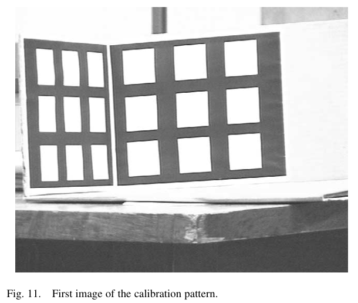
*그림 11 — 보정 패턴의 첫 번째 영상.*

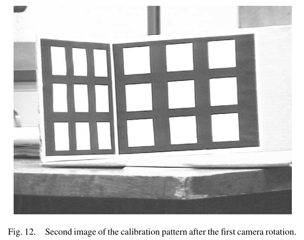
*그림 12 — 첫 번째 카메라 회전 뒤 보정 패턴의 두 번째 영상.*

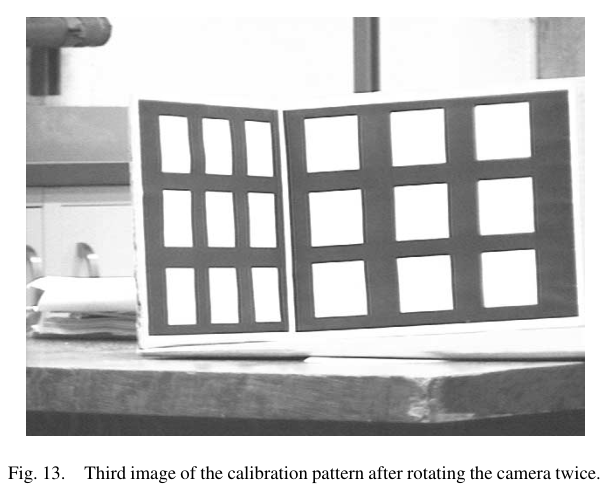
*그림 13 — 카메라를 두 번 회전한 뒤 보정 패턴의 세 번째 영상.*

**표 I** — 지지점을 중심으로 카메라를 회전하여 얻은 영상을 사용한 제안 방법의 보정 결과 (CALIBRATION RESULTS OF OUR METHOD USING IMAGES OBTAINED BY ROTATING THE CAMERA AROUND THE POINT OF SUPPORT)

| | 기존 방법(Conventional method) | 제안 방법(our method) | 순수 회전(pure rotation) |
|---|---:|---:|---:|
| $fs_x$ | 263 | 268 | 295 |
| $u_0$ | 157 | 164 | 130 |
| $v_0$ | 126 | 127 | 150 |

## V. 요약 및 논의 (SUMMARY AND DISCUSSION)

이 논문에서는 카메라 자기 보정을 위한 더 실용적인 회전 방법을 제안하였다. 제안 방법은 두 단계로 이루어진다. 먼저 카메라가 같지만 알 수 없는 평행이동과 회전을 겪는 조건에서 무한 호모그래피 행렬을 푼다. 이것이 이 논문의 새로운 부분이다. 그런 다음 기존 기법을 사용하여 무한 호모그래피 행렬로부터 카메라 내부 파라미터를 푼다. 합성 데이터 기반 실험은 서로 다른 잡음 수준, 서로 다른 점의 수, 서로 다른 초기 추정값, 서로 다른 평행이동 오프셋 등 여러 조건에서 제안 방법의 강건성과 정확도를 입증한다. 회전 오프셋을 무시하는 기존 방법과 비교하면, 제안 방법은 오프셋이 클 때 특히 효과적이다. 또한 우리의 연구는 점의 수가 충분하면 제안 방법이 (수치 안정성과 추정 정확도 측면에서) 최대 3화소의 오차까지 견딜 수 있음을 보여 주며, 이는 대부분의 영상에서의 1.5화소 오차보다 훨씬 크다. 실제 영상 실험은 평행이동 오프셋이 있을 때 제안 방법이 기존 카메라 보정 방법으로 얻은 것과 견줄 만한 추정값을 냄을 보여 준다. 이는 제안 자기 보정 알고리즘의 타당성을 추가로 뒷받침한다. 논문 전반에서 지적했듯이, 카메라 추정값은 제안 방법으로 초기화한 번들 조정 방법으로 더 정밀화할 수 있다. 번들 조정은 초기 사영 호모그래피(projective homographies)를 정밀화하는 데에도, 마지막 유클리드 단계에서도 사용할 수 있다.

제안 방법은 Stein [24]의 방법과 유사하지만, 정확히 얻기 어려운 경우가 많은 회전에 대한 지식이 필요 없으므로 더 실용적이다. 또한 회전을 알면 이를 활용하여 추정 정확도를 높일 수도 있다. 반면 능동 헤드의 축 엔코더(shaft encoder) 같은 장치로 회전 행렬을 정확히 추정할 수 있는 응용에서는 두 기법이 비슷하다.

제안 알고리즘의 기반이 되는 주요 가정은 두 회전이 같은 축을 중심으로 같은 각도로 이루어져야 한다는 것이다. 이 가정이 제안 방법의 실용성을 제한한다는 것을 인정한다. 우리의 연구는 제안 알고리즘이 두 회전 사이의 작은 불균등(최대 15)을 견디면서도 상당히 정확한 결과를 낸다는 것을 보여 준다. 또한 이 가정은 사진측량이나 일부 로봇 응용처럼 보조 장비의 도움을 받는 특정 응용에서는 실현할 수 있다. 특히 팬과 틸트가 가능한 능동 헤드에 장착된 카메라를 사전 보정하는 경우, 무리한 가정이 아니다.

## 참고문헌

- [1] R. I. Hartley and J. L. Mundy, “The relationship between photogrammetry and computer vision,” presented at the Int. Society for Optical Engineers Conf., 1993.
- [2] D. H. Ballard and C. M. Brown, Computer Vision. Englewood Cliffs, NJ: Prentice-Hall, 1982.
- [3] Z. Y. Zhang. (1996) Self-Maintaining Camera Calibration in Time. [Online]. Available: http://www.sop.inria.fr/robotvis/personnel/vubs/calib/calib.html
- [4] O. Faugeras, “Stratification of three-dimensional vision: Projective, affine and metric representations,” J. Opt. Soc. Amer., vol. 12, pp. 465–484, 1995.
- [5] E. Trucco and A. Verri, Introductory Techniques for 3-D Computer Vision. Englewood Cliffs, NJ: Prentice-Hall, 1998.
- [6] S. J. Maybank and O. D. Faugeras, “A theory of self-calibration of a moving camera,” Int. J. Comput. Vis., vol. 8, no. 2, pp. 123–151, 1992.
- [7] A. Basu, “Active calibration: Alternative strategy and analysis,” in Proc. IEEE Conf. Computer Vision, Pattern Recognition, 1993, pp. 495–500.
- [8] F. Du and M. Brady, “Self-calibration of the intrinsic parameters of cameras for active vision systems,” in Proc. IEEE Conf. Computer Vision, Pattern Recognition, 1993, pp. 477–482.
- [9] L. Dron, “Dynamic camera self-calibration from controlled motion sequences,” in Proc. IEEE Conf. Computer Vision, Pattern Recognition, 1993, pp. 501–506.
- [10] O. D. Faugeras, O. T. Luong, and S. J. Maybank, “Camera self-calibration: Theory and experiments,” in Proc. ECCV’92, Lecture Notes in Computer Science, vol. 588, 1992, pp. 321–334.
- [11] Q. T. Luong and O. D. Faugeras, “Self-Calibration of a Stereo Rig from Unknown Camera Motions and Point Correspondences,” INRIA, Sophia Antipolis, France, Tech. Rep. RR-2014, 1993.
- [12] Q. T. Luong, “An optimization framework for efficient self-calibration and motion determination,” in Proc. Int. Conf. Pattern Recognition, 1994, pp. 248–252.
- [13] S. D. Ma, “A self-calibration technique for active vision system,” IEEE Trans. Robot. Automat., vol. 12, pp. 114–120, Feb. 1996.
- [14] R. I. Hartley, “Euclidean reconstruction from uncalibrated views,” in Applications of Invariance in Computer Vision, J. Mundy, A. Zisserman, and D. Forsyth, Eds. New York: Springer-Verlag, 1994, pp. 237–256. LNCS 825.
- [15] M. Armstrong, A. Zisserman, and R. Hartley, “Self-calibration from image triplets,” in Proc. 4th Eur. Conf. Computer Vision, vol. 1, 1996, pp. 3–16.
- [16] C. Wiles and M. Brady, “Ground plane motion camera models,” in Proc. Eur. Conf. Computer Vision, 1996, pp. 238–247.
- [17] A. Heyden and K. Astrom, “Euclidean reconstruction from constant intrinsic parameters,” in Proc. Int. Conf. Pattern Recognition, vol. 1, 1996, pp. 339–343.
- [18] M. Pollefeys and L. Van Gool, “Stratified self-calibration with the modulus constraint,” IEEE Trans. Pattern Anal. Machine Intell., vol. 21, pp. 707–724, Aug. 1999.
- [19] O. Faugeras, L. Quan, and P. Sturm, “Self-calibration of a 1-D projective camera and its application to the self-calibration of a 2-D projective camera,” IEEE Trans. Pattern Anal. Machine Intell., vol. 22, pp. 1179–1185, Oct. 2000.
- [20] P. Sturm, “Critical motion sequences for monocular self-calibration and uncalibrated Euclidean reconstruction,” in Proc. IEEE Conf. Computer Vision, Pattern Recognition, 1997, pp. 1100–1105.
- [21] B. Triggs, “Autocalibration and the absolute quadric,” in Proc. IEEE Conf. Computer Vision, Pattern Recognition, 1997, pp. 609–614.
- [22] J.-E. Ha, J.-Y. Yang, K.-J. Yoon, and I.-S. Kweon, “Self-calibration using the linear projective reconstruction,” in Proc. IEEE Int. Conf. Robotics and Automation, vol. 1, Apr. 2000, pp. 885–890.
- [23] R. Hartley, “Self-calibration of stationary cameras,” Int. J. Comput. Vis., vol. 22, no. 1, pp. 5–23, 1996.
- [24] G. P. Stein, “Accurate internal camera calibration using rotation, with analysis of sources of error,” in Proc. Int. Conf. Computer Vision, 1995, pp. 230–236.
- [25] Q. T. Luong, “Matrice fondamentale et calibration visuelle sur l’environmenta,” Ph.D. dissertation, Univ. Paris-Sud, Centre D’Orsay, Paris, France, 1992.
- [26] P. Sturm, “A case against Kruppa’s equations for camera self-calibration,” IEEE Trans. Pattern Anal. Machine Intell., vol. 22, pp. 1199–1204, Oct. 2000.
- [27] A. Fusiello, E. Trucco, and A. Verri, “A compact algorithm for rectification of stereo pairs,” Machine Vis. Applicat., vol. 12, pp. 16–22, 2000.
- [28] M. Pollefeys, “Self-calibration and metric 3-D reconstruction from uncalibrated image sequences,” Ph.D. dissertation, Catholic Univ. Leuven, Leuven, Belgium, 1999.
- [29] L. de Agapito, E. Hayman, and I. D. Reid, “Self calibration of a rotating camera with varying intrinsic parameters,” in Proc. British Machine Vision Conf., 1998, pp. 105–114.
- [30] Y. Seo and K. S. Hong, “Auto-calibration of a rotating and zooming camera,” presented at the IAPR Workshop Machine Vision Application, 1998.
- [31] L. de Agapito, R. I. Hartley, and E. Hayman, “Linear self-calibration of a rotating and zooming camera,” Proc. IEEE Conf. Computer Vision, Pattern Recognition, vol. 1, p. 21, June 1999.
- [32] L. Wang, S. B. Kang, H. Y. Shum, and G. Xu, “Error analysis of pure rotation-based self-calibration,” in Proc. Int. Conf. Computer Vision (ICCV), 2001, pp. 464–471.
- [33] E. Hayman and D. W. Murray, “The effects of translational misalignment in the self-calibration of rotating and zooming cameras,” Univ. Oxford, Oxford, U.K., Tech. Rep. OUEL 2250/02, 2002.
- [34] M. Li, “Kinematic calibration of an active head-eye system,” IEEE Trans. Robot. Automat., vol. 14, pp. 153–158, Feb. 1998.
- [35] O. Faugeras, Three-Dimensional Computer Vision: A Geometric Viewpoint. Cambridge, MA: MIT Press, 1993.
- [36] A. Zisserman, D. Liebowitz, and M. Armstrong, “Resolving ambiguities in auto-calibration,” Philos. Trans. Roy. Soc. London, ser. A, vol. 356, no. 1740, pp. 1193–1211, 1998.
- [37] B. Triggs, A. Zisserman, and R. Szeliski, “Vision algorithms: Theory and practice,” presented at the Workshop on Vision Algorithms, 7th IEEE Int. Conf. Computer Vision, 1999.
- [38] F. Kahl, B. Triggs, and K. Astrom, “Critical motions for auto-calibration when some intrinsic parameters can vary,” J. Math. Imaging, Vision, vol. 13, no. 2, pp. 131–146, 2000.
- [39] Z. Y. Zhang. (1998) A Flexible New Technique for Camera Calibration, Tech. Rep. MSR-TR-98-71. [Online]. Available: http://research.microsoft.com/zhang

## 저자 소개

**Qiang Ji** (S'92–M'98)는 1993년 미국 애리조나 대학교(투손)에서 전기공학 석사 학위를, 1998년 워싱턴 대학교(시애틀)에서 전기공학 박사 학위를 받았다. 현재 미국 뉴욕주 트로이의 렌셀러 폴리테크닉 대학교 전기·컴퓨터·시스템공학과 조교수이다. 이전에는 네바다 대학교 리노 캠퍼스 컴퓨터과학과 조교수였다. 연구 관심 분야는 컴퓨터 비전, 베이즈 네트워크를 이용한 불확실성 아래의 확률적 추론, 패턴 인식, 정보 융합, 로봇공학이다. 이 분야의 심사 학술지와 학회에 40편 이상의 논문을 발표하였다. 그의 연구는 미국 국립과학재단(NSF), 국립보건원(NIH), 공군과학연구국(AFOSR), 해군연구국(ONR), 육군연구국(ARO) 등 지방·연방 정부 기관과 Boeing, Honda 등 민간 기업의 지원을 받았다.

**Songtao Dai**는 2000년 네바다 대학교 리노 캠퍼스에서 컴퓨터과학 석사 학위와 물리학 박사 학위를 받았다.

