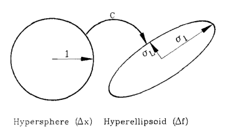
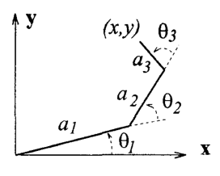
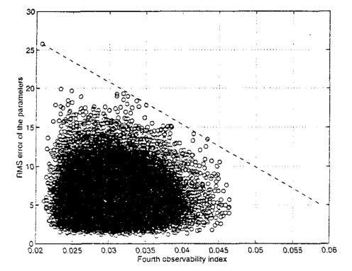
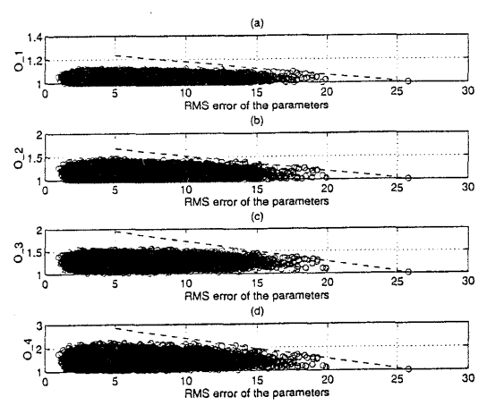
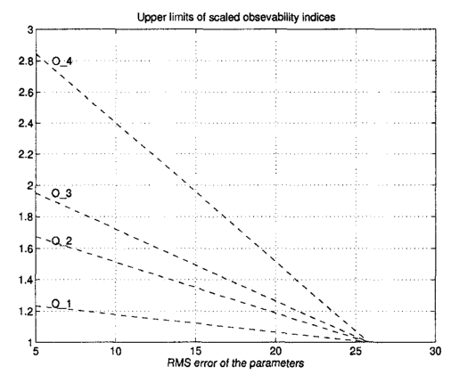
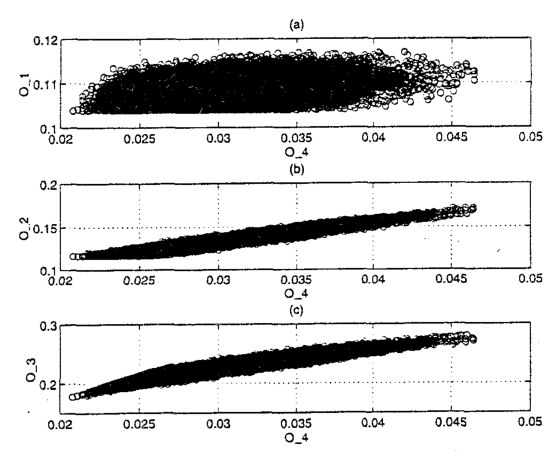
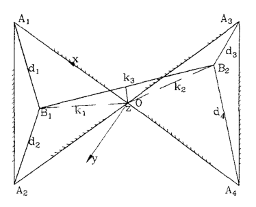
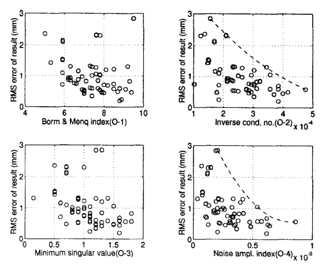
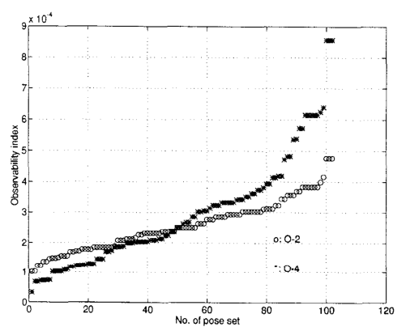
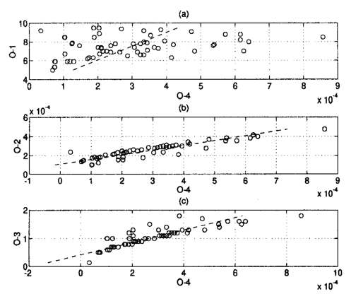

# 로봇 보정의 최적 자세 선택을 위한 잡음 증폭 지수 (Nahvi 1996)

- 원제: The Noise Amplification Index for Optimal Pose Selection in Robot Calibration
- 원문: 같은 폴더의 `Nahvi1996_ICRA_noise_amplification.pdf` (Proceedings of the 1996 IEEE International Conference on Robotics and Automation, Minneapolis, Minnesota, April 1996, pp. 647–654)
- 저자: Ali Nahvi, John M. Hollerbach (Depts. Mechanical Engineering and Computer Science, Univ. Utah)
- 번역 범위: 전문
- 그림: 원문 그림 10개를 `그림/`에 넣고 본문에서 처음 언급되는 곳에 삽입. 표 1은 마크다운 표로 옮김
- 참고: 원문 PDF는 스캔본(OCR 텍스트 품질 낮음)이어서 수식과 수치는 쪽 영상을 직접 보고 옮겼다.

## 초록 (Abstract)

이 논문은 로봇 보정(robot calibration)에서 가장 좋은 자세 집합(pose set)의 선택을 정량화하는 새로운 관측가능성 지수(observability index)를 제시한다. 이 잡음 증폭 지수(noise amplification index)는 앞서 발표된 관측가능성 지수들보다 보정 오차에 상당히 더 민감하다. 제안 지수의 근거를 해석적·기하학적으로 제시하고, 3-링크 평면 로봇에 대한 시뮬레이션과 3자유도 여유 병렬 구동 로봇(redundant parallel-drive robot)에 대한 실험을 통해 기존 지수들과 비교하여 뒷받침한다.

## 1. 서론 (Introduction)

기구학적 루프 방법(kinematic loop methods)[6]으로 보정을 수행하려면, 로봇을 가장 정확한 추정값을 내는 자세들에 놓아야 한다. 어떤 자세에서는 로봇의 파라미터가 센서 측정값에 별로 영향을 주지 않는다. 잡음과 모델링되지 않은 오차원의 영향이 로봇의 길이 및 다른 기구학 파라미터 변화의 영향을 압도한다. 그 결과 얻어진 보정 파라미터는 신뢰할 수 없게 된다.

연구자들은 자세 선택의 좋고 나쁨을 정량화하기 위해 다양한 관측가능성 지수를 제안해 왔다. 이 지수들은 미분 기구학의 자코비안 행렬에 대한 특이값 분해(SVD)에 기반한다[9]. Menq와 Borm[8]은 모든 특이값의 곱과 관련된 관측가능성 지수를 제안하였다. Driels와 Pathre[3]는 조건수(condition number)를 제안하였다. Schroer 등[11]은 신뢰할 만한 결과를 얻으려면 조건수가 100 미만이어야 한다고 하였다. Nahvi 등[10]은 최소 특이값을 제안하였다. 이 논문에서는 자세 선택의 가장 좋은 기준으로, 최대 특이값과 조건수의 비인 잡음 증폭 지수라는 새로운 관측가능성 지수를 제시한다[역주: 원문 그대로. 2.4절의 정의 식 (16) $O_4=\sigma_L^2/\sigma_1$은 최소 특이값을 조건수 $\sigma_1/\sigma_L$로 나눈 값이므로, 여기의 "maximum"은 "minimum"의 오기로 보인다]. 잡음 증폭 지수에 대한 형식적 논증을 제시하고, 다른 지수들과 시뮬레이션·실험으로 비교한다.

신뢰할 만한 관측가능성 지수를 얻으려면, 먼저 특이값들을 서로 비교할 수 있도록 작업 변수 스케일링(task variable scaling)과 파라미터 스케일링(parameter scaling)을 수행해야 한다[5, 6, 11]. 적절한 스케일링을 하지 않으면 특이값의 비교는 무의미하다. 자세 선택 전의 또 다른 중요한 단계는 SVD를 써서 식별이 잘 되지 않는 파라미터를 제거하는 랭크 결정(rank determination)이다.

## 2. 관측가능성 지수 (Observability Indices)

로봇이 $p$개의 자세에 놓인다고 가정하자. [5, 6, 13]의 정식화를 따라, 모든 기구학적 보정 방법을 폐루프(closed-loop) 방법으로 간주한다. 여기서는 어떤 끝점(endpoint) 측정 시스템이든 하나의 조인트를 이루는 것으로 본다. 따라서 $i$번째 자세($i = 1, \ldots, p$)에 대해 기구학적 루프 폐합 방정식(loop closure equations)을 세운다.

$$\mathbf{f}^i = \mathbf{g}^i(\mathbf{x}, \mathbf{v}^i) \approx 0 \tag{1}$$

여기서 $\mathbf{f}^i$는 기구학 파라미터의 부정확성, 센서 잡음, 모델링되지 않은 오차로 인한 잔차 함수(residual function), $\mathbf{g}^i$는 루프 폐합 방정식, $\mathbf{x}$는 보정할 로봇 파라미터의 벡터, $\mathbf{v}^i$는 조인트 센서 판독값과 경우에 따라 외부 센서 판독값의 벡터이다. $p$개 자세에 대한 (1)을 하나의 행렬 방정식으로 합친다.

$$\mathbf{f} = \mathbf{g}(\mathbf{x}) \tag{2}$$

여기서 $\mathbf{f} = [\mathbf{f}^{1T} \ldots \mathbf{f}^{pT}]^T$이고 $\mathbf{g} = [\mathbf{g}^{1T} \ldots \mathbf{g}^{pT}]^T$이다. (2)에서 센서 판독값 $\mathbf{v}^i$는 각 자세 $i$에 대해 상수로 취급한다. 파라미터의 공칭값 주위에서 (2)를 선형화한다.

$$\Delta\mathbf{f} = \frac{\partial\mathbf{g}}{\partial\mathbf{x}}\Delta\mathbf{x} = \mathbf{C}\Delta\mathbf{x} \tag{3}$$

여기서 $\Delta\mathbf{f}$는 측정된 잔차 함수와 계산된 잔차 함수 사이의 오차, $\mathbf{C}$는 식별 자코비안(identification Jacobian), $\Delta\mathbf{x}$는 현재 파라미터 추정값에 적용할 보정량이다. 그러면 보정 문제는 반복 최소제곱(iterative least squares)으로 $\Delta\mathbf{f}$를 최소화하여 푼다. (3)의 식별 자코비안의 SVD를 정의한다.

$$\Delta\mathbf{f} = \mathbf{C}\Delta\mathbf{x} = \mathbf{U}\boldsymbol{\Sigma}\mathbf{V}^T\Delta\mathbf{x} \tag{4}$$

여기서 $\mathbf{U}$와 $\mathbf{V}$는 직교 행렬이고, $\boldsymbol{\Sigma}$는 주대각에 $\mathbf{C}$의 특이값을, 다른 원소에 0을 가진 행렬이다. 각 자세에서 (위치와 방향에 대한) 방정식 $q$개를 쓰고, 로봇을 $p$개 위치에 놓으며, 랭크 결정 후 파라미터가 $L$개라고 가정하면, $\Delta\mathbf{f}$는 $q.p$-벡터, $\mathbf{C}$는 $q.p \times L$ 행렬, $\Delta\mathbf{x}$는 $L$-벡터, $\mathbf{U}$는 $q.p \times q.p$ 행렬, $\mathbf{V}$는 $L \times L$ 행렬이고,

$$\boldsymbol{\Sigma} = \begin{bmatrix} \mathbf{S} \\ \mathbf{O}_{q.p-L,L} \end{bmatrix}$$

이다. 여기서 $\mathbf{S} = diag(\sigma_1, \ldots, \sigma_L)$은 순서대로 정렬된 특이값의 행렬이다. 미결정(underdetermined) 연립방정식을 피하려면 $q.p$가 적어도 $L$과 같아야 한다. 다시 강조하지만, *특이값을 비교하기 전에 파라미터 스케일링과 작업 변수 스케일링을 수행해야 한다.*

이 논문에서는 출력 잡음(output noise)만 가정한다. 즉 센서 잡음은 $\mathbf{f}$에 영향을 주고 식별 자코비안 $\mathbf{C}$에는 거의 영향을 주지 않는다. 입력 잡음(input noise)의 경우, 한 가지 방법은 작업 변수 스케일링을 수행하기 전에 출력 잡음의 표준편차에 입력 잡음 표준편차를 스케일한 값을 더해 키우는 것이다[14]. 그러나 이 문제는 향후 연구로 남긴다. 다음으로, 잡음 증폭 지수를 소개하기 전에 기존에 발표된 관측가능성 지수 3개를 살펴본다.

### 2.1 특이값의 곱 (The Product of Singular Values)

Borm과 Menq[2, 8]는 모든 특이값의 기하평균을 관측가능성 지수로 선택하였으며, 이를 $O_1$이라 부르겠다.

$$O_1 = \frac{\sqrt[L]{\sigma_1 \ldots \sigma_L}}{\sqrt{m}} \tag{5}$$

여기서 $m$은 자세의 수이다. 이 지수는 $\mathbf{C}^T\mathbf{C}$의 행렬식과 관련된다.

$$\sqrt{det(\mathbf{C}^T\mathbf{C})} = \sigma_1 \ldots \sigma_L \tag{6}$$

그 근거는 다음의 기본 관계에서 나온다[8].

$$\sigma_L \le \frac{\|\Delta\mathbf{f}\|}{\|\Delta\mathbf{x}\|} \le \sigma_1 \tag{7}$$

여기서 $\sigma_L$은 $\mathbf{C}$의 가장 작은 특이값이고 $\sigma_1$은 가장 큰 특이값이다. 파라미터의 매우 작은 변화 $\Delta\mathbf{x}$가 잔차 오차 함수 $\Delta\mathbf{f}$에 가능한 한 큰 영향을 주는 것이 바람직하다. 따라서 $\|\Delta\mathbf{f}\| / \|\Delta\mathbf{x}\|$를 가능한 한 크게 만들고자 한다.

기하학적 관점에서, $\Delta\mathbf{x}$가 반지름 1인 초구(hypersphere)를 정의한다고 가정하면, $\Delta\mathbf{f}$는 반축(semiaxes)이 기울기 행렬 $\mathbf{C}$의 특이값인 초타원체(hyperellipsoid)이다(그림 1). 수학 문헌의 결과를 변형하면, 이 초타원체의 부피 $V_L$이 $\mathbf{C}$의 특이값의 곱에 비례함을 보일 수 있다.

*그림 1 — 특이값의 기하학적 해석. (표기: Hypersphere (Δx)=초구, Hyperellipsoid (Δf)=초타원체)*

$$V_L = \frac{2\pi^{L/2}\prod_{i=1}^{L}\sigma_i}{L.\Gamma(L/2)} \tag{8}$$

관측가능성 지수 $O_1$ 뒤의 기하학적 근거는 이 초타원체의 부피를 가능한 한 크게 만드는 것이다. 이는 파라미터 오차 벡터가 측정 가능한 벡터 $\Delta\mathbf{f}$의 *총체적(aggregate)* 증가를 잘 일으킨다는 뜻이다. 이 지수의 단점은 부피가 큰 초타원체에서 $\Delta\mathbf{f}$ 벡터가 반드시 크다고 보장할 수 없다는 것이다. 축이 하나만 빼고 모두 큰 커다란 초타원체를 상상해 보라. 운이 나쁘면 $\Delta\mathbf{f}$ 벡터는 그 작은 반축만큼 작을 수 있다.

### 2.2 역조건수 (The Inverse Condition Number)

Driels와 Pathre[3]는 $\mathbf{C}$의 조건수를 관측가능성 지수로 제안하였다. 최대화해야 하는 다른 관측가능성 지수들과 맞추기 위해, 최댓값이 1인 역조건수 $O_2$를 쓴다.

$$O_2 = \frac{\sigma_L}{\sigma_1} \tag{9}$$

그들은 또한 보정 중 조인트의 운동 범위가 줄면 그 조인트 파라미터의 관측가능성이 떨어지며, 이에 따라 조건수가 한 자릿수 증가한다고 하였다.

센서 잡음이나 원치 않는 오차원($\delta\Delta\mathbf{f}$) 때문에 (4)의 $\Delta\mathbf{x}$에는 오차 $\delta\Delta\mathbf{x}$가 생긴다. ($\Delta\mathbf{x}$는 파라미터의 실제값과 공칭값의 차이에서 나온다는 점을 기억하라.) Strang은 다음을 제시한다[12].

$$\frac{\|\delta\Delta\mathbf{x}\|}{\|\Delta\mathbf{x}\|} \le \frac{\sigma_1}{\sigma_L}\frac{\|\delta\Delta\mathbf{f}\|}{\|\Delta\mathbf{f}\|} \tag{10}$$

추정 파라미터의 오차 $\|\delta\Delta\mathbf{x}\|$를 최소화하려면 $\sigma_1/\sigma_L$을 가능한 한 작게, 즉 $O_2$를 크게 만들어야 한다. 기하학적으로 이 비는 $\Delta\mathbf{f}$ 초타원체의 이심률(eccentricity)의 척도이다. $O_2$가 클수록 초타원체는 초구에 가까워진다. 이 척도는 초타원체의 크기가 아니라 이심률을 고려한다. 이 지수의 장점은 두 특이값의 비이므로 무차원이라는 것이다.

### 2.3 최소 특이값 (The Minimum Singular Value)

(7)의 첫 번째 부등식을 다시 쓰면 다음과 같다.

$$\|\Delta\mathbf{f}\| \ge \sigma_L \|\Delta\mathbf{x}\| \tag{11}$$

즉 $\mathbf{C}$의 최소 특이값이 클수록 $\|\Delta\mathbf{f}\|$가 크다. 따라서 관측가능성 지수를 다음과 같이 정의한다.

$$O_3 = \sigma_L \tag{12}$$

$O_3$는 잔차 오차 함수 $\|\Delta\mathbf{f}\|$가 공칭값으로부터의 파라미터 오차와 최대한 관련된다는 생각을 담고 있다. 기하학적으로 이 관측가능성 지수는 초타원체 $\Delta\mathbf{f}$의 최소 축이 클 것을 요구한다.

### 2.4 잡음 증폭 지수 (The Noise Amplification Index)

기하학적 관점에서 요약하면, $O_1$은 모든 반축의 길이와, $O_2$는 가장 짧은 반축과 가장 긴 반축의 길이와, $O_3$는 가장 짧은 반축의 길이와 관련된다.

식 (10)은 중요하다. 이 식은 $\|\delta\Delta\mathbf{x}\| / \|\Delta\mathbf{x}\|$를 낮게 하려면 $\sigma_1/\sigma_L$과 $1/\|\Delta\mathbf{f}\|$를 모두 최소화해야 함을 말해 준다. $\sigma_1/\sigma_L$의 최소화는 큰 $O_2$로, $1/\|\Delta\mathbf{f}\|$의 최소화는 큰 $O_3$로 달성된다.

$O_2$나 $O_3$를 단독으로 쓸 수 없음을 분명히 하기 위해, 두 자세 집합 A와 B로 보정하는 파라미터 세 개짜리 가상의 로봇을 가정하자. 자세 집합 $A$와 $B$에 대해 특이값이 다음과 같다고 하자.

$$\boldsymbol{\sigma}^A = [100, 0.1, 0.1] \tag{13}$$
$$\boldsymbol{\sigma}^B = [10, 10, 0.01] \tag{14}$$

두 자세 집합은 $O_1$ 지수가 같다. 최소 특이값 $O_3$는 자세 집합 A가 더 나은 관측가능성을 준다고 시사하지만, 역조건수 $O_2$는 둘을 똑같이 취급한다. 이 예는 역조건수 $O_2$의 결함을 보여 준다. 즉 $O_2$는 $\sigma_3$의 절댓값을 고려하지 않는다.

특이값이 다음과 같은 세 번째 가상 자세 집합 $C$를 생각하자.

$$\boldsymbol{\sigma}^C = [10, 1, 0.1] \tag{15}$$

자세 집합 A와 비교하면 $\sigma_1$은 다르지만 $\sigma_3$는 같다. 이 경우 역조건수 $O_2$는 자세 집합 A보다 C를 선호하지만, 최소 특이값 $O_3$는 둘을 똑같이 취급한다. 가장 큰 특이값에 대한 이런 변별력 부족이 최소 특이값 $O_3$의 결함이다.

또한 초타원체의 부피는 최악 조건 설계 기준(worst case design criterion)에 기반하지 않으므로 관측가능성의 좋은 지표가 될 수 없다는 점에 주목한다. 식 (11)은 최소 특이값이 작은 한, 크고 측정 가능한 $\Delta\mathbf{f}$를 얻는 데 어려움이 있을 수 있음을 말해 준다.

이제 각각의 단점을 극복하기 위해 역조건수 $O_2$와 최소 특이값 $O_3$를 결합한다.

$$O_4 = \frac{\sigma_L}{\sigma_1}\sigma_L = \frac{\sigma_L^2}{\sigma_1} \tag{16}$$

이 지수가 클수록 보정 절차의 관측가능성과 정확도가 좋다. 이것이 센서 잡음과 모델링되지 않은 오차의 증폭을 나타내는 지표임을 곧 보일 것이므로, 이를 *잡음 증폭 지수(noise amplification index)*라 부른다.

앞의 예에서 $O_4$는 자세 집합 $A$에 대해 $10^{-4}$, 자세 집합 $B$에 대해 $10^{-5}$이므로, 자세 집합 B보다 A를 선택한다. 이는 최소 특이값을 고려하지 않는 $O_2$에 비한 장점이다. 자세 집합 $C$에 대해 $O_4$는 $10^{-3}$이므로, 자세 집합 A보다 C를 선택한다. 잡음 증폭 지수 $O_4$는 조건수를 고려하는데, 이는 최소 특이값 $O_3$에 비한 장점이다.

다음 정리는 잡음 증폭 지수 $O_4$에 대한 형식적 근거를 제공한다.

**정리 1 (Theorem 1)** *로봇 보정 자세 집합에서 센서 잡음이나 모델링되지 않은 오차로 인한 잔차 오차 함수의 오차를 $\delta\Delta\mathbf{f}$라 하면, 식별된 파라미터에 생기는 대응 오차의 최대 증폭 인자는 $\sigma_1/\sigma_L^2$이다.*

*증명.* (10)의 $\Delta\mathbf{f}$를 (11)에서 얻은 그 최솟값으로 바꾼다. 식 (10)은 여전히 성립한다.

$$\frac{\|\delta\Delta\mathbf{x}\|}{\|\Delta\mathbf{x}\|} \le \frac{\sigma_1}{\sigma_L}\frac{\|\delta\Delta\mathbf{f}\|}{\sigma_L\|\Delta\mathbf{x}\|} \tag{17}$$

또는

$$\|\delta\Delta\mathbf{x}\| \le \frac{\sigma_1}{\sigma_L^2}\|\delta\Delta\mathbf{f}\| \tag{18}$$

식 (18)은 보정된 파라미터의 원치 않는 오차 $\|\delta\Delta\mathbf{x}\|$가 잔차 오차 함수 잡음 $\|\delta\Delta\mathbf{f}\|$를 $\sigma_1/\sigma_L^2$배로 증폭한 것임을 분명히 보여 준다. 따라서 잡음 증폭 지수 $O_4$의 형식적 근거는 다음과 같다. $O_4$가 클수록 $\sigma_1/\sigma_L^2$가 작아지고, $\|\delta\Delta\mathbf{x}\|$가 작아진다. 기하학적으로 $O_4$는 최소 축이 크고 이심률이 완만한 초타원체를 요구한다.

## 3. 결과 (Results)

이 절에서는 네 관측가능성 지수를 평가하기 위한 기구학적 보정 연구 두 가지를 제시한다. 첫째 연구는 3-링크 평면 로봇의 시뮬레이션이고, 둘째 연구는 3자유도 여유 병렬 구동 로봇에 대한 시뮬레이션과 실험이다.

### 3.1 3-링크 평면 로봇 (A 3-Link Planar Robot)

그림 2는 시뮬레이션한 3-링크 평면 로봇을 보여 준다. 끝점 위치 $(x, y)$는 좌표계 0에서 표현된다. 이 끝점이 정규분포를 따르는 RMS 오차 3 mm의 외부 측정 장치로 추적된다고 가정한다. (이는 대략 자기식 추적기(magnetic tracker)의 성능이지만, 여기서 정확한 정확도는 중요하지 않다.) 조인트 각도 오차는 무시할 수 있다고 가정한다.

*그림 2 — 3-링크 평면 로봇.*

#### 3.1.1 보정 절차 (Calibration Procedure)

잔차 오차 함수 $\mathbf{f}$를 세우고 이를 최소화한다.

$$\begin{aligned} f(2k-1) &= a_1 cos(\theta_1(k)) + a_2 cos(\theta_1(k) + \theta_2(k)) \\ &\quad + a_3 cos(\theta_1(k) + \theta_2(k) + \theta_3(k)) - x(k) \\ f(2k) &= a_1 sin(\theta_1(k)) + a_2 sin(\theta_1(k) + \theta_2(k)) \\ &\quad + a_3 sin(\theta_1(k) + \theta_2(k) + \theta_3(k)) - y(k) \end{aligned}$$

여기서 $k = 1, \ldots, p$는 자세 번호이다. 각도 $\theta_i(k)$, $i = 1, 2, 3$은 다음과 같이 얻는다.

$$\theta_i(k) = s_i * v_i(k) + \theta_{0i} \tag{19}$$

여기서 $s_i$, $v_i(k)$, $\theta_{0i}$는 각각 조인트 $i$의 이득(gain), 센서 판독값, 오프셋을 나타낸다. 따라서 보정할 파라미터는 $a_i, s_i, \theta_{0i}$, $i = 1, 2, 3$의 9개이다. 링크 길이 $a_i$의 공칭값은 2000, 1000, 500 mm, 모든 이득은 $\pi/20$ rad/v, 오프셋은 $\pi/6$, $\pi/3$, $\pi/2$ rad이다. 센서 판독 범위는 [−10, +10] v이다. 자코비안 $\mathbf{C}$는 잔차 오차 방정식으로부터 쉽게 구할 수 있다.

#### 3.1.2 시뮬레이션 결과 (Simulation Results)

Matlab™을 써서, 선택한 로봇 파라미터로 균등 간격의 자세 343개를 생성하였다. 그 결과로 나온 $x, y$ 끝점 좌표에 3 mm 수준의 정규분포 잡음을 더하였다. 이 잡음이 섞인 $x, y$ 값을 앞 절에서 말한 9개 파라미터를 결정하는 보정 루틴의 입력으로 썼다. 지수를 평가하기 전에 파라미터 스케일링의 일종인 열 스케일링(column scaling)을 수행하였다[6]. $x$와 $y$는 단위와 불확도가 같으므로 작업 변수 스케일링은 할 필요가 없다. 보정 루틴을 실행할 때마다 343개 자세 중 50개를 무작위로 골라 하나의 자세 집합으로 삼았다.

그림 3은 보정 루틴을 50,000번 실행한 결과를 보여 준다. 각 원은 자세 집합 하나(자세 50개)의 결과를 나타낸다. 잡음 증폭 지수 $O_4$가 증가함에 따라 스케일된 파라미터의 RMS 오차의 상한(점선)이 어떻게 감소하는지 볼 수 있다. RMS 오차는 보정 루틴의 결과와 9개 파라미터의 참값 사이의 차이이다. 예를 들어 $O_4$가 0.021일 때 스케일된 파라미터의 RMS 오차 상한은 25.8이다. $O_4$가 0.043으로 증가하면 오차는 14를 넘지 않는다.

*그림 3 — 잡음 증폭 지수 $O_4$ 대 스케일된 파라미터의 RMS 오차. (축: Fourth observability index=넷째 관측가능성 지수, RMS error of the parameters=파라미터의 RMS 오차)*

마찬가지로, 다른 관측가능성 지수들과 파라미터 RMS 오차의 관계를 그림 4에 나타냈다. 이 지수들을 비교하기 위해, 각 지수의 최솟값이 1이 되도록 스케일하였다. 여기서도 상한은 점선으로 나타냈다. 각 지수의 변화 범위를 보면, 이 지수들의 민감도가 서로 상당히 다르다는 것을 알 수 있다. 그림 5는 상한선들을 보여 준다. 잡음 증폭 지수 $O_4$가 파라미터의 RMS 오차에 대해 최소 특이값 $O_3$보다 94%, 역조건수 $O_2$보다 273%, 특이값의 곱 지수 $O_1$보다 785% 더 민감하다는 것을 쉽게 계산할 수 있다. 이런 높은 민감도는 다른 지수들에 대한 잡음 증폭 지수 $O_4$의 분명한 장점이다.

*그림 4 — 스케일된 관측가능성 지수 대 파라미터의 RMS 오차.*

*그림 5 — 파라미터의 RMS 오차에 대한 관측가능성 지수들의 민감도 비교. (그림 제목: Upper limits of scaled obsevability[역주: 원문 철자 그대로] indices=스케일된 관측가능성 지수의 상한)*

우리는 이 지수들 사이의 관계에도 관심이 있다. 그림 6은 처음 세 지수가 잡음 증폭 지수 $O_4$에 따라 어떻게 변하는지 보여 준다. 그림 (a)에서는 잡음 증폭 지수 $O_4$와 지수 $O_1$ 사이에 뚜렷한 관계가 없다. 그림 (b)에서는 잡음 증폭 지수 $O_4$와 역조건수 $O_2$ 사이에 거의 선형적인 관계가 있지만, $O_4$의 작은 값 근처에서는 이 관계가 거의 사라진다. 마지막으로 그림 (c)에서는 잡음 증폭 지수 $O_4$가 증가함에 따라 최소 특이값 $O_3$가 거의 선형적으로 증가한다. 세 그림 각각에서 선형 근사로 $O_4$를 구하려 하면, 그림 (a)에서 0.016, 그림 (b)에서 0.004, 그림 (c)에서 0.005에 이르는 최대 오차가 생긴다. $O_4$의 전체 범위를 고려하면 이 최대 오차는 무시할 수 없다. 따라서 처음 세 지수 각각을 안다고 해서 정확한 $O_4$를 얻을 수는 없다고 결론짓는다.

*그림 6 — 처음 세 관측가능성 지수와 잡음 증폭 지수 $O_4$의 비교.*

### 3.2 여유 병렬 구동 로봇 (Redundant Parallel-Drive Robot)

이 기구는 출력 링크가 구면 운동(spherical motion)을 하도록 구속된 3자유도 플랫폼형 폐연쇄(closed-chain) 기구이다(그림 7)[4]. 그림 7에서 $d_i$ (i=1,2,3,4)는 기구의 입력이며, 구동기와 변위 센서 한 쌍을 나타낸다. $\mathbf{A}_i$ (i=1,2,3,4)는 각 구동기의 고정 측 구면 조인트를 나타낸다. $\mathbf{B}_1$과 $\mathbf{B}_2$는 유니버설 조인트이며, 인접한 두 구동기의 중심선이 만나는 곳에 있다. 평면 $\mathbf{B}_1\mathbf{B}_2\mathbf{O}$는 원하는 방향에 놓아야 하는 끝판(end plate)을 정의한다. $k_1$과 $k_2$는 보정 루프에 쓰이는 가상 링크이다.

*그림 7 — 위에서 본 어깨 관절의 기구학 모델.*

#### 3.2.1 보정 절차 (Calibration Procedure)

기구학적 루프 정식화[6]는 모든 조인트 각도의 측정을 요구한다. 이 기구에서는 각도를 측정하지 않으므로, 보정 방정식을 세우는 가장 간단한 방법은 거리 방정식을 쓰는 것이다. 측정 여유도(measurement redundancy)를 이용해 최소화할 목적 함수를 세운다. 기구를 $p$개의 서로 다른 자세로 움직인다고 가정하자. 다음 성분을 갖는 오차 벡터 $\mathbf{f}$를 정의한다.

$$f(k) = (\mathbf{B}_1(k) - \mathbf{B}_2(k))^2 - k_3^2 \tag{20}$$

여기서 $k = 1, \ldots, p$는 자세 번호를 나타낸다. $\mathbf{B}_1(k)$와 $\mathbf{B}_2(k)$는 $k$번째 자세에서 끝판 유니버설 조인트들의 위치 벡터이다[10]. $k$번째 자세에서 $i$번째 LVDT로 측정한 길이 $d_i(k)$는 다음과 같이 얻는다.

$$d_i(k) = s_i * v_i(k) + d_{0i} \quad (i = 1, \ldots, 4,\ k = 1, \ldots, p) \tag{21}$$

여기서 $s_i$, $v_i(k)$, $d_{0i}$는 각각 $i$번째 LVDT의 이득, 출력 전압, 오프셋을 나타낸다. LVDT를 분해했다가 다시 조립할 때마다 $d_{0i}$가 상당히(수 밀리미터) 바뀔 수 있으며, 폐루프 보정은 새 오프셋을 찾는 유망한 방법이라는 점을 언급해 둔다.

목적 함수와 풀이 절차는 2절에서 개괄하였다.

#### 3.2.2 시뮬레이션 결과 (Simulation Results)

그림 8은 280개 자세에서 무작위로 고른 여러 자세 집합에 대한 시뮬레이션 결과를 보여 준다. 각 자세 집합은 자세 30개를 포함한다. 파라미터의 참값과 루틴이 얻은 값 사이의 RMS 오차를 네 관측가능성 지수에 대해 나타냈다. 최적화가 더 빨리 수렴하도록 LVDT에 4 mv의 잡음 수준(실제 잡음 수준의 10%)을 가정하였다. 특이값들을 비교할 수 있도록 열 스케일링(파라미터 스케일링의 일종)을 수행하였다.

*그림 8 — 센서 잡음 4 mv에 대한 관측가능성 지수들의 비교. (축: RMS error of result (mm)=결과의 RMS 오차, Borm & Menq index(O-1), Inverse cond. no.(O-2)=역조건수, Minimum singular value(O-3)=최소 특이값, Noise ampl. index(O-4)=잡음 증폭 지수)*

$O_1$이 나쁜 결과를 준다는 것을 볼 수 있다. 특히 $O_1$이 큰데도 RMS 오차가 가장 나쁜, 일치하는 자세 집합이 두 개 있다. 역조건수 $O_2$ 그림에서는 모든 점이 한계 곡선(점선) 아래에 있다. $O_2$가 증가하면 RMS 오차의 상한이 감소한다. 이 곡선은 모든 점이 곡선 아래에 놓이도록 맞춘 것이다. 최소 특이값 $O_3$는 지수 $O_1$보다 나은 지표를 준다. $O_3$가 큰 값에서는 RMS 오차가 작지만, 여전히 $O_3$=1.3과 1.2에서 RMS 오차가 2.5 mm를 넘는 나쁜 결과가 보인다. 잡음 증폭 지수 $O_4$는 $O_2$와 비슷한 상한 곡선을 준다. 요약하면, 시뮬레이션 결과는 $O_1$이 관측가능성의 나쁜 지표이며 최소 특이값 $O_3$는 단독으로 쓸 수 없음을 보여 준다. 역조건수 $O_2$와 잡음 증폭 지수 $O_4$는 좋은 결과를 주었다.

그림 9는 잡음 시뮬레이션 결과에서 얻은 100개가 넘는 자세 집합에 대해 역조건수 $O_2$와 잡음 증폭 지수 $O_4$를 비교한다. 역조건수 $O_2$는 $1.02 \times 10^{-4}$에서 $4.76 \times 10^{-4}$까지 변하는 반면, 잡음 증폭 지수 $O_4$는 $0.33 \times 10^{-4}$에서 $8.57 \times 10^{-4}$까지 변한다. 잡음 증폭 지수 $O_4$는 2.2배 더 민감하며, 역조건수 $O_2$에 대한 장점을 확인해 준다.

*그림 9 — 센서 잡음 4 mv에서 관측가능성 지수 $O_2$와 $O_4$의 민감도 비교. (축: Observability index=관측가능성 지수, No. of pose set=자세 집합 번호; 범례 o: O-2, *: O-4)*

그림 10은 처음 세 지수를 $O_4$에 대해 보여 준다. 점선은 선형 맞춤(linear fitting)을 나타낸다. 그림 (a)에서는 $O_4$와 $O_1$ 사이에 좋은 대응이 없음을 쉽게 알 수 있다. 계산된 $O_4$와 맞춤선 사이의 최대 오차는 $4.9 \times 10^{-4}$로 상당히 크다. 그림 (b)에서는 $O_4$와 $O_2$ 사이에 거의 선형적인 대응이 있다. 계산된 $O_4$와 맞춤선 사이의 최대 오차는 $2.2 \times 10^{-4}$이다. 그림 (c)에서는 $O_4$가 작은 값일 때 $O_4$와 $O_3$ 사이에 대략적인 선형 관계가 있지만, 큰 값에서는 이 관계가 사라진다. 예를 들어 $O_3 \approx 2$에서 $O_4$는 $4 \times 10^{-4}$와 $9 \times 10^{-4}$ 사이일 수 있다. 계산된 $O_4$와 맞춤선 사이의 최대 오차는 $2.5 \times 10^{-4}$이다. 이 세 그림으로부터, 관측가능성 지수 $O_1$, $O_2$, $O_3$로부터 관측가능성 지수 $O_4$를 반드시 예측할 수는 없다고 결론짓는다.

*그림 10 — $O_4$에 따른 관측가능성 지수 $O_1$, $O_2$, $O_3$의 변화. 점선은 선형 근사를 나타낸다.*

그림 8에서 관측가능성 지수가 작은데도 일부 자세 집합에서 매우 정확한 결과가 나온 점에 유의하라. 관측가능성 지수의 역할은 관측가능성 지수가 큰 값일 때 작은 RMS 오차를 보장하는 것뿐이므로, 항상 이런 일이 생긴다. 관측가능성 지수가 작으면 결과는 혼란스럽다. 때로는 정확하고 때로는 나쁘다. 다시 말해 관측가능성 지수는 오차의 상한을 줄 뿐 하한을 주지는 않는다.

#### 3.2.3 실험 결과 (Experimental Results)

끝판을 수동으로 여러 방향으로 움직이면서, 네 LVDT로부터 12비트 A/D 변환기를 거쳐 20 Hz 샘플링 주파수로 데이터를 동시에 획득하였다. 자세 450개를 기록하였다. Matlab™으로 450개 자세 중 50개를 고르는 알고리즘을 작성하고, 최종 결과를 관측가능성 지수와 함께 기록하였다. 이 무작위 자세 선택 절차를 150번 반복하였다.

표 1은 두 극단적 경우, 즉 잡음 증폭 지수 $O_4$가 낮은 경우와 높은 경우의 전형적인 결과를 보여 준다. $O_4 < 0.00025$인 자세 집합 5개와 $O_4 > 0.00081$인 자세 집합 5개의 결과를 기록하였다. 그런 다음 각 파라미터에 대해 이 5개 자세 집합 결과의 표준편차를 계산하였다. 표 1로부터, $O_4$가 높은 자세 집합의 결과 표준편차가 $O_4$가 낮은 경우 표준편차의 34%에서 77% 사이임을 쉽게 계산할 수 있다. 이는 $O_4$가 높으면 보정 결과가 더 강건할 것이라는 우리의 기대와 부합한다.

**표 1. 여유 병렬 구동 로봇의 보정 실험 결과.** 오프셋 단위는 mm, 이득 단위는 mm/v이다.

| 파라미터 | 초기 추정값 | $O_4 < .00025$ 전형 결과 | $O_4 < .00025$ 표준편차 | $O_4 > .00081$ 전형 결과 | $O_4 > .00081$ 표준편차 |
|---|---|---|---|---|---|
| $d_{01}$ | 95.0 | 99.1 | 0.8 | 97.8 | 0.4 |
| $d_{02}$ | 95.0 | 98.0 | 1.1 | 99.3 | 0.8 |
| $d_{03}$ | 95.0 | 97.7 | 1.2 | 96.2 | 0.8 |
| $d_{04}$ | 95.0 | 97.0 | 0.8 | 100.4 | 0.4 |
| $s_1$ | 3.60 | 3.605 | 0.058 | 3.664 | 0.036 |
| $s_2$ | 3.60 | 3.697 | 0.040 | 3.631 | 0.014 |
| $s_3$ | 3.60 | 3.538 | 0.026 | 3.581 | 0.011 |
| $s_4$ | 3.60 | 3.733 | 0.042 | 3.670 | 0.026 |

## 4. 논의 (Discussion)

기구학적 루프 보정 방법에서 로봇의 가장 좋은 자세 집합을 찾기 위한 새로운 관측가능성 지수로 잡음 증폭 지수를 제시하였다. 제안 지수를 기존에 제안된 세 지수와 비교하여 해석적·기하학적으로 분석하였다. 시뮬레이션과 실험 결과는 새 지수의 효과를 확인하였다.

우리 방법에서는 먼저 시뮬레이션에서 여러 자세를 만든 다음, 만든 자세들 가운데 여러 자세 집합을 선택하였다. 최적 자세 집합은 관측가능성 지수가 가장 큰 것이었다. 자유도가 더 많으면 이는 번거로운 작업이 될 것이다. 가능한 모든 자세 집합에 대해 관측가능성 지수를 확인하는 어려움을 극복하기 위해, Zhuang 등[15]은 로봇 보정을 위한 최적 측정 자세 집합을 얻는 모의 담금질(simulated annealing) 방법을 제안하였다. 그들은 관측가능성 지수(예: 조건수)를 비용 함수로 정의하고 모의 담금질 최적화 알고리즘으로 이를 최소화하였다. 그들은 이 방법이 국소 최솟점을 벗어날 수 있다고 하였다.

잡음이 식별 자코비안을 교란하는 경우에는 더 복잡한 척도를 고려해야 한다. 이는 더 많은 연구가 필요한 분야이다. 예를 들어 식별 자코비안의 교란도 고려하면 여유 병렬 구동 로봇에 대해 더 나은 자세 집합을 얻을 수도 있다.

이 논문은 기구학적 보정을 강조했지만, 그 결과는 관성 파라미터 추정[1] 같은 모든 로봇 보정 문제에 일반적으로 적용된다. 마지막으로, 이 논문의 아이디어는 그와 평행하게 여유 매니퓰레이터의 손재주 척도(dexterity measures)에도 쓰일 수 있다고 믿는다. 처음 세 관측가능성 지수는 이미 손재주 척도로 제안된 바 있다[10]. 우리는 잡음 증폭 지수 $O_4$와 비슷한 조작성(manipulability) 척도를 개발하는 데 관심이 있다.

## 감사의 글 (Acknowledgments)

이 연구는 NSERC NCE IRIS II Project AMD-5와 NSF Grant MIP-9508588의 지원을 받았다.

## 참고문헌

- [1] Armstrong, B., "On finding exciting trajectories for identification experiments involving systems with nonlinear dynamics," Int. J. Robotics Research, vol. 8, no. 6, pp. 28-48, 1989.
- [2] Borm, J.H., and Menq, C.H., "Determination of optimal measurement configurations for robot calibration based on observability measure," Intl. J. Robotics Research, vol. 10.1, pp. 51-63, 1991.
- [3] Driels, M.R., and Pathre, U.S., "Significance of observation strategy on the design of robot calibration experiments," J. of Robotic Systems, vol. 7, no. 2, pp. 197-223, 1990.
- [4] Hayward, V., "Design of a hydraulic robot shoulder mechanism based on a combinatorial mechanism," Preprints of the Third Int. Symposium on Experimental Robotics. Kyoto, Japan:, 1993.
- [5] Hollerbach, J.M., "Advances in robot calibration," in Robotics Research: The Sixth International Symposium, Hidden Valley, PA, pp. 319-326, Oct. 2-5, 1993.
- [6] Hollerbach, J.M., and Wampler, C.W., "The calibration index and taxonomy for robot kinematic calibration methods," Intl. J. Robotics Research, 1996, in press.
- [7] Klein, C.A., and Blaho, B.E., "Dexterity measures for the design and control of kinematically redundant manipulators," Intl. J. Robotics Research, vol. 6, no. 2, pp. 72-83, 1987.
- [8] Menq, C.H., Borm, J.H., and Lai, J.Z., "Identification and observability measure of a basis set of error parameters in robot calibration," J. Mechanisms, Transmissions, and Automation in Design, vol. 111, pp. 513-518, 1989.
- [9] Mooring, B.W., Roth, Z.S., and Driels, M.R., Fundamentals of Manipulator Calibration. NY: Wiley Interscience, 1991.
- [10] Nahvi, A., Hollerbach, J.M., and Hayward, V., "Calibration of a parallel robot using multiple kinematic closed loops," Proc. IEEE Intl. Conf. Robotics and Automation, pp. 407-412, 1994.
- [11] Schroer, K., "Theory of kinematic modelling and numerical procedures for robot calibration," Robot Calibration, edited by R. Bernhardt et al.. London: Chapman & Hall, pp. 157-196, 1993.
- [12] Strang, G., Linear Algebra and its Applications. New York: Academic Press, 1980.
- [13] Wampler, C.W., Hollerbach, J.M., and Arai, T., "An Implicit Loop Method for kinematic calibration and its application to closed-chain mechanisms," IEEE Trans. Robotics and Automation, vol. 11, 1995, in press.
- [14] Zak, G., Benhabib, B., Fenton, R.G., and Saban, I., "Application of the weighted least squares parameter estimation method for robot calibration," J. Mechanical Design, vol. 116, pp. 890-893, 1994.
- [15] Zhuang, H., Wang, K., and Roth, Z.S., "Optimal selection of measurement configurations for robot calibration using simulated annealing," Proc. IEEE Intl. Conf. Robotics and Automation, pp. 393-398, 1994.
