# 시각 기반 제어를 위한 호모그래피 분해의 더 깊은 이해 (Malis 2007)

- 원제: Deeper understanding of the homography decomposition for vision-based control
- 저자: Ezio Malis (INRIA Sophia Antipolis), Manuel Vargas (Dpto. de Ingenieria de Sistemas y Automatica, University of Seville, Spain)
- 원문: 같은 폴더의 `MalisVargas2007_INRIA_RR-6303.pdf` (INRIA Research Report RR-6303, 2007년 9월, 본문 90쪽, HAL inria-00174036v3). 아래 쪽수는 보고서 자체 쪽 번호이며 PDF 쪽수는 보고서 쪽수 + 3이다.
- 번역 범위: 본문 1~8절(서론~결론, 해석적 분해식·해 사이의 관계·해의 선택과 제어 법칙 포함)은 전문 번역했다. 부록 A~D(수식 유도·증명)는 절 제목과 핵심 결과식만 발췌했다(각 부록 절 머리에 "(발췌: 유도 생략)" 표시). 불어 초록(Résumé), HAL 표지, 목차는 옮기지 않았다.
- 그림: 원문 그림 15개를 `그림/`에 넣고 본문에서 처음 언급되는 곳에 삽입(그림 11~15는 부록 발췌 안에 넣었다).
- 수식: 원문 기호를 그대로 LaTeX로 옮겼다. 굵은 글씨(벡터·행렬)는 `\mathbf`로 표기했다.

## 초록 (Abstract)

보정된(calibrated) 카메라가 평면 물체의 두 영상 사이에서 움직인 변위는 호모그래피(homography) 행렬을 분해해 추정할 수 있다. 이 문서의 목적은 호모그래피 분해 문제를 푸는 새로운 방법을 제안하는 것이다. 이 새 방법은 전통적인 수치 절차 대신 문제의 해에 대한 해석적 표현을 제공한다. 그 결과 평행이동(translation) 벡터, 회전(rotation) 행렬, 물체 평면 법선이 호모그래피 행렬 원소의 함수로 명시적으로 표현된다. 이 방법의 주된 장점은 호모그래피 분해 문제를 더 깊이 이해하게 해 준다는 것이다. 예를 들어 문제의 가능한 해들 사이의 관계를 얻을 수 있다. 따라서 새로운 시각 기반 로봇 제어 법칙을 설계할 수 있다. 예를 들어 이 보고서에서 제안하는 제어 기법은, 둘 중 어느 것이 참인지 가려낼 사전 지식이 없다고 가정하고 문제의 두 최종 해(그중 하나만 참)를 결합한다.

핵심어: 시각 서보(visual servoing), 평면 물체, 호모그래피, 분해, 카메라 보정 오차, 운동으로부터의 구조(structure from motion), 유클리드 재구성.

## 1. 서론 (Introduction)

시각 기반 로봇 제어의 여러 방법은 물체의 두 시점 사이에서 카메라 변위(즉 회전과 평행이동)의 추정을 필요로 한다 [3, 4, 6, 5]. 물체가 평면일 때는 (카메라 내부 파라미터를 안다고 가정하면) 두 시점으로부터 측정할 수 있는 호모그래피 행렬에서 카메라 변위를 추출할 수 있다. 이 과정을 호모그래피 분해(homography decomposition)라 한다. 호모그래피 분해의 표준 알고리즘은 행렬의 특이값 분해(singular value decomposition)를 써서 수치 해를 얻는다 [1, 11]. 일반적인 경우 호모그래피 분해에는 두 개의 가능한 해가 있음이 알려져 있다. 이 수치 분해는 많은 컴퓨터 비전·로봇 비전 응용에 충분했다. 그러나 로봇 제어 응용을 다룰 때는 분해 문제를 푸는 해석적 절차(즉 호모그래피 행렬의 성분으로 카메라 변위를 직접 계산하는 해석적 표현)가 더 바람직하다. 실제로 해석적 분해를 쓰면 카메라 보정 오차가 있을 때 추정된 카메라 자세가 어떻게 변하는지를 해석적으로 연구할 수 있다. 따라서 시각 기반 제어 법칙의 강건성에 대한 통찰을 얻을 수 있다.

이 문서의 목적은 호모그래피 분해 문제를 푸는 새로운 방법을 제안하는 것이다. 이 새 방법은 전통적인 수치 절차 대신 문제의 해에 대한 해석적 표현을 제공한다. 이 방법의 주된 장점은 호모그래피 분해 문제를 더 깊이 이해하게 해 준다는 것이다. 예를 들어 문제의 가능한 해들 사이의 관계를 얻을 수 있다. 따라서 새로운 시각 기반 로봇 제어 법칙을 설계할 수 있다. 예를 들어 이 보고서에서 제안하는 제어 기법은, 둘 중 어느 것이 참인지 가려낼 사전 지식이 없다고 가정하고 문제의 두 최종 해(그중 하나만 참)를 결합한다.

문서의 구성은 다음과 같다. 2절은 이론적 배경을 제공하고 보고서에서 쓸 표기를 도입한다. 3절에서는 호모그래피 분해의 표준 수치 방법을 간단히 상기한다. 4절에서는 제안하는 해석적 분해 방법을 기술한다. 5절에서는 분해의 두 해 사이의 관계를 구한다. 6절에서는 새로운 위치 기반 시각 서보 기법을 제안한다. 이어 7절에서는 새로운 하이브리드 시각 서보 기법을 제안한다. 끝으로 8절에서 보고서의 주요 결론을 제시한다.

## 2. 이론적 배경 (Theoretical background)

### 2.1 원근 투영 (Perspective projection)

두 개의 서로 다른 카메라 좌표계, 즉 현재 카메라 좌표계와 목표(desired) 카메라 좌표계를 생각하며, 그림에서 각각 $\mathcal{F}$와 $\mathcal{F}^*$이다. 절대 좌표계는 기준 카메라 좌표계 $\mathcal{F}^*$와 일치한다고 가정한다. 카메라가 평면 물체를 관측한다고 가정하며, 이 물체는 $n$개의 3차원 특징점 $\mathcal{P}$의 집합으로 이루어지고 그 직교 좌표는 다음과 같다:

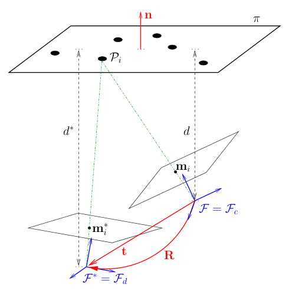
*그림 1 — 목표 카메라 좌표계와 현재 카메라 좌표계, 그리고 관련 표기.*

$$\mathcal{P} = (X, Y, Z)$$

이 점들은 목표 카메라 좌표계나 현재 카메라 좌표계 어느 쪽으로도 나타낼 수 있으며, 각각 ${}^{d}\mathcal{P}$와 ${}^{c}\mathcal{P}$로 표기한다. 3차원 점 좌표를 목표 좌표계에서 현재 좌표계로 바꾸는 동차 변환 행렬은 다음과 같다:

$${}^{c}\mathbf{T}_d = \begin{bmatrix} {}^{c}\mathbf{R}_d & {}^{c}\mathbf{t}_d \\ \mathbf{0} & 1 \end{bmatrix}$$

여기서 ${}^{c}\mathbf{R}_d$와 ${}^{c}\mathbf{t}_d$는 각각 회전 행렬과 평행이동 벡터이다.

그림에서 물체 평면으로부터 각 카메라 좌표계까지의 거리는 $d^*$와 $d$로 표기한다. 평면의 법선 $\mathbf{n}$도 기준 좌표계나 현재 좌표계로 나타낼 수 있다(각각 ${}^{d}\mathbf{n}$ 또는 ${}^{c}\mathbf{n}$). 카메라는 목표 배치와 현재 배치 양쪽에서 해당 물체의 영상을 얻는다. 이 영상 취득은 3차원 점들을 각 카메라 원점으로부터 같은 깊이를 갖는 평면으로 투영하는 것을 뜻한다. 각 점의 정규화 투영 좌표는 목표 및 현재 카메라 좌표계에 대해 다음과 같이 나타낸다:

$$\mathbf{m}^* = (x^*, y^*, 1) = {}^{d}\mathbf{m}\,; \qquad \mathbf{m} = (x, y, 1) = {}^{c}\mathbf{m}$$

끝으로 각 점의 화소 단위 동차 영상 좌표 $\mathbf{p} = (u, v, 1)$은 다음 변환으로 얻는다:

$$\mathbf{p} = \mathbf{K}\,\mathbf{m}$$

여기서 $\mathbf{K}$는 카메라 내부 파라미터를 담은 상삼각 행렬이다.

문서 전체에서 다음과 같은 약식 표기를 쓴다:

$$\begin{cases} \mathbf{R} = {}^{c}\mathbf{R}_d \\ \mathbf{t} = {}^{c}\mathbf{t}_d / d^* \\ \mathbf{n} = {}^{d}\mathbf{n} \end{cases}$$

여기서 평행이동 벡터 $\mathbf{t}$는 평면 깊이 $d^*$에 대해 정규화되어 있음을 알 수 있다. 또한 $\mathbf{t}$와 $\mathbf{n}$이 같은 좌표계로 표현되어 있지 않다는 점에도 주목할 수 있다.

### 2.2 호모그래피 행렬 (The homography matrix)

$\mathbf{p}^* = (u^*, v^*, 1)$을 기준 영상에서 한 점의 동차 좌표를 담은 (3×1) 벡터라 하고, $\mathbf{p} = (u, v, 1)$을 현재 영상에서 한 점의 동차 좌표를 담은 벡터라 하자. 사영 호모그래피 행렬(projective homography matrix) $\mathbf{G}$는 축척 인자를 제외하고 한 벡터를 다른 벡터로 변환한다:

$$\alpha_g\,\mathbf{p} = \mathbf{G}\,\mathbf{p}^*$$

사영 호모그래피 행렬은 여러 개의 동일 평면상 점을 대응시켜 영상 정보로부터 측정할 수 있다. 적어도 4개의 점이 필요하다(그중 적어도 3개는 한 직선 위에 있지 않아야 한다). 이 행렬은 변환 요소 $\mathbf{R}$, $\mathbf{t}$ 및 평면 법선 $\mathbf{n}$과 다음과 같이 관계된다:

$$\mathbf{G} = \gamma\,\mathbf{K}\left(\mathbf{R} + \mathbf{t}\,\mathbf{n}^\top\right)\mathbf{K}^{-1} \tag{1}$$

여기서 행렬 $\mathbf{K}$는 카메라 보정 행렬이다. 유클리드 공간의 호모그래피는 추정된 카메라 보정 행렬 $\widehat{\mathbf{K}}$를 써서 사영 호모그래피 행렬로부터 계산할 수 있다:

$$\widehat{\mathbf{H}} = \widehat{\mathbf{K}}^{-1}\mathbf{G}\,\widehat{\mathbf{K}} \tag{2}$$

이 보고서에서는 카메라 내부 파라미터에 불확도가 없다고 가정한다. 그러면 $\widehat{\mathbf{K}} = \mathbf{K}$이므로 $\widehat{\mathbf{H}} = \gamma\left(\mathbf{R} + \mathbf{t}\,\mathbf{n}^\top\right)$이다. 향후 연구에서는 여기서 제시하는 해석적 분해 방법을 이용해 카메라 보정 오차가 유클리드 재구성에 미치는 영향을 연구하고자 한다. 유클리드 공간에서 호모그래피 행렬 $\mathbf{G}$에 해당하는 것이 *유클리드 호모그래피 행렬(Euclidean homography matrix)* $\mathbf{H}$이다. 이 행렬은 사영 좌표로 나타낸 3차원 점 하나를 한 좌표계에서 다른 좌표계로, 역시 축척 인자를 제외하고 변환한다:

$$\alpha_h\,\mathbf{m} = \mathbf{H}\,\mathbf{m}^*$$

여기서 $\mathbf{m}^* = (x^*, y^*, 1)$은 기준 카메라 자세에서 본 점의 정규화 투영 좌표를 담은 벡터이고, $\mathbf{m} = (x, y, 1)$은 같은 점을 현재 카메라 자세에서 볼 때의 정규화 투영 좌표를 담은 벡터이다. 이 호모그래피 행렬은 다음과 같다:

$$\mathbf{H} = \frac{\widehat{\mathbf{H}}}{\gamma} = \mathbf{R} + \mathbf{t}\,\mathbf{n}^\top \tag{3}$$

$\mathrm{med}(\mathrm{svd}(\mathbf{H})) = 1$임에 주목하라. 따라서 $\widehat{\mathbf{H}}$를 얻은 뒤에는 축척 인자 $\gamma$를 다음과 같이 계산할 수 있다:

$$\gamma = \mathrm{med}(\mathrm{svd}(\widehat{\mathbf{H}}))$$

이는 3차 방정식을 풀어 얻는다(부록 B 참조).

유클리드 호모그래피 분해 문제는 *호모그래피로부터의 유클리드 재구성(Euclidean reconstruction from homography)* 이라고도 하며, 행렬 $\mathbf{H}$로부터 요소 $\mathbf{R}$, $\mathbf{t}$, $\mathbf{n}$을 구하는 문제이다:

$$\mathbf{H} \implies \{\mathbf{R}, \mathbf{t}, \mathbf{n}\}$$

평행이동은 양의 스칼라 인자를 제외하고 추정된다는 점에 주목하라($\mathbf{t}$가 $d^*$에 대해 정규화되어 있으므로).

## 3. 호모그래피 분해의 수치 방법 (The numerical method for homography decomposition)

해석적 분해 방법 자체를 제시하기 전에, SVD에 근거한 전통적인 방법들을 간결하게 상기해 두는 것이 편리하다 [1, 11].

### 3.1 Faugeras의 SVD 기반 분해 (Faugeras SVD-based decomposition)

호모그래피 행렬의 특이값 분해를 수행하면 [1]:

$$\mathbf{H} = \mathbf{U}\,\boldsymbol{\Lambda}\,\mathbf{V}^\top$$

직교 행렬 $\mathbf{U}$와 $\mathbf{V}$, 그리고 행렬 $\mathbf{H}$의 특이값을 담은 대각 행렬 $\boldsymbol{\Lambda}$를 얻는다. 이 대각 행렬도 하나의 호모그래피 행렬로 볼 수 있으므로 관계식 (3)을 적용할 수 있다:

$$\boldsymbol{\Lambda} = \mathbf{R}_{\Lambda} + \mathbf{t}_{\Lambda}\,\mathbf{n}_{\Lambda}^\top \tag{4}$$

분해할 행렬이 대각 행렬이면 회전 행렬, 평행이동 벡터, 법선 벡터의 성분을 계산하기가 간단하다. 먼저 (4)에서 나오는 세 벡터 방정식(이 행렬 방정식의 각 열마다 하나)에서 $\mathbf{t}_{\Lambda}$를 쉽게 소거할 수 있다. 그다음 $\mathbf{R}_{\Lambda}$가 직교 행렬이라는 조건을 부과하면, 이 성분들과 세 특이값만을 관계짓는 새로운 방정식 집합으로부터 $\mathbf{n}_{\Lambda}$의 성분을 선형으로 풀 수 있다(상세한 전개는 [1] 참조). 분해 알고리즘의 결과로 세 쌍 $\{\mathbf{R}_{\Lambda}, \mathbf{t}_{\Lambda}, \mathbf{n}_{\Lambda}\}$에 대해 최대 8개의 서로 다른 해를 얻을 수 있다. 그런 다음, 행렬 $\boldsymbol{\Lambda}$의 분해가 끝났다고 가정하면, 최종 분해 요소를 계산하기 위해 다음 식만 쓰면 된다:

$$\mathbf{R} = \mathbf{U}\,\mathbf{R}_{\Lambda}\,\mathbf{V}^\top, \qquad \mathbf{t} = \mathbf{U}\,\mathbf{t}_{\Lambda}, \qquad \mathbf{n} = \mathbf{V}\,\mathbf{n}_{\Lambda}$$

이 알고리즘으로는 분해 요소 $\{\mathbf{R}, \mathbf{t}, \mathbf{n}\}$의 해석적 표현을 행렬 $\mathbf{H}$의 성분으로 얻을 수 없음이 분명하다. 이것이 이 보고서의 목적, 즉 그러한 해석적 표현을 주는 방법을 개발하는 것이다. 앞서 말했듯이 이 문제에는 일반적으로 최대 8개의 해가 있다. 이 8개는 수학적 해이지만, 뒤에서 보겠듯이 모두가 물리적으로 가능한 것은 아니다. 해의 수를 줄이기 위해 몇 가지 제약을 적용할 수 있다.

### 3.2 Zhang의 SVD 기반 분해 (Zhang SVD-based decomposition)

이 분해를 얻는 비슷한 방법이 [11]에 제안되어 있다는 점에 주목하라. 저자들은 평행이동 벡터, 법선 벡터, 회전 행렬에 대한 닫힌 형식(closed-form)의 표현을 얻는다고 주장한다. 그러나 닫힌 형식의 해는 역시 호모그래피 행렬의 SVD 분해로부터 수치적으로 얻어진다.

이들은 행렬 $\mathbf{H}^\top\mathbf{H}$의 고유값과 고유벡터를 계산할 것을 제안한다:

$$\mathbf{H}^\top\mathbf{H} = \mathbf{V}\,\boldsymbol{\Lambda}^2\,\mathbf{V}^\top$$

여기서 고유값과 대응 고유벡터는 다음과 같다:

$$\boldsymbol{\Lambda} = \mathrm{diag}(\lambda_1, \lambda_2, \lambda_3)\,; \qquad \mathbf{V} = [\mathbf{v_1}\ \mathbf{v_2}\ \mathbf{v_3}]$$

단위 고유값은 $\lambda_2$이며 다음 순서로 정렬된다:

$$\lambda_1 \geq \lambda_2 = 1 \geq \lambda_3$$

그다음 $\mathbf{t}^*$를 목표 카메라 좌표계에서의 정규화 평행이동 벡터 $\mathbf{t}^* = \mathbf{R}^\top\mathbf{t}$로 정의하고, 다음 관계를 쓸 것을 제안한다:

$$\|\mathbf{t}^*\| = \lambda_1 - \lambda_3\,; \qquad \mathbf{n}^\top\mathbf{t}^* = \lambda_1\lambda_3 - 1$$

그리고

$$\begin{aligned} \mathbf{v}_1 &\propto \mathbf{v}'_1 = \zeta_1\,\mathbf{t}^* + \mathbf{n} \\ \mathbf{v}_2 &\propto \mathbf{v}'_2 = \mathbf{t}^* \times \mathbf{n} \\ \mathbf{v}_3 &\propto \mathbf{v}'_3 = \zeta_3\,\mathbf{t}^* + \mathbf{n} \end{aligned}$$

여기서 $\mathbf{v}_i$는 단위 벡터이고 $\mathbf{v}'_i$는 단위 벡터가 아니며, $\zeta_{1,3}$은 아래에 주어지는 고유값의 스칼라 함수이다.

이 관계들은 $(\mathbf{t}^* \times \mathbf{n})$이 행렬 $\mathbf{H}^\top\mathbf{H}$의 단위 고유값에 연관된 고유벡터이며 모든 고유벡터가 직교해야 한다는 사실로부터 유도된다.

그다음 저자들은 평행이동 벡터와 법선 벡터 쌍의 첫 번째 해를 계산하기 위해 다음 식을 쓸 것을 제안한다:

$$\mathbf{t}^* = \pm\frac{\mathbf{v}'_1 - \mathbf{v}'_3}{\zeta_1 - \zeta_3} \qquad \mathbf{n} = \pm\frac{\zeta_1\,\mathbf{v}'_3 - \zeta_3\,\mathbf{v}'_1}{\zeta_1 - \zeta_3}$$

두 번째 해에 대해서는 다음과 같다:

$$\mathbf{t}^* = \pm\frac{\mathbf{v}'_1 + \mathbf{v}'_3}{\zeta_1 - \zeta_3} \qquad \mathbf{n} = \pm\frac{\zeta_1\,\mathbf{v}'_3 + \zeta_3\,\mathbf{v}'_1}{\zeta_1 - \zeta_3}$$

이 관계들을 쓰려면 SVD 뒤에 $\zeta_{1,3}$을 다음과 같이 계산해야 한다:

$$\zeta_{1,3} = \frac{1}{2\,\lambda_1\lambda_3}\left(-1 \pm \sqrt{1 + 4\frac{\lambda_1\lambda_3}{(\lambda_1 - \lambda_3)^2}}\right)$$

또한 $\mathbf{v}'_{1,3}$의 노름은 고유값으로부터 계산할 수 있다:

$$\|\mathbf{v}'_i\|^2 = \zeta_i^2\,(\lambda_1 - \lambda_3)^2 + 2\,\zeta_i\,(\lambda_1\lambda_3 - 1) + 1 \qquad i = 1, 3$$

그다음 $\mathbf{v}'_{1,3}$은 단위 고유벡터로부터 다음과 같이 얻는다:

$$\mathbf{v}'_i = \|\mathbf{v}'_i\|\,\mathbf{v}_i \qquad i = 1, 3$$

끝으로 회전 행렬을 얻을 수 있다:

$$\mathbf{R} = \mathbf{H}\left(\mathbf{I} + \mathbf{t}^*\,\mathbf{n}^\top\right)^{-1}$$

보다시피 이것은 해석적 분해 절차가 아니다. $\{\mathbf{R}, \mathbf{t}, \mathbf{n}\}$을 $\mathbf{H}$의 명시적 함수로 얻지 못하기 때문이다. 오히려 계산은 Faugeras 방법에서처럼 전적으로 특이값 분해에 의존한다.

게다가 회전 행렬을 계산하려면 올바른 쌍을 골라야 하는데, +/- 모호성이 있다. 이는 $\mathbf{t}^*$의 식에서 더하기 부호를 골랐을 때 올바른 짝이 $\mathbf{n}$의 식에서 더하기 부호로 얻은 벡터인지 빼기 부호로 얻은 벡터인지를 사전에 알 방법이 없다는 뜻이다. 제안하는 해석적 절차로는 이 모호성을 사전에 해결할 수 있다.

### 3.3 불가능한 해의 제거 (Elimination of impossible solutions)

이제 호모그래피 분해 문제의 해 집합을 8개의 수학적 해에서 몇 가지 물리적 제약을 만족하는 2개의 해로 어떻게 줄일 수 있는지 기술한다. 물론 이는 수치 분해 방법에만 해당하는 것이 아니라 어떤 방법을 쓰든 일반적으로 성립한다.

#### 3.3.1 기준 평면 비교차 제약 (Reference-plane non-crossing constraint)

이것은 해의 수를 8개에서 4개로 줄일 수 있게 하는 첫 번째 물리적 제약이다. 이 제약은 다음을 요구한다:

*두 좌표계 $\mathcal{F}^*$와 $\mathcal{F}$는 물체 평면의 같은 쪽에 있어야 한다.*

이는 카메라가 평면 법선 방향으로 평면까지의 거리보다 더 멀리 갈 수 없다는 뜻이다. 그렇지 않으면 카메라가 평면을 가로지르게 되며, 이 상황은 카메라가 투명한 물체를 양쪽에서 보는 것으로 해석될 수 있다. 그림 2에서 한 좌표계에서 다른 좌표계로의 평행이동 벡터 ${}^{d}\mathbf{t}_c$는 $\mathcal{F}^*$에 대한 $\mathcal{F}$ 원점의 위치를 준다. 이것은 우리의 약식 표기에서 쓰는 벡터 $\mathbf{t}$와 같지 않지만 둘은 다음과 같이 관계된다:

$$\mathbf{t} = -{}^{c}\mathbf{R}_d\,\frac{{}^{d}\mathbf{t}_c}{d^*}$$

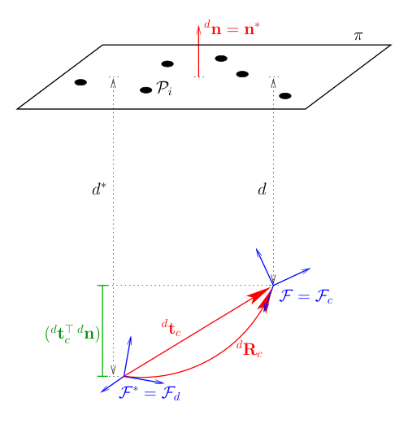
*그림 2 — 기준 평면 비교차 제약.*

이렇게 하면 평행이동 벡터 ${}^{d}\mathbf{t}_c$, 법선 벡터 $\mathbf{n} = {}^{d}\mathbf{n}$, 평면까지의 거리 $d^*$가 같은 좌표계 $\mathcal{F}^*$로 표현된다. 이 표기로는 기준 평면 비교차 제약이 다음일 때 만족됨이 분명하다:

$${}^{d}\mathbf{t}_c^\top\,{}^{d}\mathbf{n} < d^* \tag{5}$$

즉 평행이동 벡터 ${}^{d}\mathbf{t}_c$를 법선 방향으로 투영한 값이 $d^*$보다 작아야 한다. 우리의 약식 표기로 쓰면 다음과 같다:

$$1 + \mathbf{n}^\top\mathbf{R}^\top\mathbf{t} > 0 \tag{6}$$

4절에서 보겠지만 해석적 방법으로 유도한 8개의 해 가운데 4개만 이 조건을 만족한다. 실제로 기준 평면 비교차 제약을 만족하는 네 해의 집합은 일반적으로 완전히 다른 두 해와 그 "반대(opposites)"이다:

$$\begin{aligned} Rtn_a &= \{\mathbf{R}_a, \mathbf{t}_a, \mathbf{n}_a\} \\ Rtn_b &= \{\mathbf{R}_b, \mathbf{t}_b, \mathbf{n}_b\} \\ Rtn_{a-} &= \{\mathbf{R}_a, -\mathbf{t}_a, -\mathbf{n}_a\} \\ Rtn_{b-} &= \{\mathbf{R}_b, -\mathbf{t}_b, -\mathbf{n}_b\} \end{aligned}$$

#### 3.3.2 기준점 가시성 (Reference-point visibility)

이 추가 제약으로 가능한 해의 수를 4개에서 2개로 줄일 수 있다. 다음 추가 정보가 필요하다:

- 기준 영상 점들의 집합: $\mathbf{p}^*$
- 카메라 내부 파라미터를 담은 행렬: $\mathbf{K}$

먼저 기준점들의 투영 좌표를 구한다:

$$\mathbf{m}^* = \mathbf{K}^{-1}\mathbf{p}^*$$

그다음 각 법선 후보를 고려해, 각 점 $\mathbf{m}^*$를 그 법선 방향으로 투영한 값을 계산한다. 해가 유효하려면 이 투영값이 모든 점에서 양수여야 한다:

$$\mathbf{m}^{*\top}\mathbf{n}^* > 0$$

현재 좌표계에 대해서도 똑같이 할 수 있다:

$$\mathbf{m}^\top(\mathbf{R}\,\mathbf{n}) > 0$$

이 제약의 기하학적 해석은 다음과 같다(그림 3 참조):

*모든 기준점이 보이려면 그 점들은 카메라 앞에 있어야 한다.*

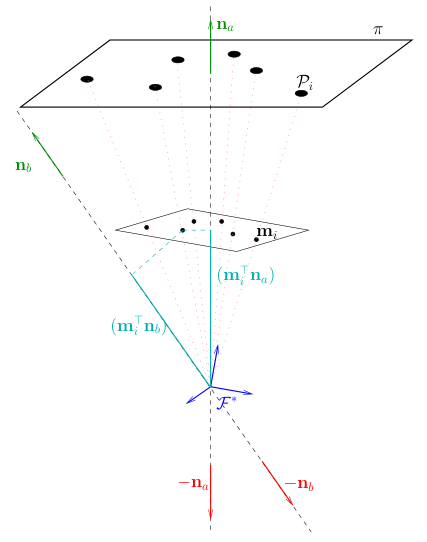
*그림 3 — 기준점 가시성 제약.*

기준 평면 비교차 제약을 만족하는 네 해 가운데 두 해는 나머지 두 해와 법선이 반대이므로, 새 제약으로 적어도 두 해를 버릴 수 있다. 세 해까지 버릴 수 있는 경우도 생길 수 있지만 흔한 상황은 아니다.

## 4. 호모그래피 분해의 새로운 해석적 방법 (A new analytical method for homography decomposition)

이 절에서는 호모그래피 분해 문제를 푸는 새로운 해석적 방법을 소개한다. SVD에 근거한 수치 방법을 쓰는 [1]과 달리, 우리는 $\{\mathbf{R}, \mathbf{t}, \mathbf{n}\}$의 표현을 행렬 $\mathbf{H}$의 함수로 제공한다.

이 절차를 따라 얻을 네 해는 다음과 같이 표기한다:

$$\begin{aligned} Rtn_a &= \{\mathbf{R}_a, \mathbf{t}_a, \mathbf{n}_a\} && (7) \\ Rtn_b &= \{\mathbf{R}_b, \mathbf{t}_b, \mathbf{n}_b\} && (8) \\ Rtn_{a-} &= \{\mathbf{R}_a, -\mathbf{t}_a, -\mathbf{n}_a\} && (9) \\ Rtn_{b-} &= \{\mathbf{R}_b, -\mathbf{t}_b, -\mathbf{n}_b\} && (10) \end{aligned}$$

앞서 말했듯이 이 해들은 일반적으로 완전히 다른 두 해와 그 반대이다.

먼저 공식 전체를 요약하고, 그다음 전개의 세부를 제시한다.

### 4.1 해석적 분해의 요약 (Summary of the analytical decomposition)

**첫 번째 방법: 법선 벡터를 먼저 계산 (First method: computing the normal vector first)**

호모그래피 행렬로부터 다음과 같이 얻는 대칭 행렬 $\mathbf{S}$를 도입하면 해석적 표현의 닫힌 형식을 얻을 수 있다:

$$\mathbf{S} = \mathbf{H}^\top\mathbf{H} - \mathbf{I} = \begin{bmatrix} s_{11} & s_{12} & s_{13} \\ s_{12} & s_{22} & s_{23} \\ s_{13} & s_{23} & s_{33} \end{bmatrix}$$

$M_{\mathbf{S}_{ij}}$, $i, j = 1..3$로 행렬 $\mathbf{S}$의 소행렬식(원소 $s_{ij}$에 대응하는 소행렬식)의 부호를 바꾼 값을 나타낸다. 예를 들면 다음과 같다:

$$M_{\mathbf{S}_{11}} = -\begin{vmatrix} s_{22} & s_{23} \\ s_{23} & s_{33} \end{vmatrix} = s_{23}^2 - s_{22}s_{33} \geq 0$$

일반적으로 행렬 $\mathbf{S}$의 성분으로부터 호모그래피 분해의 법선 벡터 $\mathbf{n}_e$(그리고 이로부터 $\mathbf{t}_e$와 $\mathbf{R}_e$)의 표현을 얻는 데에는 세 가지 다른 선택지가 있다. 다음과 같이 쓴다:

$$\mathbf{n}_e(s_{ii}) = \frac{\mathbf{n}'_e(s_{ii})}{\|\mathbf{n}'_e(s_{ii})\|}\,; \qquad e = \{a, b\}, \quad i = \{1, 2, 3\}$$

여기서 $\mathbf{n}_e(s_{ii})$는 *$s_{ii}$를 써서 전개한* $\mathbf{n}_e$를 뜻한다. 그러면 가능한 세 경우는 다음과 같다:

$$\mathbf{n}'_a(s_{11}) = \begin{bmatrix} s_{11} \\ s_{12} + \sqrt{M_{\mathbf{S}_{33}}} \\ s_{13} + \epsilon_{23}\sqrt{M_{\mathbf{S}_{22}}} \end{bmatrix}; \quad \mathbf{n}'_b(s_{11}) = \begin{bmatrix} s_{11} \\ s_{12} - \sqrt{M_{\mathbf{S}_{33}}} \\ s_{13} - \epsilon_{23}\sqrt{M_{\mathbf{S}_{22}}} \end{bmatrix} \tag{11}$$

$$\mathbf{n}'_a(s_{22}) = \begin{bmatrix} s_{12} + \sqrt{M_{\mathbf{S}_{33}}} \\ s_{22} \\ s_{23} - \epsilon_{13}\sqrt{M_{\mathbf{S}_{11}}} \end{bmatrix}; \quad \mathbf{n}'_b(s_{22}) = \begin{bmatrix} s_{12} - \sqrt{M_{\mathbf{S}_{33}}} \\ s_{22} \\ s_{23} + \epsilon_{13}\sqrt{M_{\mathbf{S}_{11}}} \end{bmatrix} \tag{12}$$

$$\mathbf{n}'_a(s_{33}) = \begin{bmatrix} s_{13} + \epsilon_{12}\sqrt{M_{\mathbf{S}_{22}}} \\ s_{23} + \sqrt{M_{\mathbf{S}_{11}}} \\ s_{33} \end{bmatrix}; \quad \mathbf{n}'_b(s_{33}) = \begin{bmatrix} s_{13} - \epsilon_{12}\sqrt{M_{\mathbf{S}_{22}}} \\ s_{23} - \sqrt{M_{\mathbf{S}_{11}}} \\ s_{33} \end{bmatrix} \tag{13}$$

여기서 $\epsilon_{ij} = sign(M_{\mathbf{S}_{ij}})$이다. 특히 $sign(\cdot)$ 함수는 뒤에서 보겠듯이 $M_{\mathbf{S}_{ij}} = 0$인 경우의 문제를 피하기 위해 다음과 같이 구현해야 한다:

$$sign(a) = \begin{cases} 1 & \text{if } a \geq 0 \\ -1 & \text{otherwise} \end{cases}$$

이 공식들은 모두 같은 결과를 준다. 그러나 $\mathbf{n}_e(s_{ii})$의 계산에는 $s_{ii}$로 나누는 과정이 들어가므로, 모든 경우에 모든 공식을 적용할 수 있는 것은 아니다. 즉 이 공식은 $s_{ii} = 0$인 특수한 경우에는 적용할 수 없다(예를 들어 $\mathbf{n}$의 $i$번째 성분이 0일 때 이런 일이 생긴다).

올바른 절차는 세 선택지 가운데 절댓값이 가장 큰 $s_{ii}$에 대응하는 것을 써서 $\mathbf{n}_a$와 $\mathbf{n}_b$를 계산하는 것이다. 그것이 가장 조건이 좋은(well conditioned) 선택이다. 그러면 유일한 특이 경우는 $\mathbf{H}$가 회전 행렬인 순수 회전의 경우이다. 이 경우 행렬 $\mathbf{S}$의 모든 성분이 0이 된다. 그러나 이것은 자명한 경우이며 어떤 공식도 적용할 필요가 없다. 이 공식들로 얻는 네 해(즉 $\{\mathbf{n}_a, -\mathbf{n}_a, \mathbf{n}_b, -\mathbf{n}_b\}$)는 모두 같지만 항상 같은 순서로 주어지지는 않는다는 점을 고려해야 한다. 이는 예를 들어 $\mathbf{n}_a(s_{22})$가 $\mathbf{n}_a(s_{11})$에 대응하는 대신 $-\mathbf{n}_a(s_{11})$, $\mathbf{n}_b(s_{11})$ 또는 $-\mathbf{n}_b(s_{11})$에 대응할 수 있다는 뜻이다.

$\mathbf{n}_e$의 표현을 행렬 $\mathbf{H}$의 열로 직접 쓸 수도 있다:

$$\mathbf{H} = \begin{bmatrix} \mathbf{h}_1 & \mathbf{h}_2 & \mathbf{h}_3 \end{bmatrix}$$

예로서 $s_{22}$로부터 유도한 결과((12)와 동등)를 제시한다:

$$\mathbf{n}'_a(s_{22}) = \begin{bmatrix} \mathbf{h}_1^\top\mathbf{h}_2 + \sqrt{\left(\mathbf{h}_1^\top\mathbf{h}_2\right)^2 - \left(\|\mathbf{h}_1\|^2 - 1\right)\left(\|\mathbf{h}_2\|^2 - 1\right)} \\ \left(\|\mathbf{h}_2\|^2 - 1\right) \\ \mathbf{h}_2^\top\mathbf{h}_3 - \epsilon_{13}\sqrt{\left(\mathbf{h}_2^\top\mathbf{h}_3\right)^2 - \left(\|\mathbf{h}_2\|^2 - 1\right)\left(\|\mathbf{h}_3\|^2 - 1\right)} \end{bmatrix} \tag{14}$$

$$\mathbf{n}'_b(s_{22}) = \begin{bmatrix} \mathbf{h}_1^\top\mathbf{h}_2 - \sqrt{\left(\mathbf{h}_1^\top\mathbf{h}_2\right)^2 - \left(\|\mathbf{h}_1\|^2 - 1\right)\left(\|\mathbf{h}_2\|^2 - 1\right)} \\ \left(\|\mathbf{h}_2\|^2 - 1\right) \\ \mathbf{h}_2^\top\mathbf{h}_3 + \epsilon_{13}\sqrt{\left(\mathbf{h}_2^\top\mathbf{h}_3\right)^2 - \left(\|\mathbf{h}_2\|^2 - 1\right)\left(\|\mathbf{h}_3\|^2 - 1\right)} \end{bmatrix} \tag{15}$$

여기서 $\epsilon_{ij} = sign(M_{\mathbf{S}_{ij}})$이며, 이 특정한 경우 그 표현은 다음과 같다:

$$\epsilon_{13} = sign\left(-\mathbf{h}_1^\top\left[\mathbf{I} + [\mathbf{h}_2]_\times^2\right]\mathbf{h}_3\right)$$

기준 좌표계에서의 평행이동 벡터 $\mathbf{t}_e^* = \mathbf{R}_e^\top\mathbf{t}_e$의 표현은 위에서 준 법선 벡터의 표현으로부터 얻을 수 있다:

$$\mathbf{t}_e^*(s_{11}) = \frac{\|\mathbf{n}'_e(s_{11})\|}{2\,s_{11}}\begin{bmatrix} s_{11} \\ s_{12} \mp \sqrt{M_{\mathbf{S}_{33}}} \\ s_{13} \mp \epsilon_{23}\sqrt{M_{\mathbf{S}_{22}}} \end{bmatrix} - \frac{\|\mathbf{t}_e\|^2}{2\,\|\mathbf{n}'_e(s_{11})\|}\begin{bmatrix} s_{11} \\ s_{12} \pm \sqrt{M_{\mathbf{S}_{33}}} \\ s_{13} \pm \epsilon_{23}\sqrt{M_{\mathbf{S}_{22}}} \end{bmatrix}$$

$$\mathbf{t}_e^*(s_{22}) = \frac{\|\mathbf{n}'_e(s_{22})\|}{2\,s_{22}}\begin{bmatrix} s_{12} \mp \sqrt{M_{\mathbf{S}_{33}}} \\ s_{22} \\ s_{23} \pm \epsilon_{13}\sqrt{M_{\mathbf{S}_{11}}} \end{bmatrix} - \frac{\|\mathbf{t}_e\|^2}{2\,\|\mathbf{n}'_e(s_{22})\|}\begin{bmatrix} s_{12} \pm \sqrt{M_{\mathbf{S}_{33}}} \\ s_{22} \\ s_{23} \mp \epsilon_{13}\sqrt{M_{\mathbf{S}_{11}}} \end{bmatrix}$$

$$\mathbf{t}_e^*(s_{33}) = \frac{\|\mathbf{n}'_e(s_{33})\|}{2\,s_{33}}\begin{bmatrix} s_{13} \mp \epsilon_{12}\sqrt{M_{\mathbf{S}_{22}}} \\ s_{23} \mp \sqrt{M_{\mathbf{S}_{11}}} \\ s_{33} \end{bmatrix} - \frac{\|\mathbf{t}_e\|^2}{2\,\|\mathbf{n}'_e(s_{33})\|}\begin{bmatrix} s_{13} \pm \epsilon_{12}\sqrt{M_{\mathbf{S}_{22}}} \\ s_{23} \pm \sqrt{M_{\mathbf{S}_{11}}} \\ s_{33} \end{bmatrix}$$

$e = a$이면 기호 $\pm, \mp$에서 위쪽 연산자를, $e = b$이면 아래쪽 연산자를 골라야 한다. 벡터 $\mathbf{t}_e^*$는 $\mathbf{n}_a$와 $\mathbf{n}_b$의 간결한 식으로도 줄 수 있다:

$$\mathbf{t}_a^*(s_{ii}) = \frac{\|\mathbf{t}_e\|}{2}\left[\epsilon_{s_{ii}}\,\rho\,\mathbf{n}_b(s_{ii}) - \|\mathbf{t}_e\|\,\mathbf{n}_a(s_{ii})\right] \tag{16}$$

$$\mathbf{t}_b^*(s_{ii}) = \frac{\|\mathbf{t}_e\|}{2}\left[\epsilon_{s_{ii}}\,\rho\,\mathbf{n}_a(s_{ii}) - \|\mathbf{t}_e\|\,\mathbf{n}_b(s_{ii})\right] \tag{17}$$

여기서

$$\epsilon_{s_{ii}} = sign(s_{ii})$$

$$\rho^2 = 2 + trace(\mathbf{S}) + \nu \tag{18}$$

$$\|\mathbf{t}_e\|^2 = 2 + trace(\mathbf{S}) - \nu \tag{19}$$

이고, $\nu$는 다음으로부터 얻을 수 있다:

$$\nu = \sqrt{2\left[(1 + trace(\mathbf{S}))^2 + 1 - trace(\mathbf{S}^2)\right]} = 2\sqrt{1 + trace(\mathbf{S}) - M_{\mathbf{S}_{11}} - M_{\mathbf{S}_{22}} - M_{\mathbf{S}_{33}}}$$

회전 행렬의 표현은 다음과 같다:

$$\mathbf{R}_e = \mathbf{H}\left(\mathbf{I} - \frac{2}{\nu}\,\mathbf{t}_e^*\mathbf{n}_e^\top\right) \tag{20}$$

끝으로 $\mathbf{t}_e$를 얻을 수 있다:

$$\mathbf{t}_e = \mathbf{R}_e\,\mathbf{t}_e^* \tag{21}$$

**두 번째 방법: 평행이동 벡터를 먼저 계산 (Second method: computing the translation vector first)**

앞의 $\mathbf{S}$ 대신 다음 행렬 $\mathbf{S}_r$에서 출발하면 $\mathbf{t}_e$에 대한 더 간단한 표현 집합을 얻을 수 있다:

$$\mathbf{S}_r = \mathbf{H}\,\mathbf{H}^\top - \mathbf{I} = \begin{bmatrix} s_{r_{11}} & s_{r_{12}} & s_{r_{13}} \\ s_{r_{12}} & s_{r_{22}} & s_{r_{23}} \\ s_{r_{13}} & s_{r_{23}} & s_{r_{33}} \end{bmatrix}$$

벡터 $\mathbf{t}_e$에 대한 새 관계는 다음과 같다:

$$\mathbf{t}_e(s_{r_{ii}}) = \|\mathbf{t}_e\|\,\frac{\mathbf{t}'_e(s_{r_{ii}})}{\|\mathbf{t}'_e(s_{r_{ii}})\|}\,; \qquad e = \{a, b\}$$

여기서 $\mathbf{t}_e(s_{r_{ii}})$는 *$s_{r_{ii}}$를 써서 전개한* $\mathbf{t}_e$를 뜻한다. 그러면 가능한 세 경우는 다음과 같다:

$$\mathbf{t}'_a(s_{r_{11}}) = \begin{bmatrix} s_{r_{11}} \\ s_{r_{12}} + \sqrt{M_{\mathbf{S}_{r_{33}}}} \\ s_{r_{13}} + \epsilon_{r_{23}}\sqrt{M_{\mathbf{S}_{r_{22}}}} \end{bmatrix}; \quad \mathbf{t}'_b(s_{r_{11}}) = \begin{bmatrix} s_{r_{11}} \\ s_{r_{12}} - \sqrt{M_{\mathbf{S}_{r_{33}}}} \\ s_{r_{13}} - \epsilon_{r_{23}}\sqrt{M_{\mathbf{S}_{r_{22}}}} \end{bmatrix} \tag{22}$$

$$\mathbf{t}'_a(s_{r_{22}}) = \begin{bmatrix} s_{r_{12}} + \sqrt{M_{\mathbf{S}_{r_{33}}}} \\ s_{r_{22}} \\ s_{r_{23}} - \epsilon_{r_{13}}\sqrt{M_{\mathbf{S}_{r_{11}}}} \end{bmatrix}; \quad \mathbf{t}'_b(s_{r_{22}}) = \begin{bmatrix} s_{r_{12}} - \sqrt{M_{\mathbf{S}_{r_{33}}}} \\ s_{r_{22}} \\ s_{r_{23}} + \epsilon_{r_{13}}\sqrt{M_{\mathbf{S}_{r_{11}}}} \end{bmatrix} \tag{23}$$

$$\mathbf{t}'_a(s_{r_{33}}) = \begin{bmatrix} s_{r_{13}} + \epsilon_{r_{12}}\sqrt{M_{\mathbf{S}_{r_{22}}}} \\ s_{r_{23}} + \sqrt{M_{\mathbf{S}_{r_{11}}}} \\ s_{r_{33}} \end{bmatrix}; \quad \mathbf{t}'_b(s_{r_{33}}) = \begin{bmatrix} s_{r_{13}} - \epsilon_{r_{12}}\sqrt{M_{\mathbf{S}_{r_{22}}}} \\ s_{r_{23}} - \sqrt{M_{\mathbf{S}_{r_{11}}}} \\ s_{r_{33}} \end{bmatrix} \tag{24}$$

여기서 $M_{\mathbf{S}_{r_{ii}}}$와 $\epsilon_{r_{ij}}$는 앞과 같은 의미이지만 $\mathbf{S}$ 대신 행렬 $\mathbf{S}_r$에 대한 것이다. $\|\mathbf{t}_e\|$의 표현은 (19)에 주어져 있다는 점에 주목하라. 이 경우 예를 들어 $\mathbf{t}$의 $i$번째 성분이 0이면 $s_{r_{ii}}$가 0이 된다.

$\mathbf{t}_e$의 표현을 행렬 $\mathbf{H}$의 행으로 직접 쓸 수도 있다:

$$\mathbf{H}^\top = \begin{bmatrix} \mathbf{h}_{r_1} & \mathbf{h}_{r_2} & \mathbf{h}_{r_3} \end{bmatrix}$$

예로서 $s_{r_{22}}$로부터 유도한 결과를 제시한다:

$$\mathbf{t}'_a(s_{r_{22}}) = \begin{bmatrix} \mathbf{h}_{r_1}^\top\mathbf{h}_{r_2} + \sqrt{\left(\mathbf{h}_{r_1}^\top\mathbf{h}_{r_2}\right)^2 - \left(\|\mathbf{h}_{r_1}\|^2 - 1\right)\left(\|\mathbf{h}_{r_2}\|^2 - 1\right)} \\ \left(\|\mathbf{h}_{r_2}\|^2 - 1\right) \\ \mathbf{h}_{r_2}^\top\mathbf{h}_{r_3} - \epsilon_{r_{13}}\sqrt{\left(\mathbf{h}_{r_2}^\top\mathbf{h}_{r_3}\right)^2 - \left(\|\mathbf{h}_{r_2}\|^2 - 1\right)\left(\|\mathbf{h}_{r_3}\|^2 - 1\right)} \end{bmatrix} \tag{25}$$

$$\mathbf{t}'_b(s_{r_{22}}) = \begin{bmatrix} \mathbf{h}_{r_1}^\top\mathbf{h}_{r_2} - \sqrt{\left(\mathbf{h}_{r_1}^\top\mathbf{h}_{r_2}\right)^2 - \left(\|\mathbf{h}_{r_1}\|^2 - 1\right)\left(\|\mathbf{h}_{r_2}\|^2 - 1\right)} \\ \left(\|\mathbf{h}_{r_2}\|^2 - 1\right) \\ \mathbf{h}_{r_2}^\top\mathbf{h}_{r_3} + \epsilon_{r_{13}}\sqrt{\left(\mathbf{h}_{r_2}^\top\mathbf{h}_{r_3}\right)^2 - \left(\|\mathbf{h}_{r_2}\|^2 - 1\right)\left(\|\mathbf{h}_{r_3}\|^2 - 1\right)} \end{bmatrix} \tag{26}$$

여기서 $\epsilon_{r_{ij}} = sign(M_{\mathbf{S}_{r_{ij}}})$이며, 이 경우 다음과 같이 쓸 수 있다:

$$\epsilon_{r_{13}} = sign\left(-\mathbf{h}_{r_1}^\top\left[\mathbf{I} + [\mathbf{h}_{r_2}]_\times^2\right]\mathbf{h}_{r_3}\right)$$

앞에서 $\mathbf{n}_e$의 표현으로부터 $\mathbf{t}_e^* = \mathbf{R}_e^\top\mathbf{t}_e$의 표현을 얻었듯이, 이제 주어진 $\mathbf{t}_e$의 표현으로부터 $\mathbf{n}'_e = \mathbf{R}_e\,\mathbf{n}_e$의 표현을 얻을 수 있다:

$$\mathbf{n}'_a(s_{r_{ii}}) = \frac{1}{2}\left[\epsilon_{s_{r_{ii}}}\frac{\rho}{\|\mathbf{t}_e\|}\,\mathbf{t}_b(s_{r_{ii}}) - \mathbf{t}_a(s_{r_{ii}})\right] \tag{27}$$

$$\mathbf{n}'_b(s_{r_{ii}}) = \frac{1}{2}\left[\epsilon_{s_{r_{ii}}}\frac{\rho}{\|\mathbf{t}_e\|}\,\mathbf{t}_a(s_{r_{ii}}) - \mathbf{t}_b(s_{r_{ii}})\right] \tag{28}$$

여기서

$$\epsilon_{s_{r_{ii}}} = sign(s_{r_{ii}})$$

(20)과 유사한 회전 행렬의 표현은 다음과 같다:

$$\mathbf{R}_e = \left(\mathbf{I} - \frac{2}{\nu}\,\mathbf{t}_e\,\mathbf{n}_e'^\top\right)\mathbf{H}$$

끝으로 $\mathbf{n}_e$를 얻을 수 있다:

$$\mathbf{n}_e = \mathbf{R}_e^\top\mathbf{n}'_e$$

물론 같은 해에 대응하는 $\mathbf{n}_e$와 $\mathbf{t}_e$ 쌍을 직접 갖고 있다면 회전 행렬은 다음과 같이 얻을 수 있다:

$$\mathbf{R}_e = \mathbf{H} - \mathbf{t}_e\,\mathbf{n}_e^\top$$

해 집합을 구성하기 위해 한쪽에서 다른 쪽을 유도하는 대신 $\mathbf{n}_e$와 $\mathbf{t}_e$의 표현 (14)-(15)와 (25)-(26)(또는 동등하게 (11)-(13)과 (22)-(24))을 결합한다면, 예상대로 $\mathbf{n}_a(s_{ii})$가 반드시 $\mathbf{t}_a(s_{r_{ii}})$와 짝을 이루지는 않는다는 점을 알고 있어야 한다.

보다시피 이 경우에는 수치 방법과 달리 분해 요소 $\{\mathbf{R}, \mathbf{t}, \mathbf{n}\}$의 해석적 표현을 행렬 $\mathbf{H}$의 성분으로 얻는다.

### 4.2 해석적 분해의 상세 전개 (Detailed development of the analytical decomposition)

이 절에서는 앞에서 요약한 해석적 표현 집합을 낳는 상세 전개를 제시한다. 해석적 분해를 위한 두 가지 대안적 방법을 기술한다. 첫 번째 방법으로는 법선 벡터를 먼저, 그다음 평행이동 벡터와 회전 행렬을 계산할 수 있게 하는 공식 집합을 유도한다. 반대로 두 번째 방법은 평행이동 벡터를 먼저, 그다음 법선 벡터와 회전 행렬을 계산할 수 있게 한다.

#### 4.2.1 첫 번째 방법 (First method)

계산을 단순화하기 위해 호모그래피 행렬로부터 다음과 같이 얻는 대칭 행렬 $\mathbf{S}$를 정의하는 것으로 시작한다:

$$\mathbf{S} = \mathbf{H}^\top\mathbf{H} - \mathbf{I} = \begin{bmatrix} s_{11} & s_{12} & s_{13} \\ s_{12} & s_{22} & s_{23} \\ s_{13} & s_{23} & s_{33} \end{bmatrix} \tag{29}$$

행렬 $\mathbf{S}$는 특이 행렬이다. 즉:

$$\det(\mathbf{S}) = s_{11}s_{22}s_{33} - s_{11}s_{23}^2 - s_{22}s_{13}^2 - s_{33}s_{12}^2 + 2s_{12}s_{13}s_{23} = 0 \tag{30}$$

이는 예를 들어 원소 $s_{33}$을 다음과 같이 쓸 수 있다는 뜻이다:

$$s_{33} = \frac{s_{11}s_{23}^2 + s_{22}s_{13}^2 - 2s_{12}s_{13}s_{23}}{s_{11}s_{22} - s_{12}^2} \tag{31}$$

이 행렬의 2차 소행렬식의 부호를 바꾼 값을 $M_{\mathbf{S}_{ij}}$(원소 $s_{ij}$에 대응하는 소행렬식)로 표기한다. 주 소행렬식(principal minors)의 부호를 바꾼 값은 다음과 같다:

$$M_{\mathbf{S}_{11}} = -\begin{vmatrix} s_{22} & s_{23} \\ s_{23} & s_{33} \end{vmatrix} = s_{23}^2 - s_{22}s_{33} \geq 0$$

$$M_{\mathbf{S}_{22}} = -\begin{vmatrix} s_{11} & s_{13} \\ s_{13} & s_{33} \end{vmatrix} = s_{13}^2 - s_{11}s_{33} \geq 0$$

$$M_{\mathbf{S}_{33}} = -\begin{vmatrix} s_{11} & s_{12} \\ s_{12} & s_{22} \end{vmatrix} = s_{12}^2 - s_{11}s_{22} \geq 0$$

이들은 모두 음이 아니다(뒤에서 유용하게 쓰일 이 성질은 부록 C.1에서 증명한다). 한편 비주 소행렬식(non-principal minors)의 부호를 바꾼 값은 다음과 같다:

$$M_{\mathbf{S}_{12}} = M_{\mathbf{S}_{21}} = -\begin{vmatrix} s_{12} & s_{13} \\ s_{23} & s_{33} \end{vmatrix} = s_{23}s_{13} - s_{12}s_{33}$$

$$M_{\mathbf{S}_{13}} = M_{\mathbf{S}_{31}} = -\begin{vmatrix} s_{12} & s_{13} \\ s_{22} & s_{23} \end{vmatrix} = s_{22}s_{13} - s_{12}s_{23}$$

$$M_{\mathbf{S}_{23}} = M_{\mathbf{S}_{32}} = -\begin{vmatrix} s_{11} & s_{13} \\ s_{12} & s_{23} \end{vmatrix} = s_{12}s_{13} - s_{11}s_{23}$$

이 소행렬식들과 관련된 흥미로운 기하학적 측면이 몇 가지 있으며, 부록 C.2에 기술되어 있다. 또한 주 소행렬식과 비주 소행렬식 사이에 다음 관계가 성립함을 확인할 수 있다:

$$\begin{aligned} M_{\mathbf{S}_{12}}^2 &= M_{\mathbf{S}_{11}}\,M_{\mathbf{S}_{22}} && (32) \\ M_{\mathbf{S}_{13}}^2 &= M_{\mathbf{S}_{11}}\,M_{\mathbf{S}_{33}} && (33) \\ M_{\mathbf{S}_{23}}^2 &= M_{\mathbf{S}_{22}}\,M_{\mathbf{S}_{33}} && (34) \end{aligned}$$

이는 $\mathbf{S}$의 행렬식이 0이라는 성질을 쓰고, (31)에서 $s_{33}$에 대해 했듯이 일부 대각 원소를 다시 써서 쉽게 증명할 수 있다(또는 부록 C.1 참조). 이 관계들은 다른 방식으로도 쓸 수 있다:

$$\begin{aligned} M_{\mathbf{S}_{12}} &= \epsilon_{12}\sqrt{M_{\mathbf{S}_{11}}}\sqrt{M_{\mathbf{S}_{22}}} && (35) \\ M_{\mathbf{S}_{13}} &= \epsilon_{13}\sqrt{M_{\mathbf{S}_{11}}}\sqrt{M_{\mathbf{S}_{33}}} && (36) \\ M_{\mathbf{S}_{23}} &= \epsilon_{23}\sqrt{M_{\mathbf{S}_{22}}}\sqrt{M_{\mathbf{S}_{33}}} && (37) \end{aligned}$$

여기서

$$\epsilon_{ij} = sign(M_{\mathbf{S}_{ij}})$$

조건 (30)은 이 행렬식들을 써서 다음과 같이 쓸 수도 있었다:

$$\det(\mathbf{S}) = -s_{11}M_{\mathbf{S}_{11}} - s_{12}M_{\mathbf{S}_{12}} - s_{13}M_{\mathbf{S}_{13}} = 0$$

행렬 $\mathbf{H}$의 각 열을 $\mathbf{h}_i$, $i = 1..3$로 표기하면:

$$\mathbf{H} = \begin{bmatrix} \mathbf{h}_1 & \mathbf{h}_2 & \mathbf{h}_3 \end{bmatrix}$$

행렬 $\mathbf{S}$는 다음과 같이 쓸 수 있다:

$$\mathbf{S} = \begin{bmatrix} \|\mathbf{h}_1\|^2 - 1 & \mathbf{h}_1^\top\mathbf{h}_2 & \mathbf{h}_1^\top\mathbf{h}_3 \\ \mathbf{h}_1^\top\mathbf{h}_2 & \|\mathbf{h}_2\|^2 - 1 & \mathbf{h}_2^\top\mathbf{h}_3 \\ \mathbf{h}_1^\top\mathbf{h}_3 & \mathbf{h}_2^\top\mathbf{h}_3 & \|\mathbf{h}_3\|^2 - 1 \end{bmatrix} \tag{38}$$

비슷한 방식으로 소행렬식의 부호를 바꾼 값은 다음과 같이 쓸 수 있다:

$$\begin{aligned} M_{\mathbf{S}_{11}} &= \left(\mathbf{h}_2^\top\mathbf{h}_3\right)^2 - \left(\|\mathbf{h}_2\|^2 - 1\right)\left(\|\mathbf{h}_3\|^2 - 1\right) && (39) \\ M_{\mathbf{S}_{22}} &= \left(\mathbf{h}_1^\top\mathbf{h}_3\right)^2 - \left(\|\mathbf{h}_1\|^2 - 1\right)\left(\|\mathbf{h}_3\|^2 - 1\right) && (40) \\ M_{\mathbf{S}_{33}} &= \left(\mathbf{h}_1^\top\mathbf{h}_2\right)^2 - \left(\|\mathbf{h}_1\|^2 - 1\right)\left(\|\mathbf{h}_2\|^2 - 1\right) && (41) \\ M_{\mathbf{S}_{12}} &= \mathbf{h}_1^\top\left(\mathbf{I} + [\mathbf{h}_3]_\times^2\right)\mathbf{h}_2 && (42) \\ M_{\mathbf{S}_{13}} &= \mathbf{h}_1^\top\left(\mathbf{I} + [\mathbf{h}_2]_\times^2\right)\mathbf{h}_3 && (43) \\ M_{\mathbf{S}_{23}} &= \mathbf{h}_2^\top\left(\mathbf{I} + [\mathbf{h}_1]_\times^2\right)\mathbf{h}_3 && (44) \end{aligned}$$

행렬 $\mathbf{S}$의 정의와 성질을 밝혔으니, 이제 이 행렬로부터 분해 요소를 추출할 수 있게 하는 전개를 시작한다. 이런 행렬을 정의하는 이점은 방정식에서 회전 행렬을 소거할 수 있게 해 준다는 것임을 보게 될 것이다. (3)을 쓰면 $\mathbf{S}$를 $\{\mathbf{R}, \mathbf{t}, \mathbf{n}\}$으로 다음과 같이 쓸 수 있다:

$$\mathbf{S} = \left(\mathbf{R}^\top + \mathbf{n}\,\mathbf{t}^\top\right)\left(\mathbf{R} + \mathbf{t}\,\mathbf{n}^\top\right) - \mathbf{I} = \mathbf{R}^\top\mathbf{t}\,\mathbf{n}^\top + \mathbf{n}\,\mathbf{t}^\top\mathbf{R} + \mathbf{n}\,\mathbf{t}^\top\mathbf{t}\,\mathbf{n}^\top \tag{45}$$

다음과 같이 정의되는 두 새 벡터 $\mathbf{x}$와 $\mathbf{y}$를 도입하면:

$$\mathbf{x} = \frac{\mathbf{R}^\top\mathbf{t}}{\|\mathbf{R}^\top\mathbf{t}\|} = \frac{\mathbf{R}^\top\mathbf{t}}{\|\mathbf{t}\|} \tag{46}$$

$$\mathbf{y} = \|\mathbf{R}^\top\mathbf{t}\|\,\mathbf{n} = \|\mathbf{t}\|\,\mathbf{n} \tag{47}$$

$\mathbf{S}$는 다음과 같이 쓸 수 있다:

$$\mathbf{S} = \mathbf{x}\mathbf{y}^\top + \mathbf{y}\mathbf{x}^\top + \mathbf{y}\mathbf{y}^\top \tag{48}$$

행렬 $\mathbf{S}$가 $\mathbf{x}$에 대해 선형임은 분명하다:

$$\begin{bmatrix} y_1^2 + 2y_1x_1 & y_2x_1 + y_1x_2 + y_1y_2 & y_3x_1 + y_1x_3 + y_1y_3 \\ \cdot & y_2^2 + 2y_2x_2 & y_3x_2 + y_2x_3 + y_2y_3 \\ \cdot & \cdot & y_3^2 + 2y_3x_3 \end{bmatrix} = \begin{bmatrix} s_{11} & s_{12} & s_{13} \\ s_{12} & s_{22} & s_{23} \\ s_{13} & s_{23} & s_{33} \end{bmatrix} \tag{49}$$

이로부터 두 연립방정식을 세울 수 있다:

$$\begin{aligned} y_1^2 + 2y_1x_1 &= s_{11} && (50) \\ y_2^2 + 2y_2x_2 &= s_{22} && (51) \\ y_3^2 + 2y_3x_3 &= s_{33} && (52) \end{aligned}$$

$$\begin{aligned} y_2x_1 + y_1x_2 + y_1y_2 &= s_{12} && (53) \\ y_3x_1 + y_1x_3 + y_1y_3 &= s_{13} && (54) \\ y_3x_2 + y_2x_3 + y_2y_3 &= s_{23} && (55) \end{aligned}$$

식 (50), (51), (52)에서 $\mathbf{x}$를 풀면:

$$x_1 = \frac{s_{11} - y_1^2}{2y_1} \quad (56) \qquad x_2 = \frac{s_{22} - y_2^2}{2y_2} \quad (57) \qquad x_3 = \frac{s_{33} - y_3^2}{2y_3} \quad (58)$$

이를 식 (53), (54), (55)에 대입하면

$$\begin{aligned} s_{22}y_1^2 - 2s_{12}y_1y_2 + s_{11}y_2^2 &= 0 && (59) \\ s_{11}y_3^2 - 2s_{13}y_1y_3 + s_{33}y_1^2 &= 0 && (60) \\ s_{33}y_2^2 - 2s_{23}y_2y_3 + s_{22}y_3^2 &= 0 && (61) \end{aligned}$$

그다음 다음과 같이 두면

$$z_1 = \frac{y_1}{y_2} \quad (62) \qquad z_2 = \frac{y_1}{y_3} \quad (63) \qquad z_3 = \frac{y_3}{y_2} \quad (64)$$

각각 $z_1$, $z_2$, $z_3$에 대한 세 개의 독립적인 2차 방정식을 얻는다:

$$\begin{aligned} s_{22}z_1^2 - 2s_{12}z_1 + s_{11} &= 0 && (65) \\ s_{33}z_2^2 - 2s_{13}z_2 + s_{11} &= 0 && (66) \\ s_{22}z_3^2 - 2s_{23}z_3 + s_{33} &= 0 && (67) \end{aligned}$$

그 해는 다음과 같다:

$$\begin{aligned} z_1 &= \alpha_1 \pm \beta_1\,; & \alpha_1 &= \frac{s_{12}}{s_{22}}\,; & \beta_1 &= \frac{\sqrt{s_{12}^2 - s_{11}s_{22}}}{s_{22}} = \frac{\sqrt{M_{\mathbf{S}_{33}}}}{s_{22}} && (68) \\ z_2 &= \alpha_2 \pm \beta_2\,; & \alpha_2 &= \frac{s_{13}}{s_{33}}\,; & \beta_2 &= \frac{\sqrt{s_{13}^2 - s_{11}s_{33}}}{s_{33}} = \frac{\sqrt{M_{\mathbf{S}_{22}}}}{s_{33}} && (69) \\ z_3 &= \alpha_3 \pm \beta_3\,; & \alpha_3 &= \frac{s_{23}}{s_{22}}\,; & \beta_3 &= \frac{\sqrt{s_{23}^2 - s_{22}s_{33}}}{s_{22}} = \frac{\sqrt{M_{\mathbf{S}_{11}}}}{s_{22}} && (70) \end{aligned}$$

여기서 $s_{22}$와 $s_{33}$이 0이 아니라고 가정했다(뒤에서 보겠지만 이 경우 $s_{33}$에 대한 제약은 없앨 수 있다). $\mathbf{S}$의 소행렬식에 관한 앞의 성질 덕분에 $z_i$는 항상 실수임에 주목하라.

이제 제약 $x_1^2 + x_2^2 + x_3^2 = 1$을 부과한다:

$$x_1^2 + x_2^2 + x_3^2 = \frac{(s_{11} - y_1^2)^2}{4y_1^2} + \frac{(s_{22} - y_2^2)^2}{4y_2^2} + \frac{(s_{33} - y_3^2)^2}{4y_3^2} = 1$$

$w = y_2^2$로 두고 $y_1^2 = z_1^2y_2^2$, $y_3^2 = z_3^2y_2^2$를 쓰면,

$$(s_{22} - w)^2 + \frac{(s_{11} - wz_1^2)^2}{z_1^2} + \frac{(s_{33} - z_3^2w)^2}{z_3^2} - 4w = 0$$

이제 $w$에 대해 다음 2차 방정식을 풀 수 있다:

$$a\,w^2 - 2\,b\,w + c = 0$$

계수는 다음과 같다:

$$\begin{aligned} a &= 1 + z_1^2 + z_3^2 && (71) \\ b &= 2 + \mathrm{trace}(\mathbf{S}) = 2 + s_{11} + s_{22} + s_{33} && (72) \\ c &= s_{22}^2 + \frac{s_{11}^2}{z_1^2} + \frac{s_{33}^2}{z_3^2} && (73) \end{aligned}$$

그러면 $w$의 두 가능한 해는 다음과 같다:

$$w = \frac{w_{num}}{a} = \frac{b \pm \sqrt{b^2 - a\,c}}{a} \tag{74}$$

이후 $\mathbf{y}$ 벡터를 계산할 수 있다:

$$\mathbf{y} = \begin{bmatrix} z_1 \\ 1 \\ z_3 \end{bmatrix}\cdot y_2\,; \qquad y_2 = \pm\sqrt{w} \tag{75}$$

이제 (56)-(58)로부터 $\mathbf{x}$ 벡터를 얻을 수 있다. $w$의 가능한 해들이 실수이고 양수임($w$는 실수의 제곱이어야 함)을 확인할 수 있으며, 이는 벡터 $\mathbf{x}$와 $\mathbf{y}$의 성분이 항상 실수임을 보장한다. 이는 부록 C.3에서 증명한다.

앞서 말했듯이 호모그래피 분해 문제에는 일반적으로 8개의 서로 다른 수학적 해가 있다. 8개의 가능한 해는 $\{z_1, z_3\}$의 가능한 두 쌍, 각 쌍에 대한 $w$의 가능한 두 값, 그리고 제곱근의 플러스/마이너스로부터 오는 $y_2$의 가능한 두 값에서 나온다. 그중 넷은 기준 물체 평면이 카메라 앞에 있는 배치에 해당하고, 나머지 넷은 물체 평면이 카메라 뒤에 있는 비현실적 상황에 해당한다. 실제 영상을 다룰 때는 후자의 해 집합을 간단히 버릴 수 있다. 실제로 이제 주어진 정식화를 쓰면 호모그래피 분해 문제의 유효한 네 해(기준 평면 비교차 제약을 만족하는 해)가 (74)에서 $w$에 마이너스 부호를 고른 것에 해당하는 해임을 증명한다. 3.3.1절에서 기준 평면 비교차 제약이 다음 조건을 뜻한다고 했다:

$$1 + \mathbf{n}^\top\mathbf{R}^\top\mathbf{t} > 0 \tag{76}$$

그러면 이 조건을 $\mathbf{x}$와 $\mathbf{y}$로 써서 올바른 네 해를 고를 수 있다:

$$1 + \mathbf{n}^\top\mathbf{R}^\top\mathbf{t} = 1 + \mathbf{y}^\top\mathbf{x} > 0$$

(56)-(58)을 써서 $\mathbf{x}$를 $\mathbf{y}$의 함수로 바꾸면,

$$[y_1\ y_2\ y_3]\begin{bmatrix} \frac{s_{11} - y_1^2}{2y_1} \\ \frac{s_{22} - y_2^2}{2y_2} \\ \frac{s_{33} - y_3^2}{2y_3} \end{bmatrix} = \frac{s_{11} - y_1^2}{2} + \frac{s_{22} - y_2^2}{2} + \frac{s_{33} - y_3^2}{2} \geq -1$$

이는 다음과 같이 쓸 수도 있다

$$\mathrm{trace}(\mathbf{S}) + 2 \geq \|\mathbf{y}\|^2 \tag{77}$$

(62)-(64)와 (71)을 쓰면 $\mathbf{y}$의 노름 제곱은 다음 꼴이 된다

$$\|\mathbf{y}\|^2 = y_1^2 + y_2^2 + y_3^2 = w\,(1 + z_1^2 + z_3^2) = w\,a = w_{num} \tag{78}$$

그러면 조건 (77)은 다음이 된다

$$b \geq w\,a$$

$w$의 가능한 값 가운데 어느 것이 이 조건을 만족하는지 확인해 보자. 이 두 값을 다음과 같이 부른다:

$$w^+ = \frac{b + \sqrt{b^2 - a\,c}}{a} \quad (79) \qquad w^- = \frac{b - \sqrt{b^2 - a\,c}}{a} \quad (80)$$

앞서 말했듯이 $w$가 실수이므로, $w = w^-$만이 필요한 조건

$$b \geq w^-\,a$$

를 만족함이 명백하다. 따라서 물리적으로 가능한 네 해를 얻으려면 다음을 고르는 것으로 충분하다고 결론지을 수 있다:

$$w = w^-$$

한편 $w$의 값과 그로부터 문제의 해를 계산하는 데에는 사실 $z_1$과 $z_3$만 필요하다는 점에 주목할 만하다. $\{z_1, z_3\}$에 대해 세울 수 있는 가능한 네 쌍

$$\{z_{a_1}, z_{a_3}\}, \quad \{z_{a_1}, z_{b_3}\}, \quad \{z_{b_1}, z_{a_3}\}, \quad \{z_{b_1}, z_{b_3}\}$$

(여기서

$$z_{a_1} = \alpha_1 + \beta_1, \quad z_{b_1} = \alpha_1 - \beta_1, \quad z_{a_3} = \alpha_3 + \beta_3, \quad z_{b_3} = \alpha_3 - \beta_3$$

) 가운데 두 쌍만 유효하며, 그것은 다음을 만족하는 쌍이다:

$$z_2 = \frac{z_1}{z_3}$$

이는 이들이 (62)-(64)로 관계되어 있기 때문이다. 다시 말해 쌍 $\{z_1, z_3\}$은 $z_2$를 $z_1/z_3$로 바꾼 식 (66)을 만족해야 한다:

$$s_{33}\frac{z_1^2}{z_3^2} - 2s_{13}\frac{z_1}{z_3} + s_{11} = 0 \tag{81}$$

따라서 식 (66)은 $z_1, z_3$의 유효한 두 쌍을 가려내는 수단으로만 필요하다. 이제 유효한 두 쌍 $\{z_1, z_3\}$을 바로 계산하는 방법을 보인다.

**유효한 쌍 $\{z_1, z_3\}$의 선택 (Choosing the valid pairs $\{z_1, z_3\}$)**

(68)과 (70)을 써서 쌍 $\{z_1, z_3\}$을 계산할 때 약간의 불편이 생긴다. 이는 올바른 두 쌍 $\{z_1, z_3\}$이 항상 같지 않고 네 가지 가능성 사이에서 바뀔 수 있다는 사실에서 비롯된다. 사실 유효한 두 쌍은 항상 상보적이다. 즉 가능성은 다음뿐이다:

$$\{\{z_{a_1}, z_{a_3}\},\ \{z_{b_1}, z_{b_3}\}\}$$

또는

$$\{\{z_{a_1}, z_{b_3}\},\ \{z_{b_1}, z_{a_3}\}\}$$

이는 매번 두 경우 모두에서 (81)을 평가해 $z_{a_1}$의 올바른 짝이 $z_{a_3}$인지 $z_{b_3}$인지 확인해야 한다는 뜻이다. 여기서 의도하는 것은 $z_{a_1}$의 올바른 짝이 두 가능성 사이에서 바뀌는 일을 피하고, 항상 그중 하나와 같도록 강제하는 것이다. 이렇게 하면 8개의 호모그래피 분해 해를 곧바로 해석적으로 계산할 수 있다.

(70)에서 $s_{33}$을 (31)에 따라 바꾸면(또는 직접 (33)을 쓰면) 이 교환 메커니즘을 더 잘 이해할 수 있다. 특히 $\beta_3$에 대한 새 표현을 얻는다:

$$\beta_3 = \frac{\sqrt{\frac{(s_{23}s_{12} - s_{22}s_{13})^2}{s_{12}^2 - s_{11}s_{22}}}}{s_{22}} = \frac{|s_{23}s_{12} - s_{22}s_{13}|}{s_{22}\sqrt{M_{\mathbf{S}_{33}}}}$$

이 표현의 분자에 있는 절댓값이 $z_{a_3}$와 $z_{b_3}$ 사이에서 생기는 교환의 원인이다. 대신 다음 식으로 $z_3$을 계산하면

$$z'_{a_3} = \alpha_3 + \beta'_3 \quad (82) \qquad z'_{b_3} = \alpha_3 - \beta'_3 \quad (83)$$

이제

$$\beta'_3 = \frac{s_{23}s_{12} - s_{22}s_{13}}{s_{22}\sqrt{M_{\mathbf{S}_{33}}}} = \frac{-M_{\mathbf{S}_{13}}}{s_{22}\sqrt{M_{\mathbf{S}_{33}}}}$$

이며 절댓값이 없어졌으므로, $z_{a_1}$의 올바른 짝이 $z'_{a_3}$임을 확인할 수 있다. 따라서 올바른 쌍은 항상 같다:

$$\{\{z_{a_1}, z'_{a_3}\},\ \{z_{b_1}, z'_{b_3}\}\}$$

이는 $z_{a_1}$과 $z'_{a_3}$의 식을(마찬가지로 $z_{b_1}$과 $z'_{b_3}$의 식을) (81)에 대입해 등식을 확인하는 것만으로 검증할 수 있다.

이제 절차가 훨씬 간단해진다. $z_2$는 완전히 무시하고 그 계산과 (81)의 확인을 잊어도 된다. $z_1$과 $z_3$만 다음에 따라 계산하면 된다:

$$z_1 = \alpha_1 \pm \beta_1, \qquad z_3 = \alpha_3 \pm \beta'_3$$

위에서 말한 교환을 피하기 위해 $z_3$을 이렇게 계산하는 대안의 유일한 문제는 $\sqrt{M_{\mathbf{S}_{33}}}$로 나누는 과정이 들어가므로 이 소행렬식이 0일 때는 적용할 수 없다는 것이다. 이 불편을 피하면서 같은 결과를 얻으려면 $\beta'_3$을 단순히 다음과 같이 계산하면 된다:

$$\beta'_3 = \frac{-\epsilon_{13}\sqrt{M_{\mathbf{S}_{11}}}}{s_{22}}$$

여기서 $\epsilon_{13}$은 다음과 같다:

$$\epsilon_{13} = sign(M_{\mathbf{S}_{13}})$$

이 절차를 따라 얻을 네 해는 다음과 같이 표기한다:

$$\begin{aligned} Rtn_a &= \{\mathbf{R}_a, \mathbf{t}_a, \mathbf{n}_a\} \\ Rtn_b &= \{\mathbf{R}_b, \mathbf{t}_b, \mathbf{n}_b\} \\ Rtn_{a-} &= \{\mathbf{R}_a, -\mathbf{t}_a, -\mathbf{n}_a\} \\ Rtn_{b-} &= \{\mathbf{R}_b, -\mathbf{t}_b, -\mathbf{n}_b\} \end{aligned}$$

앞서 말했듯이 이 해들은 일반적으로 완전히 다른 두 해와 그 반대이다.

**법선 벡터의 계산 (Computation of the normal vector)**

비현실적인 해를 피하는 방법을 보았으니, 이제 호모그래피 분해 요소 $\{\mathbf{R}, \mathbf{t}, \mathbf{n}\}$을 행렬 $\mathbf{H}$ 성분의 함수로 직접 얻는 공식을 제시한다. 법선 벡터부터 시작한다. 중간 변수 $z_1$과 $z_3$에 대해서는 다음 표현을 이미 정했다

$$z_{a_1} = \frac{s_{12} + \sqrt{M_{\mathbf{S}_{33}}}}{s_{22}}\,; \quad z_{b_1} = \frac{s_{12} - \sqrt{M_{\mathbf{S}_{33}}}}{s_{22}}$$

$$z_{a_3} = \frac{s_{23} - \epsilon_{13}\sqrt{M_{\mathbf{S}_{11}}}}{s_{22}}\,; \quad z_{b_3} = \frac{s_{23} + \epsilon_{13}\sqrt{M_{\mathbf{S}_{11}}}}{s_{22}}$$

또 다른 중간 변수 $w$도 계산해야 한다((80) 참조):

$$w_a = \frac{b - \nu}{a_a}, \qquad w_b = \frac{b - \nu}{a_b}$$

여기서 계수 $a_e$, $b$는 다음과 같다:

$$\begin{aligned} a_e &= 1 + z_{e_1}^2 + z_{e_3}^2 && (84) \\ b &= 2 + \mathrm{trace}(\mathbf{S}) && (85) \end{aligned}$$

아래첨자는 $e = \{a, b\}$일 수 있다. 이 계수들의 식을 몇 번 조작하면 $\nu$를 행렬 $\mathbf{S}$의 함수로 쓸 수 있다:

$$\nu = \sqrt{2\left[(1 + trace(\mathbf{S}))^2 + 1 - trace(\mathbf{S}^2)\right]} \tag{86}$$

또는 다르게:

$$\nu = 2\sqrt{1 + trace(\mathbf{S}) - M_{\mathbf{S}_{11}} - M_{\mathbf{S}_{22}} - M_{\mathbf{S}_{33}}} \tag{87}$$

(84)에서 도입한 계수 $\nu$가 다음과 같음을 증명할 수 있다(부록 C.4 참조): [역주] $\nu$는 (86)에서 도입되었으나 원문은 "(84)"라고 적었다.

$$\nu = 2\left(1 + \mathbf{n}^\top\mathbf{R}^\top\mathbf{t}\right) \tag{88}$$

이제 가능한 네 $\mathbf{y}$ 벡터를 계산할 수 있다:

$$\mathbf{y}_e = \pm\sqrt{w_e}\begin{bmatrix} z_{e_1} \\ 1 \\ z_{e_3} \end{bmatrix} = \pm\sqrt{w_e}\,\mathbf{n}'_e$$

$$\mathbf{y}_e = \pm\frac{\sqrt{b - \nu}}{\sqrt{a_e}}\,\mathbf{n}'_e = \pm\sqrt{b - \nu}\,\frac{\mathbf{n}'_e}{\|\mathbf{n}'_e\|}$$

$\|\mathbf{y}_e\| = \|\mathbf{t}_e\|$이므로 앞의 식으로부터 평행이동 벡터의 노름을 유도할 수 있으며, 이는 모든 해에서 같다:

$$\|\mathbf{t}_e\|^2 = w_{num} = 2 + trace(\mathbf{S}) - \nu \tag{89}$$

$\mathbf{y}_e$를 이 노름으로 나누면 법선 벡터의 표현을 얻는다:

$$\mathbf{n}_e = \frac{\mathbf{n}'_e}{\|\mathbf{n}'_e\|}\,; \qquad e = \{a, b\}$$

$$\mathbf{n}'_a = \begin{bmatrix} s_{12} + \sqrt{M_{\mathbf{S}_{33}}} \\ s_{22} \\ s_{23} - \epsilon_{13}\sqrt{M_{\mathbf{S}_{11}}} \end{bmatrix}; \quad \mathbf{n}'_b = \begin{bmatrix} s_{12} - \sqrt{M_{\mathbf{S}_{33}}} \\ s_{22} \\ s_{23} + \epsilon_{13}\sqrt{M_{\mathbf{S}_{11}}} \end{bmatrix} \tag{90}$$

여기서

$$\epsilon_{13} = sign(M_{\mathbf{S}_{13}})$$

특히 이 경우 $sign(\cdot)$ 함수는 $M_{\mathbf{S}_{ii}} = 0$인 경우의 문제를 피하기 위해 다음과 같이 구현해야 한다:

$$sign(a) = \begin{cases} 1 & \text{if } a \geq 0 \\ -1 & \text{otherwise} \end{cases}$$

이를 이해하려면 $M_{\mathbf{S}_{33}} = 0$이라고 가정해 보라. 관계식 (36)-(37)에 따르면 $M_{\mathbf{S}_{13}} = 0$이고 $M_{\mathbf{S}_{23}} = 0$이기도 하다. 그러면 보통의 $sign(\cdot)$ 함수로는 $\epsilon_{13} = \epsilon_{23} = 0$이 되어 $\mathbf{n}_{a,b}$의 셋째 성분의 둘째 항까지 잘못 지워 버리고 틀린 결과를 준다. 또한 수치 문제를 피하려면 $sign(\cdot)$ 함수의 인수 크기가 어떤 정밀도 값보다 작을 때 그 인수를 0으로 간주하는 것이 바람직하다.

**공식의 완전한 집합 (The complete set of formulas).** 앞의 전개는 식들을 $s_{22}$로 나누어 전개했으므로 $s_{22} \neq 0$이라는 가정에서 출발했다. $s_{22} = 0$인 경우(예를 들어 물체 평면 법선의 둘째 성분이 0일 때)에는 이 공식들을 적용할 수 없다. 이 상황에서는 비슷한 전개를 하되 대신 $s_{11}$이나 $s_{33}$으로 나눌 수 있다. $s_{22} = 0$이고 $s_{11}$로 나누어 전개하려 한다고 하자. 해야 할 일은 (62)-(64)의 변수 $z_1, z_2, z_3$을 다른 방식으로 정의하는 것이다. 특히 다음을 고른다:

$$z_1 = \frac{y_2}{y_1}, \qquad z_2 = \frac{y_3}{y_1}, \qquad z_3 = \frac{y_2}{y_3}$$

$z_1$, $z_2$, $z_3$에 대한 세 개의 새 2차 방정식은 다음과 같다:

$$\begin{aligned} s_{11}z_1^2 - 2s_{12}z_1 + s_{22} &= 0 \\ s_{11}z_2^2 - 2s_{13}z_2 + s_{33} &= 0 \\ s_{33}z_3^2 - 2s_{23}z_3 + s_{22} &= 0 \end{aligned}$$

이로부터 평행한 전개를 따라가면 $\mathbf{n}_a$와 $\mathbf{n}_b$에 대한 새 표현을 얻는다:

$$\mathbf{n}'_a(s_{11}) = \begin{bmatrix} s_{11} \\ s_{12} + \sqrt{M_{\mathbf{S}_{33}}} \\ s_{13} + \epsilon_{23}\sqrt{M_{\mathbf{S}_{22}}} \end{bmatrix}; \quad \mathbf{n}'_b(s_{11}) = \begin{bmatrix} s_{11} \\ s_{12} - \sqrt{M_{\mathbf{S}_{33}}} \\ s_{13} - \epsilon_{23}\sqrt{M_{\mathbf{S}_{22}}} \end{bmatrix} \tag{91}$$

표기 $\mathbf{n}_e(s_{ii})$는 다음을 뜻한다:

*$s_{ii}$를 써서(즉 $s_{ii}$로 나누어) 얻은 $\mathbf{n}_e$의 표현.*

세 번째 대안은 $s_{33}$으로 나누어 공식을 전개하는 것이다. 이 경우 다음을 얻는다:

$$\mathbf{n}'_a(s_{33}) = \begin{bmatrix} s_{13} + \epsilon_{12}\sqrt{M_{\mathbf{S}_{22}}} \\ s_{23} + \sqrt{M_{\mathbf{S}_{11}}} \\ s_{33} \end{bmatrix}; \quad \mathbf{n}'_b(s_{33}) = \begin{bmatrix} s_{13} - \epsilon_{12}\sqrt{M_{\mathbf{S}_{22}}} \\ s_{23} - \sqrt{M_{\mathbf{S}_{11}}} \\ s_{33} \end{bmatrix}$$

한편 $\mathbf{n}_e$의 표현을 $\mathbf{H}$ 행렬의 열 벡터 $\mathbf{h}_i$로 직접 쓰는 편을 선호할 수도 있다:

$$\mathbf{H} = \begin{bmatrix} \mathbf{h}_1 & \mathbf{h}_2 & \mathbf{h}_3 \end{bmatrix}$$

예로서 $s_{22}$로부터 유도한 결과를 제시한다:

$$\mathbf{n}'_a(s_{22}) = \begin{bmatrix} \mathbf{h}_1^\top\mathbf{h}_2 + \sqrt{\left(\mathbf{h}_1^\top\mathbf{h}_2\right)^2 - \left(\|\mathbf{h}_1\|^2 - 1\right)\left(\|\mathbf{h}_2\|^2 - 1\right)} \\ \left(\|\mathbf{h}_2\|^2 - 1\right) \\ \mathbf{h}_2^\top\mathbf{h}_3 - \epsilon_{13}\sqrt{\left(\mathbf{h}_2^\top\mathbf{h}_3\right)^2 - \left(\|\mathbf{h}_2\|^2 - 1\right)\left(\|\mathbf{h}_3\|^2 - 1\right)} \end{bmatrix} \tag{92}$$

$$\mathbf{n}'_b(s_{22}) = \begin{bmatrix} \mathbf{h}_1^\top\mathbf{h}_2 - \sqrt{\left(\mathbf{h}_1^\top\mathbf{h}_2\right)^2 - \left(\|\mathbf{h}_1\|^2 - 1\right)\left(\|\mathbf{h}_2\|^2 - 1\right)} \\ \left(\|\mathbf{h}_2\|^2 - 1\right) \\ \mathbf{h}_2^\top\mathbf{h}_3 + \epsilon_{13}\sqrt{\left(\mathbf{h}_2^\top\mathbf{h}_3\right)^2 - \left(\|\mathbf{h}_2\|^2 - 1\right)\left(\|\mathbf{h}_3\|^2 - 1\right)} \end{bmatrix} \tag{93}$$

여기서 $\epsilon_{13} = sign(M_{\mathbf{S}_{13}})$이며 다음과 같이 쓸 수 있다:

$$\epsilon_{13} = sign\left(-\mathbf{h}_1^\top\left[\mathbf{I} + [\mathbf{h}_2]_\times^2\right]\mathbf{h}_3\right)$$

**평행이동 벡터의 계산 (Computation of the translation vector)**

다음으로 평행이동 벡터의 표현을 얻고자 한다. (56)-(58)로부터 $\mathbf{x}$ 벡터를 다음과 같이 계산할 수 있다:

$$\mathbf{x}_e = \begin{bmatrix} x_{e_1} \\ x_{e_2} \\ x_{e_3} \end{bmatrix}; \qquad x_{e_i} = \frac{s_{ii} - y_{e_i}^2}{2y_{e_i}}\,; \qquad i = 1..3$$

(46)-(47)을 써서 이 표현을 평행이동 벡터와 법선 벡터로 다시 쓸 수 있다. 특히 여기서는 기준 좌표계에서의 평행이동 벡터 $\mathbf{t}_e^* = \mathbf{R}_e^\top\mathbf{t}_e$를 생각한다.

$$\mathbf{t}_e^* = \frac{1}{2}\begin{bmatrix} \frac{s_{11}}{n_{e_1}} \\ \frac{s_{22}}{n_{e_2}} \\ \frac{s_{33}}{n_{e_3}} \end{bmatrix} - \frac{\|\mathbf{t}_e\|^2}{2}\,\mathbf{n}_e\,; \qquad e = \{a, b\}$$

이 공식은 법선 벡터의 성분 중 하나라도 0이면 그대로 적용할 수 없다. 그런 경우 $n_i = 0 \Longrightarrow s_{ii} = 0$이므로 부정형이 된다. 이를 피하기 위해 $n_{e_i}$에서 $s_{ii}$를 상쇄할 수 있게 하는 간단한 연산을 한다. 예를 들어 비 $s_{11}/n_{a_1}$을 생각하자:

$$\frac{s_{11}}{n_{a_1}} = \|\mathbf{n}'_a\|\frac{s_{11}}{n'_{a_1}} = \|\mathbf{n}'_a\|\frac{s_{11}}{s_{12} + \sqrt{M_{\mathbf{S}_{33}}}}$$

$(s_{12} - \sqrt{M_{\mathbf{S}_{33}}})$을 곱하고 나누면 다음을 얻는다:

$$\frac{s_{11}}{n_{a_1}} = \frac{s_{12} - \sqrt{M_{\mathbf{S}_{33}}}}{s_{22}}$$

[역주] 우변에 $\|\mathbf{n}'_a\|$ 인자가 빠져 있으나 원문 그대로 옮겼다.

다른 성분에도 비슷한 연산을 하면 다음을 얻는다:

$$\mathbf{t}_a^* = \frac{\|\mathbf{n}'_a\|}{2\,s_{22}}\begin{bmatrix} s_{12} - \sqrt{M_{\mathbf{S}_{33}}} \\ s_{22} \\ s_{23} + \epsilon_{13}\sqrt{M_{\mathbf{S}_{11}}} \end{bmatrix} - \frac{\|\mathbf{t}_e\|^2}{2\,\|\mathbf{n}'_a\|}\begin{bmatrix} s_{12} + \sqrt{M_{\mathbf{S}_{33}}} \\ s_{22} \\ s_{23} - \epsilon_{13}\sqrt{M_{\mathbf{S}_{11}}} \end{bmatrix} \tag{94}$$

$$\mathbf{t}_b^* = \frac{\|\mathbf{n}'_b\|}{2\,s_{22}}\begin{bmatrix} s_{12} + \sqrt{M_{\mathbf{S}_{33}}} \\ s_{22} \\ s_{23} - \epsilon_{13}\sqrt{M_{\mathbf{S}_{11}}} \end{bmatrix} - \frac{\|\mathbf{t}_e\|^2}{2\,\|\mathbf{n}'_b\|}\begin{bmatrix} s_{12} - \sqrt{M_{\mathbf{S}_{33}}} \\ s_{22} \\ s_{23} + \epsilon_{13}\sqrt{M_{\mathbf{S}_{11}}} \end{bmatrix} \tag{95}$$

(90)과 비교하면 평행이동 벡터를 법선들로부터 얻을 수 있음이 분명하다:

$$\mathbf{t}_a^* = \frac{\|\mathbf{n}'_a\|}{2\,s_{22}}\,\mathbf{n}'_b - \frac{\|\mathbf{t}_e\|^2}{2}\,\mathbf{n}_a, \qquad \mathbf{t}_b^* = \frac{\|\mathbf{n}'_b\|}{2\,s_{22}}\,\mathbf{n}'_a - \frac{\|\mathbf{t}_e\|^2}{2}\,\mathbf{n}_b$$

단위 벡터가 아닌 $\mathbf{n}'_e$에 대한 의존을 피하기 위해 다음과 같이 쓴다:

$$\mathbf{t}_a^* = \frac{\|\mathbf{n}'_a\|\,\|\mathbf{n}'_b\|}{2\,s_{22}}\,\mathbf{n}_b - \frac{\|\mathbf{t}_e\|^2}{2}\,\mathbf{n}_a, \qquad \mathbf{t}_b^* = \frac{\|\mathbf{n}'_b\|\,\|\mathbf{n}'_a\|}{2\,s_{22}}\,\mathbf{n}_a - \frac{\|\mathbf{t}_e\|^2}{2}\,\mathbf{n}_b$$

두 식의 첫째 항에 나타나는 스칼라 몫은 모든 해에서 같은 값임을 확인할 수 있으며, 실제로 다음과 같이 쓸 수 있다:

$$\frac{\|\mathbf{n}'_a\|\,\|\mathbf{n}'_b\|}{|s_{22}|} = \rho\,\|\mathbf{t}_e\|$$

여기서 $\rho$는:

$$\rho^2 = b + \nu \Longrightarrow \rho^2 = 2 + trace(\mathbf{S}) + \nu = \|\mathbf{t}_e\|^2 + 2\,\nu \tag{96}$$

이며 $\nu$는 (86)에서 주어졌다. 끝으로 $\mathbf{n}_e$로부터 $\mathbf{t}_e^*$의 간결한 표현을 쓸 수 있다:

$$\mathbf{t}_a^* = \frac{\|\mathbf{t}_e\|}{2}\left(\epsilon_{s_{22}}\,\rho\,\mathbf{n}_b - \|\mathbf{t}_e\|\,\mathbf{n}_a\right) \tag{97}$$

$$\mathbf{t}_b^* = \frac{\|\mathbf{t}_e\|}{2}\left(\epsilon_{s_{22}}\,\rho\,\mathbf{n}_a - \|\mathbf{t}_e\|\,\mathbf{n}_b\right) \tag{98}$$

여기서

$$\epsilon_{s_{22}} = sign(s_{22})$$

이 경우 $s_{22} \neq 0$이라고 가정했으므로 $sign(\cdot)$ 함수에 대해 (90)의 $\epsilon_{13}$과 같은 문제가 없다. 즉 $\epsilon_{s_{22}}$에는 보통의 $sign(\cdot)$ 함수($sign(0) = 0$)를 써도 된다.

현재 좌표계에서의 평행이동 벡터 $\mathbf{t}_e$를 구하려면 회전 행렬을 먼저 계산해야 한다.

**공식의 완전한 집합 (The complete set of formulas).** 다시, 일부 $s_{ii}$가 0이더라도 평행이동 벡터를 계산할 수 있게 하는 완전한 공식 집합이 필요하다. 특히 관계식 (91)은 $s_{11}$로 나누어 얻었다. 그로부터 유도한 평행이동 벡터는 다음과 같다:

$$\mathbf{t}_a^*(s_{11}) = \frac{\|\mathbf{n}'_a(s_{11})\|}{2\,s_{11}}\begin{bmatrix} s_{11} \\ s_{12} - \sqrt{M_{\mathbf{S}_{33}}} \\ s_{13} - \epsilon_{23}\sqrt{M_{\mathbf{S}_{22}}} \end{bmatrix} - \frac{\|\mathbf{t}_e\|^2}{2\,\|\mathbf{n}'_a(s_{11})\|}\begin{bmatrix} s_{11} \\ s_{12} + \sqrt{M_{\mathbf{S}_{33}}} \\ s_{13} + \epsilon_{23}\sqrt{M_{\mathbf{S}_{22}}} \end{bmatrix}$$

$$\mathbf{t}_b^*(s_{11}) = \frac{\|\mathbf{n}'_b(s_{11})\|}{2\,s_{11}}\begin{bmatrix} s_{11} \\ s_{12} + \sqrt{M_{\mathbf{S}_{33}}} \\ s_{13} + \epsilon_{23}\sqrt{M_{\mathbf{S}_{22}}} \end{bmatrix} - \frac{\|\mathbf{t}_e\|^2}{2\,\|\mathbf{n}'_b(s_{11})\|}\begin{bmatrix} s_{11} \\ s_{12} - \sqrt{M_{\mathbf{S}_{33}}} \\ s_{13} - \epsilon_{23}\sqrt{M_{\mathbf{S}_{22}}} \end{bmatrix}$$

이 식들을 $\mathbf{n}_a(s_{11})$과 $\mathbf{n}_b(s_{11})$로 직접 쓸 수도 있다:

$$\mathbf{t}_a^*(s_{11}) = \frac{\|\mathbf{t}_e\|}{2}\left(\epsilon_{s_{11}}\,\rho\,\mathbf{n}_b(s_{11}) - \|\mathbf{t}_e\|\,\mathbf{n}_a(s_{11})\right), \qquad \mathbf{t}_b^*(s_{11}) = \frac{\|\mathbf{t}_e\|}{2}\left(\epsilon_{s_{11}}\,\rho\,\mathbf{n}_a(s_{11}) - \|\mathbf{t}_e\|\,\mathbf{n}_b(s_{11})\right)$$

세 번째 대안은 $s_{33}$으로 나누어 공식을 전개하는 것이다. 이 경우 다음을 얻는다:

$$\mathbf{t}_a^*(s_{33}) = \frac{\|\mathbf{n}'_a(s_{33})\|}{2\,s_{33}}\begin{bmatrix} s_{13} - \epsilon_{12}\sqrt{M_{\mathbf{S}_{22}}} \\ s_{23} - \sqrt{M_{\mathbf{S}_{11}}} \\ s_{33} \end{bmatrix} - \frac{\|\mathbf{t}_e\|^2}{2\,\|\mathbf{n}'_a(s_{33})\|}\begin{bmatrix} s_{13} + \epsilon_{12}\sqrt{M_{\mathbf{S}_{22}}} \\ s_{23} + \sqrt{M_{\mathbf{S}_{11}}} \\ s_{33} \end{bmatrix}$$

$$\mathbf{t}_b^*(s_{33}) = \frac{\|\mathbf{n}'_a(s_{33})\|}{2\,s_{33}}\begin{bmatrix} s_{13} + \epsilon_{12}\sqrt{M_{\mathbf{S}_{22}}} \\ s_{23} + \sqrt{M_{\mathbf{S}_{11}}} \\ s_{33} \end{bmatrix} - \frac{\|\mathbf{t}_e\|^2}{2\,\|\mathbf{n}'_a(s_{33})\|}\begin{bmatrix} s_{13} - \epsilon_{12}\sqrt{M_{\mathbf{S}_{22}}} \\ s_{23} - \sqrt{M_{\mathbf{S}_{11}}} \\ s_{33} \end{bmatrix}$$

[역주] $\mathbf{t}_b^*(s_{33})$ 식의 $\|\mathbf{n}'_a(s_{33})\|$은 문맥상 $\|\mathbf{n}'_b(s_{33})\|$로 보이나 원문 그대로 옮겼다.

$\mathbf{n}_a(s_{33})$과 $\mathbf{n}_b(s_{33})$로부터 직접 쓴 평행이동 벡터의 대안적 표현은 예상대로 다음과 같다:

$$\mathbf{t}_a^*(s_{33}) = \frac{\|\mathbf{t}_e\|}{2}\left(\epsilon_{s_{33}}\,\rho\,\mathbf{n}_b(s_{33}) - \|\mathbf{t}_e\|\,\mathbf{n}_a(s_{33})\right), \qquad \mathbf{t}_b^*(s_{33}) = \frac{\|\mathbf{t}_e\|}{2}\left(\epsilon_{s_{33}}\,\rho\,\mathbf{n}_a(s_{33}) - \|\mathbf{t}_e\|\,\mathbf{n}_b(s_{33})\right)$$

앞의 식들로부터, 행렬 $\mathbf{H}$의 열로 쓸 수 있는 $\mathbf{t}_e^*$의 공식은 법선 벡터에 대해 (92)-(93)에서 준 것만큼 간단하지 않으리라는 것을 알 수 있다. 게다가 $\mathbf{t}_e$를 얻으려면 행렬 $\mathbf{R}_e^\top$을 곱해야 한다. 다음 소절에서는 전개의 출발점을 다르게 잡아, $\mathbf{t}_e$에 대해 얻는 표현이 $\mathbf{n}_e$에 대해 이미 얻은 표현 (90), (92), (93)과 정확히 같은 정도로 간단해지도록 하는 방법을 제안한다. 그러나 앞의 공식 집합으로 법선 벡터와 평행이동 벡터를 계산하면 항상 올바른 짝을 얻는다는 점에 주목해야 한다. 이는 예를 들어 추가 확인 없이도 $\mathbf{t}_a$($-\mathbf{t}_a$도, $\mathbf{t}_b$도, $-\mathbf{t}_b$도 아님)가 항상 $\mathbf{n}_a$의 올바른 짝이라는 뜻이다.

**회전 행렬의 계산 (Computation of the rotation matrix)**

회전 행렬은 호모그래피 행렬의 정의와 관계식 (46)-(47)을 써서 $\mathbf{x}$와 $\mathbf{y}$로부터 얻을 수 있다:

$$\mathbf{H} = \mathbf{R} + \mathbf{t}\,\mathbf{n}^\top = \mathbf{R}\left(\mathbf{I} + \mathbf{x}\,\mathbf{y}^\top\right)$$

즉:

$$\mathbf{R} = \mathbf{H}\left(\mathbf{I} + \mathbf{x}\,\mathbf{y}^\top\right)^{-1}$$

필요한 역행렬은 다음 관계를 이용해 계산할 수 있다:

$$\left(\mathbf{I} + \mathbf{x}\,\mathbf{y}^\top\right)^{-1} = \mathbf{I} - \frac{1}{1 + \mathbf{x}^\top\mathbf{y}}\,\mathbf{x}\,\mathbf{y}^\top$$

그러면 회전 행렬은 다음과 같이 쓸 수 있다:

$$\mathbf{R}_e = \mathbf{H}\left(\mathbf{I} - \frac{1}{1 + \mathbf{x}_e^\top\mathbf{y}_e}\,\mathbf{x}_e\mathbf{y}_e^\top\right)$$

다르게는 회전 행렬을 $\mathbf{n}_e$와 $\mathbf{t}_e^*$로 직접 표현할 수 있다:

$$\mathbf{R}_e = \mathbf{H}\left(\mathbf{I} - \frac{1}{1 + \mathbf{n}_e^\top\mathbf{t}_e^*}\,\mathbf{t}_e^*\mathbf{n}_e^\top\right) = \mathbf{H}\left(\mathbf{I} - \frac{2}{\nu}\,\mathbf{t}_e^*\mathbf{n}_e^\top\right) \tag{99}$$

#### 4.2.2 두 번째 방법 (Second method)

평행이동 벡터의 해석적 계산에는 주어진 공식 (94)-(95)나 (97)-(98)로 충분하다고 보더라도, 때로는 이 벡터를 얻는 더 닫힌 형태가 있으면 편리할 수 있다. 예를 들어 카메라 보정 오차가 호모그래피 분해로부터 유도한 평행이동 벡터에 미치는 영향을 연구하려면, (92)와 (93)처럼 행렬 $\mathbf{H}$의 원소로 직접 쓴 공식 쌍이 있으면 해석이 크게 단순해질 것이다. 이 소절에서는 $\mathbf{t}_e$에 대한 그런 더 간결한 표현을 유도한다.

**평행이동 벡터의 계산 (Computation of the translation vector)**

문제의 대칭성은 (45) 대신 다음 행렬을 정의하는 것으로 시작할 수도 있었음을 시사한다:

$$\mathbf{S}_r = \mathbf{H}\,\mathbf{H}^\top - \mathbf{I} = \left(\mathbf{R} + \mathbf{t}\,\mathbf{n}^\top\right)\left(\mathbf{R}^\top + \mathbf{n}\,\mathbf{t}^\top\right) - \mathbf{I} = \mathbf{R}\,\mathbf{n}\,\mathbf{t}^\top + \mathbf{t}\,\mathbf{n}^\top\mathbf{R}^\top + \mathbf{t}\,\mathbf{t}^\top$$

벡터 $\mathbf{x}$와 $\mathbf{y}$도 다음과 같이 다시 정의한다:

$$\mathbf{x} = \mathbf{R}\,\mathbf{n}, \qquad \mathbf{y} = \mathbf{t}$$

그러면 $\mathbf{S}_r$은 다음과 같이 쓸 수 있다:

$$\mathbf{S}_r = \mathbf{x}\mathbf{y}^\top + \mathbf{y}\mathbf{x}^\top + \mathbf{y}\mathbf{y}^\top = \begin{bmatrix} s_{r_{11}} & s_{r_{12}} & s_{r_{13}} \\ s_{r_{12}} & s_{r_{22}} & s_{r_{23}} \\ s_{r_{13}} & s_{r_{23}} & s_{r_{33}} \end{bmatrix}$$

다음을 쉽게 확인할 수 있다:

$$\begin{aligned} trace(\mathbf{S}_r) &= trace(\mathbf{S}) \\ trace(\mathbf{S}_r^2) &= trace(\mathbf{S}^2) \\ M_{\mathbf{S}_{r_{11}}} + M_{\mathbf{S}_{r_{11}}} + M_{\mathbf{S}_{r_{11}}} &= M_{\mathbf{S}_{11}} + M_{\mathbf{S}_{11}} + M_{\mathbf{S}_{11}} \end{aligned}$$

[역주] 셋째 줄의 아래첨자는 각각 11, 22, 33의 합을 뜻하는 것으로 보이나 원문 표기 그대로 옮겼다.

행렬 $\mathbf{S}_r$은 (48)의 $\mathbf{S}$와 정확히 같은 꼴이지만, 이제 벡터 $\mathbf{x}$와 $\mathbf{y}$의 정의가 다르다. 이는 앞에서 얻은 결과를 그대로 쓸 수 있되, 유일한 차이는 (90)에 해당하는 식으로 이제 유도하는 첫 요소들이 $\mathbf{n}_e$에 평행한 벡터가 아니라 $\mathbf{t}_e$에 평행한 벡터라는 점이다. 그러면 벡터 $\mathbf{t}_e$에 대한 새 관계를 얻을 수 있다:

$$\mathbf{t}'_a = \begin{bmatrix} s_{r_{12}} + \sqrt{M_{\mathbf{S}_{r_{33}}}} \\ s_{r_{22}} \\ s_{r_{23}} - \epsilon_{r_{13}}\sqrt{M_{\mathbf{S}_{r_{11}}}} \end{bmatrix}; \quad \mathbf{t}'_b = \begin{bmatrix} s_{r_{12}} - \sqrt{M_{\mathbf{S}_{r_{33}}}} \\ s_{r_{22}} \\ s_{r_{23}} + \epsilon_{r_{13}}\sqrt{M_{\mathbf{S}_{r_{11}}}} \end{bmatrix} \tag{100}$$

여기서 $M_{\mathbf{S}_{r_{ii}}}$와 $\epsilon_{r_{ij}}$는 앞과 같은 의미이지만 $\mathbf{S}$ 대신 행렬 $\mathbf{S}_r$에 대한 것이다. (100)으로부터 올바른 노름을 가진 평행이동 벡터를 계산한다:

$$\mathbf{t}_e = \|\mathbf{t}_e\|\,\frac{\mathbf{t}'_e}{\|\mathbf{t}'_e\|}$$

여기서 $\|\mathbf{t}_e\|$의 표현이 필요하다:

$$\|\mathbf{t}_e\| = 2 + trace(\mathbf{S}_r) - \nu, \qquad \|\mathbf{t}_e\| = 2 + trace(\mathbf{S}) - \nu$$

[역주] (19)·(89)에 따르면 좌변은 $\|\mathbf{t}_e\|^2$이어야 하나 원문 그대로 옮겼다.

그리고 $\nu$는 $\mathbf{S}$나 $\mathbf{S}_r$ 어느 쪽을 써서든 (86)이나 (87)로 계산할 수 있다.

한편 (38)과 비슷한 방식으로 $\mathbf{S}_r$은 다음과 같이 쓸 수 있음에 주목하라:

$$\mathbf{S}_r = \begin{bmatrix} \|\mathbf{h}_{r_1}\|^2 - 1 & \mathbf{h}_{r_1}^\top\mathbf{h}_{r_2} & \mathbf{h}_{r_1}^\top\mathbf{h}_{r_3} \\ \mathbf{h}_{r_1}^\top\mathbf{h}_{r_2} & \|\mathbf{h}_{r_2}\|^2 - 1 & \mathbf{h}_{r_2}^\top\mathbf{h}_{r_3} \\ \mathbf{h}_{r_1}^\top\mathbf{h}_{r_3} & \mathbf{h}_{r_2}^\top\mathbf{h}_{r_3} & \|\mathbf{h}_{r_3}\|^2 - 1 \end{bmatrix} \tag{101}$$

여기서 $\mathbf{h}_{r_i}^\top$, $i = 1..3$은 행렬 $\mathbf{H}$의 각 행을 뜻한다:

$$\mathbf{H} = \begin{bmatrix} \mathbf{h}_{r_1}^\top \\ \mathbf{h}_{r_2}^\top \\ \mathbf{h}_{r_3}^\top \end{bmatrix}$$

새 행렬 $\mathbf{S}_r$에 아래첨자 $r$을 붙인 이유가 이것이다. $\mathbf{S}$처럼 $\mathbf{H}$의 열이 아니라 행(*r*ows)으로 쓸 수 있기 때문이다. 끝으로 의도한 대로 $\mathbf{t}_e$의 표현을 행렬 $\mathbf{H}$의 성분으로 쓴다:

$$\mathbf{t}'_a = \begin{bmatrix} \mathbf{h}_{r_1}^\top\mathbf{h}_{r_2} + \sqrt{\left(\mathbf{h}_{r_1}^\top\mathbf{h}_{r_2}\right)^2 - \left(\|\mathbf{h}_{r_1}\|^2 - 1\right)\left(\|\mathbf{h}_{r_2}\|^2 - 1\right)} \\ \left(\|\mathbf{h}_{r_2}\|^2 - 1\right) \\ \mathbf{h}_{r_2}^\top\mathbf{h}_{r_3} - \epsilon_{r_{13}}\sqrt{\left(\mathbf{h}_{r_2}^\top\mathbf{h}_{r_3}\right)^2 - \left(\|\mathbf{h}_{r_2}\|^2 - 1\right)\left(\|\mathbf{h}_{r_3}\|^2 - 1\right)} \end{bmatrix}$$

$$\mathbf{t}'_b = \begin{bmatrix} \mathbf{h}_{r_1}^\top\mathbf{h}_{r_2} - \sqrt{\left(\mathbf{h}_{r_1}^\top\mathbf{h}_{r_2}\right)^2 - \left(\|\mathbf{h}_{r_1}\|^2 - 1\right)\left(\|\mathbf{h}_{r_2}\|^2 - 1\right)} \\ \left(\|\mathbf{h}_{r_2}\|^2 - 1\right) \\ \mathbf{h}_{r_2}^\top\mathbf{h}_{r_3} + \epsilon_{r_{13}}\sqrt{\left(\mathbf{h}_{r_2}^\top\mathbf{h}_{r_3}\right)^2 - \left(\|\mathbf{h}_{r_2}\|^2 - 1\right)\left(\|\mathbf{h}_{r_3}\|^2 - 1\right)} \end{bmatrix}$$

여기서 $\epsilon_{r_{13}} = sign(M_{\mathbf{S}_{r_{13}}})$이며 다음과 같이 쓸 수 있다:

$$\epsilon_{r_{13}} = sign\left(-\mathbf{h}_{r_1}^\top\left[\mathbf{I} + [\mathbf{h}_{r_2}]_\times^2\right]\mathbf{h}_{r_3}\right)$$

이렇게 계산한 벡터 $\mathbf{t}_e$($e = a, b$)는 사실 $\mathbf{t}_e(s_{22})$이다. $\mathbf{t}_e(s_{11})$과 $\mathbf{t}_e(s_{33})$을 포함한 완전한 공식 집합은 요약(4.1절)에 주어져 있다.

**법선 벡터의 계산 (Computation of the normal vector)**

4.2.1절에서는 $\mathbf{n}_e$의 표현으로부터 $\mathbf{t}_e^* = \mathbf{R}_e^\top\mathbf{t}_e$를 계산했다. 대칭적인 전개를 따라, 이제 주어진 $\mathbf{t}_e$의 표현으로부터 $\mathbf{n}'_e = \mathbf{R}_e\,\mathbf{n}_e$의 표현을 얻을 수 있다. 그것은 다음과 같다:

$$\mathbf{n}'_a(s_{r_{ii}}) = \frac{1}{2}\left[\epsilon_{s_{r_{ii}}}\frac{\rho}{\|\mathbf{t}_e\|}\,\mathbf{t}_b(s_{r_{ii}}) - \mathbf{t}_a(s_{r_{ii}})\right], \qquad \mathbf{n}'_b(s_{r_{ii}}) = \frac{1}{2}\left[\epsilon_{s_{r_{ii}}}\frac{\rho}{\|\mathbf{t}_e\|}\,\mathbf{t}_a(s_{r_{ii}}) - \mathbf{t}_b(s_{r_{ii}})\right]$$

여기서

$$\epsilon_{s_{r_{ii}}} = sign(s_{r_{ii}})$$

**회전 행렬의 계산 (Computation of the rotation matrix)**

(99)와 유사한 회전 행렬의 표현도 얻을 수 있다:

$$\mathbf{R}_e^\top = \mathbf{H}^\top\left(\mathbf{I} - \frac{2}{\nu}\,\mathbf{n}'_e\mathbf{t}_e^\top\right)$$

또는 같은 것으로:

$$\mathbf{R}_e = \left(\mathbf{I} - \frac{2}{\nu}\,\mathbf{t}_e\,\mathbf{n}_e'^\top\right)\mathbf{H}$$

## 5. 가능한 해들 사이의 관계 (Relations among the possible solutions)

이 절의 목적은 다음 질문을 던져 보면 쉽게 이해할 수 있다. 주어진 호모그래피 행렬에 대해 (7)-(10)에서 말한 호모그래피 분해의 네 해 가운데 하나를 갖고 있다고 하자. 나머지 세 가능한 해를 계산할 수 있게 하는 어떤 표현을 찾을 수 있을까? 답은 '그렇다'이며 이 절에서 그 표현을 제시한다. 특히 한 해의 표현을 다른 해로 나타내야 한다:

$$Rtn_b = f(Rtn_a), \qquad Rtn_a = f(Rtn_b)$$

이 관계를 얻기 위해 앞에서 기술한 해석적 분해 절차를 활용한다. 다시 먼저 해들을 관계짓는 표현을 소개하고, 그다음 상세한 기술로 나아간다.

### 5.1 가능한 해들 사이의 관계 요약 (Summary of the relations among the possible solutions)

여기서 최종적으로 얻은 표현을 요약한다. 해 하나를 갖고 있다고 하고 그것을 $Rtn_a = \{\mathbf{R}_a, \mathbf{t}_a, \mathbf{n}_a\}$라 부르자. 그러면 다른 해들은 다음과 같이 나타낼 수 있다:

$$\begin{aligned} Rtn_b &= \{\mathbf{R}_b, \mathbf{t}_b, \mathbf{n}_b\} \\ Rtn_{a-} &= \{\mathbf{R}_a, -\mathbf{t}_a, -\mathbf{n}_a\} \\ Rtn_{b-} &= \{\mathbf{R}_b, -\mathbf{t}_b, -\mathbf{n}_b\} \end{aligned}$$

여기서 요소 $\mathbf{R}_b$, $\mathbf{t}_b$, $\mathbf{n}_b$는 다음과 같이 얻을 수 있다:

$$\mathbf{t}_b = \frac{\|\mathbf{t}_a\|}{\rho}\,\mathbf{R}_a\left(2\,\mathbf{n}_a + \mathbf{R}_a^\top\mathbf{t}_a\right) \tag{102}$$

$$\mathbf{n}_b = \frac{1}{\rho}\left(\|\mathbf{t}_a\|\,\mathbf{n}_a + \frac{2}{\|\mathbf{t}_a\|}\,\mathbf{R}_a^\top\mathbf{t}_a\right) \tag{103}$$

$$\mathbf{R}_b = \mathbf{R}_a + \frac{2}{\rho^2}\left[\nu\,\mathbf{t}_a\mathbf{n}_a^\top - \mathbf{t}_a\mathbf{t}_a^\top\mathbf{R}_a - \|\mathbf{t}_a\|^2\,\mathbf{R}_a\mathbf{n}_a\mathbf{n}_a^\top - 2\,\mathbf{R}_a\mathbf{n}_a\mathbf{t}_a^\top\mathbf{R}_a\right] \tag{104}$$

이 관계들에서 아래첨자 $a$와 $b$는 서로 바꿀 수 있다. 계수 $\rho$와 $\nu$는 다음과 같다:

$$\begin{aligned} \rho &= \|2\,\mathbf{n}_e + \mathbf{R}_e^\top\mathbf{t}_e\| > 1\,; \quad e = \{a, b\} && (105) \\ \nu &= 2\left(\mathbf{n}_e^\top\mathbf{R}_e^\top\mathbf{t}_e + 1\right) > 0 && (106) \\ \rho^2 &= \|\mathbf{t}_e\|^2 + 2\,\nu && (107) \end{aligned}$$

회전축과 회전각에 대해서는:

$$\mathbf{r}_b = \frac{\left[(2 - \mathbf{n}_a^\top\mathbf{t}_a)\,\mathbf{I} + \mathbf{t}_a\mathbf{n}_a^\top + \mathbf{n}_a\mathbf{t}_a^\top\right]\mathbf{r}_a + (\mathbf{n}_a \times \mathbf{t}_a)}{2 + \mathbf{n}_a^\top\mathbf{t}_a + \mathbf{r}_a^\top(\mathbf{n}_a \times \mathbf{t}_a)} \tag{108}$$

여기서 $\mathbf{r}_e$는 축 $\mathbf{u}_e$ 둘레로 각 $\theta_e$만큼 도는 회전에 대해 선택한 매개변수화이다:

$$\mathbf{r}_e = \tan\left(\frac{\theta_e}{2}\right)\mathbf{u}_e\,; \qquad e = \{a, b\}$$

주어진 영상 점 집합에 따라 두 해가 가시성 제약을 만족하는 보통의 경우, 그중 하나를 $Rtn_a$라 하면 다른 하나는 주어진 정식화에 따라 $Rtn_b$일 수도 $Rtn_{b-}$일 수도 있다는 점을 짚어 두어야 한다.

**특수한 경우 (Special cases)**

이 표현들에는 쓸 수 없는 두 가지 특이 상황이 있다는 점에 주목할 만하다. 하나는 $\rho = 0$일 때 생기는데, 이는 물리적으로 일어날 수 없음을 이미 알고 있다. 어쨌든 이 상황에 대해 기하학적 해석을 해 보자. 이 상황에서는:

$$\mathbf{t}_a = -\mathbf{R}_a\,\mathbf{n}_a\,\|\mathbf{t}_a\| \quad \text{and} \quad \|\mathbf{t}_a\| = 2 \implies \rho = 0$$

이는 카메라가 $\{\mathcal{F}^*\}$에서 $\{\mathcal{F}\}$로 가는 데 필요한 운동이 법선 방향을 따라 기준 평면 쪽으로 움직여 그 평면을 가로지른 뒤, 처음과 같은 거리에 놓이는 변위를 뜻한다. 다음 관계를 쓰면 이것이 분명히 이해된다:

$$\mathbf{t}_a^* = \mathbf{R}_a^\top\mathbf{t}_a = -2\,\mathbf{n}_a$$

여기서 $\mathbf{t}_a^*$는 기준 좌표계로 표현한 평행이동 벡터이다. 또한 평행이동은 평면까지의 깊이 $d^*$로 정규화되어 있으므로 대신 다음과 같이 쓴다:

$$\mathbf{t}_a^* = 2\,d^*\,\mathbf{n}_a\,; \qquad \mathbf{t}_a^* = -\mathbf{R}_a^\top\mathbf{t}_a$$

$d^*$는 기준 좌표계에서 측정되므로, 변위 벡터도 기준 좌표계에서 현재 좌표계로의 변위로 보도록 바꾸었다.

두 해를 관계짓는 공식의 두 번째 특이 상황은 순수 회전의 경우이다. 이는 호모그래피 행렬의 모든 특이값이 1인 퇴화한 경우에 해당한다. 이 경우 두 해가 같으므로 한 해에서 다른 해를 얻는 공식이 필요 없다:

$$\mathbf{t}_b = \mathbf{t}_a = 0\,; \quad \mathbf{R}_a = \mathbf{R}_b$$

이때 법선은 정의되지 않는다.

### 5.2 예비 관계 (Preliminary relations)

먼저 두 해 $Rtn_a$와 $Rtn_b$에서 벡터 $\mathbf{y}$와 $\mathbf{x}$ 사이의 관계를 찾는다. (75)로부터 다음을 얻었다:

$$\mathbf{y}_a = \mathbf{z}_a\,y_{a_2}\,; \quad \mathbf{y}_b = \mathbf{z}_b\,y_{b_2}$$

여기서:

$$\mathbf{z}_e = \begin{bmatrix} z_{e_1} \\ 1 \\ z_{e_3} \end{bmatrix}; \qquad e = \{a, b\}$$

한쪽에서 다른 쪽으로의 곱셈 변환으로 행렬을 하나 도입할 수 있다:

$$\mathbf{y}_b = \mathbf{T}_\mathbf{y}\,\mathbf{y}_a\,; \qquad \mathbf{T}_\mathbf{y} = r_{y_2}\begin{bmatrix} r_{z_1} & 0 & 0 \\ 0 & 1 & 0 \\ 0 & 0 & r_{z_3} \end{bmatrix} \tag{109}$$

여기서 $r_{z_1}$, $r_{z_3}$, $r_{y_2}$는 해당 비율이다:

$$r_{z_1} = \frac{z_{b_1}}{z_{a_1}}\,; \quad r_{z_3} = \frac{z_{b_3}}{z_{a_3}}\,; \quad r_{y_2} = \frac{y_{b_2}}{y_{a_2}}$$

첫 번째 해의 함수로 나타낸 $\mathbf{S}$ 행렬의 표현에서 출발하면:

$$\mathbf{S} = \mathbf{x}_a\mathbf{y}_a^\top + \mathbf{y}_a\mathbf{x}_a^\top + \mathbf{y}_a\mathbf{y}_a^\top$$

이는 (49)에 보인 꼴이며 편의를 위해 여기에 다시 적는다:

$$\mathbf{S} = \begin{bmatrix} y_1^2 + 2y_1x_1 & y_2x_1 + y_1x_2 + y_1y_2 & y_3x_1 + y_1x_3 + y_1y_3 \\ \cdot & y_2^2 + 2y_2x_2 & y_3x_2 + y_2x_3 + y_2y_3 \\ \cdot & \cdot & y_3^2 + 2y_3x_3 \end{bmatrix} \tag{110}$$

여기서 표기를 간단히 하기 위해 $x_{a_i}$, $y_{a_i}$ 대신 $x_i$, $y_i$를 썼다. 행렬 $\mathbf{S}$ 성분의 이 꼴을 써서 $z_1$과 $z_3$을 계산하면 다음을 얻는다:

$$\begin{aligned} z_{a_1} &= \frac{(1 + \epsilon)\,x_1y_2 + (1 - \epsilon)\,x_2y_1 + y_1y_2}{y_2(2x_2 + y_2)} \\ z_{b_1} &= \frac{(1 - \epsilon)\,x_1y_2 + (1 + \epsilon)\,x_2y_1 + y_1y_2}{y_2(2x_2 + y_2)} \\ z_{a_3} &= \frac{(1 + \epsilon)\,x_3y_2 + (1 - \epsilon)\,x_2y_3 + y_3y_2}{y_2(2x_2 + y_2)} \\ z_{b_3} &= \frac{(1 - \epsilon)\,x_3y_2 + (1 + \epsilon)\,x_2y_3 + y_3y_2}{y_2(2x_2 + y_2)} \end{aligned}$$

여기서

$$\epsilon = \mathrm{sign}(x_1y_2 - x_2y_1)$$

그러면 $\epsilon = -1$이면 다음을 얻는다:

$$z_{a_1} = \frac{y_1}{y_2}, \quad z_{a_3} = \frac{y_3}{y_2}, \qquad z_{b_1} = \frac{2x_1 + y_1}{2x_2 + y_2}, \quad z_{b_3} = \frac{2x_3 + y_3}{2x_2 + y_2}$$

그리고 $\epsilon = +1$인 경우에는 해가 서로 바뀐다

$$z_{a_1} = \frac{2x_1 + y_1}{2x_2 + y_2}, \quad z_{a_3} = \frac{2x_3 + y_3}{2x_2 + y_2}, \qquad z_{b_1} = \frac{y_1}{y_2}, \quad z_{b_3} = \frac{y_3}{y_2}$$

첫 번째 경우를 가정하므로, 첫 번째 해는 자명한 해, 즉 $\mathbf{S}$를 쓸 때 출발한 해이다. 그렇지 않은 경우 값 $\epsilon = +1$도 한 해에서 다른 해를 얻는 방법에 대해 같은 결과로 이끌며, 유일한 차이는 이 두 해가 서로 바뀌었다는 것인데 이는 고려할 필요가 없다. 그러면 $\epsilon = -1$로 가정하고 비율을 계산해 나간다:

$$r_{z_1} = \frac{z_{b_1}}{z_{a_1}} = \frac{y_2(2x_1 + y_1)}{y_1(2x_2 + y_2)}, \qquad r_{z_3} = \frac{z_{b_3}}{z_{a_3}} = \frac{y_2(2x_3 + y_3)}{y_3(2x_2 + y_2)}$$

비율 $r_{y_2}$를 얻기 위해 먼저 다음을 계산한다

$$\frac{w_b}{w_a} = \frac{(b - \nu)/a_b}{(b - \nu)/a_a} = \frac{a_a}{a_b} = \frac{(2x_2 + y_2)^2\,\|\mathbf{y}\|^2}{y_2^2\left(\|\mathbf{y}\|^2 + 4\,\mathbf{x}^\top\mathbf{y} + 4\right)}$$

이로부터 세 번째 비율은 다음과 같다

$$r_{y_2} = \frac{\sqrt{w_b}}{\sqrt{w_a}} = \frac{(2x_2 + y_2)\,\|\mathbf{y}\|}{y_2\sqrt{\|\mathbf{y}\|^2 + 4\,\mathbf{x}^\top\mathbf{y} + 4}} \tag{111}$$

그러면 행렬 $\mathbf{T}_\mathbf{y}$를 구성할 수 있다:

$$\mathbf{T}_\mathbf{y} = \frac{\|\mathbf{y}\|}{\sqrt{\|\mathbf{y}\|^2 + 4\,\mathbf{x}^\top\mathbf{y} + 4}}\begin{bmatrix} \frac{2x_1 + y_1}{y_1} & 0 & 0 \\ 0 & \frac{2x_2 + y_2}{y_2} & 0 \\ 0 & 0 & \frac{2x_3 + y_3}{y_3} \end{bmatrix}$$

이를 (109)에 대입하면 $\mathbf{y}_a$와 $\mathbf{x}_a$로부터 $\mathbf{y}_b$를 계산하는 매우 간단한 표현을 얻는다

$$\mathbf{y}_b = \pm\frac{\|\mathbf{y}_a\|}{\rho}\left(\mathbf{y}_a + 2\mathbf{x}_a\right) \tag{112}$$

플러스/마이너스 모호성은 (111)의 제곱근의 두 가능한 값 때문이다. 계수 $\rho$는 다음과 같다

$$\rho = \sqrt{\|\mathbf{y}_e\|^2 + 4\,\mathbf{x}_e^\top\mathbf{y}_e + 4} = \sqrt{\|\mathbf{x}_e \times \mathbf{y}_e\|^2 + (\mathbf{x}_e^\top\mathbf{y}_e + 2)^2}\,; \qquad e = \{a, b\}$$

이 계수는 모든 해에서 같으므로 아래첨자를 붙이지 않는다. 마찬가지로 첫 번째 해를 두 번째 해로부터 계산할 수 있다:

$$\mathbf{y}_a = \pm\frac{\|\mathbf{y}_b\|}{\rho}\left(\mathbf{y}_b + 2\mathbf{x}_b\right)$$

이제 (56)-(58)과 (110)의 $s_{11}$, $s_{22}$, $s_{33}$ 꼴을 써서 $\mathbf{x}$ 벡터 사이의 관계를 얻으면 다음과 같다

$$\mathbf{x}_b = \frac{1}{\rho}\left(\frac{\nu}{\|\mathbf{y}_a\|}\,\mathbf{y}_a - \|\mathbf{y}_a\|\,\mathbf{x}_a\right) \tag{113}$$

$$\mathbf{x}_a = \frac{1}{\rho}\left(\frac{\nu}{\|\mathbf{y}_b\|}\,\mathbf{y}_b - \|\mathbf{y}_b\|\,\mathbf{x}_b\right)$$

여기서 계수 $\nu$는

$$\nu = 2\left(\mathbf{x}_e^\top\mathbf{y}_e + 1\right)\,; \qquad e = \{a, b\} \tag{114}$$

### 5.3 회전 행렬의 관계 (Relations for the rotation matrices)

다음으로 $\mathbf{R}_a$와 $\mathbf{R}_b$ 사이의 관계를 찾고자 한다. 이 전개는 다음 표현에서 시작할 수 있다:

$$\mathbf{H} = \mathbf{R}_a + \mathbf{t}_a\mathbf{n}_a^\top = \mathbf{R}_b + \mathbf{t}_b\mathbf{n}_b^\top = \mathbf{R}_b\left(\mathbf{I} + \mathbf{R}_b^\top\mathbf{t}_b\mathbf{n}_b^\top\right)$$

그러면 $\mathbf{R}_b$는

$$\mathbf{R}_b = \left(\mathbf{R}_a + \mathbf{t}_a\mathbf{n}_a^\top\right)\left(\mathbf{I} + \mathbf{R}_b^\top\mathbf{t}_b\mathbf{n}_b^\top\right)^{-1}$$

$\mathbf{R}_b$를 $\mathbf{R}_a$에 또 다른 회전 행렬을 곱한 것으로 쓸 수 있다:

$$\mathbf{R}_b = \mathbf{R}_a\mathbf{R}_{ab} \tag{115}$$

이 회전 행렬은 다음과 같다:

$$\mathbf{R}_{ab} = \left(\mathbf{I} + \mathbf{R}_a^\top\mathbf{t}_a\mathbf{n}_a^\top\right)\left(\mathbf{I} + \mathbf{R}_b^\top\mathbf{t}_b\mathbf{n}_b^\top\right)^{-1}$$

이는 $\mathbf{x}_a, \mathbf{y}_a$와 $\mathbf{x}_b, \mathbf{y}_b$의 함수로 더 간결하게 쓸 수 있다:

$$\mathbf{R}_{ab} = \left(\mathbf{I} + \mathbf{x}_a\mathbf{y}_a^\top\right)\left(\mathbf{I} + \mathbf{x}_b\mathbf{y}_b^\top\right)^{-1}$$

필요한 역행렬 계산은 다음 관계를 이용해 피할 수 있다:

$$\left(\mathbf{I} + \mathbf{x}_b\mathbf{y}_b^\top\right)^{-1} = \mathbf{I} - \frac{1}{1 + \mathbf{x}_b^\top\mathbf{y}_b}\,\mathbf{x}_b\mathbf{y}_b^\top$$

앞서 말했듯이 $\mathbf{x}_b^\top\mathbf{y}_b = \mathbf{x}_a^\top\mathbf{y}_a$이므로 다음을 얻는다:

$$\mathbf{R}_{ab} = \left(\mathbf{I} + \mathbf{x}_a\mathbf{y}_a^\top\right)\left(\mathbf{I} - \frac{2}{\nu}\,\mathbf{x}_b\mathbf{y}_b^\top\right)$$

여기서 $\nu$의 표현 (114)를 썼다. $\mathbf{y}_b$와 $\mathbf{x}_b$를 각각 그 표현 (112)와 (113)으로 바꾸고 몇 번 조작하면 $\mathbf{R}_{ab}$의 또 다른 꼴을 얻는다:

$$\mathbf{R}_{ab} = \mathbf{I} + \frac{2}{\rho^2}\left[\nu\,\mathbf{x}_a\mathbf{y}_a^\top - \|\mathbf{y}_a\|^2\,\mathbf{x}_a\mathbf{x}_a^\top - \mathbf{y}_a\mathbf{y}_a^\top - 2\,\mathbf{y}_a\mathbf{x}_a^\top\right] \tag{116}$$

끝으로 $\mathbf{R}_b$는 $Rtn_a$의 요소들의 함수로 쓸 수 있다:

$$\mathbf{R}_b = \mathbf{R}_a + \frac{2}{\rho^2}\left[\nu\,\mathbf{t}_a\mathbf{n}_a^\top - \mathbf{t}_a\mathbf{t}_a^\top\mathbf{R}_a - \|\mathbf{t}_a\|^2\,\mathbf{R}_a\mathbf{n}_a\mathbf{n}_a^\top - 2\,\mathbf{R}_a\mathbf{n}_a\mathbf{t}_a^\top\mathbf{R}_a\right]$$

#### 5.3.1 회전축과 회전각의 관계 (Relations for the rotation axes and angles)

이제 $\mathbf{R}_b$의 회전축과 회전각의 표현을 $\mathbf{R}_a$에 대응하는 축과 각의 직접적인 함수로 찾고자 한다. 다음의 잘 알려진 관계가 전개에 유용할 것이다. $\mathbf{R}$이 일반적인 회전 행렬이면, 그에 대응하는 회전축 $\mathbf{u}$와 회전각 $\theta$는 다음으로부터 구할 수 있다:

$$\cos(\theta) = \frac{\mathrm{trace}(\mathbf{R}) - 1}{2}, \qquad [\mathbf{u}]_\times = \frac{\mathbf{R} - \mathbf{R}^\top}{2\sin(\theta)}, \qquad \mathbf{u} = \frac{\mathbf{k}'}{\|\mathbf{k}'\|}\,; \quad \mathbf{k}' = \begin{bmatrix} r_{32} - r_{23} \\ r_{13} - r_{31} \\ r_{21} - r_{12} \end{bmatrix} \tag{117}$$

여기서 $r_{ij}$는 회전 행렬의 성분이다. 이중 해 $\{\mathbf{u}, \theta\}$와 $\{-\mathbf{u}, -\theta\}$로 인한 모호성을 피하기 위해 항상 양의 각을 고른다고 가정했다. (116) 꼴의 회전 행렬 $\mathbf{R}_{ab}$의 경우 대응하는 각 $\theta_{ab}$는 다음과 같다:

$$\cos(\theta_{ab}) = \frac{\left(\mathbf{x}_a^\top\mathbf{y}_a + 2\right)^2 - \|\mathbf{x}_a \times \mathbf{y}_a\|^2}{\left(\mathbf{x}_a^\top\mathbf{y}_a + 2\right)^2 + \|\mathbf{x}_a \times \mathbf{y}_a\|^2}$$

$(\mathbf{x}_a^\top\mathbf{y}_a + 2)$는 항상 엄격히 양수이므로, 그 제곱으로 나누어 이 각의 삼각함수를 더 간결한 꼴로 얻을 수 있다:

$$\cos(\theta_{ab}) = \frac{1 - \eta^2}{1 + \eta^2}, \quad \sin(\theta_{ab}) = \frac{2\eta}{1 + \eta^2}, \quad \tan(\theta_{ab}) = \frac{2\eta}{1 - \eta^2}, \quad \tan\frac{\theta_{ab}}{2} = \eta$$

여기서 $\eta$는:

$$\eta = \frac{\|\mathbf{x}_a \times \mathbf{y}_a\|}{(\mathbf{x}_a^\top\mathbf{y}_a + 2)} \tag{118}$$

회전축 $\mathbf{u}_{ab}$는 (117)의 벡터 $\mathbf{k}'$로부터 얻으며, 지금의 경우 이 벡터는 다음과 같이 쓸 수 있다:

$$\mathbf{k}' = \begin{bmatrix} r_{32} - r_{23} \\ r_{13} - r_{31} \\ r_{21} - r_{12} \end{bmatrix} = \frac{4}{\rho^2}\left(\mathbf{y}_a^\top\mathbf{x}_a + 2\right)\left(\mathbf{y}_a \times \mathbf{x}_a\right)$$

이 벡터의 노름은 다음과 같으므로:

$$\|\mathbf{k}'\| = \frac{4}{\rho^2}\left(\mathbf{y}_a^\top\mathbf{x}_a + 2\right)\|\mathbf{y}_a \times \mathbf{x}_a\|$$

단위 벡터 $\mathbf{u}_{ab}$는 다음과 같다:

$$\mathbf{u}_{ab} = \frac{\mathbf{y}_a \times \mathbf{x}_a}{\|\mathbf{y}_a \times \mathbf{x}_a\|}$$

이는 "증분(incremental)" 회전 $\mathbf{R}_{ab}$에 대응하는 축과 각을 이미 $Rtn_a$의 함수로 갖고 있다는 뜻이다:

$$\tan\frac{\theta_{ab}}{2} = \frac{\|\mathbf{n}_a \times \mathbf{R}_a^\top\mathbf{t}_a\|}{(\mathbf{n}_a^\top\mathbf{R}_a^\top\mathbf{t}_a + 2)} \tag{119}$$

$$\mathbf{u}_{ab} = \frac{\mathbf{n}_a \times \mathbf{R}_a^\top\mathbf{t}_a}{\|\mathbf{n}_a \times \mathbf{R}_a^\top\mathbf{t}_a\|} \tag{120}$$

$\mathbf{R}_{ba} = \mathbf{R}_{ab}^\top$이고 어떤 회전 행렬에서든 항상 양의 회전각을 고르므로 다음이 분명하다:

$$\theta_{ba} = \theta_{ab}, \qquad \mathbf{u}_{ba} = -\mathbf{u}_{ab}$$

회전축과 회전각 사이의 적절한 관계를 얻기 위해 이제 사원수(quaternion) 곱으로부터 두 회전의 합성에 대한 관계를 쓴다.

**사원수 곱의 정의 이용 (Making use of the definition of quaternion product)**

일반적인 사원수는 실수부와 순수부를 갖는다:

$$\mathring{\mathbf{q}} = \begin{bmatrix} \alpha \\ \boldsymbol{\beta} \end{bmatrix}$$

임의의 회전 $\mathbf{R}$은 단위 사원수가 주는 세 매개변수로 표현할 수 있다:

$$\alpha = \cos\frac{\theta}{2}\,; \quad \boldsymbol{\beta} = \sin\frac{\theta}{2}\,\mathbf{u}$$

여기서 $\theta$와 $\mathbf{u}$는 보통처럼 회전 행렬 $\mathbf{R}$에 대응하는 각과 축이다. 다시 회전 $\mathbf{R}_a$와 $\mathbf{R}_{ab}$의 합성인 회전 행렬 $\mathbf{R}_b$를 생각하자:

$$\mathbf{R}_b = \mathbf{R}_a\,\mathbf{R}_{ab}$$

사원수 합성 규칙에 따라 두 회전의 합성의 각과 축은 다음과 같이 관계된다:

$$\mathring{\mathbf{q}}_b = \mathring{\mathbf{q}}_a \circ \mathring{\mathbf{q}}_{ab}, \qquad \alpha_b = \alpha_a\,\alpha_{ab} - \boldsymbol{\beta}_a^\top\boldsymbol{\beta}_{ab}, \qquad \boldsymbol{\beta}_b = \boldsymbol{\beta}_a \times \boldsymbol{\beta}_{ab} + \alpha_a\,\boldsymbol{\beta}_{ab} + \alpha_{ab}\,\boldsymbol{\beta}_a$$

따라서 다음 관계가 성립한다:

$$\cos\frac{\theta_b}{2} = \cos\frac{\theta_a}{2}\cos\frac{\theta_{ab}}{2} - \sin\frac{\theta_a}{2}\sin\frac{\theta_{ab}}{2}\,\mathbf{u}_a^\top\mathbf{u}_{ab}$$

$$\sin\frac{\theta_b}{2}\,\mathbf{u}_b = \cos\frac{\theta_{ab}}{2}\sin\frac{\theta_a}{2}\,\mathbf{u}_a + \cos\frac{\theta_a}{2}\sin\frac{\theta_{ab}}{2}\,\mathbf{u}_{ab} + \sin\frac{\theta_a}{2}\sin\frac{\theta_{ab}}{2}\,(\mathbf{u}_a \times \mathbf{u}_{ab})$$

이 관계들로부터 향후 연구에 도움이 될 수 있는 두 가지 특수한 경우를 유도할 수 있다:

- 회전축 $\mathbf{u}_a$가 $\mathbf{t}_a$와 $\mathbf{n}_a$로 정의되는 평면에 수직일 때. 이 경우 $\mathbf{R}_a^\top\mathbf{t}_a$도 같은 평면 위에 있으며, $\mathbf{u}_{ab}$는 다음과 같이 정의되었으므로((120) 참조)

  $$\mathbf{u}_{ab} = \frac{\mathbf{k}_a}{\|\mathbf{k}_a\|}\,; \qquad \mathbf{k}_a = \mathbf{y}_a \times \mathbf{x}_a = \mathbf{n}_a \times \mathbf{R}_a^\top\mathbf{t}_a$$

  다음 관계를 만족한다:

  $$\mathbf{u}_a^\top\mathbf{u}_{ab} = 1\,; \quad \mathbf{u}_a \times \mathbf{u}_{ab} = 0$$

  이는 $\mathbf{u}_{ab} = \mathbf{u}_a$라는 뜻이다.

- 또 다른 특수한 경우는 $\mathbf{u}_a = \pm\mathbf{n}_a$일 때이다. 이 경우 (여러 조건 가운데) 다음 조건이 만족된다:

  $$\mathbf{u}_a^\top\mathbf{u}_{ab} = 0\,; \quad \|\mathbf{u}_a \times \mathbf{u}_{ab}\| = 1$$

  이는 $\mathbf{u}_{ab} \perp \mathbf{u}_a$라는 뜻이다.

특수한 경우에 대한 이 언급들을 마치고 해석을 이어 가면, 두 관계를 모두 $\cos\frac{\theta_a}{2}\cos\frac{\theta_{ab}}{2}$로 나누어 탄젠트에 의존하는 관계로 바꾸면 더 간단한 관계를 얻을 수 있다:

$$\frac{\cos\frac{\theta_b}{2}}{\cos\frac{\theta_a}{2}\cos\frac{\theta_{ab}}{2}} = 1 - \tan\frac{\theta_a}{2}\tan\frac{\theta_{ab}}{2}\,\mathbf{u}_a^\top\mathbf{u}_{ab}$$

$$\frac{\sin\frac{\theta_b}{2}}{\cos\frac{\theta_a}{2}\cos\frac{\theta_{ab}}{2}}\,\mathbf{u}_b = \tan\frac{\theta_a}{2}\,\mathbf{u}_a + \tan\frac{\theta_{ab}}{2}\,\mathbf{u}_{ab} + \tan\frac{\theta_a}{2}\tan\frac{\theta_{ab}}{2}\,(\mathbf{u}_a \times \mathbf{u}_{ab})$$

다시 둘째 식을 첫째 식으로 나누면:

$$\mathbf{r}_b = \frac{\mathbf{r}_a + \mathbf{r}_{ab} + \mathbf{r}_a \times \mathbf{r}_{ab}}{1 - \mathbf{r}_a^\top\mathbf{r}_{ab}} \tag{121}$$

여기서 회전축과 회전각을 다음 매개변수화로 결합하고 있다:

$$\mathbf{r}_e = \tan\frac{\theta_e}{2}\,\mathbf{u}_e\,; \qquad e = \{a, b, ab\} \tag{122}$$

(119)와 (120)으로부터 다음을 알고 있었다:

$$\mathbf{r}_{ab} = \frac{\mathbf{n}_a \times \mathbf{R}_a^\top\mathbf{t}_a}{(\mathbf{n}_a^\top\mathbf{R}_a^\top\mathbf{t}_a + 2)} \tag{123}$$

$\mathbf{r}_a$의 표현을 $\mathbf{r}_b$와 $\mathbf{r}_{ab}$로 쓸 수도 있다:

$$\mathbf{r}_a = \frac{\mathbf{r}_b - \mathbf{r}_{ab} - \mathbf{r}_b \times \mathbf{r}_{ab}}{1 + \mathbf{r}_b^\top\mathbf{r}_{ab}}$$

이는 $\mathbf{r}_{ba} = -\mathbf{r}_{ab}$라는 사실을 써서 (121)로부터 곧바로 나온다. 끝으로 $\mathbf{R}_e$를 $\mathbf{r}_e$로 쓰는 것이 흥미롭다. 이는 회전 행렬의 로드리게스(Rodrigues) 표현에서 출발하면 쉽게 된다:

$$\mathbf{R}_e = \mathbf{I} + \sin(\theta_e)[\mathbf{u}_e]_\times + (1 - \cos(\theta_e))[\mathbf{u}_e]_\times^2$$

사인과 코사인을 반각의 함수로 전개하고 $\cos^2(\theta_e/2)$로 나누면,

$$\mathbf{R}_e = \mathbf{I} + 2\cos^2\frac{\theta_e}{2}\left([\mathbf{r}_e]_\times^2 + [\mathbf{r}_e]_\times\right)$$

$\cos^2(\theta_e/2)$는 탄젠트의 함수로 쓸 수 있으므로:

$$\cos^2\frac{\theta_e}{2} = \frac{1}{1 + \tan^2\frac{\theta_e}{2}} = \frac{1}{1 + \|\mathbf{r}_e\|^2}$$

최종 표현은 다음과 같다:

$$\mathbf{R}_e = \mathbf{I} + \frac{2}{1 + \|\mathbf{r}_e\|^2}\left([\mathbf{r}_e]_\times^2 + [\mathbf{r}_e]_\times\right) \tag{124}$$

그리고 역회전에 대해서는:

$$\mathbf{R}_e^\top = \mathbf{I} + \frac{2}{1 + \|\mathbf{r}_e\|^2}\left([\mathbf{r}_e]_\times^2 - [\mathbf{r}_e]_\times\right) \tag{125}$$

동등한 다른 꼴은 다음과 같다:

$$\mathbf{R}_e = \frac{1}{1 + \|\mathbf{r}_e\|^2}\left((1 - \|\mathbf{r}_e\|^2)\,\mathbf{I} + 2\,[\mathbf{r}_e]_\times + 2\,\mathbf{r}_e\mathbf{r}_e^\top\right)$$

$$\mathbf{R}_e^\top = \frac{1}{1 + \|\mathbf{r}_e\|^2}\left((1 - \|\mathbf{r}_e\|^2)\,\mathbf{I} - 2\,[\mathbf{r}_e]_\times + 2\,\mathbf{r}_e\mathbf{r}_e^\top\right)$$

부수적인 결과로, 이 회전 매개변수화로 다음과 같이 쓸 수 있다:

$$\left(\mathbf{I} + \mathbf{R}_e\right)^{-1} = \frac{1}{2}\left(\mathbf{I} - [\mathbf{r}_e]_\times\right), \qquad \left(\mathbf{I} + \mathbf{R}_e^\top\right)^{-1} = \frac{1}{2}\left(\mathbf{I} + [\mathbf{r}_e]_\times\right) \tag{126}$$

(123)의 $\mathbf{R}_a^\top$에 (125)의 꼴을 쓰고, 그 결과로 얻은 $\mathbf{r}_{ab}$의 식을 (121)에 대입하면 다음 관계를 얻을 수 있다:

$$\mathbf{r}_b = \frac{\mathbf{n}_a \times (\mathbf{t}_a \times \mathbf{r}_a) + 2\,\mathbf{r}_a + \mathbf{n}_a\,(\mathbf{t}_a^\top\mathbf{r}_a) + (\mathbf{n}_a \times \mathbf{t}_a)}{2 + \mathbf{n}_a^\top\mathbf{t}_a + \mathbf{r}_a^\top(\mathbf{n}_a \times \mathbf{t}_a)}$$

이 관계는 다음과 같이 쓸 수도 있다:

$$\mathbf{r}_b = \frac{\left[(2 - \mathbf{n}_a^\top\mathbf{t}_a)\,\mathbf{I} + \mathbf{t}_a\mathbf{n}_a^\top + \mathbf{n}_a\mathbf{t}_a^\top\right]\mathbf{r}_a + [\mathbf{n}_a]_\times\mathbf{t}_a}{2 + \mathbf{n}_a^\top\mathbf{t}_a + \mathbf{n}_a^\top[\mathbf{t}_a]_\times\mathbf{r}_a}$$

순수 평행이동이라는 특수한 경우에 거짓 해는 다음 꼴을 갖는다:

$$\mathbf{r}_a = \mathbf{0} \implies \mathbf{r}_b = \frac{\mathbf{n}_a \times \mathbf{t}_a}{2 + \mathbf{n}_a^\top\mathbf{t}_a}$$

### 5.4 평행이동 벡터와 법선 벡터의 관계 (Relations for translation and normal vectors)

이제 5.2절에서 준 $\mathbf{y}$와 $\mathbf{x}$ 사이의 관계에서 출발해, 서로 다른 해에 대응하는 평행이동 벡터와 법선 벡터 사이의 관계를 유도한다. (46)과 (47)을 (112)에 단순히 대입하면 다음과 같이 쓸 수 있다

$$\mathbf{n}_b = \frac{1}{\rho}\left(\|\mathbf{t}_a\|\,\mathbf{n}_a + \frac{2}{\|\mathbf{t}_a\|}\,\mathbf{R}_a^\top\mathbf{t}_a\right)$$

이 표현에서도 아래첨자 $a$와 $b$는 서로 바꿀 수 있다. (113)에 같은 대입을 하면 다음을 얻는다

$$\mathbf{t}_b = \frac{\|\mathbf{t}_a\|}{\rho}\,\mathbf{R}_b\left(\nu\,\mathbf{n}_a - \mathbf{R}_a^\top\mathbf{t}_a\right) \tag{127}$$

계수 $\rho$와 $\nu$는 $Rtn$의 함수로 직접 쓸 수 있다

$$\rho = \sqrt{\|\mathbf{n}_e \times \mathbf{R}_e^\top\mathbf{t}_e\|^2 + (\mathbf{n}_e^\top\mathbf{R}_e^\top\mathbf{t}_e + 2)^2} = \sqrt{\|\mathbf{t}_e\|^2 + 4\,\mathbf{n}_e^\top\mathbf{R}_e^\top\mathbf{t}_e + 4} = \sqrt{\|2\mathbf{R}_e\mathbf{n}_e + \mathbf{t}_e\|^2}\,; \quad e = \{a, b\}$$

이는 더 닫힌 형태로 다음과 같이 쓸 수 있다:

$$\rho = \|2\,\mathbf{n}_e + \mathbf{R}_e^\top\mathbf{t}_e\| > 1\,; \quad e = \{a, b\}, \qquad \nu = 2\left(\mathbf{n}_e^\top\mathbf{R}_e^\top\mathbf{t}_e + 1\right) > 0$$

조건 $\nu > 0$은 (76)으로부터 분명하다. 한편 덜 분명한 조건 $\rho > 1$은 부록 C.5에서 증명한다. $\mathbf{t}$의 표현은 $\mathbf{R}_a$뿐 아니라 $\mathbf{R}_b$에도 의존한다. $\mathbf{R}_b$를 다음과 같이 쓸 수 있었음을 떠올리고:

$$\mathbf{R}_b = \mathbf{R}_a\,\mathbf{R}_{ab}$$

$\mathbf{R}_{ab}$는 (116)으로 주어지므로 이를 (127)에 대입하고 몇 번 조작하면 다음을 얻는다:

$$\mathbf{t}_b = \frac{1}{\rho}\,\mathbf{R}_a\left(\|\mathbf{y}_a\|^2\mathbf{x}_a + 2\,\mathbf{y}_a\right)$$

이로부터 두 평행이동 벡터 사이의 더 간결한 관계를 얻는다:

$$\mathbf{t}_b = \frac{\|\mathbf{t}_a\|}{\rho}\,\mathbf{R}_a\left(2\,\mathbf{n}_a + \mathbf{R}_a^\top\mathbf{t}_a\right)$$

이를 고려하면 앞에서 준 $\mathbf{n}_b$의 표현을 $\mathbf{t}_b$의 표현과 더 비슷한 방식으로 다시 쓸 수 있다:

$$\mathbf{n}_b = \frac{1}{\rho}\left(\frac{\|\mathbf{t}_a\|}{2}\,2\,\mathbf{n}_a + \frac{2}{\|\mathbf{t}_a\|}\,\mathbf{R}_a^\top\mathbf{t}_a\right)$$

이 표현은 $\|\mathbf{t}_e\| = 2$일 때 호모그래피 분해의 두 해의 관계에 있는 한 가지 특수성을 드러낸다. 이 경우 두 해는 독특한 방식으로 결합된다:

$$\|\mathbf{t}_e\| = 2 \Longrightarrow \begin{cases} \mathbf{n}_b = \dfrac{\mathbf{R}_a^\top\mathbf{t}_b}{\|\mathbf{t}_b\|} \\[2ex] \mathbf{n}_a = \dfrac{\mathbf{R}_b^\top\mathbf{t}_a}{\|\mathbf{t}_a\|} \end{cases}$$

이 사실에 대한 기하학적 해석을 끌어내고 싶다면, 정규화된 호모그래피 행렬을 쓰고 있다는 점, 즉 거리가 기준 좌표계 원점에서 평면까지의 거리 $d^*$로 정규화되어 있다는 점을 고려해야 한다. 따라서 $\|\mathbf{t}_e\| = 2$는 평행이동의 크기가 거리 $d^*$의 두 배라는 것으로 이해해야 한다. 이는 매우 간단한 실험으로 미지의 축척 인자 $d^*$를 구할 수 있다는 뜻이다. 카메라를 물체 앞에 두고, 앞의 등식이 참이 되는 것을 검출할 때까지 카메라를 뒤로 움직이면, 축척 인자 $d^*$는 수행한 변위의 절반과 같다. 앞의 관계가 향후 연구에서 자기 보정(self-calibration) 목적에 갖는 의의를 검토해 볼 만할 것이다.

## 6. 해석적 분해에 근거한 위치 기반 시각 서보 (Position-based visual servoing based on analytical decomposition)

이 절에서는 앞 절들에서 소개한 해석적 호모그래피 분해의 응용으로서, 미지의 평면 물체에 대해 카메라를 위치시키는 새로운 시각 기반 제어 방법을 전개한다. 표준 방법은 호모그래피 분해에 근거한 비선형 상태 관측기를 쓴다. 이미 보았듯이 일반적인 경우 분해 문제에는 두 개의 가능한 해가 있다. 따라서 어떤 추가적인 "사전(a priori)" 정보를 써야 한다. 이 절에서는 호모그래피 행렬의 해석적 분해를 써서, 어떤 "사전" 정보 없이도 거짓 해를 버릴 수 있게 하는 새로운 제어 목표를 정의할 것을 제안한다. 제안하는 제어 법칙의 안정성은 증명되었다.

### 6.1 서론 (Introduction)

시각 서보(visual servoing)는 비선형 출력 조절(output regulation) 문제로 기술할 수 있다 [2]. 출력은 동적 시스템에 장착된 카메라가 얻는 영상이다. 따라서 카메라의 상태는 비선형 사상을 통해 접근 가능하다. 이 때문에 위치 결정 작업은 이른바 보여 주며 가르치기(teach-by-showing) 기법으로 정의되어 왔다 [2]. 카메라를 기준 위치로 옮기고 그에 대응하는 기준 영상을 저장한다. 그다음 다른 카메라 위치에서 출발해, 현재 영상이 기준 영상과 일치하도록 카메라를 움직이는 것이 제어 목표이다. 우리 연구에서는 관측 물체가 직교 공간의 평면이라고 가정한다. 제어 문제의 한 가지 해법은 상태의 비선형 관측기를 만드는 것이다. 이는 여러 출력 측정을 써서 할 수 있다. 문제는 실시간 응용을 고려할 때 가능한 한 적은 관측을 처리해야 한다는 것이다. [3, 4, 6, 5]에서 저자들은 추가 정보(평면의 법선, 소실점, ...)를 써서 비선형 상태 관측기를 만들었다. 이 경우 현재 관측과 기준 관측만 필요하다. 이 논문에서는 어떤 사전 정보도 모르는 상태에서 시각 기반 제어를 수행하고자 한다. 이를 위해서는 더 많은 관측이 필요하다. 이는 카메라를 움직여서 얻을 수 있다. 카메라를 움직이는데 상태가 관측 가능하지 않다면 문제가 생길 수 있다. 이 때문에 이 절에서는 다른 접근법을 제안한다. 유계(bounded) 오차를 유지하면서 카메라를 움직이고 상태 관측기에 필요한 정보를 얻기 위해 새로운 제어 목표를 정의한다 [9].

### 6.2 시각 기반 제어 (Vision-based control)

다음 비선형 시스템의 제어를 생각한다:

$$\dot{\mathbf{x}} = \mathbf{g}(\mathbf{x}, \mathbf{v}) \tag{128}$$

$$\mathbf{y} = \mathbf{h}(\mathbf{x}, \boldsymbol{\mu}) \tag{129}$$

여기서 $\mathbf{x} \in \mathbb{SE}(3)$은 상태(즉 카메라 자세), $\mathbf{y}$는 카메라의 출력, $\mathbf{v}$는 제어 입력(즉 카메라 속도)이다. 카메라의 출력은 상태와 몇몇 매개변수 $\boldsymbol{\mu}$(예: 평면의 법선, ...)에 의존한다. $\mathbf{x}^*$를 카메라의 기준 상태라 하자. 일반성을 잃지 않고 $\mathbf{x}^* = e$로 고를 수 있는데, 여기서 $e$는 $\mathbb{SE}(3)$의 항등원이다. 그러면 기준 출력은 $\mathbf{y}^* = \mathbf{h}(\mathbf{x}^*, \boldsymbol{\mu})$이다. 카메라 변위가 너무 크지 않다고 가정하면 상태 벡터를 다음과 같이 고를 수 있다:

$$\mathbf{x} = \begin{bmatrix} \mathbf{t} \\ \mathbf{r} \end{bmatrix}$$

여기서 $\mathbf{t}$는 평행이동 벡터이고 $\mathbf{r}$은 선택한 회전 매개변수화에 따라 다음과 같다($\mathbf{u}$와 $\theta$는 각각 회전축과 회전각):

$$\mathbf{r} = \tan\left(\frac{\theta}{2}\right)\mathbf{u}$$

한편 제어 입력은 다음 꼴의 속도 스크루(velocity screw)이다:

$$\mathbf{v} = \begin{bmatrix} \boldsymbol{\upsilon} \\ \boldsymbol{\omega} \end{bmatrix}$$

여기서 $\boldsymbol{\upsilon}$와 $\boldsymbol{\omega}$는 각각 지정된 선속도와 각속도이다. 다시 말해 고려하는 개루프 시스템은 동역학을 무시한 속도 구동 로봇이며, 영상에서 몇몇 기준점 $\mathbf{p}_i$를 제공하는 시각 센서와 함께 있다. 입력 신호는 속도 설정값이며 로봇이 지령 속도에 즉시 도달한다고 가정한다. 그러면 이 시스템은 직교 공간의 순수 적분기에 직교 공간에서 영상 공간으로의 비선형 변환을 더한 것으로 볼 수 있다:

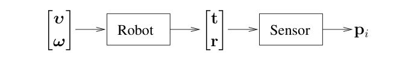
*그림 4 — 시스템의 입력과 출력.*

이로부터 현재 자세에 대한 목표 카메라 자세의 위치와 자세 도함수는 다음과 같다:

$$\dot{\mathbf{x}} = \begin{bmatrix} \dot{\mathbf{t}} \\ \dot{\mathbf{r}} \end{bmatrix} = \begin{bmatrix} \mathbf{I} & -[\mathbf{t}]_\times \\ \mathbf{0} & \mathbf{J}_\omega \end{bmatrix}\begin{bmatrix} \boldsymbol{\upsilon} \\ \boldsymbol{\omega} \end{bmatrix} \tag{130}$$

여기서 $\mathbf{J}_\omega$는 선택한 회전 매개변수화의 도함수를 시스템에 지령한 각속도와 관계짓는 야코비안이다:

$$\dot{\mathbf{r}} = \mathbf{J}_\omega\,\boldsymbol{\omega}$$

#### 6.2.1 완전한 정보를 갖는 호모그래피 기반 상태 관측기 (Homography-based state observer with full information)

상태 관측은 호모그래피 분해로부터 하려는 것이다. [6]에서는 호모그래피 행렬 $\mathbf{H}$의 추정에 근거한 새로운 부류의 시각 서보 방법이 제안되었다. 원시 영상으로부터 호모그래피를 추정하는 효율적인 실시간 알고리즘이 [7]에서 제안되었다:

$$\mathbf{H} = \mathrm{argmin}\|\mathbf{y}(\mathbf{H}) - \mathbf{y}^*\|$$

호모그래피 분해 문제에는 일반적인 경우 4개의 해가 있고, 그중 둘은 나머지 둘의 "반대"라는 것을 이미 알고 있다.

$$Rtn_a = \{\mathbf{R}_a, \mathbf{t}_a, \mathbf{n}_a\}\,; \quad Rtn_{a-} = \{\mathbf{R}_a, -\mathbf{t}_a, -\mathbf{n}_a\} \tag{131}$$

$$Rtn_b = \{\mathbf{R}_b, \mathbf{t}_b, \mathbf{n}_b\}\,; \quad Rtn_{b-} = \{\mathbf{R}_b, -\mathbf{t}_b, -\mathbf{n}_b\} \tag{132}$$

모든 기준점이 카메라에서 보여야 한다는 제약(*가시성 제약, visibility constraint*)을 적용하면 이것들을 두 해로 줄일 수 있다. 전개 내내 이 제약을 만족하는 두 해가 $Rtn_a$와 $Rtn_b$이고, 그중 $Rtn_a$가 "참" 해라고 가정한다. 이 해들은 (102)-(104)에 따라 관계된다. 실제로는 어느 것이 올바른 해인지 정하기 위해 법선 $\mathbf{n}^*$의 근삿값을 쓸 수 있다. 따라서 근사 매개변수 벡터 $\widehat{\boldsymbol{\mu}}$를 갖고 비선형 상태 관측기를 만든다:

$$\widehat{\mathbf{x}} = \boldsymbol{\varphi}(\mathbf{y}(\mathbf{x}), \mathbf{y}^*, \widehat{\boldsymbol{\mu}})$$

### 6.3 수정된 제어 목표 (A modified control objective)

위치와 자세의 직교 오차에 근거한 제어 법칙을 전개한다. 현재 상대 카메라 자세와 목표 자세 사이의 오차는 호모그래피 분해로부터 얻는다. 그러나 두 가능한 해 $Rtn_a$와 $Rtn_b$ 가운데 하나를 거짓 해로 버릴 수 없다고 가정한다. 이 상황은 예를 들어 평면의 참 법선에 대한 사전 지식이 전혀 없을 때 생긴다. 이 경우 참 해와 거짓 해의 결합을 포함하는 오차 함수를 정의하고자 한다:

$$\mathbf{e} = \begin{bmatrix} \mathbf{e}_t(\mathbf{t}_a, \mathbf{t}_b) \\ \mathbf{e}_r(\mathbf{r}_a, \mathbf{r}_b) \end{bmatrix}$$

여기서 $\mathbf{e}_t$와 $\mathbf{e}_r$은 각각 평행이동 오차와 자세 오차를 정의하는 함수이다. 어느 해가 참인지 구별할 수 없으므로 한쪽에 다른 쪽보다 더 큰 가중치를 줄 이유가 없다는 의미에서, 이 함수가 대칭이어야 함은 분명하다. 한편 이 제어 법칙으로 얻는 폐루프 시스템이 안정하고, 현재 카메라 좌표계가 목표 좌표계와 일치하는 평형점으로 시스템을 수렴시키기를 원한다. *두 가능한 해의 평균*에 근거한 제어 법칙을 쓸 수 있으며, 이 경우 시스템은 앞에서 말한 목표 평형점이 아니라 공간의 또 다른 특정 배치로 항상 수렴함을 보일 것이다. 그럼에도 시스템은 항상 거짓 해를 버릴 수 있는 방식으로 수렴함을 보게 될 것이다. 참 해가 식별되고 나면 이 해만 써서 카메라를 제어해 시스템을 목표 평형점으로 가져갈 수 있다. 다음에 이 평균 제어 법칙을 기술하며, 호모그래피 분해 문제의 새로운 해석적 정식화를 활용해 이러한 제어 법칙의 안정성을 증명할 수 있음을 보게 될 것이다.

#### 6.3.1 평균 기반 제어 법칙 (Mean-based control law)

이후 전개를 간단히 하기 위해 해 $Rtn_a$가 미지의 올바른 해라고 가정한다. 즉 이 해가 현재 좌표계에 대한 목표 기준 좌표계의 참 위치와 자세를 준다. 최소화할 작업 함수(task function) [10]로서 평행이동 오차와 자세 오차를 정의한다:

$$\mathbf{e} = \begin{bmatrix} \mathbf{e}_t \\ \mathbf{e}_r \end{bmatrix} = \begin{bmatrix} \mathbf{t}_m \\ \mathbf{r}_m \end{bmatrix}$$

여기서 $\mathbf{t}_m$과 $\mathbf{r}_m$은 각각 다음과 같이 계산한 평행이동 평균과 자세 평균이다:

$$\mathbf{t}_m = \frac{\mathbf{t}_a + \mathbf{t}_b}{2} \tag{133}$$

$$\mathbf{r}_m \Longleftarrow \mathbf{R}_m = \mathbf{R}_a\left(\mathbf{R}_a^\top\mathbf{R}_b\right)^{1/2} \tag{134}$$

이렇게 계산한 $\mathbf{R}_a$와 $\mathbf{R}_b$의 평균인 회전 행렬 $\mathbf{R}_m$은 *두 회전의 리만 평균(Riemannian mean of two rotations)* 으로 정의된다(자세한 내용은 [8] 참조). 우리의 회전 매개변수화 (122)에 따라 $\mathbf{R}_m$으로부터 $\mathbf{r}_m$을 얻는다. 두 해 사이의 관계 (102), (104), (108)을 쓰면 $\mathbf{t}_m$과 $\mathbf{R}_m$을 추정 참 해 $Rtn_a$만의 함수로 쓸 수 있음이 분명하다. 그러면 (130)을 다음과 같이 다시 쓸 수 있다:

$$\begin{bmatrix} \dot{\mathbf{t}}_a \\ \dot{\mathbf{r}}_a \end{bmatrix} = \begin{bmatrix} \mathbf{I} & -[\mathbf{t}_a]_\times \\ \mathbf{0} & \mathbf{J}_\omega \end{bmatrix}\begin{bmatrix} \boldsymbol{\upsilon} \\ \boldsymbol{\omega} \end{bmatrix}$$

정의한 작업 오차로부터 입력 제어 동작을 다음과 같이 계산할 수 있다:

$$\mathbf{v} = \begin{bmatrix} \boldsymbol{\upsilon} \\ \boldsymbol{\omega} \end{bmatrix} = -\lambda\,\mathbf{e} \tag{135}$$

여기서 $\lambda$는 폐루프 수렴 속도를 조정하는 양의 스칼라이다. 작업 오차의 도함수는 앞으로 정할 어떤 상호작용 행렬(interaction matrix) $\mathbf{L}$에 따라 속도 스크루와 관계된다:

$$\dot{\mathbf{e}} = \mathbf{L}\,\mathbf{v}$$

이로부터 다음 폐루프 시스템을 얻는다:

$$\dot{\mathbf{e}} = -\lambda\,\mathbf{L}\,\mathbf{e} \tag{136}$$

이제 상호작용 행렬 $\mathbf{L}$의 계산과 성질에 관심을 둔다. 이 행렬의 성분을 다음과 같이 정한다:

$$\begin{bmatrix} \dot{\mathbf{e}}_t \\ \dot{\mathbf{e}}_r \end{bmatrix} = \begin{bmatrix} \mathbf{L}_{11} & \mathbf{L}_{12} \\ \mathbf{L}_{21} & \mathbf{L}_{22} \end{bmatrix}\begin{bmatrix} \boldsymbol{\upsilon} \\ \boldsymbol{\omega} \end{bmatrix}$$

$$\begin{bmatrix} \dot{\mathbf{e}}_t \\ \dot{\mathbf{e}}_r \end{bmatrix} = \begin{bmatrix} \frac{\partial\mathbf{e}_t}{\partial\mathbf{t}_a} & \frac{\partial\mathbf{e}_t}{\partial\mathbf{r}_a} \\ \frac{\partial\mathbf{e}_r}{\partial\mathbf{t}_a} & \frac{\partial\mathbf{e}_r}{\partial\mathbf{r}_a} \end{bmatrix}\begin{bmatrix} \mathbf{I} & -[\mathbf{t}_a]_\times \\ \mathbf{0} & \mathbf{J}_\omega \end{bmatrix}\begin{bmatrix} \boldsymbol{\upsilon} \\ \boldsymbol{\omega} \end{bmatrix}$$

$$\begin{aligned} \mathbf{L}_{11} &= \frac{\partial\mathbf{e}_t}{\partial\mathbf{t}_a} \\ \mathbf{L}_{12} &= -\frac{\partial\mathbf{e}_t}{\partial\mathbf{t}_a}[\mathbf{t}_a]_\times + \frac{\partial\mathbf{e}_t}{\partial\mathbf{r}_a}\mathbf{J}_\omega \\ \mathbf{L}_{21} &= \frac{\partial\mathbf{e}_r}{\partial\mathbf{t}_a} \\ \mathbf{L}_{22} &= -\frac{\partial\mathbf{e}_r}{\partial\mathbf{t}_a}[\mathbf{t}_a]_\times + \frac{\partial\mathbf{e}_r}{\partial\mathbf{r}_a}\mathbf{J}_\omega \end{aligned} \tag{137}$$

이어지는 절들은 부분 행렬 $\mathbf{L}_{11}$, $\mathbf{L}_{12}$, $\mathbf{L}_{21}$, $\mathbf{L}_{22}$의 계산과 (가능한 경우) 성질의 해석에 할애한다. 그러나 이 기법의 제어 문제를 계속하기 전에 $\mathbf{r}_m$과 $\{\mathbf{r}_a, \mathbf{r}_b\}$의 관계에 대한 몇 가지 세부를 더 전개해야 한다. 다음 소절이 이를 다룬다.

#### 6.3.2 두 회전의 평균의 매개변수화 (Parametrization of the mean of two rotations)

위에서 말했듯이 자세 오차의 척도로 두 회전 $\mathbf{R}_a$와 $\mathbf{R}_b$의 평균을 쓴다.

$$\mathbf{R}_m = \mathbf{R}_a\left(\mathbf{R}_a^\top\mathbf{R}_b\right)^{1/2}$$

이미 알듯이 $\mathbf{R}_b$는 $Rtn_a$의 함수로 쓸 수 있다. 이를 써서 자세 평균의 매개변수화 $\mathbf{r}_m$을 $\mathbf{r}_a$의 함수로 나타내는 표현을 찾고자 한다. 편의를 위해 여기 다시 적는 관계식 (115)에 따르면:

$$\mathbf{R}_b = \mathbf{R}_a\mathbf{R}_{ab}$$

$\mathbf{R}_b$는 이 두 회전의 합성이다. 이를 쓰면 $\mathbf{R}_m$도 두 회전의 합성으로 쓸 수 있다:

$$\mathbf{R}_m = \mathbf{R}_a\,\mathbf{R}_h = \mathbf{R}_a\,\mathbf{R}_{ab}^{1/2}$$

여기서 $\mathbf{R}_h$를 $\mathbf{R}_{ab}$에 대응하는 "절반(half)" 회전, 즉 같은 축 $\mathbf{u}_{ab}$ 둘레로 절반 각 $\theta_{ab}/2$만큼 도는 회전이라 불렀다. 두 회전의 합성의 매개변수화 $\mathbf{r}$에 대한 표현은 이미 (121)에서 얻었다. $\mathbf{r}_a$와 $\mathbf{r}_h$의 합성에 이 관계를 쓰면:

$$\mathbf{r}_m = \frac{\mathbf{r}_a + \mathbf{r}_h + \mathbf{r}_a \times \mathbf{r}_h}{1 - \mathbf{r}_a^\top\mathbf{r}_h} \tag{138}$$

여기서¹¹

$$\mathbf{r}_h = \tan\frac{\theta_{ab}}{4}\,\mathbf{u}_{ab}$$

> 각주 11: 때때로 도움이 될 수 있는 실험적 관찰은 $\mathbf{u}_m$이 항상 $\mathbf{u}_a$와 $\mathbf{u}_b$로 정의되는 평면 위에 있는 것으로 보인다는 것이다.

앞에서 $\tan(\theta_{ab}/2)$와 $\mathbf{u}_{ab}$의 표현을 계산했으며, 각각 (119)와 (120)에 주어져 있다. 다음 삼각 관계를 이용하고:

$$\tan\frac{\alpha}{2} = \frac{\pm\sqrt{1 + \tan^2\alpha} - 1}{\tan\alpha}\,; \qquad \text{임의의 각 } \alpha \text{에 대해}$$

정규화된 각 $\theta_{ab} \in [-\pi, \pi]$을 고려하면 $\theta_{ab}/4 \in [-\pi/4, \pi/4]$이므로, 플러스/마이너스 모호성 없이 다음 관계를 얻을 수 있다:

$$\tan\frac{\theta_{ab}}{4} = \frac{\sqrt{1 + \tan^2(\theta_{ab}/2)} - 1}{\tan(\theta_{ab}/2)}$$

이 관계로부터 (119)와 (120)을 써서 $\mathbf{r}_h$의 원하는 꼴을 얻는다:

$$\mathbf{r}_h = \frac{\rho - \left(2 + \mathbf{n}_a^\top\mathbf{t}_a^*\right)}{\|\mathbf{n}_a \times \mathbf{t}_a^*\|^2}\left(\mathbf{n}_a \times \mathbf{t}_a^*\right) \tag{139}$$

여기서 늘 그렇듯이:

$$\mathbf{t}_a^* = \mathbf{R}_a^\top\mathbf{t}_a$$

결론적으로 식 (138)과 (139)는 $\mathbf{r}_m$과 $Rtn_a$의 요소 사이의 원하는 관계를 준다.

**$\mathbf{J}_\omega$의 계산 (Computation of $\mathbf{J}_\omega$)**

상호작용 부분 행렬을 연구하기에 앞서 (130)의 행렬 $\mathbf{J}_\omega$의 표현을 구한다. 이 야코비안은 우리의 자세 매개변수화를 시스템에 지령한 각속도와 관계짓는다:

$$\dot{\mathbf{r}}_a = \mathbf{J}_\omega\,\boldsymbol{\omega}$$

이 야코비안은 사원수의 도함수와 그것의 각속도와의 관계를 생각하면 더 쉽게 유도된다. [10](37쪽)에 기술된 대로 이 관계는 다음과 같다:

$$\frac{d\,\mathring{\mathbf{q}}}{dt} = \frac{1}{2}\left(\boldsymbol{\omega} \circ \mathring{\mathbf{q}}\right)$$

여기서 $\mathring{\mathbf{q}}$는 회전의 표현으로 쓰는 단위 사원수이고 $\circ$는 사원수 곱을 뜻한다. 우리의 자세 매개변수화는 회전의 사원수 표현에 가까우므로 이 관계가 매우 유용하다. 사원수 곱을 전개하면:

$$\boldsymbol{\omega} \circ \mathring{\mathbf{q}} = \begin{bmatrix} 0 \\ \boldsymbol{\omega} \end{bmatrix} \circ \begin{bmatrix} \alpha \\ \boldsymbol{\beta} \end{bmatrix} = \begin{bmatrix} -\boldsymbol{\omega}^\top\boldsymbol{\beta} \\ \boldsymbol{\omega} \times \boldsymbol{\beta} + \alpha\,\boldsymbol{\omega} \end{bmatrix}$$

여기서 $\alpha$와 $\boldsymbol{\beta}$는 각각 $\mathring{\mathbf{q}}$의 실수부와 순수부이다. 그러면

$$\frac{d\,\mathring{\mathbf{q}}}{dt} = \begin{bmatrix} \dot{\alpha} \\ \dot{\boldsymbol{\beta}} \end{bmatrix} = \begin{bmatrix} -\frac{1}{2}\boldsymbol{\beta}^\top\boldsymbol{\omega} \\ \frac{1}{2}\left(\alpha\,\mathbf{I} - [\boldsymbol{\beta}]_\times\right)\boldsymbol{\omega} \end{bmatrix} \tag{140}$$

우리의 회전 매개변수화 $\mathbf{r}$은 사원수로부터 다음과 같이 얻을 수 있으므로:

$$\mathbf{r} = \frac{\boldsymbol{\beta}}{\alpha}$$

$\mathbf{r}_a$의 시간 도함수는 다음과 같다:

$$\dot{\mathbf{r}}_a = \frac{\alpha\,\dot{\boldsymbol{\beta}} - \dot{\alpha}\,\boldsymbol{\beta}}{\alpha^2}$$

$\dot{\alpha}$와 $\dot{\boldsymbol{\beta}}$에 대해 (140)에서 얻은 식을 대입하면 다음과 같이 쓸 수 있다:

$$\dot{\mathbf{r}}_a = \frac{1}{2\alpha^2}\left(\alpha^2\mathbf{I} - \alpha\,[\boldsymbol{\omega}]_\times + \boldsymbol{\beta}\,\boldsymbol{\beta}^\top\right)\boldsymbol{\omega}$$

이는 $\mathbf{r}_a$로 나타낼 수 있으며, 원하는 야코비안을 준다:

$$\dot{\mathbf{r}}_a = \mathbf{J}_\omega\,\boldsymbol{\omega}\,; \qquad \mathbf{J}_\omega = \frac{1}{2}\left(\mathbf{I} - [\mathbf{r}_a]_\times + \mathbf{r}_a\,\mathbf{r}_a^\top\right) \tag{141}$$

(125)를 쓰면 행렬 $\mathbf{J}_\omega$를 주는 또 다른 방식은 다음과 같다:

$$\mathbf{J}_\omega = \frac{1 + \|\mathbf{r}_a\|^2}{4}\left(\mathbf{I} + \mathbf{R}_a^\top\right) \tag{142}$$

(126)으로부터 이 행렬의 역행렬 표현을 쉽게 쓸 수 있다:

$$\mathbf{J}_\omega^{-1} = \frac{2}{1 + \|\mathbf{r}_a\|^2}\left(\mathbf{I} + [\mathbf{r}_a]_\times\right)$$

**$\mathbf{L}_{11}$의 계산 (Computation of $\mathbf{L}_{11}$)**

평행이동 오차는 평행이동 벡터의 두 해의 평균으로 정의되었다:

$$\mathbf{e}_t = \mathbf{t}_m = \frac{\mathbf{t}_a + \mathbf{t}_b}{2} \tag{143}$$

그러면 $\mathbf{L}_{11}$은:

$$\mathbf{L}_{11} = \frac{\partial\mathbf{e}_t}{\partial\mathbf{t}_a} = \frac{1}{2}\left(\frac{\partial\mathbf{t}_b}{\partial\mathbf{t}_a} + \mathbf{I}\right)$$

(102)로부터, 그리고 다음을 써서:

$$\frac{\partial\|\mathbf{t}_a\|}{\partial\mathbf{t}_a} = \frac{\mathbf{t}_a}{\|\mathbf{t}_a\|}\,; \qquad \frac{\partial\|\mathbf{t}_a\|^2}{\partial\mathbf{t}_a} = 2\,\mathbf{t}_a\,; \qquad \frac{\partial\rho}{\partial\mathbf{t}_a} = \frac{1}{\rho}\left(\mathbf{t}_a + 2\,\mathbf{R}_a\mathbf{n}_a\right)$$

야코비안 $\mathbf{L}_{11}$의 표현을 구할 수 있다:

$$\mathbf{L}_{11} = \frac{1}{2}\left[2\mu_1\mathbf{n}'_a\mathbf{t}_a^\top + \mu_1\mathbf{t}_a\mathbf{t}_a^\top - 4\mu_2\mathbf{n}'_a\mathbf{n}_a'^\top - 2\mu_2\mathbf{t}_a\mathbf{n}_a'^\top + \mu_3\mathbf{I}\right] \tag{144}$$

여기서 $\mathbf{n}'_a$는 다음을 뜻한다

$$\mathbf{n}'_a = \mathbf{R}_a\mathbf{n}_a$$

그리고 스칼라 $\mu_i$는 다음과 같다:

$$\mu_1 = \frac{1}{\rho\|\mathbf{t}_a\|} - \mu_2\,; \qquad \mu_2 = \frac{\|\mathbf{t}_a\|}{\rho^3}\,; \qquad \mu_3 = \frac{\|\mathbf{t}_a\|}{\rho} + 1 \tag{145}$$

**$\mathbf{L}_{12}$의 계산 (Computation of $\mathbf{L}_{12}$)**

$\mathbf{L}_{12}$의 계산에는 야코비안 $\frac{\partial\mathbf{e}_t}{\partial\mathbf{r}_a}$가 필요하다((137) 참조):

$$\frac{\partial\mathbf{e}_t}{\partial\mathbf{r}_a} = \frac{1}{2}\frac{\partial\mathbf{t}_b}{\partial\mathbf{r}_a}$$

$\mathbf{t}_a$는 $\mathbf{r}_a$와 독립이기 때문이다. 앞에서처럼 $\mathbf{n}'_a = \mathbf{R}_a\,\mathbf{n}_a$를 쓰고 (102)와 $\rho$를 다음과 같이 쓴다:

$$\mathbf{t}_b = \frac{\|\mathbf{t}_a\|}{\rho}\left(2\,\mathbf{n}'_a + \mathbf{t}_a\right)\,; \qquad \rho = \sqrt{\|\mathbf{t}_a\|^2 + 4\,\mathbf{t}_a^\top\mathbf{n}'_a + 4}$$

그다음 다음을 써서

$$\left[\frac{\partial\rho}{\partial\mathbf{r}_a}\right]^\top = \left[\frac{\partial\rho}{\partial\mathbf{n}'_a}\right]^\top\frac{\partial\mathbf{n}'_a}{\partial\mathbf{r}_a}\,; \qquad \frac{\partial\rho}{\partial\mathbf{n}'_a} = \frac{2}{\rho}\,\mathbf{t}_a^\top$$

$\frac{\partial\mathbf{n}'_a}{\partial\mathbf{r}_a}$를 간접적으로 계산한다. $\mathbf{n}'_a$의 시간 도함수는 다음과 같다:

$$\frac{d\mathbf{n}'_a}{dt} = \dot{\mathbf{R}}_a\,\mathbf{n}_a = [\boldsymbol{\omega}]_\times\mathbf{R}_a\,\mathbf{n}_a = -[\mathbf{n}'_a]_\times\boldsymbol{\omega}$$

$\mathbf{n}_a$가 상수이기 때문이다. 앞에서 보았듯이 (141):

$$\boldsymbol{\omega} = \mathbf{J}_\omega^{-1}\,\dot{\mathbf{r}}_a$$

이므로 다음을 얻는다:

$$\frac{d\mathbf{n}'_a}{dt} = -[\mathbf{n}'_a]_\times\mathbf{J}_\omega^{-1}\,\dot{\mathbf{r}}_a$$

이로부터 $\frac{\partial\mathbf{n}'_a}{\partial\mathbf{r}_a}$는 다음과 같이 쓸 수 있다:

$$\frac{\partial\mathbf{n}'_a}{\partial\mathbf{r}_a} = -[\mathbf{n}'_a]_\times\mathbf{J}_\omega^{-1} = -\mathbf{R}_a\,[\mathbf{n}_a]_\times\,\mathbf{R}_a^\top\mathbf{J}_\omega^{-1}$$

간단한 조작을 몇 번 하면 다음과 같이 쓸 수 있다:

$$\frac{\partial\mathbf{e}_t}{\partial\mathbf{r}_a} = \left[2\,\mu_2\,\mathbf{n}'_a\,\mathbf{t}_a^\top + \mu_2\,\mathbf{t}_a\,\mathbf{t}_a^\top + (1 - \mu_3)\,\mathbf{I}\right][\mathbf{n}'_a]_\times\,\mathbf{J}_\omega^{-1}$$

계수 $\mu_2$와 $\mu_3$은 (145)에서 정의했다. 이로부터 의도한 야코비안이 다음과 같다고 결론지을 수 있다((137)을 다시 참조):

$$\mathbf{L}_{12} = -\mathbf{L}_{11}\,[\mathbf{t}_a]_\times + \left[2\,\mu_2\,\mathbf{n}'_a\,\mathbf{t}_a^\top + \mu_2\,\mathbf{t}_a\,\mathbf{t}_a^\top + (1 - \mu_3)\,\mathbf{I}\right][\mathbf{n}'_a]_\times$$

여기서 이미 말했듯이 $\mathbf{n}'_a$는:

$$\mathbf{n}'_a = \mathbf{R}_a\,\mathbf{n}_a$$

이 표현을 더 정리하면 $\mathbf{L}_{12}$에 대한 극히 닫힌 꼴을 얻는다:

$$\mathbf{L}_{12} = -[\mathbf{e}_t]_\times \tag{146}$$

이는 $\dot{\mathbf{t}}_a$와 비슷한 방식으로, 즉

$$\dot{\mathbf{t}}_a = \mathbf{I}\,\boldsymbol{\upsilon} + (\boldsymbol{\omega} \times \mathbf{t}_a)$$

처럼 다음과 같이 쓸 수 있다는 뜻이다:

$$\dot{\mathbf{e}}_t = \mathbf{L}_{11}\,\boldsymbol{\upsilon} + (\boldsymbol{\omega} \times \mathbf{e}_t)$$

또는 같은 것으로:

$$\dot{\mathbf{t}}_m = \mathbf{L}_{11}\,\boldsymbol{\upsilon} + (\boldsymbol{\omega} \times \mathbf{t}_m)$$

이것의 해석은, 각속도에 관한 한 평행이동 벡터의 참 해 하나 $\mathbf{t}_a$에서와 같은 효과를 평행이동 벡터의 참 해와 거짓 해의 평균 $\mathbf{t}_m$에서도 볼 수 있다는 것이다.

**$\mathbf{L}_{21}$의 계산 (Computation of $\mathbf{L}_{21}$)**

상호작용 부분 행렬

$$\mathbf{L}_{21} = \frac{\partial\mathbf{e}_r}{\partial\mathbf{t}_a}\,; \qquad \mathbf{e}_r = \mathbf{r}_m$$

에 대해, 먼저 $\mathbf{e}_r$의 전 시간 도함수를 계산해 보면 다음과 같이 쓸 수 있다:

$$\dot{\mathbf{r}}_m = \frac{\partial\mathbf{r}_m}{\partial\mathbf{r}_h}\,\dot{\mathbf{r}}_h + \frac{\partial\mathbf{r}_m}{\partial\mathbf{r}_a}\,\dot{\mathbf{r}}_a \tag{147}$$

첫째 항이 $\boldsymbol{\omega}$에 의존하지 않음은 쉽게 보일 수 있다. 실제로 이 항은 다음과 같이 쓸 수 있다:

$$\frac{\partial\mathbf{r}_m}{\partial\mathbf{r}_h}\,\dot{\mathbf{r}}_h = \frac{\partial\mathbf{r}_m}{\partial\mathbf{r}_h}\frac{\partial\mathbf{r}_h}{\partial\mathbf{t}_a^*}\,\mathbf{R}_a^\top\,\boldsymbol{\upsilon}$$

왜냐하면

$$\dot{\mathbf{t}}_a^* = \frac{d\left[\mathbf{R}_a^\top\mathbf{t}_a\right]}{dt} = \mathbf{R}_a^\top\,\boldsymbol{\upsilon}$$

이기 때문이다. 한편 둘째 항은 $\boldsymbol{\upsilon}$에 의존하지 않는다. 이를 확인하려면 다음을 상기하는 것으로 충분하다:

$$\dot{\mathbf{r}}_a = \mathbf{J}_\omega\,\boldsymbol{\omega}$$

이로부터 둘째 항은 다음과 같이 쓸 수 있다:

$$\frac{\partial\mathbf{r}_m}{\partial\mathbf{r}_a}\,\dot{\mathbf{r}}_a = \frac{\partial\mathbf{r}_m}{\partial\mathbf{r}_a}\,\mathbf{J}_\omega\,\boldsymbol{\omega}$$

이는 식 (147)을 다음 식과 맞추면

$$\dot{\mathbf{e}}_r = \dot{\mathbf{r}}_m = \mathbf{L}_{21}\,\boldsymbol{\upsilon} + \mathbf{L}_{22}\,\boldsymbol{\omega} \tag{148}$$

상호작용 부분 행렬 $\mathbf{L}_{21}$과 $\mathbf{L}_{22}$를 다음과 같이 얻을 수 있다는 뜻이다:

$$\mathbf{L}_{21} = \frac{\partial\mathbf{r}_m}{\partial\mathbf{r}_h}\frac{\partial\mathbf{r}_h}{\partial\mathbf{t}_a^*}\,\mathbf{R}_a^\top \tag{149}$$

$$\mathbf{L}_{22} = \frac{\partial\mathbf{r}_m}{\partial\mathbf{r}_a}\,\mathbf{J}_\omega \tag{150}$$

이 소절에서는 $\mathbf{L}_{21}$에 관심을 둔다. 그러면 (149)의 첫 번째 야코비안부터 진행하면:

$$\frac{\partial\mathbf{r}_m}{\partial\mathbf{r}_h} = \frac{(1 + \|\mathbf{r}_a\|^2)\,\mathbf{I} + \left([\mathbf{r}_a]_\times^2 + [\mathbf{r}_a]_\times\right)\left(\mathbf{I} + [\mathbf{r}_h]_\times\right)}{(1 - \mathbf{r}_a^\top\mathbf{r}_h)^2}$$

관계식 (124)를 쓰면 여기에 $\mathbf{R}_a$를 도입할 수 있다:

$$\frac{\partial\mathbf{r}_m}{\partial\mathbf{r}_h} = \frac{1 + \|\mathbf{r}_a\|^2}{2\,(1 - \mathbf{r}_a^\top\mathbf{r}_h)^2}\left[(\mathbf{R}_a + \mathbf{I}) + (\mathbf{R}_a - \mathbf{I})\,[\mathbf{r}_h]_\times\right]$$

(149)에서 정해야 할 두 번째 야코비안은 다음과 같다:

$$\frac{\partial\mathbf{r}_h}{\partial\mathbf{t}_a^*} = \frac{\frac{1}{\rho}\,\mathbf{z}\,\mathbf{t}_a^{*\top} + (\frac{2}{\rho} - 1)\,\mathbf{z}\,\mathbf{n}_a^\top + \sigma_1\left(\mathbf{I} - \frac{2}{\|\mathbf{z}\|^2}\,\mathbf{z}\,\mathbf{z}^\top\right)[\mathbf{n}_a]_\times}{\|\mathbf{z}\|^2}$$

여기서 계수 $\sigma_1$과 벡터 $\mathbf{z}$는 다음과 같다:

$$\mathbf{z} = \mathbf{n}_a \times \mathbf{t}_a^*\,; \qquad \sigma_1 = \rho - \left(2 + \mathbf{n}_a^\top\mathbf{t}_a^*\right)$$

즉 $\mathbf{r}_h$는 이 요소들로 다음과 같이 나타낼 수 있다:

$$\mathbf{r}_h = \frac{\sigma_1}{\|\mathbf{z}\|^2}\,\mathbf{z}$$

$\frac{\partial\mathbf{r}_m}{\partial\mathbf{r}_h}$와 $\frac{\partial\mathbf{r}_h}{\partial\mathbf{t}_a^*}$를 곱할 때, 벡터 $\mathbf{r}_h$와 $\mathbf{z}$가 평행하므로 다음 곱을 포함하는 모든 항이 0이 되어 약간의 단순화를 할 수 있다:

$$[\mathbf{r}_h]_\times\mathbf{z} = 0$$

끝으로, 이 야코비안에 대한 닫힌 꼴은 아직 얻지 못했다는 점을 말해 두어야 한다. 그럼에도 뒤에서 보겠지만 이 행렬은 그 꼴과 복잡도가 어떻든 신경 쓸 필요가 없다.

**$\mathbf{L}_{22}$의 계산 (Computation of $\mathbf{L}_{22}$)**

여기서는 관계식 (150)을 출발점으로 삼는다. 관계식 (138)도 쓰면 야코비안 $\frac{\partial\mathbf{r}_m}{\partial\mathbf{r}_a}$를 계산할 수 있다:

$$\frac{\partial\mathbf{r}_m}{\partial\mathbf{r}_a} = \frac{1 + \|\mathbf{r}_h\|^2}{2\,(1 - \mathbf{r}_a^\top\mathbf{r}_h)^2}\left[\mathbf{R}_h^\top(\mathbf{I} - [\mathbf{r}_a]_\times) + (\mathbf{I} + [\mathbf{r}_a]_\times)\right]$$

이 야코비안 뒤에 $\mathbf{J}_\omega$를 곱하면 $\mathbf{L}_{22}$에 대한 다음 표현을 얻을 수 있다:

$$\mathbf{L}_{22} = \frac{(1 + \|\mathbf{r}_a\|^2)\,(1 + \|\mathbf{r}_h\|^2)}{4\,(1 - \mathbf{r}_a^\top\mathbf{r}_h)^2}\left(\mathbf{I} + \mathbf{R}_m^\top\right)$$

이는 매우 닫힌 꼴로 쓸 수 있다:

$$\mathbf{L}_{22} = \frac{1 + \|\mathbf{r}_m\|^2}{4}\left(\mathbf{I} + \mathbf{R}_m^\top\right) \tag{151}$$

이것은 $\mathbf{J}_\omega$ (142)와 정확히 같은 구조임을 알 수 있다. 이는 다음과 같이 썼던 것과 같은 방식으로,

$$\dot{\mathbf{r}}_a = \mathbf{0}\,\boldsymbol{\upsilon} + \mathbf{J}_\omega\,\boldsymbol{\omega}$$

다음과 같이 쓸 수 있다는 뜻이다:

$$\dot{\mathbf{r}}_m = \mathbf{L}_{21}\,\boldsymbol{\upsilon} + \mathbf{J}_\omega(\mathbf{r}_m)\,\boldsymbol{\omega}$$

표기 $\mathbf{J}_\omega(\mathbf{r}_m)$은 *$\mathbf{J}_\omega$의 표현에서 회전 $\mathbf{r}_a$를 $\mathbf{r}_m$에 대응하는 것으로 바꾼다*는 뜻이다.

### 6.4 안정성 해석 (Stability analysis)

이 절의 처음에 제시한 평균 기반 제어의 안정성을 해석한다. 먼저 평행이동 오차 $\mathbf{e}_t$의 안정성을 고려한다.

#### 6.4.1 평행이동 오차 $\mathbf{e}_t$의 안정성 (Stability of the translation error $\mathbf{e}_t$)

$\mathbf{e}_t$가 0으로 수렴함을 증명하기 위해 다음 리아푸노프(Lyapunov) 함수 후보를 제안한다:

$$V_t = \frac{1}{2}\,\mathbf{e}_t^\top\mathbf{e}_t$$

그 시간 도함수는 다음과 같다:

$$\dot{V}_t = \frac{d\|\mathbf{e}_t\|}{dt} = \mathbf{e}_t^\top\dot{\mathbf{e}}_t$$

상호작용 행렬의 성분으로 나타낸 $\dot{\mathbf{e}}_t$의 표현은 다음과 같다:

$$\dot{\mathbf{e}}_t = \mathbf{L}_{11}\,\boldsymbol{\upsilon} + \mathbf{L}_{12}\,\boldsymbol{\omega}$$

$\mathbf{L}_{12}$에 꼴 (146)을 쓰고 제어 입력 $\boldsymbol{\upsilon}$와 $\boldsymbol{\omega}$를 (135)로 바꾸면:

$$\dot{\mathbf{e}}_t = -\lambda\,\mathbf{L}_{11}\,\mathbf{e}_t - \lambda\,\mathbf{L}_{12}\,\mathbf{e}_r = -\lambda\,\mathbf{L}_{11}\,\mathbf{e}_t - \lambda\,[\mathbf{e}_t]_\times\,\mathbf{e}_r$$

이로부터

$$\dot{V}_t = -\lambda\,\mathbf{e}_t^\top\mathbf{L}_{11}\,\mathbf{e}_t$$

$\mathbf{L}_{11}$은 일반적으로 대칭 행렬이 아니므로 앞의 식을 다음과 같이 쓰는 것이 편리하다:

$$\dot{V}_t = -\lambda\,\mathbf{e}_t^\top\mathbf{S}_{11}\,\mathbf{e}_t \tag{152}$$

여기서 $\mathbf{S}_{11}$은 행렬 $\mathbf{L}_{11}$의 대칭 부분이다:

$$\mathbf{S}_{11} = \frac{\mathbf{L}_{11} + \mathbf{L}_{11}^\top}{2}$$

그러면 $\mathbf{e}_t$의 수렴은 행렬 $\mathbf{S}_{11}$의 양성(positiveness)에만 의존한다. (144)로부터 행렬 $\mathbf{S}_{11}$이 다음 꼴임을 알 수 있다:

$$\mathbf{S}_{11} = \frac{1}{2}\left[(\mu_1 - \mu_2)\left(\mathbf{n}'_a\mathbf{t}_a^\top + \mathbf{t}_a\mathbf{n}_a'^\top\right) + \mu_1\mathbf{t}_a\mathbf{t}_a^\top - 4\mu_2\mathbf{n}'_a\mathbf{n}_a'^\top + \mu_3\mathbf{I}\right] \tag{153}$$

이 행렬의 구조로 보아 그 고유값은 쉽게 계산할 수 있으며 다음과 같다:

$$\lambda_1 = \frac{\rho + \|\mathbf{t}_a\|}{2\,\rho} > 0, \qquad \lambda_2 = \frac{\|\mathbf{t}_a\| + 1}{2\,\rho} + \frac{1}{2} + \frac{\mathbf{t}_a^\top\mathbf{R}_a\mathbf{n}_a}{2\,\rho\,\|\mathbf{t}_a\|} > \lambda_3, \qquad \lambda_3 = \frac{\|\mathbf{t}_a\| - 1}{2\,\rho} + \frac{1}{2} + \frac{\mathbf{t}_a^\top\mathbf{R}_a\mathbf{n}_a}{2\,\rho\,\|\mathbf{t}_a\|} \geq 0$$

첫째 고유값에 대한 조건은 $\rho$가 양수임을 알고 있으므로 분명하다. 둘째 고유값은 셋째 고유값보다 큰데, 그 차가 다음과 같기 때문이다:

$$\lambda_2 - \lambda_3 = \frac{1}{\rho} > 0$$

끝으로 셋째 고유값은 항상 음이 아니며 특정한 배치, 즉

$$\frac{\mathbf{R}_a^\top\mathbf{t}_a}{\|\mathbf{t}_a\|} = -\mathbf{n}_a \tag{154}$$

에서만 0이 됨을 증명할 수 있다. 증명은 부록 D.1에 있다. 이 조건의 기하학적 해석은 그림 5의 왼쪽 그림에 보였다. 이 그림에서 $\mathbf{t}_a$를 $\mathbf{n}_a$와 같은 좌표계, 즉 좌표계 $\mathcal{F}^*$로 표현하면 후자에 평행함을 볼 수 있다. 관계식 (154)에 따르면 가능한 배치는 왼쪽 그림에 그린 것, 즉 현재 좌표계가 목표 좌표계와 물체 평면 사이에 있어 평행이동 벡터가 $\mathbf{n}_a$와 반대 방향을 가리키는 배치뿐이어야 한다. 그러나 현재 좌표계가 목표 좌표계 뒤에 있는 다른 배치도 가능함을 쉽게 알 수 있다. 이유는 매우 간단하다. (154)로 기술되는 배치에서 $Rtn_a$와 $Rtn_b$ 사이에 존재하는 독특한 관계에 주목하면 된다. 이 특정한 경우 (102)-(108)은 다음이 된다:

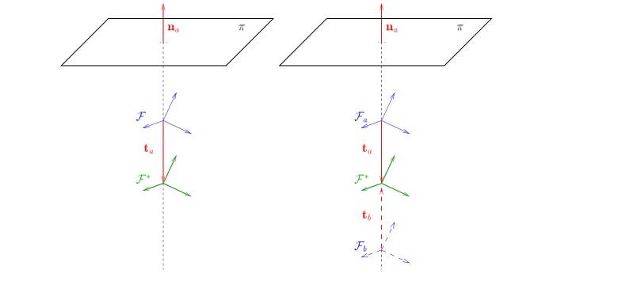
*그림 5 — $\mathbf{L}_{11}$이 특이해지는 기하학적 배치.*

$$\mathbf{t}_b = -\mathbf{t}_a\,; \qquad \mathbf{n}_b = -\mathbf{n}_a\,; \qquad \mathbf{r}_b = \mathbf{r}_a \tag{155}$$

이 상황은 그림 5의 오른쪽 그림에 그렸으며, "참" 해와 "거짓" 해를 보여 준다. 전개하는 동안 $Rtn_a$가 참 해에, $Rtn_b$가 거짓 해에 대응한다고 가정해 왔다. 그러나 실제로는 둘을 구별할 방법이 없다고 가정한다. 이는 $Rtn_a$ 대신 $Rtn_b$가 참 해일 수 있다는 뜻이다. 이런 일이 생기면, 현재 좌표계의 실제 해가 목표 좌표계 뒤에 있는 상황이 된다. 그러면 기하학적 배치 (154)를 다음 새 배치로 일반화해야 한다:

$$\frac{\mathbf{R}_a^\top\mathbf{t}_a}{\|\mathbf{t}_a\|} = \pm\mathbf{n}_a \tag{156}$$

관계식 (155)에서 나오는 또 한 가지 고려 사항은, 이 배치에서는 법선이 반대 방향을 가리키므로 두 해 $Rtn_a$, $Rtn_b$ 가운데 하나는 가시성 제약을 만족하지 않으리라는 것이다. $\dot{V}_t$ (152)에 대한 연구로 돌아가 앞의 문단들에 따르면, $\dot{V}_t$는 항상 양이 아니며 평형점 $\mathbf{e}_t = \mathbf{0}$에서만 0이라고 말할 수 있다. 그 이유는 0이 될 수 있는 $\mathbf{S}_{11}$의 유일한 고유값 $\lambda_3$이 관계식 (156)이 성립할 때만 실제로 0이 되기 때문이다. 이 배치에서 $\mathbf{t}_b = -\mathbf{t}_a$임을 알고 있으며, 이는 평균, 따라서 평행이동 오차가 0이라는 뜻이다.

$$\mathbf{e}_t = \mathbf{t}_m = \frac{\mathbf{t}_a + \mathbf{t}_b}{2} = 0$$

$\mathbf{e}_t$에 대한 결론으로, 이는 항상 평형점 $\mathbf{e}_t = \mathbf{0}$으로 수렴하며, 이 평형점은 기하학적 배치 (156)과 일치한다. 이제 $\mathbf{e}_t$가 항상 수렴함을 증명했으니 답해야 할 또 다른 흥미로운 질문이 있다. 그것은 다음과 같이 제기할 수 있다:

**평균 기반 제어 법칙을 쓰면 $\|\mathbf{t}_a\|$는 결코 증가하지 않는다 ($\|\mathbf{t}_a\|$ never increases using the mean-based control law)**

$\mathbf{e}_t$가 수렴하는 동안 현재 카메라 좌표계가 멀어져 물체의 가시성을 잃을 위험이 없도록 앞의 해석을 완성해야 한다. 실제로 이 질문의 답이 긍정이라면, 시스템이 $\mathbf{e}_t = 0$으로 수렴함에 따라 현재 카메라 자세가 목표 카메라 자세에 항상 가까워진다(또는 적어도 결코 멀어지지 않는다)는 것을 증명하는 셈이다. 다음 식을 상기하고:

$$\dot{\mathbf{t}}_a = \boldsymbol{\upsilon} - [\mathbf{t}_a]_\times\,\boldsymbol{\omega}$$

$\mathbf{t}_a$ 노름의 시간 도함수가 양수일 수 있는지 해석한다:

$$V_{t_a} = \frac{1}{2}\|\mathbf{t}_a\|^2 \implies \dot{V}_{t_a} = \mathbf{t}_a^\top\dot{\mathbf{t}}_a = \mathbf{t}_a^\top\boldsymbol{\upsilon}$$

평균 기반 제어 법칙 $\boldsymbol{\upsilon} = -\lambda\,\mathbf{e}_t$를 쓰면:

$$\dot{V}_{t_a} = -\lambda\,\mathbf{t}_a^\top\mathbf{t}_m = -\frac{\lambda}{2}\,\mathbf{t}_a^\top(\mathbf{t}_a + \mathbf{t}_b) \tag{157}$$

관계식 (102)로부터 $\mathbf{t}_b$를 행렬과 $\mathbf{t}_a$의 곱으로 쓸 수 있다:

$$\mathbf{t}_b = \mathbf{M}\,\mathbf{t}_a\,; \qquad \mathbf{M} = \frac{1}{\rho}\left(\frac{2}{\|\mathbf{t}_a\|}\,\mathbf{R}_a\,\mathbf{n}_a\,\mathbf{t}_a^\top + \|\mathbf{t}_a\|\,\mathbf{I}\right)$$

이 표현을 (157)에 쓰면 다음과 같이 쓸 수 있다:

$$\dot{V}_{t_a} = -\frac{\lambda}{2}\,\mathbf{t}_a^\top\mathbf{A}\,\mathbf{t}_a\,; \qquad \mathbf{A} = \mathbf{I} + \mathbf{M}$$

여기서 행렬 $\mathbf{A}$의 대칭 부분 $\mathbf{S}_A$를 도입할 수 있다:

$$\dot{V}_{t_a} = -\frac{\lambda}{2}\,\mathbf{t}_a^\top\mathbf{S}_A\,\mathbf{t}_a$$

행렬 $\mathbf{S}_A$의 고유값을 계산하면:

$$\lambda_1 = 1 + \frac{\|\mathbf{t}_a\|}{\rho}, \qquad \lambda_2 = 1 + \frac{\|\mathbf{t}_a\| + 1}{\rho} + \frac{\mathbf{t}_a^\top\mathbf{R}_a\mathbf{n}_a}{\rho\,\|\mathbf{t}_a\|}, \qquad \lambda_3 = 1 + \frac{\|\mathbf{t}_a\| - 1}{\rho} + \frac{\mathbf{t}_a^\top\mathbf{R}_a\mathbf{n}_a}{\rho\,\|\mathbf{t}_a\|}$$

이는 행렬 $\mathbf{S}_{11}$ 고유값의 정확히 두 배이며, 그 고유값들은 $\lambda_3 = 0$인 평형점 $\mathbf{e}_t = \mathbf{0}$을 제외하면 항상 양수라고 결론지었다. 이는 제안한 평균 기반 제어 법칙을 쓰면 $\|\mathbf{t}_a\|$가 항상 증가하지 않음을 확인해 준다.

#### 6.4.2 자세 오차 $\mathbf{e}_r$의 안정성 (Stability in the orientation error $\mathbf{e}_r$)

다음 리아푸노프 함수 후보를 정의한다:

$$V_r = \frac{1}{2}\,\mathbf{e}_r^\top\mathbf{e}_r$$

그 시간 도함수는:

$$\dot{V}_r = \frac{d\|\mathbf{e}_r\|}{dt} = \mathbf{e}_r^\top\dot{\mathbf{e}}_r$$

$\mathbf{e}_r$의 도함수 표현은 다음과 같다:

$$\dot{\mathbf{e}}_r = \mathbf{L}_{21}\,\boldsymbol{\upsilon} + \mathbf{L}_{22}\,\boldsymbol{\omega} = -\lambda\,\mathbf{L}_{21}\,\mathbf{e}_t - \lambda\,\mathbf{L}_{22}\,\mathbf{e}_r$$

방금 보았듯이 $\mathbf{e}_t$는 항상 0으로 수렴하므로 첫째 항은 0으로 간다. 앞서 말했듯이 $\mathbf{L}_{21}$의 구체적인 꼴이 중요하지 않은 이유가 이것이다. 둘째 항에 대해서는 행렬 $\mathbf{L}_{22}$의 양성을 증명해야 한다. 이것도 비대칭 행렬이므로 그 대칭 부분을 해석한다:

$$\mathbf{S}_{22} = \frac{\mathbf{L}_{22} + \mathbf{L}_{22}^\top}{2}$$

이는 다음 꼴이다:

$$\mathbf{S}_{22} = \frac{1 + \|\mathbf{r}_m\|^2}{4}\left(2\,\mathbf{I} + \mathbf{R}_m + \mathbf{R}_m^\top\right)$$

$\left(2\,\mathbf{I} + \mathbf{R}_m + \mathbf{R}_m^\top\right)$의 고유값은 다음과 같다:

$$\lambda_1 = 4\,; \qquad \lambda_2 = \lambda_3 = 2\,(1 + \cos\theta_m) \geq 0$$

$\theta_m = \pm\pi$일 때 $\lambda_2 = \lambda_3 = 0$이다. $\pm\pi$가 평균 각으로서 넓은 범위라고 보더라도, 이는 $\mathbf{L}_{22}$가 폐루프 방정식 (136)에 관여하는 방식을 알아차리면 피할 수 있는 제한이다. 이 방정식에서 $\mathbf{L}_{22}$는 다음 곱으로 나타난다:

$$\mathbf{L}_{22}\,\mathbf{e}_r = \mathbf{L}_{22}\,\mathbf{r}_m$$

(151)을 써서 $\mathbf{L}_{22}$를 바꾸면 이 곱은 다음이 된다:

$$\mathbf{L}_{22}\,\mathbf{r}_m = \frac{1 + \|\mathbf{r}_m\|^2}{4}\left(\mathbf{I} + \mathbf{R}_m^\top\right)\mathbf{r}_m$$

$\mathbf{r}_m$은 $\mathbf{R}_m$의 회전축 위에 있으므로 회전으로 바뀌지 않는다:

$$\mathbf{R}_m\,\mathbf{r}_m = \mathbf{r}_m$$

따라서 이 곱은 다음으로 줄어든다:

$$\mathbf{L}_{22}\,\mathbf{r}_m = \frac{1 + \|\mathbf{r}_m\|^2}{2}\,\mathbf{r}_m$$

이는 폐루프 시스템에 관한 한, 상호작용 행렬에서 $\mathbf{L}_{22}$를 다음의 대칭 양정치 행렬로 바꿀 수 있다는 뜻이다:

$$\mathbf{L}'_{22} = \frac{1 + \|\mathbf{r}_m\|^2}{2}\,\mathbf{I}$$

따라서 다음을 얻는다:

$$\frac{d\|\mathbf{e}_r\|}{dt} \to -\lambda\,\mathbf{e}_r^\top\mathbf{L}_{22}\,\mathbf{e}_r = -\lambda\,\frac{1 + \|\mathbf{r}_m\|^2}{2}\,\mathbf{e}_r^\top\mathbf{e}_r$$

이는 항상 양이 아니므로, $\mathbf{e}_r$에 대한 결론은 항상 $\mathbf{e}_r = \mathbf{0}$, 즉 $\mathbf{R}_a = \mathbf{R}_b = \mathbf{I}$로 수렴한다는 것이다.

#### 6.4.3 평균 기반 제어의 안정성에 관한 결론 (Conclusions on the stability of the mean-based control)

이 시점에서 위치 기반 제어 기법 전체의 안정성에 대한 결론은, 참 해와 거짓 해의 평균을 써서 전역 점근 안정성(global asymptotic stability)을 달성할 수 있다는 것이다. 유일한 제한은 $\mathbf{r}_m$에서 $\tan(\theta_m/2)$를 쓰는 데서 오는데, 평균 각 $\theta_m$이 $\pm\pi$로 가면 포화가 생길 수 있다. 끝으로 달성한 평형점 $\mathbf{e} = \mathbf{0}$은 현재 카메라 좌표계가 목표 좌표계와 일치하는 목표 배치가 아니라는 점에 주목해야 한다:

$$\mathbf{e} = \mathbf{0} \nRightarrow \begin{bmatrix} \mathbf{t}_a \\ \mathbf{r}_a \end{bmatrix} = \mathbf{0}$$

대신 그것은 다음으로 정의되는 직교 공간의 직선에 대응한다:

$$\frac{\mathbf{R}_a^\top\mathbf{t}_a}{\|\mathbf{t}_a\|} = \pm\mathbf{n}_a\,; \qquad \mathbf{R}_a = \mathbf{I} \tag{158}$$

$$\mathbf{e} = \mathbf{0} \Rightarrow \begin{bmatrix} \frac{\mathbf{t}_a}{\|\mathbf{t}_a\|} \\ \mathbf{r}_a \end{bmatrix} = \begin{bmatrix} \pm\mathbf{n}_a \\ \mathbf{0} \end{bmatrix}$$

즉 현재 카메라 좌표계는 기준 좌표계에 맞게 올바로 정렬되지만, 평행이동 오차는 항상 기준 평면 법선에 평행한 배치에 도달하며 수렴한다. 다음 절에서 보겠듯이 이는 전환 제어 법칙(switching control law)을 써서 극복한다.

#### 6.4.4 전역 안정성을 제한하는 실제적 고려 사항 (Practical considerations bounding global stability)

이론적 전개에서는 $Rtn_a$가 네 가능한 해 (131)-(132) 가운데 참 해라고 가정했다. 공식을 써서 $Rtn_a$로부터 $Rtn_b$를 계산하면, $Rtn_a$가 가시성 제약을 만족하는데도 $Rtn_b$는 만족하지 않는 일이 생길 수 있다. 이는 대신 $Rtn_{b-}$를 골라 $Rtn_a$와 함께 평균 기반 제어 입력 계산에 써야 한다는 뜻이다. 게다가 실제 상황에서 참 해와 거짓 해의 평균으로 제어할 때는 어느 것이 참 해인지 가려낼 수단이 없다고 가정하므로, 네 가능한 해 가운데 가시성 제약을 만족하는 두 해를 골라야 한다. 이렇게 고르면 두 해 가운데 하나는 참 해임이 확실하지만, 다른 하나인 거짓 해는 공식으로 참 해에서 얻은 해일 수도, 그 반대일 수도 있다. 이는 앞에서처럼 $\{Rtn_a, Rtn_b\}$ 대신 쌍 $\{Rtn_a, Rtn_{b-}\}$를 쓸 때에도 평균 기반 제어 법칙의 수렴을 증명해야 한다는 뜻이다. 따라서 (133)-(134) 대신 다음의 대안적 평균 제어 법칙을 생각하자:

$$\mathbf{t}_m = \frac{\mathbf{t}_a - \mathbf{t}_b}{2}, \qquad \mathbf{r}_m \Longleftarrow \mathbf{R}_m = \mathbf{R}_a\left(\mathbf{R}_a^\top\mathbf{R}_b\right)^{1/2}$$

앞의 해석과의 유일한 차이는 새 행렬 $\mathbf{L}_{11_-}$이다. (144) 대신 이제 다음을 얻는다:

$$\mathbf{L}_{11_-} = \frac{1}{2}\left[-2\mu_1\mathbf{n}'_a\mathbf{t}_a^\top - \mu_1\mathbf{t}_a\mathbf{t}_a^\top + 4\mu_2\mathbf{n}'_a\mathbf{n}_a'^\top + 2\mu_2\mathbf{t}_a\mathbf{n}_a'^\top + (2 - \mu_3)\mathbf{I}\right] \tag{159}$$

(153) 대신 $\mathbf{L}_{11_-}$의 대칭 부분은 다음과 같다:

$$\mathbf{S}_{11_-} = \frac{1}{2}\left[(\mu_2 - \mu_1)\left(\mathbf{n}'_a\mathbf{t}_a^\top + \mathbf{t}_a\mathbf{n}_a'^\top\right) - \mu_1\mathbf{t}_a\mathbf{t}_a^\top + 4\mu_2\mathbf{n}'_a\mathbf{n}_a'^\top + (2 - \mu_3)\mathbf{I}\right] \tag{160}$$

그 고유값은 다음과 같다:

$$\lambda_{1_-} = \frac{\rho - \|\mathbf{t}_a\|}{2\,\rho}, \qquad \lambda_{2_-} = \frac{1 - \|\mathbf{t}_a\|}{2\,\rho} + \frac{1}{2} - \frac{\mathbf{t}_a^\top\mathbf{R}_a\mathbf{n}_a}{2\,\rho\,\|\mathbf{t}_a\|}, \qquad \lambda_{3_-} = -\frac{1 + \|\mathbf{t}_a\|}{2\,\rho} + \frac{1}{2} - \frac{\mathbf{t}_a^\top\mathbf{R}_a\mathbf{n}_a}{2\,\rho\,\|\mathbf{t}_a\|}$$

이 고유값들은 다음을 만족한다:

$$\lambda_{1_-} > 0\,; \qquad \lambda_{2_-} > \lambda_{3_-}\,; \qquad \lambda_{3_-} \geq 0 \ \text{ if } \|\mathbf{t}_a\| \leq 1$$

첫째 고유값에 대한 조건은 $\rho$가 다음과 같고:

$$\rho = \sqrt{\|\mathbf{t}_a\|^2 + 2\,\nu} > \|\mathbf{t}_a\|$$

$\nu > 0$이므로 분명하다. 둘째 고유값은 역시 셋째 고유값보다 큰데, 그 차가 다음과 같기 때문이다:

$$\lambda_2 - \lambda_3 = \frac{1}{\rho} > 0$$

$\lambda_{3_-}$에 대한 조건은 충분조건이며 부록 D.2에서 증명한다. 실제로 그 부록에서 증명한 $\lambda_{3_-}$가 음이 아니기 위한 필요충분조건은 다음과 같다:

$$\|\mathbf{t}_a\| \leq \frac{4 - (1 + c_\alpha)^2}{2\,(1 - c_\alpha)} \tag{161}$$

여기서 $c_\alpha = \cos\alpha$이고 $\alpha$는 벡터 $\mathbf{n}_a$와 $\mathbf{R}^\top\mathbf{t}_a$ 사이의 각이다. 그 증명의 결론은 (161)이 만족될 때(또는 더 제한적이지만 더 간단한 조건인 $\|\mathbf{t}_a\| \leq 1$을 쓸 때) $\mathbf{L}_{11_-}$이 항상 양의 준정치(positive-semidefinite)이고, 잘 알려진 배치 (156)에서만 특이해진다는 것이다. 6.4.1절과 비슷한 연구로 다음을 말할 수 있다: $\|\mathbf{t}_a\|$*는 쌍 $\{Rtn_a, Rtn_{b-}\}$에 근거한 평균 제어 법칙을 쓰면 결코 증가하지 않는다*. 이는 목표 자세와 현재 자세 사이의 거리가 $d^*$보다 작은 배치(즉 $\|\mathbf{t}_a\| \leq 1$)에서 출발하면, 이 노름은 결코 증가하지 않으므로 $\|\mathbf{t}_a\| \leq 1$을 유지하면서 $\mathbf{e}_t$가 항상 수렴함을 확인해 준다. 이에 따르면 폐루프 시스템의 전역 점근 안정성 조건은 국소 점근 안정성으로 낮추어야 한다. 그럼에도 조건 (161)을 만족하지 않는 배치에서 출발한 모든 시뮬레이션 실험에서 시스템은 완벽히 안정한 거동을 보였다. 이는 선택한 리아푸노프 함수로 두 번째 경우($\mathbf{t}_m = \frac{\mathbf{t}_a - \mathbf{t}_b}{2}$)의 전역 안정성을 증명하지는 못했지만, 이 경우에도 전역 안정성을 보장하는 다른 리아푸노프 함수 후보를 찾을 수 있을 가능성이 높음을 시사한다.

### 6.5 전환 제어 법칙 (Switching control law)

앞 절들에서 보였듯이 평균 기반 제어 법칙은 시스템을 항상 다음 평형점으로 가져간다((155) 참조):

$$\mathbf{t}_b = -\mathbf{t}_a\,; \qquad \mathbf{n}_b = -\mathbf{n}_a\,; \qquad \mathbf{R}_b = \mathbf{R}_a = \mathbf{I}$$

이는 요구되는 바와 달리 $\mathbf{t}_a$가 0이 아닐 수 있으므로 완전히 만족스럽지 않다. 이제 다음 목표 평형점에 도달하도록 이 제어 법칙을 개선하고자 한다:

$$\begin{bmatrix} \mathbf{t}_a \\ \mathbf{r}_a \end{bmatrix} = \mathbf{0} \Longrightarrow \begin{cases} \mathbf{t}_a = \mathbf{t}_b = \mathbf{0} \\ \mathbf{R}_a = \mathbf{R}_b = \mathbf{I} \end{cases} \tag{162}$$

(노름 $\mathbf{t}_b$는 항상 $\mathbf{t}_a$의 노름과 같으므로 두 해는 동시에 평행이동이 0이어야 한다.) 앞서 말했듯이 실제로는 처음에 가시성 제약을 만족하는 두 해를 고르고, 시스템이 직교 공간의 특정 배치 (158)로 수렴할 때까지 그 평균으로 시스템을 제어한다. 이 수렴 동안 물체가 움직이지 않고 기준 좌표계 $\mathcal{F}^*$도 정지해 있으므로 참 법선 $\mathbf{n}_a$는 바뀌지 않는다. 한편 거짓 법선 $\mathbf{n}_b$는 원래 방향에서 바뀌어 $\mathbf{n}_a$와 반대가 될 때까지 변한다. 이는 그림 6에서 분명히 이해할 수 있으며, 그림에는 초기 시각 $t_0$부터 시스템이 수렴하는 $t_\infty$까지 거짓 법선과 그 반대의 변화가 나와 있다. 이 연속적인 변화 동안 어느 시점에서 $\mathbf{n}_b$가 더 이상 가시성 제약을 만족하지 않게 됨이 분명하다. 이 시각을 그림에서 $t_\perp$로 표시했지만, 이는 $\mathcal{F}^*$에 대한 기준점들의 위치에 따라 $\mathbf{n}_b$가 $\mathbf{n}_a$에 수직이 되는 시각 전에 생길 수도 후에 생길 수도 있다. 그 시각 이후에는 $-\mathbf{n}_b$가 가시성 제약을 만족하기 시작하는 거짓 법선이다. 그러나 이는 처음부터 버린 해이므로 고려하지 않는다. 이는 두 해의 평균에 근거한 제어가 현재 좌표계를, 처음에 가시성 제약을 만족한 두 해 가운데 거짓 해를 항상 검출할 수 있는 방식으로 이끈다는 뜻이다. 그러면 이 시각부터는 참 해만 써서 시스템을 제어해 목표 평형점 (162)로 가져갈 수 있다. 이에 따라, 두 해 중 하나가 거짓으로 드러나면 평균 제어에서 참 해만 쓰는 제어로 매끄럽게 전이하기 시작하는 전환 제어 전략을 제안할 수 있다. 제어 신호의 변화에 급격한 변화가 생기지 않도록, 거짓 해를 즉시 버리는 것보다 매끄러운 전이가 바람직하다. 그러면 평균 제어 법칙 (133)-(134)를 가중 평균 제어 법칙으로 바꿀 수 있다:

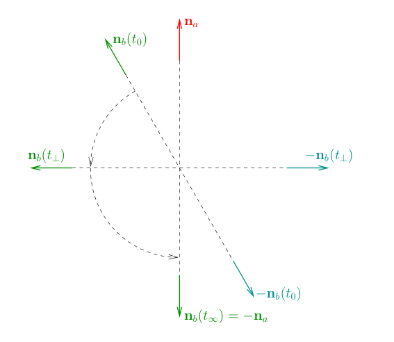
*그림 6 — 거짓 평면 법선 $\mathbf{n}_b$의 변화.*

$$\begin{cases} \mathbf{t}_m = \dfrac{\alpha_a\,\mathbf{t}_a + \alpha_b\,\mathbf{t}_b}{2} \\ \mathbf{r}_m \Longleftarrow \mathbf{R}_m = \mathbf{R}_a\left(\mathbf{R}_a^\top\mathbf{R}_b\right)^{\frac{\alpha_b}{2}} \end{cases}$$

가중 계수 $\alpha_a$와 $\alpha_b$는 지수적으로 감소하는 시간 함수에 따라 정의할 수 있다:

$$f(t) = e^{-\lambda_f\,(t - t_\perp)} \tag{163}$$

여기서:

$$\alpha_a = 2 - f(t)\,; \quad \alpha_b = f(t)$$

앞의 해석에서 $\mathbf{t}_b$와 $\mathbf{n}_b$가 나오면, $Rtn_b$나 $Rtn_{b-}$ 가운데 가시성 제약을 만족하는 쪽에 대응하는 평행이동과 법선으로 이해해야 한다. 실용적으로 큰 쓸모는 없지만 완결성을 위해 또 다른 경우를 언급할 수 있다. 참 해와 $Rtn_b$ 또는 $Rtn_{b-}$로부터 계산한 평균 평행이동과 평균 회전으로 제어할 수 있음을 이미 알고 있다. 가시성 제약을 만족하지 않는 해를 두 번째 해로 생각하면 어떻게 될까? 그림 6에 따르면 이는 평균 평행이동을 다음과 같이 계산하는 것을 뜻한다:

$$\mathbf{t}_m = \frac{\mathbf{t}_a - \mathbf{t}_b}{2}$$

$-\mathbf{t}_b$가 그림의 법선 $-\mathbf{n}_b$에 대응하기 때문이다. 이 경우 $-\mathbf{n}_a$로 수렴하는 것은 법선 $-\mathbf{n}_b$이다. 이제 $-\mathbf{n}_b$는 처음에 가시성 제약을 만족하지 않았고 수렴 동안에도 계속 그러하므로, 거짓 해의 가시성 조건 변화는 관찰되지 않을 것이다. 그림으로 말하면 거짓 해에 대응하는 법선 $\mathbf{n}_b$와 $-\mathbf{n}_b$의 회전이 그림에 보인 것과 반대 방향이라고 할 수 있다.

#### 6.5.1 거짓 해 검출의 대안 (Alternatives for the detection of the false solution)

시스템이 수렴하는 동안 가시성 제약을 써서 거짓 해를 검출하는 방법을 방금 기술했다. 다른 연구에서 이미 쓰인 다른 대안도 우리 경우에 적용할 수 있다. 그중 하나는, 앞에서 보았듯이 카메라 보정 오차가 없으면 카메라가 목표 배치로 움직이는 동안 참 법선이 바뀌지 않는다는 사실을 활용하는 것이다. 따라서 초기값에 대해 상당한 변화를 겪는 해를 거짓 해로 검출할 수 있다. 이 대안은 두세 단계 뒤에 거짓 해를 검출할 수 있다 하더라도 평균 기반 제어 법칙과 양립할 수 없는 것이 아니다. 그 경우에도 처음 몇 번의 반복 동안 시스템의 안정성을 보장하는 제어 법칙이 필요하기 때문이다. 평균 기반 제어 법칙은 거짓 해를 검출하는 데 필요한 두 단계, 세 단계, 또는 몇 단계든 그 동안 수렴을 보장한다. 한편 의도하는 것은 거짓 해를 검출할 수 있을 때까지 임의의 움직임을 하는 것이 아니라, 시스템을 항상 제어 아래 두면서 거짓 해를 검출할 수 있는 것이다.

### 6.6 시뮬레이션 결과 (Simulation results)

기술할 모든 실험의 공통 매개변수로서 초기 자세 오차는 36도이고 제어 법칙 (135)에 쓰는 스칼라 $\lambda$는 $\lambda = 1$로 고른다.

#### 6.6.1 참 해를 쓴 제어 (Control using the true solution)

이 실험에서는 네 가능한 해 (131)-(132) 가운데 참 해만 처음에 가시성 제약을 만족한다. 이 경우 평균 기반 제어를 쓸 필요가 없으며 통상의 위치 기반 제어가 시스템을 목표 평형점으로 가져간다. 그림 7의 위쪽에 평행이동 오차와 자세 오차의 변화를 보였다. 아래쪽 그림에는 필요한 제어 벡터를 주었다. 대신 거짓 해만 써서 제어하려 하면, 그 해가 가시성 제약을 만족하더라도 불안정한 거동이 관찰된다.

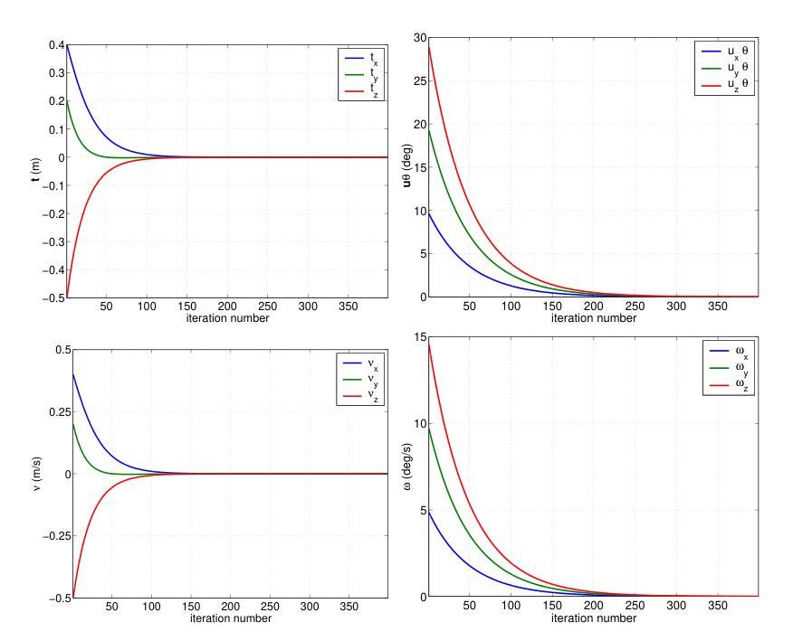
*그림 7 — 참 해만 쓴 시뮬레이션 실험.*

#### 6.6.2 평균 기반 제어 (Mean-based control)

그림 8에 보인 이 실험에서는 평균 기반 제어 법칙을 적용한다. 가장 불리한 상황을 모사한다. 즉 처음에 가시성 제약을 만족하는 두 해가 $Rtn_a$와 $Rtn_{b-}$이다. 이 경우 수렴은 $\|\mathbf{t}_a\|$가 조건 (161)을 만족할 때만 보장되었다. 이 실험에서는 처음에 $\|\mathbf{t}_a\| = 1.2$로, 그 조건을 만족하지 않는다. 따라서 이는 $\|\mathbf{t}_a\| \leq 1$이나 심지어 (161)도 시스템 수렴의 필요조건이 아님을 보여 준다. 그림에서 예상대로 $\mathbf{t}_a$가 0으로 수렴하지 않음을 알 수 있다. 특히 실험에서 $\mathbf{n}_a = [0, 0, 1]^\top$이므로 평형점에서 $\mathbf{t}_a$의 셋째 성분만 0이 아님을 볼 수 있다. 수렴하면 $\mathbf{n}_b = -\mathbf{n}_a$를 얻으므로 그때 어느 것이 참 해인지 알게 된다.

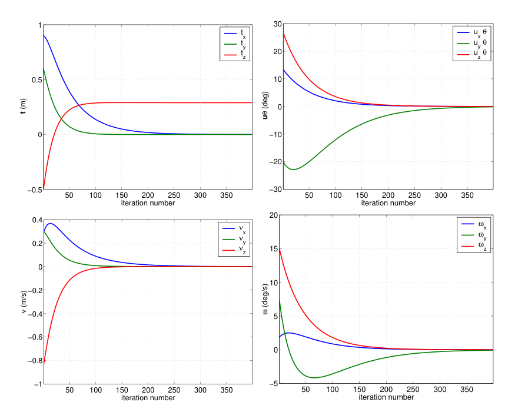
*그림 8 — 참 해와 거짓 해의 평균을 쓴 시뮬레이션 실험.*

#### 6.6.3 전환 제어 (Switching control)

마지막 실험에서는 전환 제어 전략의 성능을 보인다(그림 9 참조). 특히 거짓 해에 따르면 그 시점에 점 하나가 보이지 않게 되므로, 제어 시스템은 14번째 반복에서 전환을 시작한다.

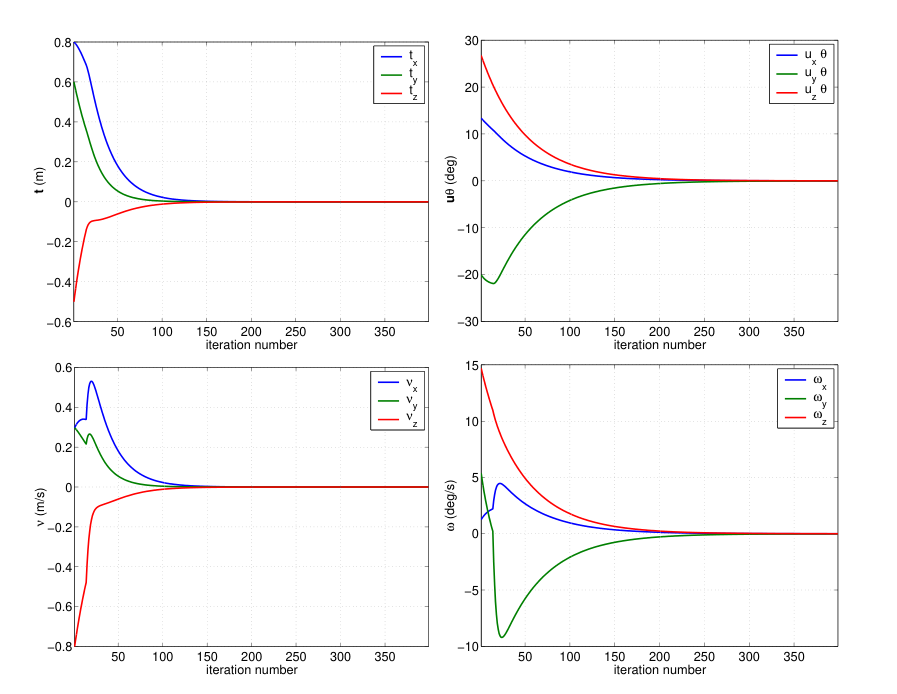
*그림 9 — 전환 제어를 쓴 시뮬레이션 실험.*

전환 속도 매개변수로 고른 값은 $\lambda_f = 0.25$이다. 이는 이산 시간 전환 메커니즘으로 구현했으며, (163)의 $(t - t_\perp)$를 $(k - k_\perp)$로 바꾸었다. 여기서 $k$는 현재 반복 번호이고 $k_\perp$는 거짓 해가 검출된 반복 번호이다. 예상대로 시스템이 목표 카메라 자세에 도달하는 평형점으로 수렴함을 볼 수 있다.

## 7. 해석적 분해에 근거한 하이브리드 시각 서보 (Hybrid visual servoing based on analytical decomposition)

앞 절에서 제안한 제어 기법은 참 법선 벡터의 선택에 근거한다. 이는 평행이동 벡터에 대한 두 해의 평균을 쓰는 데서 오는 전환 제어 법칙의 도입을 뜻한다. 대신 평균 회전만 제어하고 평행이동은 영상 데이터로 제어할 수 있다. 이렇게 하면 하이브리드 시각 서보(hybrid visual servoing) [12]를 얻지만, 호모그래피 분해의 참 해를 찾을 필요는 없다. 작업 함수는 다음과 같이 정의할 수 있다:

$$\mathbf{e} = \begin{bmatrix} (\mathbf{H} - \mathbf{I})\mathbf{m}^* \\ \mathbf{u}_m\theta_m \end{bmatrix}$$

여기서 $\mathbf{R}_m = \exp([\mathbf{u}_m\theta_m]_\times) = \mathbf{R}_v(\mathbf{R}_v^\top\mathbf{R}_f)^{(1/2)}$이다. 작업 함수의 도함수는 다음과 같이 쓸 수 있다:

$$\dot{\mathbf{e}} = \mathbf{L}\mathbf{v}$$

그리고 간단한 제어 법칙은 다음과 같다:

$$\mathbf{v} = -\lambda\widehat{\mathbf{L}}^{-1}\mathbf{e}$$

여기서 $\widehat{\mathbf{L}}$은 상호작용 행렬 $\mathbf{L}$의 근사이다.

그림 10은 제안한 하이브리드 시각 서보 기법의 시뮬레이션 결과를 보여 준다. 이미 언급했듯이 이 기법의 주된 장점은 두 해 사이에서 선택하는 일(즉 앞 절에서 제안한 제어 법칙의 전환)을 피한다는 것이다. 이 제어 법칙에서 제안하는 또 다른 개선은 새로운 회전 매개변수화로, $\theta_m = \pm\pi$일 때 앞 방법의 제한을 피한다. 한편 이 제어 법칙의 안정성 해석은 더 복잡하다. 현재로서는 고무적인 시뮬레이션 결과를 얻었으며, 안정성의 이론적 증명은 향후 연구로 남긴다.

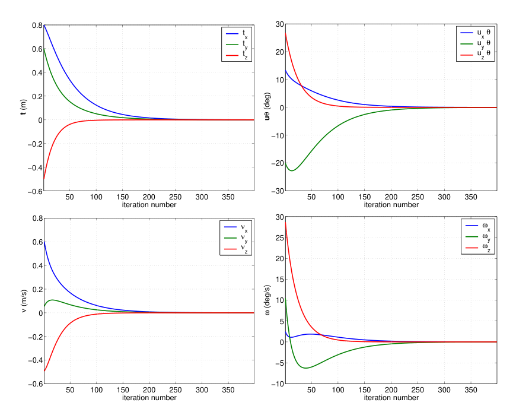
*그림 10 — 하이브리드 시각 서보를 쓴 시뮬레이션 실험.*

## 8. 결론 (Conclusions)

이 보고서에서는 유클리드 호모그래피 행렬을 분해하는 새로운 해석적 방법을 제시했다. 이 해석적 절차의 결과로 유클리드 분해 요소 $\mathbf{R}$, $\mathbf{t}$, $\mathbf{n}$의 서로 다른 해들 사이의 명시적 관계를 찾을 수 있었다. 보고서에서 기술한 또 다른 결과는, 역시 해석적 정식화에서 유도한 것으로, 둘을 구별할 사전 지식(예: 물체 평면 법선의 추정값)이 없다고 가정하고 호모그래피 분해의 두 해(그중 하나는 거짓 해)를 쓰는 위치 기반 제어 전략의 안정성 조건을 제시한 것이다. 이 제어 법칙을 쓰면 시스템이 어느 시점에서 어느 것이 참 해인지 항상 정할 수 있는 방식으로 진화함이 증명되었다. 참 해가 식별된 뒤에는 참 해만 쓰는 쪽으로 매끄럽게 옮겨 가기 위해 전환 전략을 도입했다. 이 문서에서 제안하는 또 다른 가능한 제어 법칙은 회전에 대해서만 해들의 평균을 쓰고 나머지 자유도는 영상 정보로 제어해 하이브리드 시각 서보 기법을 이룬다. 이 대안적 해법은 참 해의 선택을 피할 수 있게 해 준다.

향후 연구는 유도한 해석적 표현을 활용해 카메라 보정 오차가 호모그래피 분해에 미치는 영향을 연구하는 데 초점을 맞출 것이다. 또 다른 향후 목표는 보이는 두 해의 평균을 쓰는 하이브리드 시각 서보의 안정성 조건을 증명해 보는 것이다. 앞에서 보았듯이 이는 위치 기반 시각 서보에서 필요한 전환 메커니즘이 필요 없는 매우 흥미로운 대안이기 때문이다.

## 감사의 글 (Acknowledgments)

저자들은 PHC Picasso 프로젝트 "Robustness of vision-based control for positioning tasks"에서 수행한 이 연구를 지원해 준 INRIA, MEyC(과제 HF2005-0200 및 DPI2004-06419), Egide에 감사한다.

## 부록 A. 호모그래피 분해에 유용한 관계 (Useful relations for the homography decomposition)

(발췌: 유도 생략) 회전 행렬의 로드리게스 공식과 그로부터 나오는 관계:

$$\mathbf{R} = \mathbf{I} + \sin(\theta)[\mathbf{u}]_\times + (1 - \cos(\theta))[\mathbf{u}]_\times^2 \tag{164}$$

$$\mathbf{R} - \mathbf{R}^\top = 2\sin(\theta)[\mathbf{u}]_\times, \qquad \mathbf{H} - \mathbf{H}^\top = \left[2\sin(\theta)[\mathbf{u}]_\times + [\mathbf{n}]_\times\mathbf{t}\right]_\times$$

이 밖에 반각 삼각 관계($\sin 2x$, $\cos 2x$를 $\tan x$로 쓴 식), 반대칭 행렬 관계($[\mathbf{u}]_\times^2 = \mathbf{u}\mathbf{u}^\top - \|\mathbf{u}\|^2\mathbf{I}$, $[\mathbf{u}]_\times^3 = -\|\mathbf{u}\|^2[\mathbf{u}]_\times$ 등), 단위 벡터 도함수 성질, 역행렬 공식 $\left(\mathbf{I} + \mathbf{x}\mathbf{y}^\top\right)^{-1} = \mathbf{I} - \frac{1}{1 + \mathbf{x}^\top\mathbf{y}}\mathbf{x}\mathbf{y}^\top$을 정리했다. 끝으로 $\mathbf{H}^\top\mathbf{H} = \mathbf{S} + \mathbf{I}$는 단위 고유값에 연관된 특수한 고유벡터를 갖는다:

$$(\mathbf{S} + \mathbf{I})\,\mathbf{v} = \mathbf{v}\,; \qquad \mathbf{v} = [\mathbf{n}]_\times\mathbf{R}^\top\mathbf{t}$$

## 부록 B. 호모그래피 행렬의 정규화 (On the normalization of the homography matrix)

(발췌: 유도 생략) 추정한 $\widehat{\mathbf{H}}$로부터 정규화 호모그래피 $\mathbf{H} = \widehat{\mathbf{H}}/\gamma$, $\gamma = \mathrm{med}(\mathrm{svd}(\widehat{\mathbf{H}}))$를 얻는다. 이 인자는 3차 방정식

$$\det\left(\widehat{\mathbf{H}}^\top\widehat{\mathbf{H}} - \lambda\,\mathbf{I}\right) = 0 \implies \mathrm{svd}(\widehat{\mathbf{H}}) = \sqrt{\lambda}, \qquad \lambda^3 + a_2\lambda^2 + a_1\lambda + a_0 = 0$$

($a_2 = -(m_{11} + m_{22} + m_{33})$, $a_1 = m_{11}m_{22} + m_{11}m_{33} + m_{22}m_{33} - (m_{12}^2 + m_{13}^2 + m_{23}^2)$, $a_0 = m_{12}^2m_{33} + m_{13}^2m_{22} + m_{23}^2m_{11} - m_{11}m_{22}m_{33} - 2m_{12}m_{13}m_{23}$, $m_{ij}$는 $\mathbf{M} = \widehat{\mathbf{H}}^\top\widehat{\mathbf{H}}$의 성분)을 카르다노(Cardano) 공식으로 풀어 해석적으로 계산할 수 있다:

$$\lambda_1 = -\frac{a_2}{3} + (S + T), \quad \lambda_{2,3} = -\frac{a_2}{3} - \frac{1}{2}(S + T) \mp \frac{\sqrt{3}}{2}(S - T)\,i \tag{165}$$

$$S = \left(R + \sqrt{Q^3 + R^2}\right)^{1/3}, \quad T = \left(R - \sqrt{Q^3 + R^2}\right)^{1/3}, \quad Q = \frac{3a_1 - a_2^2}{9}, \quad R = \frac{9a_2a_1 - 27a_0 - 2a_2^3}{54}$$

$\mathbf{M}$이 대칭이므로 세 근은 모두 실수이고 $\lambda_1 \geq \lambda_2 \geq \lambda_3$로 정렬되며, 정규화 인자 $\gamma$는 (165)의 [중앙값 근의] 제곱근으로 주어진다.

## 부록 C. 여러 성질의 증명 (Proofs of several properties)

### C.1 행렬 $\mathbf{S}$의 소행렬식에 관한 성질의 증명 (Proof of properties on minors of matrix S)

(발췌: 유도 생략) $\mathbf{S} = \mathbf{x}\mathbf{y}^\top + \mathbf{y}\mathbf{x}^\top + \mathbf{y}\mathbf{y}^\top$ (166)의 꼴을 쓰면 주 소행렬식의 부호를 바꾼 값은 완전제곱이 되어 음이 아니다:

$$M_{\mathbf{S}_{11}} = (x_2y_3 - x_3y_2)^2 \geq 0, \quad M_{\mathbf{S}_{22}} = (x_1y_3 - x_3y_1)^2 \geq 0, \quad M_{\mathbf{S}_{33}} = (x_1y_2 - x_2y_1)^2 \geq 0$$

또 $m_1 = x_3y_2 - x_2y_3$, $m_2 = x_3y_1 - x_1y_3$, $m_3 = x_2y_1 - x_1y_2$ (170)-(172)로 두면 $M_{\mathbf{S}_{13}} = m_1m_3$ (173) 등이 성립하므로 관계식 (167)-(169)가 증명된다:

$$M_{\mathbf{S}_{12}} = \epsilon_{12}\sqrt{M_{\mathbf{S}_{11}}}\sqrt{M_{\mathbf{S}_{22}}}, \quad M_{\mathbf{S}_{13}} = \epsilon_{13}\sqrt{M_{\mathbf{S}_{11}}}\sqrt{M_{\mathbf{S}_{33}}}, \quad M_{\mathbf{S}_{23}} = \epsilon_{23}\sqrt{M_{\mathbf{S}_{22}}}\sqrt{M_{\mathbf{S}_{33}}}$$

### C.2 행렬 $\mathbf{S}$의 소행렬식과 관련된 기하학적 측면 (Geometrical aspects related to minors of matrix S)

(발췌: 유도 생략) 핵심 결과:

$$[\mathbf{n}]_\times\mathbf{t}^* = \pm\,\mathbf{m}\,; \qquad \mathbf{m} = \begin{bmatrix} \epsilon_{23}\sqrt{M_{\mathbf{S}_{11}}} \\ -\epsilon_{13}\sqrt{M_{\mathbf{S}_{22}}} \\ \epsilon_{12}\sqrt{M_{\mathbf{S}_{33}}} \end{bmatrix}$$

따라서 $\mathbf{n}$과 $\mathbf{t}^*$를 좌표 평면($YZ$, $XZ$, $XY$)에 투영한 두 벡터가 평행하면 대응하는 소행렬식이 0이 된다:

$$\mathbf{n}_{YZ} \parallel \mathbf{t}^*_{YZ} \Longrightarrow M_{\mathbf{S}_{11}} = 0, \qquad \mathbf{n}_{XZ} \parallel \mathbf{t}^*_{XZ} \Longrightarrow M_{\mathbf{S}_{22}} = 0, \qquad \mathbf{n}_{XY} \parallel \mathbf{t}^*_{XY} \Longrightarrow M_{\mathbf{S}_{33}} = 0$$

즉 $\mathbf{n}$과 $[0\ 0\ 1]^\top$이 정의하는 평면(그림 11의 파란 평면)이 공간을 두 영역으로 나누며, $\mathbf{t}^*$가 어느 쪽에 있느냐에 따라 대응하는 $M_{\mathbf{S}_{ij}}$(이 경우 $M_{\mathbf{S}_{12}}$)의 부호가 바뀌고, $\mathbf{t}^*$가 그 평면 위에 있으면 $M_{\mathbf{S}_{33}}$이 0이다.

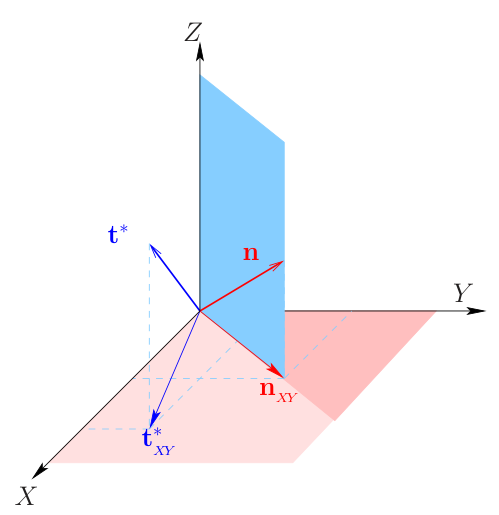
*그림 11 — $M_{\mathbf{S}_{33}}$이 0이 되기 위해 $\mathbf{t}^*$가 놓여야 하는 평면(파란색).*

### C.3 벡터 $\mathbf{x}$와 $\mathbf{y}$의 성분은 항상 실수이다 (Components of vectors x and y are always real)

(발췌: 유도 생략) (74)의 판별식은

$$b^2 - a\,c = 4\left(\mathrm{trace}(\mathbf{S}) + 1 - M_{\mathbf{S}_{11}} - M_{\mathbf{S}_{22}} - M_{\mathbf{S}_{33}}\right)$$

이고, 이것이 음이 아니라는 조건은 결국 다음과 같이 항상 참인 부등식으로 귀결된다:

$$(\mathbf{x}^\top\mathbf{y})^2 + 2\,\mathbf{x}^\top\mathbf{y} + 1 = (\mathbf{x}^\top\mathbf{y} + 1)^2 \geq 0$$

또 $a$와 $c$((71), (73))는 항상 양수이므로 $w \geq 0$이 성립한다.

### C.4 $\nu$의 여러 표현의 동등성 증명 (Proof of the equivalence of different expressions for $\nu$)

(발췌: 유도 생략) $\nu_1 = 2(1 + \mathbf{n}^\top\mathbf{R}^\top\mathbf{t}) = 2(1 + \mathbf{y}^\top\mathbf{x})$와 $\nu_2 = 2 + trace(\mathbf{S}) - \|\mathbf{t}_e\|^2$에 대해 $\mathbf{y}^\top\mathbf{x} = \frac{1}{2}\left(trace(\mathbf{S}) - \|\mathbf{y}\|^2\right)$이므로

$$\nu_1 = 2 + trace(\mathbf{S}) - \|\mathbf{t}_e\|^2 = \nu_2$$

### C.5 조건 $\rho > 1$의 증명 (Proof of condition $\rho > 1$)

(발췌: 유도 생략) $\mathbf{n}_e^\top(2\mathbf{n}_e + \mathbf{R}_e^\top\mathbf{t}_e) = 2 + \mathbf{n}_e^\top\mathbf{R}_e^\top\mathbf{t}_e > 1$((76) 이용)이고 이 값이 $\|2\mathbf{n}_e + \mathbf{R}_e^\top\mathbf{t}_e\|\cos\phi$와 같으므로,

$$-\frac{\pi}{2} < \phi < \frac{\pi}{2} \tag{174}$$

이며 $\cos\phi \leq 1$에서 $\rho = \|2\,\mathbf{n}_e + \mathbf{R}_e^\top\mathbf{t}_e\| > 1$이 증명된다.

## 부록 D. 안정성 증명 (Stability proofs)

### D.1 행렬 $\mathbf{S}_{11}$의 양성 (Positivity of matrix $\mathbf{S}_{11}$)

(발췌: 유도 생략) $\mathbf{S}_{11}$의 셋째 고유값 $\lambda_3$이 음이 아님을 증명한다. $\mathbf{t}_a^* = \mathbf{R}_a^\top\mathbf{t}_a$, $\mathbf{n}_a^\top\mathbf{t}_a^* = \|\mathbf{t}_a\|c_\alpha$ ($\alpha$는 $\mathbf{n}_a$와 $\mathbf{t}_a^*$ 사이의 각)로 두면 조건은

$$\lambda_3 = \frac{\|\mathbf{t}_a\| - 1 + \rho + c_\alpha}{2\,\rho} \overset{?}{\geq} 0 \tag{175}$$

이 되고, $\rho\,c_\phi = 2 + \|\mathbf{t}_a\|c_\alpha$($\phi$는 $\mathbf{n}_a$와 $2\mathbf{n}_a + \mathbf{t}_a^*$ 사이의 각, $c_\phi > 0$)를 써서 다음 꼴로 바뀐다:

$$\|\mathbf{t}_a\|(c_\phi + c_\alpha) + \left[2 + c_\phi(c_\alpha - 1)\right] \geq 0$$

$2 + c_\phi(c_\alpha - 1) \geq 0$이므로 충분조건은 $c_\phi \geq -c_\alpha$이며, $\alpha \in [-\pi/2, \pi/2]$인 경우(그림 12)와 $\mathbf{t}_a^*$가 2·3사분면에 있는 경우(그림 13). 후자의 경우 기준 평면 비교차 조건 (76)이 $\mathbf{t}_a^*$의 크기를 제한하며, 극한 경우 $\mathbf{n}_a^\top\mathbf{t}'_a = 1$(카메라가 물체 평면에 닿는 경우, 그림 14)에서 $\phi = \pi - \alpha$, 즉 $c_\phi = -c_\alpha$이고 그보다 작은 노름(그림 15)에서는 항상 $c_\phi > c_{\phi_{lim}} = -c_\alpha$이다. 따라서 두 경우 모두에서 이 조건이 성립함을 기하학적으로 보인다.

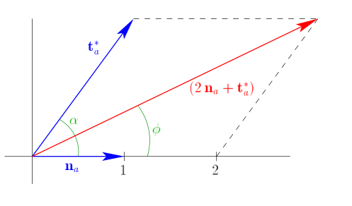
*그림 12 — 각 $\alpha$와 $\phi$. $\alpha \in [-\pi/2, \pi/2]$인 경우.*

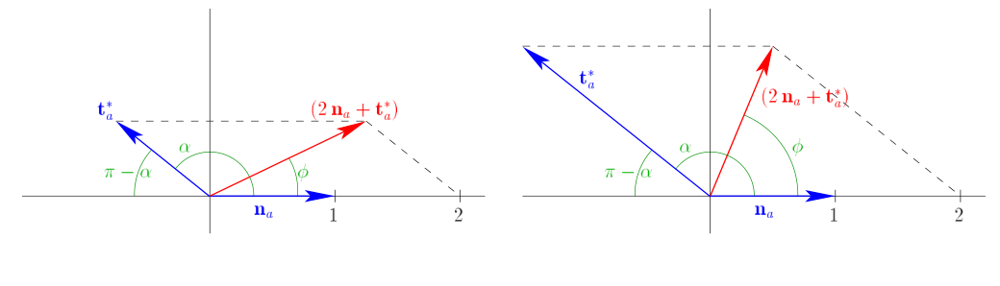
*그림 13 — 각 $\alpha$와 $\phi$. $\mathbf{t}_a^*$가 2사분면 또는 3사분면에 있는 경우. 왼쪽: 조건이 만족됨. 오른쪽: 조건이 만족되지 않음.*

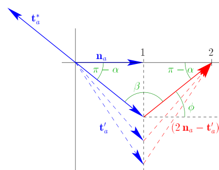
*그림 14 — 조건 $\mathbf{n}_a^\top\mathbf{t}'_a = 1$의 기하학적 해석.*

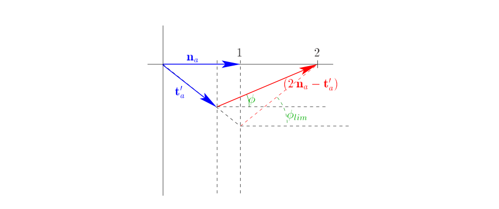
*그림 15 — 조건 $\mathbf{n}_a^\top\mathbf{t}'_a < 1$의 기하학적 해석.*

#### D.1.1 $\mathbf{S}_{11}$은 언제 특이한가? (When is $\mathbf{S}_{11}$ singular ?)

(발췌: 유도 생략) $\lambda_3 = 0$이려면 두 항 $2 + c_\phi(c_\alpha - 1) = 0$과 $\|\mathbf{t}_a\|(c_\phi + c_\alpha) = 0$이 동시에 성립해야 하며, 이는 $c_\alpha = -1$, $c_\phi = 1$일 때, 즉 $\mathbf{t}_a^*$가 평면 법선과 반대 방향일 때이다:

$$\frac{\mathbf{R}_a^\top\mathbf{t}_a}{\|\mathbf{t}_a\|} = -\mathbf{n}_a$$

기준 평면 비교차 제약 때문에 $c_\alpha = -1$이면 이미 $c_\phi = 1$이 따라 나오므로 추가 조건은 필요 없다. 이 배치에서 영 고유값에 대응하는 고유벡터는 $\kappa_1[n_{a2}, -n_{a1}, 0]^\top$, $\kappa_2[0, -n_{a3}, n_{a2}]^\top$ 꼴이다($n_{ai}$는 $\mathbf{R}_a\mathbf{n}_a$의 성분).

### D.2 행렬 $\mathbf{S}_{11-}$의 양성 (Positivity of matrix $\mathbf{S}_{11-}$)

(발췌: 유도 생략) $\mathbf{S}_{11-}$ (160)의 셋째 고유값 $\lambda_{3_-}$에 대해, 양변을 제곱해 정리하면 $\lambda_{3_-} \geq 0$의 필요충분조건으로 본문 (161)을 얻는다:

$$\|\mathbf{t}_a\| \leq \frac{4 - (1 + c_\alpha)^2}{2\,(1 - c_\alpha)}$$

특히 $\|\mathbf{t}_a\| \leq 1$이면 $(1 + c_\alpha)^2 + 2(1 - c_\alpha) \geq (1 + c_\alpha)^2 + 2\|\mathbf{t}_a\|(1 - c_\alpha)$이고 필요한 부등식이 항상 참이므로, $\|\mathbf{t}_a\| \leq 1$은 충분조건이다.

#### D.2.1 $\mathbf{S}_{11-}$은 언제 특이한가? (When is $\mathbf{S}_{11-}$ singular ?)

(발췌: 유도 생략) 부등식들은 $c_\alpha = 1$일 때 등식이 된다. 즉 $\mathbf{n}_a$와 $\mathbf{t}_a^*$가 평행한, 이미 알려진 직교 공간 배치 (156)에서만 $\lambda_{3_-} = 0$이다.

## 참고문헌 (References)

- [1] O. Faugeras and F. Lustman, “Motion and structure from motion in a piecewise planar environment”, in International Journal of Pattern Recognition and Artificial Intelligence, 2(3):485–508, 1988.
- [2] S. Hutchinson, G. D. Hager and P. I. Corke, “A tutorial on Visual Servo Control”, in IEEE Transaction on Robotics and Automation, 12(5):651–670, October 1996.
- [3] E. Malis, F. Chaumette and S. Boudet, “2 1/2 D Visual Servoing”, in IEEE Transaction on Robotics and Automation, 15(2):234–246, April 1999.
- [4] E. Malis, “Hybrid vision-based robot control robust to large calibration errors on both intrinsic and extrinsic camera parameters”, in European Control Conference, pp. 2898- 2903, Porto, Portugal, September 2001.
- [5] Y. Fang, D.M. Dawson, W.E. Dixon, and M.S. de Queiroz, ”Homography-Based Visual Servoing of Wheeled Mobile Robots”, in Proc. IEEE Conf. Decision and Control, pp. 2866-282871, Las Vegas, NV, Dec. 2002.
- [6] E. Malis and F. Chaumette, “Theoretical improvements in the stability analysis of a new class of model-free visual servoing methods”, in IEEE Transaction on Robotics and Automation, 18(2):176–186, April 2002.
- [7] S. Benhimane and E. Malis, “Real-time image-based tracking of planes using efficient second-order minimization”, in IEEE/RSJ International Conference on Intelligent Robots Systems, Sendai, Japan, October 2004.
- [8] M. Moakher., “Means and averaging in the group of rotations”, in SIAM Journal on Matrix Analysis and Applications, Vol. 24, Number 1, pp. 1-16, 2002.
- [9] M. Vargas and E. Malis, “Visual servoing based on an analytical homography decomposition”, in 44th IEEE Conference on Decision and Control and European Control Conference ECC 2005 (CDC-ECC’05), Seville, Spain, December 2005.
- [10] C. Samson, M. Le Borgne, and B. Espiau. Robot control: the task function approach, Vol. 22 of Oxford Engineering Science Series. Clarendon Press, Oxford, UK, 1991.
- [11] Z. Zhang, and A.R. Hanson. “3D Reconstruction based on homography mapping”, in Proc. ARPA96, pp. 1007-1012, 1996.
- [12] E. Malis, F. Chaumette “Theoretical improvements in the stability analysis of a new class of model-free visual servoing methods”, in IEEE Transaction on Robotics and Automation, 18(2):176-186, April 2002.
