# 회전 광학 측정 시스템에서 카메라 보정에 기반한 축 정렬 방법 (Hou 2020)

- 원제: Alignment Method of an Axis Based on Camera Calibration in a Rotating Optical Measurement System
- 원문: 같은 폴더의 `Hou2020_AppSci.pdf` (Applied Sciences 2020, 10(19), 6962, doi:10.3390/app10196962, MDPI 오픈 액세스, CC BY 4.0)
- 저자: Yanli Hou, Xianyu Su, Wenjing Chen* (College of Electronics and Information Engineering, Sichuan University, Chengdu 610065, China; *교신저자)
- 접수 2020년 8월 28일, 승인 2020년 10월 2일, 게재 2020년 10월 5일
- 번역 범위: 전문 (본문, 그림·표 캡션, 저자 기여·연구비·이해 상충 고지 포함. 참고문헌은 원문 그대로)
- 그림: 원문 그림 19개를 `그림/`에 넣고 본문에서 처음 언급되는 곳에 삽입

## 초록

CCD(charge-coupled device) 카메라와 턴테이블(turntable)로 구성된 회전 광학 측정 시스템의 정렬(alignment) 문제를 다룬다. 회전 장치와 함께 회전하는 카메라의 광학 중심(optical center, 컴퓨터 비전에서는 투영 중심 projection center)의 운동 궤적 모델을 세운다. 턴테이블로 카메라를 회전시킬 때 광학 중심의 위치를 계산하기 위해, 2차원 타깃을 이용한 카메라 보정(캘리브레이션, camera calibration)에 기반한 방법을 제안한다. 보조 좌표계(auxiliary coordinate system)를 도입해 카메라의 외부 파라미터 행렬을 조정함으로써 광학 중심들을 특별한 가상 평면(fictitious plane) 위로 사상한다. 최소제곱 평면 원 피팅(least square planar circle fitting) 방법으로 턴테이블의 중심과, 광학 중심과 회전 중심 사이의 거리를 정확히 계산할 수 있다. 마지막으로 회전 중심과 광학 중심의 좌표를 이용해 회전 측정 시스템에서 카메라를 설치하는 지침을 제공한다. 시뮬레이션과 실험으로 제안 방법의 타당성을 검증한다.

키워드: 회전 측정 시스템(rotation measurement system); 카메라 보정(camera calibration); 카메라와 턴테이블 정렬(camera and turntable alignment)

## 1. 서론 (Introduction)

최근 사진측량(photogrammetry) 원리 [1–3]에 기반한 광학 측정 방법은 고속·비접촉·고정확도·유연성 덕분에 빠르게 발전해 왔다. 광학 측정은 좌표 측정, 궤적 측정, 표면 복원을 위한 효과적인 방법 중 하나다. 3차원(3D) 센서 측정, 파노라마 영상 모자이크, 항공우주, 가상현실(VR), 증강현실(AR), 산업 제조 등 다양한 분야에서 널리 쓰인다 [4–9].

대규모 장면이나 360도 환형 영역의 측정에서는 카메라 시야(field of view, FOV)의 제약 때문에 단일 렌즈 카메라로 대상의 전체 측정 범위를 덮을 수 없다. 그래서 스캐닝 사진측량(scanning photography) [10]을 쓰는데, 고정점을 중심으로 회전하는 회전 기구가 카메라로 하여금 여러 각도에서 영상을 얻게 해 측정 범위를 넓힌다. 이론적으로, 투영 중심을 중심으로 회전하는 카메라가 찍은 인접 영상들은 장면의 3차원 형상 없이도 겹침 영역의 순수한 사영 변환(projective transformation)만으로 정합할 수 있다 [11–13]. 계산과 이후의 데이터 융합을 쉽게 하려면, 실제로 파노라마 영상을 만들 때 카메라의 광학 중심을 회전 기구의 회전 중심과 일치시키는 것이 매우 중요하다. 여기서 카메라의 광학 중심은 컴퓨터 비전에서 카메라 좌표계의 원점이다. 많은 문헌에서 투영 중심이라고도 부르며, 같은 매질 안에 설치된 카메라 렌즈의 제1 절점(first nodal point, 또는 주 절점 principle node)에 해당한다. 근거리 응용에서는 두 중심의 불일치(misalignment)가 최종 결과에 들어가고 영상이 잘 이어 붙지 않을 수 있다. 간결하게 하기 위해, 이 글의 나머지에서는 "카메라의 광학 중심"을 "광학 중심"으로 줄여 쓴다.

회전 광학 측정 시스템의 정렬은 여러 분야에서 늘 관심 주제였으며 많은 연구자의 흥미를 끌어 왔다. Carlo Tomasi 등 [11]은 원거리·근거리 타깃의 전이선(transition line)을 이용해 평행이동(병진, translation) 플랫폼으로 카메라를 움직여 회전 중심을 정렬하는 중심 맞춤(centering) 절차를 제안했으며, 위치 정확도는 0.1 mm에 이를 수 있었다. Antero Kukko 등 [14]은 특수 보정 타깃인 "원뿔(cones)"을 설계해 광학 중심을 회전 중심에 정렬함으로써 디지털 카메라를 구면 파노라마 카메라 헤드에 맞추어 조정했다. 달성한 투영 중심 불확도(uncertainty)는 약 1 mm로 추정되었다. Kauhanen 등 [15]은 3차원 보정 타깃을 쓰는 카메라 보정 방법에 기반해 회전 중심을 찾는 방법을 개발했다. 카메라 위치 보정을 위한 X, Y, Z 이동량을 수치적 방법으로 구했다. 보정 후 투영 중심과 회전 중심 사이의 표준편차는 0.161 mm에 이를 수 있었다. 이와 반대로, 일부 연구에서는 카메라와 회전 기구 사이의 관계를 미리 시스템 보정으로 계산한 뒤 이를 최종 영상 모자이크에 대입한다 [16–18]. 예를 들어 Zhang Zuxun 등 [19,20]은 Photo Total Station System(PTSS)이라는 측정 시스템을 설계했는데, 내부 파라미터를 아는 측량용 카메라(metric camera)를 토탈 스테이션(total station)의 망원경에 강체로 장착해 FOV를 넓히고 정확도를 높였다. Zhang 등 [21]은 넓은 시야각에서 정밀 측정을 하기 위해 경위의(theodolite)와 카메라로 이루어진 경위의–카메라(theodolite–camera, TC) 측정 시스템을 설계했다. 토탈 스테이션이나 경위의는 기준점(control point)의 공간 좌표를 제공할 수 있으며, 이를 이용해 회전하는 동안 카메라의 관계를 세울 수 있다. 이런 종류의 측정 시스템은 광학 중심과 회전 중심의 불일치 영향을 없애기 위해 복잡한 계산 과정이 필요하다.

어떤 회전 광학 측정 시스템이든 광학 중심의 운동 궤적은 회전 중심을 중심으로 하는 원이 된다. 원의 반지름이 0이면 광학 중심이 회전 중심과 일치한다는 뜻이다. 그렇지 않으면 광학 중심은 회전 중심과 맞지 않는다. 그러나 결상계가 여러 렌즈로 이루어져 있으므로 광학 중심의 실제 위치를 정확히 계산하고 정하기 어렵다. 따라서 광학 중심과 회전 중심 사이의 좋은 정렬을 보장하는 것은 어려운 과제이며, 어떤 불일치든 이후의 정보 접합(stitching)에 영향을 줄 수 있다.

정렬 문제를 풀기 위해 광학 중심과 회전 중심의 좌표를 계산하고자 카메라 보정 [22–26]의 개념을 도입한다. 이 논문에서는 비측량용(non-metric) 카메라와 일반 회전 플랫폼으로 구성된 회전 광학 측정 시스템에서, 카메라의 외부 파라미터(평행이동 벡터와 회전 행렬 포함)로부터 통일된 월드 좌표계에서의 광학 중심 위치를 계산하는, Zhang의 카메라 보정 원리 [27]에 기반한 방법을 제안한다. 턴테이블이 회전함에 따라 일련의 외부 파라미터 행렬을 얻고, 이로부터 일련의 광학 중심을 계산해 최소제곱 원(least square circle, LSC) 피팅 방법으로 회전 중심을 찾는다. 광학 중심과 회전 중심은 회전 측정 시스템에서 카메라를 설치하는 지침이 된다. 피팅 복잡도를 줄이고 피팅 정확도를 높이기 위해, 원 피팅 전에 광학 중심들을 하나의 가상 평면 위로 사상하는 보조 평면 좌표계를 도입한다. 또한 오차를 줄이기 위해 카메라를 서로 다른 위치에서 회전시키며 영상을 수집하고, 여러 세트의 광학 중심을 동시에 계산해 여러 개의 피팅 원 중심을 얻는다. 최종 회전 중심은 가중 알고리즘으로 정한다. 컴퓨터 시뮬레이션과 몇몇 실험으로 이 방법이 회전 광학 측정 시스템의 설치와 조정을 안내할 수 있음을 검증한다.

논문의 나머지 구성은 다음과 같다. 2절은 제안 방법의 원리를 설명한다. 3절은 제안 방법을 검증하는 시뮬레이션을 보인다. 4절은 제안 방법을 검증하는 실험 결과를 보이고 제안 방법의 장점과 기여를 논의한다. 5절은 논문을 요약한다.

## 2. 원리 (Principle)

이 절에서는 제안하는 회전 광학 측정 시스템의 기본 구성과 회전 중심을 찾기 위한 관련 기법을 설명한다.

### 2.1. 회전 광학 측정 시스템의 구성 (The Composition of the Rotating Optical Measurement System)

구축한 회전 광학 측정 시스템과 보정 장치는 체커보드 타깃, 카메라, 서보 제어 장치, 컴퓨터 처리 장치 등으로 이루어진다. 측정 시스템의 개략도는 그림 1a와 같다.

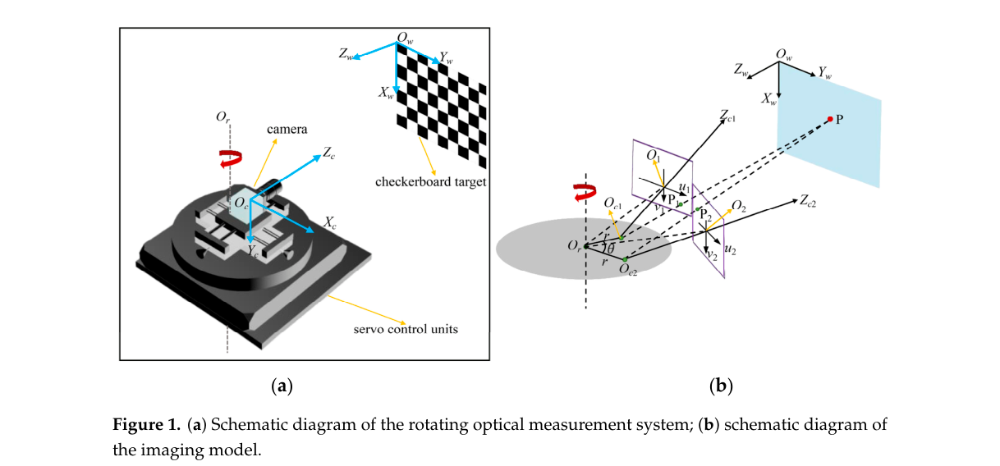
*그림 1 — (a) 회전 광학 측정 시스템의 개략도; (b) 결상 모델의 개략도.*

그림 1a에서 카메라는 회전 플랫폼과 서로 수직인 두 평행이동 플랫폼으로 구성된 서보 제어 장치 위에 놓인다. 두 평행이동 플랫폼은 턴테이블 위에 고정되어, 여러 번의 보정과 최종 정렬을 위해 카메라를 움직인다. Or은 턴테이블의 회전축이다. Oc-XcYcZc는 카메라 좌표계이고, Ow-XwYwZw는 고정된 월드 좌표계다. 이 좌표계들은 2.2절에서 설명한다. 카메라 보정을 위해 체커보드 타깃을 시스템 앞에 고정한다. 턴테이블이 카메라를 회전시키는 동안, 체커보드 전체 또는 일부를 담은 영상 시퀀스를 수집한다.

### 2.2. 결상 모델 (Imaging Model)

먼저 회전 광학 측정 시스템의 결상 모델을 소개한다. 그림 1b에서 Or은 회전축, P는 타깃 위의 한 점이며, P1과 P2는 카메라가 위치 1과 위치 2로 회전했을 때 그 점의 결상점이다. Oc1과 Oc2는 각각 두 촬영의 광학 중심이다. Oc1Zc1과 Oc2Zc2는 카메라의 광축 방향이고, Oi-uivi (i = 1, 2)는 영상 좌표계이며 원점은 Oi다. OrOc1과 OrOc2 사이의 회전각은 θ이다. 즉 ∠Oc1OrOc2 = ∠O1OrO2 = θ이다. Oc1O1 = Oc2O1 = f이며, f는 카메라의 초점 거리다. [역주: 원문 그대로 "Oc2O1"로 표기되어 있으나 문맥상 Oc2O2로 보인다.] 광학 중심이 턴테이블의 회전축에서 벗어나 있으면 Oc1과 Oc2는 회전 중심을 중심으로 하는 원 위에 있어야 한다. 즉 OrOc1 = OrOc2 = r이며, r은 원의 반지름이다. 광학 중심이 회전 중심과 일치하면 r→0이다. 회전 중심과 광학 중심의 위치는 우리 방법으로 구할 수 있다. 이 위치들을 이용해 카메라 이동 거리와 방향을 조정함으로써 광학 중심과 회전 중심의 정렬을 안내할 수 있다. 자세한 내용은 다음 절들에서 제시한다.

이론적으로는 턴테이블이 카메라를 회전시킬 때 광학 중심의 연속 위치들이 원 전체에 가능한 한 고르게 분포해야 한다. 그러나 매우 크고 원형인 보정 타깃을 제공하는 것은 거의 불가능하므로, 얻은 위치들은 원의 작은 호에만 놓일 수 있다. 회전 중심의 계산 정확도를 높이기 위해 카메라를 여러 위치로 옮겨 여러 그룹의 영상을 수집하고 여러 세트의 광학 중심을 얻는다. 턴테이블 평면이 평면 Ow-YwZw와 평행하고 각 초기 위치에서 카메라 광축이 타깃에 수직일 때에만, 광학 중심의 운동 궤적이 Ow-YwZw에 평행한 동심 원호 위에 놓인다. 그러나 실제 회전 광학 측정 시스템에서는 보정 과정에서 위 조건이 충족되지 않을 수 있으며, 그러면 얻은 피팅 원들이 동심이 되지 않는다. 이 문제를 극복하기 위해 보조 좌표계 Op-XpYpZp를 도입했다. Op-XpYpZp와 Ow-XwYwZw의 관계는 그림 2에 나타냈다. 보조 좌표계는 여러 세트의 광학 중심을 Ow-YwZw에 평행한 평면 위로 사상해, 평면 동심원 피팅으로 회전 중심을 찾을 수 있게 해 준다.

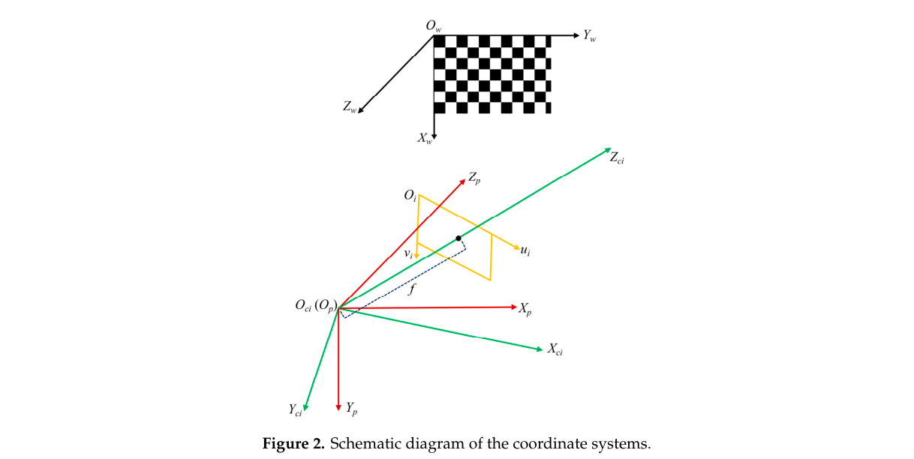
*그림 2 — 좌표계들의 개략도.*

명확히 하기 위해 보정에 쓰이는 네 좌표계를 강조해 둔다.

1. 월드 좌표계(World Coordinate System) Ow-XwYwZw는 오른손(Xw-Yw-Zw) 직교 3차원 좌표계이며, 원점 Ow는 고정된 체커보드 평면의 왼쪽 위 모서리에 둔다. 즉 고정된 체커보드 평면 위의 점들은 Zw = 0이다. 월드 좌표계는 보정하는 동안 기준 좌표계로 선택된다.
2. 영상 좌표계(Image Coordinate System) Oi-uivi는 카메라의 영상 평면에 고정된 직교 좌표계로, ui축과 vi축은 각각 센서 어레이의 위쪽 변과 옆 변에 평행하고 원점 Oi는 어레이의 왼쪽 위 모서리에 있다.
3. 카메라 좌표계(Camera Coordinate System) Oci-XciYciZci는 오른손(Xci-Yci-Zci) 직교 좌표계다. 원점 Oci는 카메라의 광학 중심에 있고, Zci축은 영상 평면에 수직이며 카메라 광축과 일치한다. Xci축과 Yci축은 각각 Oi-uivi의 ui축과 vi축에 평행하다. Zci = f인 평면이 영상 평면이며, f는 광학 중심과 영상 평면 사이의 주점 거리(principal distance)다.
4. 보조 좌표계(Auxiliary Coordinate System) Op-XpYpZp는 오른손(Xp-Yp-Zp) 직교 좌표계다. 원점 Op는 광학 중심에 있다. 평면 XpOpZp는 가상 평면이며, Xp축과 Yp축은 각각 Yw축과 Xw축에 같은 방향으로 평행하고, Zp축은 Zw축에 반대 방향으로 평행하다.

### 2.3. 회전 광학 측정 시스템의 회전 중심을 정하는 단계 (Steps to Determine the Rotation Center of the Rotating Optical Measurement System)

회전 광학 측정 시스템의 회전 중심을 정하는 절차는 세 단계로 나뉜다. 첫째, 카메라를 서로 다른 위치(i)에서 회전시키며 영상을 수집하고 Zhang의 방법으로 카메라의 내부 파라미터와 외부 파라미터(회전 행렬 R과 평행이동 벡터 T)를 보정한다. 그러면 통일된 월드 좌표계에서 광학 중심들의 좌표를 얻을 수 있다. 둘째, 보조 좌표계를 이용해, 얻은 광학 중심의 월드 좌표로부터 LSC 피팅 방법으로 회전 중심을 계산한다. 마지막으로 가중 알고리즘으로 최종 회전 중심을 구한다. 절차의 흐름도는 그림 3과 같다.

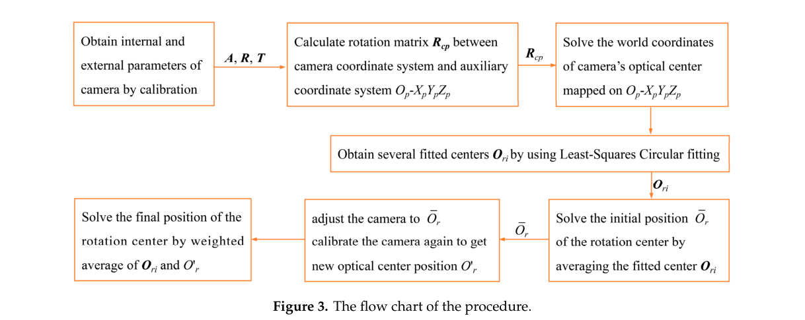
*그림 3 — 절차의 흐름도. (보정으로 카메라의 내부·외부 파라미터 A, R, T를 구함 → 카메라 좌표계와 보조 좌표계 Op-XpYpZp 사이의 회전 행렬 Rcp 계산 → Op-XpYpZp 위로 사상된 광학 중심의 월드 좌표 계산 → 최소제곱 원 피팅으로 여러 피팅 중심 Ori를 구함 → 피팅 중심 Ori의 평균으로 회전 중심의 초기 위치 $\bar{O}_r$를 구함 → 카메라를 $\bar{O}_r$로 옮기고 다시 보정해 새 광학 중심 위치 O'r을 구함 → Ori와 O'r의 가중 평균으로 회전 중심의 최종 위치를 구함)*

#### 2.3.1. 카메라의 광학 중심 계산 (Calculate the Optical Center of the Camera)

핀홀 카메라 모델에 기반한 전통적 카메라 보정 방법에서는, 월드 좌표를 아는 특징점과 그에 대응하는 영상 좌표로부터 카메라의 내부·외부 파라미터를 계산한다. 카메라 좌표계와 월드 좌표계 사이의 관계는 회전 행렬 R과 평행이동 벡터 T로 기술된다. R과 T는 고정된 월드 좌표계에서 카메라의 공간 위치를 반영한다. 월드 좌표계에서 점들의 동차 좌표 $M = (X_w, Y_w, Z_w, 1)^T$와 그 영상 좌표 $m = (u, v, 1)^T$를 알면, 둘 사이의 관계는 다음과 같이 기술된다.

$$
s\begin{bmatrix}u\\v\\1\end{bmatrix}=\begin{bmatrix}f_x&\alpha&u_0&0\\0&f_y&v_0&0\\0&0&1&0\end{bmatrix}\begin{bmatrix}R&T\\0^T&1\end{bmatrix}\begin{bmatrix}X_w\\Y_w\\Z_w\\1\end{bmatrix}=A\begin{bmatrix}R&T\\0^T&1\end{bmatrix}\begin{bmatrix}X_w\\Y_w\\Z_w\\1\end{bmatrix},\qquad(1)
$$

여기서 s는 0이 아닌 임의의 축척 계수(scale factor), $f_x$와 $f_y$는 각각 u축과 v축의 축척 계수, α는 두 영상 축의 비틀림 계수(skew factor), $(u_0, v_0)$는 카메라의 주점(principal point)이다. 회전 행렬 R은 직교 단위 행렬, T는 3차원 평행이동 벡터, A는 카메라의 내부 파라미터 행렬이며 다음과 같이 정의된다.

$$
A=\begin{bmatrix}f_x&\alpha&u_0&0\\0&f_y&v_0&0\\0&0&1&0\end{bmatrix}.\qquad(2)
$$

Zhang의 방법 [27]에서 타깃 평면은 월드 좌표계의 $X_wO_wY_w$ 평면, 즉 $Z_w = 0$ 위에 놓인다. 식 (1)은 식 (3)으로 단순화된다.

$$
sm = HM,\qquad(3)
$$

여기서 $H = [h_1\ h_2\ h_3] = \lambda A\,[r_1\ r_2\ t]$는 3×3 행렬이고 λ는 상수다. 호모그래피(homography) 행렬 H는 타깃 위의 점과 영상 위의 점 사이의 사상을 세운다. 카메라의 내부·외부 파라미터를 계산하려면 서로 다른 자세의 타깃 영상이 여러 장(이론상 최소 두 장) 필요하다.

우리 보정에서는 고정된 기준 월드 좌표계를 제공하기 위해 타깃을 가만히 두고 카메라를 회전시켜 R과 T를 보정한다. 한 점의 좌표가 카메라 좌표계에서 $M_c$, 월드 좌표계에서 $M_w$라고 하면, 둘의 관계는 다음 강체 운동 방정식으로 연결된다.

$$
M_c = RM_w + T.\qquad(4)
$$

$M_c$를 알면 $M_w$는 식 (5)로 구할 수 있다.

$$
M_w = R^{-1}(M_c - T).\qquad(5)
$$

회전 행렬 R은 직교 단위 행렬이므로 $R^T = R^{-1}$이며, 식 (5)는 다음과 같이 다시 쓸 수 있다.

$$
M_w = R^T(M_c - T).\qquad(6)
$$

카메라 좌표계에서 광학 중심의 좌표 (0, 0, 0)은 식 (6)으로 월드 좌표계에 사상할 수 있다. 턴테이블이 카메라를 회전시킬 때 광학 중심의 운동 궤적은 턴테이블 평면 위의 원호여야 한다. 실제로는 보조 좌표계 Op-XpYpZp를 이용해, 광학 중심들을 Ow-YwZw에 평행한 평면 위로 사상하는 식 (7)이 필요하다.

$$
M_w = R_{cp}R^T(M_c - T),\qquad(7)
$$

여기서 $R_{cp}$는 카메라 좌표계와 보조 좌표계 사이의 회전 관계를 기술하는 3×3 회전 행렬이다.

#### 2.3.2. 광학 중심과 회전 중심의 일치 방법 (Method for Coincidence of the Optical Center and the Rotation Center)

한 위치에서 카메라를 회전시켜서는 충분한 수의 광학 중심을 얻을 수 없으므로, 그림 4처럼 카메라를 여러 위치로 옮겨 더 많은 영상을 수집한다. 여기서 $c_i$ (i = 1, 2, 3)는 카메라의 세 초기 위치를 나타낸다. 평행이동으로 카메라를 쉽게 움직여 회전 중심에 정렬하려면 $c_1c_2 \perp c_1c_3$, $c_1c_2 \parallel O_wZ_w$, $c_1c_3 \parallel O_wY_w$여야 한다.

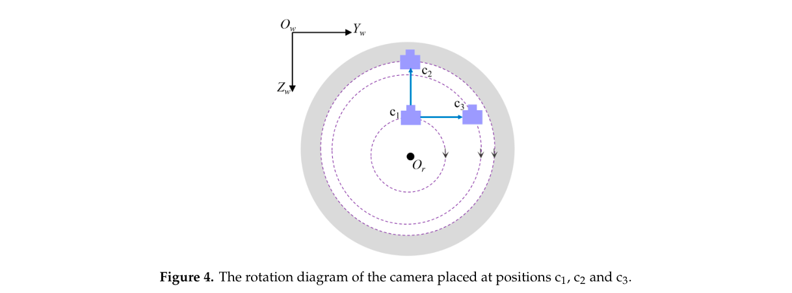
*그림 4 — 위치 c1, c2, c3에 놓인 카메라의 회전 개략도.*

회전 중심을 계산하기 위해 LSC 피팅 [28]을 수행하는데, 이는 각 표본점과 피팅 곡선 사이 거리의 제곱합을 최소화하는 조건을 만족한다. $(y_0, z_0)$를 회전 중심의 2차원(2D) 좌표, $(y_j, z_j)$ (j = 1~N, N은 카메라 회전 횟수)를 $Y_wO_wZ_w$ 평면에 투영한 광학 중심의 2D 좌표라 하자. $(y_0, z_0)$를 구하기 위한 목적 함수는 다음과 같다.

$$
C=\min\sum_{j=1}^{N}\left[(y_j-y_0)^2+(z_j-z_0)^2-R^2\right].\qquad(8)
$$

[역주: 원문 식 (8)은 대괄호 항에 제곱이 없고 반지름을 R로 표기했다. 원문 그대로 옮겼다.]

이론적으로 카메라를 옮기면 피팅 원의 반지름은 달라지지만 원의 중심은 변하지 않아야 한다. 그러나 실제 피팅에서는 피팅 중심 $O_{ri}$들 사이에 편차가 있다. 초기 회전 중심 $\bar{O}_r$은 $O_{ri}$의 평균으로 정한다. 카메라를 $\bar{O}_r$로 조정하고 다시 보정해 새로운 광학 중심 세트 $O'_{rj}$를 얻으며, 그 평균이 $O'_r$이다. $O_{ri}$와 $O'_r$의 가중 평균값을 최종 회전 중심 $O_r = (O_y, O_z)$로 삼는다. 계산식은 다음과 같다.

$$
O_y=\sum_{m=1}^{n+1}k_{ym}O_{ym},\qquad(9)
$$

$$
O_z=\sum_{m=1}^{n+1}k_{zm}O_{zm},\qquad(10)
$$

여기서 $O_{ym}$과 $O_{zm}$은 각각 피팅 원 중심 $O_{ri}$와 $O'_r$의 Yw 방향과 Zw 방향 좌표를 나타낸다. m = 1, 2, …, n+1이며 n은 피팅 원의 개수다. $k_{ym}$과 $k_{zm}$은 각각 가중 계수로, 각 광학 중심 그룹의 분산 $\sigma_m = (\sigma_{ym}, \sigma_{zm})$에 의해 식 (11)과 (12)로 정해진다.

$$
k_{ym}=\frac{\sigma_{ym}}{\sum_{m=1}^{n+1}\sigma_{ym}},\qquad(11)
$$

$$
k_{zm}=\frac{\sigma_{zm}}{\sum_{m=1}^{n+1}\sigma_{zm}}.\qquad(12)
$$

[역주: 원문 식 (11)·(12)대로라면 분산이 큰 그룹일수록 가중치가 커진다. 통상의 역분산 가중과 반대이지만 원문 그대로 옮겼다.]

## 3. 컴퓨터 시뮬레이션 (Computer Simulation)

우리 방법을 검증하기 위해 컴퓨터 시뮬레이션을 수행했다. 모의 카메라의 파라미터는 $f_x = f_y$ = 1700.00 pixels, $u_0$ = 600.00 pixels, $v_0$ = 500.00 pixels, α = 0이다. 모의 체커보드의 정사각형 한 칸 크기는 14.175 × 14.175 mm다. 월드 좌표계에서 모의 회전 중심은 Or = (−80.00, −50.00, 900.00) mm다. 모의 카메라는 월드 좌표계에서 Cr = (−80.00, −33.31, 852.87) mm, Cg = (−80.00, −5.26, 852.85) mm, Cb = (−80.00, −33.37, 821.75) mm에 놓이며, 그림 5처럼 회전 중심에서 각각 50.00 mm, 65.00 mm, 80.00 mm 떨어져 있다.

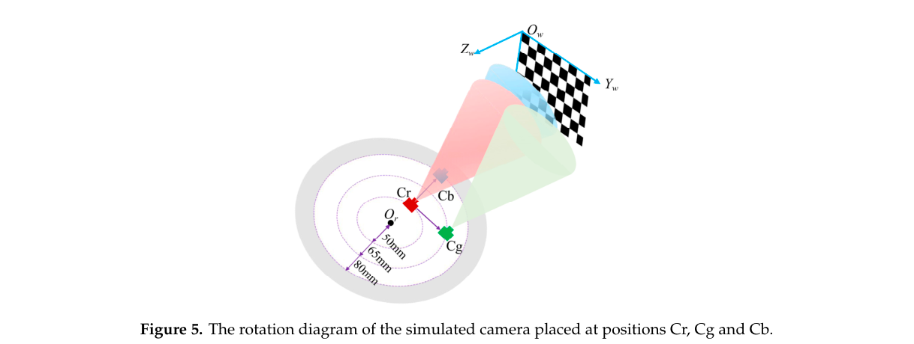
*그림 5 — 위치 Cr, Cg, Cb에 놓인 모의 카메라의 회전 개략도.*

각 위치마다 카메라의 운동을 모의하기 위해 외부 파라미터 행렬(R과 T) 20쌍을 지정했다. 카메라가 "본" 모의 영상 총 60장을 Zhang의 방법에 넣어 내부 파라미터 A와 외부 파라미터 R, T를 계산하고, 이로부터 광학 중심의 위치를 구했다. 다음으로 영상의 각 화소 좌표에 영향을 주도록 3.5% 가우시안 잡음을 더하고, 같은 연산을 수행해 A, R, T와 광학 중심을 계산했다. 두 경우에 얻은 내부 파라미터는 표 1과 같다. $Y_wO_wZ_w$ 평면에 투영한 세 그룹 광학 중심의 궤적은 그림 6과 같다. 그림 6a는 잡음이 없는 결과, 그림 6b는 잡음이 있는 결과다. LSC 피팅 방법으로 피팅한 원 곡선은 그림 7과 같다. 피팅한 중심과 반지름은 표 2와 같다.

표 1. 모의 보정 결과 (Simulated calibration results).

| 파라미터 | fx/Pixels | fy/Pixels | u0/Pixels | v0/Pixels | α | 화소 오차/Pixels |
|---|---|---|---|---|---|---|
| 잡음 없음 | 1700.00 | 1700.00 | 600.00 | 500.00 | 0 | 0 |
| 3.5% 가우시안 잡음 | 1698.84 | 1698.78 | 599.77 | 500.05 | 0 | 0.035 |

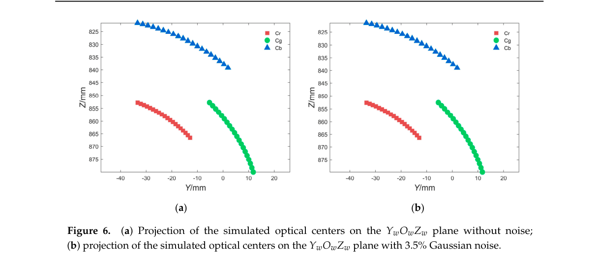
*그림 6 — (a) 잡음이 없을 때 $Y_wO_wZ_w$ 평면에 투영한 모의 광학 중심; (b) 3.5% 가우시안 잡음이 있을 때 $Y_wO_wZ_w$ 평면에 투영한 모의 광학 중심.*

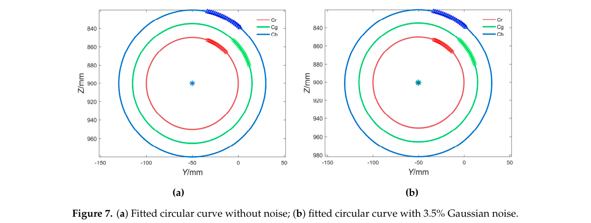
*그림 7 — (a) 잡음이 없을 때 피팅한 원 곡선; (b) 3.5% 가우시안 잡음이 있을 때 피팅한 원 곡선.*

표 2. 피팅 중심과 반지름 대응표 (Fitted centers and radii correspondence table).

| 조건 | 피팅 중심/mm | 피팅 반지름/mm |
|---|---|---|
| 잡음 없음 | Or = (−50.00, 900.00) | r = 50.00 |
| | Og = (−50.00, 900.00) | r = 65.00 |
| | Ob = (−50.00, 900.00) | r = 80.00 |
| 3.5% 무작위 잡음 | Or = (−49.96, 900.04) | r = 49.96 |
| | Og = (−50.01, 900.03) | r = 65.19 |
| | Ob = (−49.96, 900.01) | r = 79.99 |

표 2에서 보듯 잡음을 고려하지 않으면 세 원의 중심과 반지름이 설정값과 같다. 3.5% 가우시안 잡음이 있을 때 세 원 중심의 평균은 $\bar{O}_r$ = (−49.98, 900.02) mm이며, 피팅 중심과 반지름의 오차는 각각 0.05 mm와 0.19 mm보다 작다. 이 결과는 제안 방법을 회전 광학 측정 시스템에서 회전 중심의 위치를 찾는 데 쓸 수 있음을 확인해 준다.

## 4. 실험 (Experiment)

### 4.1. 실험 설정 (Experimental Setting)

우리 방법을 검증하기 위해 실험을 수행했다. 실험 장치는 그림 8a와 같다. 회전 제어 시스템은 초점 거리 16 mm 결상 렌즈(모델: MA1214M-MP)를 단 CCD 카메라(모델: Bammer camera TXG50; 해상도: 1224 × 1025 pixels), 평행이동 스테이지 두 대(Zolix TSA50-C 전동 평행이동 플랫폼, 재위치 정밀도 5 µm 미만; PI-M406, 재위치 정밀도 0.078 µm), 턴테이블(Zolix RAP200 전동 회전 플랫폼, 재위치 정밀도 0.005° 미만)로 구성된다. 평행이동 스테이지는 회전 플랫폼 위에 고정되고 카메라는 평행이동 스테이지 위에 고정된다. 스테핑 모터가 카메라를 각각 Yw축과 Zw축을 따라 움직이고 턴테이블과 함께 회전시킨다. 실험 중 카메라 노출 시간은 12,000 µs다. 체커보드 영상(정사각형 한 칸 크기 14.175 × 14.175 mm)은 LCD 화면(Philips 190V, 해상도 1440 × 900 pixels, 도트 피치 0.2835 mm/pixel)에 표시한다. 보정 과정 동안 LCD 화면은 정지해 있다. LCD 화면은 완전한 평면이고 화면 유리가 매우 얇으므로 굴절 현상은 무시할 수 있다. 물론 더 높은 정확도의 특징점을 제공하기 위해 가공 정밀도가 더 높은 체커보드 타깃을 쓸 수도 있다.

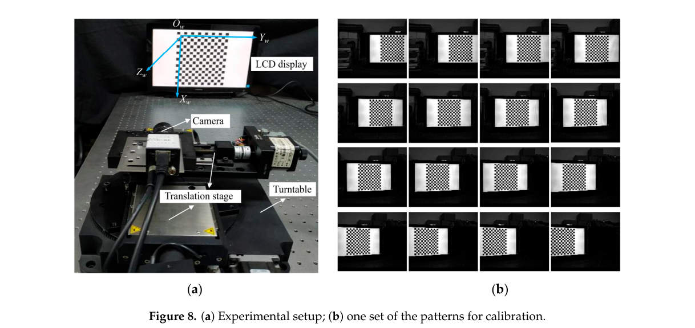
*그림 8 — (a) 실험 장치; (b) 보정용 패턴 한 세트.*

### 4.2. 회전 중심의 결정 (Determination of the Rotation Center)

실험에서는 그림 4처럼 카메라를 세 위치에 각각 놓으며, $c_1c_2 \perp c_1c_3$, $c_1c_2 = c_1c_3$ = 20 mm다. 각 초기 위치에서 카메라를 한 단계 1.5도씩 16번, 총 22.5도 회전시킨다. 따라서 턴테이블이 회전하는 동안 총 48장의 프레임 패턴을 촬영하며, 이를 세 세트로 나눈다. 패턴 한 세트는 그림 8b와 같다. 디포커스(defocus)가 보정 결과에 주는 영향을 피하기 위해 화면은 카메라 렌즈의 피사계 심도 안에 둔다. 외부 파라미터 행렬(R과 T)은 Zhang의 방법으로 구하며, 계산된 R과 T에는 렌즈 왜곡이 거의 없다. 우리 실험에서 보정 결과의 재투영 화소 오차는 0.039 pixels였다.

보정으로 얻은 회전 행렬로부터, 초기 위치의 카메라 좌표계 Xc, Yc, Zc축에 대한 월드 좌표계 Xw, Yw, Zw축의 회전각 $\gamma_{ix}(j)$, $\gamma_{iy}(j)$, $\gamma_{iz}(j)$ (i = 1, 2, 3, j = 1, 2, ..., 16)를 각각 계산할 수 있다. 이론적으로, 초기 위치에서 카메라 광축 Zc가 Zw에 평행하고 평면 Oc-XcZc가 평면 Ow-YwZw에 평행하면, 카메라가 Yc축을 중심으로 회전할 때 회전각 $\gamma_{iy}(j)$는 턴테이블의 실제 회전각과 같아야 하고 회전각 $\gamma_{ix}(j)$, $\gamma_{iz}(j)$ = 0이어야 한다(그림 9a). 그림에서 세 세트의 각도 곡선을 서로 다른 색으로 표시했으며, 가로축은 카메라 회전 횟수로 N = 16(i − 1) + 1~16i로 표시한다. 실제로는 회전각 $\gamma_{ix}(j)$와 $\gamma_{iz}(j)$가 0도 주변에서 요동한다. 계산된 세 회전각을 그림 9b처럼 각각 $\gamma'_{ix}(j)$, $\gamma'_{iz}(j)$, $\gamma'_{iy}(j)$로 나타낸다. 이 세 각을 그대로 써서 광학 중심을 계산하면 세 피팅 중심이 평면 Ow-YwZw 위에서 동심이 되지 않는다. 그림 10a와 b는 각각 평면 Ow-YwZw 위의 광학 중심 투영과 피팅 궤적을 보여 준다. 원 중심들의 편차가 커서 회전 중심을 정확히 찾을 수 없다. 보조 좌표계 Op-XpYpZp를 이용하면 회전 행렬 $R_{cp}$를 통해 광학 중심들을 Ow-YwZw에 평행한 평면 위로 사상할 수 있다. $R_{cp}$에서 세 회전각은 $\Delta\gamma_{ix}(j) = \gamma'_{ix}(j) - \gamma_{ix}(j)$, $\Delta\gamma_{iy}(j) = \gamma'_{iy}(j) - \gamma_{iy}(j)$, $\Delta\gamma_{iz}(j) = \gamma'_{iz}(j) - \gamma_{iz}(j)$이다. $R_{cp}$로 각도를 보정한 뒤 식 (7)로 계산한 광학 중심들은 같은 월드 좌표계로 통일된다.

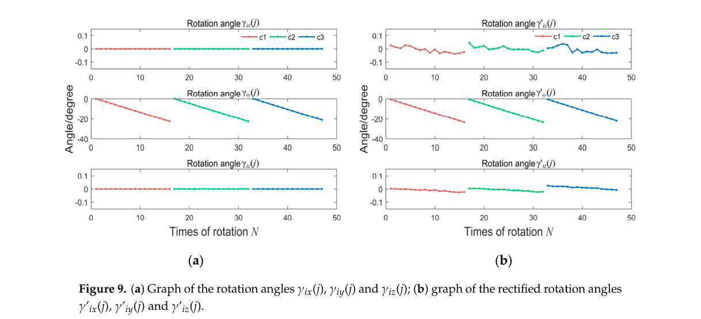
*그림 9 — (a) 회전각 $\gamma_{ix}(j)$, $\gamma_{iy}(j)$, $\gamma_{iz}(j)$의 그래프; (b) 보정된 회전각 $\gamma'_{ix}(j)$, $\gamma'_{iy}(j)$, $\gamma'_{iz}(j)$의 그래프.*

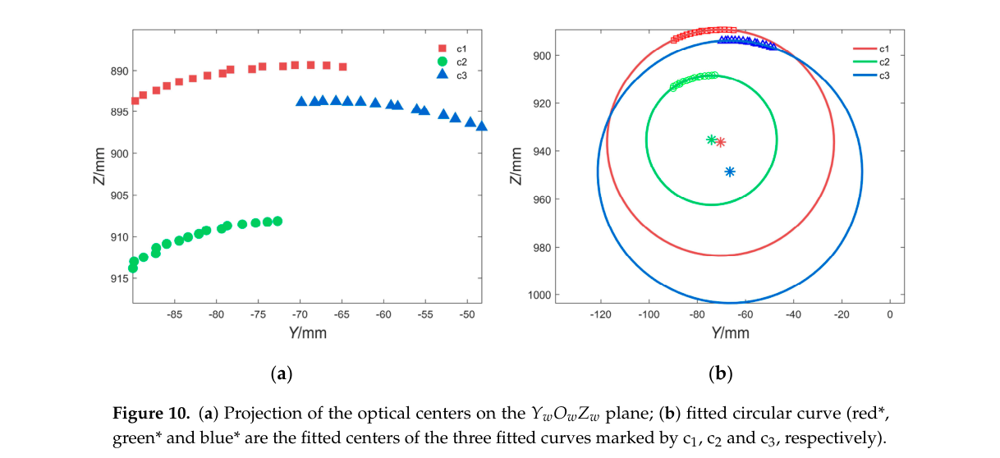
*그림 10 — (a) $Y_wO_wZ_w$ 평면 위의 광학 중심 투영; (b) 피팅한 원 곡선(빨강*, 초록*, 파랑*은 각각 c1, c2, c3로 표시한 세 피팅 곡선의 피팅 중심).*

[역주: 원문은 그림 9a를 "이론적" 각도, 그림 9b를 "계산된" 각도로 설명하면서 그림 9 캡션에서는 9b를 "보정된(rectified)" 회전각이라 부른다. 원문 그대로 옮겼다.]

Ow-YwZw 평면 위의 세 세트 광학 중심과 반지름이 서로 다른 피팅 원호는 그림 11a, b와 같다. 광학 중심 좌표를 이용해 c1, c2, c3 사이의 거리를 계산하면 $c_1c_2$ = 20.16 mm, $c_1c_3$ = 20.08 mm다. 거리 오차는 각각 0.78%와 0.42%다. 세 그룹의 피팅 결과와 평균제곱근 오차(root mean square error, RMSE)는 표 3에 나타냈다. 세 피팅 중심의 평균값은 $\bar{O}_r$ = (−55.20, 961.67) mm이며, 이를 회전 중심의 초기값으로 삼는다.

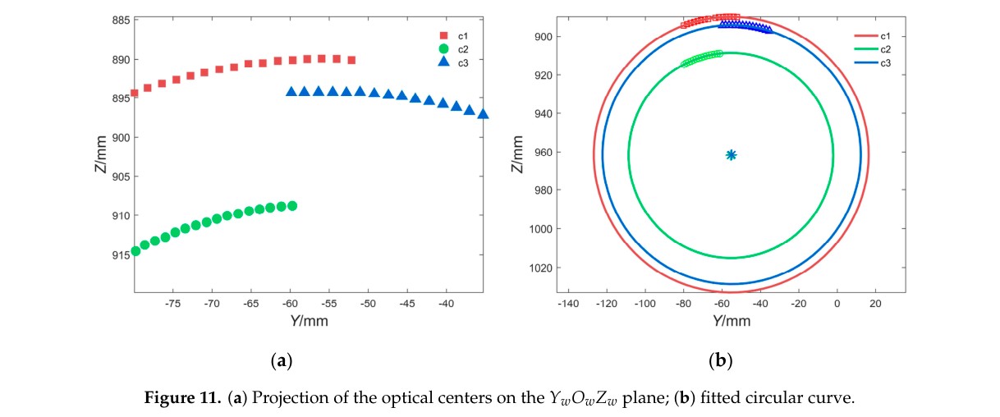
*그림 11 — (a) $Y_wO_wZ_w$ 평면 위의 광학 중심 투영; (b) 피팅한 원 곡선.*

표 3. 피팅 결과 (Fitting results).

| 카메라 초기 위치 | 피팅 중심/mm | 피팅 반지름/mm | RMSE/mm |
|---|---|---|---|
| c1 | Or1 = (−55.23, 961.58) | r1 = 71.62 | 0.042 |
| c2 | Or2 = (−55.38, 961.88) | r2 = 53.32 | 0.054 |
| c3 | Or3 = (−55.00, 961.53) | r3 = 67.29 | 0.042 |

더 정확한 회전 중심을 얻기 위해 평행이동 스테이지로 Yw와 Zw 방향을 따라 카메라를 각각 $\bar{O}_r$로 조정하고, 카메라를 16번 회전시켜 광학 중심 $O'_{rj}$를 계산했다. 이들은 그림 12처럼 작은 범위에 분포한다. $O'_{rj}$의 평균값은 $O'_r$ = (−54.59, 962.05) mm다. 최종 회전 중심 $O_r$은 식 (9)–(12)를 써서 Or1, Or2, Or3와 $O'_r$로 계산하며, $O_r$ = (−54.69, 961.96) mm다. 카메라를 $O_r$로 옮기고 16번 회전시켜 광학 중심 $O''_{rj}$를 계산한다. Yw와 Zw 방향에서 $\bar{O}_r$에 대한 $O'_{rj}$의 표준편차(standard deviation, STD)와 $O_r$에 대한 $O''_{rj}$의 표준편차는 표 4와 같다. $O_r$이 $\bar{O}_r$보다 더 신뢰할 만함이 분명하다. 이 결과는 카메라의 광학 중심이 턴테이블의 회전 중심에 정확히 위치되었으며, 우리 방법의 계통 불확도(systematic uncertainty)가 약 0.1 mm로 유지됨을 보여 준다.

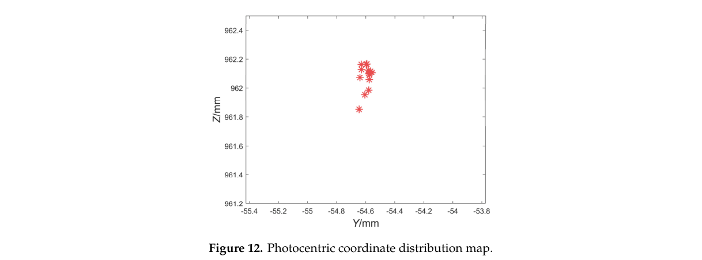
*그림 12 — 광학 중심(photocentric) 좌표 분포도.*

표 4. Yw와 Zw 방향의 표준편차 (The standard deviation in the Yw and Zw directions).

| 표준편차/mm | Yw | Zw |
|---|---|---|
| $\bar{O}_r$에 대한 $O'_{rj}$ | 0.029 | 0.141 |
| $O_r$에 대한 $O''_{rj}$ | 0.022 | 0.117 |

### 4.3. 검증 (Verification)

카메라를 위치 $O_r$에 고정한 뒤, 우리 방법으로 광학 중심이 회전 중심에 정렬되었는지 증명하기 위해 두 실험을 설계했다.

#### 4.3.1. 두 공간점 M1, M2와 광학 중심이 이루는 각 계산 (Calculating the Angle Formed by the Two Space Points M1, M2 and the Optical Center)

이 실험에서는 그림 13처럼 두 공간점 M1, M2와 광학 중심이 이루는 각 α를 계산했다. 광학 중심이 회전 중심과 일치하면 카메라가 회전해도 각 α는 변하지 않아야 한다. 그러나 광학 중심이 회전 중심과 일치하지 않으면 턴테이블 위에서 카메라가 회전함에 따라 각이 변한다. 즉 α1 ≠ α2이다.

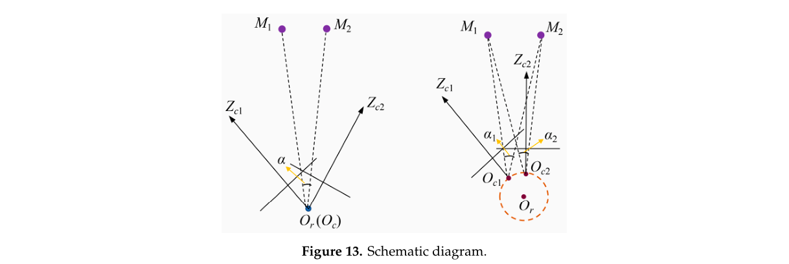
*그림 13 — 개략도.*

실험에서는 그림 14처럼 체커보드 평면 위에서 위치가 서로 다른 네 점 쌍을 골라 각 $\alpha_k$ (k = 1~4)를 계산했으며, 빨간 원, 초록 삼각형, 분홍 마름모, 파란 사각형으로 표시했다. 동축(coaxial) 조건에서 카메라를 회전시키며 16개의 각 $\alpha_k(j)$ (j = 1, 2, …, 16)를 계산했다. 네 각도 곡선은 그림 15a, 인접 각들의 네 차이 곡선은 그림 15b와 같다. 카메라를 회전 중심에서 떨어뜨려 계산한 각도 곡선은 그림 15c, 인접 각들의 네 차이 곡선은 그림 15d와 같다. 두 경우 네 세트 각도의 표준편차는 표 5와 같다. 그림 15와 표 5에서 보듯, 동축일 때 네 그룹 마커 점들의 각 $\alpha_k$는 거의 변하지 않으며, 동축일 때 각도의 표준편차가 축 이탈(off-axis)일 때보다 확연히 작다. 이는 광학 중심이 턴테이블의 회전 중심과 일치함을 나타낸다.

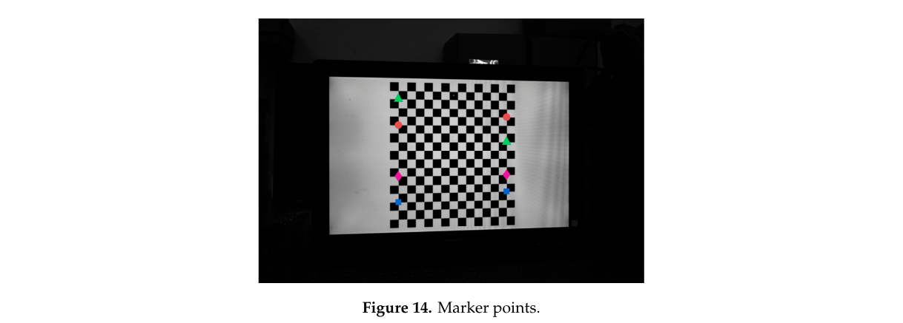
*그림 14 — 마커 점.*

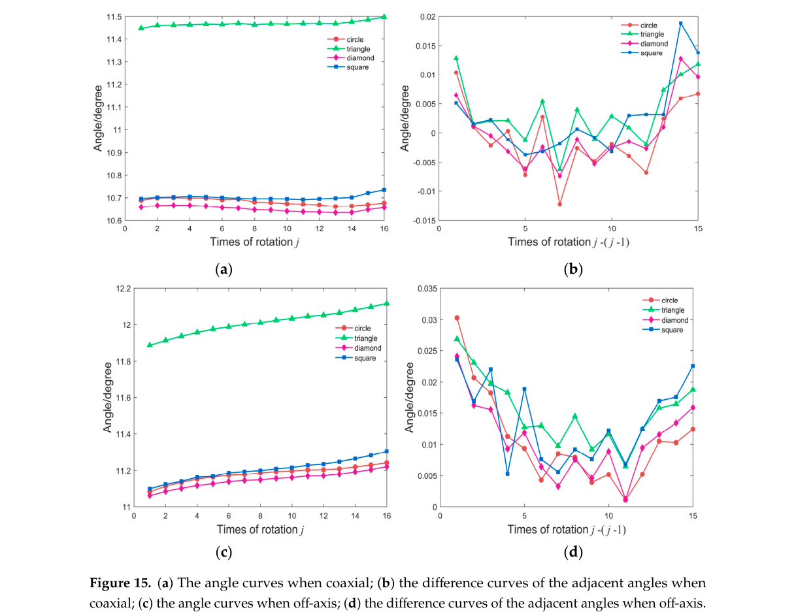
*그림 15 — (a) 동축일 때의 각도 곡선; (b) 동축일 때 인접 각들의 차이 곡선; (c) 축 이탈일 때의 각도 곡선; (d) 축 이탈일 때 인접 각들의 차이 곡선.*

표 5. 네 세트 마커 점 각도의 표준편차 (The standard deviation of the angles of the four sets of marker points).

| 표준편차/도 | 빨간 원 | 초록 삼각형 | 분홍 마름모 | 파란 사각형 |
|---|---|---|---|---|
| 정렬(Alignment) | 0.013 | 0.011 | 0.011 | 0.011 |
| 불일치(Misalignment) | 0.043 | 0.066 | 0.043 | 0.057 |

#### 4.3.2. 카메라 회전 전후 같은 공간점의 카메라 좌표 정합 (Camera Coordinates Registration of the Same Spatial Points Before and After Camera Rotation)

이 실험에서는 카메라 회전 전후에 타깃 위 공간점들의 카메라 좌표를 비교했다. 그림 1b의 결상 모델을 쓰면, 공간점 P의 좌표는 카메라 좌표계 Oc1-Xc1Yc1Zc1과 Oc2-Xc2Yc2Zc2에서 각각 (Xcl, Ycl, Zcl)과 (Xcr, Ycr, Zcr)이다. 평면 Oc-XcZc가 평면 Ow-YwZw에 평행할 때, 광학 중심이 회전 중심과 일치하면 (Xcl, Ycl, Zcl)과 (Xcr, Ycr, Zcr) 사이의 관계는 식 (13)으로 표현된다.

$$
\begin{bmatrix}X_{cl}\\Y_{cl}\\Z_{cl}\end{bmatrix}=R_\theta\begin{bmatrix}X_{cr}\\Y_{cr}\\Z_{cr}\end{bmatrix},\qquad(13)
$$

여기서 $R_\theta=\begin{bmatrix}\cos\theta&0&-\sin\theta\\0&1&0\\\sin\theta&0&\cos\theta\end{bmatrix}$이고 θ는 턴테이블의 회전각이다.

그렇지 않고 광학 중심이 회전 중심에서 벗어나 있으면 (Xcl, Ycl, Zcl)과 (Xcr, Ycr, Zcr) 사이의 관계는 식 (14)로 표현되어야 한다.

$$
\begin{bmatrix}X_{cl}\\Y_{cl}\\Z_{cl}\end{bmatrix}=R_\theta\begin{bmatrix}X_{cr}\\Y_{cr}\\Z_{cr}\end{bmatrix}+T,\qquad(14)
$$

여기서 T는 Oc1-Xc1Yc1Zc1과 Oc2-Xc2Yc2Zc2 사이의 평행이동 벡터다.

턴테이블이 카메라를 서로 다른 회전각 $\theta_i$로 회전시킬 때 체커보드 영상을 촬영하고, 체커보드 코너를 표시점(marked point)으로 추출했다. 월드 좌표계에서의 동차 좌표 $(X_{wi}, Y_{wi}, Z_{wi}, 1)^T$, 영상 좌표 $(u_i, v_i, 1)^T$, 내부 파라미터 행렬 A를 이용하면, 서로 다른 위치에서 월드 좌표계와 카메라 좌표계 사이의 회전 행렬 $R_i$와 평행이동 벡터 $T_i$를 식 (1)로 구할 수 있다. 그러면 표시점들의 좌표 $(X_{ci}, Y_{ci}, Z_{ci}, 1)^T$는 식 (15)로 계산할 수 있다.

$$
\begin{bmatrix}X_{ci}\\Y_{ci}\\Z_{ci}\\1\end{bmatrix}=\begin{bmatrix}R_i&T_i\\0^T&1\end{bmatrix}\begin{bmatrix}X_{wi}\\Y_{wi}\\Z_{wi}\\1\end{bmatrix}.\qquad(15)
$$

(Xcl, Ycl, Zcl)과 (Xcr, Ycr, Zcr)이 각각 한 공간점의 원래 좌표와 카메라 회전 후 좌표를 나타낸다고 하자. 좌표 (X'cl, Y'cl, Z'cl)는 좌표 (Xcr, Ycr, Zcr)로부터 식 (13)으로 계산한 결과 좌표다. (X'cl, Y'cl, Z'cl)를 원래 좌표 (Xcl, Ycl, Zcl)와 비교할 수 있다. 둘이 같으면 광학 중심이 회전 중심과 일치함이 증명되고, 그렇지 않으면 카메라의 광학 중심이 턴테이블 중심에서 벗어나 있음을 나타낸다.

먼저 제안 방법으로 광학 중심을 회전 중심에 정렬한다. 그림 16처럼 턴테이블이 각각 0°, 6°, 9°, 12° 회전할 때 카메라가 타깃 영상을 촬영한다. 카메라의 원래 위치가 0°에 해당한다. 표시점들의 좌표 (Xcl, Ycl, Zcl)과 (Xcri, Ycri, Zcri) (i = 1, 2, 3)를 각각 계산한다. 식 (13)을 써서 해당 회전 행렬 $R_{\theta i}$를 곱하면 (X'cli, Y'cli, Z'cli)를 계산할 수 있다. 이를 좌표 (Xcl, Ycl, Zcl)와 비교하면, 그림 17처럼 좌표들이 정확히 일치함을 볼 수 있다. 그림에서 원래 좌표 (Xcl, Ycl, Zcl)는 빨간 "+", 결과 좌표 (X'cli, Y'cli, Z'cli)는 파란 "o"로 표시했으며, 원형 영역은 확대한 부분이다. Xc와 Yc 방향의 표준편차는 표 6과 같다.

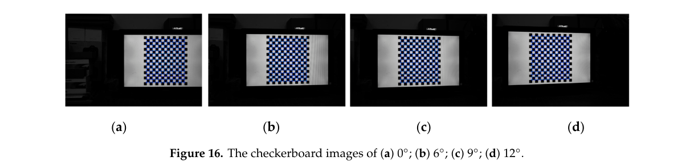
*그림 16 — (a) 0°, (b) 6°, (c) 9°, (d) 12°의 체커보드 영상.*

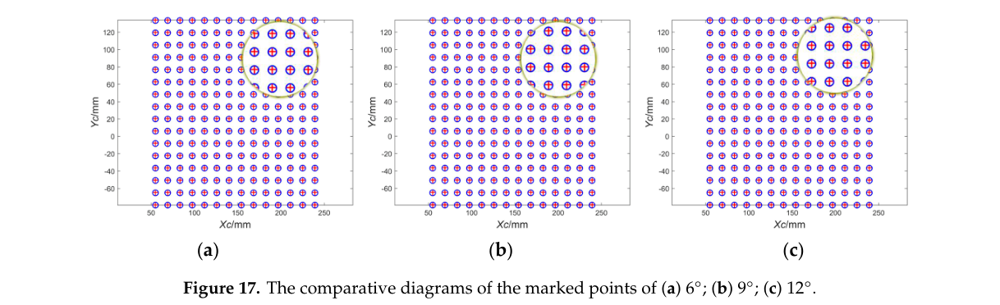
*그림 17 — (a) 6°, (b) 9°, (c) 12°에서 표시점들의 비교도.*

표 6. Xc와 Yc 방향의 표준편차 (The standard deviation in the Xc and Yc directions).

| 조건 | 방향 | STD/mm 6° | STD/mm 9° | STD/mm 12° |
|---|---|---|---|---|
| 정렬(Alignment) | Xc | 0.010 | 0.048 | 0.065 |
| | Yc | 0.015 | 0.037 | 0.063 |
| 불일치(Misalignment) | Xc | 7.221 | 10.910 | 14.641 |
| | Yc | 0.314 | 0.358 | 0.424 |

광학 중심을 회전 중심에서 벗어나게 하고 위 단계를 반복했다. 촬영한 타깃 영상은 그림 18과 같다. 표시점들의 좌표 (Xcri, Ycri, Zcri) (i = 1, 2, 3)에 $R_{\theta i}$를 작용시키면, 그림 19처럼 큰 편차가 나타난다. Xc와 Yc 방향의 표준편차는 표 6과 같다.

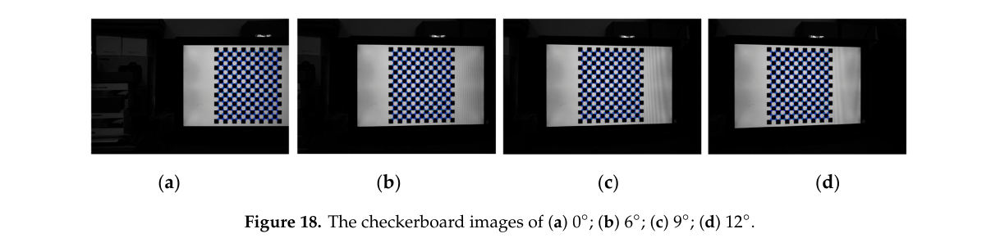
*그림 18 — (a) 0°, (b) 6°, (c) 9°, (d) 12°의 체커보드 영상.*

실험은 우리 방법이 광학 중심을 회전 중심에 정렬할 수 있음을 검증한다. 광학 중심이 회전 중심과 일치하면, 카메라 회전 후 좌표에 $R_{\theta i}$를 작용시켰을 때 추출한 표시점들이 서로 일치하며 Xc와 Yc 방향의 정렬 오차가 매우 작다. 그렇지 않으면 Xc, Yc 방향의 편차가 크다.

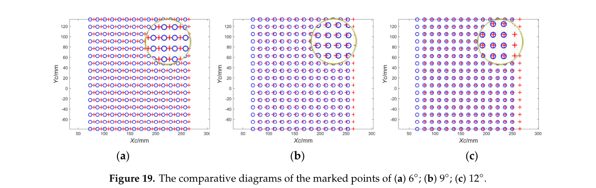
*그림 19 — (a) 6°, (b) 9°, (c) 12°에서 표시점들의 비교도.*

## 5. 결론 (Conclusions)

카메라와 회전 플랫폼으로 구성된 회전 광학 측정 시스템에서 카메라의 광학 중심과 회전 중심의 정렬 문제를 풀기 위해, 2차원 타깃을 이용한 카메라 보정에 기반한 방법을 제안한다. 카메라의 외부 파라미터 행렬을 조정하기 위해 보조 평면 좌표계를 도입한다. 보정된 외부 파라미터 행렬로 통일된 월드 좌표계에서 광학 중심들을 계산한다. 여러 개의 피팅 원은 하나의 피팅 원보다 회전 중심을 더 정확히 정할 수 있으며, 이는 파노라마 모자이크 같은 후속 응용에서 더 높은 정밀도를 제공한다. 시뮬레이션과 실험으로 제안 방법의 효과를 검증했다.

원 피팅 정확도를 높이려면 보정하는 동안 카메라 초기 위치의 광학 중심을 회전 중심에서 적절한 거리만큼 떨어뜨려 두어야 한다는 점에 유의해야 한다. 덧붙여, 이 논문은 1차원 회전 광학 시스템에서 카메라 광학 중심의 정렬만 다루지만, 제안 방법은 원리상 2차원 회전 광학 시스템에서 광학 중심을 회전축에 정렬하는 문제로도 확장할 수 있다. 그러나 현재 실험 장치는 1차원 회전 광학 시스템의 정렬 문제에만 적합하다. 후속 연구에서는 2차원(피치와 요) 회전 플랫폼에 적합한 장치를 찾을 것이다.

**저자 기여(Author Contributions):** 개념화, Y.H., X.S., W.C.; 방법론, Y.H., X.S., W.C.; 조사, Y.H.; 데이터 관리, Y.H.; 원고 초안 작성, Y.H.; 원고 검토 및 편집, X.S., W.C.; 연구비 확보, X.S., W.C. 모든 저자가 게재본 원고를 읽고 동의했다.

**연구비(Funding):** 이 연구는 중국 국가 핵심 과학 장비 개발 프로젝트(National Key Scientific Apparatus Development Project of China, 과제 번호 2013YQ490879)의 지원을 받았다.

**이해 상충(Conflicts of Interest):** 저자들은 이해 상충이 없음을 밝힌다.

© 2020 저자. 라이선스 보유자 MDPI, Basel, Switzerland. 이 논문은 Creative Commons Attribution(CC BY) 라이선스(http://creativecommons.org/licenses/by/4.0/) 조건으로 배포되는 오픈 액세스 논문이다.

## 참고문헌

1. Luhmann, T.; Robson, S.; Kyle, S.; Boehm, J. Close-Range Photogrammetry and 3D Imaging. Photogramm. Eng. Remote Sens. 2015, 81, 273–274.
2. Sun, T.; Xing, F.; You, Z. Optical system error analysis and calibration method of high-accuracy star trackers. Sensors (Basel) 2013, 13, 4598–4623.
3. Luhmann, T. Close range photogrammetry for industrial applications. ISPRS J. Photogramm. Remote Sens. 2010, 65, 558–569.
4. Robert, S.; Holger, B.; Armin, K.; Richard, K. Measurement of three-dimensional deformation vectors with digital holography and stereo photogrammetry. Opt. Lett. 2012, 37, 1943–1945.
5. Li, J.; Liu, Z. Efficient camera self-calibration method for remote sensing photogrammetry. Opt. Express 2018, 26, 14213–14231.
6. Zhang, S. Three-dimensional range data compression using computer graphics rendering pipeline. Appl. Opt. 2012, 51, 4058–4064.
7. Li, Y.; Wang, H.; Ma, L.; Shi, Y. Three-dimensional imaging and display of real-existing scene using fringe. In Proceedings of the Volume 8769, International Conference on Optics in Precision Engineering and Nanotechnology (icOPEN2013), Singapore, 22 June 2013; Quan, C., Qian, K., Asundi, A., Eds.; p. 87691I1-9.
8. Sun, P.; Lu, N.; Dong, M. Modelling and calibration of depth-dependent distortion for large depth visual measurement cameras. Opt. Express 2017, 25, 9834–9847.
9. Xiao, Y.; Su, X.; Chen, W.; Liu, Y. Three-dimensional shape measurement of aspheric mirrors with fringe reflection photogrammetry. Appl. Opt. 2012, 51, 457–464.
10. Huang, S.; Zhang, Z.; Ke, T.; Tang, M.; Xu, X. Scanning Photogrammetry for Measuring Large Targets in Close Range. Remote Sens. 2015, 7, 10042–10077.
11. Tomasi, C.; Zhang, J. How to rotate a camera. In Proceedings of the 10th International Conference on Image Analysis and Processing, Venice, Italy, 27–29 September 1999; pp. 606–611.
12. Gledhill, D.; Tian, G.; Taylor, D.; Clarke, D. Panoramic imaging—A review. Comput. Graph. 2003, 27, 435–445.
13. Luhmann, T. A historical review on panorama photogrammetry. Int. Arch. Photogramm. Remote Sens. Spat. Inf. Sci. 2004, 34, 8.
14. Kukko, A. A new method for perspective centre alignment for spherical panoramic imaging. Photogramm. J. Finl. 2004, 19, 37–46.
15. Kauhanen, H.; Rönnholm, P.; Lehtola, V.V. Motorized panoramic camera mount-calibration and image capture. ISPRS Ann. Photogramm. Remote Sens. Spat. Inf. Sci. 2016, 3, 89–96.
16. Huang, Y. 3-D measuring systems based on theodolite-CCD cameras. Int. Arch. Photogramm. Remote Sens. Spat. Inf. Sci. 1993, 29, 541.
17. Huang, Y. Calibration of the Wild P32 camera using the camera-on-theodolite method. Photogrammetric Rec. 1998, 16, 97–104.
18. Andreas, W. A new approach for geo-monitoring using modern total stations and RGB + D images. Measurement 2016, 82, 64–74.
19. Zhang, Z.; Zheng, S.; Zhan, Z. Digital terrestrial photogrammetry with photo total station. Int. Arch. Photogramm. Remote Sens. Istanb. Turk. 2004, 232–236.
20. Zhang, Z.; Zhan, Z.; Zheng, S. Photo total station systemthe integration of digital photogrammetry and total station. Bull. Surv. Mapp. 2005, 11, 1–5.
21. Zhang, X.; Zhu, Z.; Yuan, Y.; Li, L.; Sun, X.; Yu, Q.; Ou, J. A universal and flexible theodolite-camera system for making accurate measurements over large volumes. Opt. Lasers Eng. 2012, 50, 1611–1620.
22. Huang, L.; Zhang, Q.; Asundi, A. Flexible camera calibration using not-measured imperfect target. Appl. Opt. 2013, 52, 6278–6286.
23. Huang, L.; Zhang, Q.; Asundi, A. Camera calibration with active phase target: Improvement on feature detection and optimization. Opt. Lett. 2013, 38, 1446–1448.
24. Wang, Y.; Wang, Y.; Liu, L.; Chen, X. Defocused camera calibration with a conventional periodic target based on Fourier transform. Opt. Lett. 2019, 44, 3254–3257.
25. Fischler, M.A.; Bolles, R.C. Random sample consensus: A paradigm for model fitting with applications to image analysis and automated cartography. Commun. ACM 1981, 24, 381–395.
26. Gao, X.; Hou, X.; Tang, J.; Cheng, H. Complete solution classification for the perspective-three-point problem. IEEE Trans. Pattern Anal. Mach. Intell. 2003, 25, 930–943.
27. Zhang, Z. A flexible new technique for camera calibration. IEEE Trans. Pattern Anal. Mach. Intell 2000, 22, 1330–1334.
28. Gander, W.; Golub, G.H.; Strebel, R. Least-squares fitting of circles and ellipses. BIT 1994, 34, 558–578.
