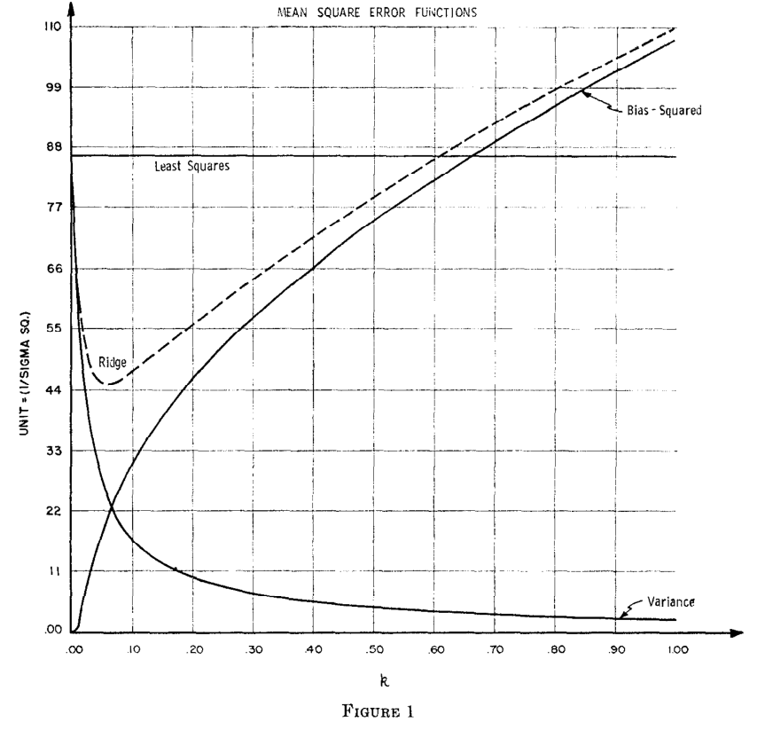

# 능형 회귀: 비직교 문제를 위한 편향 추정 (Hoerl 1970)

- 원제: Ridge Regression: Biased Estimation for Nonorthogonal Problems
- 원문: 같은 폴더의 `Hoerl1970_Technometrics_ridge_regression.pdf` (Arthur E. Hoerl, Robert W. Kennard, Technometrics, Vol. 12, No. 1, pp. 55–67, February 1970, DOI 10.1080/00401706.1970.10488634). PDF 1쪽은 도서관 다운로드 안내문이며 본문은 PDF 2~14쪽(학술지 55~67쪽)이다.
- 번역 범위: 전문(초록·본문·부록·각주·그림·표 캡션). PDF 첫 쪽의 다운로드 안내문은 제외했다. 참고문헌은 원문 그대로 옮겼다.
- 그림: 원문 그림 1개(Figure 1)를 `그림/`에 넣고 본문에서 처음 언급되는 곳 근처에 삽입했다. 원문에는 표가 없다.

## 초록

다중 회귀(multiple regression)에서, 예측 벡터가 직교하지 않으면 잔차 제곱합 최소화에 기반한 파라미터 추정값이 틀리지는 않더라도 만족스럽지 못할 확률이 높다는 것을 보인다. $\mathbf{X'X}$의 대각에 작은 양수를 더하는 데 기반한 추정 절차를 제안한다. 비직교성(nonorthogonality)의 영향을 2차원으로 보여 주는 방법인 능형 자취(ridge trace)를 소개한다. 그런 다음 $\mathbf{X'X}$를 보강하여 평균제곱오차(mean square error)가 더 작은 편향(biased) 추정값을 얻는 방법을 보인다.

## 0. 서론 (INTRODUCTION)

다중 선형 회귀의 표준 모형 $\mathbf{Y} = \mathbf{X\beta} + \boldsymbol{\epsilon}$을 생각하자. 여기서 $\mathbf{X}$는 $(n \times p)$이고 계수(rank)가 $p$이며, $\boldsymbol\beta$는 $(p \times 1)$이고 미지이며, $E[\boldsymbol\epsilon] = \mathbf{0}$, $E[\boldsymbol{\epsilon\epsilon}'] = \sigma^2\mathbf{I}_n$이라 가정한다. 인자(factor)에 대한 관측을 $\mathbf{x}_\nu = \{x_{1\nu}, x_{2\nu}, \ldots, x_{p\nu}\}$로 나타내면, 일반형 $\mathbf{X\beta}$는 $\{\sum_{i=1}^{p}\beta_i\theta_i(\mathbf{x}_\nu)\}$이며, 여기서 $\theta_i$는 미지 파라미터를 포함하지 않는 함수이다.

미지의 $\boldsymbol\beta$에 대한 통상적인 추정 절차는 가우스-마르코프(Gauss-Markov) 추정, 즉 불편(unbiased)이고 분산이 최소인 $\mathbf{Y} = \{y_\nu\}$의 선형 함수이다. 이 추정 절차는 $\mathbf{X'X}$가 상관 행렬 형태일 때 거의 단위 행렬이면 좋은 방법이다. 그러나 $\mathbf{X'X}$가 단위 행렬에 가깝지 않으면 최소제곱 추정값은 여러 "오차"에 민감하다. $\mathbf{X\beta}$가 참 모형이라고 명시할 때 이러한 오차의 결과는 치명적이다. 그러면 최소제곱 추정값은 데이터를 생성하는 공정의 물리, 화학, 공학 맥락에 넣었을 때 말이 되지 않는 경우가 많다. 이런 경우에는 추정된 예측 함수를 블랙박스로 취급하거나, $\mathbf{X'X}$를 구성하는 데 쓰인 $\mathbf{X}_i$ 사이의 상관 결합을 깨기 위해 인자를 빼야 한다. 원래 의도가 추정된 예측자를 제어와 최적화에 사용하는 것이었다면 두 대안 모두 만족스럽지 않다. 결과를 블랙박스로 취급하면 모형 사용자에게 편미분을 하지 말라고 경고해야 하며(실제로는 쓸모없는 경고이다), 다른 경우에는 매달린 제어 변수나 관측 변수 집합이 남는다.

$\mathbf{X'X}$ 대신 행렬 $[\mathbf{X'X} + k\mathbf{I}_p]$, $k \ge 0$에 기반한 추정은 통상적인 최소제곱 추정값과 관련된 많은 어려움을 피하는 데 도움이 되는 절차임이 밝혀졌다. 특히 이 절차는 사용하는 특정 데이터 집합에 대한 추정값의 민감도를 보여 주는 데 쓸 수 있고, 평균제곱오차가 더 작은 점 추정값을 얻는 데 쓸 수 있다.

> (각주) 1968년 8월 접수, 1969년 6월 수정.

## 1. 최량 선형 불편 추정의 성질 (PROPERTIES OF BEST LINEAR UNBIASED ESTIMATION)

확률 벡터 $\boldsymbol\epsilon$이 정규분포를 따를 때 분산이 최소인 불편 선형 추정이나 최대가능도 추정을 사용하면

$$\hat{\boldsymbol\beta} = (\mathbf{X'X})^{-1}\mathbf{X'Y} \tag{1.1}$$

를 $\boldsymbol\beta$의 추정값으로 얻으며, 이는 잔차 제곱합의 최솟값을 준다.

$$\phi(\hat{\boldsymbol\beta}) = (\mathbf{Y} - \mathbf{X}\hat{\boldsymbol\beta})'(\mathbf{Y} - \mathbf{X}\hat{\boldsymbol\beta}). \tag{1.2}$$

$\hat{\boldsymbol\beta}$의 성질은 잘 알려져 있다 [18]. 여기서의 관심은 주로 $\mathbf{X'X}$가 단위 행렬에 가깝지 않은 경우이다(따로 명시하지 않으면, 모형은 상관 형태의 $\mathbf{X'X}$를 주도록 정식화한다). 이 조건이 $\boldsymbol\beta$의 추정에 미치는 영향을 보이기 위해 $\hat{\boldsymbol\beta}$의 두 성질, 즉 분산-공분산 행렬과 기댓값으로부터의 거리를 생각하자.

(i) $\mathrm{VAR}(\hat{\boldsymbol\beta}) = \sigma^2(\mathbf{X'X})^{-1}$ $\qquad$ (1.3)

(ii) $L_1 \equiv$ $\hat{\boldsymbol\beta}$에서 $\boldsymbol\beta$까지의 거리.

$$L_1^2 = (\hat{\boldsymbol\beta} - \boldsymbol\beta)'(\hat{\boldsymbol\beta} - \boldsymbol\beta) \tag{1.4}$$

$$E[L_1^2] = \sigma^2\,\mathrm{Trace}\,(\mathbf{X'X})^{-1} \tag{1.5}$$

또는 동등하게

$$E[\hat{\boldsymbol\beta}'\hat{\boldsymbol\beta}] = \boldsymbol\beta'\boldsymbol\beta + \sigma^2\,\mathrm{Trace}\,(\mathbf{X'X})^{-1} \tag{1.5a}$$

오차 $\boldsymbol\epsilon$이 정규분포를 따르면

$$\mathrm{VAR}\,[L_1^2] = 2\sigma^4\,\mathrm{Trace}\,(\mathbf{X'X})^{-2}. \tag{1.6}$$

이 관련 성질들은 $\mathbf{X'X}$가 단위 행렬에서 조건이 나쁜(ill-conditioned) 행렬로 옮겨 갈 때 $\hat{\boldsymbol\beta}$의 불확실성을 보여 준다. $\mathbf{X'X}$의 고윳값을

$$\lambda_{\max} = \lambda_1 \ge \lambda_2 \ge \cdots \ge \lambda_p = \lambda_{\min} > 0, \tag{1.7}$$

로 나타내면, $\hat{\boldsymbol\beta}$에서 $\boldsymbol\beta$까지의 거리 제곱의 평균값은

$$E[L_1^2] = \sigma^2\sum_{i=1}^{p}(1/\lambda_i) \tag{1.8}$$

이고, 오차가 정규분포일 때 분산은

$$\mathrm{VAR}\,[L_1^2] = 2\sigma^4\sum(1/\lambda_i)^2. \tag{1.9}$$

평균과 분산의 하한은 각각 $\sigma^2/\lambda_{\min}$과 $2\sigma^4/\lambda_{\min}^2$이다. 따라서 인자 공간의 모양이 합리적인 데이터 수집으로 작은 고윳값을 하나 이상 가진 $\mathbf{X'X}$를 낳는 경우, $\hat{\boldsymbol\beta}$에서 $\boldsymbol\beta$까지의 거리는 커지는 경향이 있다. 실제 비직교 데이터 문제를 다뤄 본 사람이라면 누구나 절댓값이 큰 추정 계수 $\hat\beta_i$를 관찰했을 것이다.

최소제곱 추정값 (1.1)은 점 추정값을 주는 수리 최적화 기법의 결함을 안고 있다. 즉 이 추정 절차에는 최적화 기준 (1.2)에 대한 해 (1.1)의 민감도를 보여 주는 방법이 들어 있지 않다. 이어지는 절에서 논의할 절차들은 해의 민감도를 보여 주고, 비민감성(nonsensitivity)을 분석의 보조 수단으로 활용한다.

## 2. 능형 회귀 (RIDGE REGRESSION)

A. E. Hoerl은 1962년 [9] [11]에 최소제곱 추정값에 따르는 팽창과 전반적 불안정성을 제어하기 위해 다음을 사용할 수 있다고 처음 제안하였다.

$$\hat{\boldsymbol\beta}^* = [\mathbf{X'X} + k\mathbf{I}]^{-1}\mathbf{X'Y};\ k \ge 0 \tag{2.1}$$

$$= \mathbf{WX'Y}. \tag{2.2}$$

$k \ge 0$으로 주어지는 추정값의 족(family)은 이차 반응 함수의 묘사 [10]와 수학적으로 많은 유사점이 있다. 이 때문에 (2.1)을 중심으로 한 추정과 분석을 "능형 회귀(ridge regression)"라 불러 왔다. 능형 추정값과 일반 추정값의 관계는 다음의 대안 형태로 주어진다.

$$\hat{\boldsymbol\beta}^* = [\mathbf{I}_p + k(\mathbf{X'X})^{-1}]^{-1}\hat{\boldsymbol\beta} \tag{2.3}$$

$$= \mathbf{Z}\hat{\boldsymbol\beta}. \tag{2.4}$$

이 관계는 이후 절에서 더 살펴본다. 사용할 $\hat{\boldsymbol\beta}^*$, $\mathbf{W}$, $\mathbf{Z}$의 몇 가지 성질은 다음과 같다.

(i) $\xi_i(\mathbf{W})$와 $\xi_i(\mathbf{Z})$를 각각 W와 Z의 고윳값이라 하자. 그러면

$$\xi_i(\mathbf{W}) = 1/(\lambda_i + k) \tag{2.5}$$

$$\xi_i(\mathbf{Z}) = \lambda_i/(\lambda_i + k) \tag{2.6}$$

여기서 $\lambda_i$는 $\mathbf{X'X}$의 고윳값이다. 이 결과는 (2.2)와 (2.4)의 $\mathbf{W}$와 $\mathbf{Z}$의 정의와 특성 방정식 $|\mathbf{W} - \xi\mathbf{I}| = 0$, $|\mathbf{Z} - \xi\mathbf{I}| = 0$의 해에서 바로 나온다.

(ii) $\mathbf{Z} = \mathbf{I} - k(\mathbf{X'X} + k\mathbf{I})^{-1} = \mathbf{I} - k\mathbf{W}$ $\qquad$ (2.7)

이 관계는 $\mathbf{Z}$를 대안 형태 $\mathbf{Z} = (\mathbf{X'X} + k\mathbf{I})^{-1}\mathbf{X'X} = \mathbf{WX'X}$로 쓰고 (2.7)의 양변 왼쪽에 $\mathbf{W}^{-1}$을 곱하면 쉽게 확인된다.

(iii) $k \ne 0$이면 $\hat{\boldsymbol\beta}^*$는 $\hat{\boldsymbol\beta}$보다 짧다. 즉

$$(\hat{\boldsymbol\beta}^*)'(\hat{\boldsymbol\beta}^*) < \hat{\boldsymbol\beta}'\hat{\boldsymbol\beta}. \tag{2.8}$$

정의에 따라 $\hat{\boldsymbol\beta}^* = \mathbf{Z}\hat{\boldsymbol\beta}$이다. 그 정의와 $\mathbf{X'X}$에 대한 가정으로부터 $\mathbf{Z}$는 분명히 대칭 양의 정부호이다. 그러면 다음 관계가 성립한다 [17].

$$(\hat{\boldsymbol\beta}^*)'(\hat{\boldsymbol\beta}^*) \le \xi_{\max}^2(\mathbf{Z})\,\hat{\boldsymbol\beta}'\hat{\boldsymbol\beta}. \tag{2.9}$$

그런데 $\xi_{\max}(\mathbf{Z}) = \lambda_1/(\lambda_1 + k)$이고 여기서 $\lambda_1$은 $\mathbf{X'X}$의 최대 고윳값이므로 (2.8)이 성립한다. (2.6)과 (2.7)로부터 $\mathbf{Z}(0) = \mathbf{I}$이고 $k \to \infty$이면 $\mathbf{Z}$는 $\mathbf{0}$에 접근함을 알 수 있다.

추정값 $\hat{\boldsymbol\beta}^*$에 대한 잔차 제곱합은

$$\phi^*(k) = (\mathbf{Y} - \mathbf{X}\hat{\boldsymbol\beta}^*)'(\mathbf{Y} - \mathbf{X}\hat{\boldsymbol\beta}^*) \tag{2.10}$$

이며, 이는 다음 형태로 쓸 수 있다.

$$\phi^*(k) = \mathbf{Y'Y} - (\hat{\boldsymbol\beta}^*)'\mathbf{X'Y} - k(\hat{\boldsymbol\beta}^*)'(\hat{\boldsymbol\beta}^*). \tag{2.11}$$

이 식은 $\phi^*(k)$가 총제곱합에서 $\hat{\boldsymbol\beta}^*$에 대한 "회귀" 제곱합을 뺀 것에, $\hat{\boldsymbol\beta}^*$의 길이 제곱에 따른 수정을 가한 것임을 보여 준다.

## 3. 능형 자취 (THE RIDGE TRACE)

### a. 능형 자취의 정의 (Definition of the Ridge Trace)

$\mathbf{X'X}$가 단위 행렬에서 상당히 벗어날 때, 즉 작은 고윳값을 가질 때, (1.5)와 (1.6)은 $\hat{\boldsymbol\beta}$가 $\boldsymbol\beta$에 가까울 확률이 작을 수 있음을 보여 준다. 아주 작은 문제가 아니라면, $\mathbf{X'X}$의 원소인 단순 상관만 살펴서는 인자 사이의 관계를 풀어내기 어렵다. 이런 풀어내기가 문제라는 것은 인자 공간의 차원을 줄이거나 예측 변수의 "최선" 부분집합을 선택하기 위해 제안된 "자동" 절차들에 반영되어 있다. 이러한 자동 절차에는 $\mathbf{X'X}$의 주성분(principal components)을 이용한 좌표 변환으로 얻은 인자를 사용하는 회귀, 단계적 회귀(stepwise regression), $2^p$개 회귀 전부의 계산, 부분 요인 설계(fractional factorials)나 분기 한정(branch and bound) 기법을 사용한 전체 회귀의 일부 부분집합 계산 등이 있다 [3][5][6][7][8][14][19]. 그러나 가끔 예외인 주성분을 제외하면, 이 방법들은 인자 공간의 구조와 당장 가진 특정 데이터 집합에 대한 결과의 민감도에 대해 실제로 통찰을 주지 못한다. 그러나 여러 $k$ 값에 대해 $\hat{\boldsymbol\beta}^*(k)$와 $\phi^*(k)$를 계산하면 그런 통찰을 얻을 수 있다. 두 비직교 문제에 대한 상세한 연구와 그 능형 자취에서 이끌어 낼 수 있는 결론은 [12]에 있다.

### b. 능형 자취의 특성화 (Characterization of the Ridge Trace)

$\mathbf{B}$를 벡터 $\boldsymbol\beta$의 임의의 추정값이라 하자. 그러면 잔차 제곱합은 다음과 같이 쓸 수 있다.

$$\begin{aligned}\phi &= (\mathbf{Y} - \mathbf{XB})'(\mathbf{Y} - \mathbf{XB})\\ &= (\mathbf{Y} - \mathbf{X}\hat{\boldsymbol\beta})'(\mathbf{Y} - \mathbf{X}\hat{\boldsymbol\beta}) + (\mathbf{B} - \hat{\boldsymbol\beta})'\mathbf{X'X}(\mathbf{B} - \hat{\boldsymbol\beta})\\ &= \phi_{\min} + \phi(\mathbf{B})\end{aligned} \tag{3.1}$$

$\phi$가 일정한 등고선은 $\boldsymbol\beta$의 일반 최소제곱 추정값 $\hat{\boldsymbol\beta}$를 중심으로 하는 초타원체(hyperellipsoid)의 표면이다. $\phi$의 값은 최솟값 $\phi_{\min}$에 $(\mathbf{B} - \hat{\boldsymbol\beta})$의 이차 형식 값을 더한 것이다. $\phi_0 > 0$이 고정된 증분일 때 관계 $\phi = \phi_{\min} + \phi_0$를 만족하는 $\mathbf{B}_0$ 값은 연속체(continuum)를 이룬다. 그러나 2절의 관계는 $\mathbf{X'X}$에 작은 고윳값이 있으면 $\hat{\boldsymbol\beta}$에서 $\boldsymbol\beta$까지의 거리가 평균적으로 커지는 경향이 있음을 보여 준다. 특히 $\mathbf{X'X}$의 조건이 나쁠수록 $\hat{\boldsymbol\beta}$가 너무 길 것으로 예상할 수 있다. 반면 조건이 나쁠수록 잔차 제곱합을 눈에 띄게 늘리지 않고 $\hat{\boldsymbol\beta}$에서 더 멀리 이동할 수 있다. (1.5a)에 비추어 보면, 최소 제곱합 점에서 벗어난다면 회귀 벡터의 길이를 줄이는 방향으로 이동해야 한다는 것이 합리적으로 보인다.

능형 자취는 제곱합 곡면 위에서, 고정된 $\phi$에 대해 $\mathbf{B}$의 값 하나를 선택하되 그것이 길이가 최소인 값이 되도록 하는 경로를 따른다는 것을 보일 수 있다. 이는 다음과 같이 정확히 진술할 수 있다.

$\mathbf{B'B}$를 최소화하라,

$$\text{subject to } (\mathbf{B} - \hat{\boldsymbol\beta})'\mathbf{X'X}(\mathbf{B} - \hat{\boldsymbol\beta}) = \phi_0. \tag{3.2}$$

라그랑주 문제로 쓰면 다음과 같다.

$$\text{Minimize } F = \mathbf{B'B} + (1/k)[(\mathbf{B} - \hat{\boldsymbol\beta})'\mathbf{X'X}(\mathbf{B} - \hat{\boldsymbol\beta})' - \phi_0] \tag{3.3}$$

여기서 $(1/k)$는 승수(multiplier)이다. [역주: 원문 (3.3)의 두 번째 $(\mathbf{B} - \hat{\boldsymbol\beta})$에 붙은 전치 기호 $'$는 원문 그대로 옮겼다.] 그러면

$$\frac{\partial F}{\partial \mathbf{B}} = 2\mathbf{B} + (1/k)[2(\mathbf{X'X})\mathbf{B} - 2(\mathbf{X'X})\hat{\boldsymbol\beta}] = 0 \tag{3.4}$$

이는 다음으로 정리된다.

$$\mathbf{B} = \hat{\boldsymbol\beta}^* = [\mathbf{X'X} + k\mathbf{I}]^{-1}\mathbf{X'Y} \tag{3.5}$$

여기서 $k$는 제약 (3.2)를 만족하도록 선택한다. 이것이 능형 추정량(ridge estimator)이다. 물론 실제로는 $k \ge 0$을 고른 다음 $\phi_0$를 계산하는 편이 쉽다. $\hat{\boldsymbol\beta}^*$로 나타내면 잔차 제곱합은 다음과 같다.

$$\phi^*(k) = (\mathbf{Y} - \mathbf{X}\hat{\boldsymbol\beta}^*)'(\mathbf{Y} - \mathbf{X}\hat{\boldsymbol\beta}^*) = \phi_{\min} + k^2\hat{\boldsymbol\beta}^{*\prime}(\mathbf{X'X})^{-1}\hat{\boldsymbol\beta}^*. \tag{3.6}$$

이 경로에 대한 완전히 동등한 진술은 다음과 같다. 회귀 벡터 $\mathbf{B}$의 길이 제곱을 $R^2$로 고정하면, $\hat{\boldsymbol\beta}^*$는 최소 제곱합을 주는 $\mathbf{B}$의 값이다. 즉 $\hat{\boldsymbol\beta}^*$는 다음 함수를 최소화하는 $\mathbf{B}$의 값이다.

$$F_1 = (\mathbf{Y} - \mathbf{XB})'(\mathbf{Y} - \mathbf{XB}) + (1/k)(\mathbf{B'B} - R^2). \tag{3.7}$$

### c. 능형 자취의 가능도 특성화 (Likelihood Characterization of the Ridge Trace)

오차 벡터가 정규분포 $(\mathbf{0}, \sigma^2\mathbf{I}_n)$를 따른다는 가정을 사용하면 가능도 함수는 다음과 같다.

$$(2\pi\sigma^2)^{-n/2}\exp\{-(1/2\sigma^2)(\mathbf{Y} - \mathbf{X\beta})'(\mathbf{Y} - \mathbf{X\beta})\}. \tag{3.8}$$

이 함수의 핵심(kernel)은 지수 안의 이차 형식이며, 다음 형태로 쓸 수 있다.

$$(\mathbf{Y} - \mathbf{X\beta})'(\mathbf{Y} - \mathbf{X\beta}) = (\mathbf{Y} - \mathbf{X}\hat{\boldsymbol\beta})'(\mathbf{Y} - \mathbf{X}\hat{\boldsymbol\beta}) + (\boldsymbol\beta - \hat{\boldsymbol\beta})'\mathbf{X'X}(\boldsymbol\beta - \hat{\boldsymbol\beta}). \tag{3.9}$$

3b의 (3.1)과 함께 보면, 이는 잔차 제곱합의 증가가 가능도 함수 값의 감소와 동등함을 보여 준다. 따라서 가능도가 같은 등고선도 $\hat{\boldsymbol\beta}$를 중심으로 하는 초타원체의 표면 위에 놓인다.

따라서 능형 자취는 가능도 공간을 지나는 경로로 해석할 수 있으며, 왜 이 특정 경로가 특별히 관심을 끌 수 있는지 의문이 생긴다. 그 논리는 제곱합의 경우와 같다. 긴 벡터는 짧은 벡터와 같은 가능도 값을 주지만, 항상 같은 물리적 의미를 갖지는 않는다. 여기에는 서론에서 제시한 일반 선형 모형의 정식화에서 명시하지 않은, $\hat{\boldsymbol\beta}$가 가질 수 있는 값에 대한 제약이 함축되어 있다. 이 함의는 이어지는 절에서 더 논의한다.

## 4. 능형 회귀의 평균제곱오차 성질 (MEAN SQUARE ERROR PROPERTIES OF RIDGE REGRESSION)

### a. 능형 추정량의 분산과 편향 (Variance and Bias of a Ridge Estimator)

평균제곱오차의 관점에서 $\hat{\boldsymbol\beta}^*$를 보려면 $E[L_1^2(k)]$의 식을 구해야 한다. 기댓값 연산자와 (2.3)을 그대로 적용하면 다음을 얻는다.

$$\begin{aligned}E[L_1^2(k)] &= E[(\hat{\boldsymbol\beta}^* - \boldsymbol\beta)'(\hat{\boldsymbol\beta}^* - \boldsymbol\beta)]\\ &= E[(\hat{\boldsymbol\beta} - \boldsymbol\beta)'\mathbf{Z'Z}(\hat{\boldsymbol\beta} - \boldsymbol\beta)] + (\mathbf{Z\beta} - \boldsymbol\beta)'(\mathbf{Z\beta} - \boldsymbol\beta) &(4.2)\\ &= \sigma^2\,\mathrm{Trace}\,(\mathbf{X'X})^{-1}\mathbf{Z'Z} + \boldsymbol\beta'(\mathbf{Z} - \mathbf{I})'(\mathbf{Z} - \mathbf{I})\boldsymbol\beta &(4.3)\\ &= \sigma^2[\mathrm{Trace}\,(\mathbf{X'X} + k\mathbf{I})^{-1} - k\,\mathrm{Trace}\,(\mathbf{X'X} + k\mathbf{I})^{-2}] + k^2\boldsymbol\beta'(\mathbf{X'X} + k\mathbf{I})^{-2}\boldsymbol\beta &(4.4)\\ &= \sigma^2\sum_{1}^{p}\lambda_i/(\lambda_i + k)^2 + k^2\boldsymbol\beta'(\mathbf{X'X} + k\mathbf{I})^{-2}\boldsymbol\beta &(4.5)\\ &= \gamma_1(k) + \gamma_2(k) &(4.6)\end{aligned}$$

[역주: 원문에는 식 번호 (4.1)이 없고 (4.2)부터 시작한다.]

분해의 두 요소 $\gamma_1(k)$와 $\gamma_2(k)$의 의미는 쉽게 확인된다. 두 번째 요소 $\gamma_2(k)$는 $\mathbf{Z\beta}$에서 $\boldsymbol\beta$까지의 거리 제곱이다. $k = 0$이면 $\mathbf{Z}$가 $\mathbf{I}$와 같으므로 이 값은 0이 된다. 따라서 $\gamma_2(k)$는 $\hat{\boldsymbol\beta}$ 대신 $\hat{\boldsymbol\beta}^*$를 사용할 때 도입되는 편향의 제곱으로 볼 수 있다. 첫 번째 항 $\gamma_1(k)$는 파라미터 추정값의 분산의 합(총분산)임을 보일 수 있다. 확률 변수 $\mathbf{Y}$로 나타내면

$$\hat{\boldsymbol\beta}^* = \mathbf{Z}\hat{\boldsymbol\beta} = \mathbf{Z}(\mathbf{X'X})^{-1}\mathbf{X'Y}. \tag{4.7}$$

그러면

$$\begin{aligned}\mathrm{VAR}\,[\hat{\boldsymbol\beta}^*] &= \mathbf{Z}(\mathbf{X'X})^{-1}\mathbf{X'}\,\mathrm{VAR}\,[\mathbf{Y}]\,\mathbf{X}(\mathbf{X'X})^{-1}\mathbf{Z'}\\ &= \sigma^2\mathbf{Z}(\mathbf{X'X})^{-1}\mathbf{Z'}.\end{aligned} \tag{4.8}$$

모든 $\hat\beta_i^*$의 분산의 합은 (4.8)의 대각 원소의 합이다.

그림 1은 분산, 편향 제곱, 파라미터 $k$ 사이의 관계를 정성적으로 보여 준다. 총분산은 $k$가 커질수록 줄어들고, 편향 제곱은 $k$와 함께 커진다. $\gamma_1(k)$와 $\gamma_2(k)$의 합, 따라서 $E[L_1^2(k)]$인 점선이 나타내듯이, $\hat{\boldsymbol\beta}^*$의 평균제곱오차가 통상적인 해 $\hat{\boldsymbol\beta}$보다 작아지는 $k$ 값(허용 가능한 값, admissible values)이 존재할 가능성이 있다. 이 가능성은 $\gamma_1(k)$와 $\gamma_2(k)$의 수학적 성질로 뒷받침된다[4b절 참조]. 함수 $\gamma_1(k)$는 $k$의 단조 감소 함수이고, $\gamma_2(k)$는 단조 증가이다. 그러나 가장 중요한 특징은 원점 근방에서 각 함수의 도함수 값이다. 이 도함수는 다음과 같다.

$$\lim_{k\to0^+}(d\gamma_1/dk) = -2\sigma^2\Sigma(1/\lambda_i^2) \tag{4.9}$$

$$\lim_{k\to0^+}(d\gamma_2/dk) = 0. \tag{4.10}$$

따라서 $\gamma_1(k)$는 직교 $\mathbf{X'X}$에 대해 $k \to 0^+$일 때 $-2p\sigma^2$에 접근하는 음의 도함수를 가지며, $\mathbf{X'X}$의 조건이 나빠져 $\lambda_p \to 0$이 되면 $-\infty$에 접근한다. 반면 $k \to 0^+$일 때 (4.10)은 $\gamma_2(k)$가 원점에서 평평하고 0임을 보여 준다. 이 성질들로부터, $k > 0$으로 옮겨 가서 약간의 편향을 받아들이고 분산을 크게 줄여 추정과 예측의 평균제곱오차를 개선할 수 있다는 결론에 이른다. 이 결론을 입증하는 존재 정리는 4b절에 있다.

*그림 1 — 평균제곱오차 함수(MEAN SQUARE ERROR FUNCTIONS). 가로축은 $k$, 세로축 단위는 $1/\sigma^2$이다. 분산(Variance)은 $k$와 함께 감소하고 편향 제곱(Bias-Squared)은 증가하며, 점선(Ridge)은 둘의 합이다. 수평선은 최소제곱(Least Squares)의 값이다.*

### b. 평균제곱 함수에 관한 정리 (Theorems on the Mean Square Function)

*정리(Theorem) 4.1.* 총분산 $\gamma_1(k)$는 $k$의 연속 단조 감소 함수이다.

*따름정리(Corollary) 4.1.1.* 총분산의 $k$에 대한 1차 도함수 $\gamma_1'(k)$는 $k \to 0^+$이고 $\lambda_p \to 0$일 때 $-\infty$에 접근한다.

정리와 따름정리 모두 $\lambda_i$로 나타낸 $\gamma_1(k)$와 그 도함수를 사용하여 쉽게 증명된다.

*정리 4.2.* 편향 제곱 $\gamma_2(k)$는 $k$의 연속 단조 증가 함수이다.

*증명(Proof):* (4.5)로부터 $\gamma_2(k) = k^2\boldsymbol\beta'(\mathbf{X'X} + k\mathbf{I})^{-2}\boldsymbol\beta$.

*따름정리 4.1.1.* 총분산의 1차 도함수 $\gamma_1'(k)$는 $k \to 0^+$이고 행렬 $\mathbf{X'X}$가 특이(singular)해질 때 $-\infty$에 접근한다.

정리와 따름정리 모두 $\lambda_i$로 나타낸 $\gamma_1(k)$와 그 도함수를 사용하여 쉽게 증명된다.

*정리 4.2.* 편향 제곱 $\gamma_2(k)$는 $k$의 연속 단조 증가 함수이다.

[역주: 원문 62쪽 첫머리에 61쪽의 따름정리 4.1.1·정리 4.2와 미완성 증명 한 줄이 조판상 중복되어 있다. 원문 그대로 옮겼다.]

*증명:* (4.5)로부터 $\gamma_2(k) = k^2\boldsymbol\beta'(\mathbf{X'X} + k\mathbf{I})^{-2}\boldsymbol\beta$이다. $\boldsymbol\Lambda$가 $\mathbf{X'X}$의 고윳값 행렬이고 $\mathbf{P}$가 $\mathbf{X'X} = \mathbf{P'\Lambda P}$가 되는 직교 변환이면,

$$\gamma_2(k) = k^2\sum_{1}^{p}\alpha_i^2/(\lambda_i + k)^2 \tag{4.11}$$

$$\text{where } \boldsymbol\alpha = \mathbf{P\beta}. \tag{4.12}$$

모든 $i$에 대해 $\lambda_i > 0$이고 $k \ge 0$이므로 각 원소 $(\lambda_i + k)$는 양수이고 합에 특이점이 없다. 분명히 $\gamma_2(0) = 0$이다. 그러면 $\gamma_2(k)$는 $k \ge 0$에서 연속 함수이다. $k > 0$이면 (4.11)은 다음과 같이 쓸 수 있다.

$$\gamma_2(k) = \sum_{1}^{p}\alpha_i^2/[1 + (\lambda_i/k)]^2. \tag{4.13}$$

모든 $i$에 대해 $\lambda_i > 0$이므로 함수 $\lambda_i/k$는 $k$가 증가할 때 분명히 단조 감소하고, $\gamma_2(k)$의 각 항은 단조 증가한다. 따라서 $\gamma_2(k)$는 단조 증가한다. q.e.d.

*따름정리 4.2.1.* 편향 제곱 $\gamma_2(k)$는 상한으로서 $\boldsymbol\beta'\boldsymbol\beta$에 접근한다.

*증명:* (4.13)으로부터 $\lim_{k\to\infty}\gamma_2(k) = \sum_1^p\alpha_i^2 = \boldsymbol\alpha'\boldsymbol\alpha = \boldsymbol\beta'\mathbf{P'P}\boldsymbol\beta = \boldsymbol\beta'\boldsymbol\beta$ q.e.d.

*따름정리 4.2.2.* 도함수 $\gamma_2'(k)$는 $k \to 0^+$일 때 0에 접근한다.

*증명:* (4.11)로부터 다음이 쉽게 확인된다.

$$d\gamma_2(k)/dk = 2k\sum_{1}^{p}\lambda_i\alpha_i^2/(\lambda_i + k)^3. \tag{4.14}$$

합 안의 각 항 $2k\lambda_i\alpha_i^2/(\lambda_i + k)^3$은 연속 함수이다. 그리고 $k \to 0^+$일 때 각 항의 극한은 0이다. q.e.d.

*정리 4.3.* (존재 정리, Existence Theorem) $E[L_1^2(k)] < E[L_1^2(0)] = \sigma^2\sum_1^p(1/\lambda_i)$가 되는 $k > 0$이 항상 존재한다.

*증명:* (4.5), (4.11), (4.14)로부터

$$dE[L_1^2(k)]/dk = d\gamma_1(k)/dk + d\gamma_2(k)/dk = -2\sigma^2\sum_{1}^{p}\lambda_i/(\lambda_i + k)^3 + 2k\sum_{1}^{p}\lambda_i\alpha_i^2/(\lambda_i + k)^3. \tag{4.15}$$

먼저 $\gamma_1(0) = \sigma^2\sum_1^p(1/\lambda_i)$이고 $\gamma_2(0) = 0$임에 주목하자. 정리 4.1과 4.2에서 $\gamma_1(k)$와 $\gamma_2(k)$가 각각 단조 감소, 단조 증가임을 보였다. 이들의 1차 도함수는 각각 항상 양이 아니고(non-positive) 음이 아니다(non-negative). 따라서 정리를 증명하려면 $dE[L_1^2(k)]/dk < 0$이 되는 $k > 0$이 항상 존재함을 보이기만 하면 된다. (4.15)로부터 그 조건은 다음과 같다.

$$k < \sigma^2/\alpha_{\max}^2\quad\text{q.e.d.} \tag{4.16}$$

### c. 평균제곱오차 함수에 대한 몇 가지 논평 (Some Comments On The Mean Square Error Function)

$E[L_1^2(k)] = \gamma_1(k) + \gamma_2(k)$의 성질은 이 함수가 최솟값을 지난다는 것을 보여 준다. 그리고 $k \to \infty$일 때 $\gamma_2(k)$가 극한으로 $\boldsymbol\beta'\boldsymbol\beta$에 접근하므로, $\boldsymbol\beta'\boldsymbol\beta$의 크기가 커질수록 이 최솟값은 $k = 0$ 쪽으로 이동한다. $\boldsymbol\beta'\boldsymbol\beta$는 미지 회귀 벡터의 길이 제곱이므로, $\boldsymbol\beta'\boldsymbol\beta$에 상한을 정할 수 없으면 $k \ne 0$인 값을 선택하여 더 작은 평균제곱오차를 얻는 것은 불가능해 보일 것이다. 반면 실제로는 $\boldsymbol\beta'\boldsymbol\beta$가 무한대가 되지 않음이 분명하며, $\hat{\boldsymbol\beta}^*$를 $\hat{\boldsymbol\beta}$보다 $\boldsymbol\beta$에 더 가깝게 놓는 $k$ 값을 하나 또는 여러 개 찾을 수 있어야 한다. 다시 말해, 엄밀한 수학적 의미의 무한성과 실제적인 무한성은 서로 다른 것이다. 7절에서 $k > 0$을 선택하기 위한 몇 가지 권고를 제시하고, 암묵적인 유계성 가정을 더 살펴본다.

## 5. 능형 회귀의 일반형 (A GENERAL FORM OF RIDGE REGRESSION)

서론에서 정의한 일반 선형 회귀 문제는 $\mathbf{X'X}$ 행렬이 대각인 정준형(canonical form)으로 항상 바꿀 수 있다. 특히 $\mathbf{X'X} = \mathbf{P'\Lambda P}$가 되는 직교 변환 $\mathbf{P}$가 존재하며, 여기서 $\boldsymbol\Lambda = (\delta_{ij}\lambda_i)$는 $\mathbf{X'X}$의 고윳값 행렬이다. 다음과 같이 두자.

$$\mathbf{X} = \mathbf{X^*P} \tag{5.1}$$

그리고

$$\mathbf{Y} = \mathbf{X}^*\boldsymbol\alpha + \boldsymbol\epsilon \tag{5.2}$$

여기서

$$\boldsymbol\alpha = \mathbf{P\beta},\ (\mathbf{X}^*)'(\mathbf{X}^*) = \boldsymbol\Lambda,\ \text{and}\ \boldsymbol\alpha'\boldsymbol\alpha = \boldsymbol\beta'\boldsymbol\beta. \tag{5.3}$$

그러면 일반 능형 추정 절차는 다음으로 정의된다.

$$\boldsymbol\alpha^* = [(\mathbf{X}^*)'(\mathbf{X}^*) + \mathbf{K}]^{-1}(\mathbf{X}^*)'\mathbf{Y} \tag{5.4}$$

여기서

$$\mathbf{K} = (\delta_{ij}k_i),\ k_i \ge 0.$$

4절에서 제시한 모든 기본 결과는 이 더 일반적인 정식화에서도 성립함을 보일 수 있다. 가장 중요한 것은 존재 정리인 정리 4.3에 상응하는 것이 있다는 점이다. 일반형에서는 $\mathbf{X}^*$로 정의되는 각 정준 변량(canonical variate)마다 $k_i$를 구한다. $(L_1^*)^2 = (\hat{\boldsymbol\alpha}^* - \boldsymbol\alpha)'(\hat{\boldsymbol\alpha}^* - \boldsymbol\alpha)$로 정의하면, $k_i$의 최적값이 $k_i = \sigma^2/\alpha_i^2$임을 보일 수 있다. 능형 자취(RIDGE TRACE)에 상응하는 그래프는 없지만, $\hat k_i = \hat\sigma^2/\hat\alpha_i^2$에서 시작하는 반복 절차를 사용할 수 있다(7절 참조).

## 6. 회귀 분야의 다른 연구와의 관계 (RELATION TO OTHER WORK IN REGRESSION)

능형 회귀는 회귀 분석의 다른 접근 및 같은 목적을 가진 연구와 접점이 있다. 세 가지를 언급해야 한다.

- 일련의 논문에서 Stein [20][21]과 James와 Stein [13]은 $\hat{\boldsymbol\beta}$에 $C\hat{\boldsymbol\beta}$, $0 \le C < 1$ 형태의 변환, 즉 벡터 $\hat{\boldsymbol\beta}$를 줄이는 변환을 가하여 평균제곱오차를 개선하는 것을 연구하였다. 그들은 그러한 $C > 0$을 항상 찾을 수 있음을 보이고, 그것을 계산하는 방법을 제시하였다.
- 회귀에 대한 베이즈(Bayesian) 접근은 Jeffreys [15]와 Raiffa와 Schlaifer [16]에서 찾을 수 있다. 이 맥락에서 보면, 각 능형 추정값은 회귀 계수 $\boldsymbol\beta$에 평균이 0이고 분산-공분산 행렬이 $\boldsymbol\Sigma = (\delta_{ij}\sigma^2/k)$인 정규 사전분포를 줄 때의 사후 평균으로 볼 수 있다. $\boldsymbol\beta$를 확률 변수로 가정하는 것의 철학적 함의를 좋아하지 않는 사람에게는, 이 모든 것이 $\boldsymbol\beta$의 값에 비균일 가중을 주는 제약 추정과 동등하다.
- 회귀와 관련된 맥락의 제약 추정(constrained estimation)은 [1]에서 찾을 수 있다. 이 논문의 모형에 대해, $\boldsymbol\beta$가 닫힌 유계 볼록 집합 $C$ 안에 있도록 제약하고, 특히 $C$를 반지름 $R$인 초구(hypersphere)라 하자. 추정 기준을 잔차 제곱합 최소 $\phi = (\mathbf{Y} - \mathbf{XB})'(\mathbf{Y} - \mathbf{XB})$로 하고, $\mathbf{B}$를 최솟값을 주는 값이라 하자. 이 제약 아래에서 $\hat{\boldsymbol\beta}'\hat{\boldsymbol\beta} \le R^2$이면 $B$로 $\hat{\boldsymbol\beta}$를 선택하고, 그렇지 않으면 $(\hat{\boldsymbol\beta}^*)'(\hat{\boldsymbol\beta}^*) = R^2$이 되도록 $k$를 고른 $\hat{\boldsymbol\beta}^*$를 $\mathbf{B}$로 선택한다.

## 7. $\boldsymbol\beta$의 더 나은 추정값 선택 (SELECTING A BETTER ESTIMATE OF $\boldsymbol\beta$)

2절과 3절의 예에서, $\mathbf{X'X}$의 고윳값 스펙트럼이 균일하지 않으면 회귀 벡터 $\boldsymbol\beta$의 일반 최소제곱 추정값이 여러 결함을 가진다는 것을 보였다. [역주: 원문 3절에는 수치 예가 따로 실려 있지 않다. 원문 표현을 그대로 옮겼다.] $\mathbf{X'X}$의 대각을 작은 양수로 보강하여 얻는 편향 추정량 $\hat{\boldsymbol\beta}^*$의 부류를 도입하였는데, 이는 $\mathbf{X'X}$에 대한 해의 민감도를 보여 주는 동시에 평균제곱오차가 더 작은 $\boldsymbol\beta$의 추정값을 얻는 기반이 된다. $\hat{\boldsymbol\beta}^*$의 성질을 살펴보면, 이를 사용하는 것은 $\boldsymbol\beta$의 개별 좌표나 그 길이 제곱 $\boldsymbol\beta'\boldsymbol\beta$에 대해 어떤 유계성 가정을 하는 것과 동등함을 보일 수 있다. Barnard [12]가 최근 지적했듯이, 최소제곱 추정량 $\hat{\boldsymbol\beta}$의 논리에서 불편성의 대안은 $\boldsymbol\beta$에 대한 유계성 가정 없이 평균제곱오차가 유계임을 사전에 보장하는 것이다. [역주: 참고문헌 목록에서 Barnard는 [2]이고 [12]는 Hoerl과 Kennard의 논문이다. 원문의 번호를 그대로 옮겼다.] $\boldsymbol\beta$에 대해 구체적인 수학적 가정을 할 수 있다면, 그 가정을 반영하도록 추정 절차를 제약할 수 있다.

$\hat{\boldsymbol\beta}^*$를 사용할 때 내재하는 유계성 가정 때문에, $\hat{\boldsymbol\beta}$를 산출하도록 구성할 수 있는 것처럼 점 추정값($k$의 단일 값 또는 각 $k_i$의 특정 값)을 산출하는 명확하고 자동적인 추정 절차를 구성할 수는 없다는 것이 분명하다. 그러나 이것이 사용의 단점이 되지는 않는데, 어떤 데이터 집합이 주어지든 $\hat{\boldsymbol\beta}$보다 나은 $\hat{\boldsymbol\beta}^*$를 선택하기는 어렵지 않기 때문이다. 실제로 맥락 속에 놓고 보면, 선형 회귀 분석의 대상이 되는 모든 데이터 집합에는 데이터 생성기의 알려진 성질과 부합할 수 있는 추정값의 가능한 값에 대한 제약이 암묵적으로 들어 있다. 그러나 이러한 제약을 명시하기는 어렵고, 특히 수학적으로 명시하기는 어렵다. 최근 논문 [4]에서는 분포의 평균 $\mu$를 추정하는 문제에 대해, 데이터 집합 안에 생성기로서 논리적 후보가 될 수 있는 $\sigma$ 값에 대한 암묵적 제약이 들어 있음을 보였다. 물론 선형 회귀에서는 문제가 훨씬 어렵다. 가능성의 수가 매우 크기 때문이다. 먼저 관련된 파라미터의 수가 있다. 회귀 계수가 10~20개인 것은 드물지 않다. 그리고 그 부호도 고려해야 한다. 그다음에는 $\mathbf{X'X}$와 $\binom{p}{2}$개의 서로 다른 인자 상관, 그리고 그것들이 관련될 수 있는 방식이 있다. 그러나 최종 분석에서는 이 많은 서로 다른 영향을 통합하여, 추정값이 데이터 및 데이터 생성기의 성질과 부합하는지를 평가할 수 있다. 물론 그 과정에서 길잡이가 되는 것은 연구의 목적이다. [12]에서는 두 문제에 대해 그러한 평가를 어떻게 할 수 있는지를 보였다.

경험상 더 나은 추정값 $\hat{\boldsymbol\beta}^*$를 얻는 가장 좋은 방법은 모든 $i$에 대해 $k_i = k$를 사용하고, 능형 자취를 사용하여 $k$의 단일 값과 유일한 $\hat{\boldsymbol\beta}^*$를 선택하는 것이다. 다음과 같은 사항이 선택의 길잡이가 될 수 있다.

- 어떤 $k$ 값에서 시스템이 안정되고 직교 시스템의 일반적인 특성을 갖게 된다.
- 계수가, 그 계수가 변화율을 나타내는 인자에 비해 비합리적인 절댓값을 갖지 않는다.
- $k = 0$에서 명백히 틀린 부호를 가졌던 계수가 올바른 부호로 바뀌어 있다.
- 잔차 제곱합이 비합리적인 값으로 부풀려지지 않았다. 최소 잔차 제곱합에 비해 크거나, 데이터를 생성하는 공정에 대해 합리적인 분산에 비해 크지 않다.

또 다른 접근은 5절에서 전개한 $k_i$ 최적값의 추정값을 사용하는 것이다. 여기서의 전형적인 접근은 다음과 같다.

- 변환 $\mathbf{X} = \mathbf{X^*P}$와 $\boldsymbol\alpha = \mathbf{P\beta}$로 시스템을 정준형으로 바꾼다.
- $\hat k_{i0} = \hat\sigma^2/\hat\alpha_i^2$을 사용하여 최적 $k_i$의 추정값을 정한다. $\hat k_{i0}$를 사용하여 $\hat{\boldsymbol\beta}^*$를 얻는다.
- $\boldsymbol\alpha'\boldsymbol\alpha$를 과대추정하는 경향 때문에 $\hat k_{i0}$는 너무 작아지는 경향이 있다. $\hat k_{i0}$를 사용하면 추정 회귀 벡터의 길이가 줄어들므로, $\hat\alpha_i^*$를 사용하여 $k_{i0}$를 다시 추정할 수 있다. 이 재추정은 $(\hat{\boldsymbol\alpha}^*)'(\boldsymbol\alpha^*)$와 $\hat k_{i0} = \hat\sigma^2/(\hat\alpha_i^*)^2$이 안정될 때까지 계속할 수 있다.

## 8. 결론 (CONCLUSIONS)

$\mathbf{X'X}$의 고윳값 스펙트럼이 균일하지 않으면, 잔차 제곱합 최소 기준에 기반한 $\mathbf{Y} = \mathbf{X\beta} + \boldsymbol\epsilon$의 $\boldsymbol\beta$ 추정값이 $\boldsymbol\beta$에서 멀리 떨어질 확률이 높을 수 있음을 보였다. 이 불만족스러운 상태는 절댓값이 너무 큰 추정값으로 나타나며, 일부는 부호가 틀리기도 한다. 각 대각 원소에 작은 양수를 더하면 시스템 $[\mathbf{X'X} + \mathbf{K}]\hat{\boldsymbol\beta}^* = \mathbf{X'Y}$는 직교 시스템에 더 가깝게 동작한다. $\mathbf{K} = k\mathbf{I}$로 두고 구간 $0 \le k \le 1$의 모든 해를 구하면, 시스템을 2차원으로 특성화하고 예측 변수 사이의 상호 상관이 일으키는 어려움의 종류를 묘사할 수 있다. 추정량 $\hat{\boldsymbol\beta}^*$의 성질을 연구하면, 이를 사용하여 추정의 평균제곱오차를 개선할 수 있으며 이 개선의 크기는 고윳값 스펙트럼의 퍼짐이 커질수록 커진다는 것을 알 수 있다. $\hat{\boldsymbol\beta}^*$에 기반한 추정값은 편향되어 있으며, 편향 추정량의 사용은 회귀 벡터 $\boldsymbol\beta$에 대한 어떤 사전 경계를 함축한다. 그러나 특정 문제의 데이터에는 합리적인 생성기 $\boldsymbol\beta$의 부류를 보여 줄 수 있는 정보가 들어 있다. 능형 자취의 목적은 이 정보를 명시적으로 보여 주어 사용자를 더 나은 추정값 $\hat{\boldsymbol\beta}^*$로 이끄는 것이다.

## 기호 목록 (NOMENCLATURE)

- $\hat{\boldsymbol\beta} = (\mathbf{X'X})^{-1}\mathbf{X'Y}$
- $\hat{\boldsymbol\beta}^* = \hat{\boldsymbol\beta}^*(k) = [\mathbf{X'X} + k\mathbf{I}]^{-1}\mathbf{X'Y};\ k > 0$
- $\mathbf{W} = \mathbf{W}(k) = [\mathbf{X'X} + k\mathbf{I}]^{-1}$
- $\mathbf{Z} = \mathbf{Z}(k) = [\mathbf{I} + k(\mathbf{X'X})^{-1}]^{-1} = \mathbf{I} - k\mathbf{W}$
- $\lambda_i$ = $\mathbf{X'X}$의 고윳값; $\lambda_1 \ge \lambda_2 \ge \cdots \ge \lambda_p > 0$
- $\boldsymbol\Lambda = (\delta_{ij}\lambda_i)$ = 고윳값 행렬
- $\mathbf{P}$ = $\mathbf{P'\Lambda P} = \mathbf{X'X}$가 되는 직교 행렬
- $L_1^2(k) = E[(\hat{\boldsymbol\beta}^* - \boldsymbol\beta)'(\hat{\boldsymbol\beta}^* - \boldsymbol\beta)] = \gamma_1(k) + \gamma_2(k)$
- $\gamma_1(k)$ = 추정값 $\hat{\boldsymbol\beta}^*$의 분산
- $\gamma_2(k)$ = 추정값 $\hat{\boldsymbol\beta}^*$의 편향 제곱
- $\mathbf{K} = (\delta_{ij}k_i);\ k_i \ge 0$ — 음이 아닌 상수로 이루어진 대각 행렬
- $\boldsymbol\alpha = \mathbf{P\beta}$
- $\mathbf{X}^* = \mathbf{XP}'$
- $\hat{\boldsymbol\alpha}^* = [(\mathbf{X}^*)'(\mathbf{X}^*) + \mathbf{K}]^{-1}(\mathbf{X}^*)'\mathbf{Y}$
- $\mathbf{W}^* = [(\mathbf{X}^*)'(\mathbf{X}^*) + \mathbf{K}]^{-1}$
- $\mathbf{Z}^* = \{\mathbf{I} + [(\mathbf{X}^*)'(\mathbf{X}^*)]^{-1}\mathbf{K}]\} = \mathbf{I} - \mathbf{KW}$

## 참고문헌

- [1] Balakrishnan, A. V. (1963). An operator theoretic formulation of a class of control problems and a steepest descent method of solution. Journal on Control 1, 109–127.
- [2] Barnard, G. A. (1963). The logic of least squares. Journal of the Royal Statistical Society, Series B 25, 124–127.
- [3] Beale, E. M. L., Kendall, M. G., and Mann, D. W. (1967). The discarding of variables in multivariate analysis. Biometrika 54, 356–366.
- [4] Clutton-Brock, M. (1965). Using the observations to estimate prior distribution. Journal of the Royal Statistical Society, Series B 27, 17–27.
- [5] Efroymson, M. A. (1960). Multiple regression analysis. Chapter 17 in Mathematical Methods for Digital Computers. Edited by A. Ralston and H. S. Wilf, John Wiley & Sons, Inc., New York.
- [6] Garside, M. J. (1965). The best subset in multiple regression analysis. Applied Statistics 14.
- [7] Gorman, J. W. and Toman, R. J. (1966). Selection of variables for fitting equations to data. Technometrics 8, 27–51.
- [8] Hocking, R. R. and Leslie, R. N. (1967). Selection of the best subset in regression analysis. Technometrics 9, 531–540.
- [9] Hoerl, A. E. (1962). Application of ridge analysis to regression problems. Chemical Engineering Progress 58, 54–59.
- [10] Hoerl, A. E. (1964). Ridge analysis. Chemical Engineering Progress Symposium Series 60, 67–77.
- [11] Hoerl, A. E. and Kennard, R. W. (1968). On regression analysis and biased estimation. Technometrics 10, 422–423. Abstract.
- [12] Hoerl, A. E. and Kennard, R. W. (1970). Ridge Regression. Applications to nonorthogonal problems. Technometrics 12.
- [13] James, W. and Stein, C. M. (1961). Estimation with quadratic loss. Proc. 4th Berkeley Symposium 1, 361–379.
- [14] Jeffers, J. N. R. (1967). Two case studies in the application of principal component analysis. Applied Statistics 16, 225–236.
- [15] Jeffreys, H. (1961). Theory of Probability. Third Edition, Oxford University Press, London, Chapter III.
- [16] Raiffa, H. and Schlaifer, R. (1961). Applied Statistical Decision Theory, Harvard University, Boston, Chapters 11 and 13.
- [17] Riley, J. D. (1955). Solving systems of linear equations with a positive definite, Symmetric, but possibly ill-conditioned matrix. Mathematics of Computation 9, 96–101.
- [18] Scheffé, H. (1960). The Analysis of Variance. John Wiley & Sons, Inc., New York, Chapters 1 and 2.
- [19] Scott, J. T., Jr. (1966). Factor analysis and regression. Econometrica 34, 552–562.
- [20] Stein, C. M. (1960). Multiple regression. Chapter 37 in Essays in Honor of Harold Hotelling, Stanford University Press.
- [21] Stein, C. M. (1962). Confidence sets for the mean of a multivariate normal distribution. Journal of the Royal Statistical Society, Series B, 24, 265–296.

