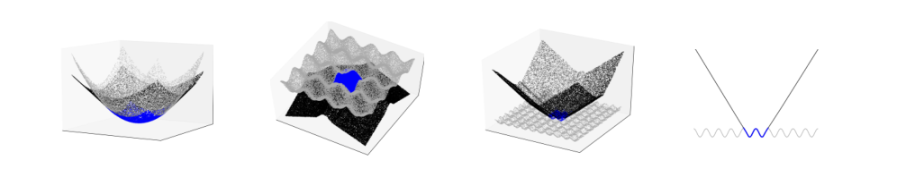
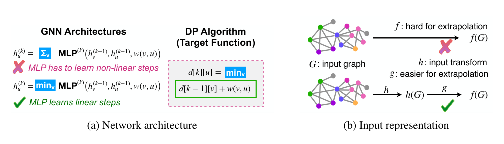
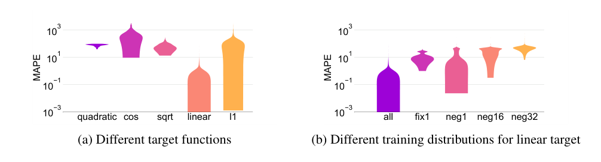
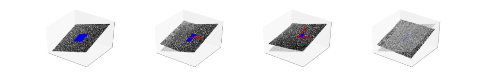
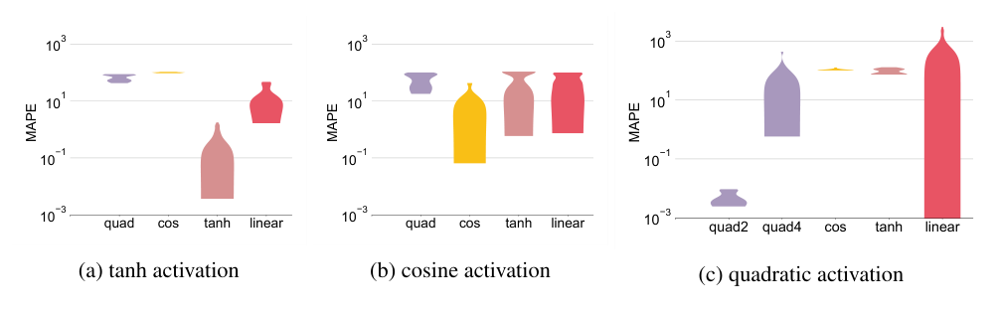
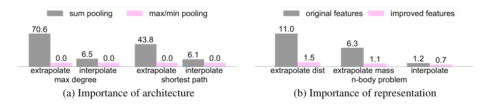
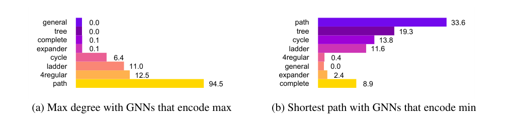

# 신경망은 어떻게 외삽하는가: 순방향 신경망에서 그래프 신경망까지 (Xu 2021)

- 원제: How Neural Networks Extrapolate: From Feedforward to Graph Neural Networks
- 저자: Keyulu Xu, Mozhi Zhang, Jingling Li, Simon S. Du, Ken-ichi Kawarabayashi, Stefanie Jegelka (MIT, University of Maryland, University of Washington, National Institute of Informatics)
- 원문: 같은 폴더의 `Xu2021_ICLR_how_neural_networks_extrapolate.pdf` (ICLR 2021 학회 논문, arXiv:2009.11848v5, 52쪽)
- 번역 범위: 발췌. **본문(초록, 1~5절, 6절 결론, 감사의 글, 원문 1~10쪽)은 전문 번역**. 참고문헌(원문 10~15쪽)은 번역하지 않고 원문 그대로 옮김. **부록(원문 16~52쪽, A~D절)은 절 제목 목록과 본 과제 관련 부분만 발췌**: 외삽 오차·NTK 정의(A), 정리 1(선형 외삽)·보조정리 1·정리 2(외삽 조건)의 증명 개요와 진술(B.1~B.3), MLP 실험(C.1~C.3)의 요점. GNN 관련 부록 증명·실험(B.4 이후, C.4 이후, D)은 절 제목만 남김.
- 그림: 본문 그림 7개(그림 1~7)를 `그림/`에 넣고 본문에서 처음 언급되는 곳에 삽입. 부록 그림은 넣지 않음.
- 용어: extrapolation=외삽, interpolation=내삽, training distribution=학습 분포, support=지지집합(서포트), neural tangent kernel(NTK)=신경 접선 커널, over-parameterized=과매개변수화된, gradient descent(GD)=경사 하강법, dynamic programming(DP)=동적 계획법.

## 초록 (Abstract)

우리는 경사 하강법(gradient descent)으로 학습한 신경망이 어떻게 외삽(extrapolate)하는지, 즉 학습 분포의 지지집합(support) 밖에서 무엇을 학습하는지 연구한다. 기존 연구들은 신경망의 외삽에 대해 엇갈린 경험적 결과를 보고한다. 순방향 신경망(feedforward neural networks), 즉 다층 퍼셉트론(MLP)은 어떤 단순한 과제에서 외삽을 잘 하지 못하는 반면, MLP 모듈을 가진 구조화된 신경망인 그래프 신경망(GNN)은 더 복잡한 과제에서 어느 정도 성공을 보였다. 이론적 설명을 향해, 우리는 MLP와 GNN이 외삽을 잘 하는 조건을 밝힌다. 첫째, ReLU MLP가 원점에서 뻗는 어떤 방향으로든 빠르게 선형 함수로 수렴한다는 관찰을 정량화하며, 이는 ReLU MLP가 대부분의 비선형 함수를 외삽하지 못함을 뜻한다. 그러나 학습 분포가 충분히 "다양(diverse)"하면 선형 목표 함수는 증명 가능하게 학습할 수 있다. 둘째, GNN의 성공과 한계를 분석하는 것과 관련하여, 이 결과들은 하나의 가설을 제시하며 우리는 그에 대한 이론적·경험적 증거를 제공한다: 알고리즘 과제에서 GNN이 새 데이터(예: 더 큰 그래프나 간선 가중치)로 외삽하는 데 성공하는 것은 과제 고유의 비선형성을 구조나 특징(feature)에 부호화(encoding)하는 데 달려 있다. 우리의 이론 분석은 과매개변수화된(over-parameterized) 신경망과 신경 접선 커널(neural tangent kernel)의 연결에 기반한다. 경험적으로 우리의 이론은 다양한 학습 설정에서 성립한다.

## 1. 서론 (Introduction)

인간은 많은 과제에서 외삽을 잘 한다. 예를 들어 우리는 임의로 큰 수에 산술을 적용할 수 있다. 신경망도 같은 일을 하여 학습 데이터에서 임의로 멀리 떨어진 예제로 일반화할 수 있는지 궁금할 수 있다(Lake et al., 2017). 흥미롭게도 기존 연구들은 신경망의 외삽 결과를 엇갈리게 보고한다. 초기 연구들은 순방향 신경망, 즉 다층 퍼셉트론(MLP)이 단순한 다항 함수를 학습할 때 외삽을 잘 하지 못함을 보였다(Barnard & Wessels, 1992; Haley & Soloway, 1992). 그러나 최근 연구들은 MLP를 구성 요소로 하는 구조화된 신경망의 한 부류인 그래프 신경망(GNN)(Scarselli et al., 2009)이 물리 시스템의 시간 변화 예측(Battaglia et al., 2016), 그래프 알고리즘 학습(Velickovic et al., 2020), 수학 방정식 풀이(Lample & Charton, 2020)와 같은 어려운 알고리즘 과제에서 학습 그래프보다 훨씬 큰 그래프로 일반화할 수 있음을 보인다.

이 수수께끼를 설명하기 위해, 우리는 경사 하강법(GD)으로 학습한 신경망이 어떻게 외삽하는지, 즉 학습 분포의 지지집합 밖에서 무엇을 학습하는지 형식적으로 연구한다. 신경망이 학습 분포 밖에서 과제를 학습하면 외삽을 잘 한다고 말한다. 언뜻 보면 신경망은 용량이 크고(Zhang et al., 2017) 보편 근사기(universal approximator)이므로(Cybenko, 1989; Funahashi, 1989; Hornik et al., 1989; Kurkova, 1992) 학습 분포 밖에서 임의로 행동할 수 있을 것처럼 보인다. 그러나 신경망은 경사 하강 학습에 의해 제약된다(Hardt et al., 2016; Soudry et al., 2018). 우리의 분석에서는 신경 접선 커널(NTK)(Jacot et al., 2018)을 통한, 과매개변수화된 신경망의 학습 동역학과 커널 회귀 사이의 유비를 통해 이러한 암묵적 편향(implicit bias)을 명시적으로 고려한다.

*그림 1 — ReLU MLP는 어떻게 외삽하는가. 비선형 함수(회색)를 학습하도록 MLP를 훈련시키고, 학습 분포 안(파랑)과 밖(검정)에서의 예측을 그렸다. MLP는 학습 데이터 범위 밖에서 원점에서 뻗는 방향을 따라 빠르게 선형 함수로 수렴한다(정리 1). 따라서 MLP는 대부분의 비선형 과제에서 외삽을 잘 하지 못한다. 그러나 적절한 학습 데이터가 있으면 MLP는 선형 목표 함수를 증명 가능하게 외삽할 수 있다(정리 2).*

가장 단순한 신경망이자 GNN 같은 더 복잡한 구조의 구성 요소인 순방향 신경망에서 시작하여, 우리는 GD로 학습한 ReLU 활성화의 과매개변수화된 MLP의 예측이 원점에서 뻗는 어떤 방향으로든 선형 함수로 수렴함을 확립한다. 2층 신경망에 대해 수렴 속도를 증명하고, 수렴이 흔히 학습 데이터 가까이에서 일어남을 경험적으로 관찰한다(그림 1). 이는 ReLU MLP가 대부분의 비선형 과제에서 외삽을 잘 할 수 없음을 시사한다. 우리의 결과는 ReLU 신경망이 유한 개의 선형 영역을 갖는다는 사실(Arora et al., 2018; Hanin & Rolnick, 2019; Hein et al., 2019)에서 따라 나오는 것이 아님을 강조한다. 선형 영역이 유한 개라는 것은 ReLU MLP가 결국 선형이 된다는 것을 뜻하지만, MLP가 학습 분포 가까이에서 올바른 목표 함수를 학습할지는 말해 주지 않는다. 반면 우리의 결과는 비점근적(non-asymptotic)이며 MLP가 학습 분포 가까이에서 어떤 종류의 함수를 학습할지 정량화한다. 둘째, MLP가 외삽을 잘 하는 조건을 밝힌다: 과제가 선형이고 학습 분포의 기하가 충분히 "다양"한 경우다. 우리가 아는 한, 우리의 결과는 순방향 신경망에 대한 이런 종류의 최초의 외삽 결과다.

이어서 순방향 신경망에 대한 통찰을 GNN과 연결하여, 왜 GNN이 일부 알고리즘 과제에서 외삽을 잘 하는지 설명한다. 기존 연구들은 동적 계획법(DP)(Bellman, 1966)으로 풀 수 있는 과제에서 외삽 성공을 보고하는데, DP는 GNN과 정렬된(aligned) 계산 구조를 갖는다(Xu et al., 2020). DP 갱신은 흔히 비선형 단계와 선형 단계로 분해할 수 있다. 따라서 우리는 구조와 입력 표현에 적절한 비선형성을 부호화하면 GD로 학습한 GNN이 DP 과제에서 외삽을 잘 할 수 있다고 가정한다(그림 2). 중요한 점은, MLP 모듈이 학습 분포 안에서는 많은 비선형 함수를 쉽게 학습할 수 있으므로(Cybenko, 1989; Hornik et al., 1989; Xu et al., 2020) GNN이 내삽(interpolate)하는 데는 비선형성 부호화가 불필요할 수 있지만, GNN이 올바르게 외삽하는 데는 결정적이라는 것이다. 우리는 Graph NTK(Du et al., 2019b)를 써서 단순화된 경우에 대해 이 가설을 증명한다. 경험적으로는 최대 차수(max degree), 최단 경로(shortest paths), n체 문제(n-body problem)의 세 DP 과제에서 가설을 검증한다. 적절한 구조, 입력 표현, 학습 분포를 갖춘 GNN이 보지 못한 크기, 구조, 간선 가중치, 노드 특징을 가진 그래프에서 잘 예측할 수 있음을 보인다. 우리의 이론은 기존 연구의 경험적 성공을 설명하고 그 한계를 시사한다: 외삽의 성공은 과제 고유의 비선형성을 부호화하는 데 달려 있으며, 이는 도메인 지식이나 광범위한 모델 탐색을 요구한다. 더 넓은 관점에서 우리의 통찰은 GNN을 넘어 다른 신경망에도 폭넓게 적용된다.

*그림 2 — GNN은 어떻게 외삽하는가. MLP는 선형 함수를 학습할 때 외삽을 잘 할 수 있으므로, 구조(왼쪽)와 입력 표현(오른쪽; 도메인 지식이나 표현 학습을 통해)에 적절한 비선형성을 부호화하면 GNN이 동적 계획법(DP) 과제에서 외삽을 잘 할 수 있다고 가정한다. 부호화된 비선형성은 MLP 모듈로 근사할 수 있으므로 내삽에는 필요하지 않을 수 있지만, 외삽에는 도움이 된다. 우리는 이 가설을 이론적으로(정리 3), 경험적으로(그림 6) 뒷받침한다. [그림 안 글: (a) 신경망 구조 — DP 알고리즘(목표 함수) $d[k][u] = \min_v d[k-1][v] + w(v,u)$; GNN 구조 $h_u^{(k)} = \sum_v \mathrm{MLP}^{(k)}(h_v^{(k-1)}, h_u^{(k-1)}, w(v,u))$ 이면 "MLP가 비선형 단계를 학습해야 함", $\min_v$ 집계를 쓰면 "MLP가 선형 단계를 학습". (b) 입력 표현 — 입력 그래프 G, 입력 변환 h; f(G)는 외삽이 어렵고 g(h(G))는 외삽이 더 쉬움.]*

요약하면, 우리는 신경망이 어떻게 외삽하는지 연구한다. 첫째, GD로 학습한 ReLU MLP는 원점에서 뻗는 방향을 따라 $O(1/t)$의 속도로 선형 함수로 수렴한다. 둘째, 왜 GNN이 일부 알고리즘 과제에서 외삽을 잘 하는지 설명하기 위해, ReLU MLP가 선형 과제에서 외삽을 잘 할 수 있음을 증명하고, 다음 가설을 이끌어 낸다: 적절한 비선형성을 구조와 특징에 부호화하면 신경망은 외삽을 잘 할 수 있다. 우리는 단순화된 경우에 이 가설을 증명하고 더 일반적인 설정에 대해 경험적 근거를 제공한다.

### 1.1 관련 연구 (Related Work)

초기 연구들은 MLP가 외삽을 잘 하지 못하는 예제 과제, 예컨대 단순한 다항식 학습을 보였다(Barnard & Wessels, 1992; Haley & Soloway, 1992). 우리는 대신 ReLU MLP가 외삽하는 일반적 양상을 보이고 MLP가 외삽을 잘 하는 조건을 밝힌다. 더 최근 연구들은 NTK 영역과 평균장(mean field) 영역 모두에서 경사 하강이 MLP에 유도하는 암묵적 편향을 연구한다(Bietti & Mairal, 2019; Chizat & Bach, 2018; Song et al., 2018). 우리 결과와 관련하여, 일부 연구는 MLP 예측이 "단순한" 조각별 선형 함수, 예컨대 선형 영역이 적은 함수로 수렴함을 보인다(Hanin & Rolnick, 2019; Maennel et al., 2018; Savarese et al., 2019; Williams et al., 2019). 우리 연구가 다른 점은 이들 중 어느 것도 외삽을 명시적으로 연구하지 않으며, 일부는 1차원 입력에만 초점을 둔다는 것이다. 최근 연구들은 또한 NTK 영역의 고차원 설정에서 MLP가 특정 척도 극한(scaling limit)에서 점근적으로 기껏해야 선형 예측기임을 보인다(Ba et al., 2020; Ghorbani et al., 2019). 우리는 다른 설정(외삽)을 연구하며, 우리의 분석은 본질적으로 비점근적이고 무작위 행렬 이론에 의존하지 않는다.

기존 연구들은 더 큰 그래프에서 시험하여 GNN 외삽을 탐구한다(Battaglia et al., 2018; Santoro et al., 2018; Saxton et al., 2019; Velickovic et al., 2020). 우리는 GNN 외삽을 이론적으로 연구한 최초의 연구이며, 외삽의 개념을 보지 못한 특징과 구조까지 포함하도록 완성한다.

## 2. 사전 지식 (Preliminaries)

먼저 설정을 소개한다. $\mathcal{X}$를 관심 정의역(예: 벡터 또는 그래프)이라 하자. 과제는 학습 집합 $\{(\boldsymbol{x}_i, y_i)\}_{i=1}^n \subset \mathcal{D}$로 바탕 함수 $g: \mathcal{X} \to \mathbb{R}$을 학습하는 것이며, 여기서 $y_i = g(\boldsymbol{x}_i)$이고 $\mathcal{D}$는 학습 분포의 지지집합이다. 기존 연구들은 학습 분포와 시험 분포가 같은 분포 내 일반화(in-distribution generalization), 즉 $\mathcal{D} = \mathcal{X}$인 경우를 폭넓게 연구했다(Valiant, 1984; Vapnik, 2013). 반면 외삽은 학습 분포의 지지집합 $\mathcal{D}$보다 큰 정의역 $\mathcal{X}$에서의 예측을 다룬다. 모델의 외삽 오차가 작으면 그 모델이 외삽을 잘 한다고 말한다.

**정의 1(Definition 1).** (외삽 오차, Extrapolation error) $f: \mathcal{X} \to \mathbb{R}$을 바탕 함수 $g: \mathcal{X} \to \mathbb{R}$을 갖는 $\{(\boldsymbol{x}_i, y_i)\}_{i=1}^n \subset \mathcal{D}$로 학습한 모델이라 하자. $\mathcal{P}$를 $\mathcal{X} \setminus \mathcal{D}$ 위의 분포, $\ell: \mathbb{R} \times \mathbb{R} \to \mathbb{R}$을 손실 함수라 하자. $f$의 외삽 오차를 $\mathbb{E}_{\boldsymbol{x}\sim\mathcal{P}}[\ell(f(\boldsymbol{x}), g(\boldsymbol{x}))]$로 정의한다.

우리는 제곱 손실로 경사 하강법(GD) 또는 그 변형으로 학습한 신경망에 초점을 둔다. 순방향 신경망과 그래프 신경망의 두 구조를 연구한다.

**그래프 신경망(Graph Neural Networks).** GNN은 MLP 모듈로 그래프 위에서 동작하는 구조화된 신경망이다(Battaglia et al., 2018; Xu et al., 2019). $G = (V, E)$를 그래프라 하자. 각 노드 $u \in V$는 특징 벡터 $\boldsymbol{x}_u$를, 각 간선 $(u, v) \in E$는 특징 벡터 $\boldsymbol{w}_{(u,v)}$를 갖는다. GNN은 반복 $k$에서 노드 표현 $\boldsymbol{h}_u^{(k)}$를 재귀적으로 계산한다(Gilmer et al., 2017; Xu et al., 2018). 처음에 $\boldsymbol{h}_u^{(0)} = \boldsymbol{x}_u$이다. $k = 1..K$에 대해 GNN은 이웃 표현을 집계하여 $\boldsymbol{h}_u^{(k)}$를 갱신한다. 선택적으로 최종 노드 표현을 집계하여 그래프 표현 $\boldsymbol{h}_G$를 계산할 수 있다. 즉,

$$\boldsymbol{h}_u^{(k)} = \sum_{v\in\mathcal{N}(u)} \mathrm{MLP}^{(k)}\Big(\boldsymbol{h}_u^{(k-1)}, \boldsymbol{h}_v^{(k-1)}, \boldsymbol{w}_{(v,u)}\Big), \quad \boldsymbol{h}_G = \mathrm{MLP}^{(K+1)}\Big(\sum_{u\in G}\boldsymbol{h}_u^{(K)}\Big). \tag{1}$$

최종 출력은 과제에 따라 그래프 표현 $\boldsymbol{h}_G$ 또는 최종 노드 표현 $\boldsymbol{h}_u^{(K)}$이다. $\boldsymbol{h}_u^{(k)}$의 이웃 집계 단계를 집계(aggregation), $\boldsymbol{h}_G$의 풀링 단계를 판독(readout)이라 부른다. 기존 연구들은 보통 합 집계와 합 판독을 쓴다(Battaglia et al., 2018). 우리의 결과는 이를 바꾸는 것이 왜 외삽에 도움이 될 수 있는지 보여 준다(4절).

## 3. 순방향 신경망은 어떻게 외삽하는가 (How Feedforward Neural Networks Extrapolate)

순방향 신경망은 가장 단순한 신경망이자 GNN 같은 더 복잡한 구조의 구성 요소이므로, 먼저 GD로 학습할 때 이들이 어떻게 외삽하는지 연구한다. 논문 전체에서 ReLU 활성화를 가정한다. 3.3절에 다른 활성화 함수에 대한 예비 결과가 있다.

### 3.1 ReLU MLP의 선형 외삽 거동 (Linear Extrapolation Behavior of ReLU MLPs)

구조상 ReLU 신경망은 조각별 선형 함수를 학습하지만, 학습 데이터의 지지집합 밖에서 이 영역들은 정확히 어떤 모습일까? 그림 1은 GD로 여러 비선형 함수를 학습한 ReLU MLP가 어떻게 외삽하는지 예를 보여 준다. 이 예들은 학습 지지집합 밖에서 예측이 원점에서 뻗는 방향을 따라 빠르게 선형이 됨을 시사한다. 우리는 MLP 예측에 대한 선형 회귀로 이 양상을 체계적으로 검증한다: 결정계수($R^2$)는 항상 0.99보다 크다(부록 C.2). 즉 ReLU MLP는 학습 데이터 범위 밖에서 거의 즉시 "선형화"된다.

우리는 신경 접선 커널(NTK)을 통한, GD로 학습한 신경망의 암묵적 편향을 이용해 이 관찰을 형식화한다: "NTK 영역(NTK regime)"이라 불리는 일련의 가정 아래에서, GD로 학습한 과매개변수화된 신경망의 최적화 궤적은 특정 신경 접선 커널을 쓴 커널 회귀의 궤적과 동등하다(Jacot et al., 2018). 여기서는 비형식적 정의를 제시한다. 자세한 내용은 Jacot et al. (2018)과 부록 A를 참조하라.

**정의 2(Definition 2).** (비형식적) NTK 영역에서 학습한 신경망은 폭이 무한하고, 특정 척도로 무작위 초기화되며, 무한소 보폭의 GD로 학습된다.

기존 연구들은 NTK를 통해 과매개변수화된 신경망의 최적화와 분포 내 일반화를 분석한다(Allen-Zhu et al., 2019a;b; Arora et al., 2019a;b; Cao & Gu, 2019; Du et al., 2019c;a; Li & Liang, 2018; Nitanda & Suzuki, 2021). 우리는 대신 외삽을 분석한다.

정리 1은 그림 1의 관찰을 형식화한다: 학습 데이터 범위 밖에서, 원점에서 뻗는 어떤 방향 $t\boldsymbol{v}$를 따라서든 2층 ReLU MLP의 예측은 $O(\frac{1}{t})$의 속도로 빠르게 선형 함수로 수렴한다. 선형 계수 $\boldsymbol{\beta}_{\boldsymbol{v}}$와 수렴 속도의 상수항은 학습 데이터와 방향 $\boldsymbol{v}$에 의존한다. 증명은 부록 B.1에 있다.

**정리 1(Theorem 1).** (선형 외삽, Linear extrapolation) 2층 ReLU MLP $f: \mathbb{R}^d \to \mathbb{R}$을 NTK 영역에서 제곱 손실로 학습한다고 하자. 임의의 방향 $\boldsymbol{v} \in \mathbb{R}^d$에 대해 $\boldsymbol{x}_0 = t\boldsymbol{v}$라 하자. $t \to \infty$일 때, 임의의 $h > 0$에 대해 $f(\boldsymbol{x}_0 + h\boldsymbol{v}) - f(\boldsymbol{x}_0) \to \beta_{\boldsymbol{v}} \cdot h$이며, 여기서 $\beta_{\boldsymbol{v}}$는 상수 선형 계수다. 또한 $\epsilon > 0$이 주어지면, $t = O(\frac{1}{\epsilon})$에 대해 $\left|\frac{f(\boldsymbol{x}_0 + h\boldsymbol{v}) - f(\boldsymbol{x}_0)}{h} - \beta_{\boldsymbol{v}}\right| < \epsilon$이다.

ReLU 신경망은 유한 개의 선형 영역을 가지므로(Arora et al., 2018; Hanin & Rolnick, 2019) 그 예측은 결국 선형이 된다. 이와 달리 정리 1은 MLP가 어떻게 외삽하는지에 대한 더 세밀한 분석이며 수렴 속도를 제공한다. 정리 1은 NTK 영역의 2층 신경망을 가정하지만, 실험은 선형 외삽 거동이 깊이, 폭, 학습률, 배치 크기가 다른 신경망들에서 두루 일어남을 확인한다(부록 C.1과 C.2). 우리의 증명 기법은 더 깊은 신경망으로도 확장될 수 있을 것이다.

정리 1은 ReLU MLP가 학습 데이터 밖에서 어떤 목표 함수에 맞출 수 있는지를 시사한다: 원점에서 멀어지는 방향을 따라 거의 선형인 함수뿐이다. 실제로 그림 4a는 ReLU MLP가 $\boldsymbol{x}^\top A\boldsymbol{x}$ (quadratic, 2차), $\sum_{i=1}^d \cos(2\pi\cdot\boldsymbol{x}^{(i)})$ (cos), $\sum_{i=1}^d \sqrt{\boldsymbol{x}^{(i)}}$ (sqrt) 같은 목표 함수를 외삽하지 못함을 보여 준다. 여기서 $\boldsymbol{x}^{(i)}$는 $\boldsymbol{x}$의 $i$번째 차원이다. 적절한 하이퍼파라미터를 쓰면 MLP는 방향 선형성 조건을 만족하는 L1 노름은 올바르게 외삽한다.

*그림 4 — ReLU MLP의 외삽 성능. 다양한 하이퍼파라미터(깊이, 폭, 학습률, 배치 크기)로 학습한 MLP의 MAPE(평균 절대 백분율 오차) 분포를 그렸다. (a) 서로 다른 목표 함수 학습. (b) 선형 목표 함수 학습을 위한 서로 다른 학습 분포: "all"은 모든 방향을 덮고, "fix1"은 한 차원이 상수로 고정되며, "negd"는 $d$개 차원이 음수 값으로 제약된다. ReLU MLP는 목표 함수가 각 방향을 따라 선형이 아니면 일반적으로 외삽을 잘 하지 못하며(그림 4a), 학습 분포가 충분히 많은 방향을 덮으면 선형 목표 함수를 외삽한다(그림 4b).*

그림 4a는 긍정적 결과를 하나 더 제공한다: MLP는 많은 서로 다른 하이퍼파라미터에서 두루 선형 목표 함수를 잘 외삽한다. 선형 함수 학습은 처음에는 매우 제한적으로 보일 수 있지만, 4절에서 이 통찰은 비선형 실무 과제에서 GNN의 외삽 특성을 설명하는 데 도움이 될 것이다. 그 전에 먼저 MLP가 언제 외삽을 잘 하는지 이론적으로 분석한다.

### 3.2 ReLU MLP가 증명 가능하게 외삽을 잘 하는 경우 (When ReLU MLPs Provably Extrapolate Well)

그림 4a는 목표 함수가 선형일 때 MLP가 외삽을 잘 할 수 있음을 보여 준다. 그러나 이것이 항상 참인 것은 아니다. 이 절에서는 외삽의 성공이 학습 데이터의 기하에 달려 있음을 보인다. 직관적으로, 올바른 외삽을 위해서는 학습 분포가 충분히 "다양"해야 한다.

학습 데이터의 기하와 외삽을 연결하는 두 조건을 제시한다. 보조정리 1은 과매개변수화된 MLP가 단 $2d$개의 예제로 선형 목표 함수를 학습할 수 있음을 말한다.

**보조정리 1(Lemma 1).** $\boldsymbol{\beta} \in \mathbb{R}^d$에 대해 $g(\boldsymbol{x}) = \boldsymbol{\beta}^\top\boldsymbol{x}$를 목표 함수라 하자. $\{\boldsymbol{x}_i\}_{i=1}^n$이 직교 기저 $\{\hat{\boldsymbol{x}}_i\}_{i=1}^d$와 $\{-\hat{\boldsymbol{x}}_i\}_{i=1}^d$를 포함한다고 하자. 2층 ReLU MLP $f$를 $\{(\boldsymbol{x}_i, y_i)\}_{i=1}^n$에서 NTK 영역의 제곱 손실로 학습하면, 모든 $\boldsymbol{x} \in \mathbb{R}^d$에 대해 $f(\boldsymbol{x}) = \boldsymbol{\beta}^\top\boldsymbol{x}$이다.

보조정리 1은 $2d$개의 예제를 신중하게 골라야 하므로 주로 이론적 관심사다. 정리 2는 보조정리 1에 기반하여 외삽 성공을 위한 더 실용적인 조건을 밝힌다: 학습 분포의 지지집합이 모든 방향을 덮으면(예: 원점을 덮는 초입방체), 충분한 학습 데이터가 있을 때 MLP는 선형 목표 함수로 수렴한다.

**정리 2(Theorem 2).** (외삽 조건, Conditions for extrapolation) $\boldsymbol{\beta} \in \mathbb{R}^d$에 대해 $g(\boldsymbol{x}) = \boldsymbol{\beta}^\top\boldsymbol{x}$를 목표 함수라 하자. $\{\boldsymbol{x}_i\}_{i=1}^n$이, 지지집합 $\mathcal{D}$가 연결된 부분집합 $S$를 포함하는 분포에서 표집되었다고 하자. 여기서 $S$는 0이 아닌 임의의 $\boldsymbol{w} \in \mathbb{R}^d$에 대해 $k\boldsymbol{w} \in S$가 되는 $k > 0$이 존재하는 집합이다. 2층 ReLU MLP $f: \mathbb{R}^d \to \mathbb{R}$을 $\{(\boldsymbol{x}_i, y_i)\}_{i=1}^n$에서 NTK 영역의 제곱 손실로 학습하면, $n \to \infty$일 때 $f(\boldsymbol{x}) \xrightarrow{p} \boldsymbol{\beta}^\top\boldsymbol{x}$이다.

**실험: 학습 데이터의 기하가 외삽에 영향을 준다(Experiments: geometry of training data affects extrapolation).** 정리 2의 조건은 외삽이 성공하려면 학습 분포가 "다양"해야 한다는, 예컨대 $\mathcal{D}$가 모든 방향을 포함해야 한다는 직관을 형식화한다. 경험적으로, 정리 2의 조건이 만족될 때 외삽 오차는 실제로 작다(그림 4b의 "all"). 반대로 학습 예제가 일부 방향으로만 제한되면 외삽 오차가 훨씬 크다(그림 4b와 그림 3).

*그림 3 — ReLU MLP가 외삽을 잘 하는 조건. 선형 함수(회색)를 서로 다른 학습 분포(파랑)로 학습하도록 MLP를 훈련시키고, 분포 밖 예측(검정)을 그렸다. 정리 2에 따라, 학습 분포(파랑)가 모든 방향에 지지집합을 가지면(첫 번째 패널) MLP는 외삽을 잘 하지만, 그렇지 않으면 그렇지 않다: 가운데 두 패널에서는 학습 데이터의 일부 차원이 양수로 제약되어 있고(빨간 화살표), 마지막 패널에서는 한 차원이 고정된 상수다.*

기존 연구와 관련하여, 정리 2는 인과성 논증(Arjovsky et al., 2019; Peters et al., 2016; Rojas-Carulla et al., 2018)을 보완하여 왜 허위 상관(spurious correlation)이 외삽을 해칠 수 있는지 시사한다. 학습 데이터에 허위 상관이 있으면 특징의 일부 조합이 빠진다. 예컨대 어떤 영상 모음에서 낙타는 사막에만 나타날 수 있다. 그러면 정리 2의 조건이 더 이상 성립하지 않고 모델은 잘못 외삽할 수 있다. 정리 2는 선형 모델의 식별 가능성(identifiability) 조건과도 유사하지만 더 엄격하다. 학습 데이터가 완전한 (특징) 계수(full rank)를 가지면 선형 함수를 유일하게 식별할 수 있다. MLP는 표현력이 더 크므로 선형 목표 함수를 식별하려면 추가 제약이 필요하다.

요약하면, 우리는 ReLU MLP가 어떻게 외삽하는지 분석하고 두 가지 통찰을 제공한다: (1) MLP는 선형 외삽 때문에 대부분의 비선형 과제를 외삽할 수 없다(정리 1). (2) 목표 함수가 선형일 때, 학습 분포가 "다양"하면 MLP는 외삽을 잘 한다(정리 2). 다음 절에서 이 결과들은 더 복잡한 신경망이 어떻게 외삽하는지 이해하는 데 도움을 준다.

### 3.3 다른 활성화 함수를 쓰는 MLP (MLPs with Other Activation Functions)

GNN으로 넘어가기 전에, 다른 활성화 함수에 대한 실험으로 MLP의 그림을 완성한다: tanh $\sigma(x) = \tanh(x)$, 코사인 $\sigma(x) = \cos(x)$ (Lapedes & Farber, 1987; McCaughan, 1997; Sopena & Alquezar, 1994), 2차 $\sigma(x) = x^2$ (Du & Lee, 2018; Livni et al., 2014). 자세한 내용은 부록 C.4에 있다. MLP는 활성화 함수와 목표 함수가 비슷할 때 외삽을 잘 한다. 예컨대 tanh 활성화는 tanh를 학습할 때는 외삽을 잘 하지만 다른 함수는 그렇지 않다(그림 5). 또한 활성화 함수마다 다른 한계가 있다. tanh 활성화로 tanh 함수를 외삽하려면 학습 데이터 범위가 충분히 넓어야 한다. 2차 활성화로 2차 함수를 학습할 때는 층이 많으면 더 높은 차수의 다항식이 되므로 2층 신경망만 외삽을 잘 한다. 코사인 활성화는 고차원 데이터에서 최적화하기 어려우므로 1·2차원 코사인 목표 함수만 고려한다.

*그림 5 — 다른 활성화 함수를 쓰는 MLP의 외삽 성능. (a) tanh 활성화, (b) 코사인 활성화, (c) 2차 활성화. 활성화 함수가 목표 함수와 "비슷"할 때 MLP는 외삽을 잘 할 수 있다. 2차 활성화로 2차 함수를 학습할 때 2층 신경망(quad-2)은 외삽을 잘 하지만 4층 신경망(quad-4)은 그렇지 않다.*

## 4. 그래프 신경망은 어떻게 외삽하는가 (How Graph Neural Networks Extrapolate)

위에서 MLP에게 비선형 과제의 외삽이 어렵다는 것을 보았다. 이런 한계에도 불구하고, GNN은 직관 물리(Battaglia et al., 2016; Janner et al., 2019), 그래프 알고리즘(Battaglia et al., 2018; Velickovic et al., 2020), 기호 수학(Lample & Charton, 2020) 같은 일부 비선형 알고리즘 과제에서 외삽을 잘 한다고 보고되었다. 이 불일치를 다루기 위해 MLP 결과를 바탕으로 GD로 학습한 GNN이 어떻게 외삽하는지 연구한다.

### 4.1 가설: 선형 알고리즘 정렬이 외삽을 돕는다 (Hypothesis: Linear Algorithmic Alignment Helps Extrapolation)

예제로 시작하자: 최단 경로 문제를 풀도록 GNN을 학습하는 것이다. 이 과제에 대해 기존 연구들은 최솟값 집계(min-aggregation)를 쓰는 수정된 GNN 구조가 학습 집합의 그래프보다 큰 그래프로 일반화할 수 있음을 관찰한다(Battaglia et al., 2018; Velickovic et al., 2020):

$$\boldsymbol{h}_u^{(k)} = \min_{v\in\mathcal{N}(u)} \mathrm{MLP}^{(k)}\Big(\boldsymbol{h}_u^{(k-1)}, \boldsymbol{h}_v^{(k-1)}, \boldsymbol{w}_{(v,u)}\Big). \tag{2}$$

먼저 직관적 설명을 제공한다(그림 2a). 최단 경로는 다음 갱신을 쓰는 벨만-포드(Bellman-Ford, BF) 알고리즘(Bellman, 1958)으로 풀 수 있다:

$$d[k][u] = \min_{v\in\mathcal{N}(u)} d[k-1][v] + \boldsymbol{w}(v, u), \tag{3}$$

여기서 $\boldsymbol{w}(v, u)$는 간선 $(v, u)$의 가중치이고, $d[k][u]$는 $k$ 단계 안에서 노드 $u$까지의 최단 거리다. 두 식은 쉽게 정렬할 수 있다: MLP 모듈이 선형 함수 $d[k-1][v] + \boldsymbol{w}(v, u)$를 학습하면 GNN은 BF 알고리즘을 모사한다. MLP는 선형 과제를 외삽할 수 있으므로, 이 "정렬"은 왜 최솟값 집계 GNN이 이 과제에서 외삽을 잘 할 수 있는지 설명할 수 있다.

비교를 위해, 더 흔히 쓰는 합 집계(식 1)를 쓰는 GNN이 이 과제에서 외삽을 잘 하리라 기대하지 않는 이유를 따져 볼 수 있다. 합 집계에서는 BF 알고리즘을 모사하기 위해 MLP 모듈이 비선형 함수를 학습해야 하는데, 정리 1은 이들이 학습 지지집합 밖에서 대부분의 비선형 함수를 외삽하지 못할 것임을 시사한다.

위의 직관을 다른 알고리즘 과제로 일반화할 수 있다. GNN이 외삽을 잘 하는 많은 과제는 동적 계획법(DP)(Bellman, 1966)으로 풀 수 있는데, DP는 GNN(식 1)과 비슷한 재귀 구조를 가진 알고리즘 패러다임이다(Xu et al., 2020).

**정의 3(Definition 3).** 동적 계획법(DP)은 다음 갱신을 갖는 재귀 절차다.

$$\text{Answer}[k][s] = \text{DP-Update}(\{\text{Answer}[k-1][s']\},\ s' = 1...n), \tag{4}$$

여기서 Answer$[k][s]$는 반복 $k$와 상태 $s$로 색인된 부분 문제의 해이고, DP-Update는 이전 반복에 근거하여 부분 문제를 푸는 과제 고유의 갱신 함수다.

더 넓은 관점에서 우리는 다음과 같이 가정한다: MLP 모듈이 거의 선형인 단계만 학습하면 되도록 모델 구조와 입력 표현에 적절한 비선형성을 부호화하면, 그 결과 신경망은 외삽을 잘 할 수 있다.

**가설 1(Hypothesis 1).** (선형 알고리즘 정렬, Linear algorithmic alignment) $f: \mathcal{X} \to \mathbb{R}$을 바탕 함수, $\mathcal{N}$을 $m$개의 MLP 모듈을 가진 신경망이라 하자. $\mathcal{N}$의 MLP 모듈을 $g_i$로 바꾸면 $\mathcal{N}$이 $f$를 모사하게 되는 $m$개의 선형 함수 $\{g_i\}_{i=1}^m$이 존재한다고 하자. $\epsilon > 0$이 주어지면, $\{(\boldsymbol{x}_i, f(\boldsymbol{x}_i))\}_{i=1}^n$에서 제곱 손실의 GD로 학습한 $\mathcal{N}$이 $\|\hat f - f\| < \epsilon$인 $\hat f$를 학습하게 되는 $\{(\boldsymbol{x}_i, f(\boldsymbol{x}_i))\}_{i=1}^n \subset \mathcal{D} \subsetneq \mathcal{X}$가 존재한다.

우리의 가설은 (Xu et al., 2020)의 알고리즘 정렬(algorithmic alignment) 틀에 기반한다. 그 틀은 모듈들이 학습하기 쉬운 (비선형일 수도 있는) 함수에 "정렬"되면 신경망이 내삽을 잘 한다고 말한다. 외삽의 성공은 더 어렵다: 모듈들이 선형 함수에 정렬되어야 한다.

**선형 알고리즘 정렬의 응용(Applications of linear algorithmic alignment).** 일반적으로 선형 알고리즘 정렬은 GNN에 국한되지 않고 신경망에 폭넓게 적용된다. 조건을 만족시키기 위해, 구조나 입력 표현에 적절한 비선형 연산을 부호화할 수 있다(그림 2). GNN으로 DP 알고리즘을 학습하는 것은 구조에 비선형성을 부호화하는 한 예다(Battaglia et al., 2018; Corso et al., 2020). 다른 예는 산술 과제에서 곱셈의 외삽을 돕기 위해 구조에 로그-지수 변환을 부호화하는 것이다(Trask et al., 2018; Madsen & Johansen, 2020). 신경 기호 프로그램(neural symbolic programs)은 한 걸음 더 나아가 외삽을 돕기 위해 기호 연산 라이브러리를 부호화한다(Johnson et al., 2017; Mao et al., 2019; Yi et al., 2018).

일부 과제에서는 입력 표현을 바꾸는 것이 더 쉬울 수 있다(그림 2b). 때로는 목표 함수 $f$를 특징 임베딩 $h$와 모델이 잘 외삽할 수 있는 "더 단순한" 목표 함수 $g$로 $f = g \circ h$와 같이 분해할 수 있다. $h$는 도메인 지식을 이용한 특수 특징이나 특징 변환으로(Lample & Charton, 2020; Webb et al., 2020), 또는 $\mathcal{X} \setminus \mathcal{D}$의 레이블 없는 분포 밖 데이터를 이용한 표현 학습(예: BERT)으로(Chen et al., 2020; Devlin et al., 2019; Hu et al., 2020; Mikolov et al., 2013b; Peters et al., 2018) 얻을 수 있다. 이는 다양한 응용 분야에서 표현이 외삽을 돕는 방식에 대한 새로운 관점을 제공한다. 예를 들어 자연어 처리에서 사전 학습 표현(Mikolov et al., 2013a; Wu & Dredze, 2019)과 도메인 지식을 이용한 특징 변환(Yuan et al., 2020; Zhang et al., 2019)은 모델이 특수한 종류의 외삽인 언어 간 일반화를 하도록 돕는다. 계량 금융에서는 금융 시장이 자주 외삽 영역에 있을 수 있으므로, 올바른 "팩터(factor)"나 특징을 식별하는 것이 딥러닝 모델에 결정적이다(Banz, 1981; Fama & French, 1993; Ross, 1976).

선형 알고리즘 정렬은 문헌의 외삽 성공을 설명하며, 외삽이 일반적으로 더 어렵다는 것을 시사한다: 적절한 비선형성을 부호화하려면 흔히 도메인 전문성이나 모델 탐색이 필요하다. 다음으로 우리 가설에 대한 이론적·경험적 근거를 제시한다.

### 4.2 이론적·경험적 근거 (Theoretical and Empirical Support)

최대 차수, 최단 경로, n체 문제의 세 DP 과제에서 가설을 검증하고, 최대 차수에 대해 가설을 증명한다. 외삽에서 그래프 구조의 역할을 강조한다.

**이론 분석(Theoretical analysis).** 단순하지만 근본적인 과제로 시작한다: 반복이 한 번인 DP의 특수한 경우인, 그래프의 최대 차수 학습이다. 정리 1의 따름정리로서, 흔히 쓰는 합 기반 GNN(식 1)은 외삽을 잘 할 수 없다(증명은 부록 B.4).

**따름정리 1(Corollary 1).** 합 집계와 합 판독을 쓰는 GNN은 최대 차수(Max Degree)에서 외삽을 잘 하지 못한다.

선형 알고리즘 정렬을 이루기 위해, 유일한 비선형성인 max 함수를 판독에 부호화할 수 있다. 정리 3은 max 판독을 쓰는 GNN이 이 과제에서 외삽을 잘 할 수 있음을 확인한다.

**정리 3(Theorem 3).** (GNN을 이용한 외삽, Extrapolation with GNNs) 모든 노드가 같은 특징을 갖는다고 가정하자. $g$와 $g'$를 각각 최대/최소 차수 함수라 하자. $\{(G_i, g(G_i))\}_{i=1}^n$을 학습 집합이라 하자. $N_i^{max}$와 $N_i^{min}$이 $G_i$에서 최대/최소 차수를 갖는 노드의 수일 때 $\{(g(G_i), g'(G_i), g(G_i)\cdot N_i^{max}, g'(G_i)\cdot N_i^{min})\}_{i=1}^n$이 $\mathbb{R}^4$를 생성(span)하면, $\{(G_i, g(G_i))\}_{i=1}^n$에서 NTK 영역의 제곱 손실로 학습한 1층 max 판독 GNN은 $g$를 학습한다.

GNN의 MLP 모듈은 간접적인 지도(supervision)만 받으므로 정리 3은 정리 2에서 바로 따라 나오지 않는다. 부록 B.5에서 Graph NTK(Du et al., 2019b)를 분석하여 정리 3을 증명한다. 정리 3은 동일한 노드 특징을 가정하지만, 동일한 특징과 동일하지 않은 특징 모두에서 비슷한 결과를 경험적으로 관찰한다(부록의 그림 16).

**조건의 해석(Interpretation of conditions).** 정리 3의 조건은 정리 2의 조건과 유사하다. 두 정리 모두 다양한 학습 데이터를 요구하며, 정리 3에서는 그래프 구조로, 정리 2에서는 방향으로 측정된다. 정리 3에서는 모든 학습 그래프가 같은 최대 또는 최소 노드 차수를 가지면 조건이 위반된다. 예컨대 학습 데이터가 다음 계열 중 하나에서 온 경우다: 경로(path), C-정규 그래프(차수 C인 정규 그래프), 순환(cycle), 사다리(ladder).

**실험: 외삽을 돕는 구조(Experiments: architectures that help extrapolation).** 최대 차수와 최단 경로의 두 DP 과제로 이론 분석을 검증한다(자세한 내용은 부록 C.5와 C.6). 기존 연구는 크기가 다른 그래프에서만 시험했지만(Battaglia et al., 2018; Velickovic et al., 2020), 우리는 보지 못한 구조, 간선 가중치, 노드 특징을 가진 그래프에서도 시험한다. 결과는 우리 이론을 뒷받침한다. 최대 차수에서는 max 판독 GNN이 합 판독 GNN보다 우수하며(그림 6a), 따름정리 1과 정리 3을 확인해 준다. 최단 경로에서는 min 판독과 min 집계를 쓰는 GNN이 합 판독 GNN보다 우수하다(그림 6a).

*그림 6 — 알고리즘 과제에서의 외삽. 각 열은 과제와 평균 절대 백분율 오차(MAPE)를 나타낸다. 구조나 표현에 적절한 비선형성을 부호화하는 것은 내삽에는 덜 도움이 되지만 외삽은 크게 개선한다. 왼쪽: 최대 차수와 최단 경로에서 max/min을 적절히 부호화한 GNN은 외삽을 잘 하지만, 합 풀링 GNN은 그렇지 않다. 오른쪽: 개선된 입력 표현을 쓰면 GNN은 n체 문제에서 더 잘 외삽한다. [그림 안 수치(MAPE, %): (a) 구조의 중요성 — 최대 차수: 합 풀링 외삽 70.6 / 내삽 6.5, max/min 풀링 외삽 0.0 / 내삽 0.0; 최단 경로: 합 풀링 외삽 43.8 / 내삽 6.1, max/min 풀링 외삽 0.0 / 내삽 0.0. (b) 표현의 중요성(n체 문제) — 원래 특징: 거리 외삽 11.0, 질량 외삽 6.3, 내삽 1.2; 개선된 특징: 거리 외삽 1.5, 질량 외삽 1.1, 내삽 0.7.]*

실험은 학습 그래프 구조의 중요성을 확인해 준다(그림 7). 흥미롭게도 두 과제는 서로 다른 그래프 구조를 선호한다. 최대 차수에서는 정리 3이 예측하듯 트리, 완전 그래프, 확장 그래프(expander), 일반 그래프로 학습하면 GNN이 외삽을 잘 하고, 4-정규, 순환, 사다리 그래프로 학습하면 외삽 오차가 더 크다. 최단 경로에서는 학습 그래프의 희소도를 바꾸면 외삽 오차가 U자 곡선을 따른다(그림 7b와 부록의 그림 18). 직관적으로, 희소하거나 조밀한 그래프로 학습한 모델은 퇴화한 해를 학습할 가능성이 크다.

*그림 7 — 학습 그래프 구조의 중요성. 행은 학습 집합이 다루는 그래프 구조와 외삽 오차(MAPE)를 나타낸다. 최대 차수에서는 학습 그래프의 최대/최소 차수가 제한되지 않으면 max 판독 GNN이 외삽을 잘 한다(정리 3). 최단 경로에서는 min GNN의 외삽 오차가 학습 그래프의 희소도에 대해 U자 모양을 따른다. 더 많은 결과는 부록 D.2에 있다. [(a) max를 부호화한 GNN의 최대 차수: path 94.5, 4regular 12.5, ladder 11.0, cycle 6.4, expander 0.1, complete 0.1, tree 0.0, general 0.0. (b) min을 부호화한 GNN의 최단 경로: complete 8.9, expander 2.4, general 0.0, 4regular 0.4, ladder 11.6, cycle 13.8, tree 19.3, path 33.6.]*

**실험: 외삽을 돕는 표현(Experiments: representations that help extrapolation).** 끝으로 좋은 입력 표현이 외삽을 도움을 보인다. n체 문제(Battaglia et al., 2016; Watters et al., 2017)(부록 C.7), 즉 중력계에서 $n$개 물체의 시간 변화를 예측하는 문제를 연구한다. 기존 연구를 따라, 입력은 노드가 물체인 완전 그래프다(Battaglia et al., 2016). 노드 $u$의 특징은 시각 $t$에서 물체의 질량 $m_u$, 위치 $\boldsymbol{x}_u^{(t)}$, 속도 $\boldsymbol{v}_u^{(t)}$를 이어 붙인 것이다. 간선 특징은 0으로 둔다. 각 물체 $u$의 시각 $t+1$에서의 속도를 예측하도록 GNN을 학습한다. 물체 $u$의 참 속도 $f(G; u)$는 대략 다음과 같다.

$$f(G; u) \approx \boldsymbol{v}_u^t + \boldsymbol{a}_u^t\cdot dt,\quad \boldsymbol{a}_u^t = C\cdot\sum_{v\neq u}\frac{m_v}{\|\boldsymbol{x}_u^t - \boldsymbol{x}_v^t\|_2^3}\cdot\big(\boldsymbol{x}_v^t - \boldsymbol{x}_u^t\big), \tag{5}$$

여기서 $C$는 상수다. $f$를 학습하려면 MLP 모듈이 비선형 함수를 학습해야 한다. 따라서 GNN은 보지 못한 질량이나 거리로 외삽을 잘 하지 못한다(그림 6b의 "original features"). 대신 비선형성을 부호화하기 위해 개선된 표현 $h(G)$를 쓴다. 시각 $t$에서 $(u, v)$의 간선 특징을 0에서 $\boldsymbol{w}_{(u,v)}^{(t)} = m_v\cdot\big(\boldsymbol{x}_v^{(t)} - \boldsymbol{x}_u^{(t)}\big)/\|\boldsymbol{x}_u^{(t)} - \boldsymbol{x}_v^{(t)}\|_2^3$로 바꾼다. 새 간선 특징은 정보를 더하지 않지만, 이제 MLP 모듈은 선형 함수만 학습하면 되므로 외삽에 도움이 된다(그림 6b의 "improved features").

## 5. 다른 분포 밖 설정과의 연결 (Connections to Other Out-of-Distribution Settings)

몇 가지 관련 설정을 논의한다. 직관적으로, 위 결과의 관점에서 관련 설정의 방법들은 1) 학습 데이터 범위 너머에서 유용한 비선형성을 학습하거나 2) 관련 시험 데이터를 학습 데이터 범위로 사상(mapping)함으로써 외삽을 개선할 수 있다.

**도메인 적응(Domain adaptation)**은 특정 목표 도메인으로의 일반화를 연구한다(Ben-David et al., 2010; Blitzer et al., 2008; Mansour et al., 2009). 전형적인 전략은 학습 과정을 조정한다: 예컨대 목표 도메인의 레이블 없는 표본을 써서 목표 분포와 원천 분포를 정렬한다(Ganin et al., 2016; Zhao et al., 2018). 학습 중에 목표 도메인 데이터를 쓰면 유용한 비선형성이 유도될 수 있고, 목표 분포와 원천 분포를 맞춤으로써 외삽 [문제]를 완화할 수 있다. 다만 학습된 사상의 올바름은 레이블 분포에 달려 있다(Zhao et al., 2019).

**자기 지도 학습(Self-supervised learning)**은 대량의 레이블 없는 데이터로 레이블된 학습 데이터 범위 너머의 유용한 비선형성을 학습할 수 있다(Chen et al., 2020; Devlin et al., 2019; He et al., 2020; Peters et al., 2018). 따라서 우리의 결과는 BERT 같은 사전 학습 표현이 왜 분포 밖 강건성을 개선하는지에 대한 설명을 시사한다(Hendrycks et al., 2020). 또한 자기 지도 학습은 의미적으로 비슷한 데이터를 비슷한 표현으로 사상할 수 있으므로, 일부 도메인 밖 예제는 사상 후 학습 분포 안에 들어올 수 있다.

**불변 모델(Invariant models)**은 여러 학습 분포에 걸쳐 특정 불변성을 따르는 특징을 학습하는 것을 목표로 한다(Arjovsky et al., 2019; Rojas-Carulla et al., 2018; Zhou et al., 2021). 모델이 실제로 이러한 불변성을 학습한다면(선형인 경우와, 교란 변수나 반인과 변수가 있는 경우에 일어날 수 있다(Ahuja et al., 2021; Rosenfeld et al., 2021)), 불변 특징의 변화는 모델이 무시할 수 있으므로 이는 본질적으로 학습 데이터 범위를 넓힐 수 있다.

**분포 강건성(Distributional robustness)**은 데이터 분포의 작은 적대적 섭동을 고려하고, 그 아래에서 모델이 잘 동작하도록 보장한다(Goh & Sim, 2010; Sagawa et al., 2020; Sinha et al., 2018; Staib & Jegelka, 2019). 우리는 대신 더 전역적인 섭동을 본다. 그래도 일반적으로 외삽을 돕는 수정은 국소 섭동에 대한 강건성도 개선하리라 기대할 수 있다.

## 6. 결론 (Conclusion)

본 논문은 경사 하강법으로 학습한 신경망이 어떻게 외삽하는지 형식적으로 이해하기 위한 첫걸음이다. 우리는 MLP와 GNN이 원하는 대로 외삽하는 조건을 밝힌다. 또한 GNN이 어떻게 복잡한 알고리즘 과제에서 외삽을 잘 할 수 있었는지에 대한 설명을 제시한다: 구조와 특징에 적절한 비선형성을 부호화하면 외삽에 도움이 될 수 있다. 우리의 결과와 가설은 본 논문과 문헌의 경험적 결과와 일치한다.

## 감사의 글 (Acknowledgments)

통찰력 있는 토론을 해 준 Ruosong Wang, Tianle Cai, Han Zhao, Yuichi Yoshida, Takuya Konishi, Toru Lin, Weihua Hu, Matt J. Staib, Yichao Zhou, Denny Wu, Tianyi Yang, Dingli (Leo) Yu에게 감사한다. 이 연구는 NSF CAREER award 1553284, NSF III 1900933, Chevron-MIT Energy Fellowship의 지원을 받았다. 또한 JST ERATO JPMJER1201과 JSPS Kakenhi JP18H05291의 지원을 받았다. MZ는 BETTER Program 계약 2019-19051600005를 통해 ODNI, IARPA의 지원을 받았다. 이 글에 담긴 견해, 의견 및/또는 발견은 저자의 것이며, 국방고등연구계획국(DARPA), 국방부, ODNI, IARPA 또는 미국 정부의 공식 견해나 정책을 명시적·묵시적으로 대표하는 것으로 해석해서는 안 된다. 미국 정부는 저작권 표시와 관계없이 정부 목적으로 재인쇄본을 복제·배포할 권한을 갖는다.
## 참고문헌 (References)

원문 그대로 옮김(원문 10~15쪽).

- Kartik Ahuja, Jun Wang, Amit Dhurandhar, Karthikeyan Shanmugam, and Kush R. Varshney. Empirical or invariant risk minimization? a sample complexity perspective. In International Conference on Learning Representations, 2021.
- Zeyuan Allen-Zhu, Yuanzhi Li, and Yingyu Liang. Learning and generalization in overparameterized neural networks, going beyond two layers. In Advances in Neural Information Processing Systems, pp. 6155–6166, 2019a.
- Zeyuan Allen-Zhu, Yuanzhi Li, and Zhao Song. A convergence theory for deep learning via overparameterization. In International Conference on Machine Learning, pp. 242–252, 2019b.
- Martin Arjovsky, Léon Bottou, Ishaan Gulrajani, and David Lopez-Paz. Invariant risk minimization. arXiv preprint arXiv:1907.02893, 2019.
- Raman Arora, Amitabh Basu, Poorya Mianjy, and Anirbit Mukherjee. Understanding deep neural networks with rectified linear units. In International Conference on Learning Representations, 2018.
- Sanjeev Arora, Simon Du, Wei Hu, Zhiyuan Li, and Ruosong Wang. Fine-grained analysis of optimization and generalization for overparameterized two-layer neural networks. In International Conference on Machine Learning, pp. 322–332, 2019a.
- Sanjeev Arora, Simon S Du, Wei Hu, Zhiyuan Li, Russ R Salakhutdinov, and Ruosong Wang. On exact computation with an infinitely wide neural net. In Advances in Neural Information Processing Systems, pp. 8139–8148, 2019b.
- Sanjeev Arora, Simon S. Du, Zhiyuan Li, Ruslan Salakhutdinov, Ruosong Wang, and Dingli Yu. Harnessing the power of infinitely wide deep nets on small-data tasks. In International Conference on Learning Representations, 2020.
- Jimmy Ba, Murat Erdogdu, Taiji Suzuki, Denny Wu, and Tianzong Zhang. Generalization of two-layer neural networks: An asymptotic viewpoint. In International Conference on Learning Representations, 2020.
- Rolf W Banz. The relationship between return and market value of common stocks. Journal of financial economics, 9(1):3–18, 1981.
- Etienne Barnard and LFA Wessels. Extrapolation and interpolation in neural network classifiers. IEEE Control Systems Magazine, 12(5):50–53, 1992.
- Peter Battaglia, Razvan Pascanu, Matthew Lai, Danilo Jimenez Rezende, et al. Interaction networks for learning about objects, relations and physics. In Advances in Neural Information Processing Systems, pp. 4502–4510, 2016.
- Peter W Battaglia, Jessica B Hamrick, Victor Bapst, Alvaro Sanchez-Gonzalez, Vinicius Zambaldi, Mateusz Malinowski, Andrea Tacchetti, David Raposo, Adam Santoro, Ryan Faulkner, et al. Relational inductive biases, deep learning, and graph networks. arXiv preprint arXiv:1806.01261, 2018.
- Richard Bellman. On a routing problem. Quarterly of applied mathematics, 16(1):87–90, 1958.
- Richard Bellman. Dynamic programming. Science, 153(3731):34–37, 1966.
- Shai Ben-David, John Blitzer, Koby Crammer, Alex Kulesza, Fernando Pereira, and Jennifer Wortman Vaughan. A theory of learning from different domains. Machine learning, 79(1-2):151–175, 2010.
- Alberto Bietti and Julien Mairal. On the inductive bias of neural tangent kernels. In Advances in Neural Information Processing Systems, pp. 12873–12884, 2019.
- John Blitzer, Koby Crammer, Alex Kulesza, Fernando Pereira, and Jennifer Wortman. Learning bounds for domain adaptation. In Advances in neural information processing systems, pp. 129–136, 2008.
- Yuan Cao and Quanquan Gu. Generalization bounds of stochastic gradient descent for wide and deep neural networks. In Advances in Neural Information Processing Systems, pp. 10835–10845, 2019.
- Ting Chen, Simon Kornblith, Mohammad Norouzi, and Geoffrey Hinton. A simple framework for contrastive learning of visual representations. In International Conference on Machine Learning, 2020.
- Lenaic Chizat and Francis Bach. On the global convergence of gradient descent for over-parameterized models using optimal transport. Advances in Neural Information Processing Systems, 31:3036– 3046, 2018.
- Lenaic Chizat, Edouard Oyallon, and Francis Bach. On lazy training in differentiable programming. In Advances in Neural Information Processing Systems, pp. 2933–2943, 2019.
- Gabriele Corso, Luca Cavalleri, Dominique Beaini, Pietro Liò, and Petar Veličković. Principal neighbourhood aggregation for graph nets. Advances in Neural Information Processing Systems, 2020.
- George Cybenko. Approximation by superpositions of a sigmoidal function. Mathematics of control, signals and systems, 2(4):303–314, 1989.
- Jacob Devlin, Ming-Wei Chang, Kenton Lee, and Kristina Toutanova. Bert: Pre-training of deep bidirectional transformers for language understanding. In Proceedings of the 2019 Conference of the North American Chapter of the Association for Computational Linguistics: Human Language Technologies, Volume 1 (Long and Short Papers), pp. 4171–4186, 2019.
- Simon Du, Jason Lee, Haochuan Li, Liwei Wang, and Xiyu Zhai. Gradient descent finds global minima of deep neural networks. In International Conference on Machine Learning, pp. 1675– 1685, 2019a.
- Simon S. Du and Jason D. Lee. On the power of over-parametrization in neural networks with quadratic activation. In International Conference on Machine Learning, 2018.
- Simon S Du, Kangcheng Hou, Russ R Salakhutdinov, Barnabas Poczos, Ruosong Wang, and Keyulu Xu. Graph neural tangent kernel: Fusing graph neural networks with graph kernels. In Advances in Neural Information Processing Systems, pp. 5724–5734, 2019b.
- Simon S. Du, Xiyu Zhai, Barnabas Poczos, and Aarti Singh. Gradient descent provably optimizes over-parameterized neural networks. In International Conference on Learning Representations, 2019c.
- Eugene F Fama and Kenneth R French. Common risk factors in the returns on stocks and bonds. Journal of financial economics, 33(1):3–56, 1993.
- Ken-Ichi Funahashi. On the approximate realization of continuous mappings by neural networks. Neural networks, 2(3):183–192, 1989.
- Yaroslav Ganin, Evgeniya Ustinova, Hana Ajakan, Pascal Germain, Hugo Larochelle, François Laviolette, Mario Marchand, and Victor Lempitsky. Domain-adversarial training of neural networks. The Journal of Machine Learning Research, 17(1):2096–2030, 2016.
- Behrooz Ghorbani, Song Mei, Theodor Misiakiewicz, and Andrea Montanari. Linearized two-layers neural networks in high dimension. arXiv preprint arXiv:1904.12191, 2019.
- Justin Gilmer, Samuel S Schoenholz, Patrick F Riley, Oriol Vinyals, and George E Dahl. Neural message passing for quantum chemistry. In International Conference on Machine Learning, pp. 1273–1272, 2017.
- Joel Goh and Melvyn Sim. Distributionally robust optimization and its tractable approximations. Operations research, 58:902–917, 2010.
- Pamela J Haley and DONALD Soloway. Extrapolation limitations of multilayer feedforward neural networks. In International Joint Conference on Neural Networks, volume 4, pp. 25–30. IEEE, 1992.
- Boris Hanin and David Rolnick. Complexity of linear regions in deep networks. In International Conference on Machine Learning, pp. 2596–2604, 2019.
- Moritz Hardt, Ben Recht, and Yoram Singer. Train faster, generalize better: Stability of stochastic gradient descent. In International Conference on Machine Learning, pp. 1225–1234, 2016.
- Kaiming He, Haoqi Fan, Yuxin Wu, Saining Xie, and Ross Girshick. Momentum contrast for unsupervised visual representation learning. In Proceedings of the IEEE/CVF Conference on Computer Vision and Pattern Recognition, pp. 9729–9738, 2020.
- Matthias Hein, Maksym Andriushchenko, and Julian Bitterwolf. Why relu networks yield highconfidence predictions far away from the training data and how to mitigate the problem. In Proceedings of the IEEE Conference on Computer Vision and Pattern Recognition, pp. 41–50, 2019.
- Dan Hendrycks, Xiaoyuan Liu, Eric Wallace, Adam Dziedzic, Rishabh Krishnan, and Dawn Song. Pretrained transformers improve out-of-distribution robustness. In Association for Computational Linguistics, 2020.
- Kurt Hornik, Maxwell Stinchcombe, and Halbert White. Multilayer feedforward networks are universal approximators. Neural networks, 2(5):359–366, 1989.
- Weihua Hu, Bowen Liu, Joseph Gomes, Marinka Zitnik, Percy Liang, Vijay Pande, and Jure Leskovec. Strategies for pre-training graph neural networks. In International Conference on Learning Representations, 2020.
- Arthur Jacot, Franck Gabriel, and Clément Hongler. Neural tangent kernel: Convergence and generalization in neural networks. In Advances in neural information processing systems, pp. 8571–8580, 2018.
- Michael Janner, Sergey Levine, William T. Freeman, Joshua B. Tenenbaum, Chelsea Finn, and Jiajun Wu. Reasoning about physical interactions with object-centric models. In International Conference on Learning Representations, 2019.
- Justin Johnson, Bharath Hariharan, Laurens van der Maaten, Judy Hoffman, Li Fei-Fei, C Lawrence Zitnick, and Ross Girshick. Inferring and executing programs for visual reasoning. In Proceedings of the IEEE International Conference on Computer Vision, pp. 2989–2998, 2017.
- Vera Kurkova. Kolmogorov’s theorem and multilayer neural networks. Neural networks, 5(3): 501–506, 1992.
- Brenden M Lake, Tomer D Ullman, Joshua B Tenenbaum, and Samuel J Gershman. Building machines that learn and think like people. Behavioral and brain sciences, 40, 2017.
- Guillaume Lample and François Charton. Deep learning for symbolic mathematics. In International Conference on Learning Representations, 2020.
- Alan Lapedes and Robert Farber. Nonlinear signal processing using neural networks: Prediction and system modelling. Technical report, 1987.
- Yuanzhi Li and Yingyu Liang. Learning overparameterized neural networks via stochastic gradient descent on structured data. In Advances in Neural Information Processing Systems, pp. 8157–8166, 2018.
- Roi Livni, Shai Shalev-Shwartz, and Ohad Shamir. On the computational efficiency of training neural networks. In Advances in neural information processing systems, pp. 855–863, 2014.
- Andreas Madsen and Alexander Rosenberg Johansen. Neural arithmetic units. In International Conference on Learning Representations, 2020.
- Hartmut Maennel, Olivier Bousquet, and Sylvain Gelly. Gradient Descent Quantizes ReLU Network Features. arXiv e-prints, art. arXiv:1803.08367, March 2018.
- Yishay Mansour, Mehryar Mohri, and Afshin Rostamizadeh. Domain adaptation: Learning bounds and algorithms. In Conference on Learning Theory, 2009.
- Jiayuan Mao, Chuang Gan, Pushmeet Kohli, Joshua B. Tenenbaum, and Jiajun Wu. The neurosymbolic concept learner: Interpreting scenes, words, and sentences from natural supervision. In International Conference on Learning Representations, 2019.
- David B McCaughan. On the properties of periodic perceptrons. In International Conference on Neural Networks, 1997.
- Tomas Mikolov, Quoc V Le, and Ilya Sutskever. Exploiting similarities among languages for machine translation. arXiv preprint arXiv:1309.4168, 2013a.
- Tomas Mikolov, Ilya Sutskever, Kai Chen, Greg S Corrado, and Jeff Dean. Distributed representations of words and phrases and their compositionality. In Advances in Neural Information Processing Systems, 2013b.
- Atsushi Nitanda and Taiji Suzuki. Optimal rates for averaged stochastic gradient descent under neural tangent kernel regime. In International Conference on Learning Representations, 2021.
- Roman Novak, Lechao Xiao, Jiri Hron, Jaehoon Lee, Alexander A. Alemi, Jascha Sohl-Dickstein, and Samuel S. Schoenholz. Neural tangents: Fast and easy infinite neural networks in python. In International Conference on Learning Representations, 2020.
- Jonas Peters, Peter Bühlmann, and Nicolai Meinshausen. Causal inference by using invariant prediction: identification and confidence intervals. Journal of the Royal Statistical Society: Series B (Statistical Methodology), 78(5):947–1012, 2016.
- Matthew Peters, Mark Neumann, Mohit Iyyer, Matt Gardner, Christopher Clark, Kenton Lee, and Luke Zettlemoyer. Deep contextualized word representations. In Proceedings of the 2018 Conference of the North American Chapter of the Association for Computational Linguistics: Human Language Technologies, Volume 1 (Long Papers), pp. 2227–2237, 2018.
- Mateo Rojas-Carulla, Bernhard Schölkopf, Richard Turner, and Jonas Peters. Invariant models for causal transfer learning. The Journal of Machine Learning Research, 19(1):1309–1342, 2018.
- Elan Rosenfeld, Pradeep Kumar Ravikumar, and Andrej Risteski. The risks of invariant risk minimization. In International Conference on Learning Representations, 2021.
- Stephen A Ross. The arbitrage theory of capital asset pricing. Journal of Economic Theory, 13(3): 341–360, 1976.
- Shiori Sagawa, Pang Wei Koh, Tatsunori B. Hashimoto, and Percy Liang. Distributionally robust neural networks. In International Conference on Learning Representations, 2020.
- Adam Santoro, Felix Hill, David Barrett, Ari Morcos, and Timothy Lillicrap. Measuring abstract reasoning in neural networks. In International Conference on Machine Learning, pp. 4477–4486, 2018.
- Pedro Savarese, Itay Evron, Daniel Soudry, and Nathan Srebro. How do infinite width bounded norm networks look in function space? In Conference on Learning Theory, 2019.
- David Saxton, Edward Grefenstette, Felix Hill, and Pushmeet Kohli. Analysing mathematical reasoning abilities of neural models. In International Conference on Learning Representations, 2019.
- Franco Scarselli, Marco Gori, Ah Chung Tsoi, Markus Hagenbuchner, and Gabriele Monfardini. The graph neural network model. IEEE Transactions on Neural Networks, 20(1):61–80, 2009.
- Aman Sinha, Hongseok Namkoong, and John Duchi. Certifying some distributional robustness with principled adversarial training. In International Conference on Learning Representations, 2018.
- Mei Song, Andrea Montanari, and P Nguyen. A mean field view of the landscape of two-layers neural networks. Proceedings of the National Academy of Sciences, 115:E7665–E7671, 2018.
- JM Sopena and R Alquezar. Improvement of learning in recurrent networks by substituting the sigmoid activation function. In International Conference on Artificial Neural Networks, pp. 417–420. Springer, 1994.
- Daniel Soudry, Elad Hoffer, Mor Shpigel Nacson, Suriya Gunasekar, and Nathan Srebro. The implicit bias of gradient descent on separable data. The Journal of Machine Learning Research, 19(1): 2822–2878, 2018.
- Matthew Staib and Stefanie Jegelka. Distributionally robust optimization and generalization in kernel methods. In Advances in Neural Information Processing Systems, pp. 9134–9144, 2019.
- Andrew Trask, Felix Hill, Scott E Reed, Jack Rae, Chris Dyer, and Phil Blunsom. Neural arithmetic logic units. In Advances in Neural Information Processing Systems, pp. 8035–8044, 2018.
- Leslie G Valiant. A theory of the learnable. In Proceedings of the sixteenth annual ACM symposium on Theory of computing, pp. 436–445. ACM, 1984.
- Vladimir Vapnik. The nature of statistical learning theory. Springer science & business media, 2013.
- Petar Velickovic, Rex Ying, Matilde Padovano, Raia Hadsell, and Charles Blundell. Neural execution of graph algorithms. In International Conference on Learning Representations, 2020.
- Nicholas Watters, Daniel Zoran, Theophane Weber, Peter Battaglia, Razvan Pascanu, and Andrea Tacchetti. Visual interaction networks: Learning a physics simulator from video. In Advances in neural information processing systems, pp. 4539–4547, 2017.
- Taylor Webb, Zachary Dulberg, Steven Frankland, Alexander Petrov, Randall O’Reilly, and Jonathan Cohen. Learning representations that support extrapolation. In International Conference on Machine Learning, pp. 10136–10146. PMLR, 2020.
- Francis Williams, Matthew Trager, Daniele Panozzo, Claudio Silva, Denis Zorin, and Joan Bruna. Gradient dynamics of shallow univariate relu networks. In Advances in Neural Information Processing Systems, pp. 8376–8385, 2019.
- Shijie Wu and Mark Dredze. Beto, bentz, becas: The surprising cross-lingual effectiveness of bert. In Proceedings of the 2019 Conference on Empirical Methods in Natural Language Processing and the 9th International Joint Conference on Natural Language Processing (EMNLP-IJCNLP), pp. 833–844, 2019.
- Keyulu Xu, Chengtao Li, Yonglong Tian, Tomohiro Sonobe, Ken-ichi Kawarabayashi, and Stefanie Jegelka. Representation learning on graphs with jumping knowledge networks. In International Conference on Machine Learning, pp. 5453–5462, 2018.
- Keyulu Xu, Weihua Hu, Jure Leskovec, and Stefanie Jegelka. How powerful are graph neural networks? In International Conference on Learning Representations, 2019.
- Keyulu Xu, Jingling Li, Mozhi Zhang, Simon S. Du, Ken ichi Kawarabayashi, and Stefanie Jegelka. What can neural networks reason about? In International Conference on Learning Representations, 2020. URL https://openreview.net/forum?id=rJxbJeHFPS.
- Kexin Yi, Jiajun Wu, Chuang Gan, Antonio Torralba, Pushmeet Kohli, and Josh Tenenbaum. Neuralsymbolic vqa: Disentangling reasoning from vision and language understanding. In Advances in Neural Information Processing Systems, pp. 1031–1042, 2018.
- Michelle Yuan, Mozhi Zhang, Benjamin Van Durme, Leah Findlater, and Jordan Boyd-Graber. Interactive refinement of cross-lingual word embeddings. In Proceedings of Empirical Methods in Natural Language Processing, 2020.
- Chiyuan Zhang, Samy Bengio, Moritz Hardt, Benjamin Recht, and Oriol Vinyals. Understanding deep learning requires rethinking generalization. In International Conference on Learning Representations, 2017.
- Mozhi Zhang, Keyulu Xu, Ken-ichi Kawarabayashi, Stefanie Jegelka, and Jordan Boyd-Graber. Are girls neko or shōjo? cross-lingual alignment of non-isomorphic embeddings with iterative normalization. In Proceedings of the 57th Annual Meeting of the Association for Computational Linguistics, pp. 3180–3189, 2019.
- Han Zhao, Shanghang Zhang, Guanhang Wu, José MF Moura, Joao P Costeira, and Geoffrey J Gordon. Adversarial multiple source domain adaptation. In Advances in neural information processing systems, pp. 8559–8570, 2018.
- Han Zhao, Remi Tachet Des Combes, Kun Zhang, and Geoffrey Gordon. On learning invariant representations for domain adaptation. In International Conference on Machine Learning, pp. 7523–7532, 2019.
- Kaiyang Zhou, Yongxin Yang, Yu Qiao, and Tao Xiang. Domain generalization with mixstyle. In International Conference on Learning Representations, 2021.

## 부록 (Appendix) — 발췌

원문 부록(16~52쪽)의 절 구성은 다음과 같다. 본 과제(학습 분포 밖으로의 외삽 조건)와 관련된 A, B.1~B.3, C.1~C.3은 요지를 옮기고, 나머지는 절 제목만 적는다.

- A. 이론적 배경 (Theoretical Background) — 발췌
- B. 증명 (Proofs)
  - B.1 정리 1의 증명 (Proof of Theorem 1) — 요지 발췌
  - B.2 보조정리 1의 증명 (Proof of Lemma 1) — 요지 발췌
  - B.3 정리 2의 증명 (Proof of Theorem 2) — 요지 발췌
  - B.4 따름정리 1의 증명 (Proof of Corollary 1) — 제목만
  - B.5 정리 3의 증명 (Proof of Theorem 3) — 제목만
  - B.6 보조정리 2의 증명 (Proof of Lemma 2) — 제목만
  - B.7 보조정리 3의 증명 (Proof of Lemma 3) — 제목만
- C. 실험 세부 사항 (Experimental Details)
  - C.1 단순한 비선형 함수 학습 (Learning Simple Non-linear Functions) — 데이터 설정 요지만
  - C.2 분포 밖 방향에 대한 R² (R-squared for Out-of-distribution Directions) — 요지 발췌
  - C.3 선형 함수 학습 (Learning Linear Functions) — 요지 발췌
  - C.4 코사인·2차·tanh 활성화를 쓰는 MLP (MLPs with Cosine, Quadratic, and Tanh Activation) — 제목만
  - C.5 최대 차수 (Max Degree) — 제목만
  - C.6 최단 경로 (Shortest Path) — 제목만
  - C.7 n체 문제 (N-body Problem) — 제목만
- D. 시각화와 추가 실험 결과 (Visualization and Additional Experimental Results)
  - D.1 시각화 결과 (Visualization Results) — 제목만
  - D.2 추가 실험 결과 (Extra Experimental Results) — 제목만

### A. 이론적 배경 (Theoretical Background) — 발췌

이 절에서는 신경 접선 커널(NTK)에 관한 이론적 배경을 소개한다. NTK는 폭이 무한한(또는 매우 넓은) 신경망의 학습 동역학과 신경 접선 커널에 대한 커널 회귀의 학습 동역학 사이의 동등성을 이끌어 낸다.

일반적인 신경망 $f(\boldsymbol{\theta}, \boldsymbol{x}): \mathcal{X} \to \mathbb{R}$을 생각하자. 여기서 $\boldsymbol{\theta} \in \mathbb{R}^m$은 신경망의 파라미터, $\boldsymbol{x} \in \mathcal{X}$는 입력이다. 학습 데이터에 대한 제곱 손실 $\ell(\boldsymbol{\theta}) = \frac{1}{2}\sum_{i=1}^n (f(\boldsymbol{\theta}, \boldsymbol{x}_i) - y_i)^2$을 무한소 학습률의 경사 하강법, 즉 $\frac{d\boldsymbol{\theta}(t)}{dt} = -\nabla\ell(\boldsymbol{\theta}(t))$로 최소화하여 신경망을 학습한다고 하자. $\boldsymbol{u}(t) = (f(\boldsymbol{\theta}(t), \boldsymbol{x}_i))_{i=1}^n$을 신경망 출력이라 하면, $\boldsymbol{u}(t)$는 다음 동역학을 따른다.

$$\frac{d\boldsymbol{u}(t)}{dt} = -\boldsymbol{H}(t)(\boldsymbol{u}(t) - \boldsymbol{y}), \tag{6}$$

여기서 $\boldsymbol{H}(t)$는 $(i, j)$ 원소가 다음과 같은 $n \times n$ 행렬이다.

$$\boldsymbol{H}(t)_{ij} = \left\langle \frac{\partial f(\boldsymbol{\theta}(t), \boldsymbol{x}_i)}{\partial\boldsymbol{\theta}}, \frac{\partial f(\boldsymbol{\theta}(t), \boldsymbol{x}_j)}{\partial\boldsymbol{\theta}} \right\rangle. \tag{7}$$

일련의 연구는 충분히 넓은 신경망에서는 학습 중 $\boldsymbol{H}(t)$가 거의 일정하게, 즉 극한에서 $\boldsymbol{H}(t) = \boldsymbol{H}(0)$으로 유지됨을 보인다(Arora et al., 2019a;b; Allen-Zhu et al., 2019a; Du et al., 2019c;a; Li & Liang, 2018; Jacot et al., 2018). 신경망 파라미터를 특정 척도로 무작위 초기화하면, 신경망 폭이 무한대로 갈 때 $\boldsymbol{H}(0)$은 고정 행렬인 신경 접선 커널(NTK)로 수렴한다(Jacot et al., 2018):

$$\mathrm{NTK}(\boldsymbol{x}, \boldsymbol{x}') = \mathop{\mathbb{E}}_{\boldsymbol{\theta}\sim\mathcal{W}}\left\langle \frac{\partial f(\boldsymbol{\theta}(t), \boldsymbol{x})}{\partial\boldsymbol{\theta}}, \frac{\partial f(\boldsymbol{\theta}(t), \boldsymbol{x}')}{\partial\boldsymbol{\theta}} \right\rangle, \tag{8}$$

여기서 $\mathcal{W}$는 가우스 분포다.

따라서 이 영역에서 충분히 넓은 신경망의 학습 동역학은 NTK에 대한 커널 경사 하강법의 동역학과 동등하다. 이는 임의의 특정 학습 집합에서 수렴 시 신경망이 학습한 함수 $f_{\mathrm{NTK}}(\boldsymbol{x})$를 정확히 특성화할 수 있으며, 다음 커널 회귀 해와 동등함을 뜻한다.

$$f_{\mathrm{NTK}}(\boldsymbol{x}) = (\mathrm{NTK}(\boldsymbol{x}, \boldsymbol{x}_1), ..., \mathrm{NTK}(\boldsymbol{x}, \boldsymbol{x}_n))\cdot\mathrm{NTK}_{\mathrm{train}}^{-1}\boldsymbol{Y}, \tag{9}$$

여기서 $\mathrm{NTK}_{\mathrm{train}}$은 학습 데이터의 $n \times n$ 커널, $\mathrm{NTK}(\boldsymbol{x}, \boldsymbol{x}_i)$는 시험 데이터 $\boldsymbol{x}$와 학습 데이터 $\boldsymbol{x}_i$ 사이의 커널 값, $\boldsymbol{Y}$는 학습 레이블이다.

(이하 요지) 우리의 이론은 신경망 학습과 커널 회귀의 이 동등성에 기반하여, 주어진 학습 집합에서 충분히 넓은 신경망이 학습하는 함수를 더 정확히 특성화한다. 특히 $\mathcal{X}$ 정의역 전체에서 학습된 함수와 참 함수의 차이가 외삽 오차를 결정한다. 식 9는 점별 값만 주므로, 대신 NTK가 유도하는 특징 공간에서 함수 형태를 분석한다. 보조정리 2는 NTK 커널 회귀의 해가 "NTK 특징 공간에서 모든 학습 데이터를 맞추는 함수 중 RKHS 노름이 최소인 해"와 같음을 말한다.

**보조정리 2(Lemma 2).** $\phi(\boldsymbol{x})$를 임의의 $\boldsymbol{x} \in \mathbb{R}^d$에 대해 신경 접선 커널이 유도하는 특징 사상이라 하자. 커널 회귀 식 9의 해는 $f_{\mathrm{NTK}}(\boldsymbol{x}) = \phi(\boldsymbol{x})^\top\boldsymbol{\beta}_{\mathrm{NTK}}$와 동등하며, 여기서 $\boldsymbol{\beta}_{\mathrm{NTK}}$는 $\min_{\boldsymbol{\beta}}\|\boldsymbol{\beta}\|_2$ s.t. $\phi(\boldsymbol{x}_i)^\top\boldsymbol{\beta} = y_i$, $i = 1, ..., n$의 해이다.

**보조정리 3(Lemma 3).** ReLU 활성화를 쓰는 2층 다층 퍼셉트론의 신경 접선 커널이 유도하는 무한 차원 특징 사상 $\phi(\boldsymbol{x})$는

$$\phi(\boldsymbol{x}) = c\left(\boldsymbol{x}\cdot\mathbb{I}\big(\boldsymbol{w}^{(k)\top}\boldsymbol{x} \ge 0\big),\ \boldsymbol{w}^{(k)\top}\boldsymbol{x}\cdot\mathbb{I}\big(\boldsymbol{w}^{(k)\top}\boldsymbol{x} \ge 0\big),\ ...\right) \tag{10}$$

이며, 여기서 $\boldsymbol{w}^{(k)} \sim \mathcal{N}(\boldsymbol{0}, \boldsymbol{I})$이고 $k$는 무한대로 간다. $c$는 상수, $\mathbb{I}$는 지시 함수다.

(요지) 저자들은 이 두 보조정리로 과매개변수화된 신경망이 학습하는 함수를 "학습 데이터를 맞춘다는 제약 아래 NTK 특징 공간에서 노름이 최소인 함수"로 정확히 특성화한다. 대부분의 학습 분포에서는 증명 가능한 외삽이 이루어지지 않으며, 바람직한 조건을 이해하려면 학습 데이터 분포의 기하적 성질이 신경망이 학습하는 해와 어떻게 상호작용하는지 알아야 한다. $\mathbb{R}^d$ 공간에서는 학습 데이터의 **방향**을, 그래프에서는 그에 더해 학습 데이터의 **그래프 구조**를 고려해야 한다.

### B.1 정리 1의 증명 (Proof of Theorem 1) — 요지

신경망 출력 $f(\boldsymbol{x})$가 모든 방향 $\boldsymbol{v}$를 따라 선형 함수로 수렴함을 보이기 위해, 신경망의 NTK RKHS 공간에서의 함수 표현을 분석한다. 보조정리 2에 의해 $f(\boldsymbol{x}) = \phi(\boldsymbol{x})^\top\boldsymbol{\beta}_{\mathrm{NTK}}$ (식 11)이고, 특징 사상은 보조정리 3의 식 12로 주어진다. 편향 항을 붙인 $\hat{\boldsymbol{x}} = [\boldsymbol{x}|1]$을 쓰고, 단위 구 위의 임의 방향 $\boldsymbol{v}$에 대해 분포 밖 데이터 $\boldsymbol{x}_0 = t\boldsymbol{v}$와 $\boldsymbol{x} = \boldsymbol{x}_0 + h\boldsymbol{v} = (1+\lambda)\boldsymbol{x}_0$의 출력 차이를 전개한다. 지시 함수 $\mathbb{I}(\boldsymbol{w}^\top\hat{\boldsymbol{x}} \ge 0)$과 $\mathbb{I}(\boldsymbol{w}^\top\hat{\boldsymbol{x}}_0 \ge 0)$의 차이가 0이 되는 속도는

$$\left(1 - \frac{1}{1+\lambda}\right)\cdot O\left(\frac{1}{t}\right) = \frac{h/t}{1 + h/t}\cdot O\left(\frac{1}{t}\right) = O\left(\frac{h}{(h+t)t}\right) \tag{41}$$

이며, 이 지시 함수 항이 좌변의 증가보다 빨리 감소하므로($\frac{t}{h}\cdot\frac{h}{(h+t)t} = \frac{1}{h+t} \to 0$, $\frac{1}{h}\cdot\frac{h}{(h+t)t} = \frac{1}{(h+t)t} \to 0$, 식 43·44) 기울기 차이가 $O(\frac{1}{\epsilon})$의 속도로 0으로 수렴한다. 즉 정리 1의 "$t = O(1/\epsilon)$이면 방향 기울기가 상수 $\beta_{\boldsymbol{v}}$와 $\epsilon$ 이내" 진술이 성립한다.

### B.2 보조정리 1의 증명 (Proof of Lemma 1) — 요지

**증명 개요(Overview of proof).** 학습 데이터 조건 아래 정확한 외삽을 증명하기 위해, 신경망이 학습한 함수를 함수 형태로 분석한다. 신경망이 학습한 함수는, 모든 학습 데이터를 맞추는 함수 중 RKHS 노름이 최소인 NTK 특징 공간의 해, 즉 제약 최적화 문제의 최적해로 정확히 특성화된다. 학습 데이터 조건이 주어지면 이 제약 최적화 문제의 전역 최적해가 바탕의 참 함수와 정확히 같은 함수임을 보인다.

(요지) 무한히 많은 가우스 방향 $\boldsymbol{w}$마다 특징이 두 개씩 있으며, 각 $\boldsymbol{w}$에 대한 가중치 $\hat{\boldsymbol{\beta}}_{\boldsymbol{w}}$, $\hat{\beta}'_{\boldsymbol{w}}$를 분석한다. 학습 집합이 선형 독립인 $\boldsymbol{x}_i$와 그 반대 벡터 $-\boldsymbol{x}_i$를 함께 포함하면, $\boldsymbol{w}$를 회전시켜 활성화되는 $\boldsymbol{x}_i$의 집합이 바뀌어도(어떤 $\boldsymbol{x}_i$가 비활성화되면 반드시 $-\boldsymbol{x}_i$가 활성화됨) 제약을 계속 만족하는 계수를 찾을 수 있다(Claim (a)~(c)). 그 결과 전역 최적해는 모든 $\boldsymbol{w}$에서 $\boldsymbol{\beta}_{\boldsymbol{w}} + \beta'_{\boldsymbol{w}}\cdot\boldsymbol{w} = 2\boldsymbol{\beta}_g$를 만족하고, 이는 모든 $\boldsymbol{x} \in \mathbb{R}^d$에서 학습된 함수 $f(\boldsymbol{x})$가 참 함수 $g(\boldsymbol{x})$와 같다는 것, 즉 정확한 외삽을 뜻한다. [정리자 주: 반대 방향 쌍($\pm\boldsymbol{x}_i$)이 학습 집합에 있어야 한다는 것이 증명의 핵심이다.]

### B.3 정리 2의 증명 (Proof of Theorem 2) — 요지

점근적 외삽 수렴의 증명은 정확한 외삽(보조정리 1)의 증명 위에 세운다. 증명 아이디어는 다음과 같다: 학습 데이터 분포가 모든 방향에 지지집합을 가지면, 표본 수 $n \to \infty$일 때 학습 집합은 정확한 외삽 조건을 만족하는 어떤 가상의 학습 집합으로 점근적으로 수렴한다. 학습 데이터가 가까우면 신경 접선 커널도 가까우므로, 예측(학습된 함수)은 완벽한 외삽을 이루는 함수, 즉 바탕의 참 함수로 수렴한다.

**데이터 집합의 점근적 수렴(Asymptotic convergence of data sets).** 학습 데이터 $\{\boldsymbol{x}_i\}_{i=1}^n$이, 모든 방향과 만나는 연결 집합 $S$(0이 아닌 임의의 $\boldsymbol{w} \in \mathbb{R}^d$에 대해 $k\boldsymbol{w} \in S$인 $k > 0$이 존재)를 지지집합에 포함하는 분포에서 표집되었다고 하자. 보조정리 1의 조건을 만족하는 데이터 집합들의 모임까지의 최소 정합 거리 $D^*(X)$를 정의하면, 크기 $2d$의 부분 집합들로 나누어 보았을 때 $P(D^*(X_n) > \epsilon) \le \delta^{\lfloor n/2d\rfloor}$ ($\delta < 1$)이므로

$$D^*(X_n) \xrightarrow{p} 0,\quad \text{i.e.,}\quad \lim_{n\to\infty}P(D^*(X_n) > \epsilon) = 0\ \ \forall\epsilon > 0 \tag{63}$$

이다. 식 63은 학습 표본 수 $n \to \infty$일 때 학습 집합이 정확한 외삽 요건을 만족하는 데이터 집합으로 확률 수렴함을 말한다.

**예측의 점근적 수렴(Asymptotic convergence of predictions).** $\boldsymbol{x} \to \boldsymbol{x}^*$이면 $\mathrm{NTK}(\boldsymbol{x}, \cdot) \to \mathrm{NTK}(\boldsymbol{x}^*, \cdot)$이고, NTK는 양정치이므로 $\mathrm{NTK}_{\mathrm{train}}^{-1} \to N^{*-1}$이다. 이를 결합하면 $f_{\mathrm{NTK}} \xrightarrow{p} f^*_{\mathrm{NTK}} = g$이다. 여기서 $f^*_{\mathrm{NTK}}$는 완벽한 데이터 집합으로 학습한 함수이며 참 함수 $g$와 같다.

### C.1 단순한 비선형 함수 학습 — 데이터 설정 요지

목표 함수는 a) 2차 $g(\boldsymbol{x}) = \boldsymbol{x}^\top A\boldsymbol{x}$, b) 코사인 $\sum_i\cos(2\pi\cdot x_i)$, c) 제곱근 $\sum_i\sqrt{x_i}$ (정의역은 각 차원 비음수), d) L1 노름 $|\boldsymbol{x}|_1$이다. 학습·검증 데이터는 초입방체 $[-a, a]^d$ ($a \in \{0.5, 1.0\}$) 등에서 균일 표집하고, 시험 데이터는 그보다 넓은 범위에서 표집한다. (세부 하이퍼파라미터 목록은 생략)

### C.2 분포 밖 방향에 대한 R² — 요지

분포 밖 영역에서 무작위로 표집한 방향을 따라 MLP 예측에 선형 회귀를 맞추고 $R^2$(결정계수)를 계산하여 정리 1을 검증한다. 데이터 집합, 학습/시험 분포, 하이퍼파라미터(학습률, 배치 크기, MLP 층 수, 폭, 초기화)의 2,000개가 넘는 조합 각각에 대해, 가우스 벡터 $\mathcal{N}(0, I)$로 5,000개 방향을 표집하고, 각 방향 $\boldsymbol{w}$와 학습 지지집합 경계의 교점 $\boldsymbol{x}_{\boldsymbol{w}}$에서 바깥으로

$$\left\{\left(\boldsymbol{x}_{\boldsymbol{w}} + k\cdot\frac{r}{10}\cdot\boldsymbol{w},\ f\left(\boldsymbol{x}_{\boldsymbol{w}} + k\cdot\frac{r}{10}\cdot\boldsymbol{w}\right)\right)\right\}_{k=0}^{100} \tag{75}$$

의 예측 100개를 모아 선형 회귀한다($r$은 학습 지지집합의 범위). **결과:** 단순 비선형 함수 학습 과제에서 $R^2$ 결과의 96% 이상이 0.99를 넘었다. 이는 정리 1을 경험적으로 확인하며, 실제로 수렴 속도가 빠름을 보여 준다. 대부분의 방향에서 MLP가 학습한 함수는 학습 데이터 지지집합을 벗어나자마자 선형이 된다.

### C.3 선형 함수 학습 — 요지

목표 함수는 선형 $y = g(\boldsymbol{x}) = A\boldsymbol{x}$이다. 학습 10,000개, 검증 1,000개, 시험 2,000개를 표집하며, 입력 차원 $d \in \{1, 2, 32\}$, $A$의 원소는 $[-a, a]$ ($a \in \{5.0, 10.0\}$)에서 균일 표집한다. 학습·검증 데이터는 초입방체 $[-a, a]^d$ ($a \in \{5.0, 10.0\}$) 또는 반지름 $r \in \{5.0, 10.0\}$인 구면에서 균일 표집하고, 시험 데이터는 초입방체 $[-a, a]^d$ ($a \in \{20.0, 50.0\}$) 또는 반지름 $[0, 20]$, $[0, 50]$의 초구에서 표집한다.

**학습 분포가 방향을 놓칠 때의 절제 연구(ablation).** 시험 분포는 그대로 두고, (i) 모든 학습 데이터의 첫 차원을 고정값 0.1로 제한(그림 4b의 "fix1"), (ii) 처음 $k$개 차원을 양수로 제한, (iii) 처음 $k$개 차원을 음수로 제한("neg$k$")한다. 입력 차원 2에서는 $k \in \{1, 2\}$, 32에서는 $k \in \{1, 16, 32\}$를 고려한다.

**NTK 정확 계산.** 보조정리 1(유한 데이터에서의 정확한 외삽)을 검증하기 위해 무한 폭 신경망, 즉 NTK 커널 회귀를 직접 수행한다. 직교 기저와 그 반대 벡터 $X = \{\boldsymbol{e}_i, -\boldsymbol{e}_i\}_{i=1}^d$에 QR 분해로 얻은 직교 변환 행렬 $Q$ 100개를 곱해 보조정리 1의 조건을 만족하는 $2d$개짜리 학습 집합 100개를 만든다. 2층 NTK로 커널 회귀를 하면 시험 손실이 기계 정밀도까지 모두 정확히 0이었다. 이는 보조정리 1을 경험적으로 확인한다.

