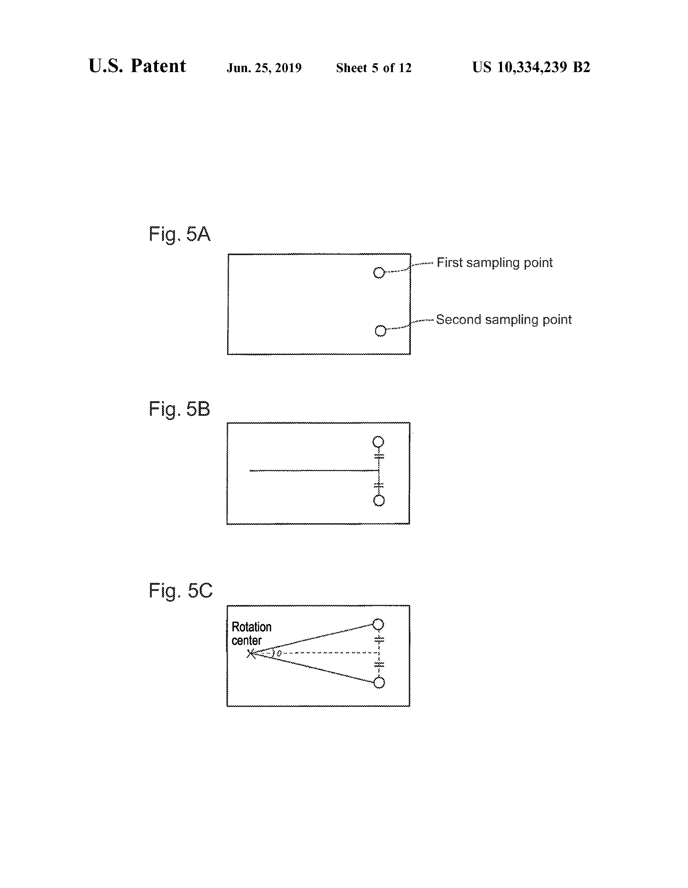
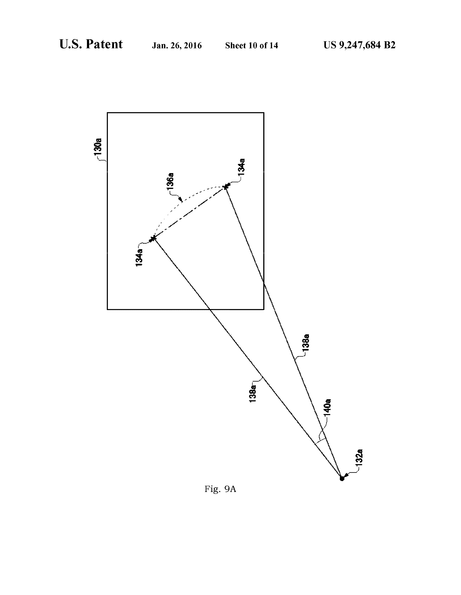
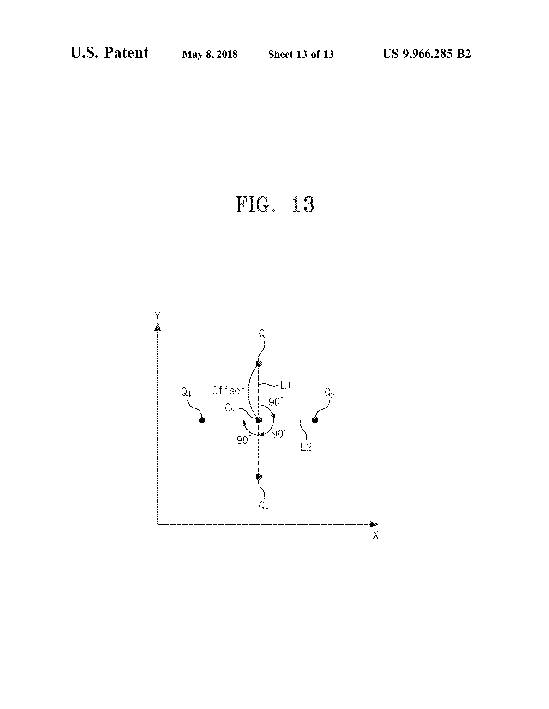

# Y·Θ 분리 특허 조사 — 방법론 및 결과

- 조사일: 2026-10-30
- 대상 과제: 비전 기반 2축(Y·Θ) 로봇 얼라인먼트 자동 보정 (SEMES 기업연계)
- 계획 문서: `조사방법론.md`
- 문제 정의: `../논문/00000_YT분리_조사_방법론_및_결과_.md` 1장의 P1~P5를 그대로 쓴다. 4장의 할 일 번호(1-1, 3-2 등)도 논문 결과서를 따른다.
- 제외: 유사연구 특허 01~09(`../../01_주제_관련/유사연구/특허/`)와 겹치는 특허는 고르지 않았다.

## 핵심 요약

1. **산업 XYθ 얼라인먼트는 회전과 평행이동을 "알려진 시험 이동"으로 분리한다.** 선정한 7건 중 5건(01·02·03·04·06)이 장비를 알려진 양만큼 움직이거나 돌린 전후 영상(또는 센서값)으로 회전 중심을 닫힌 식으로 구한다. 한 장의 영상에서 두 축을 동시에 풀려는 구성은 찾지 못했다. 논문 조사의 결론(P1·P2는 정보 한계라서 능동 이동 P5로 정보를 늘려야 함)과 같은 방향이다.
2. **회전 중심 산출식은 세 가지로 정리된다.** ① 회전 전후 두 점 + 회전각 → 이등변 삼각형 꼭짓점(01 OMRON, 02 Cognex), ② 같은 각도로 여러 번 돌린 점들의 외접원 중심·대각선 교차점(04 SEMES, 02 Cognex의 원호 맞춤), ③ 180° 회전 후 복귀 보정량 → tan(ΔΘ/2) 식(03 Therma-Wave). 모두 C++로 몇 줄이면 구현된다.
3. **카메라 미보정(P3)은 스테이지를 움직여 자동 보정하는 것이 업계 표준이다.** 01 OMRON은 X 이동 2점 + 기계 특성값으로 만든 가상 점 1점으로 아핀 변환을 구하고, 05 Cognex는 스테이지·카메라 파라미터를 비선형 최소제곱으로 동시에 다듬는다. 우리 1014 단일축 자료가 이 보정의 입력 형식과 같다.
4. **P1(공선성)을 직접 다룬 특허는 02 Cognex가 가장 가깝다.** 회전에만 반응하는 관측(선의 기울기)으로 θ를 먼저 구하고, 회전 중심 기준으로 되돌린 뒤 남는 것만 평행이동으로 본다. 또 회전 중심이 시야에서 멀면 짧은 원호 때문에 오차가 커진다고 명시하고 2단계 재회전으로 보정한다. 우리 PAN 회전축 오프셋 문제와 같은 구조다.
5. **SEMES 특허(04)가 같은 분리 원리를 이미 쓰고 있다.** 스핀척을 90°씩 돌려 편심값 4개를 재고 대각선 교차점으로 회전 중심과 위치 오프셋을 분리해 로봇 티칭을 보정한다. 과제 발표에서 "SEMES 장비의 기존 방식과 같은 원리를 Y·Θ에 적용"으로 설명할 수 있다.

## 1. 목적

| 목적 | 활용처 |
|---|---|
| P1~P5 각각에 대해 산업 장비 특허가 쓰는 해결 구성(장치·절차·계산식) 확보 | 4장 "본 과제에서 할 일"의 근거, 알고리즘 설명 자료 |
| 회전 중심 산출, 좌표 변환 자동 보정, 시험 이동 절차를 원문으로 확인 | 1014 자료 자기 보정(3-2), 시험 이동 루틴(5-2), 설치 시 자동 보정(5-4) 설계 |
| 유사연구 특허 01~09와 겹치지 않는 Y·Θ 분리 관련 특허 확보 | 과제 차별점·배경 |

## 2. 검색 방법

### 2.1 검색어

| 블록 | 영문 | 국문 |
|---|---|---|
| A. 회전 중심 | rotation center, rotational center position, center of rotation, rotate stage by known angle | 회전 중심, θ 보정, 소정 각도 회전 |
| B. 얼라인먼트 | XY theta stage, alignment mark, two marks, fiducial, aligner | 얼라인 스테이지, 얼라인 마크 |
| C. 좌표 보정 | calibration, camera/stage coordinate system, hand-eye calibration, move known amount | 캘리브레이션, 좌표 변환 |
| D. 이송 로봇 | substrate transfer robot, position/angle deviation, camera, teaching | 이송 로봇, 위치 편차, 티칭 |

### 2.2 검색 기록

"걸린 건수"는 검색 서비스가 보고한 총 건수, "후보"는 제목·요약을 보고 원문 표지를 확인할 대상으로 남긴 수, "선정"은 3장 표에 올린 수다(경로 사이 중복 있음).

| 날짜 | 경로 | 검색어 | 걸린 건수 | 후보 | 선정 |
|---|---|---|---:|---:|---:|
| 10-30 | Google Patents 질의(전체 국가) | ("rotation center") ("alignment mark") camera (theta) stage calibration | 116 (상위 3 확인 중 인코딩 오류로 중단) | 0 | 0 |
| 10-30 | Google Patents 질의(US) | 같은 검색어 | 2 | 0 | 0 |
| 10-30 | Google Patents 질의(US) | ("rotation center") camera calibration (aligner OR alignment) (theta) automatically calculate | 17 | 0 | 0 |
| 10-30 | Google Patents 질의(US) | alignment stage rotation center calculated by rotating stage camera images mark positions | 38,922 (상위 15) | 2 | 0 (US9424646 표지 확인 후 제외) |
| 10-30 | Google Patents 질의(US) | XY theta stage camera calibration rotation center mark images rotated known angle | 800 (상위 15) | 0 | 0 |
| 10-30 | Google Patents 질의(US) | two alignment marks camera calculate theta offset X Y offset correction stage | 932 (상위 15) | 0 | 0 |
| 10-30 | Google Patents 질의(US) | calibration camera coordinate system stage coordinate system moving stage known amount mark images | 122,129 (상위 15) | 0 | 0 |
| 10-30 | Google Patents 질의(US) | robot hand camera calibration coordinate transformation moving robot known amount mark | 23,106 (상위 15) | 1 | 0 (Fanuc US9969090, 원문 미확인) |
| 10-30 | Google Patents 질의(US) | substrate transfer robot camera position deviation angle deviation correction image | 9,474 (상위 15) | 1 | 0 (Kawasaki US20260223631, 표지 확인 후 제외) |
| 10-30 | 웹 검색 | patent alignment XYθ stage camera automatically calculate rotation center by rotating stage mark image calibration | 10 | 3 | 2 (01·02) |
| 10-30 | 웹 검색 | Omron patent "rotation center" stage visual sensor calibration alignment "image processing apparatus" | 10 | 3 | 1 (07) |
| 10-30 | 웹 검색 | 특허 얼라인 스테이지 회전 중심 산출 카메라 마크 θ 보정 자동 캘리브레이션 | 9 | 1 | 1 (03) |
| 10-30 | 웹 검색 | Cognex patent hand-eye calibration motion stage XY theta alignment ... move known amounts | 10 | 3 | 1 (05) |
| 10-30 | 웹 검색 | patent alignment camera cannot distinguish rotation from translation ... two cameras | 10 | 1 | 0 (US7110103, 스테레오 카메라 조립이라 제외) |
| 10-30 | 웹 검색 | substrate transfer robot hand camera ... rotated by predetermined angle, rotation center ... | 10 | 3 | 2 (04·06) |
| 10-30 | 웹 검색 | display panel alignment patent XYθ stage vision two cameras alignment marks rotation center ... | 10 | 2 | 0 (US5928399, 01·02와 역할 중복) |
| 10-30 | USPTO 원문 PDF | 후보 11건 등록본(1건은 표지 미확인) + 공개본 6건 | — | 11 | 7 |

후보 10건의 표지(1쪽)를 직접 보고 7건을 골랐다(US5928399는 받았으나 표지를 보지 않음). 제외: US9424646(OMRON, 주제가 2단계 속도 제어), US8860818(Apple, 휴대기기 카메라 회전 오프셋), US20260223631(Kawasaki, 비전 아닌 구동 전달 편차), US5928399(접합 장치 2마크 θ 보정, 01·02와 중복).

### 2.3 선정 기준

- 포함: P1~P5 중 하나 이상에 해결 구성을 주는 특허. 카메라(또는 센서)로 회전과 평행이동을 구분하거나 회전 중심을 구하는 것.
- 관련도: ◎ 문제를 직접 해결하는 구성 / ○ 부분적으로 해결 / △ 참고.
- ◎·○ 4건은 원문 전체(요약·청구항·상세 설명)를 번역하고 도면을 넣었다. △ 3건은 요약.md만 썼다.

### 한계

- **Google Patents 자동 접근 차단**: 검색 질의(xhr) 9회는 결과를 받았으나, 특허 상세 페이지는 처음 요청부터 HTTP 503("automated queries")을 돌려줬고 WebFetch도 같은 503이었다. 공통 지시서의 HTML 추출 방식(extract.py)을 쓰지 못했다. 우회 시도는 하지 않았다.
- **원문 텍스트는 USPTO 스캔 PDF의 문자 인식(OCR)으로 얻었다.** PaddleOCR(영문)로 본문 쪽을 왼쪽·오른쪽 단으로 나눠 인식했다. 그리스 문자(θ, α, β, Δ)는 "0", "a", "A0"처럼 깨지므로, 식이 있는 문단은 PDF 화상을 직접 보고 복원했다. 그 밖의 문단에 인식 오류로 인한 단어 누락이 남아 있을 수 있다. 청구항 수는 4건 모두 표지 값과 일치한다.
- **서지 정보**: 출원인·날짜는 USPTO PDF 표지에서 확인한 값만 썼다. 07(US20190096083A1)의 등록 여부는 확인하지 못했다.
- **다른 경로**: Justia·FreePatentsOnline은 403(봇 차단). KIPRIS는 자동 접근이 안 되어 검색하지 않았다. 04(SEMES)의 대응 한국 출원 10-2015-0076463 국문 원문을 확인하지 못했다.
- **CPC 분류 검색은 하지 않았다**(Google Patents 차단으로 계획한 G06T7/80·H01L21/68 분류 질의를 돌리지 못함).

## 3. 결과 요약

| 관련도 | 번호 | 특허 (출원인) | 카메라/센서 | 인식 대상 | 핵심 방법 | 해결 P# |
|:---:|:---:|---|---|---|---|:---:|
| ◎ | 01 | US10334239B2 (OMRON) | 고정 카메라 4대 | 워크·필름의 십자 마크 | X 이동 2점 + 기계 특성값(상대 각도·배율) 가상 점 → 3점 아핀 보정. θ 시험 회전 전후 2점 + 각도 → 회전 중심 | P3·P5·P1 |
| ◎ | 02 | US9247684B2 (Cognex) | 고정 카메라 2대 | 대상물 모서리(변·꼭짓점) | 변의 기울기로 θ 먼저 → 회전 중심 기준 되돌린 뒤 X·Y. 시험 회전 이등변 삼각형/원호로 회전 중심, 시야 안 재회전으로 보정 | P1·P5·P2 |
| ○ | 03 | US6747746B2 (Therma-Wave) | 고정 현미경 카메라 | 웨이퍼 특징점 | 180° 회전 + −2R 시험 이동 → 복귀 보정 ΔΘ·ΔR → y=ΔR/2, x=tan(ΔΘ/2)·[r−ΔR/2] | P5·P3 |
| ○ | 04 | US9966285B2 (SEMES) | 센서 또는 카메라(핸드) | 기판 편심 | 스핀척 120°×3 또는 90°×4 회전 → 편심 점의 외접원 중심/대각선 교차점 = 회전 중심 → 로봇 티칭 보정 | P5·P4 |
| △ | 05 | US10076842B2 (Cognex) | 손 카메라 또는 고정 카메라 | 캘리브레이션 타깃 | 로봇·XYθ 스테이지 기구 파라미터와 핸드-아이를 비선형 최소제곱으로 동시 정제 | P3·P4·P1 |
| △ | 06 | US11749547B2 (Kawasaki) | 핸드 광센서 | 재치부 타깃 | 여러 회전 위치에서 거리가 같은 두 위치의 중간 → 회전축 방향 | P5 |
| △ | 07 | US20190096083A1 (OMRON) | 카메라 | 특징부 | 여러 목표 위치의 명령-검출 차이를 같은 좌표에 표시·통계 평가·원인 추정 | P4·P3 |

## 4. 문제(P#)별 특허 근거와 본 과제에서 할 일

논문 결과서 4장의 할 일(번호 그대로)에 특허 근거를 붙이고, 특허에서 새로 얻은 할 일은 "P#-특허n"으로 추가했다.

### P1. 관측 행렬의 공선성

- **특허가 주는 해결 구성**
  - 02 Cognex: θ를 회전 불변량(대상물 선의 기울기)으로 먼저 구하고, 기준점을 회전 중심 기준으로 그 θ만큼 되돌린 뒤 남는 차이만 X·Y 평행이동으로 쓴다. 동시 추정 대신 **순차 추정**으로 결합을 끊는다.
  - 01 OMRON: 회전 중심을 스테이지 좌표 원점으로 두면 X·Y·θ 보정량이 따로 계산된다(도 3 S5~S7).
  - 05 Cognex: 상관 큰 파라미터는 합치거나 그룹별로 번갈아 고정·정제한다.
- **본 과제에서 할 일**

| 번호 | 할 일 | 특허 근거 | 성공 기준 |
|:---:|---|:---:|---|
| 1-2 (보강) | 가로선(θ 전용 관측)으로 T를 먼저 구하고, QR 판 이동에서 T 기여분(회전 중심 기준)을 빼서 Y를 구하는 순차 추정을 joint GLS와 비교 | 02 | 외부 4-fold 통과 ≥ 337/341, Y 평균 오차 ≤ 0.009 |
| P1-특허1 | 1-1 정보 한계 계산에 "회전 중심 원점화" 좌표 변환을 넣어 Y·T 반응 열의 각도가 얼마나 벌어지는지 계산 | 01·03 | 변환 후 두 열 사이 각도·조건수 보고 |

### P2. 단일 평면 정보 부족

- **특허가 주는 해결 구성**: 02 Cognex는 대상물 양 끝을 두 카메라로 보고 분해능에 비례한 가중치로 결합한다. 01 OMRON도 두 마크를 멀리 떨어진 두 카메라로 본다. 회전 분리 정보는 관측점 사이 거리(기저선)에 비례한다는 점을 특허 구성이 전제한다.
- **본 과제에서 할 일**

| 번호 | 할 일 | 특허 근거 | 성공 기준 |
|:---:|---|:---:|---|
| 1-4 (보강) | QR 3개·가로선 블록의 관측을 분해능(점 잡음 역분산)으로 가중 결합 | 02 | σ_Y 증가 10 % 이내에서 측정 블록 절반 이하 |
| 2-3 (보강) | SEMES 질의에 "판 양 끝에 보조 마크(또는 두 번째 카메라 시야) 허용 여부" 추가 | 01·02 | 허용 목록 확보 |

### P3. 카메라 미보정

- **특허가 주는 해결 구성**
  - 01 OMRON: 알려진 X 이동 2점 + 기계 특성값으로 아핀 변환 6개 파라미터, 알려진 θ 회전으로 회전 중심을 구해 저장한다. 반복 샘플링으로 잡음 평균.
  - 03 Therma-Wave: 2축(R·θ) 장비에서 회전 중심-시야 오프셋 하나만 알면 좌표 보정이 끝난다.
  - 05 Cognex: 명령값(엔코더)과 영상을 함께 모아 장치·카메라 파라미터를 비선형 최소제곱으로 동시 정제.
- **본 과제에서 할 일**

| 번호 | 할 일 | 특허 근거 | 성공 기준 |
|:---:|---|:---:|---|
| 3-2 (보강) | 1014 자료 자기 보정: 01의 아핀+회전 중심을 초기값으로, 05의 동시 정제(그룹별 교대)로 마무리 | 01·05 | 재투영 RMS ≤ 0.05 px, 혼합 57장 ≥ 55/57 |
| 3-4 (보강) | "광학 중심–Θ 회전축 거리"를 03의 오프셋 식 구조로 정의하고 실측 감도비(14.25 px/mm, 80.04 px/T)를 재현 | 03 | 이론 등가비와 실측 5 % 안 일치 |

### P4. 학습 회귀의 외삽

- **특허가 주는 해결 구성**: 04 SEMES는 측정 자세를 360°에 고르게(90°×4, 120°×3) 배치한다. 07 OMRON은 목표 위치를 범위 전체에 두고 반복 이동 통계로 오차 패턴을 평가한다. 05 Cognex는 전 자세를 하나의 기하 모델로 묶는다.
- **본 과제에서 할 일**

| 번호 | 할 일 | 특허 근거 | 성공 기준 |
|:---:|---|:---:|---|
| 4-1 (보강) | 새 촬영 목록을 (Y, T) 평면에 대칭 배치(네 사분면 모서리 + 축 위 + 반복 3회 + 양방향 접근) | 04·07 | SEMES 요청서 제출 |
| P4-특허1 | 명령-측정 차이를 (Y, T) 평면에 화살표로 그리고, 패턴(한쪽 치우침=백래시, 원호=회전 중심 오차, 배율=스케일 오차)을 원인 표로 정리 | 07 | 1014·1020 전 자료 오차 지도와 원인 표 |

### P5. 능동적 분리

- **특허가 주는 해결 구성** (핵심)
  - 01·02: 회전 전후 마크 2점 + 회전각 → 이등변 삼각형 꼭짓점 = 회전 중심.
  - 02: 회전 중심이 시야에서 멀면 원호가 짧아 오차가 크다 → 1차 추정 후 회전 중심을 시야 가까이 옮겨 재회전, 차이로 보정.
  - 03: 알려진 큰 시험 이동 → 원위치 복귀 보정량 → 닫힌 식.
  - 04: 같은 각도로 여러 번 돌린 점의 외접원 중심(3점)·대각선 교차점(4점).
  - 06: 측정값이 같아지는 대칭 두 회전 위치의 중간을 기준으로 삼는다.
- **본 과제에서 할 일**

| 번호 | 할 일 | 특허 근거 | 성공 기준 |
|:---:|---|:---:|---|
| 5-2 (보강) | 턴 시작 시 T를 +δT, −δT 시험 회전해 2장 추가 촬영 → QR 3개 중심의 이동으로 회전 중심(이등변 삼각형 식) → 현재 판 위치의 Y 성분 산출 | 01·02·06 | 실제 로봇 혼합 자세 ≥ 95 % 20턴 안 도달 |
| 5-4 (보강) | 설치 시 1회 자동 보정: Y ±δ, T ±δ(또는 T 3~4단계)로 회전 중심·스케일 산출, 03처럼 장비 교체 때만 재수행 | 01·03·04 | 1014형 재촬영 ≥ 278/280, 소요 ≤ 1분 |
| P5-특허1 | 1014 T 스윕(T = −1~+1) 자료로 QR 점 궤적에 원호를 맞춰 회전 중심을 구하고, 02가 지적한 짧은 원호 오차를 정량화(원호 길이 대비 중심 추정 σ) | 02·04 | 회전 중심 σ와 그로 인한 Y 등가 오차(mm) 보고. Y 허용오차 1.28 px 대비 판정 |

## 5. 특허별 폴더

특허마다 폴더 하나에 원문 PDF(등록본·공개본), 요약(`요약.md`)을 넣고, ◎·○는 국문 전문 번역(`번역.md`, 도면 포함)과 도면(`도면/`)을 넣었다.

| 번호 | 관련도 | 폴더 | 원문 PDF | 번역 | 원문 링크 |
|:---:|:---:|---|---|:---:|---|
| 01 | ◎ | [01_US10334239_Omron_스테이지이동_좌표보정_회전중심](01_US10334239_Omron_스테이지이동_좌표보정_회전중심/) | 등록·공개 | ✅ 14항, 도면 12장 | [Google Patents](https://patents.google.com/patent/US10334239B2/en) |
| 02 | ◎ | [02_US9247684_Cognex_기준마크각도_회전중심특정](02_US9247684_Cognex_기준마크각도_회전중심특정/) | 등록·공개 | ✅ 15항, 도면 14장 | [Google Patents](https://patents.google.com/patent/US9247684B2/en) |
| 03 | ○ | [03_US6747746_ThermaWave_R세타스테이지_회전중심](03_US6747746_ThermaWave_R세타스테이지_회전중심/) | 등록·공개 | ✅ 21항, 도면 6장 | [Google Patents](https://patents.google.com/patent/US6747746B2/en) |
| 04 | ○ | [04_US9966285_SEMES_지지판회전_편심값_티칭](04_US9966285_SEMES_지지판회전_편심값_티칭/) | 등록·공개 | ✅ 24항, 도면 13장 | [Google Patents](https://patents.google.com/patent/US9966285B2/en) |
| 05 | △ | [05_US10076842_Cognex_기구_핸드아이_동시보정](05_US10076842_Cognex_기구_핸드아이_동시보정/) | 등록·공개 | 요약만 | [Google Patents](https://patents.google.com/patent/US10076842B2/en) |
| 06 | △ | [06_US11749547_Kawasaki_기판재치부_회전축탐색](06_US11749547_Kawasaki_기판재치부_회전축탐색/) | 등록·공개 | 요약만 | [Google Patents](https://patents.google.com/patent/US11749547B2/en) |
| 07 | △ | [07_US20190096083_Omron_위치검출_조정지원](07_US20190096083_Omron_위치검출_조정지원/) | 공개 | 요약만 | [Google Patents](https://patents.google.com/patent/US20190096083A1/en) |

### 대표 도면

*01 OMRON 도 5 — 회전 전후 두 샘플링 점의 수직 이등분선 위에서 회전각 θ를 이루는 점 = 회전 중심*

*02 Cognex 도 9a — 회전 중심이 시야 밖이면 원호가 짧고 꼭지각이 작아 회전 중심 오차가 커진다*

*04 SEMES 도 13 — 90° 간격 편심 Q1~Q4의 대각선 교차점 C2 = 회전 중심*

### 후보였지만 폴더를 만들지 않은 특허

| 특허 | 경로 | 남긴 이유 |
|---|---|---|
| US9424646B2 (OMRON, Control system and control method) | 웹 검색, Google Patents | 표지 확인. 두 마크로 위치를 재지만 주제는 가감속 2단계 위치 제어 |
| US5928399 (접합 장치, XYθ 테이블 2마크 회전 보정) | 웹 검색 | 웹 요약만 확인. 두 마크 선분의 기울기로 θ 보정 — 01·02와 역할 중복 |
| US10664994 (Cognex, 핸드-아이 캘리브레이션), US5978080 (Cognex, 기준 마크를 지정 위치로 옮겨 보정) | 웹 검색 | 원문을 열지 못함(Google Patents 차단) |
| US9969090B2 (Fanuc, 타깃 마크 촬상 카메라 로봇 시스템) | Google Patents 질의 | 원문을 열지 못함 |
| US7110103 (스테레오 카메라 정렬) | 웹 검색 | 회전·평행이동이 같은 영상 변위를 만든다는 지적은 P1과 같으나, 카메라 조립 정렬이라 주제 밖 |

## 6. 한계

- 2.3절 한계와 같다(Google Patents 차단 → USPTO 스캔 PDF OCR, KIPRIS·CPC 검색 미실행).
- 선정 특허는 모두 카메라가 위에서 내려다보는 2D 평면 정렬이라 θ가 영상에서 "회전"으로 보인다. 본 과제처럼 PAN 회전이 영상의 가로 이동으로 보여 Y와 거의 같은 방향이 되는 구성(P1의 원인)을 직접 다룬 특허는 찾지 못했다. 특허의 회전 중심 식을 우리 상황에 쓰려면 "QR 점이 그리는 궤적이 영상에서 원호로 보이는가"를 1014 T 스윕으로 먼저 확인해야 한다(P5-특허1).
- 특허는 효과 수치(정렬 정확도 등)를 거의 주지 않는다. 03만 기계 조정 정밀도(10~20 µm)를 적었다. 정량 근거는 논문(특히 논문 03 Ha 2008)과 우리 실측으로 채운다.

## 7. 추가로 할 일

- Google Patents 차단이 풀리면 HTML 텍스트로 번역 4건의 OCR 누락을 대조하고, 계획한 CPC 질의(G06T7/80 + rotation center, H01L21/68 + camera + theta)와 위 미확인 후보 4건(US10664994, US5978080, US9969090, US5928399)을 확인한다.
- KIPRIS에서 세메스·삼성전자 × "회전 중심", "얼라인", "편심", "θ 보정"으로 국내 특허를 찾고, 04의 대응 한국 출원(10-2015-0076463) 국문 원문을 받는다.
- 4장 P5-특허1(1014 T 스윕 원호 맞춤)을 논문 결과서 1-1(정보 한계 계산)과 함께 가장 먼저 한다. 결과가 5-2(시험 회전 루틴)를 실제 로봇에서 시도할지 정한다.
