# 화상 처리 장치, 캘리브레이션 방법 및 캘리브레이션 프로그램 (US10334239B2)
- 원제: Image processing apparatus, calibration method, and calibration program
- 원문: 같은 폴더의 `US10334239.pdf`(등록본), `US20170039715.pdf`(공개본), https://patents.google.com/patent/US10334239B2/en
- 번역 기준: USPTO 등록본 PDF(스캔 이미지)를 문자 인식(OCR)해 얻은 원문 텍스트를 한국어로 옮김. 조사 당일 Google Patents가 자동 접근을 막아(HTTP 503) 그 텍스트를 쓰지 못했다. 원문의 그리스 문자(θ, α, β)는 인식 결과에서 깨진 것을 PDF로 확인해 복원했다.
- 도면: 원문 PDF 도면 시트 12장을 도면/ 폴더에 넣고 본문에서 처음 설명되는 곳에 삽입함. 식 1~6은 도 10에만 있다.

## 요약

X 스테이지와 Y 스테이지가 서로 독립적으로 움직이는 스테이지 구조와 촬상 장치 사이의 위치 캘리브레이션을 가능하게 한다. 화상 처리 장치는 촬상 장치의 카메라 좌표계와 스테이지 좌표계 사이의 위치 캘리브레이션을, X 스테이지가 기준 위치에 있을 때 촬상한 화상에서 마크의 위치를 나타내는 제1 화상 좌표 공간의 기준 위치, X 스테이지가 제1 기준 위치에서 X 방향으로 이동한 제1 변위 위치에 있을 때 촬상한 화상에서 마크의 위치를 나타내는 제1 화상 좌표 공간의 변위 위치, 그리고 Y 스테이지의 특성값을 사용해 계산한 화상에서 마크의 위치를 나타내는 제1 화상 좌표 공간의 가상 위치를 사용하여 수행한다.

## 청구범위

청구하는 것은 다음과 같다.

1. 스테이지 구조에 대한 스테이지 좌표계와 제1 카메라에 대한 카메라 좌표계 사이의 위치 캘리브레이션을 수행하는 화상 처리 장치로서, 상기 스테이지 구조는 제1 방향으로 이동 가능한 제1 스테이지 및 상기 제1 스테이지와 독립적으로 제2 방향으로 이동 가능한 제2 스테이지를 포함하고, 상기 제1 카메라는 상기 제1 스테이지 위의 제1 마크의 화상 또는 상기 제1 스테이지에 놓인 대상물 위의 상기 제1 마크의 화상을 촬상하며, 상기 화상 처리 장치는,

상기 스테이지 구조의 특성값 — 상기 특성값은 상기 제1 스테이지와 상기 제2 스테이지 사이의 기계적 관계를 포함함 — 및 위치 캘리브레이션 파라미터를 저장하는 메모리; 및

상기 제1 카메라가 촬상한 복수의 화상에서의 상기 제1 마크의 위치와 상기 특성값을 사용하여 상기 위치 캘리브레이션 파라미터를 계산하는 것을 포함하는 동작을 수행하도록 프로그램으로 구성된 프로세서를 포함하고,

상기 프로세서는,

상기 제1 스테이지가 제1 기준 위치에 있을 때 상기 제1 카메라가 촬상한 제1 화상에서 상기 제1 마크의 위치를 나타내는, 제1 화상 좌표 공간에서의 기준 위치를 얻는 것,

상기 제1 스테이지가 상기 제1 기준 위치로부터 상기 제1 방향으로 이동한 제1 변위 위치에 있을 때 상기 제1 카메라가 촬상한 제2 화상에서 상기 제1 마크의 위치를 나타내는, 상기 제1 화상 좌표 공간에서의 변위 위치를 얻는 것,

상기 제1 스테이지가 상기 제1 기준 위치에서 상기 제1 변위 위치로 상기 제1 방향으로 이동하는 것에 대응하여 상기 제1 마크가 이동한다고 가정되는 위치를 나타내는, 상기 스테이지 좌표계에서의 제1 가상 위치를 계산하는 것 — 상기 제1 가상 위치는 상기 제1 변위 위치에서의 상기 제1 스테이지의 상기 기준 위치로부터의 상기 스테이지 좌표계에서의 변위에 상기 특성값을 곱하여 계산됨 —,

상기 제1 화상 좌표 공간에서의 상기 기준 위치로부터 상기 제1 화상 좌표 공간에서의 상기 변위 위치에 있는 상기 제1 마크의 상기 제1 화상 좌표 공간에서의 변위에 상기 특성값을 곱하여, 상기 스테이지 좌표계에서의 상기 제1 가상 위치에 대응하는 상기 제1 화상 좌표 공간에서의 가상 위치를 계산하는 것,

상기 제1 기준 위치를 상기 제1 화상 좌표 공간에서의 상기 기준 위치와, 상기 제1 변위 위치를 상기 제1 화상 좌표 공간에서의 상기 변위 위치와, 그리고 상기 제1 가상 위치를 상기 제1 화상 좌표 공간에서의 상기 가상 위치와 비교함으로써 상기 카메라 좌표계를 상기 스테이지 좌표계로 변환하는 제1 위치 캘리브레이션 파라미터를 계산하는 것, 및

상기 제1 위치 캘리브레이션 파라미터를 상기 메모리에 저장하는 것을 더 포함하는 동작을 수행하도록 상기 프로그램으로 구성되는, 화상 처리 장치.

2. 제1항에 있어서, 상기 특성값은 상기 제1 방향에 대한 상기 제2 방향의 상대 각도, 또는 상기 제1 스테이지에 대한 상기 제2 스테이지의 변위의 상대 배율 중 적어도 하나를 포함하는, 화상 처리 장치.

3. 제2항에 있어서, 상기 프로세서는,

상기 제1 화상 좌표 공간에서의 상기 기준 위치가, 상기 제1 화상 좌표 공간에서의 상기 변위 위치의 방향으로, 상기 제1 화상 좌표 공간에서의 상기 변위 위치와 상기 제1 화상 좌표 공간에서의 상기 기준 위치 사이의 거리에 상기 상대 배율을 곱한 거리만큼 이동하는 위치를 나타내는, 화상 좌표 공간에서의 보정 위치를 계산하는 것, 및

상기 화상 좌표 공간에서의 상기 보정 위치가 상기 제1 화상 좌표 공간에서의 상기 기준 위치를 중심으로 상기 상대 각도만큼 회전하는 위치를 나타내는, 상기 제1 화상 좌표 공간에서의 상기 가상 위치를 계산하는 것을 더 포함하는 동작을 수행하도록 상기 프로그램으로 구성되는, 화상 처리 장치.

4. 제1항에 있어서, 상기 프로세서는,

입력 정보를 받도록 구성된 입력부로서의 동작,

사용자로부터 상기 특성값을 받는 것을 더 포함하는 동작을 수행하도록 상기 프로그램으로 구성되는, 화상 처리 장치.

5. 제1항에 있어서, 상기 제2 스테이지 위의 제2 마크의 화상 또는 상기 제2 스테이지에 놓인 대상물 위의 상기 제2 마크의 화상을 촬상하도록 구성된 제2 카메라를 더 포함하고,

상기 프로세서는,

상기 제2 스테이지가 제2 기준 위치에 있을 때 상기 제2 카메라가 촬상한 제3 화상에서 상기 제2 마크의 위치를 나타내는, 제2 화상 좌표 공간에서의 기준 위치를 얻는 것,

상기 제2 스테이지가 상기 제2 기준 위치로부터 상기 제2 방향으로 이동한 제2 변위 위치에 있을 때 상기 제2 카메라가 촬상한 제4 화상에서 상기 제2 마크의 위치를 나타내는, 상기 제2 화상 좌표 공간에서의 변위 위치를 얻는 것,

상기 제2 마크가 제2 가상 위치로 이동한다고 가정할 때 상기 메모리에 있는 상기 제1 스테이지의 상기 특성값을 사용하여 계산한 화상에서 상기 제2 마크의 위치를 나타내는, 상기 제2 화상 좌표 공간에서의 가상 위치를 계산하는 것,

상기 제2 기준 위치, 상기 제2 변위 위치, 상기 제2 가상 위치, 상기 제2 화상 좌표 공간에서의 상기 기준 위치, 상기 제2 화상 좌표 공간에서의 상기 변위 위치, 및 상기 제2 화상 좌표 공간에서의 상기 가상 위치를 사용하여 제2 위치 캘리브레이션 파라미터를 계산하는 것, 및

상기 제2 위치 캘리브레이션 파라미터를 상기 메모리에 저장하는 것을 더 포함하는 동작을 수행하도록 상기 프로그램으로 구성되는, 화상 처리 장치.

6. 제5항에 있어서, 상기 프로세서는,

값을 출력하도록 구성된 출력부로서의 동작,

상기 제1 카메라가 촬상한 상기 제1 화상에서의 상기 제1 마크의 위치와 상기 제1 위치 캘리브레이션 파라미터를 사용하여 상기 스테이지 좌표계에서의 상기 제1 마크의 위치를 계산하는 것,

상기 제2 카메라가 촬상한 상기 제3 화상에서의 상기 제2 마크의 위치와 상기 제2 위치 캘리브레이션 파라미터를 사용하여 상기 스테이지 좌표계에서의 상기 제2 마크의 위치를 계산하는 것, 및

상기 스테이지 좌표계에서 상기 제1 마크의 위치와 상기 제2 마크의 위치 사이의 차이를 계산하고, 계산한 차이를 상기 출력부로 출력하는 것을 더 포함하는 동작을 수행하도록 상기 프로그램으로 구성되는, 화상 처리 장치.

7. 제5항에 있어서, 상기 프로세서는,

값을 출력하도록 구성된 출력부로서의 동작,

상기 제1 카메라가 촬상한 상기 제1 화상에서의 상기 제1 마크의 위치와 상기 제1 위치 캘리브레이션 파라미터를 사용하여 상기 스테이지 좌표계에서의 상기 제1 마크의 위치를 계산하는 것, 및

상기 제2 카메라가 촬상한 상기 제3 화상에서의 상기 제2 마크의 위치와 상기 제2 위치 캘리브레이션 파라미터를 사용하여 상기 스테이지 좌표계에서의 상기 제2 마크의 위치를 계산하고, 계산한 상기 제1 마크의 위치와 계산한 상기 제2 마크의 위치를 상기 출력부로 출력하는 것을 더 포함하는 동작을 수행하도록 상기 프로그램으로 구성되는, 화상 처리 장치.

8. 제1항에 있어서, 상기 제1 스테이지와 연동하여 이동 가능하고 회전 가능한 제3 스테이지를 더 포함하고,

상기 프로세서는,

상기 제3 스테이지가 제3 기준 위치에 있을 때 상기 제1 카메라가 촬상한 제3 화상에서, 상기 제1 스테이지 위의 마크, 상기 제1 스테이지에 놓인 대상물 위의 마크, 상기 제3 스테이지 위의 마크, 또는 상기 제3 스테이지에 놓인 대상물 위의 마크의 위치를 나타내는, 제3 화상 좌표 공간에서의 기준 위치를 얻는 것,

상기 제3 스테이지가 상기 제3 기준 위치로부터 소정 각도만큼 회전했을 때 촬상한 제4 화상에서 상기 마크의 위치를 나타내는, 상기 제3 화상 좌표 공간에서의 변위 위치를 얻는 것,

상기 제3 화상 좌표 공간에서의 상기 기준 위치, 상기 제3 화상 좌표 공간에서의 상기 변위 위치, 및 상기 소정 각도를 사용하여 상기 제3 스테이지의 회전 중심의 위치를 계산하는 것, 및

상기 회전 중심의 위치를 상기 메모리에 저장하는 것을 더 포함하는 동작을 수행하도록 상기 프로그램으로 구성되는, 화상 처리 장치.

9. 제8항에 있어서, 상기 프로세서는,

값을 출력하도록 구성된 출력부로서의 동작,

상기 제1 카메라가 촬상한 상기 복수의 화상에서의 상기 마크의 위치로부터 소정의 목표 위치로 상기 마크를 이동시키기 위한 상기 제3 스테이지의 회전 각도를 계산하는 것, 및

상기 회전 각도를 출력하는 상기 출력부로서의 동작을 더 포함하는 동작을 수행하도록 상기 프로그램으로 구성되는, 화상 처리 장치.

10. 스테이지 구조에 대한 스테이지 좌표계와 제1 카메라에 대한 카메라 좌표계 사이의 위치 캘리브레이션을 수행하는 동작을 포함하는 동작을 수행하도록 구성된 프로세서를 포함하는 화상 처리 장치에 의해 구현되는 위치 캘리브레이션 방법으로서, 상기 스테이지 구조는 제1 방향으로 이동 가능한 제1 스테이지 및 상기 제1 스테이지와 독립적으로 제2 방향으로 이동 가능한 제2 스테이지를 포함하고, 상기 제1 카메라는 상기 제1 스테이지 위의 제1 마크의 화상 또는 상기 제1 스테이지에 놓인 대상물 위의 상기 제1 마크의 화상을 촬상하며,

상기 프로세서에 의해 구현되는 상기 방법은,

상기 제1 스테이지가 제1 기준 위치에 있을 때 상기 제1 카메라가 촬상한 제1 화상에서 상기 제1 마크의 위치를 나타내는, 제1 화상 좌표 공간에서의 기준 위치를 얻는 단계,

상기 제1 스테이지가 상기 제1 기준 위치로부터 상기 제1 방향으로 이동한 제1 변위 위치에 있을 때 상기 제1 카메라가 촬상한 제2 화상에서 상기 제1 마크의 위치를 나타내는, 상기 제1 화상 좌표 공간에서의 변위 위치를 얻는 단계,

상기 제1 스테이지가 상기 제1 기준 위치에서 상기 제1 변위 위치로 상기 제1 방향으로 이동하는 것에 대응하여 상기 제1 마크가 이동한다고 가정되는 위치를 나타내는, 상기 스테이지 좌표계에서의 제1 가상 위치를 계산하는 단계 — 상기 제1 가상 위치는 상기 제1 변위 위치에서의 상기 제1 스테이지의 상기 기준 위치로부터의 상기 스테이지 좌표계에서의 변위에 특성값을 곱하여 계산되고, 상기 특성값은 상기 제1 스테이지와 상기 제2 스테이지 사이의 기계적 관계를 포함함 —,

상기 제1 화상 좌표 공간에서의 상기 기준 위치로부터 상기 제1 화상 좌표 공간에서의 상기 변위 위치에 있는 상기 제1 마크의 상기 제1 화상 좌표 공간에서의 변위에 상기 특성값을 곱하여, 상기 제1 가상 위치에 대응하는 상기 제1 화상 좌표 공간에서의 가상 위치를 계산하는 단계, 및

상기 제1 기준 위치를 상기 제1 화상 좌표 공간에서의 상기 기준 위치와, 상기 제1 변위 위치를 상기 제1 화상 좌표 공간에서의 상기 변위 위치와, 그리고 상기 제1 가상 위치를 상기 제1 화상 좌표 공간에서의 상기 가상 위치와 비교함으로써 상기 카메라 좌표계를 상기 스테이지 좌표계로 변환하는 제1 위치 캘리브레이션 파라미터를 계산하는 단계를 포함하는, 위치 캘리브레이션 방법.

11. 제10항에 있어서,

상기 제2 스테이지 위의 제2 마크의 화상 또는 상기 제2 스테이지에 놓인 대상물 위의 상기 제2 마크의 화상을 촬상하도록 구성된 제2 카메라로 제2 위치 캘리브레이션으로 전환하는 단계;

상기 제2 스테이지가 제2 기준 위치에 있을 때 촬상한 제3 화상에서 상기 제2 마크의 위치를 나타내는, 제2 화상 좌표 공간에서의 기준 위치를 얻는 단계;

상기 제2 스테이지가 상기 제2 기준 위치로부터 상기 제2 방향으로 이동한 제2 변위 위치에 있을 때 촬상한 제4 화상에서 상기 제2 마크의 위치를 나타내는, 상기 제2 화상 좌표 공간에서의 변위 위치를 얻는 단계;

상기 제2 마크가 제2 가상 위치로 이동한다고 가정할 때 상기 제1 스테이지의 상기 특성값을 사용하여 계산한 화상에서 상기 제2 마크의 위치를 나타내는, 상기 제2 화상 좌표 공간에서의 가상 위치를 계산하는 단계; 및

상기 제2 기준 위치, 상기 제2 변위 위치, 상기 제2 가상 위치, 상기 제2 화상 좌표 공간에서의 상기 기준 위치, 상기 제2 화상 좌표 공간에서의 상기 변위 위치, 및 상기 제2 화상 좌표 공간에서의 상기 가상 위치를 사용하여 제2 위치 캘리브레이션 파라미터를 계산하는 단계를 더 포함하는, 위치 캘리브레이션 방법.

12. 제10항에 있어서,

상기 제1 스테이지와 연동하여 이동 가능하고 회전 가능한 제3 스테이지를 포함하는 스테이지 구조에 대한 스테이지 좌표계와 상기 제1 카메라에 대한 상기 카메라 좌표계 사이의 제3 위치 캘리브레이션으로 전환하는 단계;

상기 제3 스테이지가 제3 기준 위치에 있을 때 상기 제1 카메라를 사용하여 상기 제1 스테이지 위의 마크의 제3 화상, 상기 제1 스테이지에 놓인 대상물 위의 상기 마크의 화상, 상기 제3 스테이지 위의 상기 마크의 화상, 또는 상기 제3 스테이지에 놓인 대상물 위의 상기 마크의 화상을 촬상하고, 상기 제3 화상에서 상기 마크의 위치를 나타내는 제3 화상 좌표 공간에서의 기준 위치를 얻는 단계;

상기 제3 스테이지가 상기 제3 기준 위치로부터 소정 각도만큼 회전했을 때 촬상한 제4 화상에서 상기 마크의 위치를 나타내는, 상기 제3 화상 좌표 공간에서의 변위 위치를 얻는 단계; 및

상기 제3 화상 좌표 공간에서의 상기 기준 위치, 상기 제3 화상 좌표 공간에서의 상기 변위 위치, 및 상기 소정 각도를 사용하여 상기 제3 스테이지의 회전 중심을 계산하는 제3 위치 캘리브레이션을 수행하는 단계를 더 포함하는, 위치 캘리브레이션 방법.

13. 읽혀서 실행되면 상기 프로세서가 제10항에 따른 방법을 구현하게 하는 프로그램을 저장한 비일시적 컴퓨터 판독 가능 매체.

14. 산업 장치로서,

제1 방향으로 이동 가능한 제1 스테이지;

상기 제1 스테이지와 독립적으로 제2 방향으로 이동 가능한 제2 스테이지;

상기 제1 스테이지 위의 마크의 화상 또는 상기 제1 스테이지에 놓인 대상물 위의 상기 마크의 화상을 촬상하는 제1 카메라; 및

상기 화상을 처리하는 동작을 수행하도록 프로그램으로 구성된 프로세서를 포함하는 화상 처리 장치를 포함하고,

상기 프로세서는,

상기 제1 스테이지의 동작 및 상기 제2 스테이지의 동작을 제어하도록 구성된 모션 컨트롤러로서의 동작;

상기 제1 스테이지가 제1 기준 위치에 있을 때 촬상한 제1 화상에서 상기 마크의 위치를 나타내는 제1 화상 좌표 공간에서의 기준 위치, 상기 제1 스테이지가 상기 제1 기준 위치로부터 상기 제1 방향으로 이동한 제1 변위 위치에 있을 때 촬상한 제2 화상에서 상기 마크의 위치를 나타내는 상기 제1 화상 좌표 공간에서의 변위 위치, 상기 제1 스테이지가 상기 제1 기준 위치에서 상기 제1 변위 위치로 상기 제1 방향으로 이동하는 것에 대응하여 상기 마크가 이동한다고 가정되는 위치를 나타내는 상기 스테이지 좌표계에서의 제1 가상 위치 — 상기 제1 스테이지와 상기 제2 스테이지의 기계적 관계를 나타내는 특성값을 상기 제1 변위 위치에서의 상기 제1 스테이지의 상기 기준 위치로부터의 상기 스테이지 좌표계에서의 변위에 곱하여 계산됨 —, 및 상기 제1 가상 위치에 대응하는 상기 제1 화상 좌표 공간에서의 가상 위치 — 상기 특성값을 상기 제1 화상 좌표 공간에서의 상기 기준 위치로부터 상기 제1 화상 좌표 공간에서의 상기 변위 위치에 있는 상기 마크의 상기 제1 화상 좌표 공간에서의 변위에 곱하여 계산됨 — 를 사용하여, 상기 제1 스테이지와 상기 제2 스테이지에 대한 스테이지 좌표계와 상기 제1 카메라에 대한 카메라 좌표계 사이의 위치 캘리브레이션을 수행하는 것, 및

상기 위치 캘리브레이션 결과 얻은 상기 스테이지 좌표계에서의 좌표를 상기 모션 컨트롤러로 출력하는 것을 더 포함하는 동작을 수행하도록 상기 프로그램으로 구성되는, 산업 장치.

## 상세한 설명

### 기술 분야 (FIELD)

본 발명은 화상 처리를 이용해 대상물의 위치를 결정하는 위치 결정 장치, 캘리브레이션 방법 및 캘리브레이션 프로그램에 관한 것이다.

### 배경 기술 (BACKGROUND)

제조 현장에서는 다양한 자동화 기술이 개발되어 왔다. 이 분야에서 알려진 자동화 기술의 하나는 화상 처리 장치를 이용한 대상물의 위치 결정이다.

그러한 기술의 하나로, 특허문헌 1은 평행 이동과 회전이 가능한 XYθ 스테이지 위에 놓인 대상물을, 카메라로 촬상한 기준 마크 화상을 사용해 대상물 위 기준 마크의 위치를 계산하면서 정렬하는 위치 정렬 시스템을 기재한다.

이 위치 정렬 시스템은 위치 정렬 전에 캘리브레이션을 수행한다. 캘리브레이션 과정은 XYθ 방향의 변위와, XYθ 스테이지를 향하도록 설치된 카메라로 촬상한 화상에서의 대응 변위 사이의 관계를 측정하는 것, XYθ 스테이지의 이동 방향 및 그로 인한 변위와 카메라로 촬상한 화상에서의 방향 및 변위 사이의 관계를 결정하여 카메라로 XYθ 스테이지의 움직임을 확인하면서 XYθ 스테이지의 움직임을 최적화하는 것, 그리고 정렬 조건을 조정하는 것을 포함한다.

특허문헌 2는 디스플레이 패널 표면에 다양한 기능을 가진 필름을 접합하는 기술을 기재한다.

### 인용 문헌 (CITATION LIST)

특허문헌

특허문헌 1: 일본 공개특허공보 2007-17424호

특허문헌 2: 일본 공개특허공보 2013-208827호

### 발명의 내용 (SUMMARY)

두 대상물을 정렬해야 할 때 대상물을 각각 별개의 3축 XYθ 스테이지에 놓으면 축 수가 늘어나고(총 6축) 비용이 증가한다. 이를 피하기 위해, 예컨대 한 대상물은 Xθ 스테이지에, 다른 대상물은 Y 스테이지에 놓을 수 있다. Xθ 스테이지와 Y 스테이지는 서로 분리되어 있다. 이 경우 특허문헌 1에 기재된 캘리브레이션 기술은 사용할 수 없다.

본 발명의 하나 이상의 측면은 분리된 X 스테이지와 Y 스테이지를 포함하는 스테이지 구조와 촬상 장치 사이의 위치 캘리브레이션에 관한 것이다.

위의 문제에 대응하여, 본 발명의 한 측면은 스테이지 구조에 대한 스테이지 좌표계와 제1 촬상 장치에 대한 카메라 좌표계 사이의 위치 캘리브레이션을 수행하는 처리부를 포함하는 화상 처리 장치를 제공한다. 스테이지 구조는 제1 방향으로 이동하는 제1 스테이지와, 제1 스테이지와 독립적으로 제2 방향으로 이동하는 제2 스테이지를 포함한다. 제1 촬상 장치는 제1 스테이지 위의 제1 마크의 화상 또는 제1 스테이지에 놓인 대상물 위의 제1 마크의 화상을 촬상한다. 화상 처리 장치는 스테이지 구조의 기계적 특성값과 위치 캘리브레이션 파라미터를 저장하는 메모리, 그리고 제1 촬상 장치가 촬상한 화상에서의 제1 마크의 위치와 특성값을 사용하여 위치 캘리브레이션 파라미터를 계산하는 처리부를 포함한다. 처리부는 제1 스테이지가 제1 기준 위치에 있을 때 제1 촬상 장치가 촬상한 화상에서 제1 마크의 위치를 나타내는 제1 화상 좌표 공간의 기준 위치를 얻고, 제1 스테이지가 제1 기준 위치로부터 제1 방향으로 이동한 제1 변위 위치에 있을 때 제1 촬상 장치가 촬상한 화상에서 제1 마크의 위치를 나타내는 제1 화상 좌표 공간의 변위 위치를 얻으며, 제1 마크가 스테이지 좌표계의 제1 가상 위치로 이동한다고 가정할 때 그 제1 가상 위치에서 가상으로 촬상될 제1 마크의 위치를 나타내는 제1 화상 좌표 공간의 가상 위치를 메모리에 있는 제2 스테이지의 특성값을 사용하여 계산하고, 제1 기준 위치, 제1 변위 위치, 제1 가상 위치, 제1 화상 좌표 공간의 기준 위치, 제1 화상 좌표 공간의 변위 위치, 제1 화상 좌표 공간의 가상 위치를 사용하여 제1 위치 캘리브레이션 파라미터를 계산하고, 제1 위치 캘리브레이션 파라미터를 메모리에 저장한다.

제1 기준 위치는 제1 촬상 장치로 촬상한 화상에서 마크의 임의의 위치일 수 있다. 제1 스테이지는 원점에 있을 수 있다.

본 발명의 다른 측면은, 스테이지 구조에 대한 스테이지 좌표계와 제1 촬상 장치에 대한 카메라 좌표계 사이의 위치 캘리브레이션을 수행하도록 화상 처리 장치에 포함된 처리부가 구현하는 위치 캘리브레이션 방법을 제공한다. 스테이지 구조는 제1 방향으로 이동하는 제1 스테이지와, 제1 스테이지와 독립적으로 제2 방향으로 이동하는 제2 스테이지를 포함한다. 제1 촬상 장치는 제1 스테이지 위의 제1 마크의 화상 또는 제1 스테이지에 놓인 대상물 위의 제1 마크의 화상을 촬상한다. 처리부가 구현하는 방법은, 제1 스테이지가 제1 기준 위치에 있을 때 제1 촬상 장치가 촬상한 화상에서 제1 마크의 위치를 나타내는 제1 화상 좌표 공간의 기준 위치를 얻는 단계, 제1 스테이지가 제1 기준 위치로부터 제1 방향으로 이동한 제1 변위 위치에 있을 때 제1 촬상 장치가 촬상한 화상에서 제1 마크의 위치를 나타내는 제1 화상 좌표 공간의 변위 위치를 얻는 단계, 제1 마크가 제1 가상 위치로 이동한다고 가정할 때 제2 스테이지의 특성값을 사용하여 계산한 화상에서 제1 마크의 위치를 나타내는 제1 화상 좌표 공간의 가상 위치를 계산하는 단계, 그리고 제1 기준 위치, 제1 변위 위치, 제1 가상 위치, 제1 화상 좌표 공간의 기준 위치, 제1 화상 좌표 공간의 변위 위치, 제1 화상 좌표 공간의 가상 위치를 사용하여 제1 위치 캘리브레이션 파라미터를 계산하는 단계를 포함한다.

본 발명의 또 다른 측면은 제1 방향으로 이동하는 제1 스테이지, 제1 스테이지와 독립적으로 제2 방향으로 이동하는 제2 스테이지, 제1 스테이지의 동작과 제2 스테이지의 동작을 제어하는 모션 컨트롤러, 제1 스테이지 위의 마크의 화상 또는 제1 스테이지에 놓인 대상물 위의 마크의 화상을 촬상하는 제1 촬상 장치, 그리고 그 화상을 처리하는 화상 처리 장치를 포함하는 산업 장치를 제공한다. 화상 처리 장치는 제1 스테이지가 제1 기준 위치에 있을 때 촬상한 화상에서 마크의 위치를 나타내는 제1 화상 좌표 공간의 기준 위치, 제1 스테이지가 제1 기준 위치로부터 제1 방향으로 이동한 제1 변위 위치에 있을 때 촬상한 화상에서 마크의 위치를 나타내는 제1 화상 좌표 공간의 변위 위치, 그리고 마크가 제1 가상 위치로 이동한다고 가정할 때 제2 스테이지의 특성값을 사용해 계산한 화상에서 마크의 위치를 나타내는 제1 화상 좌표 공간의 가상 위치를 사용하여, 제1 스테이지와 제2 스테이지에 대한 스테이지 좌표계와 제1 촬상 장치에 대한 카메라 좌표계 사이의 위치 캘리브레이션을 수행하고, 위치 캘리브레이션 결과 얻은 스테이지 좌표계의 좌표를 모션 컨트롤러로 출력한다.

위 구조는 제2 방향의 제1 가상 위치를 계산할 수 있고, 제1 화상 좌표 공간의 가상 위치를 가상으로 계산할 수 있다. 이로써 제1 스테이지와 제2 스테이지가 분리되어 있어 두 스테이지를 모두 움직였을 때 바뀌는 좌표를 촬상 장치의 시야 안에서 읽을 수 없는 스테이지 구조에서도 캘리브레이션이 가능해진다.

제1 스테이지와 제2 스테이지는 통상 제1 방향의 X축과 제2 방향의 Y축을 가지며, 두 축은 서로 90도를 이룬다. 이 방향들 사이의 상대 각도는 90도가 아닐 수도 있다. 제1 스테이지와 제2 스테이지는 같은 평면에 있을 수도 있고, 꼬인 위치에 있을 수도 있다. 제1·제2 스테이지가 꼬인 위치에 있는 경우, 제1 방향과 제2 방향 사이의 상대 각도는 제2 방향의 축을 촬상 장치의 광축을 따라 평행 이동시킨 뒤 제2 방향의 축이 제1 방향의 축과 교차할 때 두 방향이 이루는 각도이다.

촬상 장치는 통상 CCD(charge-coupled device) 카메라 또는 CMOS(complementary metal oxide semiconductor) 카메라일 수 있다.

마크는 촬상 장치로 촬상한 화상에서 위치를 결정할 수 있는 어떤 형태여도 된다. 마크는 통상 십자 마크이지만 다른 어떤 마크여도 된다. 스테이지의 모서리나 대상물의 모서리를 마크로 사용할 수도 있다.

여기서 "놓는다"는 것은 대상물을 스테이지와 함께 이동 가능하게 두는 것을 말하며, 통상 대상물을 스테이지 위에 놓는 것을 말한다. 스테이지가 아래를 향하는 경우, 대상물을 놓는다는 것은 스테이지에 흡착된 상태로 대상물을 두는 것을 포함한다. 스테이지가 아래를 향하는 경우 촬상 장치는 위를 향하도록 설치된다.

본 발명의 위 측면에 따른 화상 처리 장치와 위치 캘리브레이션 방법에서, 특성값은 제1 방향에 대한 제2 방향의 상대 각도 또는 제1 스테이지에 대한 제2 스테이지의 변위의 상대 배율 중 적어도 하나를 포함한다. 특성값은 제1 스테이지와 제2 스테이지의 오른손 좌표계 값 또는 왼손 좌표계 값을 포함할 수 있다. 특성값은 스테이지의 기계적 특성을 나타내는 값을 말한다.

위 구조에서는 제1 스테이지와 제2 스테이지 사이의 위치 관계와 그 변위에 기초하여 제1 가상 위치와 제1 화상 좌표 공간의 가상 위치를 정확하게 결정할 수 있다.

본 발명의 위 측면에 따른 화상 처리 장치에서, 처리부는 제1 화상 좌표 공간의 기준 위치가 제1 화상 좌표 공간의 변위 위치 방향으로, 제1 화상 좌표 공간의 변위 위치와 제1 화상 좌표 공간의 기준 위치 사이의 거리에 상대 배율을 곱한 거리만큼 이동한 위치를 나타내는 화상 좌표 공간의 보정 위치를 계산하고, 화상 좌표 공간의 보정 위치가 제1 화상 좌표 공간의 기준 위치를 중심으로 상대 각도만큼 회전한 위치를 나타내는 제1 화상 좌표 공간의 가상 위치를 계산한다.

본 발명의 측면에 따른 화상 처리 장치는 입력 정보를 받는 입력부를 더 포함한다. 입력부는 사용자로부터 특성값을 받는다. 본 발명의 측면에 따른 위치 캘리브레이션 방법은 사용자로부터 상대 각도 또는 상대 배율 중 적어도 하나를 받는 것을 더 포함한다. 입력부는 통상 키보드나 마우스이지만, 화상 처리 장치에 연결된 개인용 컴퓨터나 화상 처리 장치에 무선으로 연결된 태블릿 컴퓨터일 수도 있다.

위 구조는 스테이지 사이의 설계 오차에 대응할 수 있다.

본 발명의 측면에 따른 화상 처리 장치는 제2 스테이지 위의 제2 마크의 화상 또는 제2 스테이지에 놓인 대상물 위의 제2 마크의 화상을 촬상하는 제2 촬상 장치를 더 포함한다. 처리부는 제2 스테이지가 제2 기준 위치에 있을 때 제2 촬상 장치가 촬상한 화상에서 제2 마크의 위치를 나타내는 제2 화상 좌표 공간의 기준 위치를 얻고, 제2 스테이지가 제2 기준 위치로부터 제2 방향으로 이동한 제2 변위 위치에 있을 때 제2 촬상 장치가 촬상한 화상에서 제2 마크의 위치를 나타내는 제2 화상 좌표 공간의 변위 위치를 얻으며, 제2 마크가 제2 가상 위치로 이동한다고 가정할 때 메모리에 있는 제1 스테이지의 특성값을 사용해 계산한 화상에서 제2 마크의 위치를 나타내는 제2 화상 좌표 공간의 가상 위치를 계산하고, 제2 기준 위치, 제2 변위 위치, 제2 가상 위치, 제2 화상 좌표 공간의 기준 위치, 제2 화상 좌표 공간의 변위 위치, 제2 화상 좌표 공간의 가상 위치를 사용해 제2 위치 캘리브레이션 파라미터를 계산하고, 제2 위치 캘리브레이션 파라미터를 메모리에 저장한다.

본 발명의 측면에 따른 화상 처리 장치는 값을 출력하는 출력부를 더 포함한다. 처리부는 제1 촬상 장치가 촬상한 화상에서의 제1 마크의 위치와 제1 위치 캘리브레이션 파라미터를 사용해 스테이지 좌표계에서 제1 마크의 위치를 계산하고, 제2 촬상 장치가 촬상한 화상에서의 제2 마크의 위치와 제2 위치 캘리브레이션 파라미터를 사용해 스테이지 좌표계에서 제2 마크의 위치를 계산하며, 스테이지 좌표계에서 제1 마크의 위치와 제2 마크의 위치 사이의 차이를 계산한다. 출력부는 그 차이를 출력한다.

본 발명의 측면에 따른 화상 처리 장치는 값을 출력하는 출력부를 더 포함한다. 처리부는 제1 촬상 장치가 촬상한 화상에서의 제1 마크의 위치와 제1 위치 캘리브레이션 파라미터를 사용해 스테이지 좌표계에서 제1 마크의 위치를 계산하고, 제2 촬상 장치가 촬상한 화상에서의 제2 마크의 위치와 제2 위치 캘리브레이션 파라미터를 사용해 스테이지 좌표계에서 제2 마크의 위치를 계산한다. 출력부는 제1 마크의 위치와 제2 마크의 위치를 출력한다.

본 발명의 측면에 따른 화상 처리 장치는 제1 스테이지와 연동하여 이동 가능하고 회전 가능한 제3 스테이지를 더 포함한다. 처리부는 제3 스테이지가 제3 기준 위치에 있을 때 제1 촬상 장치가 촬상한 화상에서 제1 스테이지 위의 마크, 제1 스테이지에 놓인 대상물 위의 마크, 제3 스테이지 위의 마크, 또는 제3 스테이지에 놓인 대상물 위의 마크의 위치를 나타내는 제3 화상 좌표 공간의 기준 위치를 얻고, 제3 스테이지가 제3 기준 위치로부터 소정 각도만큼 회전했을 때 촬상한 화상에서 마크의 위치를 나타내는 제3 화상 좌표 공간의 변위 위치를 얻으며, 제3 화상 좌표 공간의 기준 위치, 제3 화상 좌표 공간의 변위 위치, 소정 각도를 사용해 제3 스테이지의 회전 중심의 위치를 계산하고, 회전 중심의 위치를 메모리에 저장한다.

회전 가능한 제3 스테이지는 통상 제1 스테이지 위에, 더 구체적으로는 카메라에 인접하게 장착된다. 이 경우 캘리브레이션에는 제3 스테이지 위의 마크 또는 제3 스테이지에 놓인 대상물 위의 마크가 사용된다. 제3 스테이지는 제1 스테이지 아래에 배치될 수도 있다. 다시 말해 제3 스테이지의 회전이 제1 스테이지 전체의 회전을 일으킨다. 이 경우 캘리브레이션에는 제1 스테이지 위의 마크 또는 제1 스테이지에 놓인 대상물 위의 마크가 사용된다. 회전 중심은 제1 스테이지의 소정 위치에 정해지며, 회전 중심은 스테이지 좌표계의 원점으로 사용된다.

본 발명의 측면에 따른 화상 처리 장치에서 처리부는 값을 출력하는 출력부를 더 포함한다. 처리부는 제1 촬상 장치가 촬상한 화상에서의 마크의 위치로부터 소정의 목표 위치로 마크를 이동시키기 위한 제3 스테이지의 회전 각도를 계산한다. 출력부는 그 회전 각도를 출력한다.

본 발명의 측면에 따른 위치 캘리브레이션 방법은 제1 기준 위치, 제1 변위 위치, 제1 가상 위치, 제1 화상 좌표 공간의 기준 위치, 제1 화상 좌표 공간의 변위 위치, 제1 화상 좌표 공간의 가상 위치를 사용해 아핀 변환 파라미터를 계산함으로써 제1 위치 캘리브레이션을 수행하는 것을 포함한다.

본 발명의 측면에 따른 위치 캘리브레이션 방법은, 제2 스테이지 위의 마크의 화상 또는 제2 스테이지에 놓인 대상물 위의 마크의 화상을 촬상할 수 있는 제2 촬상 장치로 제2 위치 캘리브레이션으로 전환하는 것, 제2 스테이지가 제2 기준 위치에 있을 때 촬상한 화상에서 마크의 위치를 나타내는 제2 화상 좌표 공간의 기준 위치를 얻는 것, 제2 스테이지가 제2 기준 위치로부터 제2 방향으로 이동한 제2 변위 위치에 있을 때 촬상한 화상에서 마크의 위치를 나타내는 제2 화상 좌표 공간의 변위 위치를 얻는 것, 마크가 제2 가상 위치로 이동한다고 가정할 때 제1 스테이지의 특성값을 사용해 계산한 화상에서 마크의 위치를 나타내는 제2 화상 좌표 공간의 가상 위치를 계산하는 것, 그리고 제2 기준 위치, 제2 변위 위치, 제2 가상 위치, 제2 화상 좌표 공간의 기준 위치, 제2 화상 좌표 공간의 변위 위치, 제2 화상 좌표 공간의 가상 위치를 사용해 제2 위치 캘리브레이션 파라미터를 계산하는 것을 포함한다.

위 구조에서는 가상 축을 제1 스테이지에서 제2 스테이지로 바꿨을 때, 제2 스테이지를 가상 축으로 설정한 경우와 같은 방식으로 위치 캘리브레이션을 수행할 수 있다.

본 발명의 측면에 따른 위치 캘리브레이션 방법은, 제1 스테이지와 연동하여 이동 가능하고 회전 가능한 제3 스테이지를 포함하는 스테이지 구조에 대한 스테이지 좌표계와 제1 촬상 장치에 대한 카메라 좌표계 사이의 제3 위치 캘리브레이션으로 전환하는 것, 제3 스테이지가 제3 기준 위치에 있을 때 제1 촬상 장치를 사용해 제1 스테이지 위의 마크의 화상, 제1 스테이지에 놓인 대상물 위의 마크의 화상, 제3 스테이지 위의 마크의 화상, 또는 제3 스테이지에 놓인 대상물 위의 마크의 화상을 촬상하고, 그 화상에서 마크의 위치를 나타내는 제3 화상 좌표 공간의 기준 위치를 얻는 것, 제3 스테이지가 제3 기준 위치로부터 소정 각도만큼 회전했을 때 촬상한 화상에서 마크의 위치를 나타내는 제3 화상 좌표 공간의 변위 위치를 얻는 것, 그리고 제3 화상 좌표 공간의 기준 위치, 제3 화상 좌표 공간의 변위 위치, 소정 각도를 사용해 제3 스테이지의 회전 중심을 계산하는 제3 위치 캘리브레이션을 수행하는 것을 포함한다.

위 구조는 제1 스테이지의 이동과 제3 스테이지의 회전 이동을 조합한 정렬을 가능하게 한다.

본 발명의 위 측면에 따른 화상 처리 장치는 컴퓨터일 수 있다. 이 경우 컴퓨터가 화상 처리 장치의 각 구성요소로 기능하도록 실행하는 프로그램과, 그 프로그램을 저장한 컴퓨터 판독 가능 저장 매체도 본 발명의 범위에 속한다.

### 유리한 효과 (Advantageous Effects)

본 발명의 하나 이상의 실시예는 서로 독립적으로 움직이는 X 스테이지와 Y 스테이지를 포함하는 스테이지 구조와 촬상 장치 사이의 위치 캘리브레이션을 가능하게 한다.

### 도면의 간단한 설명 (BRIEF DESCRIPTION OF THE DRAWINGS)

도 1은 본 발명의 일 실시예에 따른 위치 결정 시스템을 나타내는 도면이다.

도 2는 일 실시예에서 화상 처리 장치의 하드웨어 구성을 나타내는 블록도이다.

도 3은 정렬 과정을 나타내는 흐름도이다.

도 4는 목표 좌표를 결정하는 방법을 설명하는 도면이다.

도 5a 내지 5c는 목표 좌표를 결정하는 방법을 설명하는 도면이다.

도 6은 본 발명의 일 실시예에 따른 캘리브레이션 과정을 설명하는 도면이다.

도 7은 본 발명의 일 실시예에 따른 캘리브레이션 과정을 나타내는 흐름도이다.

도 8a 및 8b는 오른손 및 왼손 스테이지 좌표계를 나타내는 도면이다.

도 9a 및 9b는 오른손 및 왼손 카메라 좌표계를 나타내는 도면이다.

도 10은 아핀 변환 행렬의 목록이다.

도 11a 및 11b는 각각 사용자 인터페이스(UI)를 나타내는 도면이다.

도 12는 실시예의 변형에 따른 위치 결정 시스템을 나타내는 도면이다.

### 발명을 실시하기 위한 구체적인 내용 (DETAILED DESCRIPTION)

이제 도면을 참조하여 본 발명의 실시예를 설명한다. 같은 구성요소 또는 대응하는 구성요소에는 같은 참조 부호를 붙이고 같은 이름과 기능을 가지며, 중복해서 자세히 설명하지 않는다.

도 1은 본 발명의 일 실시예에 따른 위치 결정 시스템을 나타내는 도면이다. 위치 결정 시스템(산업 장치)은 공업 제품의 제조 공정에서 사용되며, 화상 처리를 이용해 대상물(이하 워크)을 생산 라인의 의도한 위치에 어긋남 없이 놓는다(정렬한다).

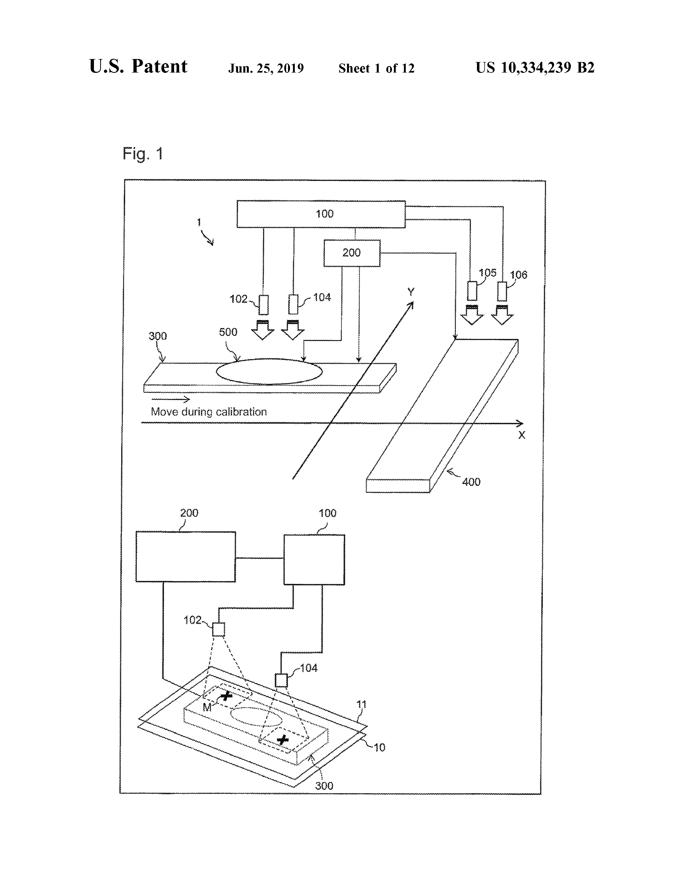
*도 1 — 위치 결정 시스템: 카메라 102·104(X 스테이지 쪽), 105·106(Y 스테이지 쪽), X 스테이지 300, Y 스테이지 400, 워크 10의 위치 결정 마크 M*

본 실시예에 따른 위치 결정 시스템은 액정 패널 생산 라인에서 사용되며, 유리 기판인 워크에 필름을 접합할 때 워크의 위치 결정을 제어한다. 위치 결정 시스템은 회로 기판에 부품을 실장하거나 부품을 서로 조립하는 데에도 사용될 수 있다.

도 1에 나타낸 바와 같이, 위치 결정 시스템(1)은 화상 처리 장치(100), 하나 이상의 제1 및 제2 카메라(102, 104)(각각 제1 촬상 장치에 해당), 제3 및 제4 카메라(105, 106)(각각 제2 촬상 장치에 해당), 모션 컨트롤러(200), 스테이지(제1~제3 스테이지)(300, 400, 500)를 포함한다. 화상 처리 장치(100)는 제1 및 제2 카메라(102, 104)로 촬상한 화상 데이터를 얻고 그 화상 데이터를 사용해 워크의 위치를 결정한다. 더 구체적으로, 워크(10)는 소정 위치에 뚜렷한 위치 결정 마크(M)를 가진다. 화상 처리 장치(100)는 얻은 화상 데이터에 포함된 위치 결정 마크(M)의 위치에 기초하여 워크(10)의 위치를 결정한다. 워크에 위치 결정 마크가 없을 수도 있다. 위치 결정 마크가 없는 워크의 경우 화상 처리 장치(100)는 워크의 모서리를 검출해 워크의 위치를 결정한다.

모션 컨트롤러(200)는 화상 처리 장치(100)의 지시에 따라 서보 모터 드라이버(도시 생략)를 구동하여 스테이지(300, 400, 500)를 움직이고 워크(10)의 위치를 결정한다. 더 구체적으로, 모션 컨트롤러(200)는 워크(10) 위 위치 결정 마크(M)의 위치에 기초해 결정한 위치를 목표 위치와 비교한 뒤, 이 위치들 사이의 차이를 없애도록 스테이지(300, 400, 500)를 움직인다. 액정 패널 생산 라인에서 워크(10)인 유리 기판에 필름을 접합하기 위해, 모션 컨트롤러(200)는 필름에 인쇄된 위치 결정 마크(M)를 목표 위치로 사용해 유리 기판을 움직인다.

스테이지(300, 500)는 워크(10)인 유리 기판에 필름을 접합할 수 있는 위치로 이동 가능하다. 더 구체적으로, 스테이지(300, 500)는 워크(10)를 수평 방향의 한쪽으로, 그리고 회전 방향으로 변위시킬 수 있다.

더 구체적으로, 본 실시예의 스테이지(300)는 X 방향으로 이동 가능한 X 스테이지(300)와, X 스테이지(300) 위에 장착되어 소정 회전축을 중심으로 회전 가능한 θ 스테이지(500)를 포함한다. 이하 스테이지에 대한 좌표계(스테이지 좌표계)는 θ 스테이지(500)의 회전 중심을 원점으로 하며, 이 원점은 X 스테이지(300)의 이동 범위의 중점(소정 위치)이다. 이 좌표계는 원점에서 X 방향으로 X축을 가지고, Y 방향으로 이동 가능한 Y 스테이지(400)를 따라 Y축을 가진다. 일부 실시예에서 스테이지 좌표계의 원점은 X 스테이지(300)의 끝이거나 X 스테이지(300)와 Y 스테이지(400)의 교차점일 수 있다.

필름(워크 11)을 유리 기판(워크 10)에 접합할 때, 본 실시예의 Xθ 스테이지(300, 500)는 Xθ 스테이지 위 유리 기판의 X 방향 및 회전 방향 어긋남을 보정하도록 이동하고, Xθ 스테이지(300, 500)와 독립된 Y 스테이지(400)는 Y 스테이지(400) 위 필름의 Y 방향 어긋남을 보정하도록 이동한다. 이 두 보정을 조합하여 유리 기판과 필름이 서로 정렬된다. 유리 기판에 필름을 접합하는 것은 하나의 예일 뿐이므로, 유리 기판이나 필름을 스테이지 위에 유지하거나 흡착하거나 놓는 기구는 도시하지 않는다.

도 2는 일 실시예에서 화상 처리 장치의 하드웨어 구성을 나타내는 블록도이다. 도 2에 나타낸 바와 같이, 화상 처리 장치(100)는 처리부(프로세서)(101), 데이터를 저장하거나 처리부에 작업 영역을 제공하는 메모리(111), 조작부(입력부와 디스플레이를 포함)(113), 카메라 I/F(117), 모션 컨트롤러 I/F(119)를 포함한다. 처리부(101)는 이 구성요소들에 연결되어 화상 처리 장치(100) 전체를 제어한다.

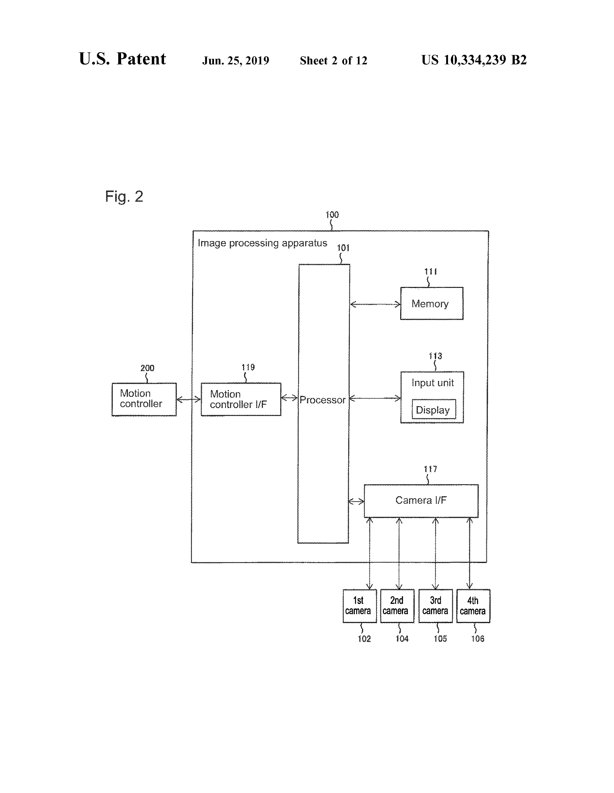
*도 2 — 화상 처리 장치 100의 하드웨어 구성(프로세서 101, 메모리 111, 입력부 113, 카메라 I/F 117, 모션 컨트롤러 I/F 119)*

카메라 I/F(117)는 Xθ 스테이지(300, 500)를 향하도록 설치된 제1 및 제2 카메라(102, 104)와 제3 및 제4 카메라(105, 106)로 워크(10)를 촬상해 생성한 화상 데이터를 받는다. 카메라 I/F(117)는 제1 및 제2 카메라(102, 104)와 제3 및 제4 카메라(105, 106)의 화상 데이터를 일시 저장하는 버퍼(도시 생략)를 포함한다.

조작부(113)는 복수의 키를 포함한다. 조작부(113)는 지시, 문자, 숫자 등 키에 해당하는 사용자 조작으로 입력된 데이터를 받는다. 조작부(113)는 액정 디스플레이(LCD)나 유기 EL 디스플레이(organic ELD)일 수 있는 디스플레이(114)를 포함한다. 디스플레이(114)는 사용자를 위한 지시 메뉴와 얻은 화상 데이터에 관한 정보를 표시한다. 디스플레이(114)와 조작부(113)는 조작 패널을 이룰 수 있다.

모션 컨트롤러 I/F(119)는 모션 컨트롤러(200)에 연결된다. 처리부(101)는 모션 컨트롤러 I/F(119)를 통해 모션 컨트롤러(200)와 데이터를 주고받는다.

이제 캘리브레이션 과정(뒤에서 설명) 뒤에 수행하는 정렬 과정을 설명한다. 도 3은 한 예의 정렬 과정을 나타내는 흐름도이다. 도 3에 나타낸 단계들은 기본적으로 화상 처리 장치(100)와 모션 컨트롤러(200)가 서로 협력해 수행하는 과정이다.

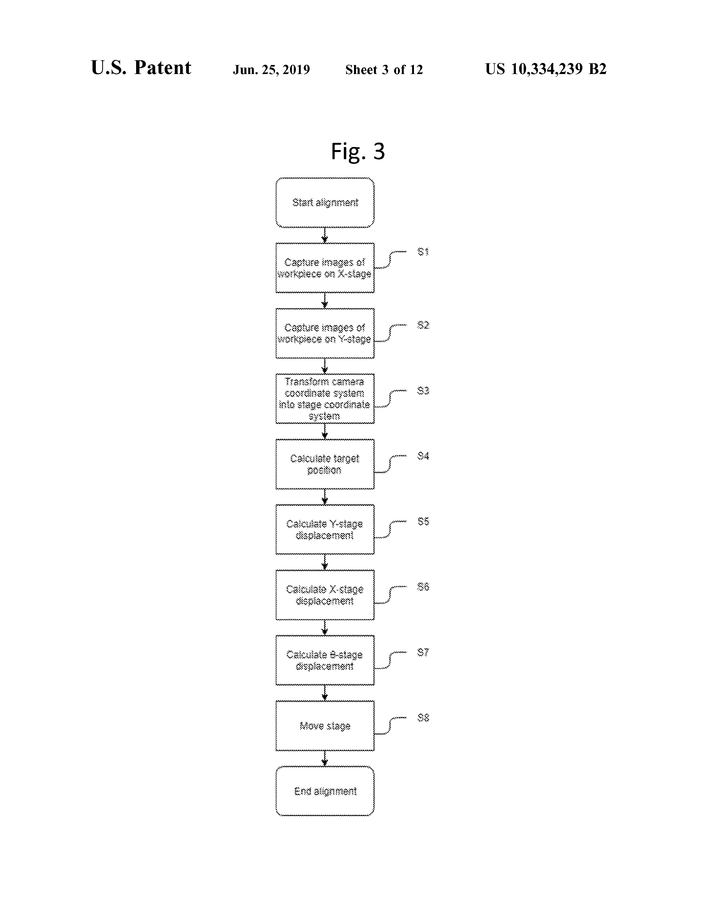
*도 3 — 정렬 과정 흐름도(S1~S8): X·Y 스테이지 워크 촬상 → 카메라 좌표계를 스테이지 좌표계로 변환 → 목표 위치 → Y·X·θ 스테이지 변위 계산 → 스테이지 이동*

단계 S1(X 스테이지 위 워크 촬상)에서, 화상 처리 장치(100)는 제1 및 제2 카메라(102, 104)를 사용해 워크(10) 위의 제1 마크와 제2 마크를 검출한 뒤, 각 카메라에 대한 카메라 좌표계를 계산한다.

단계 S2(Y 스테이지 위 워크 촬상)에서, 화상 처리 장치(100)는 제3 및 제4 카메라(105, 106)를 사용해 워크(11) 위의 제3 마크와 제4 마크를 검출한 뒤, 각 카메라에 대한 카메라 좌표계를 계산한다.

단계 S3(카메라 좌표계를 스테이지 좌표계로 변환)에서, 각 카메라의 캘리브레이션 파라미터를 사용해 화상에서의 제1~제4 마크의 좌표 위치로부터 스테이지 좌표계에서의 제1~제4 마크의 위치를 계산한다.

단계 S4(목표 위치 계산)에서, 스테이지 좌표계에서 점 (X, Y)가 제3 마크와 제4 마크 사이의 중점(이하 워크 11의 중심점)일 때 점 (X, 0)을 목표 위치로 사용한다.

단계 S5(Y 스테이지 변위 계산)에서, 워크(11)의 중심점을 목표 위치에 맞추기 위한 Y 스테이지의 변위 Yt를 계산한다.

단계 S6(X 스테이지 변위 계산)에서, 스테이지 좌표계에서 워크(10)의 중심점이 제1 마크와 제2 마크 사이의 중점일 때 워크(10)의 중심점을 목표 위치에 맞추기 위한 X 스테이지의 변위 Xt를 계산한다.

단계 S7(θ 스테이지 변위 계산)에서, 워크(10, 11)의 중심점을 서로 맞췄을 때 워크(10, 11)의 목표 마크의 편차를 사용해 회전 변위 θt를 계산한다.

단계 S8(스테이지 이동)에서, 화상 처리 장치(100)는 단계 S5~S7에서 계산한 변위를 모션 컨트롤러(200)로 출력한다. 모션 컨트롤러(200)는 그 변위에 따라 스테이지(300, 400, 500)를 움직이고 정렬 과정을 끝낸다.

워크(10, 11)를 서로 접합하기 위해, 정렬 과정 뒤 Z 방향으로 이동 가능한 기구(도시 생략)를 사용해 접합 과정을 완료한다.

위 실시예에서는 단계 S1~S8의 처리를 화상 처리 장치(100)가 수행하지만, 화상 처리 장치(100)가 단계 S3에서 얻은 제1~제4 마크의 위치를 나타내는 스테이지 좌표를 모션 컨트롤러(200)로 출력하고, 단계 S4~S8의 처리는 모션 컨트롤러(200)가 수행할 수도 있다.

화상 처리 장치(100)는 스테이지 좌표계에서 제1 카메라(102, 104)로 촬상한 마크와 제2 카메라(105, 106)로 촬상한 마크 사이의 차이(벡터)를 모션 컨트롤러(200)로 출력할 수도 있다. 이렇게 출력하면 제1 카메라(102)로 촬상한 마크를 제2 카메라(105)로 촬상한 마크에 맞추고, 제1 카메라(104)로 촬상한 마크를 제2 카메라(106)로 촬상한 마크에 맞추는 정렬 과정에서 모션 컨트롤러(200)가 빠르게 계산할 수 있다.

화상 처리 장치(100)는 제1 카메라(102, 104)로 촬상한 마크의 스테이지 좌표계 좌표와 제2 카메라(105, 106)로 촬상한 마크의 스테이지 좌표계 좌표를 출력할 수도 있다. 이 경우 모션 컨트롤러(200)가 정렬을 위한 위치를 계산한다.

이제 도 3을 참조하여 설명한 정렬 과정 전에 수행하는, 본 발명의 일 실시예에 따른 캘리브레이션 과정을 설명한다. 캘리브레이션 과정은 워크(10)를 촬상하는 제1 및 제2 카메라(102, 104)로부터 얻은 위치 정보와, 워크(10)의 실제 위치를 나타내는 위치 정보 사이의 관계를 결정하는 것을 포함한다.

도 1에 나타낸 바와 같이, 제1 및 제2 카메라(102, 104)가 각각 워크(10) 위의 대응하는 위치 결정 마크(M)를 촬상할 때, 제1 및 제2 카메라(102, 104)가 사용하는 카메라 좌표계는 실제 스테이지 좌표계와 일치하지 않는다. 이 좌표계들은 캘리브레이션으로 맞춰야 한다. 더 구체적으로, 위치 결정 마크(M)가 있는 워크(10)를 움직이고, 그로 인한 카메라 좌표계에서의 변위를 그로 인한 스테이지 좌표계에서의 변위와 비교하여 캘리브레이션 파라미터(뒤에서 설명)를 계산한다. 캘리브레이션 과정은 카메라마다 수행되므로 각 카메라 고유의 캘리브레이션 파라미터를 얻는다.

도 6은 본 발명의 일 실시예에 따른 캘리브레이션 과정을 설명하는 도면이다. 도 6은 카메라(102, 104) 각각으로 촬상한 워크(10) 위 십자 마크(M)의 화상을 개략적으로 나타낸다. 카메라(102, 104) 각각은 시야 안에서 복수의 마크(M)를 촬상할 수 있지만, 캘리브레이션 과정은 그중 특정한 하나의 마크(M)를 사용한다. 이해를 돕기 위해 화상 좌표 공간의 가상 위치를 도면에 나타냈다. 캘리브레이션 과정은 카메라로 촬상한 화상에 화상 좌표 공간의 가상 위치가 나타나지 않아도 수행할 수 있다.

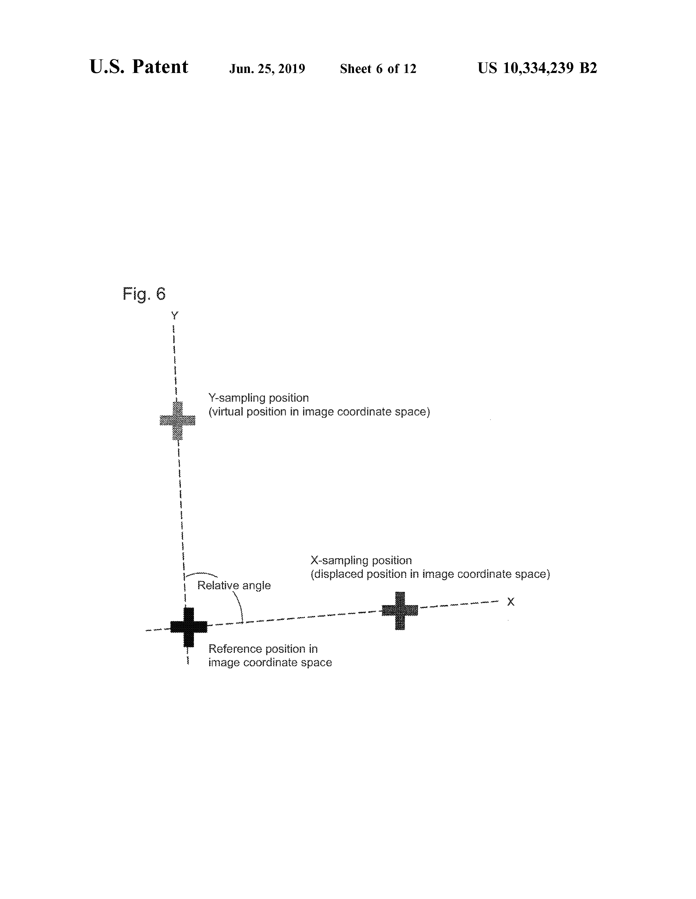
*도 6 — 캘리브레이션: 화상 좌표 공간의 기준 위치, X 샘플링 위치(변위 위치), Y 샘플링 위치(가상 위치)와 상대 각도*

도 7은 본 발명의 일 실시예에 따른 캘리브레이션 과정을 나타내는 흐름도이다. 캘리브레이션 과정은 정렬 과정 전에 수행된다. 캘리브레이션 과정에서 Xθ 스테이지(300, 500)는 기준 위치, 예컨대 원점에 미리 설정된다. 워크(10)는 그 위치 결정 마크(M)가 제1 및 제2 카메라(102, 104)로 촬상될 수 있도록 Xθ 스테이지(300, 500) 위에 놓인다. 캘리브레이션 파라미터는 X 스테이지(300)와 Y 스테이지(400)를 움직인 뒤 제1 및 제2 카메라(102, 104)로 촬상한 화상(카메라 좌표계)에서 마크(M)를 나타내는 세 점의 좌표를 사용해 계산할 수 있다. 도 1에 나타낸 스테이지의 경우 X 스테이지(300)를 움직인 뒤 카메라(102, 104)로 촬상한 화상에서 마크(M)를 나타내는 두 점의 좌표는 얻을 수 있지만, Y 스테이지(400)를 움직인 뒤에는 카메라(102, 104)가 마크(M)를 나타내는 또 다른 점의 좌표를 얻을 수 없다. 카메라(102, 104)로 촬상한 화상에서 Y 스테이지(400)를 이동한 뒤(가상 위치) 얻을 마크(M)를 나타내는 세 번째 점으로서, 화상 좌표 공간의 가상 위치를 Y 스테이지의 특성값에 기초해 계산한다. 이로써 캘리브레이션 파라미터를 얻는다.

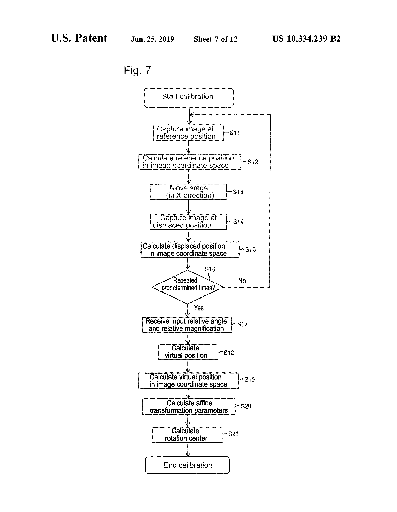
*도 7 — 캘리브레이션 흐름도(S11~S21): 기준 위치 촬상 → X 방향 이동·촬상 반복 → 상대 각도·배율 입력 → 가상 위치 → 아핀 변환 파라미터 → 회전 중심*

도 7에 나타낸 바와 같이, 화상 처리 장치(100)는 워크(10) 위의 마크(M)를 촬상하고(단계 S11), 화상에서 위치 결정 마크(M)의 위치를 화상 좌표 공간의 기준 위치로 계산한다(단계 S12).

단계 S13에서, 모션 컨트롤러(200)가 워크(10)를 X 스테이지(300)를 따라 X 방향으로 소정 거리만큼 이동시킨다. 소정 거리는 마크(M)가 화상 안에 머물도록 설정된다. 화상 처리 장치(100)는 설정된 위치에서 마크(M)를 다시 촬상하고(단계 S14), 화상에서 마크(M)의 위치를 다시 계산해 화상 좌표 공간의 변위 위치로 삼는다(단계 S15). 이 샘플링 과정 뒤 처리는 단계 S16으로 진행한다.

단계 S16에서, 화상 처리 장치(100)는 단계 S11~S15의 샘플링 과정이 소정 횟수 반복되었는지 판정한다. 단계 S11~S15의 샘플링 과정이 소정 횟수 반복되었으면 화상 처리 장치(100)는 처리를 단계 S17로 진행한다. 판정이 부정이면 화상 처리 장치(100)는 Xθ 스테이지(300, 500)를 기준 위치로 되돌리고 처리를 단계 S11로 되돌린다. 샘플링 과정을 반복하는 것은 각 샘플링 과정에서 생기는 잡음을 평균하기 위한 것이며, X축의 추정 정확도를 높인다. 샘플링 과정에서 θ 스테이지(500)를 회전시켜 위치 결정 마크(M)를 화상에서 세로 방향(Y 방향)으로 변위시키고, 위치 결정 마크(M)를 화상의 왼쪽 위, 오른쪽 위, 왼쪽 아래, 오른쪽 아래로 이 순서대로 이동시킬 수도 있다.

단계 S17에서, 화상 처리 장치(100)는 도 11a 또는 11b에 나타낸 사용자 인터페이스(UI)를 통해 상대 각도 α와 상대 배율 β를 입력받는다. 상대 각도 α는 X 스테이지(300)의 축(X축)의 양의 방향과, Xθ 스테이지(300, 500)와 독립적으로 설치된 Y 스테이지(400)의 축(가상 Y축)의 양의 방향이 이루는 각도이다. 상대 각도 α는 도 8a에 나타낸 왼손 좌표계 또는 도 8b에 나타낸 오른손 좌표계에서 정의될 수 있다. 좌표계 설정도 UI를 통해 입력받을 수 있다. 도 11a는 도 12에 나타낸 θ 스테이지(500)가 없는 스테이지에 사용하는 UI를 나타낸다. 도 11b는 도 1에 나타낸 θ 스테이지(500)가 있는 스테이지에 사용하는 UI를 나타낸다.

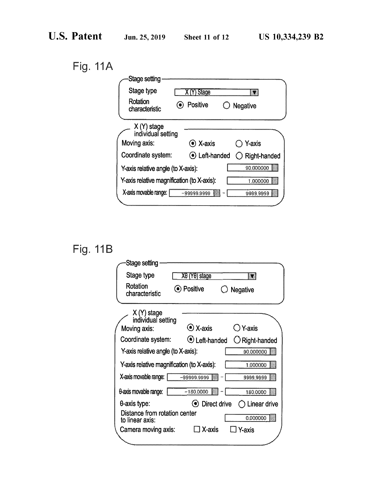
*도 11a, 11b — 스테이지 설정 UI: 스테이지 종류, 회전 특성, 좌표계(왼손/오른손), Y축 상대 각도·상대 배율, 이동 범위, θ축 종류, 회전 중심-직선축 거리*

상대 배율 β는 스테이지 좌표계에서 X 스테이지(300)(X축)에 대한 Y축(가상 Y축)의 배율이다. 상대 배율 β는 모션 컨트롤러(200)가 출력한 지시에 대한 Y 스테이지(400)의 변위와, 모션 컨트롤러(200)가 출력한 지시에 대한 X 스테이지(300)의 변위의 비이다. 도 11a 또는 도 11b의 UI는 입력된 상대 배율 1.000000을 보여 주는데, 이는 모션 컨트롤러(200)가 소정 거리만큼 이동하라는 지시를 줄 때 X 스테이지(300)와 Y 스테이지(400)가 같은 거리만큼 이동한다는 것을 나타낸다. 통상의 스테이지는 상대 각도 α 90도, 상대 배율 β 1로 설계되지만, 제조 중 Xθ 스테이지(300, 500)와 Y 스테이지(400)에 생길 수 있는 오차를 보정하기 위해 사용자가 스테이지의 이런 값을 입력할 수 있다. 스테이지는 상대 각도 α가 90도가 아니고 상대 배율 β가 1이 아닌 특수한 용도로 사용될 수도 있다. 스테이지의 이러한 특성값은 캘리브레이션 과정을 시작할 때 입력할 수 있다. 입력된 값은 메모리(111)에 저장된다.

단계 S18에서, 화상 처리 장치(100)는 스테이지 좌표계에서의 가상 위치를 계산한다. 더 구체적으로, 스테이지 좌표계는 대문자로 쓴 좌표 (Xn, Yn)로 표현된다. 가상 위치 (X0, Y2)(제1 가상 점)는 단계 S11에서 화상을 촬상한 기준 위치 (X0, 0)(제1 기준 위치), 단계 S13에서 X 스테이지(300)가 기준 위치로부터 X 방향으로 이동한 위치 (X1, 0)(제1 변위 위치), 그리고 단계 S17에서 입력받은 상대 배율 β와 왼손·오른손 좌표계 중 어느 것인지의 설정을 사용해 계산된다(도 8 참조). 상대 각도 α가 90도이고 상대 배율 β가 1이면 Y2는 (X1−X0)이다. 이 좌표 변환은 일반식 Y2=sin α×β(X1−X0)로 표현된다.

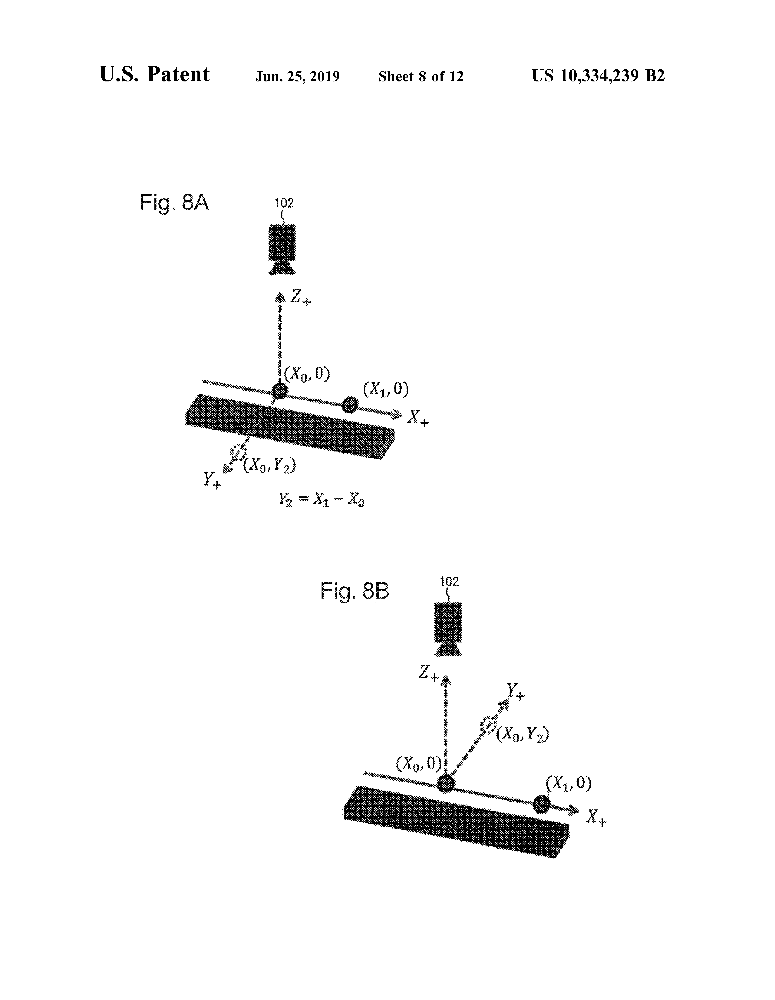
*도 8a, 8b — 왼손·오른손 스테이지 좌표계에서의 기준 위치 (X0, 0), 변위 위치 (X1, 0), 가상 위치 (X0, Y2), Y2 = X1 − X0*

단계 S19에서, 화상 처리 장치(100)는 스테이지 좌표계의 가상 위치에 대응하는 카메라 좌표계의 화상 좌표 공간에서의 가상 위치를 계산한다. 더 구체적으로, 카메라 좌표계는 소문자로 쓴 좌표 (xn, yn)로 표현된다. 기준 위치 (X0, 0)에서 촬상한 화상의 위치 결정 마크(M)의 화상 좌표 공간에서의 기준 위치 (x0, y0)(제1 화상 좌표 공간의 기준 위치)와, X 스테이지(300)가 기준 위치 (X0, 0)에서 X 방향으로 이동한 위치 (X1, 0)에서 촬상한 화상의 위치 결정 마크(M)의 위치 (x1, y1)(제1 화상 좌표 공간의 변위 위치)가 계산되고, 단계 S17에서 왼손 좌표계가 설정되면, 화상 처리 장치(100)는 도 10의 식 1을 사용해 카메라 좌표계의 화상 좌표 공간에서의 가상 위치 (x2, y2)(제1 화상 좌표 공간의 가상 위치)를 계산한다(도 8a 및 9a 참조). 도 10의 식 1을 사용해, 화상 처리 장치(100)는 단계 S17에서 입력받아 스테이지 좌표계에서 사용한 것과 같은 X축-Y축 상대 각도 α와 같은 상대 배율 β를 사용해 카메라 좌표계의 대응 가상 위치를 계산한다. 화상 처리 장치(100)는 카메라 좌표계의 화상 좌표 공간에서 기준 위치로부터의 마크(M)의 변위에 상대 배율 β를 곱하고, 그 결과 위치를 상대 각도 α만큼 시계 방향으로 회전시켜 얻은 좌표를 가상 위치로 삼는다. 단계 S17에서 오른손 좌표계가 설정되면, 카메라 좌표계의 화상 좌표 공간에서의 가상 위치 (x2, y2)는 도 10의 식 2로 계산된다(도 8b 및 9b 참조). 도 10의 식 2를 사용해, 화상 처리 장치(100)는 카메라 좌표계의 화상 좌표 공간에서 기준 위치로부터의 마크(M)의 변위에 상대 배율 β를 곱하고, 그 결과 위치를 상대 각도 α만큼 반시계 방향으로 회전시켜 얻은 좌표를 가상 위치로 삼는다.

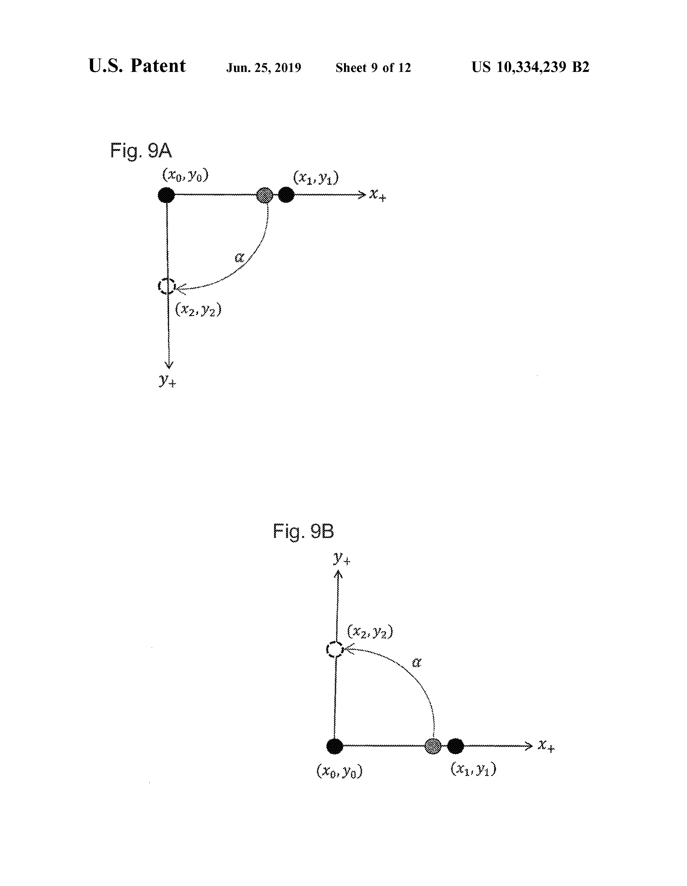
*도 9a, 9b — 왼손·오른손 카메라 좌표계에서 (x0, y0), (x1, y1)로부터 상대 각도 α 회전으로 얻는 가상 위치 (x2, y2)*

단계 S20에서, 화상 처리 장치(100)는 위에서 말한 캘리브레이션 파라미터로서 아핀 변환 파라미터를 계산한다. 더 구체적으로, 화상 처리 장치(100)는 화상 좌표 공간의 기준 위치 (x0, y0)와 그에 대응하는 스테이지 좌표계의 위치 (X0, 0)를 사용한 도 10의 식 3, 카메라 좌표계의 위치 (x1, y1)와 그에 대응하는 스테이지 좌표계의 기준 위치 (X1, 0)를 사용한 식 4, 그리고 단계 S19에서 계산한 화상 좌표 공간의 가상 위치 (x2, y2)와 그에 대응하는 스테이지 좌표 공간의 가상 위치 (X0, Y2)를 사용한 도 10의 식 5로 아핀 변환 파라미터 (A, B, C, D, E, F)를 계산한다. 위에서 설명한 바와 같이, 스테이지 좌표계 가상 위치 (X0, Y2)의 좌표 Y2는 도 10의 식 6으로 얻는다.

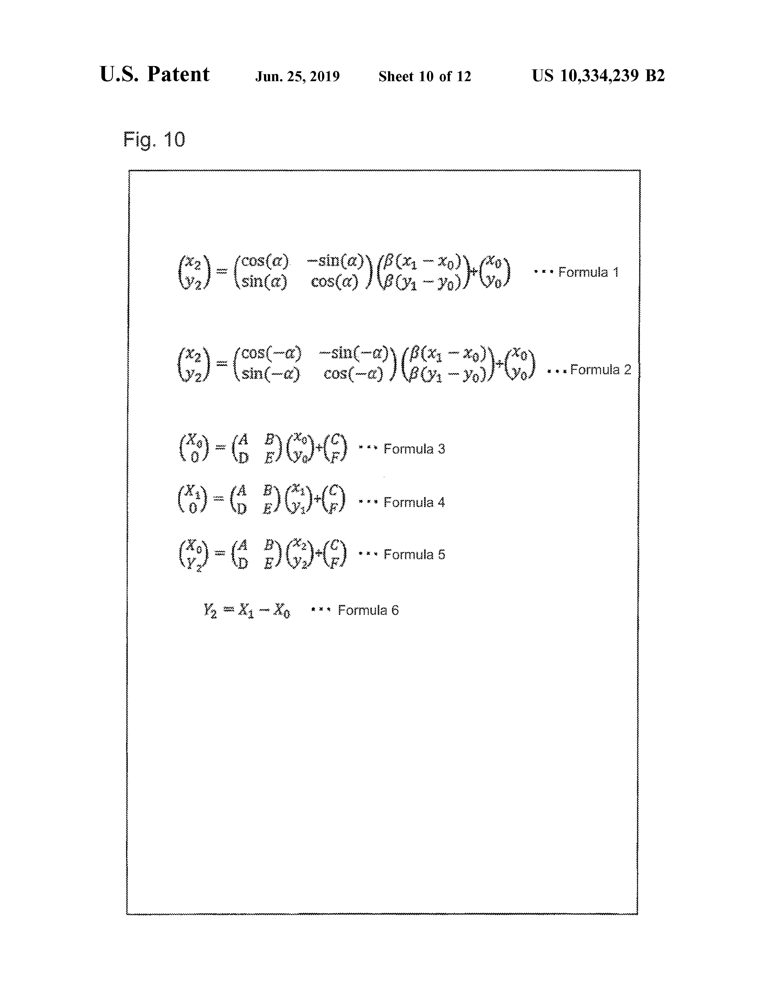
*도 10 — 식 1·2(가상 위치: 변위에 β를 곱하고 ±α 회전), 식 3~5(세 점 대응으로 아핀 파라미터 A~F), 식 6(Y2 = X1 − X0)*

단계 S21에서, θ 스테이지(500)의 회전축을 카메라 좌표계에서 결정한다. 이제 도 4와 도 5a~5c를 참조하여 카메라 좌표계에서 θ 스테이지(500)의 회전축을 결정하는 방법을 자세히 설명한다. 도 4와 도 5a~5c는 θ 스테이지(500)의 회전축을 결정하는 방법을 설명하는 도면이다. 도 4에 나타낸 바와 같이, 화상 처리 장치(100)는 대응하는 카메라(102, 104)로 워크(10) 위의 위치 결정 마크(M)를 촬상하고, 워크(10)의 회전 중심과 회전 각도를 계산해 θ 스테이지(500)의 회전축을 결정한다.

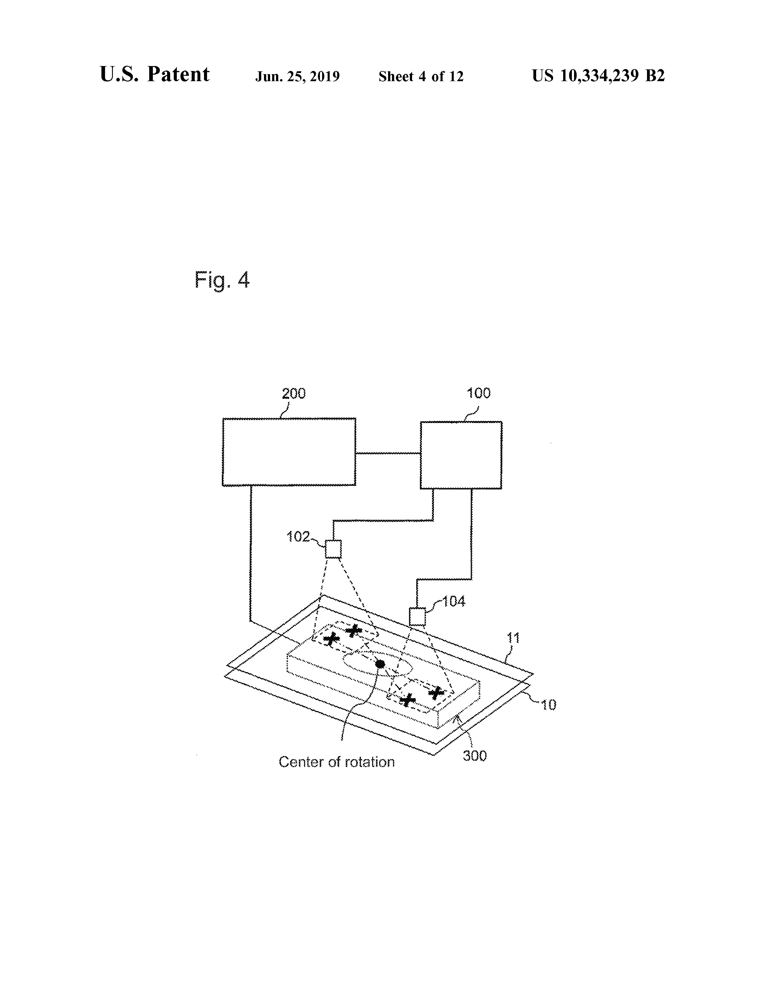
*도 4 — 두 카메라 102·104로 워크의 두 마크를 촬상해 회전 중심을 구하는 배치*

도 5a~5c에 나타낸 바와 같이, θ 스테이지(500)는 위치 결정 마크(M)가 카메라(102, 104)의 시야 안에 머물도록 각도 θ만큼 회전된다. 회전 전 각 마크의 위치로부터 각 위치 결정 마크(M)의 위치 변위를 사용해 회전 중심을 추정한다. 더 구체적으로, 도 5a에 나타낸 바와 같이, 위치 결정 마크(M)가 있는 워크(10)를 θ 스테이지(500)로 각도 θ만큼 회전시킨다. 회전 전 위치 결정 마크(M)의 위치를 제1 샘플링 점(제3 화상 좌표 공간의 기준 위치)이라 하고, 회전 후 위치 결정 마크(M)의 위치를 제2 샘플링 점(제3 화상 좌표 공간의 변위 위치)이라 한다.

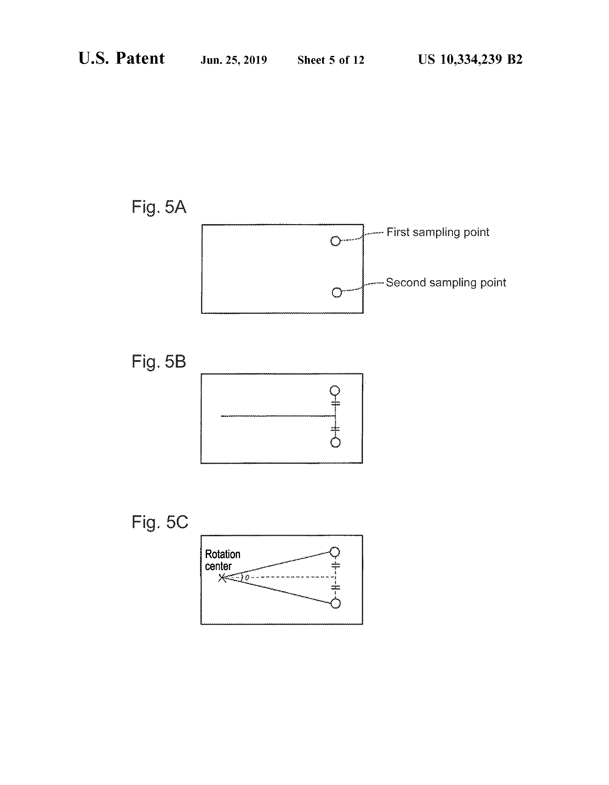
*도 5a~5c — 회전 전후 두 샘플링 점을 잇는 선분의 수직 이등분선 위에서 두 점과 각도 θ를 이루는 점을 회전 중심으로 산출*

도 5b에 나타낸 바와 같이, 각도 θ만큼 회전하기 전후의 위치 결정 마크(M)의 위치를 나타내는 좌표 점을 잇는 직선을 정의한다. 도 5c에 나타낸 바와 같이, 그 직선의 수직 이등분선 위에서 위치 결정 마크(M)를 나타내는 이 두 점과 각도 θ를 이루는 위치를 나타내는 좌표를 계산한다. 계산한 좌표를 Xθ 스테이지(300, 500)의 회전 중심으로 정한다.

X 스테이지(300)의 이동 범위 중점에 배치된 θ 스테이지(500)의 회전 중심을 스테이지 좌표계의 원점으로 사용할 수 있다. θ 스테이지(500)의 회전 중심을 원점으로 설정하고 도 5a~5c에 나타낸 샘플링을 수행하면, 샘플링한 마크(M)의 스테이지 좌표계 좌표를 계산할 수 있다. 이로써 카메라 좌표계와 스테이지 좌표계를 일치시킬 수 있다.

본 실시예에 따른 화상 처리 장치(100)는 위에서 설명한 Xθ 스테이지(300, 500)를 포함하는 위치 결정 시스템(1)을 사용해 캘리브레이션을 수행하지만, 화상 처리 장치(100)는 여기 개시한 내용에 기초한 구조로 도 12에 나타낸 θ 스테이지(500)를 포함하지 않는 위치 결정 시스템을 사용할 수도 있다. 이 위치 결정 시스템은 예컨대 워크(11)를 스테이지(300)에 장착하는 지그로 인해 회전 어긋남이 생길 수 없을 때, 또는 회전 정렬이 필요 없는 원형 워크(11)를 처리할 때 사용된다.

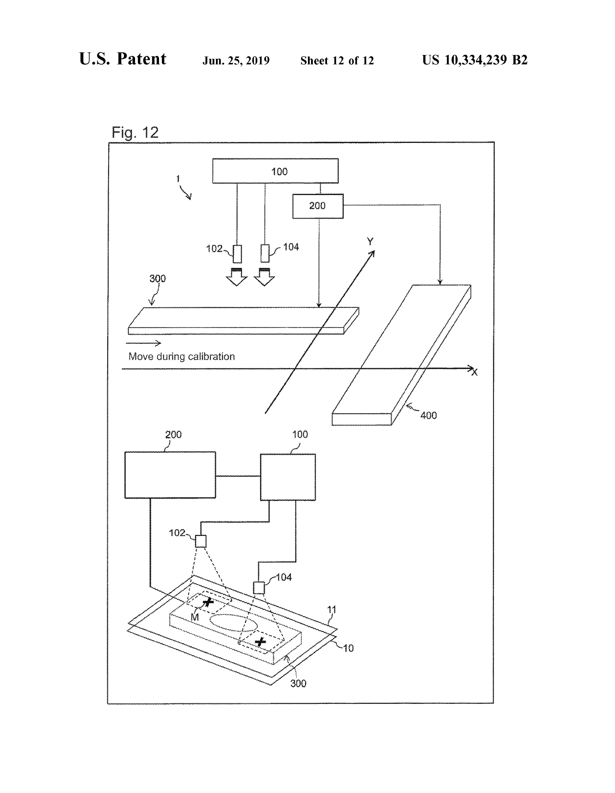
*도 12 — θ 스테이지가 없는 변형 위치 결정 시스템*

위 실시예에서는 캘리브레이션에 사용하는 가상 위치의 좌표를

스테이지 좌표계의 Y 좌표에 대해 Y2=sin α×β(X1−X0), 그리고

카메라 좌표계의 y 좌표에 대해 y2=sin α×β(X1−X0)+cos α×β(y1−y0)+y0

식으로 계산한다.

일부 실시예에서 스테이지 좌표계의 좌표 Y2는 X 좌표값 X1 대신 스테이지 좌표계 X축 위의 값 Xn으로부터 계산할 수 있다. 좌표 Y2는 값 Xn으로부터 위에서 설명한 것과 같은 방식으로 상대 각도 α와 상대 배율 β를 사용해 계산한 Y 좌표값이다. 카메라 좌표계의 좌표 y2도 스테이지 좌표계의 값 Xn에 대응하는 카메라 좌표계 x축 위의 값 xn으로부터 계산할 수 있다. 좌표 y2는 값 xn으로부터 위에서 설명한 것과 같은 방식으로 상대 각도 α와 상대 배율 β를 사용해 계산한 y 좌표값이다.

화상 처리 장치(100)는 Y 스테이지를 가상 축으로 사용해 카메라(102, 104)에 대해 Xθ 스테이지(300, 500)를 캘리브레이션하지만, X 스테이지를 가상 축으로 사용해 도 1에 나타낸 카메라(105, 106)에 대해 Y 스테이지를 캘리브레이션할 수도 있다. 가상 축은 위에서 설명한 UI를 사용해 스테이지 사이에서 전환할 수 있다.

더 구체적으로, X 스테이지(300)에서 Y 스테이지(400)로, 그리고 Y 스테이지(400)의 화상 또는 Y 스테이지(400)에 놓인 대상물의 화상을 촬상할 수 있는 카메라(105, 106)로 전환한다. Y 스테이지(400)가 기준 위치(제2 기준 위치)에 있을 때 화상에서 마크의 위치를 나타내는 화상 좌표 공간의 기준 위치(제2 화상 좌표 공간의 기준 위치)를 얻는다. Y 스테이지(400)가 제2 기준 위치에서 Y 방향으로 이동한 위치(제2 변위 위치)에 있을 때 화상에서 마크의 위치(제2 화상 좌표 공간의 변위 위치)를 얻는다. Y 스테이지(400)가 소정 위치에서 X 방향으로 소정 거리만큼 가상으로 이동한 가상 위치(제2 가상 위치)에 있다고 가정할 때 화상에서 마크의 위치(제2 화상 좌표 공간의 가상 위치)를 X 스테이지의 특성값을 사용해 얻는다. 그런 다음 제2 기준 위치, 제2 변위 위치, 제2 가상 위치, 제2 화상 좌표 공간의 기준 위치, 제2 화상 좌표 공간의 변위 위치, 제2 화상 공간의 가상 위치를 사용해 캘리브레이션을 수행한다.

### 소프트웨어를 이용한 구현 (Implementations Using Software)

화상 처리 장치(100)의 각 기능 블록(특히 처리부 101)은 집적 회로(IC 칩) 같은 논리 회로(하드웨어)를 사용해 구현하거나, 중앙 처리 장치(CPU)로 구현하는 소프트웨어를 사용해 구현할 수 있다.

기능 블록을 소프트웨어로 구현하는 경우, 화상 처리 장치(100)는 기능을 구현하기 위해 프로그램 또는 소프트웨어에 포함된 명령을 실행하는 CPU, 컴퓨터(또는 CPU)가 읽을 수 있는 프로그램과 각종 데이터를 저장하는 읽기 전용 메모리(ROM) 또는 저장 장치(이하 저장 매체), 그리고 프로그램을 펼치는 랜덤 액세스 메모리(RAM)를 포함한다. 컴퓨터(또는 CPU)는 저장 매체에서 프로그램을 읽어 실행하여 본 발명의 하나 이상의 측면을 구현한다. 저장 매체는 테이프, 디스크, 카드, 반도체 메모리, 프로그래머블 논리 회로 같은 비일시적 유형 매체일 수 있다. 프로그램은 컴퓨터로 프로그램을 전송할 수 있는 임의의 전송 매체(통신망이나 방송파 등)를 통해 제공될 수 있다. 본 발명의 하나 이상의 실시예는 반송파에 실린 데이터 신호 형태로 전자적으로 전송되는 프로그램을 사용해 구현될 수 있다.

여기 개시한 실시예는 제한적으로 해석되어서는 안 되며, 청구하는 발명의 취지와 범위 안에서 변형될 수 있다. 서로 다른 실시예에 개시된 기술적 특징은 발명의 기술적 범위 안에서 다른 실시예에서 조합될 수 있다. 실시예에 개시된 기술적 특징을 더 조합해 새로운 기술적 특징을 제공할 수 있다.

### 부호의 설명 (REFERENCE SIGNS LIST)

1 위치 결정 시스템(산업 장치)

10 워크

100 화상 처리 장치

102, 104 카메라(촬상 장치)

113 조작부(UI)

114 디스플레이(UI)

200 모션 컨트롤러

300 X 스테이지(제1 스테이지)

400 Y 스테이지(제2 스테이지)

500 θ 스테이지(제3 스테이지)

α 상대 각도

β 상대 배율
