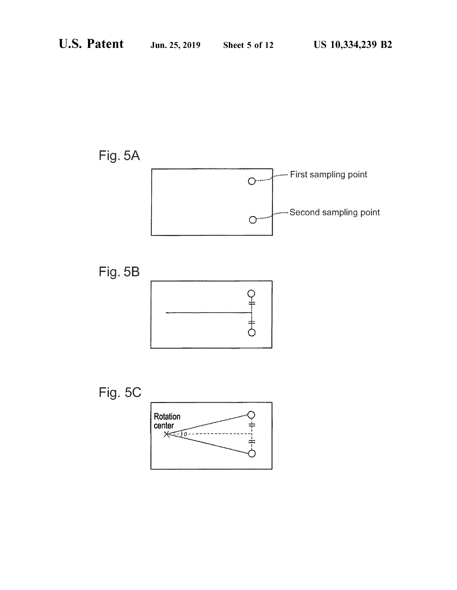
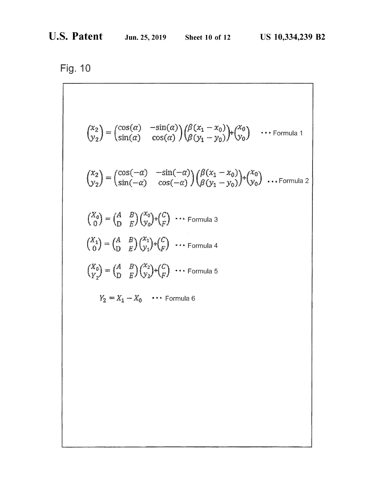

# US10334239B2 — 화상 처리 장치, 캘리브레이션 방법 및 캘리브레이션 프로그램 (OMRON)

| 항목 | 내용 |
|---|---|
| 원문 | `US10334239.pdf`(등록, 2019-06-25) · `US20170039715.pdf`(공개, 2017-02-09) |
| 출원인 | OMRON Corporation |
| 우선일 | 2015-08-07 (JP 2015-157666) · 출원 2016-07-26 |
| 핵심 | 스테이지를 알려진 거리만큼 X로 움직여 찍은 마크 위치 2점 + 기계 특성값(상대 각도 α, 상대 배율 β)으로 만든 가상 점 1점, 총 3점 대응으로 카메라 좌표 → 스테이지 좌표 아핀 변환(A~F)을 구한다. θ 스테이지를 소정 각도 θ 돌려 회전 전후 마크 2점과 θ로 회전 중심을 닫힌 식으로 구한다. |
| 관련도 | ◎ 문제를 직접 해결하는 구성 |
| 해결하는 P# | P3(카메라 미보정 → 알려진 이동으로 좌표 변환 자동 보정), P5(시험 이동·시험 회전으로 보정량 산출), P1(회전 중심을 원점으로 두고 X·θ를 따로 보정) |
| 링크 | [Google Patents](https://patents.google.com/patent/US10334239B2/en) |

---

## 상세 요약 (번역본 기준)

### 1. 해결하려는 문제
- 두 대상물(유리 기판·필름)을 각각 3축 XYθ 스테이지에 올리면 6축이 되어 비싸다. 그래서 유리 기판은 Xθ 스테이지, 필름은 독립된 Y 스테이지에 올린다.
- 이 경우 기존 캘리브레이션(특허문헌 1, XYθ 스테이지를 움직이며 카메라 변위와 스테이지 변위 관계를 측정)은 쓸 수 없다. 카메라 102·104는 X 스테이지 쪽만 보므로 Y 스테이지를 움직여도 마크가 시야에서 움직이지 않는다.
- 아핀 변환 파라미터를 구하려면 마크 3점이 필요한데 실측으로는 2점(기준, X 이동 후)만 얻는다.

### 2. 핵심 구성
| 구성 | 부호 | 위치·역할 |
|---|---|---|
| 화상 처리 장치 | 100 | 프로세서 101, 메모리 111(특성값·캘리브레이션 파라미터 저장), UI 113 |
| 제1·제2 카메라 | 102, 104 | Xθ 스테이지 쪽 워크 10의 마크 M 두 개를 각각 촬상 |
| 제3·제4 카메라 | 105, 106 | Y 스테이지 쪽 워크 11(필름)의 마크 촬상 |
| X 스테이지 | 300 | 제1 스테이지 |
| Y 스테이지 | 400 | 제2 스테이지(X와 독립) |
| θ 스테이지 | 500 | 제3 스테이지, X 스테이지 위에 장착. 회전 중심이 스테이지 좌표계 원점 |
| 특성값 | α, β | Y축의 X축 대비 상대 각도와 상대 배율(사용자가 UI로 입력, 제조 오차 보정 가능) |

### 3. 동작 순서
**캘리브레이션 (도 7, S11~S21)**
1. S11·S12: 기준 위치 (X0, 0)에서 마크 촬상 → 화상 좌표 기준 위치 (x0, y0).
2. S13~S15: X 스테이지를 소정 거리(마크가 화상 안에 머무는 범위) 이동 → 변위 위치 (x1, y1).
3. S16: 소정 횟수 반복해 잡음 평균. θ 스테이지를 돌려 마크를 화면 네 귀퉁이로 옮겨 가며 샘플링할 수도 있음.
4. S17: 상대 각도 α, 상대 배율 β, 왼손/오른손 좌표계 입력.
5. S18: 스테이지 가상 위치 (X0, Y2), Y2 = sin α×β(X1−X0) (α=90°, β=1이면 Y2 = X1−X0).
6. S19: 화상 가상 위치 (x2, y2) = 화상 변위 벡터에 β를 곱하고 α만큼 회전(도 10 식 1·2).
7. S20: 세 점 대응(식 3~5)으로 아핀 변환 파라미터 A~F.
8. S21: θ 스테이지를 각도 θ만큼 회전(마크가 두 카메라 시야 안에 머물도록) → 회전 전후 마크 2점을 잇는 선분의 수직 이등분선 위에서 두 점과 각 θ를 이루는 점 = 회전 중심.

**정렬 (도 3, S1~S8)**
- 4개 카메라로 마크 4개 검출 → 캘리브레이션 파라미터로 스테이지 좌표 변환 → 목표 위치 → Y 변위 Yt, X 변위 Xt, θ 변위 θt를 따로 계산 → 스테이지 이동.

### 4. 청구항 요지 (14항, 독립항 1·10·13·14)
- 청구항 1: 독립 X·Y 스테이지 구조에서, 기준 위치·변위 위치의 마크 화상 좌표와, 특성값(기계적 관계)을 곱해 만든 스테이지 가상 위치·화상 가상 위치를 비교해 카메라→스테이지 변환 파라미터를 계산·저장하는 화상 처리 장치.
- 청구항 2·3: 특성값 = 상대 각도·상대 배율. 화상 변위를 배율만큼 늘리고 기준 위치를 중심으로 상대 각도만큼 돌려 가상 위치를 만든다.
- 청구항 8·12: 회전 가능한 제3 스테이지를 소정 각도 돌린 전후 마크 위치와 그 각도로 회전 중심을 계산·저장.
- 청구항 9: 마크를 목표 위치로 옮길 제3 스테이지 회전 각도를 계산·출력.
- 청구항 10: 같은 내용의 방법, 청구항 13: 프로그램 매체, 청구항 14: 산업 장치(모션 컨트롤러 포함).

### 5. 대표 도면

*도 5a~5c — 회전 전후 두 샘플링 점과 회전각 θ로 회전 중심 산출*

*도 10 — 가상 위치(식 1·2)와 세 점 아핀 변환(식 3~5), Y2 = X1 − X0(식 6)*

### 6. 본 과제(Y·Θ 얼라인먼트)와 비교
- 같은 점:
  - 카메라가 스테이지 좌표를 모르는 상태(미보정)에서 출발해, 스테이지를 **알려진 양만큼 움직인 영상**으로 영상↔장비 좌표 관계를 만든다. 우리 1014 단일축 280장과 같은 구조의 자료다.
  - 회전 중심은 **알려진 각도의 시험 회전 1회**와 마크 2점으로 닫힌 식으로 구한다.
  - 정렬 단계에서 X·Y·θ 변위를 각각 따로 계산한다(회전 중심을 원점으로 둔 덕분).
- 다른 점:
  - 카메라가 위에서 수직으로 보는 2D 평면 정렬이라 θ가 영상에서 "회전"으로 보인다. 우리는 Θ(PAN)가 영상에서 가로 이동으로 보여 Y와 섞인다(P1).
  - 마크가 두 카메라에 하나씩, 멀리 떨어져 있어 회전 분리 정보가 크다. 우리는 카메라 1대, QR 3개가 한 판에 있다.
  - 아핀(2D) 모델만 쓰고 원근·깊이는 다루지 않는다.
- 참고할 점:
  - **P3**: 1014 자료의 "Y만 움직인 영상"과 "T만 움직인 영상"으로 각 축의 영상 반응 방향·크기(우리 식으로는 14.25 px/mm, 80.04 px/T)를 보정값으로 저장하는 절차를 그대로 정식화할 수 있다. 설치 때 이 절차를 자동으로 돌리는 "자동 보정 모드"(4장 5-4)의 근거.
  - **P5**: 회전 중심 산출은 "시험 회전 θ → 마크 2점 → 수직 이등분선" 한 번이면 끝난다. 우리도 턴 시작 시 T를 ±δT 시험 회전하는 루틴(5-2)의 계산식 근거로 쓸 수 있다.
  - 반복 샘플링으로 잡음 평균(S16), 마크를 시야 네 귀퉁이로 옮겨 가며 샘플링하는 아이디어는 촬영 설계(4-1)와 연결된다.
  - 기계 특성값(상대 각도·배율)을 사용자 입력으로 따로 둔 구조는 "명목값 확보(3-1)" 후 보정에 넣는 방식과 같다.

---

> **같은 특허의 다른 폴더:** `문헌연구/01_주제_관련/원인분석/특허/02_US10334239_Omron_카메라스테이지_보정_회전중심` (번역 있음). 두 폴더는 주제 관점이 달라 요약을 따로 두었다.
