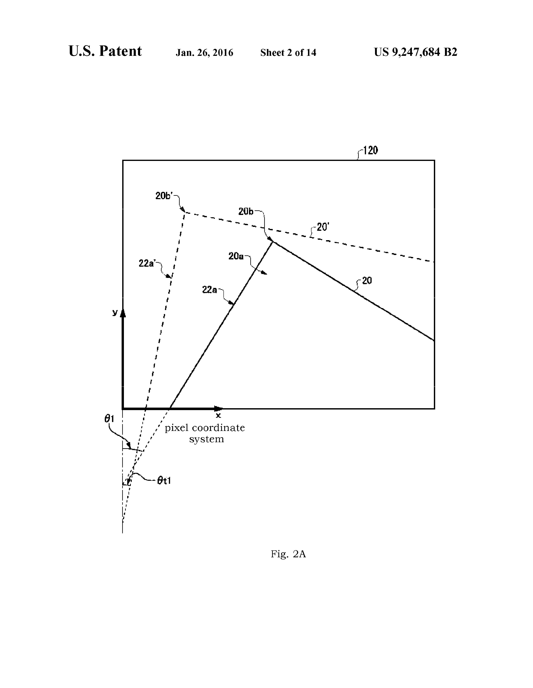
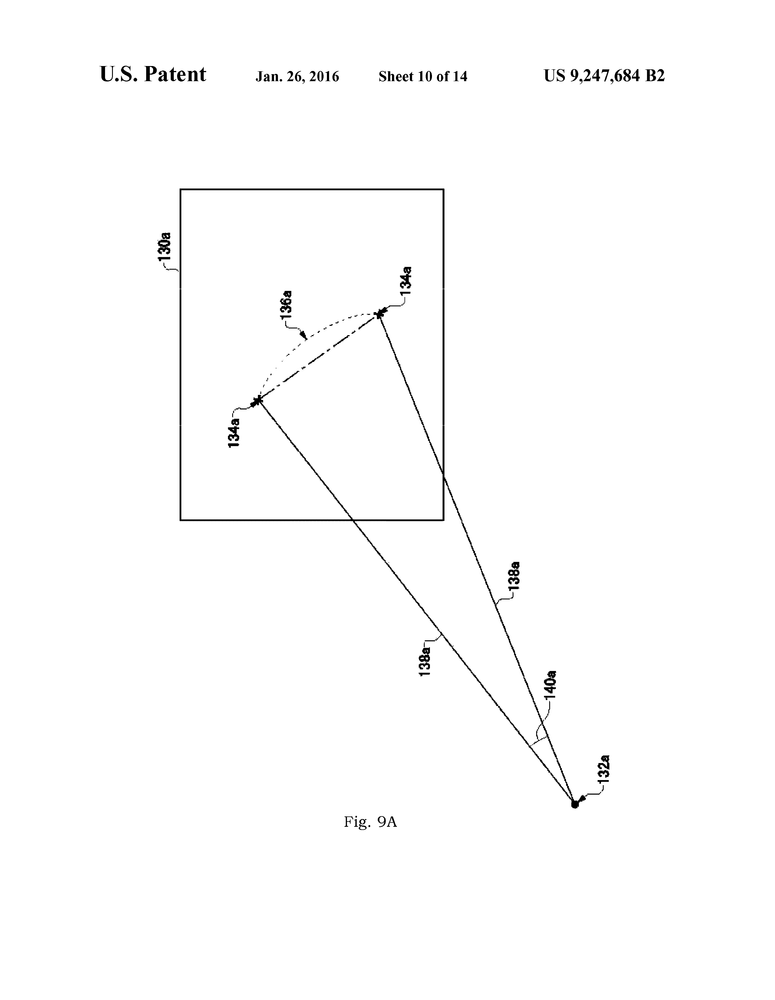

# US9247684B2 — 대상물 제어 시스템, 대상물 제어 방법 및 프로그램, 회전 중심 위치 특정 장치 (Cognex)

| 항목 | 내용 |
|---|---|
| 원문 | `US9247684.pdf`(등록, 2016-01-26) · `US20120262626.pdf`(공개, 2012-10-18) |
| 출원인 | Cognex Corporation (발명자 Masaaki Ikeda) |
| 우선일 | 2009-12-07 (JP 2009-278033) · PCT 출원 2010-12-06 (WO2011/071813) |
| 핵심 | (1) 마크의 **선(변)의 기울기**로 θ를 먼저 구하고, 기준점을 회전 중심 기준으로 그 θ만큼 돌린 뒤 남는 차이를 X·Y 평행 이동량으로 쓴다(회전 → 평행이동 순서로 분리). 두 카메라 값은 평균 또는 분해능 가중 평균. (2) 시험 회전 전후 마크 2점 + 명령 회전각으로 이등변 삼각형 꼭짓점 = 회전 중심. 회전 중심이 시야 밖이면 오차가 크므로, 시야 안의 설정 회전 중심으로 다시 돌려 그 차이로 보정한다. |
| 관련도 | ◎ 문제를 직접 해결하는 구성 |
| 해결하는 P# | P1(θ를 회전 불변량인 "선의 각도"로 먼저 분리해 평행이동과의 결합 회피), P5(시험 회전으로 회전 중심 산출, 시야 안 재회전으로 정밀화), P2(두 위치 관측의 가중 결합) |
| 링크 | [Google Patents](https://patents.google.com/patent/US9247684B2/en) |

---

## 상세 요약 (번역본 기준)

### 1. 해결하려는 문제
- 종래(일본 특허 3,531,674)는 마크 편차가 없어질 때까지 테이블을 여러 번 회전·평행 이동해야 한다.
- 종래(일본 공개 2006-49755)는 두 카메라 사이 거리(두 마크 사이 거리)를 미리 입력해 회전각과 회전 중심을 구하므로, **카메라 설치 위치가 정확하지 않으면 회전 중심 좌표에 오차**가 생겨 정렬이 오래 걸린다.
- 회전 중심이 카메라 시야 밖에 있으면 시험 회전으로 구한 회전 중심의 오차가 크다(짧은 원호, 작은 꼭지각).

### 2. 핵심 구성
| 구성 | 부호 | 역할 |
|---|---|---|
| 제1·제2 촬상부 | 40, 42 | 대상물 20의 두 모서리 20a·20c를 각각 촬상(같은 위치를 찍어도 됨) |
| 스테이지 이동 기구 | 30 (32·34·36) | X·Y 평행 이동, θ 회전. X-Y-θ 또는 U-V-W 스테이지 |
| 각도 취득부 | 62 | 대상물 선(모서리 변)과 픽셀 Y축 사이 각도 θ1·θ2 |
| 기준점 좌표값 취득부 | 64 | 모서리 꼭짓점(기준점)의 픽셀 좌표 |
| 목표 좌표값 유지부 | 70 | 대상물이 목표 위치에 있을 때의 각도·좌표(목표 θt1·θt2, 목표 픽셀 좌표) |
| 캘리브레이션부 | 52 (522·524·526) | 픽셀↔스테이지 좌표 대응 테이블, 회전 중심 픽셀 좌표 산출·보정 |

### 3. 동작 순서
**캘리브레이션 (도 4·11)**
1. 스테이지를 Δθ씩 회전하며 스테이지 기준점의 스테이지 좌표와 픽셀 좌표를 대응 테이블로 등록(도 5).
2. 회전 중심: (a) Δθ씩 돌린 여러 점에 최소제곱 원호 맞춤 → 원 중심, 또는 (b) 회전 전후 2점을 밑변, 명령 회전각을 꼭지각으로 하는 이등변 삼각형의 꼭짓점.
3. 정밀화(도 11): 시야 밖 회전 중심으로 돌려 제1 회전 중심 → 그 값으로 시야 안 설정 회전 중심을 정해 스테이지를 평행 이동 후 다시 회전 → 제2 회전 중심 → "설정값 − 제2 회전 중심" 차이를 제1 회전 중심에 더해 보정.

**얼라인먼트 (도 6)**
1. 두 화상에서 각도 θ1·θ2 → 목표 각도와의 차분 → 평균 차분 각도 = 목표 회전량.
2. 기준점을 회전 중심 기준으로 평균 차분 각도만큼 회전시킨 좌표와 목표 좌표의 차 → 카메라별 평행 이동량 → 평균.
3. 회전량·X·Y 이동량으로 스테이지 1회 이동.
4. 한쪽 화상에 마크가 없으면 다른 화상만으로 정렬하거나(도 7), 다른 화상 쪽으로 마크를 끌어들인 뒤 정렬(도 8). 분해능이 높은 카메라에 큰 가중치.

### 4. 청구항 요지 (15항, 독립항 1·12·13)
- 청구항 1: 기준 마크의 대상물 선과 목표 대상물 선 사이 차분 각도로 회전 기구 제어 + 캘리브레이션부가 (시야 밖) 제1 회전 중심 → (시야에 더 가까운) 설정 회전 중심으로 재회전해 제2 회전 중심 → 둘의 차이로 제1 회전 중심 보정.
- 청구항 2: 회전 전후 마크 2점을 밑변, 회전량을 꼭지각으로 하는 이등변 삼각형 꼭짓점 = 회전 중심.
- 청구항 3: 제1 회전 중심은 시야 밖, 설정 회전 중심은 시야 안.
- 청구항 4~6: 제2 촬상 장치의 제2 차분 각도, 한쪽 화상에 마크가 없을 때 다른 쪽으로 제어.
- 청구항 7~11: 카메라별 가중치(분해능이 높을수록 큰 가중치; 해상도 또는 촬상 범위 차이), 평행 이동량에도 가중치.
- 청구항 12: 방법, 13: 매체, 14·15: 가중치 방법.

### 5. 대표 도면

*도 2a — 대상물 선(변 22a)과 Y축의 각도 θ1, 목표 각도 θt1: θ를 위치와 무관한 "선의 기울기"로 측정*

*도 9a — 회전 중심이 시야 밖이면 원호가 짧고 꼭지각이 작아 회전 중심 오차가 커진다*

### 6. 본 과제(Y·Θ 얼라인먼트)와 비교
- 같은 점:
  - 카메라 설치 위치가 정확하지 않아도(미보정) 정렬하려는 목적이 같다.
  - 회전 중심을 시험 회전으로 영상에서 직접 구한다.
- 다른 점:
  - 위에서 내려다보는 카메라라 θ가 영상에서 "선의 기울기 변화"로 보인다. 우리 Θ(PAN)는 영상에서 기울기보다 가로 이동으로 나타나 Y와 거의 같은 방향이다(P1).
  - 두 카메라가 대상물 양 끝을 각각 본다. 우리는 카메라 1대.
- 참고할 점:
  - **P1 — 계산 순서로 결합 끊기**: "회전 불변량으로 θ 먼저 → 회전 중심 기준으로 θ를 되돌린 뒤 남는 것만 평행이동"이 이 특허의 분리 방식이다. 우리에게 θ에만 반응하고 Y에는 둔감한 관측(뒷벽 가로선의 세로 이동, QR 사다리꼴 비대칭 등)이 있으면 같은 순서를 적용할 수 있다. 팀이 쓰는 가로선이 바로 이 "θ 전용 관측" 역할이다.
  - **P5 — 회전 중심 정밀화**: 회전 중심이 시야에서 멀면 짧은 원호로 추정해 오차가 크다는 지적은 우리 상황(PAN 회전축이 카메라·판에서 떨어져 있음)과 같다. 1차 추정 → 회전 중심을 시야 가까이 옮긴 재시험 회전 → 차이로 보정하는 2단계 절차를 시험 이동 루틴 설계에 참고.
  - **P2 — 다중 관측 가중**: 두 관측(우리는 QR 3개, 가로선 블록)의 결과를 분해능에 비례한 가중치로 평균한다. 4장 1-4(관측 블록 선택)의 가중치 근거로 쓸 수 있다.

---

> **같은 특허의 다른 폴더:** `문헌연구/01_주제_관련/원인분석/특허/01_US9247684_Cognex_회전중심_시야밖오차보정` (번역 있음). 두 폴더는 주제 관점이 달라 요약을 따로 두었다.
