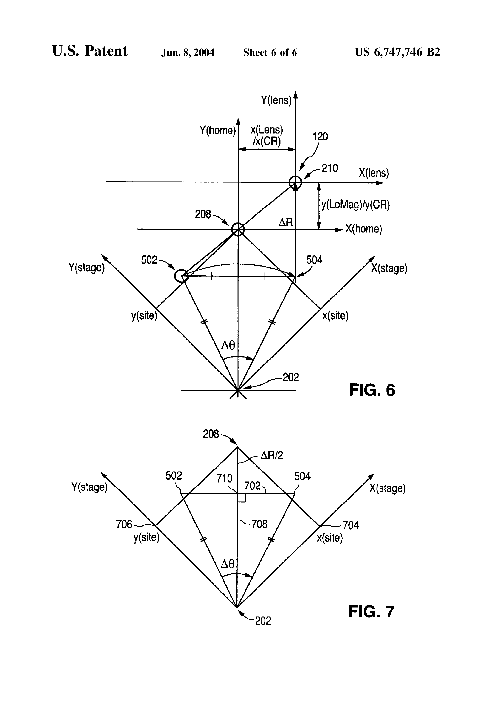
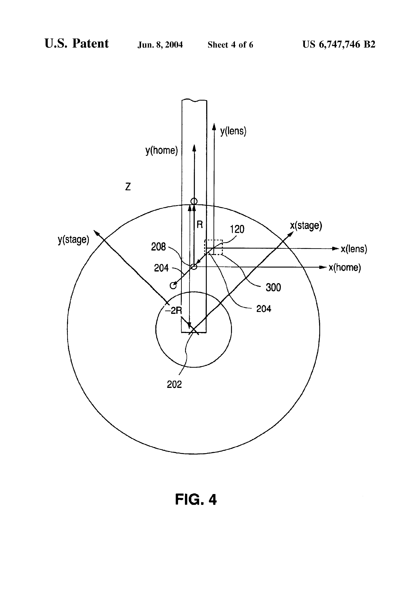

# US6747746B2 — R-θ 스테이지의 회전 중심을 찾는 시스템 및 방법 (Therma-Wave)

| 항목 | 내용 |
|---|---|
| 원문 | `US6747746.pdf`(등록, 2004-06-08) · `US20030025919.pdf`(공개, 2003-02-06) |
| 출원인 | Therma-Wave, Inc. (반도체 웨이퍼 광학 계측 장비) |
| 우선일 | 2001-07-16 (미국 가출원 60/305,761) · 출원 2002-01-11 |
| 핵심 | 웨이퍼 위 한 점을 시야에 맞춘 뒤 **180° 회전 + −2R 이동**이라는 알려진 시험 이동을 준다. 회전 중심과 시야 중심이 어긋나 있으면 점이 시야 중심에서 벗어나므로, 다시 맞추는 데 든 보정량(ΔΘ, ΔR)으로 오프셋을 닫힌 식으로 구한다: y = ΔR/2, x = tan(ΔΘ/2)·[√(x(site)²+y(site)²) − ΔR/2]. |
| 관련도 | ○ 부분적으로 해결 |
| 해결하는 P# | P5(알려진 시험 이동 → 복귀 보정량으로 회전 중심 오프셋 산출), P3(회전 중심-시야 오프셋 보정) |
| 링크 | [Google Patents](https://patents.google.com/patent/US6747746B2/en) |

---

## 상세 요약 (번역본 기준)

### 1. 해결하려는 문제
- 설치 면적을 줄이려 R-θ(극좌표) 스테이지를 쓰면, 회전할 때 시야도 돈다.
- 종래 XYθ 방식은 X·Y로 회전 중심을 시야 중심에 맞출 수 있다고 가정했으나, R-θ에서는 두 축(R, θ)뿐이라 기계적으로 정확히 맞추기 어렵다. 오프셋을 모르면 웨이퍼의 특정 사이트를 시야 중심에 정확히 놓을 수 없다.
- R-θ에서는 같은 점을 시야 중심에 놓는 스테이지 자세가 최대 두 개뿐이다(XYθ는 무한 개).

### 2. 핵심 구성
| 구성 | 부호 | 역할 |
|---|---|---|
| R-θ 스테이지 | 101 (트랙 104, 척 102, 회전자 108) | R축 직선 이동 + 회전 |
| 광학 촬상 시스템 | 대물 렌즈 120, 검출기 118, 처리기 116, 모니터 114 | 시야 300 |
| 프로세서 시스템 | 112 | 척 이동 제어, ΔΘ·ΔR 저장, 오프셋 계산 |
| 좌표계 | 홈(208 원점), 렌즈(시야 중심), 스테이지(회전 중심 202, 척과 함께 움직임) | 세 좌표계 관계로 오프셋 정의 |

### 3. 동작 순서
1. 기계식 나사로 회전 중심과 렌즈의 가로 위치를 10~20 µm 수준으로 대략 맞춤.
2. 웨이퍼 중심 가까운 특징점 210을 골라 시야 중심에 맞춤(예: 약 130° 회전 + R 이동, 도 3).
3. 시험 이동: 180° 회전 + −2R 이동(도 4). 오프셋이 없으면 점이 다시 시야 중심에 와야 함.
4. 실제로는 어긋나므로 작업자가 ΔΘ 회전, ΔR 이동으로 다시 맞춤(도 5).
5. 식으로 오프셋 계산(도 6·7): y(lens)=ΔR/2, x(lens)=tan(ΔΘ/2)·[(x(site)²+y(site)²)^1/2−ΔR/2].
6. 내부 파라미터 갱신. 여러 사분면 점으로 반복하면 검증, 실제로는 1회로 충분.
7. 스테이지·광학계 교체 때만 재수행.

### 4. 청구항 요지 (21항, 독립항 1·7·12·19·20·21)
- 청구항 1: 사이트를 시야에 맞추는 것으로 얻은 정보로 시야 중심-회전 중심 오프셋을 결정하는 검사 시스템.
- 청구항 2~5: 180° 회전 + 제1 거리의 2배 이동, 작업자 조작으로 재정렬 후 회전량·이동량 저장.
- 청구항 6·11·16~18: 위 식(y=ΔR/2, x=tan(ΔΘ/2)·[...]).
- 청구항 7: 방법(제1 위치 → 180° + 2배 이동한 제2 위치 → 조정한 제3 위치, 제2→제3의 ΔΘ·ΔR로 오프셋).
- 청구항 12: 일반화 — 같은 사이트를 시야에 두는 두 위치의 차이로 오프셋 계산.
- 청구항 19~21: 오프셋을 써서 사이트 위치 결정, 180° 기준 위치와의 차이로 오프셋.

### 5. 대표 도면

*도 6·7 — 회전 전후 점 502·504, ΔΘ, ΔR, 회전 중심 202와 홈 208의 기하 관계*

*도 4 — 180° 회전 + −2R 뒤 오프셋 때문에 점이 렌즈 아래에서 벗어남*

### 6. 본 과제(Y·Θ 얼라인먼트)와 비교
- 같은 점:
  - 축이 2개(직선 1 + 회전 1)뿐이다. 본 과제도 Y(직선)와 Θ(회전) 2축이다.
  - 회전 중심과 카메라 시야 중심이 어긋나 있어 회전이 영상에서 평행이동을 만든다는 문제 인식이 같다. 이 오프셋이 우리 P1(Y와 Θ가 영상에서 같은 방향으로 보임)의 기하학적 원인이다.
- 다른 점:
  - 위에서 내려다보는 계측 장비, 수동 재정렬(작업자 조작) 포함.
  - 180° 같은 큰 시험 회전을 쓴다. 우리 Θ 범위는 ±2 수준.
- 참고할 점:
  - **P5**: "알려진 시험 이동 → 원래 상태로 되돌리는 데 든 보정량 → 닫힌 식으로 오프셋"이라는 구조는 우리 턴 구조(명령 이동 → 재촬영)에 그대로 대응한다. 시험 Θ 회전 후 Y만으로 영상을 원위치시키는 데 필요한 양을 재면, 회전 중심 오프셋(=Θ가 만드는 가짜 Y 이동의 비율)을 현장에서 구할 수 있다.
  - **P3**: 2축 장비에서도 회전 중심-시야 오프셋 하나만 알면 좌표 보정이 된다. 우리 기하 모델(4장 3-2·3-4)에서 "광학 중심-Θ 회전축 거리"가 같은 역할의 파라미터다.
  - 한 번 구한 값은 장비 교체 때만 다시 구한다 → 설치 시 1회 자동 보정(5-4)의 근거.

---

> **같은 특허의 다른 폴더:** `문헌연구/01_주제_관련/원인분석/특허/07_US6747746_ThermaWave_R-theta_회전중심` (요약만). 두 폴더는 주제 관점이 달라 요약을 따로 두었다.
