# 티칭 방법 및 이를 이용한 기판 처리 장치 (US9966285B2)
- 원제: Teaching method and substrate treating apparatus using the same
- 원문: 같은 폴더의 `US9966285.pdf`(등록본), `US20160351425.pdf`(공개본), https://patents.google.com/patent/US9966285B2/en
- 번역 기준: USPTO 등록본 PDF(스캔 이미지)를 문자 인식(OCR)해 얻은 원문 텍스트를 한국어로 옮김. 조사 당일 Google Patents가 자동 접근을 막아(HTTP 503) 그 텍스트를 쓰지 못했다. 대응 한국 출원 10-2015-0076463의 국문 원문은 KIPRIS 자동 접근이 안 되어 확인하지 못했다. 원문 오기(예: "photographing process", "touch method", "support plate 932", "fourth detectors", 청구항 7의 "four times"와 요약 본문의 "three times" 불일치, 도 12·13 설명 순서)는 고치지 않았다.
- 도면: 원문 PDF 도면 시트 13장을 도면/ 폴더에 넣고 본문에서 처음 설명되는 곳에 삽입함

## 요약

지지판이 기판을 지지하며 회전 가능한 지지판 위로 기판을 이송하는 로봇의 위치를 설정하는 티칭 방법이 개시된다. 이 티칭 방법은, 로봇으로 지지판 위에 기판을 로딩하고, 지지판을 미리 설정한 각도만큼 회전시키고, 로봇으로 지지판에서 기판을 언로딩하고, 로봇의 핸드 위에 위치한 기판의 편심값을 검출하는 동작을 복수 회 수행해 얻은 편심값들을 이용해 로봇의 위치를 설정하는 것을 포함한다.

## 청구범위

청구하는 것은 다음과 같다.

1. 기판을 지지하는 회전 가능한 지지판 위로 기판을 이송하는 로봇의 위치를 설정하는 티칭 방법으로서,

로봇으로 지지판 위에 기판을 로딩하는 단계;

상기 지지판을 미리 설정한 각도만큼 회전시키는 단계;

상기 로봇으로 상기 지지판에서 상기 기판을 언로딩하는 단계;

상기 로봇의 핸드 위에 위치한 상기 기판의 편심값을 복수 회 검출하는 단계; 및

상기 편심값들을 이용해 상기 로봇의 위치를 설정하는 단계를 포함하는, 티칭 방법.

2. 제1항에 있어서, 상기 로봇으로 상기 지지판 위에 상기 기판을 로딩하기 전에 상기 핸드 위 상기 기판의 편심값을 취득하는 단계를 더 포함하는, 티칭 방법.

3. 제1항에 있어서, 상기 편심값들은 상기 로봇에 마련된 센서를 이용해 검출되는, 티칭 방법.

4. 제1항에 있어서, 상기 편심값들은 카메라를 이용해 검출되는, 티칭 방법.

5. 제1항에 있어서, 상기 로봇의 위치는 취득한 세 편심값을 이용해 설정되는, 티칭 방법.

6. 제5항에 있어서, 취득한 세 편심값을 모두 지나는 원의 중심점을 구하는 단계를 더 포함하고,

상기 로봇의 위치는 상기 중심점이 상기 지지판의 중심에 대응하도록 설정되는, 티칭 방법.

7. 제1항에 있어서, 상기 미리 설정한 각도는 90도이고 상기 복수 회는 네 번인, 티칭 방법.

8. 제7항에 있어서, 취득한 네 편심값 중 두 편심값의 두 세트가 각각 연결선으로 서로 연결되고, 상기 연결선들이 서로 교차해 교차점을 이루며, 상기 로봇의 위치는 상기 교차점이 상기 지지판의 중심에 대응하도록 설정되는, 티칭 방법.

9. 제1항에 있어서,

네 편심값을 검출하는 단계; 및

취득한 네 편심값 중 두 편심값의 두 세트를 각각 연결선으로 서로 연결하는 단계를 더 포함하고,

상기 연결선들은 서로 교차해 교차점을 이루며, 상기 로봇의 위치는 상기 교차점이 상기 지지판의 중심에 대응하도록 설정되는, 티칭 방법.

10. 기판을 지지하는 회전 가능한 지지판 위로 기판을 이송하는 로봇의 위치를 설정하는 티칭 방법으로서,

로봇으로 지지판 위에 기판을 로딩하는 단계;

상기 로봇으로 상기 지지판에서 상기 기판을 언로딩하는 단계; 및

상기 로봇의 위치를 설정하는 단계를 포함하고, 상기 로봇의 위치를 설정하는 단계는,

상기 기판이 상기 로봇의 핸드 위에 있는 동안 상기 기판의 1차 편심값을 검출하는 단계;

상기 기판을 상기 지지판 위에 위치시키고 상기 지지판을 90도 회전시키는 단계;

상기 기판이 상기 지지판에서 언로딩되어 상기 로봇의 핸드 위에 있는 동안 상기 기판의 2차 편심값을 검출하는 단계;

상기 기판을 상기 지지판 위에 위치시키고 상기 지지판을 90도 회전시키는 단계;

상기 기판이 상기 지지판에서 언로딩되어 상기 로봇의 핸드 위에 있는 동안 상기 기판의 3차 편심값을 검출하는 단계;

상기 기판을 상기 지지판 위에 위치시키고 상기 지지판을 90도 회전시키는 단계; 및

상기 기판이 상기 지지판에서 언로딩되어 상기 로봇의 핸드 위에 있는 동안 상기 기판의 4차 편심값을 검출하는 단계를 포함하는, 티칭 방법.

11. 제10항에 있어서, 상기 1차 편심값과 상기 3차 편심값을 잇는 제1 선과 상기 2차 편심값과 상기 4차 편심값을 잇는 제2 선의 교차점을 구하고, 상기 로봇의 위치는 상기 교차점이 상기 지지판의 중심에 대응하도록 설정되는, 티칭 방법.

12. 제10항에 있어서, 상기 1차 검출 단계는 상기 기판이 상기 지지판 위에 로딩되기 전에 상기 핸드 위에서 수행되는, 티칭 방법.

13. 제10항에 있어서, 상기 1차 검출 단계는 상기 기판이 상기 지지판 위에 로딩된 뒤 상기 지지판에서 상기 핸드로 언로딩된 후 상기 핸드 위에서 수행되는, 티칭 방법.

14. 제10항에 있어서, 상기 센터링 값들은 상기 로봇에 마련된 센서를 이용해 검출되는, 티칭 방법.

15. 제10항에 있어서, 상기 센터링 값들은 카메라를 이용해 검출되는, 티칭 방법.

16. 기판을 처리하는 장치로서,

상기 기판을 지지하는 회전 가능한 지지판;

상기 기판이 안착되는 핸드를 가지며 상기 기판을 상기 지지판 위로 이송하는 로봇;

상기 기판의 편심값을 검출하는 검출기; 및

검출한 편심값들을 이용해 상기 로봇의 위치를 설정하는 계산부를 가지며 상기 지지판과 상기 로봇의 회전을 제어하는 제어기를 포함하고,

상기 제어기는, 상기 로봇으로 상기 지지판 위에 상기 기판을 로딩하고, 상기 지지판을 미리 설정한 각도만큼 회전시키고, 상기 로봇으로 상기 지지판에서 상기 기판을 언로딩하고, 상기 로봇의 핸드 위에 위치한 상기 기판의 편심값을 검출하는 동작을 복수 회 반복해 취득한 편심값들을 이용해 상기 로봇의 위치를 설정하는, 장치.

17. 제16항에 있어서, 상기 검출기는 상기 로봇에 마련된 센서인, 장치.

18. 제16항에 있어서, 상기 검출기는 카메라인, 장치.

19. 제16항에 있어서, 상기 제어기는 상기 검출기가 세 편심값을 취득하도록 상기 지지부와 상기 로봇을 제어하는, 장치.

20. 제19항에 있어서, 상기 계산부는 검출한 세 편심값을 모두 지나는 원의 중심을 구하고, 상기 제어기는 상기 지지판의 중심이 상기 원의 중심에 대응하도록 상기 로봇의 위치를 설정하는, 장치.

21. 제16항에 있어서, 상기 제어기는 상기 미리 설정한 각도를 90도로 하여 상기 검출기가 네 편심값을 취득하도록 상기 지지판과 상기 로봇의 회전을 제어하는, 장치.

22. 제21항에 있어서, 상기 계산부는 취득한 네 편심값 중 두 편심값의 두 세트를 각각 연결선으로 서로 연결해 교차점을 이루고, 상기 교차점이 상기 지지판의 중심에 대응하도록 상기 로봇의 위치를 설정하는, 장치.

23. 제16항에 있어서, 상기 제어기는 상기 검출기가 네 편심값을 취득하도록 상기 지지판과 상기 로봇의 회전을 제어하고, 상기 계산부는 취득한 네 편심값 중 두 편심값의 두 쌍을 각각 연결선으로 연결해 교차점을 이루며, 상기 교차점이 상기 지지판의 중심에 대응하도록 상기 로봇의 위치를 설정하는, 장치.

24. 제16항에 있어서, 상기 기판의 둘레에 형성된 에지 비드가 제거되도록 상기 기판의 주변 영역에 에지 비드 제거액을 공급하는 에지 비드 제거(EBR) 노즐을 더 포함하는, 장치.

## 상세한 설명

### 관련 출원의 상호 참조 (CROSS-REFERENCE TO RELATED APPLICATIONS)

2015년 5월 29일 한국 특허청에 출원된 한국 특허 출원 10-2015-0076463호에 대해 35 U.S.C. §119에 따른 우선권을 주장하며, 그 전체 내용은 여기에 참조로 포함된다.

### 배경 기술 (BACKGROUND)

본 발명의 개념은 티칭 방법 및 이를 이용한 기판 처리 장치에 관한 것으로, 더 구체적으로는 기판 이송 로봇의 자동 티칭 방법 및 이를 이용한 기판 처리 장치에 관한 것이다.

반도체 소자와 평판 디스플레이 패널을 제조하는 과정은 사진 공정, 식각 공정, 애싱 공정, 박막 증착 공정, 세정 공정 등 다양한 공정을 포함한다. 이 공정들 중 사진 공정에서는 도포, 노광, 현상 단계가 순차적으로 수행된다. 도포 공정은 레지스트 같은 감광액을 기판 표면에 도포하는 공정이다. 노광 공정은 감광막이 형성된 기판에 회로 패턴을 노광하는 공정이다. 현상 공정은 기판의 노광된 영역을 선택적으로 현상하는 공정이다. 도포 공정은 크게 액 도포 공정과 에지 비드 제거(EBR) 공정을 포함한다. 여기서 액 도포 공정은 기판 상면 전체 영역에 감광막을 형성하는 공정이고, 에지 제거(EBR) 공정은 기판 주변 영역에 형성된 감광막(에지 비드)을 제거하는 공정이다.

기판 이송 장치는 다양한 공정을 처리하는 처리 챔버(또는 공정 챔버)로 기판을 이송한다. 따라서 기판 이송 장치는 처리 유닛에 기판을 정밀하게 공급하도록 이송 로봇의 위치를 설정해야 한다. 예컨대 스피너 시스템이나 스크러버 같은 반도체 제조 설비는 복수의 처리 유닛을 가지며, 이송 로봇이 처리 유닛으로 기판을 이송한다. 처리 유닛이 공정을 수행하고, 기판은 다시 이송 로봇에 의해 외부로 이송된다. 이때 처리 유닛의 플레이트의 미리 설정된 위치에 기판을 정밀하게 위치시키는 것이 매우 중요하다. 베이크 모듈이나 도포 모듈의 플레이트 위에 기판이 부정확하게 놓이면 공정 오류가 생긴다. 예컨대 기판 전체 영역이 균일하게 가열되지 못하거나 포토레지스트가 기판에 균일하게 도포되지 못한다. 특히 최근 회로 패턴이 미세해지면서 기판 둘레의 에지 비드를 제거하는 에지 비드 제거(EBR) 공정의 정밀도를 보장하는 것이 매우 중요해졌다. 이를 위해 기판이 정밀한 위치에 로딩될 수 있도록 이송 로봇의 위치를 조정하는 티칭 작업의 중요성이 커지고 있다.

### 발명의 내용 (SUMMARY)

본 발명의 개념은 기판을 지지판의 미리 설정된 위치에 정밀하게 위치시키기 위한 로봇의 티칭 방법과 기판 처리 장치를 제공한다.

본 발명의 개념은 또한 처리 공정의 정밀도를 향상시키는 기판 처리 장치를 제공한다.

본 발명의 개념의 측면은 이에 한정되지 않으며, 언급하지 않은 다른 측면은 이하의 설명으로부터 당업자가 명확히 이해할 수 있을 것이다.

본 발명의 개념은 터치 방법을 제공한다.

본 발명의 개념의 한 측면에 따르면, 기판을 지지하는 회전 가능한 지지판 위로 기판을 이송하는 로봇의 위치를 설정하는 티칭 방법이 제공되며, 이 티칭 방법은 로봇으로 지지판 위에 기판을 로딩하고, 지지판을 미리 설정한 각도만큼 회전시키고, 로봇으로 지지판에서 기판을 언로딩하고, 로봇의 핸드 위에 위치한 기판의 편심값을 검출하는 동작을 복수 회 수행해 취득한 편심값들을 이용해 로봇의 위치를 설정하는 것을 포함한다.

일 실시예에 따르면, 티칭 방법은 로봇으로 지지판 위에 기판을 로딩하기 전에 핸드 위 기판의 편심값을 취득하는 것을 더 포함할 수 있다.

일 실시예에 따르면, 편심값들은 로봇에 마련된 센서를 이용해 검출될 수 있다.

일 실시예에 따르면, 편심값들은 카메라를 이용해 검출될 수 있다.

일 실시예에 따르면, 로봇의 위치는 취득한 세 편심값을 이용해 설정될 수 있다.

일 실시예에 따르면, 티칭 방법은 세 편심값을 모두 지나는 원의 중심점을 구하는 것을 더 포함할 수 있으며, 로봇의 위치는 그 중심점이 지지판의 중심에 대응하도록 설정될 수 있다.

일 실시예에 따르면, 미리 설정한 각도는 90도이고 복수 회는 세 번일 수 있다.

일 실시예에 따르면, 티칭 방법은 네 편심값을 검출하고, 취득한 네 편심값 중 두 편심값의 두 세트를 각각 서로 연결하는 것을 더 포함할 수 있으며, 연결선들이 서로 교차해 교차점을 이루고, 로봇의 위치는 그 교차점이 지지판의 중심에 대응하도록 설정될 수 있다.

일 실시예에 따르면, 취득한 네 편심값 중 두 편심값의 두 세트를 각각 서로 연결하고, 연결선들이 서로 교차해 교차점을 이루며, 로봇의 위치는 그 교차점이 지지판의 중심에 대응하도록 설정될 수 있다.

본 발명의 개념의 다른 측면에 따르면, 기판을 지지하는 회전 가능한 지지판 위로 기판을 이송하는 로봇의 위치를 설정하는 티칭 방법이 제공되며, 이 티칭 방법은 기판이 로봇의 핸드 위에 있는 동안 기판의 1차 편심값을 검출하고, 기판을 지지판 위에 위치시키고 지지판을 90도 회전시키고, 기판이 지지판에서 언로딩되어 로봇의 핸드 위에 있는 동안 기판의 2차 편심값을 검출하고, 기판을 지지판 위에 위치시키고 지지판을 90도 회전시키고, 기판이 지지판에서 언로딩되어 로봇의 핸드 위에 있는 동안 기판의 3차 편심값을 검출하고, 기판을 지지판 위에 위치시키고 지지판을 90도 회전시키고, 기판이 지지판에서 언로딩되어 로봇의 핸드 위에 있는 동안 기판의 4차 편심값을 검출하는 것을 포함한다.

일 실시예에 따르면, 1차 편심값과 3차 편심값을 잇는 제1 선과 2차 편심값과 4차 편심값을 잇는 제2 선의 교차점을 구하고, 로봇의 위치는 그 교차점이 지지판의 중심에 대응하도록 설정될 수 있다.

일 실시예에 따르면, 1차 검출 단계는 기판이 지지판 위에 로딩되기 전에 핸드 위에서 수행될 수 있다.

일 실시예에 따르면, 1차 검출 단계는 기판이 지지판 위에 로딩된 뒤 지지판에서 핸드로 언로딩된 후 핸드 위에서 수행될 수 있다.

일 실시예에 따르면, 센터링 값들은 로봇에 마련된 센서를 이용해 검출될 수 있다.

일 실시예에 따르면, 센터링 값들은 카메라를 이용해 검출될 수 있다.

본 발명의 개념은 기판 처리 장치를 제공한다.

본 발명의 개념의 다른 측면에 따르면, 기판을 처리하는 장치가 제공되며, 이 장치는 기판을 지지하는 회전 가능한 지지판, 기판이 안착되는 핸드를 가지며 기판을 지지판 위로 이송하는 로봇, 기판의 편심값을 검출하는 검출기, 그리고 검출한 편심값들을 이용해 로봇의 위치를 설정하는 계산부를 가지며 지지판과 로봇의 회전을 제어하는 제어기를 포함하고, 제어기는 로봇으로 지지판 위에 기판을 로딩하고, 지지판을 미리 설정한 각도만큼 회전시키고, 로봇으로 지지판에서 기판을 언로딩하고, 로봇의 핸드 위에 위치한 기판의 편심값을 검출하는 동작을 복수 회 반복해 취득한 편심값들을 이용해 로봇의 위치를 설정한다.

일 실시예에 따르면, 검출기는 로봇에 마련된 센서일 수 있다.

일 실시예에 따르면, 검출기는 카메라일 수 있다.

일 실시예에 따르면, 제어기는 검출기가 세 편심값을 취득하도록 지지부와 로봇을 제어할 수 있다.

일 실시예에 따르면, 제어기는 미리 설정한 각도를 90도로 하여 검출기가 네 편심값을 취득하도록 지지판과 로봇의 회전을 제어할 수 있다.

일 실시예에 따르면, 계산부는 검출한 세 편심값을 모두 지나는 원의 중심을 구할 수 있으며, 제어기는 지지부의 중심이 원의 중심에 대응하도록 로봇의 위치를 설정할 수 있다.

일 실시예에 따르면, 제어기는 검출기가 네 편심값을 취득하도록 지지판과 로봇의 회전을 제어할 수 있으며, 계산부는 취득한 네 편심값 중 두 편심값의 두 쌍을 각각 연결하고, 연결선을 교차시켜 교차점을 이루며, 그 교차점이 지지판의 중심에 대응하도록 로봇의 위치를 설정한다.

일 실시예에 따르면, 계산부는 취득한 네 편심값 중 두 편심값의 두 세트를 각각 서로 연결하고, 연결선을 교차시켜 교차점을 이루며, 그 교차점이 지지판의 중심에 대응하도록 로봇의 위치를 설정할 수 있다.

일 실시예에 따르면, 장치는 기판 둘레에 형성된 에지 비드가 제거되도록 기판 주변 영역에 에지 비드 제거액을 공급하는 에지 비드 제거(EBR) 노즐을 더 포함할 수 있다.

### 도면의 간단한 설명 (BRIEF DESCRIPTION OF THE FIGURES)

위의 목적과 특징 및 다른 목적과 특징은 다음 도면을 참조한 이하의 설명으로부터 분명해질 것이며, 도면 전체에서 같은 참조 부호는 따로 명시하지 않는 한 같은 부분을 가리킨다.

도 1은 기판 처리 설비를 나타내는 단면도이다;

도 2는 도 1의 A-A 선을 따라 자른 도 1 설비의 단면도이다;

도 3은 도 1의 B-B 선을 따라 자른 도 1 설비의 단면도이다;

도 4는 도 1의 C-C 선을 따라 자른 도 1 설비의 단면도이다;

도 5는 도 1의 이송 로봇을 나타내는 도면이다;

도 6은 본 발명의 개념에 따른 도 1의 기판 처리 장치를 나타내는 도면이다;

도 7 내지 10은 로봇이 지지판 위에 기판을 위치시키는 과정을 나타내는 도면이다;

도 11은 세 편심값을 이용해 로봇의 위치를 설정하는 방법을 나타내는 도면이다;

도 12는 네 편심값을 얻는 티칭 방법의 단계를 나타내는 흐름도이다; 그리고

도 13은 네 편심값을 이용해 로봇의 위치를 설정하는 방법을 나타내는 도면이다.

### 상세한 설명 (DETAILED DESCRIPTION)

이하 첨부 도면을 참조하여 본 발명의 개념의 예시적 실시예를 더 자세히 설명한다. 본 발명의 개념의 실시예는 다양한 형태로 변형될 수 있으며, 본 발명의 개념의 범위가 이하의 실시예로 한정되는 것으로 해석되어서는 안 된다. 본 발명의 개념의 실시예는 당업자에게 본 발명의 개념을 더 완전하게 설명하기 위해 제공된다. 따라서 도면의 구성요소 형상은 더 명확한 설명을 강조하기 위해 과장되었다.

본 실시예의 설비는 반도체 기판이나 평판 디스플레이 패널 같은 기판에 사진 공정을 수행하는 데 사용될 수 있다. 특히 본 실시예의 설비는 노광 장치에 연결되어 기판에 도포 공정과 현상 공정을 수행할 수 있다. 이하 기판으로서 기판을 사용하는 경우를 예로 설명할 수 있다.

이하 도 1 내지 5를 참조하여 본 발명의 개념에 따른 기판 처리 설비와 기판 처리 장치를 설명한다.

도 1은 위에서 본 기판 처리 설비의 도면이다. 도 2는 도 1의 A-A 선을 따라 자른 도 1 설비의 단면도이다. 도 3은 도 1의 B-B 선을 따라 자른 도 1 설비의 단면도이다. 도 4는 도 1의 C-C 선을 따라 자른 도 1 설비의 단면도이다.

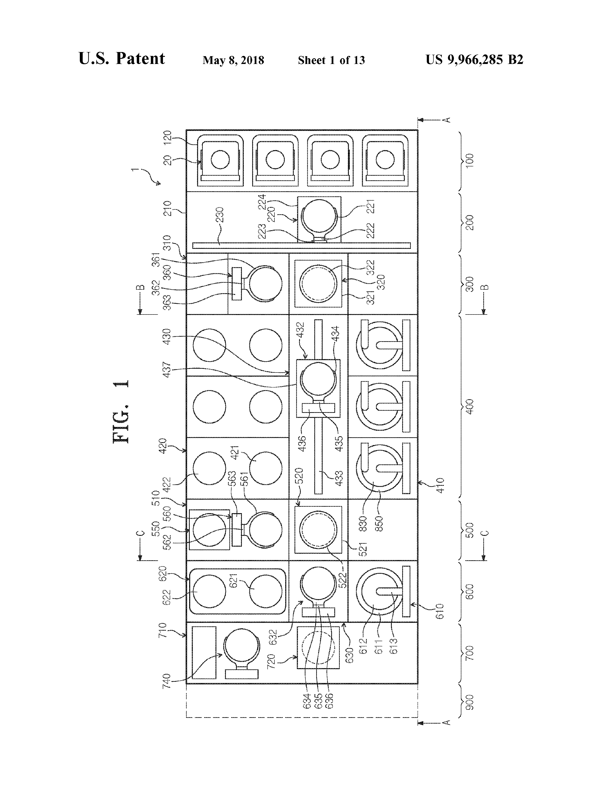
*도 1 — 기판 처리 설비 1의 평면 배치(로드 포트 100 ~ 인터페이스 모듈 700)*

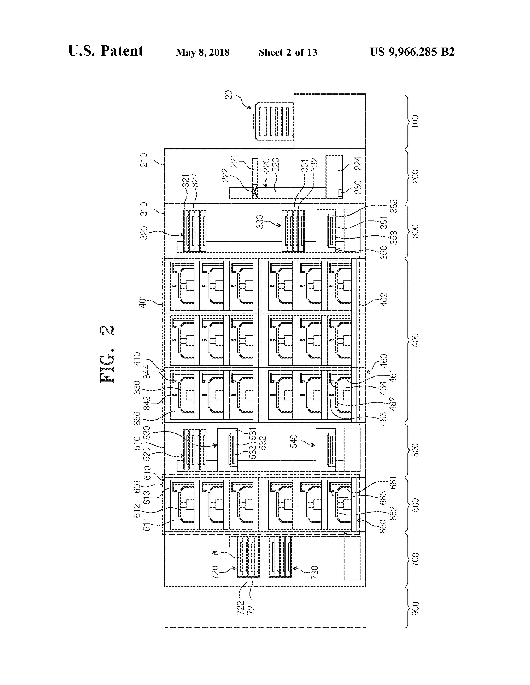
*도 2 — 도 1의 A-A 단면*

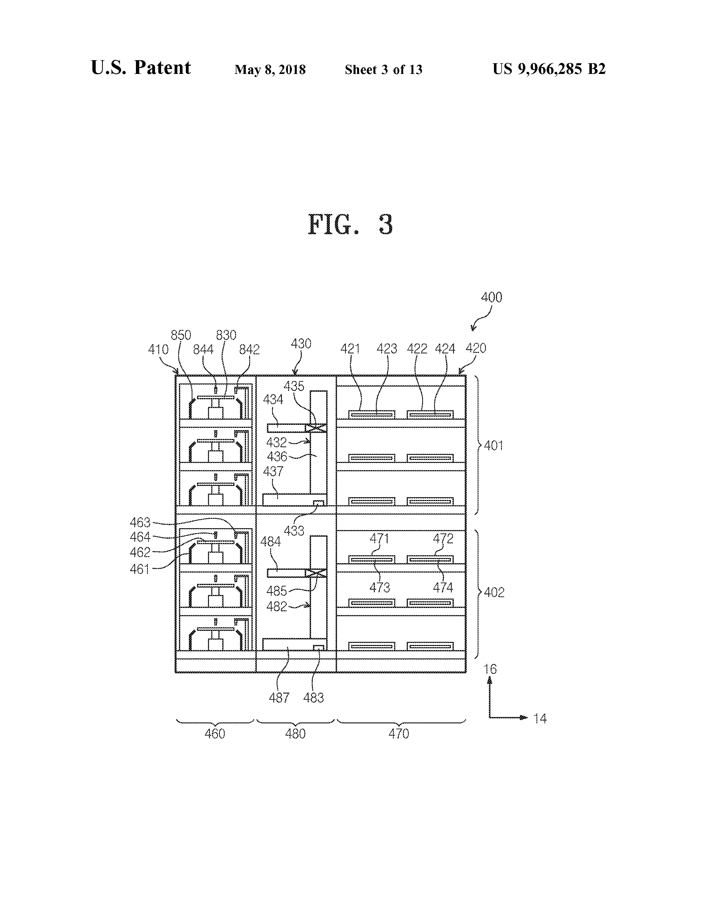
*도 3 — 도 1의 B-B 단면(도포/현상 모듈 400)*

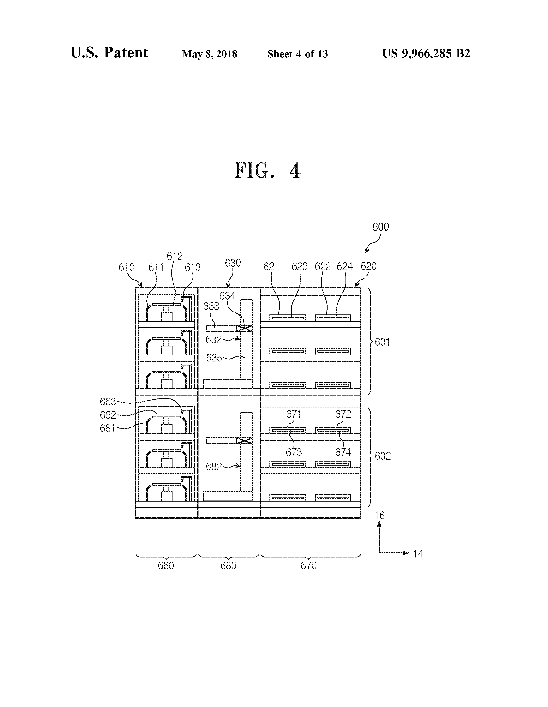
*도 4 — 도 1의 C-C 단면(노광 전후 처리 모듈 600)*

도 1 내지 4를 참조하면, 기판 처리 설비(1)는 로드 포트(100), 인덱스 모듈(200), 제1 버퍼 모듈(300), 도포/현상 모듈(400), 제2 버퍼 모듈(500), 노광 전후 처리 모듈(600), 인터페이스 모듈(700)을 포함한다. 로드 포트(100), 인덱스 모듈(200), 제1 버퍼 모듈(300), 도포/현상 모듈(400), 제2 버퍼 모듈(500), 노광 전후 처리 모듈(600), 인터페이스 모듈(700)은 한 방향으로 한 줄로 순차 배치된다.

이하 로드 포트(100), 인덱스 모듈(200), 제1 버퍼 모듈(300), 도포/현상 모듈(400), 제2 버퍼 모듈(500), 노광 전후 처리 모듈(600), 인터페이스 모듈(700)이 배치되는 방향을 제1 방향(12)이라 하고, 위에서 볼 때 제1 방향(12)에 수직인 방향을 제2 방향(14)이라 하며, 제1 방향(12)과 제2 방향(14)에 수직인 방향을 제3 방향(16)이라 한다.

기판(W)은 카세트(20)에 수용된 채로 이동된다. 이때 카세트(20)는 외부로부터 밀폐되는 구조를 가진다. 예컨대 전면에 도어를 가진 FOUP(front open unified pod)를 카세트(20)로 사용할 수 있다.

이하 로드 포트(100), 인덱스 모듈(200), 제1 버퍼 모듈(300), 도포/현상 모듈(400), 제2 버퍼 모듈(500), 노광 전후 처리 모듈(600), 인터페이스 모듈(700)을 자세히 설명한다.

로드 포트(100)는 기판(W)이 수용된 카세트(20)가 놓이는 캐리어(120)를 가진다. 복수의 캐리어(120)가 제공되며 제2 방향(14)을 따라 한 줄로 배치된다. 도 2에서는 네 개의 캐리어(120)가 제공된다.

인덱스 모듈(200)은 로드 포트(100)의 캐리어(120)에 놓인 카세트(20)와 제1 버퍼 모듈(300) 사이에서 기판(W)을 이송한다. 인덱스 모듈(200)은 프레임(210), 인덱스 로봇(220), 가이드 레일(230)을 가진다. 프레임(210)은 내부가 빈 대략 직육면체 형상을 가지며 로드 포트(100)와 제1 버퍼 모듈(300) 사이에 배치된다. 인덱스 모듈(200)의 프레임(210)은 뒤에서 설명할 제1 버퍼 모듈(300)의 프레임(310)보다 낮은 높이를 가질 수 있다. 인덱스 로봇(220)과 가이드 레일(230)은 프레임(210) 안에 배치된다. 인덱스 로봇(220)은 기판(W)을 직접 다루는 핸드(221)가 제1 방향(12), 제2 방향(14), 제3 방향(16)으로 이동 및 회전할 수 있도록 4축 구동 구조를 가진다. 인덱스 로봇(220)은 핸드(221), 암(222), 지지대(223), 받침대(224)를 가진다. 핸드(221)는 암(222)에 고정 설치된다. 암(222)은 신축 및 회전 가능한 구조를 가진다. 지지대(223)는 그 길이 방향이 제3 방향(16)을 따라 배치되도록 구성된다. 암(222)은 지지대(223)를 따라 이동 가능하도록 지지대(223)에 결합된다. 지지대(223)는 받침대(224)에 고정 결합된다. 가이드 레일(230)은 그 길이 방향이 제2 방향(14)을 따라 배치되도록 제공된다. 받침대(224)는 가이드 레일(230)을 따라 직선 이동 가능하도록 가이드 레일(230)에 결합된다. 도시하지 않았지만 프레임(210)에는 카세트(20)의 도어를 여닫는 도어 오프너가 더 마련된다.

제1 버퍼 모듈(300)은 프레임(310), 제1 버퍼(320), 제2 버퍼(330), 냉각 챔버(350), 제1 버퍼 로봇(360)을 가진다. 프레임(310)은 내부가 빈 직육면체 형상을 가지며 인덱스 모듈(200)과 도포/현상 모듈(400) 사이에 배치된다. 제1 버퍼(320), 제2 버퍼(330), 냉각 챔버(350), 제1 버퍼 로봇(360)은 프레임(310) 안에 위치한다. 냉각 챔버(350), 제2 버퍼(330), 제1 버퍼(320)는 아래에서부터 제3 방향(16)을 따라 순차 배치된다. 제1 버퍼(320)는 뒤에서 설명할 도포/현상 모듈(400)의 도포 모듈(401)에 대응하는 높이에 위치하고, 제2 버퍼(330)와 냉각 챔버(350)는 뒤에서 설명할 도포/현상 모듈(400)의 현상 모듈(402)에 대응하는 높이에 위치한다. 제1 버퍼 로봇(360)은 제2 버퍼(330), 냉각 챔버(350), 제1 버퍼(320)로부터 제2 방향(14)으로 소정 거리 떨어져 있다.

제1 버퍼(320)와 제2 버퍼(330)는 복수의 기판(W)을 일시 보관한다. 제2 버퍼(330)는 하우징(331)과 복수의 지지부(332)를 가진다. 지지부(332)는 하우징(331) 안에 배치되며 제3 방향(16)을 따라 서로 이격된다. 각 지지부(332)에 기판(W) 하나가 놓인다. 하우징(331)은 인덱스 로봇(220), 제1 버퍼 로봇(360), 뒤에서 설명할 현상 모듈(402)의 현상 로봇(482)이 하우징(331) 안의 지지부(332)로 기판(W)을 반입하거나 반출할 수 있도록, 인덱스 로봇(220)이 마련된 쪽, 제1 버퍼 로봇(360)이 마련된 쪽, 현상 로봇(482)이 마련된 쪽에 개구(도시 생략)를 가진다. 제1 버퍼(320)는 제2 버퍼(330)와 대체로 비슷한 구조를 가진다. 한편 제1 버퍼(320)의 하우징(321)은 제1 버퍼 로봇(360)이 마련된 쪽과 뒤에서 설명할 도포 모듈(401)에 위치한 도포 로봇(432)이 마련된 쪽에 개구를 가진다. 제1 버퍼(320)에 마련된 지지부(322)의 수와 제2 버퍼(330)에 마련된 지지부(332)의 수는 같거나 다를 수 있다. 일 실시예에 따르면, 제2 버퍼(330)에 마련된 지지부(332)의 수가 제1 버퍼(320)에 마련된 지지부(332)의 수보다 많을 수 있다.

제1 버퍼 로봇(360)은 제1 버퍼(320)와 제2 버퍼(330) 사이에서 기판(W)을 이송한다. 제1 버퍼 로봇(360)은 핸드(361), 암(362), 지지대(363)를 가진다. 핸드(361)는 암(362)에 고정 설치된다. 암(362)은 신축 구조를 가지며 핸드(361)가 제2 방향(14)을 따라 이동할 수 있게 한다. 암(362)은 지지대(363)를 따라 제3 방향(16)으로 직선 이동 가능하도록 지지대(363)에 결합된다. 지지대(363)는 제2 버퍼(330)에 대응하는 위치에서 제1 버퍼(320)에 대응하는 위치까지 연장된 길이를 가진다. 지지대(363)는 위나 아래로 더 길게 연장되도록 제공될 수 있다. 제1 버퍼 로봇(360)은 핸드(361)가 제2 방향(14)과 제3 방향(16)을 따라 단순히 2축 구동되도록 제공될 수 있다.

냉각 챔버(350)는 기판(W)을 냉각한다. 냉각 챔버(350)는 하우징(351)과 냉각 플레이트(352)를 가진다. 냉각 플레이트(352)는 기판(W)이 놓이는 상면과 기판(W)을 냉각하는 냉각 유닛(353)을 가진다. 냉각 유닛(353)으로는 냉각수를 이용하는 냉각 방식, 열전 소자를 이용하는 냉각 방식 등 다양한 방식을 쓸 수 있다. 냉각 챔버(350)에는 냉각 플레이트(352) 위에 기판(W)을 위치시키는 리프트 핀 조립체(도시 생략)가 마련될 수 있다. 하우징(351)은 인덱스 로봇(220)과 뒤에서 설명할 현상 모듈(402)에 마련된 현상 로봇(482)이 냉각 플레이트(352)로 기판(W)을 반입하거나 반출할 수 있도록, 인덱스 로봇(220)이 마련된 쪽과 현상 로봇(482)이 마련된 쪽에 개구(도시 생략)를 가진다. 냉각 챔버(350)에는 위의 개구들을 여닫는 도어(도시 생략)가 마련될 수 있다.

도포/현상 모듈(400)은 노광 공정 전에 기판(W)에 포토레지스트를 도포하는 공정과 노광 공정 뒤에 기판(W)을 현상하는 공정을 수행한다. 도포/현상 모듈(400)은 대체로 직육면체 형상을 가진다. 도포/현상 모듈(400)은 도포 모듈(401)과 현상 모듈(402)을 가진다. 도포 모듈(401)과 현상 모듈(402)은 서로 다른 층으로 구획되도록 배치될 수 있다. 한 예에 따르면, 도포 모듈(401)은 현상 모듈(402) 위에 위치한다.

도포 모듈(401)은 기판(W)에 포토레지스트 같은 감광액을 도포하는 공정과, 레지스트 도포 공정 전후에 기판(W)을 예컨대 가열·냉각하는 열처리 공정을 수행한다. 도포 모듈(401)은 레지스트 도포 챔버(410), 베이크 챔버(420), 반송 챔버(430)를 가진다. 레지스트 도포 챔버(410), 베이크 챔버(420), 반송 챔버(430)는 제2 방향(14)을 따라 순차 배치된다. 따라서 레지스트 도포 챔버(410)와 베이크 챔버(420)는 반송 챔버(430)를 사이에 두고 제2 방향(14)으로 서로 이격된다. 복수의 레지스트 도포 챔버(410)가 제공될 수 있으며, 제1 방향(12)과 제3 방향(16) 각각으로 복수의 레지스트 도포 챔버(410)가 제공될 수 있다. 도면에서는 예로서 여섯 개의 레지스트 도포 챔버(410)를 나타냈다. 제1 방향(12)과 제3 방향(16) 각각으로 복수의 베이크 챔버(420)가 제공될 수 있다. 도면에서는 예로서 여섯 개의 베이크 챔버(420)를 나타냈다. 그러나 이와 달리 더 많은 수의 베이크 챔버(420)가 제공될 수 있다.

반송 챔버(430)는 제1 방향(12)으로 제1 버퍼 모듈(300)의 제1 버퍼(320)와 나란히 위치한다. 반송 챔버(430) 안에는 도포 로봇(432)과 가이드 레일(433)이 위치할 수 있다. 반송 챔버(430)는 대체로 직사각형 형상을 가진다. 도포 로봇(432)은 베이크 챔버(420), 레지스트 도포 챔버(400), 제1 버퍼 모듈(300)의 제1 버퍼(320), 제2 버퍼 모듈(500)의 제1 냉각 챔버(520) 사이에서 기판(W)을 이송한다. 가이드 레일(433)은 그 길이 방향이 제1 방향(12)과 나란하도록 배치된다. 가이드 레일(433)은 도포 로봇(432)이 제1 방향(12)으로 직선 이동하도록 도포 로봇(432)을 안내한다.

이하 도 1 내지 5를 참조하여 도포 로봇(432)을 설명한다.

도포 로봇(432)은 개구(415)를 통해 레지스트 도포 챔버(410)로 들어간다. 도포 로봇(432)은 핸드(434), 암(435), 지지대(436), 받침대(437)를 가진다. 핸드(434)는 암(435)에 고정 설치된다. 기판은 핸드(434) 위에 안착된다. 암(435)은 핸드(434)가 수평 이동할 수 있도록 신축 구조를 가진다. 지지대(436)는 그 길이 방향이 제3 방향(16)을 따라 배치되도록 제공된다. 암(435)은 지지대(436)를 따라 제3 방향(16)으로 직선 이동 가능하도록 지지대(436)에 결합된다. 지지대(436)는 받침대(437)에 고정 결합되고, 받침대(437)는 가이드 레일(433)을 따라 이동 가능하도록 가이드 레일(433)에 결합된다.

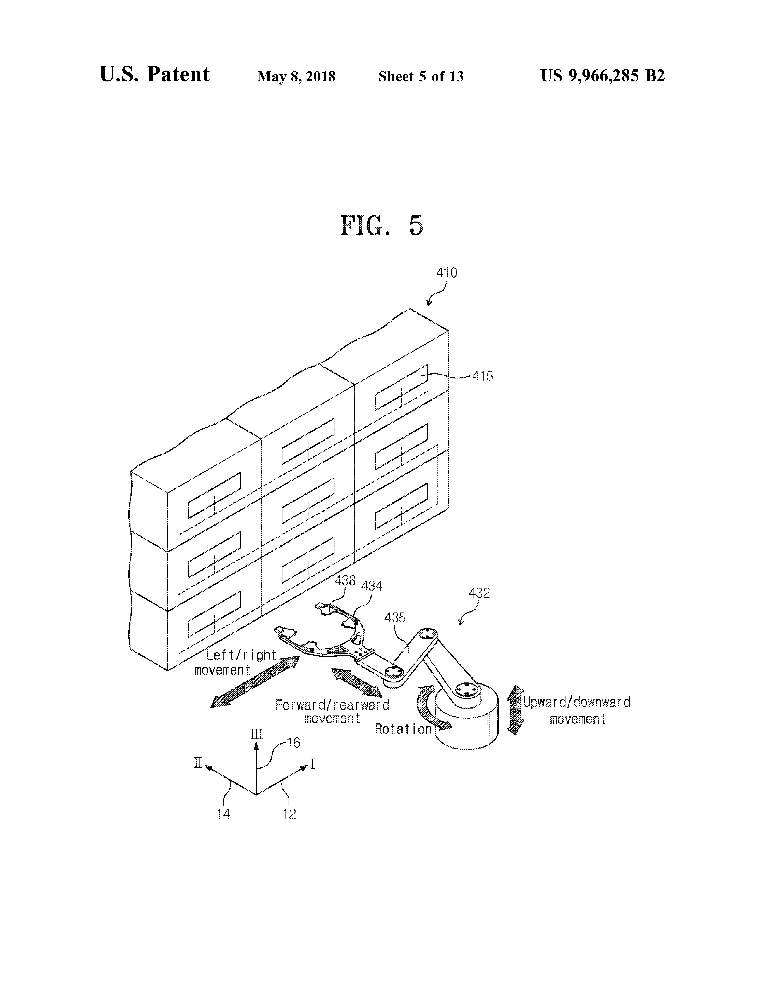
*도 5 — 도포 로봇 432: 핸드 434, 암 435, 지지대·받침대(좌우·전후·상하 이동과 회전)*

한편 뒤에서 설명하듯, 도포 로봇(432)은 본 발명의 개념의 실시예에 따른 기판 처리 장치(800)의 로봇(932)으로 제공될 수 있다.

레지스트 도포 챔버(410)는 기판(W)에 포토레지스트를 도포한다. 레지스트 도포 챔버(410)들은 같은 구조를 가진다. 그러나 레지스트 도포 챔버(410)들에서 쓰는 포토레지스트의 종류는 다를 수 있다. 예로서 포토레지스트는 화학 증폭형 레지스트일 수 있다.

레지스트 도포 챔버(410)는 본 발명의 개념의 실시예에 따른 기판 처리 장치(800)의 하우징(810)으로 제공될 수 있다.

이하 도 1 내지 6을 참조하여 기판 처리 장치(800)를 설명한다.

기판 처리 장치(800)는 티칭 공정, 액 도포 공정, 에지 비드 제거(EBR) 공정을 수행한다. 기판 처리 장치(800)는 하우징(810), 기류 제공 유닛(820), 기판 지지 유닛(830), 액 공급 유닛(840), 처리 용기(850), 승강 유닛(890), 로봇(932), 검출기(938), 제어기(940)를 포함한다.

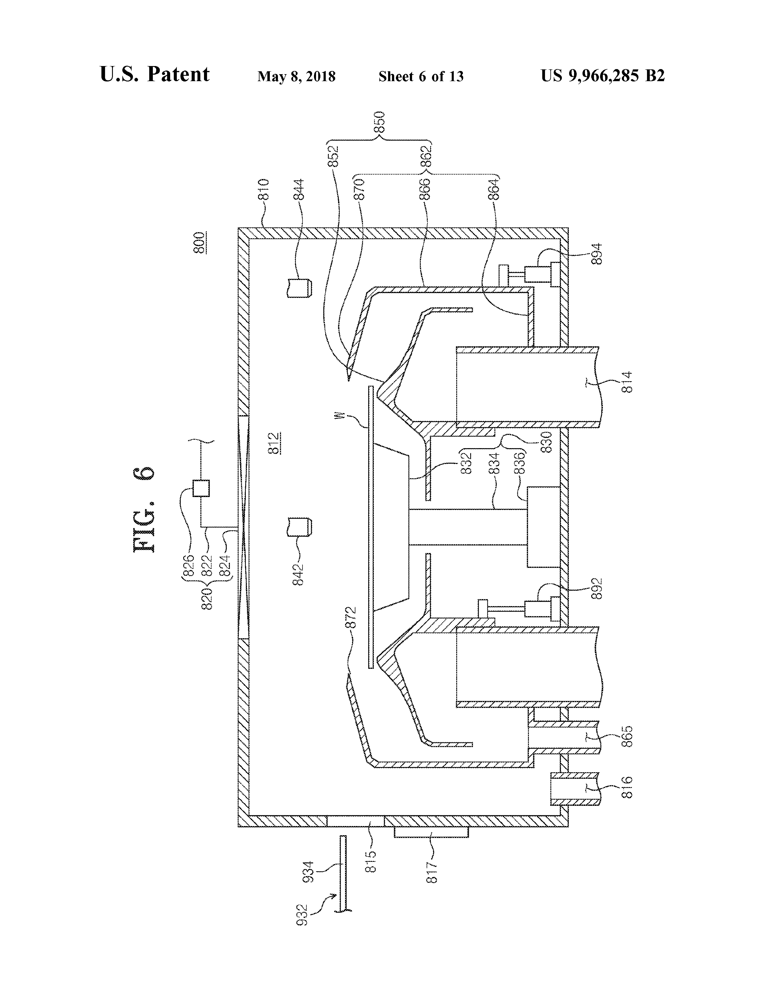
*도 6 — 기판 처리 장치 800: 하우징 810, 지지판 832, 회전축 834, 노즐 842·844, 처리 용기 850, 로봇 핸드 934*

하우징(810)은 내부에 공간(812)을 가진 직사각형 통 형상을 가진다. 하우징(810)의 한쪽 면에 개구(815)가 형성된다. 개구(815)는 로봇(932)이 기판(W)을 반입·반출하는 통로로 기능한다. 개구(815)에는 도어(817)가 설치되며, 도어(817)는 개구(815)를 여닫는다. 기판 처리 공정이 수행되면 도어가 개구(815)를 막아 하우징(810)의 내부 공간(812)을 닫는다. 하우징(810)의 하면에는 내측 배기구(814)와 외측 배기구(816)가 형성된다. 하우징(810) 안의 공기는 내측 배기구(814)와 외측 배기구(816)를 통해 외부로 배기된다. 한 예에 따르면, 처리 용기(850) 쪽으로 제공된 공기는 내측 배기구(814)를 통해 배기되고, 처리 용기(850) 바깥쪽으로 제공된 공기는 외측 배기구(816)를 통해 배기될 수 있다.

기류 제공 유닛(820)은 하우징(810)의 내부 공간에 하강 기류를 형성한다. 기류 제공 유닛(820)은 기류 공급 라인(822), 팬(824), 필터(826)를 포함한다. 기류 공급 라인(822)은 하우징(810)에 연결된다. 기류 공급 라인(822)은 외부 공기를 하우징(810) 안으로 공급한다. 필터(826)는 기류 공급 라인(822)에서 제공된 공기를 거른다. 필터(826)는 공기에 포함된 불순물을 제거한다. 팬(824)은 하우징(810)의 상면에 설치된다. 팬(824)은 하우징(810) 상면의 중앙 영역에 위치한다. 팬(824)은 하우징(810)의 내부 공간에 하강 기류를 형성한다. 기류 공급 라인(822)에서 팬(824)으로 공기가 공급되면 팬(824)은 공기를 아래로 공급한다.

기판 지지 유닛(830)은 하우징(810)의 내부 공간에서 기판(W)을 지지한다. 기판 지지 유닛(830)은 기판(W)을 회전시킨다. 기판 지지 유닛(830)은 지지판(832), 회전축(834), 구동기(836)를 포함한다. 지지판(832)은 원판 형상을 가진다. 기판(W)은 지지판(832)의 상면에 접촉한다. 지지판(832)은 기판(W)보다 작은 직경을 가진다. 한 예에 따르면, 지지판(832)은 기판(W)을 진공 흡착해 척킹할 수 있다. 선택적으로 지지판(832)은 정전기를 이용해 기판(W)을 척킹하는 정전 척으로 제공될 수 있다. 지지판(832)은 물리적 힘으로 기판(W)을 척킹할 수도 있다. 회전축(834)은 지지판(832) 아래에서 지지판(832)을 지지한다. 회전축(834)은 그 길이 방향이 위아래를 향하도록 제공된다. 회전축(834)은 그 중심축을 중심으로 회전 가능하게 제공된다. 구동기(836)는 회전축(834)이 회전하도록 구동력을 제공한다. 예컨대 구동기(836)는 모터일 수 있다.

액 공급 유닛(840)은 기판(W) 위에 처리액을 공급한다. 처리액은 감광액 또는 에지 비드 제거액일 수 있다. 액 공급 유닛(840)은 EBR 노즐(842)과 감광액 노즐(844)을 포함한다. EBR 노즐(842)은 기판(W) 위에 에지 비드 제거액을 공급하고, 감광액 노즐(844)은 기판(W) 위에 감광액을 공급한다. 예컨대 에지 비드 제거액은 감광액을 희석하는 액일 수 있다. 에지 비드 제거액은 용제이고, 포토레지스트액은 레지스트 같은 감광액일 수 있다. EBR 노즐(842)은 기판(W)의 중앙 위치와 주변 위치에서 에지 비드 제거액을 공급하고, 감광액 노즐(844)은 기판(W)의 중앙 위치에서 감광액을 공급한다. 여기서 중앙 위치는 노즐(842, 844)이 기판(W)의 중앙 영역을 마주하는 위치를 말하고, 주변 위치는 EBR 노즐(842)이 기판(W)의 주변 영역을 마주하는 위치를 말한다.

처리 용기(850)는 하우징(810)의 내부 공간(812)에 위치한다. 처리 용기(850)는 내부에 처리 공간을 가진다. 처리 용기(850)는 위가 열린 컵 형상을 가진다. 처리 용기(850)는 내측 컵(852)과 외측 컵(862)을 포함한다.

내측 컵(852)은 회전축(834)을 둘러싸는 원판 형상을 가진다. 내측 컵(852)은 위에서 볼 때 내측 배기구(814)와 겹치도록 위치한다.

외측 컵(862)은 기판 지지 유닛(830)과 내측 컵(852)을 둘러싸는 컵 형상을 가진다. 외측 컵(862)은 바닥벽(864), 측벽(866), 상부벽(870)을 가진다. 바닥벽(864)은 가운데가 빈 원판 형상을 가진다. 바닥벽(864)에는 회수 라인(865)이 형성된다. 회수 라인(865)은 기판(W) 위에 공급된 처리액을 회수한다. 회수 라인(865)으로 회수된 처리액은 외부 액 재생 시스템에서 재사용될 수 있다. 측벽(866)은 기판 지지 유닛(830)을 둘러싸는 원통 형상을 가진다. 측벽(866)은 바닥벽(864)의 측단에서 바닥벽(864)에 수직인 방향으로 연장된다. 측벽(866)은 바닥벽(864)에서 위로 연장된다.

상부벽(870)은 측벽(866)의 상단에서 외측 컵(862)의 안쪽을 향해 연장된다. 상부벽(870)은 기판 지지 유닛(830)에 가까워지도록 제공된다. 상부벽(870)은 링 형상을 가진다. 상부벽(870)의 상단은 기판 지지 유닛(830)에 지지된 기판(W)보다 높다.

승강 유닛(890)은 내측 컵(852)과 외측 컵(862)을 승강시킨다. 승강 유닛(890)은 내측 이동 부재(892)와 외측 이동 부재(894)를 포함한다. 내측 이동 부재(892)는 내측 컵(852)을 승강시키고, 외측 이동 부재(894)는 외측 컵(862)을 승강시킨다.

로봇(932)은 기판을 이송하며 개구(815)를 통해 지지판(832) 위에 기판을 위치시킨다. 로봇(932)은 앞서 설명한 도포 로봇(432)과 같거나 비슷할 수 있다.

검출기(938)는 로봇(932)의 핸드(934) 위에 위치한 기판의 편심값을 기판으로부터 검출한다. 검출기(938)는 센서 또는 카메라일 수 있다. 일 실시예에 따르면, 검출기(938)는 핸드(934)에 마련될 수 있다. 그러나 검출기(938)가 반드시 핸드(934)에 마련될 필요는 없다. 검출기(938)는 핸드(934) 위에 위치한 기판의 편심값을 검출할 수 있는 한 어느 곳에든 설치될 수 있다. 편심값은 지지판(832) 위에 위치한 기판의 중심에 관한 것이다. 편심값을 검출하려면 수학적으로 세 점 이상이 필요하다. 따라서 검출기(938)는 적어도 세 개 마련될 수 있다. 일 실시예에 따르면, 검출기(938)는 적어도 네 개 마련될 수 있다. 기판에 형성된 노치가 검출기(938)에 대응하는 부분에 위치하면 편심값을 검출할 수 없다. 따라서 이 경우에 대비해 적어도 네 개의 검출기(938)를 마련할 수 있다.

제어기(940)는 지지판(832)과 로봇(932)의 회전을 제어한다. 편심값은 로봇(932)으로 지지판(832) 위에 기판을 위치시키고, 지지판(832)을 설정 각도만큼 회전시키고, 지지판(832)에서 기판을 언로딩해 검출한다. 제어기(940)는 계산부(950)를 가진다. 계산부(950)는 편심값들을 이용해 로봇(932)의 위치를 설정한다.

다음으로 기판 처리 장치(800)를 이용해 기판(W)을 처리하는 과정을 설명한다. 로봇(932)의 위치를 설정하는 티칭 작업을 수행한 뒤, 기판에 액을 도포하는 기판 처리 공정을 수행한다.

이하 도 7 내지 13을 참조하여 기판을 이송하는 로봇(932)의 위치를 설정하는 티칭 방법을 설명한다. 도 7 내지 10의 기판에 있는 화살표는 기판이 회전함을 보이기 위해 기판의 방향을 나타낸다. 도 11은 티칭 방법의 단계를 나타낸다. 도 12와 13은 검출한 편심값의 수에 따라 로봇의 위치를 설정하는 방법을 나타내는 도면이다.

로봇(932)은 지지판(832) 위에 기판을 로딩하며, 개구(815)를 통해 지지판(832) 위에 기판을 위치시킨다. 기판은 티칭 지그일 수 있다. 한편 기판을 로딩하기 전에 핸드(934) 위 기판의 초기 편심값을 검출해 취득할 수 있다. 초기 편심값은 이송된 기판을 핸드(934) 위에서 바로 검출할 수 있다. 또는 이송된 기판을 지지판(832) 위에 로딩한 뒤 지지판(832)에서 언로딩한 후 핸드(934) 위에서 검출할 수 있다. 편심값은 센서나 카메라 같은 검출기(938)로 검출할 수 있다.

도 7 내지 10은 티칭 과정을 단계별로 나타낸다. 도 7 내지 10을 참조하여 티칭 과정을 설명한다. 제어기(940)를 이용해, 로봇(932)으로 지지판(832) 위에 기판을 로딩하고, 지지판(832)을 설정 각도만큼 회전시키고, 로봇(932)으로 지지판(832)에서 기판을 언로딩하고, 로봇(932)의 핸드(934) 위에 위치한 기판의 편심값을 측정하는 과정을 복수 회 반복할 수 있다. 예컨대 도 7과 8의 기판은 제2 방향(14)을 향한다. 그 뒤 기판이 회전한다. 따라서 도 9와 10의 기판은 제1 방향(12)을 향한다.

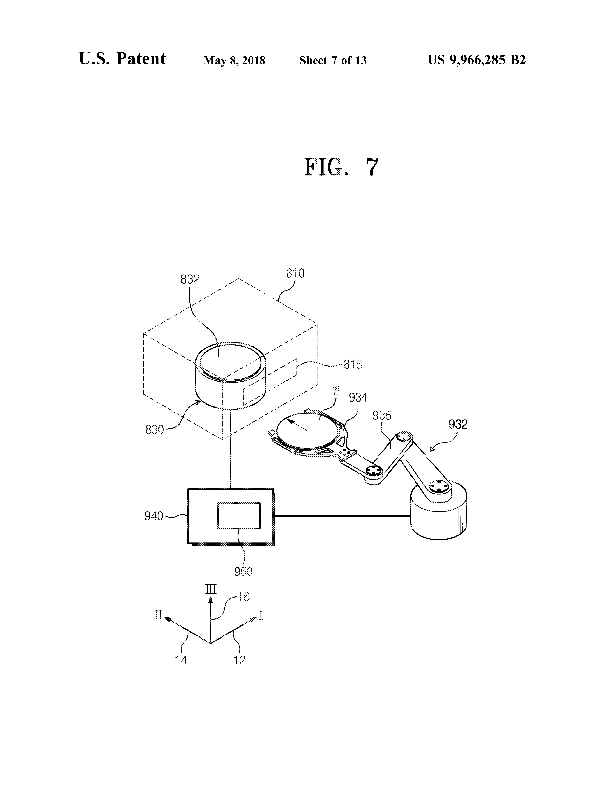
*도 7 — 로봇 핸드 934 위 기판 W를 지지판 832로 반입하기 전*

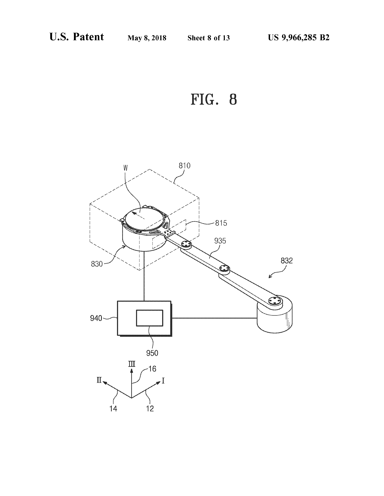
*도 8 — 기판을 지지판 832 위에 로딩*

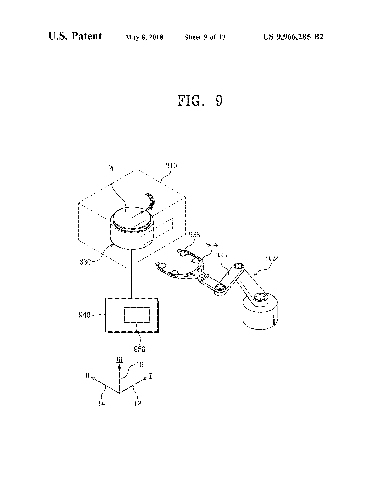
*도 9 — 지지판 회전 후 기판을 핸드로 언로딩(기판 방향이 바뀜)*

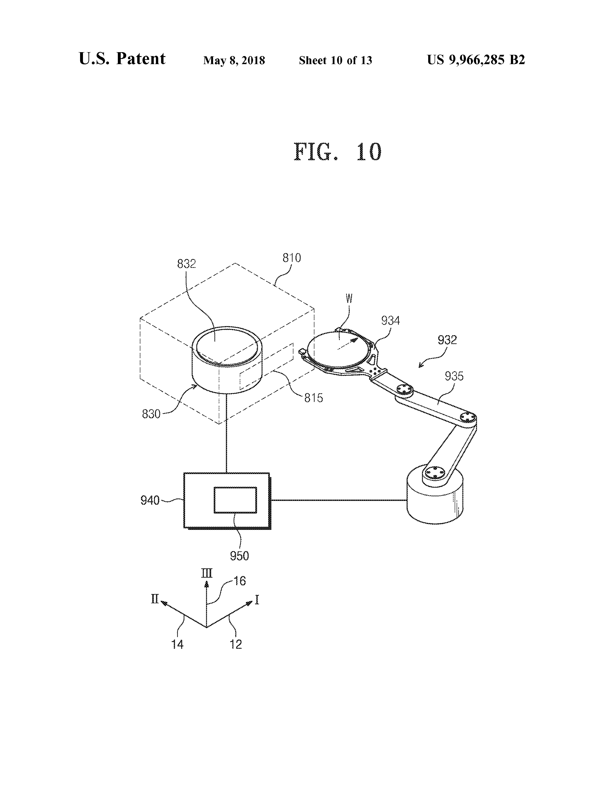
*도 10 — 회전된 기판이 핸드 위에서 편심값 검출 위치로 반출*

이 과정을 복수 회 반복해 복수의 편심값을 취득할 수 있다. 이때 설정 각도는 항상 같을 수 있다. 복수의 설정 각도의 합은 360도일 수 있다. 회전 방향은 한 방향이다.

일 실시예에 따르면, 적어도 세 편심값을 검출할 수 있다. 계산부(950)는 편심값들을 이용해 로봇(932)의 위치를 설정할 수 있다. 예로서 적어도 세 편심값을 검출할 수 있다. 기판을 지지판(832) 위에 로딩하기 전에 기판의 초기 편심값을 검출하면 과정은 두 번 수행된다. 예컨대 설정 각도를 120도로 하여 두 번 회전시킬 수 있다.

도 11을 참조하여 세 편심값을 검출했을 때 세 편심값을 이용해 로봇(932)의 위치를 설정하는 방법을 설명한다.

*도 11 — 세 편심값 P1·P2·P3(120° 간격)를 지나는 원의 중심 C1과 P1-C1 오프셋*

일반적으로 세 점을 모두 지나는 원은 수학적 방법으로 구할 수 있다. 따라서 계산부(950)를 통해 수학적 계산 방법으로 세 편심값을 모두 지나는 원을 구할 수 있다. 세 편심값 중 초기 편심값을 P1, 다음 편심값을 P2, 마지막 편심값을 P3라 한다. P1, P2, P3를 모두 지나는 원의 중심점을 C1이라 한다. 로봇(932)의 위치는 C1이 지지판(832)의 중심에 대응하도록 설정될 수 있다. 먼저 P1과 C1 사이의 오프셋을 계산한다. 또한 로봇(932)의 초기 설정 티칭 값을 그 오프셋을 반영해 보정한다. 이렇게 로봇(932)의 새 위치를 설정할 수 있다. 그 뒤 보정한 설정 티칭 값을 이용해 기판을 지지판(832)으로 정밀하게 이송할 수 있다.

예로서 네 편심값을 검출할 수 있다. 계산부(950)는 편심값들을 이용해 로봇(932)의 위치를 설정할 수 있다. 초기 편심값을 검출하는 경우 복수 회는 세 번이다.

취득한 네 편심값 중 두 편심값의 두 세트를 서로 연결하고, 그 연결선이 서로 교차해 교차점을 이룬다. 로봇(932)의 위치는 그 교차점이 지지판(832)의 중심에 대응하도록 설정된다.

예컨대 지지판(932)을 90도씩 회전시켜 네 편심값을 검출할 수 있다. 도 12 내지 13을 참조하여 로봇(932)의 위치를 설정하는 방법을 설명한다.

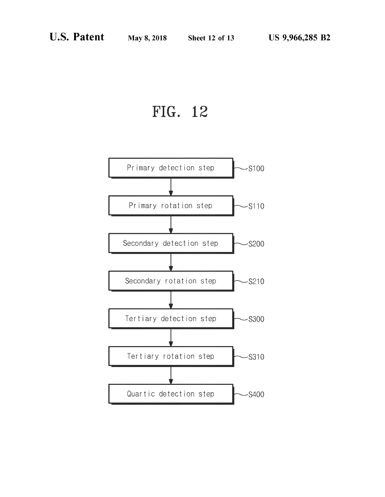
*도 12 — 네 편심값 티칭 흐름도: 1차 검출 S100 → 1차 회전 S110 → 2차 검출 S200 → 2차 회전 S210 → 3차 검출 S300 → 3차 회전 S310 → 4차 검출 S400*

이 방법은 기판이 로봇(932)의 핸드(934) 위에 있는 동안 기판의 1차 편심값을 검출하는 1차 검출 단계(S100), 기판을 지지판(832) 위에 위치시키고 지지판(832)을 90도 회전시키는 1차 회전 단계(S110), 기판이 지지판(832)에서 언로딩되어 로봇(932)의 핸드(934) 위에 있는 동안 기판의 2차 편심값을 검출하는 2차 검출 단계(S200), 기판을 지지판(832) 위에 위치시키고 지지판(832)을 90도 회전시키는 2차 회전 단계(S210), 기판이 지지판(832)에서 언로딩되어 로봇(932)의 핸드(934) 위에 있는 동안 기판의 3차 편심값을 검출하는 3차 검출 단계(S300), 기판을 지지판(832) 위에 위치시키고 지지판(832)을 90도 회전시키는 3차 회전 단계(S310), 그리고 기판이 지지판(832)에서 언로딩되어 로봇(932)의 핸드(934) 위에 있는 동안 기판의 4차 편심값을 검출하는 4차 검출 단계(S400)를 포함할 수 있다.

1차 편심값은 앞서 설명한 초기 편심값과 같은 의미이다. 1차 편심값을 Q1, 2차 편심값을 Q2, 3차 편심값을 Q3, 4차 편심값을 Q4라 한다. 또한 1차 편심값과 3차 편심값을 잇는 제1 선을 L1, 2차 편심값과 4차 편심값을 잇는 제2 선을 L2라 한다. L1과 L2의 교차점을 C2라 한다. 1차 편심값 Q1과 3차 편심값 Q3를 잇는 제1 선 L1과 2차 편심값 Q2와 4차 편심값 Q4를 잇는 제2 선 L2가 서로 교차할 때 교차점 C2가 형성된다. 로봇(932)의 위치는 C2가 지지판(832)의 중심에 대응하도록 설정될 수 있다. 먼저 Q1과 C2 사이의 오프셋을 계산한다. 또한 로봇(932)의 초기 티칭 설정값을 그 오프셋을 반영해 보정한다. 이렇게 로봇(932)의 새 위치를 설정할 수 있다. 그 뒤 보정한 설정 티칭 값을 이용해 기판을 지지판(832)으로 정밀하게 이송할 수 있다.

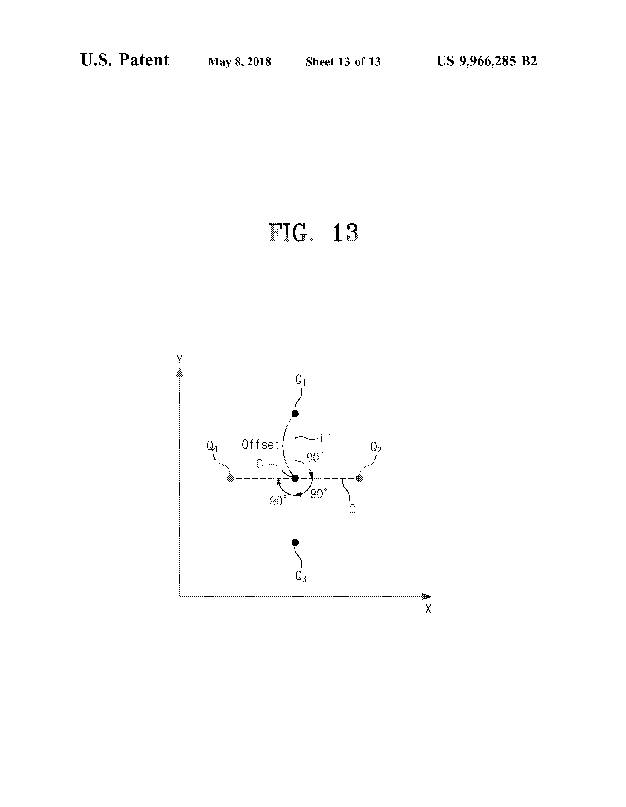
*도 13 — 90° 간격 네 편심값 Q1~Q4, Q1-Q3 선 L1과 Q2-Q4 선 L2의 교차점 C2, Q1-C2 오프셋*

앞서 설명한 로봇(932)의 티칭 방법은 도포 로봇(432)에 한정되지 않으며, 공정 처리 챔버로 기판을 이송하는 모든 기판 이송 로봇에 적용될 수 있고, 세정 공정 등 다른 공정을 수행하는 기판 처리 설비에도 적용될 수 있다.

또한 위의 설명에서는 본 발명의 개념이 복수의 챔버가 적층된 구조의 기판 처리 설비에 적용된 것을 예시했지만, 챔버가 하나인 기판 처리 설비에도 적용될 수 있다.

위에서 설명한 바와 같이 티칭 작업을 완료한 뒤 로봇(932)을 이용해 기판을 지지판(832) 위로 이송한다. 기판이 지지판(832) 위에 놓이면 기판을 처리하는 공정이 수행된다. 기판 처리 공정에서는 액 도포 단계와 에지 비드 제거 단계가 순차 수행된다.

액 도포 단계는 기판(W) 상면 전체 영역에 감광액을 도포하는 단계이다. 감광액은 감광액 노즐(844)에 의해 기판(W)의 중앙 영역에 공급되어 기판(W) 상면 전체 영역에 도포된다. 감광액 공급이 끝나면 에지 비드 제거 단계가 수행된다. 에지 비드 제거 단계는 기판(W) 상면 주변 영역에 도포된 에지 비드, 즉 감광액을 제거하는 단계이다. 에지 비드 제거 단계에서는 EBR 노즐(842)이 기판(W)의 주변 영역에 에지 비드 제거액을 공급한다. 기판(W) 위에 도포된 감광액은 에지 비드 제거액에 의해 제거된다.

다시 도 1 내지 4를 참조하면, 베이크 챔버(420)는 기판(W)을 열처리한다. 예컨대 베이크 챔버(420)들은 포토레지스트를 도포하기 전에 기판(W)을 소정 온도로 가열해 기판(W) 표면의 유기물과 수분을 제거하는 프리베이크 공정, 또는 기판(W)에 포토레지스트를 도포한 뒤 수행하는 소프트 베이크 공정을 수행하고, 가열 공정 뒤 기판(W)을 냉각하는 냉각 공정을 수행한다. 베이크 챔버(420)는 냉각 플레이트(421)와 가열 플레이트(422)를 가진다. 냉각 플레이트(421)에는 냉각수나 열전 소자 같은 냉각 유닛(423)이 마련된다. 가열 플레이트(422)에는 열선이나 열전 소자 같은 가열 유닛(424)이 마련된다. 냉각 플레이트(421)와 가열 플레이트(422)는 한 베이크 챔버(420) 안에 마련될 수 있다. 선택적으로 일부 베이크 챔버(420)는 냉각 플레이트(421)만 포함하고, 일부 베이크 챔버(420)는 가열 플레이트(422)만 포함할 수 있다.

현상 모듈(402)은 기판(W)에 패턴을 얻기 위해 현상액을 공급해 포토레지스트를 제거하는 공정과, 현상 공정 전후에 기판(W)에 수행하는 가열·냉각 같은 열처리 공정을 포함한다. 현상 모듈(402)은 현상 챔버(460), 베이크 챔버(470), 반송 챔버(480)를 가진다. 현상 챔버(460), 베이크 챔버(470), 반송 챔버(480)는 제2 방향(14)을 따라 순차 배치된다. 따라서 현상 챔버(460)와 베이크 챔버(470)는 반송 챔버(480)를 사이에 두고 제2 방향(14)으로 서로 이격된다. 복수의 현상 챔버(460)가 제공될 수 있으며, 제1 방향(12)과 제3 방향(16) 각각으로 복수의 현상 챔버(460)가 제공될 수 있다. 도면에서는 예로서 여섯 개의 현상 챔버(460)를 나타냈다. 제1 방향(12)과 제3 방향(16) 각각으로 복수의 베이크 챔버(470)가 제공될 수 있다. 도면에서는 예로서 여섯 개의 베이크 챔버(470)를 나타냈다. 그러나 이와 달리 더 많은 수의 베이크 챔버(470)가 제공될 수 있다.

반송 챔버(480)는 제1 방향(12)으로 제1 버퍼 모듈(300)의 제2 버퍼(330)와 나란히 위치한다. 반송 챔버(480) 안에는 현상 로봇(482)과 가이드 레일(483)이 위치할 수 있다. 반송 챔버(480)는 대체로 직사각형 형상을 가진다. 현상 로봇(482)은 베이크 챔버(470), 현상 챔버(460), 제1 버퍼 모듈(300)의 제2 버퍼(330)와 냉각 챔버(350), 제2 버퍼 모듈(500)의 제2 냉각 챔버(540) 사이에서 기판(W)을 이송한다. 가이드 레일(483)은 그 길이 방향이 제1 방향(12)과 나란하도록 배치된다. 가이드 레일(483)은 현상 로봇(432)이 제1 방향(12)으로 직선 이동하도록 현상 로봇(482)을 안내한다. 현상 로봇(482)은 핸드(484), 암(485), 지지대(486), 받침대(487)를 가진다. 핸드(484)는 암(485)에 고정 설치된다. 암(485)은 핸드(484)가 수평 이동할 수 있도록 신축 구조를 가진다. 지지대(486)는 그 길이 방향이 제3 방향(16)을 따라 배치되도록 제공된다. 암(485)은 지지대(486)를 따라 제3 방향(16)으로 직선 이동 가능하도록 지지대(486)에 결합된다. 지지대(486)는 받침대(487)에 고정 결합된다. 받침대(487)는 가이드 레일(483)을 따라 직선 이동 가능하도록 가이드 레일(483)에 결합된다.

현상 챔버(460)들은 같은 구조를 가진다. 그러나 현상 챔버(460)들에서 쓰는 현상액의 종류는 다를 수 있다. 현상 챔버(460)는 기판(W) 위 포토레지스트 중 빛이 조사된 영역을 제거한다. 이때 보호막 중 빛이 조사된 영역도 함께 제거된다. 선택적으로 사용하는 포토레지스트의 종류에 따라 포토레지스트와 보호막 중 빛이 조사되지 않은 영역만 제거될 수 있다.

현상 챔버(460)는 용기(461), 지지판(462), 노즐(463)을 가진다. 용기(461)는 위가 열린 컵 형상을 가진다. 지지판(462)은 용기(461) 안에 위치하며 기판(W)을 지지한다. 지지판(462)은 회전 가능하게 제공될 수 있다. 노즐(463)은 지지판(462) 위에 놓인 기판(W)에 현상액을 공급한다. 노즐(463)은 원형 관 형상을 가질 수 있으며 기판(W)의 중심에 현상액을 공급할 수 있다. 선택적으로 노즐(463)은 기판(W)의 직경에 해당하는 길이를 가질 수 있으며, 노즐(463)의 토출구는 슬릿일 수 있다. 현상 챔버(460)에는 현상액이 추가로 공급된 기판(W)의 표면을 세정하기 위해 탈이온수 같은 세정액을 공급하는 노즐(464)이 더 마련될 수 있다.

베이크 챔버(470)는 기판(W)을 열처리한다. 예컨대 베이크 챔버(470)들은 현상 공정 전에 기판(W)을 가열하는 포스트 베이크 공정, 현상 공정 뒤에 기판(W)을 가열하는 하드 베이크 공정, 그리고 베이크 공정 뒤 가열된 기판을 냉각하는 냉각 공정을 수행할 수 있다. 베이크 챔버(470)는 냉각 플레이트(471)와 가열 플레이트(472)를 가진다. 냉각 플레이트(471)에는 냉각수나 열전 소자 같은 냉각 유닛(473)이 마련된다. 가열 플레이트(472)에는 열선이나 열전 소자 같은 가열 유닛(474)이 마련된다. 냉각 플레이트(471)와 가열 플레이트(472)는 한 베이크 챔버(470) 안에 마련될 수 있다. 선택적으로 일부 베이크 챔버(470)는 냉각 플레이트(471)만 포함하고, 일부 베이크 챔버(470)는 가열 플레이트(472)만 포함할 수 있다.

위에서 설명한 바와 같이, 도포/현상 모듈(400)은 도포 모듈(401)과 현상 모듈(402)이 분리되도록 제공된다. 위에서 볼 때 도포 모듈(401)과 현상 모듈(402)은 같은 챔버 배치를 가질 수 있다.

제2 버퍼 모듈(500)은 도포/현상 모듈(400)과 노광 전후 처리 모듈(600) 사이에서 기판(W)이 이송되는 통로로 제공된다. 제2 버퍼 모듈(500)은 기판(W)에 냉각 공정이나 에지 노광 공정 같은 공정을 수행한다. 제2 버퍼 모듈(500)은 프레임(510), 버퍼(520), 제1 냉각 챔버(530), 제2 냉각 챔버(540), 에지 노광 챔버(550), 제2 버퍼 로봇(560)을 가진다. 프레임(510)은 직육면체 형상을 가진다. 버퍼(520), 제1 냉각 챔버(530), 제2 냉각 챔버(540), 에지 노광 챔버(550), 제2 버퍼 로봇(560)은 프레임(510) 안에 위치한다. 버퍼(520), 제1 냉각 챔버(530), 에지 노광 챔버(550)는 도포 모듈(401)에 대응하는 높이에 배치된다. 제2 냉각 챔버(540)는 현상 모듈(402)에 대응하는 높이에 배치된다. 버퍼(520), 제1 냉각 챔버(530), 제2 냉각 챔버(540)는 제3 방향(16)을 따라 한 줄로 배치된다. 위에서 볼 때 버퍼(520)는 제1 방향(12)으로 도포 모듈(401)의 반송 챔버(430)를 따라 배치된다. 에지 노광 챔버(550)는 버퍼(520) 또는 제1 냉각 챔버(530)로부터 제2 방향(14)으로 소정 거리 이격된다.

제2 버퍼 로봇(560)은 버퍼(520), 제1 냉각 챔버(530), 에지 노광 챔버(550) 사이에서 기판(W)을 이송한다. 제2 버퍼 로봇(560)은 에지 노광 챔버(550)와 버퍼(520) 사이에 위치한다. 제2 버퍼 로봇(560)은 제1 버퍼 로봇(360)과 비슷한 구조를 가질 수 있다.

제1 냉각 챔버(530)와 에지 노광 챔버(550)는 도포 모듈(401)이 공정을 수행한 기판(W)에 후속 공정을 수행한다. 제1 냉각 챔버(530)는 도포 모듈(401)이 공정을 수행한 기판(W)을 냉각한다. 제1 냉각 챔버(530)는 제1 버퍼 모듈(300)의 냉각 챔버(350)와 비슷한 구조를 가진다. 에지 노광 챔버(550)는 제1 냉각 챔버(530)가 냉각 공정을 수행한 기판(W)의 둘레를 노광한다. 버퍼(520)는 에지 노광 챔버(550)가 공정을 수행한 기판(W)을 뒤에서 설명할 전처리 모듈(601)로 이송하기 전에 일시 보관한다. 제2 냉각 챔버(540)는 뒤에서 설명할 후처리 모듈(602)이 공정을 수행한 기판(W)을 현상 모듈(402)로 이송하기 전에 냉각한다. 제2 버퍼 모듈(500)은 현상 모듈(402)에 대응하는 높이에 버퍼를 더 가질 수 있다. 이 경우 후처리 모듈(602)이 공정을 수행한 기판(W)은 추가된 버퍼에 일시 보관된 뒤 현상 모듈(402)로 이송될 수 있다.

노광 장치(900)가 액침 노광 공정을 수행하는 경우, 노광 전후 처리 모듈(600)은 액침 노광 공정 동안 기판(W)에 도포된 포토레지스트막을 보호하는 보호막을 도포하는 공정을 수행할 수 있다. 노광 전후 처리 모듈(600)은 노광 공정 뒤 기판(W)을 세정하는 공정을 수행할 수 있다. 또한 화학 증폭형 레지스트를 이용해 도포 공정을 수행하는 경우, 노광 전후 처리 모듈(600)은 노광 공정 뒤 베이크 공정을 수행할 수 있다.

노광 전후 처리 모듈(600)은 전처리 모듈(601)과 후처리 모듈(602)을 가진다. 전처리 모듈(601)은 노광 공정 전에 기판(W)을 처리하는 공정을 수행하고, 후처리 모듈(602)은 노광 공정 뒤에 기판(W)을 처리하는 공정을 수행한다. 전처리 모듈(601)과 후처리 모듈(602)은 서로 다른 층으로 구획되도록 배치될 수 있다. 한 예에 따르면, 전처리 모듈(601)은 후처리 모듈(602) 위에 위치한다. 전처리 모듈(601)은 도포 모듈(401)과 같은 높이를 가진다. 후처리 모듈(602)은 현상 모듈(402)과 같은 높이를 가진다. 전처리 모듈(601)은 보호막 도포 챔버(610), 베이크 챔버(620), 반송 챔버(630)를 가진다. 보호막 도포 챔버(610), 반송 챔버(630), 베이크 챔버(620)는 제2 방향(14)을 따라 순차 배치된다. 따라서 보호막 도포 챔버(610)와 베이크 챔버(620)는 반송 챔버(630)를 사이에 두고 제2 방향(14)으로 서로 이격된다. 복수의 보호막 도포 챔버(610)가 제공되며, 복수의 보호막 도포 챔버(610)는 제3 방향(16)을 따라 배치되어 서로 다른 층을 이룬다. 선택적으로 제1 방향(12)과 제3 방향(16) 각각으로 복수의 보호막 도포 챔버(610)가 제공될 수 있다. 복수의 베이크 챔버(620)가 제공되며, 복수의 베이크 챔버(610)는 제3 방향(16)을 따라 배치되어 서로 다른 층을 이룬다. 선택적으로 제1 방향(12)과 제3 방향(16) 각각으로 복수의 베이크 챔버(620)가 제공될 수 있다.

반송 챔버(630)는 제1 방향(12)으로 제2 버퍼 모듈(500)의 제1 냉각 챔버(530)와 나란히 위치한다. 반송 챔버(630) 안에는 전처리 로봇(632)이 위치한다. 반송 챔버(630)는 대체로 정사각형 또는 직사각형 형상을 가진다. 전처리 로봇(632)은 보호막 도포 챔버(610), 베이크 챔버(620), 제2 버퍼 모듈(500)의 버퍼(520), 뒤에서 설명할 인터페이스 모듈(700)의 제1 버퍼(720) 사이에서 기판(W)을 이송한다. 전처리 로봇(632)은 핸드(633), 암(634), 지지대(635)를 가진다. 핸드(633)는 암(634)에 고정 설치된다. 암(634)은 신축 및 회전 가능한 구조를 가진다. 암(634)은 지지대(635)를 따라 제3 방향(16)으로 직선 이동 가능하도록 지지대(635)에 결합된다.

보호막 도포 챔버(610)는 액침 노광 공정 동안 레지스트막을 보호하는 보호막을 기판(W)에 도포한다. 보호막 도포 챔버(610)는 하우징(611), 지지판(612), 노즐(613)을 가진다. 하우징(611)은 위가 열린 컵 형상을 가진다. 지지판(612)은 하우징(611) 안에 위치하며 기판(W)을 지지한다. 지지판(612)은 회전 가능하게 제공될 수 있다. 노즐(613)은 지지판(612) 위에 놓인 기판(W)에 보호막을 형성하기 위한 보호액을 공급한다. 노즐(613)은 원형 관 형상을 가지며 기판(W)의 중심에 보호액을 공급할 수 있다. 선택적으로 노즐(613)은 기판(W)의 직경에 해당하는 길이를 가질 수 있으며, 노즐(613)의 토출구는 슬릿일 수 있다. 이 경우 지지판(612)은 고정된 상태로 제공될 수 있다. 보호액은 팽창성 물질을 포함한다. 보호액은 포토레지스트와 물에 대한 친화력이 낮은 물질일 수 있다. 예컨대 보호액은 불소계 용제를 포함할 수 있다. 보호막 도포 챔버(610)는 지지판(612) 위에 놓인 기판(W)을 회전시키면서 기판(W)의 중앙 영역에 보호액을 공급한다.

베이크 챔버(620)는 보호막이 도포된 기판(W)을 열처리한다. 베이크 챔버(620)는 냉각 플레이트(621)와 가열 플레이트(622)를 가진다. 냉각 플레이트(621)에는 냉각수나 열전 소자 같은 냉각 유닛(623)이 마련된다. 가열 플레이트(622)에는 열선이나 열전 소자 같은 가열 유닛(624)이 마련된다. 가열 플레이트(622)와 냉각 플레이트(621)는 한 베이크 챔버(620) 안에 마련될 수 있다. 선택적으로 일부 베이크 챔버(620)는 가열 플레이트(622)만 포함하고, 일부 베이크 챔버(620)는 냉각 플레이트(621)만 포함할 수 있다.

후처리 모듈(602)은 세정 챔버(660), 노광 후 베이크 챔버(670), 반송 챔버(680)를 가진다. 세정 챔버(660), 반송 챔버(680), 노광 후 챔버(670)는 제2 방향(14)을 따라 순차 배치된다. 따라서 세정 챔버(660)와 노광 후 베이크 챔버(670)는 반송 챔버(680)를 사이에 두고 제2 방향(14)으로 서로 이격된다. 복수의 세정 챔버(660)가 제공되며, 복수의 세정 챔버(610)는 제3 방향(16)을 따라 배치되어 서로 다른 층을 이룬다. 선택적으로 제1 방향(12)과 제3 방향(16) 각각으로 복수의 세정 챔버(660)가 제공될 수 있다. 복수의 노광 후 베이크 챔버(670)가 제공되며, 복수의 노광 후 베이크 챔버(610)는 제3 방향(16)을 따라 배치되어 서로 다른 층을 이룬다. 선택적으로 제1 방향(12)과 제3 방향(16) 각각으로 복수의 노광 후 베이크 챔버(670)가 제공될 수 있다.

위에서 볼 때 반송 챔버(680)는 제1 방향(12)으로 제2 버퍼 모듈(500)의 제2 냉각 챔버(540)와 나란히 위치한다. 반송 챔버(680)는 대체로 정사각형 또는 직사각형 형상을 가진다. 반송 챔버(680) 안에는 후처리 로봇(682)이 위치한다. 후처리 로봇(682)은 세정 챔버(660), 노광 후 베이크 챔버(670), 제2 버퍼 모듈(500)의 제2 냉각 챔버(540), 뒤에서 설명할 인터페이스 모듈(700)의 제2 버퍼(730) 사이에서 기판(W)을 이송한다. 후처리 모듈(602)에 마련된 후처리 로봇(682)은 전처리 모듈(601)에 마련된 전처리 로봇(632)과 같은 구조를 가질 수 있다.

세정 챔버(660)는 노광 공정 뒤 기판(W)을 세정한다. 세정 챔버(660)는 하우징(661), 지지판(662), 노즐(663)을 가진다. 하우징(661)은 위가 열린 컵 형상을 가진다. 지지판(662)은 하우징(661) 안에 위치하며 기판(W)을 지지한다. 지지판(662)은 회전 가능하게 제공될 수 있다. 노즐(663)은 지지판(662) 위에 놓인 기판(W)에 세정액을 공급한다. 세정액은 탈이온수 같은 물일 수 있다. 세정 챔버(660)는 지지판(662) 위에 놓인 기판(W)을 회전시키면서 기판(W)의 중앙 영역에 세정액을 공급한다. 선택적으로 기판(W)이 회전하는 동안 노즐(663)이 기판(W)의 중앙 영역에서 주변 영역으로 직선 이동하거나 회전할 수 있다.

노광 공정 뒤 베이크 챔버(670)는 노광 공정이 수행된 기판(W)을 원적외선으로 가열한다. 노광 공정 뒤 베이크 공정에서는 노광 공정으로 포토레지스트에 생긴 산을 증폭시켜 포토레지스트의 특성 변화를 완료하도록 기판(W)을 가열한다. 노광 공정 뒤 베이크 챔버(670)는 가열 플레이트(672)를 가진다. 가열 플레이트(672)에는 열선이나 열전 소자 같은 가열 유닛(674)이 마련된다. 노광 공정 뒤 베이크 챔버(670)의 내부에는 냉각 플레이트(671)가 더 마련될 수 있다. 냉각 플레이트(671)에는 냉각수나 열전 소자 같은 냉각 유닛(673)이 마련된다. 선택적으로 냉각 플레이트(671)만 가진 베이크 챔버가 더 마련될 수 있다.

위에서 설명한 바와 같이 노광 전후 처리 모듈(600)은 전처리 모듈(601)과 후처리 모듈(602)이 서로 완전히 분리되도록 제공된다. 전처리 모듈(601)의 반송 챔버(630)와 후처리 모듈(602)의 반송 챔버(680)는 같은 크기를 가질 수 있으며, 위에서 볼 때 서로 완전히 겹칠 수 있다. 보호막 도포 챔버(610)와 세정 챔버(660)는 같은 크기를 가질 수 있으며, 위에서 볼 때 서로 완전히 겹칠 수 있다. 베이크 챔버(620)와 노광 후 챔버(670)는 같은 크기를 가질 수 있으며, 위에서 볼 때 서로 완전히 겹칠 수 있다.

인터페이스 모듈(700)은 노광 전후 처리 모듈(600)과 노광 장치(900) 사이에서 기판(W)을 이송한다. 인터페이스 모듈(700)은 프레임(710), 제1 버퍼(720), 제2 버퍼(730), 인터페이스 로봇(740)을 가진다. 제1 버퍼(720), 제2 버퍼(730), 인터페이스 로봇(740)은 프레임(710) 안에 위치한다. 제1 버퍼(720)와 제2 버퍼(730)는 서로 소정 거리 이격되며 적층될 수 있다. 제1 버퍼(720)는 제2 버퍼(730)보다 높은 위치에 배치된다. 제1 버퍼(720)는 전처리 모듈(601)에 대응하는 높이에 위치하고, 제2 버퍼(730)는 후처리 모듈(602)에 대응하는 높이에 배치된다. 위에서 볼 때 제1 버퍼(720)는 전처리 모듈(601)의 반송 챔버(630)와 줄을 이루며 제1 방향(12)을 따라 배치되고, 제2 버퍼(730)는 후처리 모듈(602)의 반송 챔버(630)와 줄을 이루며 제1 방향(12)을 따라 배치된다.

인터페이스 로봇(740)은 제1 버퍼(720)와 제2 버퍼(730)로부터 제2 방향(14)으로 이격되어 위치한다. 인터페이스 로봇(740)은 제1 버퍼(720), 제2 버퍼(730), 노광 장치(900) 사이에서 기판(W)을 이송한다. 인터페이스 로봇(740)은 제2 버퍼 로봇(560)과 대체로 비슷한 구조를 가진다.

제1 버퍼(720)는 전처리 모듈(601)이 공정을 수행한 기판(W)을 노광 장치(900)로 옮기기 전에 일시 보관한다. 제2 버퍼(730)는 노광 장치(900)가 공정을 완료한 기판(W)을 후처리 모듈(602)로 옮기기 전에 일시 보관한다. 제1 버퍼(720)는 하우징(721)과 복수의 지지부(722)를 가진다. 지지부(722)는 하우징(721) 안에 배치되며 제3 방향(16)을 따라 서로 이격된다. 각 지지부(722)에 기판(W) 하나가 놓인다. 하우징(721)은 인터페이스 로봇(740)과 전처리 로봇(632)이 냉각 플레이트(722)로 기판(W)을 반입하거나 반출할 수 있도록, 인터페이스 로봇(740)이 마련된 쪽과 전처리 로봇(721)이 마련된 쪽에 개구(도시 생략)를 가진다. 제2 버퍼(730)는 제1 버퍼(720)와 대체로 비슷한 구조를 가진다. 한편 제2 버퍼(730)의 하우징(4531)은 인터페이스 로봇(740)이 마련된 쪽과 후처리 로봇(682)이 마련된 쪽에 개구를 가진다. 인터페이스 모듈은 기판에 특정 공정을 수행하는 챔버 없이 위에서 설명한 버퍼와 로봇만 갖추어 제공될 수 있다.

일 실시예에 따르면, 기판을 이송할 때 기판을 지지판의 미리 설정된 위치에 정밀하게 위치시킬 수 있다.

본 발명의 개념의 일 실시예에 따르면, 처리 공정의 정밀도가 향상될 수 있다.

본 발명의 개념의 효과는 위에서 언급한 효과로 한정되지 않으며, 언급하지 않은 효과는 명세서와 첨부 도면으로부터 본 발명의 개념이 속하는 분야의 당업자가 명확히 이해할 수 있을 것이다.

위의 상세한 설명은 본 발명의 개념을 예시한다. 또한 위의 내용은 본 발명의 개념의 예시적 실시예를 설명한 것이며, 본 발명의 개념은 다양한 다른 조합, 변경, 환경에서 사용될 수 있다. 즉 본 발명의 개념은 명세서에 개시된 본 발명의 개념의 범위, 기재된 개시와 균등한 범위, 및/또는 당업자의 기술 또는 지식 범위를 벗어나지 않고 변형·수정될 수 있다. 기재된 실시예는 본 발명의 개념의 기술적 사상을 구현하기 위한 최선의 상태를 설명하며, 본 발명의 개념의 구체적 적용 분야와 목적에 필요한 다양한 변경이 가능하다. 따라서 본 발명의 개념의 상세한 설명은 개시된 실시예 상태로 본 발명의 개념을 한정하려는 것이 아니다. 또한 첨부한 청구범위는 다른 실시예도 포함하는 것으로 해석되어야 한다.
