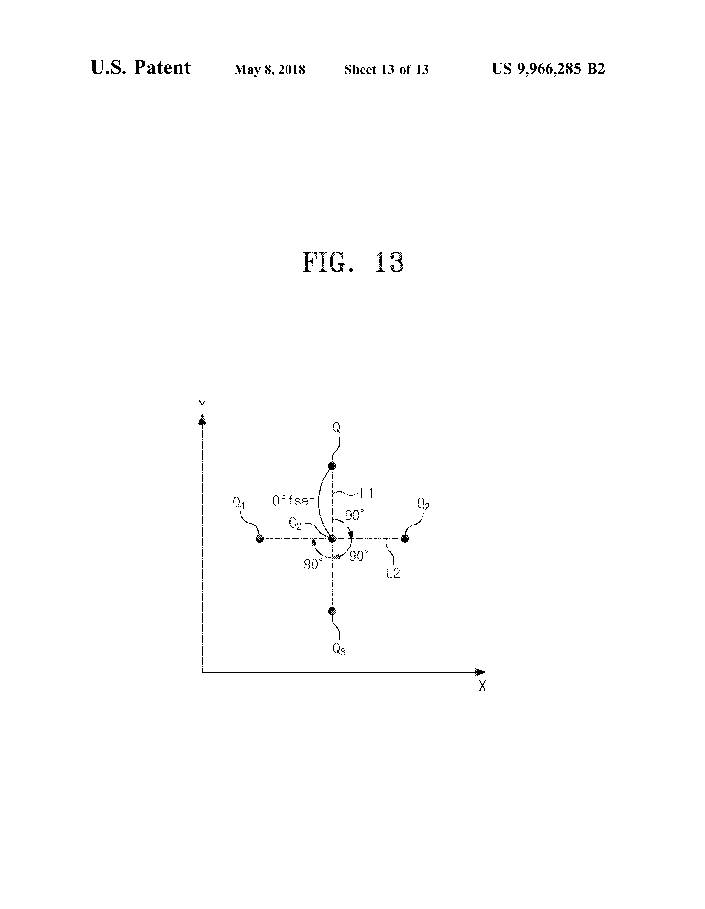

# US9966285B2 — 티칭 방법 및 이를 이용한 기판 처리 장치 (SEMES)

| 항목 | 내용 |
|---|---|
| 원문 | `US9966285.pdf`(등록, 2018-05-08) · `US20160351425.pdf`(공개, 2016-12-01) |
| 출원인 | SEMES Co., Ltd. (대응 한국 출원 10-2015-0076463) |
| 우선일 | 2015-05-29 · 미국 출원 2016-05-23 |
| 핵심 | 기판을 회전 지지판(스핀척)에 올리고 **알려진 각도(120° 또는 90°)만큼 돌린 뒤** 다시 핸드로 꺼내 편심값을 잰다. 이를 반복해 얻은 편심 점 3개는 외접원 중심, 4개는 대각선(Q1–Q3, Q2–Q4) 교차점으로 지지판 회전 중심을 구하고, 첫 편심값과의 차이(오프셋)로 로봇 티칭 값을 보정한다. 검출기는 센서 또는 카메라. |
| 관련도 | ○ 부분적으로 해결 |
| 해결하는 P# | P5(알려진 회전을 주어 회전 중심과 위치 오프셋을 분리), P4(360°를 고르게 나눈 측정 배치로 한쪽에 치우치지 않은 추정) |
| 링크 | [Google Patents](https://patents.google.com/patent/US9966285B2/en) |

---

## 상세 요약 (번역본 기준)

### 1. 해결하려는 문제
- 도포·현상 설비(스피너)에서 이송 로봇이 기판을 지지판의 정확한 위치에 놓지 못하면 가열 불균일, 도포 불균일이 생기고, 특히 에지 비드 제거(EBR) 정밀도가 떨어진다.
- 기판이 핸드 위에서 어긋난 양(편심)과, 로봇 티칭 위치가 지지판 회전 중심에서 어긋난 양이 섞여 있어 한 번 측정으로는 구분할 수 없다.

### 2. 핵심 구성
| 구성 | 부호 | 역할 |
|---|---|---|
| 지지판(스핀척) | 832, 회전축 834, 구동기 836 | 기판을 받아 설정 각도만큼 회전 |
| 로봇 | 932 (핸드 934) | 기판 로딩·언로딩. 도포 로봇 432와 같거나 비슷 |
| 검출기 | 938 | 핸드 위 기판의 편심값 검출. 센서 또는 카메라, 노치 대비 4개 이상 |
| 제어기·계산부 | 940·950 | 지지판 회전·로봇 제어, 편심값으로 로봇 위치 계산 |
| EBR 노즐 | 842 | 기판 둘레 감광막 제거(정밀도가 필요한 이유) |

### 3. 동작 순서
**세 편심값 (도 11)**
1. 핸드 위 초기 편심값 P1 검출(로딩 전 또는 한 번 로딩·언로딩 후).
2. 로딩 → 지지판 120° 회전 → 언로딩 → P2 검출. 한 번 더 → P3.
3. P1·P2·P3를 지나는 원의 중심 C1 = 지지판 회전 중심이 핸드 좌표에서 보이는 위치.
4. P1−C1 오프셋으로 초기 티칭 값 보정.

**네 편심값 (도 12·13, S100~S400)**
1. Q1 검출 → 90° 회전 → Q2 → 90° → Q3 → 90° → Q4.
2. Q1–Q3 선 L1과 Q2–Q4 선 L2의 교차점 C2 = 회전 중심.
3. Q1−C2 오프셋으로 티칭 값 보정.
- 설정 각도는 매번 같고 합이 360°, 회전 방향은 한 방향.

### 4. 청구항 요지 (24항, 독립항 1·10·16)
- 청구항 1: 로딩 → 지지판 설정 각도 회전 → 언로딩 → 핸드 위 편심값 검출을 복수 회 → 편심값들로 로봇 위치 설정.
- 청구항 2: 로딩 전 편심값도 취득. 3·4: 센서 또는 카메라로 검출.
- 청구항 5·6: 세 편심값, 외접원 중심을 지지판 중심에 맞춤.
- 청구항 7~9: 90°, 네 편심값, 두 쌍을 잇는 선의 교차점.
- 청구항 10~15: 90°씩 1차~4차 편심값 검출 절차, Q1–Q3·Q2–Q4 교차점.
- 청구항 16~24: 장치(지지판·로봇·검출기·계산부 제어기), 카메라 검출기, EBR 노즐.

### 5. 대표 도면

*도 11 — 120° 간격 편심 P1·P2·P3의 외접원 중심 C1과 오프셋*

*도 13 — 90° 간격 Q1~Q4의 대각선 교차점 C2와 오프셋*

### 6. 본 과제(Y·Θ 얼라인먼트)와 비교
- 같은 점:
  - SEMES 장비 특허다. "위치 오프셋(평행이동)"과 "회전 중심"이 한 번 측정에 섞여 있는 문제를 **알려진 회전을 반복해 주는 방식**으로 분리한다. 본 과제의 Y(평행이동)·Θ(회전) 분리와 구조가 같다.
  - 측정 결과로 로봇 티칭(보정) 값을 고친다.
- 다른 점:
  - 회전하는 것은 지지판이고 로봇은 평행이동만 보정한다. 우리는 로봇 자체가 Y·Θ 2축.
  - 120°·90° 같은 큰 회전을 쓴다. 우리 Θ 범위는 작아 같은 원 맞춤을 쓰면 짧은 원호 문제(02번 Cognex가 지적한 오차 증가)가 생긴다.
- 참고할 점:
  - **P5**: 편심 = (회전 중심 대비 위치) 성분 + (회전에 따라 도는) 성분이므로, 서로 다른 알려진 회전에서의 측정을 모으면 회전 중심(고정)과 위치 오프셋(회전 따라 변함)이 분리된다. 우리도 턴 사이 알려진 ΔΘ에서 QR 위치를 모아 원(또는 원호) 맞춤으로 Θ 회전 중심을 추정하고, 나머지를 Y로 보는 방식의 근거.
  - **P4**: 측정 자세를 360°에 고르게(90°×4, 120°×3) 배치하는 설계는 한 사분면만 있는 우리 혼합 자세 자료의 문제를 피하는 촬영 설계(4-1)의 산업 사례다.
  - 대각선 교차점(4점)은 원 맞춤보다 계산이 간단하고 C++ 구현이 쉽다.
