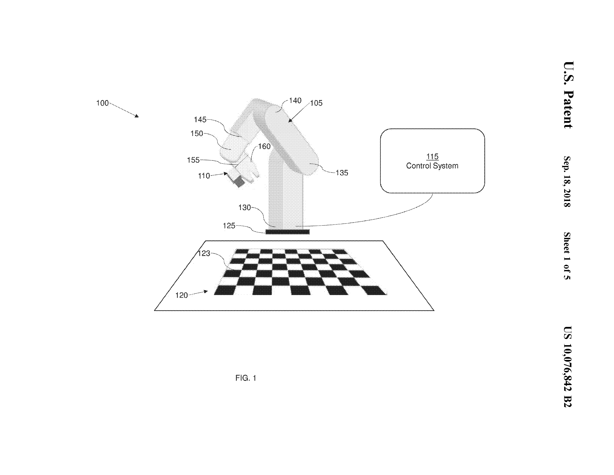
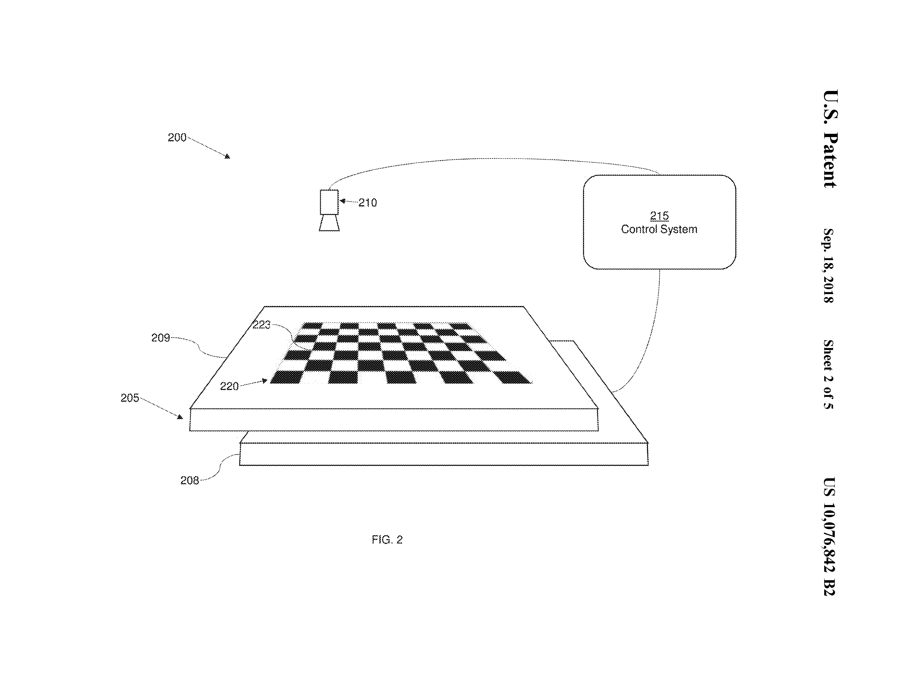
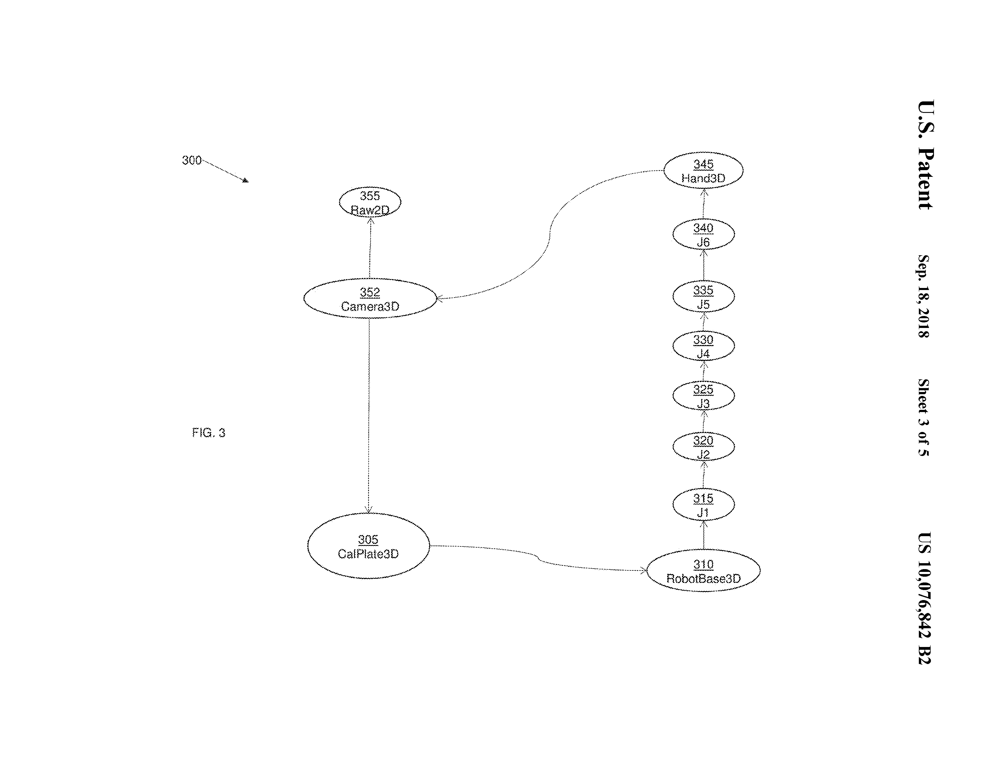
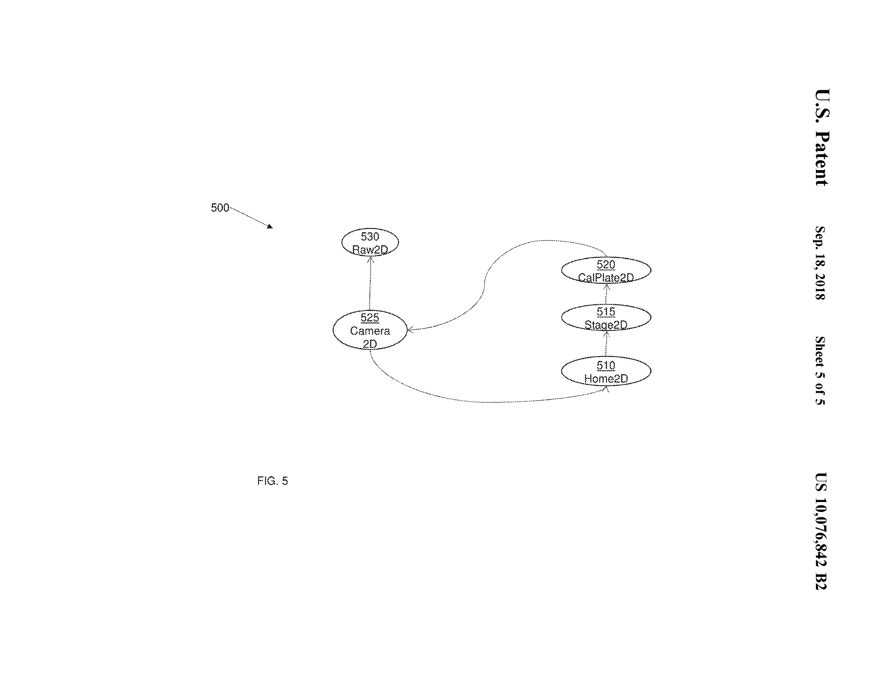
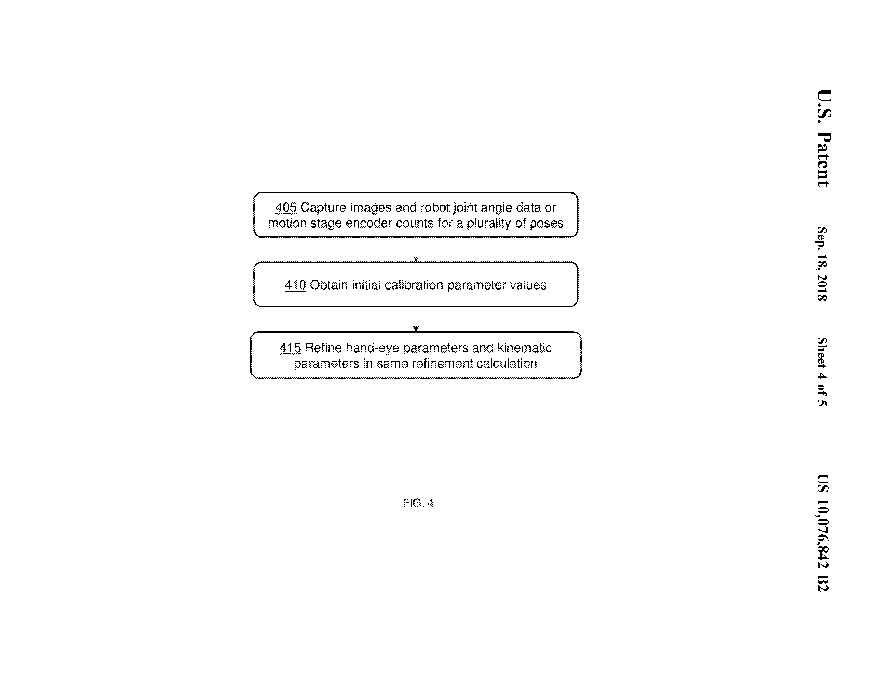

# 기구학 및 핸드-아이 동시 캘리브레이션 (US10076842B2)

- 원제: SIMULTANEOUS CALIBRATION OF KINEMATICS AND HAND-EYE
- 원문: 같은 폴더의 `US10076842.pdf`, https://patents.google.com/patent/US10076842B2/en
- 출원인: 코그넥스 코퍼레이션 (Cognex Corporation)
- 출원일: 2016-09-28 · 등록일: 2018-09-18 (미국 특허 US 10,076,842 B2)
- 번역 기준: USPTO 등록본 PDF 직접 판독 및 국문 번역 수록
- 도면: `도면/` 폴더 내 도면 시트 5장 수록

---

## 요약

모션 디바이스(다관절 로봇 또는 XYθ/UVW 정밀 모션 스테이지)와 비전 시스템(카메라) 사이의 기구학(kinematics) 파라미터 및 핸드-아이(hand-eye) 파라미터를 동시에 정밀 보정하는 시스템 및 방법이 개시된다. 모션 디바이스를 복수의 상이한 위치 및 자세로 이동시키면서 캘리브레이션 타깃의 화상과 관절 각도 또는 축별 엔코더 값을 수집한다. 종래처럼 기구학과 핸드-아이를 순차적으로 분리 보정할 때 발생하는 오차 누적을 방지하기 위해, 본 발명은 단일 통합 목적 함수(비용 함수)를 구성하고 비선형 최소제곱 최적화(Levenberg-Marquardt 등)를 통해 두 파라미터 군을 한 번에 동시에 정제(refine)한다. 비용 함수로는 화상 평면 상의 관측 특징점과 기구학-광학 투영 체인에 의한 예측 특징점 간의 재투영 오차(reprojection error), 또는 폐루프 왕복 변환의 항등 변환 편차가 사용된다. 상호 결합도가 높은 파라미터는 그룹별 교대 최적화를 적용하여 최적화의 수치적 안정성을 보장한다.

---

## 청구범위

청구하는 발명은 다음과 같다.

1. 모션 디바이스 및 상기 모션 디바이스와 관련된 비전 시스템을 캘리브레이션하기 위한 방법으로서,
상기 비전 시스템의 카메라에 의해 캘리브레이션 플레이트의 복수의 화상을 획득하는 단계로서, 상기 복수의 화상 각각은 상기 모션 디바이스의 복수의 물리적 자세 각각에서 획득되고, 상기 복수의 물리적 자세 각각에 대해 상기 모션 디바이스의 모션 제어기로부터 기구학적 위치 데이터(관절각 또는 엔코더 값)가 기록되는, 단계;
상기 모션 디바이스에 대한 초기 기구학 파라미터를 제공하는 단계;
상기 비전 시스템에 대한 초기 핸드-아이 파라미터를 제공하는 단계; 및
상기 획득된 복수의 화상, 상기 기록된 기구학적 위치 데이터, 상기 초기 기구학 파라미터, 및 상기 초기 핸드-아이 파라미터에 근거하여 비용 함수를 공식화하고, 비선형 최적화(non-linear optimization)를 수행하여 상기 기구학 파라미터 및 상기 핸드-아이 파라미터를 동시에 정제(refine)하는 단계를 포함하는, 방법.

2. 제1항에 있어서,
상기 비용 함수는 상기 복수의 화상에서 관측된 특징점들의 위치와 상기 기구학 파라미터 및 핸드-아이 파라미터에 근거하여 투영된 예측 특징점 위치 사이의 화소 거리 오차를 포함하는, 방법.

3. 제1항에 있어서,
상기 비용 함수는 상기 모션 디바이스의 모션 제어기 좌표계와 상기 비전 시스템의 좌표계 사이의 폐루프 왕복 좌표 변환이 항등 변환(identity transform)으로부터 벗어난 편차에 근거하는, 방법.

4. 제1항에 있어서,
상기 모션 디바이스는 다관절 로봇 아암이고, 상기 기구학 파라미터는 상기 로봇 아암의 링크 길이 및 관절 오프셋을 정의하는 Denavit-Hartenberg (D-H) 파라미터를 포함하는, 방법.

5. 제1항에 있어서,
상기 모션 디바이스는 평면 모션 스테이지(XYθ 스테이지 또는 UVW 스테이지)이고, 상기 기구학 파라미터는 각 구동축의 이동 방향 벡터, 스케일 팩터(스텝당 이동량), 및 상기 평면 모션 스테이지의 회전 중심(center of rotation) 좌표를 포함하는, 방법.

6. 제5항에 있어서,
상기 평면 모션 스테이지의 회전 중심 좌표는 상기 스테이지의 홈 위치(Home2D) 좌표계의 원점으로 정의되는, 방법.

7. 제1항에 있어서,
상기 비선형 최적화는 레벤버그-마쿼트(Levenberg-Marquardt) 알고리즘을 사용하여 수행되는, 방법.

8. 제1항에 있어서,
상기 기구학 파라미터 및 핸드-아이 파라미터 중 상호 결합도가 높은 파라미터들은 그룹별로 분할되어 교대로(alternately) 고정 및 정제되는, 방법.

---

## 상세한 설명

### 배경 기술 및 기술적 과제

산업용 로봇 및 초정밀 정렬 스테이지(XYθ, UVW)에서 비전 카메라를 이용하여 대상물을 서보 정렬하거나 피크-앤-플레이스를 수행하기 위해서는 (1) 로봇/스테이지의 기구학 모델(축 방향, 관절 길이, 회전 중심)과 (2) 카메라와 엔드 이펙터/스테이지 간의 공간적 관계를 나타내는 핸드-아이(hand-eye) 변환 행렬이 완벽히 일치해야 한다.

종래에는 제조사가 제공한 공칭(nominal) 기구학 파라미터를 신뢰한 상태에서 핸드-아이 캘리브레이션을 수행하거나, 기구학 보정을 별도로 완료한 후 비전 보정을 수행하였다. 그러나 실제 장비에서는 제조 조립 공차, 액추에이터 백래시, 롤러 편심, 센서 장착 기울어짐 등으로 인해 공칭 기구학 모델 자체에 오차가 존재한다. 이로 인해 기구학 오차가 핸드-아이 보정 결과로 전파되어 복합적인 잔류 정렬 오차를 남기게 된다.

*도 1 — 이동 카메라(핸드 장착 카메라 110)를 구비한 다관절 로봇 시스템(105)과 캘리브레이션 플레이트(120)의 배치 구성도.*

*도 2 — 고정 카메라(210)와 평면 모션 스테이지(205) 상에 탑재된 캘리브레이션 플레이트(220)의 구성도.*

### 좌표계 사슬 및 기하학적 모델링

본 발명은 전체 시스템의 모든 물리적 구성요소를 단일 폐루프 좌표계 사슬(Coordinate Chain)로 정식화한다.

*도 3 — 로봇 시스템에서의 3차원 좌표계 변환 사슬. CalPlate3D → RobotBase3D → Joint1~6 → Hand3D → Camera3D → Raw2D 화상 좌표계.*

*도 5 — 모션 스테이지 시스템에서의 2차원 좌표계 사슬. Home2D(스테이지 홈 위치의 회전 중심 기준) → Stage2D → CalPlate2D, Camera2D → Raw2D.*

특히 평면 정렬 스테이지(도 5)의 경우, 스테이지의 기준 좌표계 `Home2D`는 스테이지 기구학의 **순수 회전 중심(Center of Rotation)**에 원점을 둔다. 이를 통해 병진 이동($X, Y$)과 회전 이동($\theta$)의 결합 현상을 수학적으로 명확히 분리하여 정식화할 수 있다.

### 동시 캘리브레이션 절차 및 비용 함수

*도 4 — 기구학 및 핸드-아이 동시 캘리브레이션 실행 흐름도(단계 405~415).*

1. **데이터 수집(단계 405)**: 스테이지 또는 로봇을 $M$개의 다양한 위치 및 회전 자세로 이동시킨다. 각 자세에서 인코더 판독값 $q_j$와 카메라 화상 $I_j$를 동기화하여 수집한다.
2. **초기값 설정(단계 410)**: 제조사 스펙 시트로부터 기구학 파라미터 초기 벡터 $P_{\text{kin}}^0$를 입력하고, 표준 비전 툴(Cognex Vision Library 등)로 핸드-아이 초기 벡터 $P_{\text{he}}^0$를 구한다.
3. **통합 비용 함수 최소화(단계 415)**:
   $$\min_{P_{\text{kin}}, P_{\text{he}}} \sum_{j=1}^{M} \sum_{k=1}^{N} \left\| m_{j,k} - \pi(P_{\text{he}}, \mathcal{K}(q_j; P_{\text{kin}}), M_k) \right\|^2$$
   여기서 $M_k$는 캘리브레이션 타깃 상의 물리적 특징점 좌표, $m_{j,k}$는 화상에서 검출된 실제 특징점 화소 좌표, $\mathcal{K}$는 기구학 순방향 함수, $\pi$는 카메라 투영 함수이다.
4. **수치적 안정화 기법**:
   - 중복되거나 비관측성(unobservable)을 갖는 파라미터를 사전 기하 분석을 통해 통합 축소한다.
   - 평행이동과 회전처럼 민감도 편차가 큰 파라미터는 그룹별 교대 최적화(Block Coordinate Descent)를 수행하여 발산을 방지하고 대역적 최적점으로 안정적으로 수렴시킨다.

본 발명에 따르면 로봇의 D-H 파라미터 오차뿐만 아니라 UVW 스테이지의 롤러 반지름, 축 비직교성, 회전 중심 편심까지 비전 측정값과 완벽하게 정합시킴으로써 나노미터급 고정밀 얼라인먼트를 구현할 수 있다.
