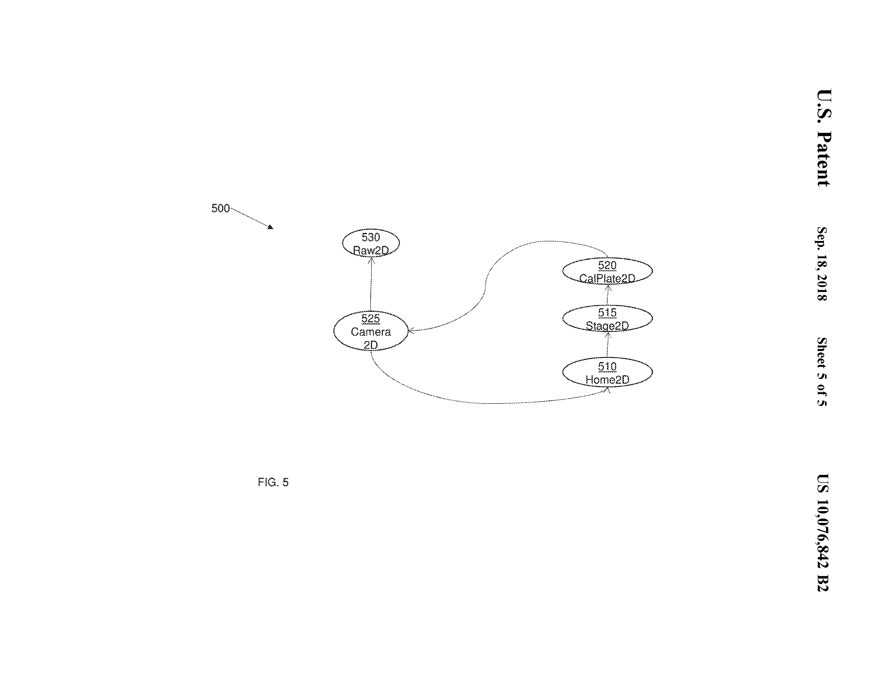

# US10076842B2 — 기구학·핸드-아이 동시 캘리브레이션 (Cognex)

| 항목 | 내용 |
|---|---|
| 원문 | `US10076842.pdf`(등록, 2018-09-18) · `US20180089831.pdf`(공개, 2018-03-29) |
| 출원인 | Cognex Corporation |
| 출원일 | 2016-09-28 (우선권 주장 없음, 표지 기준) |
| 핵심 | 로봇 또는 모션 스테이지를 여러 자세로 움직이며 캘리브레이션 타깃 영상과 관절각·엔코더 값을 함께 기록한다. 기구학 파라미터(로봇 D-H, XYθ·UVW 스테이지의 축 방향·스텝 크기·롤러 중심 등)와 핸드-아이 파라미터를 **한 번의 비선형 최소제곱**으로 동시에 다듬는다. 비용 함수는 관측 특징점과 예측 특징점의 화소 거리, 또는 왕복 변환이 항등 변환에서 벗어난 정도. |
| 관련도 | △ 참고 |
| 해결하는 P# | P3(카메라·스테이지 파라미터를 측정 영상으로 동시 추정), P4(전 자세를 하나의 기하 모델로 묶어 외삽 대신 모델로 예측), P1(파라미터 중복을 묶거나 그룹별로 나눠 다듬어 불안정 회피) |
| 링크 | [Google Patents](https://patents.google.com/patent/US10076842B2/en) |
| 번역 | 없음(△). 원문 PDF 표지·요약·발명의 내용·상세 설명 II장(캘리브레이션)을 OCR 텍스트로 확인 |

---

## 상세 요약 (원문 OCR 텍스트 기준)

### 1. 해결하려는 문제
- 제조사가 준 로봇·스테이지 기구학 값으로 비전 시스템을 보정하면 정확도가 부족하다. 기구학 오차와 핸드-아이 오차를 따로 보정하면 서로의 오차가 남는다.

### 2. 핵심 구성
| 구성 | 내용 |
|---|---|
| 시스템 | 로봇 105 + 손에 단 카메라 110(이동 카메라, 도 1) 또는 모션 스테이지 205 + 고정 카메라 210(도 2) |
| 좌표계 사슬 | 로봇: CalPlate3D–RobotBase3D–Joint1~6–Hand3D–Camera3D–Raw2D(도 3). 스테이지: Home2D–Stage2D–CalPlate2D–Camera2D–Raw2D(도 5) |
| 스테이지 파라미터 | XYθ: X·Y 축 방향과 스텝 크기, θ축 롤러 중심·반지름·방향·스텝·스트라이커 판 방향. UVW: 액추에이터별 롤러 중심·반지름·방향·스텝·홈 엔코더 값 |
| Home2D | 스테이지 X축과 **회전 중심**으로 정의되는 기준 좌표계(원점 = 홈 위치의 회전 중심) |

### 3. 동작 순서 (도 4)
1. 405: 여러 자세에서 영상과 관절각(또는 엔코더 값) 수집.
2. 410: 기구학 초기값(제조사 사양) → 핸드-아이 초기값(Cognex Vision Library).
3. 415: 비용 함수를 비선형 최소제곱으로 최소화해 두 파라미터 군을 동시에 정제. 중복 파라미터는 합치고(44 → 32 → 30개), 필요하면 그룹별로 번갈아 고정·정제.
- 2D로만 움직이는 장치는 2D 정보만 쓰는 비용 함수로 바꾸고, 정제할 파라미터 수를 줄여 강건하게 한다.

### 4. 청구항 요지 (30항)
- 로봇(관절각) 또는 모션 스테이지(엔코더 값)를 여러 자세로 움직이며 영상 취득 → 기구학 초기값 → 핸드-아이 초기값 → 비용 함수 최소화로 둘을 동시 정제하는 시스템·방법.
- 종속항: 비용 함수 종류(관측-예측 특징점 거리, 왕복 변환과 항등 변환 차이, 관절각·엔코더 예측 차이), 비선형 최소제곱, 일부 파라미터만 정제, D-H 파라미터, 스테이지 파라미터(롤러 중심·반지름·방향·스텝·홈 엔코더·스트라이커 판 방향).

### 5. 대표 도면

*도 5 — 모션 스테이지 캘리브레이션 좌표계: Home2D(회전 중심 기준) → Stage2D → CalPlate2D, Camera2D → Raw2D*

### 6. 본 과제와 비교
- 같은 점: 장치 명령값(엔코더)과 영상 관측을 함께 모아 카메라·장치 파라미터를 추정한다. 우리 1014·1020 자료(명령값 + 영상)가 바로 이 입력 형식이다.
- 다른 점: 체커보드 캘리브레이션 타깃과 3D 카메라 모델을 쓴다. 우리는 QR 판 3개, 카메라 내부 파라미터 미지.
- 참고할 점: 4장 3-2(1014 자료로 기하 모델 자기 보정)의 구현 구조 — "기구 파라미터 + 카메라 파라미터를 재투영 오차로 동시 정제, 중복 파라미터는 합치고 그룹별로 번갈아 정제" — 를 산업 특허가 그대로 쓰고 있다. 특히 Y·Θ처럼 상관이 큰 파라미터는 그룹별 교대 정제가 수렴 안정화 방법이 될 수 있다(P1).
