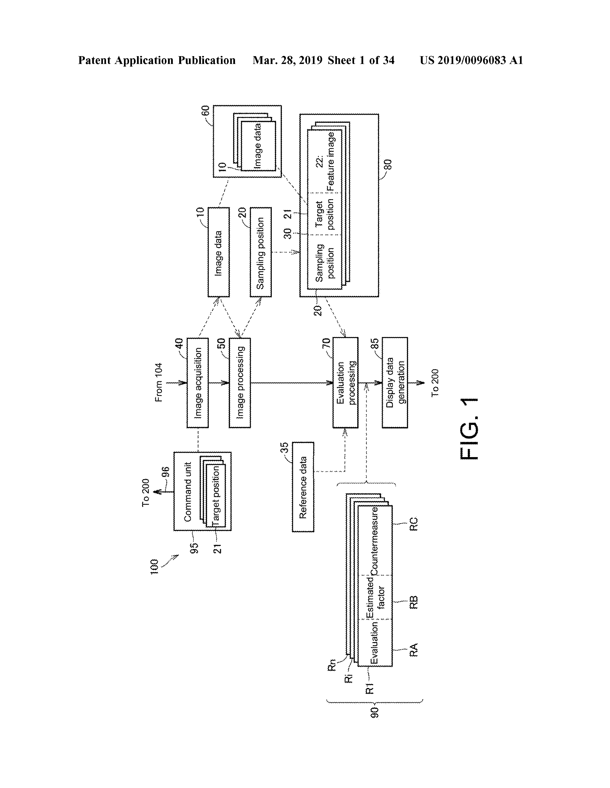
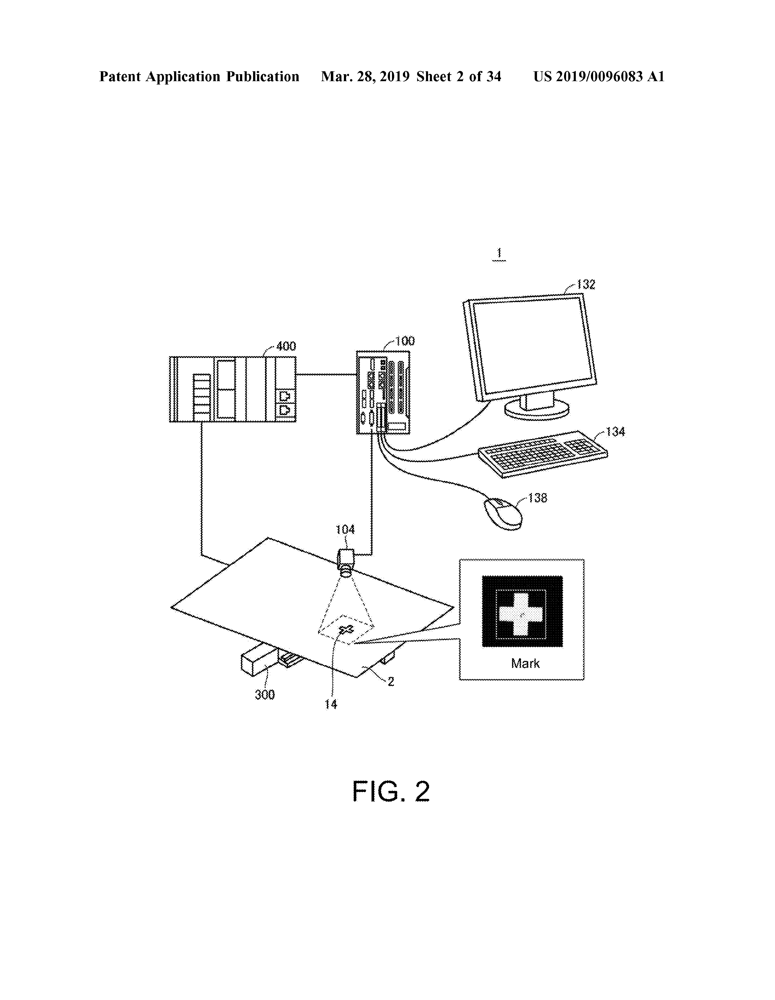
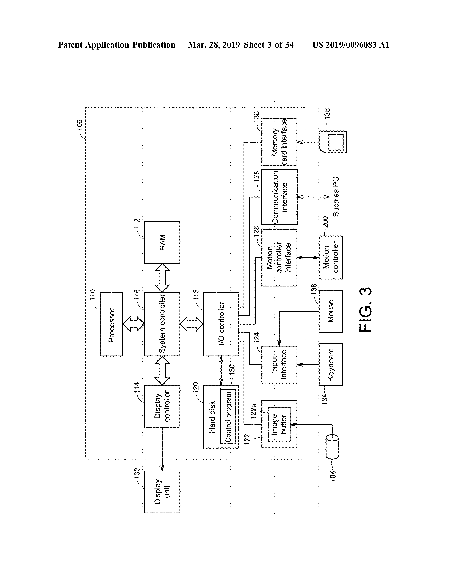
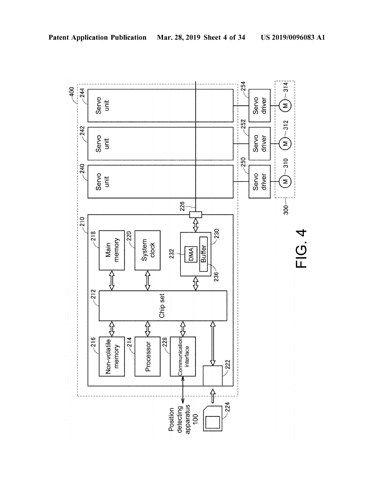
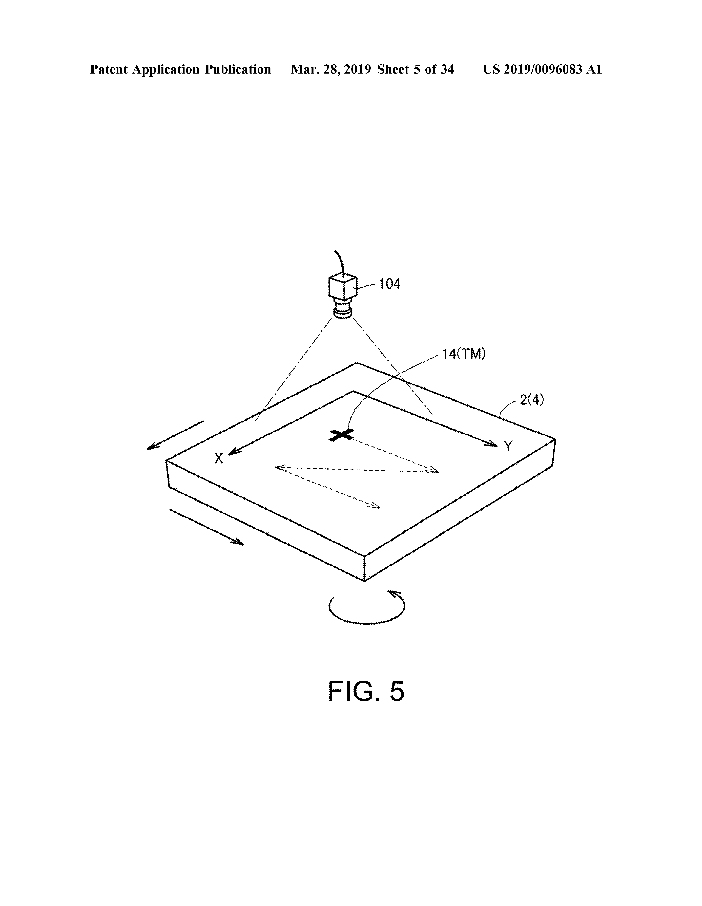
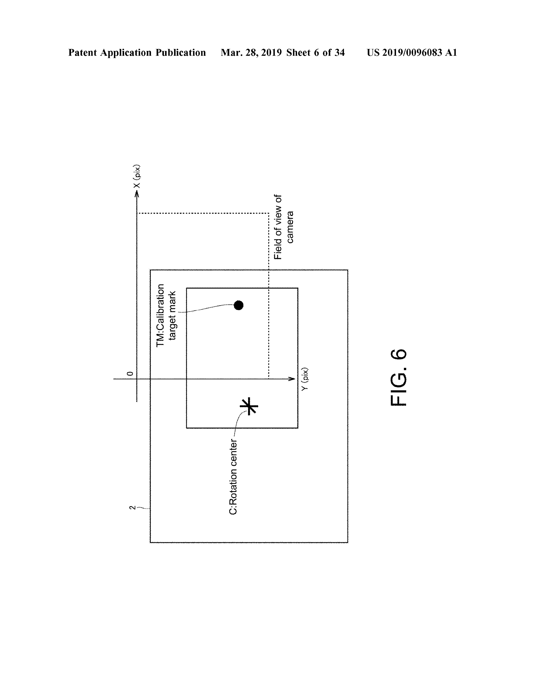

# 위치 검출 장치 및 컴퓨터 판독 가능 기록 매체 (US20190096083A1)

- 원제: POSITION DETECTING APPARATUS AND COMPUTER-READABLE RECORDING MEDIUM
- 원문: 같은 폴더의 `US20190096083.pdf`, https://patents.google.com/patent/US20190096083A1/en
- 출원인: 오므론 주식회사 (OMRON Corporation, 교토, 일본)
- 발명자: Tomohiro ARANO, Yoshihide YAMAMOTO, Hiroyuki HAZEYAMA
- 공개일: 2019-03-28 (미국 특허공개 US 2019/0096083 A1, 우선권 주장 2017-09-27 JP 2017-186021)
- 번역 기준: USPTO 공개 공보 직접 판독 및 핵심 청구항·명세서 국문 수록
- 도면: `도면/` 폴더 내 대표 도면 수록

---

## 요약

정밀 위치결정 장치에서 각 구성부품의 조정을 지원하기 위한 정보를 직관적으로 제공하는 위치 검출 장치 및 프로그램이 개시된다. 위치 검출 장치는: 이동 기구에 의해 대상물의 특징부가 각각의 목표 위치에 위치결정될 때 촬상되어 획득된 화상 데이터로부터 화상 처리를 통해 특징부의 검출 위치를 추출하는 화상 처리부; 상기 각각의 목표 위치와 연계하여 상기 목표 위치들에서 검출된 검출 위치를 저장하는 위치 저장부; 및 상기 검출 위치들에 관련된 정보를 표시 장치 상에 표시하기 위한 데이터를 생성하는 표시 데이터 생성부를 포함한다. 특히 표시 데이터 생성부는 목표 위치와 그에 대응하여 검출된 검출 위치를 동일한 좌표 공간 상에 중첩하여 시각적으로 표시함으로써, 작업자가 오차의 경향성(백래시, 스케일 편차, 회전축 중심 오프셋 등)을 직관적으로 파악하고 원인별 대책을 신속히 수립할 수 있도록 지원한다.

---

## 청구범위

청구하는 발명은 다음과 같다.

1. 위치 검출 장치로서,
이동 기구에 의해 대상물의 특징부가 복수의 목표 위치 각각에 위치결정될 때 촬상되어 획득된 화상 데이터로부터, 화상 처리를 통해 상기 특징부의 검출 위치를 검출하도록 구성된 화상 처리부;
상기 각각의 목표 위치와 연계하여, 상기 목표 위치들에서 검출된 상기 검출 위치들을 저장하는 위치 저장부; 및
표시부 상에 상기 검출 위치들에 관련된 정보를 표시하기 위한 표시 데이터를 생성하도록 구성된 표시 데이터 생성부를 포함하며,
상기 표시 데이터 생성부는, 상기 목표 위치들과 연계되어 저장된 상기 각각의 목표 위치 및 상기 각각의 검출 위치를 동일한 좌표 공간 상에 함께 표시하기 위한 데이터를 생성하는, 위치 검출 장치.

2. 제1항에 있어서,
상기 목표 위치와 상기 검출 위치 사이의 위치 차이를 미리 정해진 기준에 근거하여 평가하도록 구성된 평가 처리부를 더 포함하는, 위치 검출 장치.

3. 제2항에 있어서,
상기 평가 처리부는, 동일한 목표 위치에 대해 상기 이동 기구가 반복 위치결정될 때 얻어지는 복수의 검출 위치들에 근거하여, 평균 오차, 최대 오차, 최소 오차, 및 편차(분산) 중 적어도 하나를 통계적으로 산출하는, 위치 검출 장치.

4. 제2항에 있어서,
평가 결과 내용과, 상기 평가 결과 내용에 대응하는 복수의 추정 원인, 및 상기 추정 원인 각각에 대응하는 대책 정보를 연계하여 저장하는 원인 저장부를 더 포함하며,
상기 표시 데이터 생성부는 상기 평가 처리부의 평가 결과에 대응하는 상기 추정 원인 및 대책 정보를 상기 표시부 상에 안내 표시하도록 구성된, 위치 검출 장치.

5. 제4항에 있어서,
상기 추정 원인은 상기 이동 기구의 구동 파라미터 조건, 상기 화상 처리부의 알고리즘 파라미터, 및 카메라의 촬상 광학 조건 중 적어도 하나를 포함하는, 위치 검출 장치.

6. 제1항에 있어서,
상기 위치 저장부는, 기구적 이동량에 근거하여 화상을 보정하는 보정 파라미터가 적용되기 전의 제1 검출 위치와, 상기 보정 파라미터가 적용된 후의 제2 검출 위치를 상기 목표 위치와 함께 저장하며,
상기 표시 데이터 생성부는 상기 보정 파라미터 적용 전후의 검출 위치 변화를 상기 동일한 좌표 공간 상에 비교 표시하는, 위치 검출 장치.

7. 이동 기구에 의해 대상물의 특징부가 복수의 목표 위치에 위치결정될 때의 위치 검출 처리를 컴퓨터로 하여금 실행하게 하는 컴퓨터 판독 가능 기록 매체로서,
상기 특징부가 각각의 목표 위치에 위치결정될 때 촬상된 화상 데이터로부터 화상 처리를 통해 검출 위치를 검출하는 단계;
상기 각각의 목표 위치와 연계하여 상기 검출 위치를 메모리에 저장하는 단계; 및
상기 각각의 목표 위치 및 상기 각각의 검출 위치를 동일한 좌표 공간 상에 표시부로 표시 출력하는 단계를 포함하는 처리를 실행시키는, 비일시적 컴퓨터 판독 가능 기록 매체.

---

## 상세한 설명

### 배경 기술 및 해결 과제

반도체 조립 및 정밀 부품 실장 공정에서는 비전 카메라와 서보 스테이지를 연동하여 대상물을 목표 좌표로 정밀하게 이동시킨다. 그러나 실제 설비 셋업 및 양산 중에는 모터 튜닝 불량, 스테이지 가이드 레일의 기계적 백래시, 카메라-스테이지 간의 축 정렬 불량, 조명 및 렌즈 왜곡 등 다양한 원인으로 인해 지령된 목표 위치와 실제 카메라가 측정한 위치 사이에 편차가 발생한다.

종래의 설비는 수치 데이터(좌표값 테이블)만 나열하거나 합격/불합격(OK/NG) 판정만을 제공하여, 작업자가 오차의 공간적 분포 특성(기울어짐, 비선형 왜곡, 특정 축 쏠림)을 직관적으로 파악하기 어려웠다. 본 발명은 전 작업 영역에 걸친 목표 좌표와 실측 좌표를 단일 2D/3D 좌표계에 직관적으로 시각화하고, 오차의 패턴으로부터 기계·비전·광학계의 구체적인 원인과 최적 조치 방안을 가이드하는 시스템을 제공한다.

*도 1 — 위치 검출 장치(100) 및 제어부(200)를 포함하는 전체 시스템 구성 블록도. 화상 취득부(40), 화상 처리부(50), 위치 저장부(60, 80), 평가 처리부(70), 원인 저장부(90), 표시 데이터 생성부(85)의 상호작용을 나타낸다.*

*도 2 — 카메라와 이동 기구(XY 스테이지)에 의해 대상물이 복수의 격자형 목표 위치로 이동되는 물리적 구성도.*

### 좌표계 동시 시각화 메커니즘

1. **목표 위치 그리드 설정**: 작업 영역 전체를 포괄하도록 $N \times M$ 격자 형태의 복수의 목표 위치 $(X_k, Y_k)$를 미리 티칭한다.
2. **순차 촬상 및 검출**: 이동 기구가 각 목표 위치로 대상물을 이동시킬 때마다 고해상도 카메라로 화상을 취득하고, 서브픽셀 특징점(원형 마크, 십자선, 또는 QR 패턴)의 위치 $(x_k, y_k)$를 검출한다.
3. **동일 좌표 공간 오버레이 표시**:
   - 도 3 및 도 4에 도시된 바와 같이, 표시 화면 상에 목표 위치(이상 격자점)와 실제 검출된 위치(실측점)를 동일 평면 상에 점 및 편차 벡터(화살표)로 중첩하여 그린다. 오차의 크기가 수십 픽셀 미만으로 미세한 경우, 편차 벡터의 스케일을 확대(예: 100배 확대)하여 왜곡 경향을 강조 표시한다.

*도 3 — 목표 위치(동그라미)와 실제 검출 위치(십자) 및 오차 벡터를 동일 좌표 공간에 중첩 표시한 맵핑 예시도.*

*도 4 — 반복 위치결정 시의 산포 타원(분산) 및 방향별 편차 분포를 표시한 화면 예시.*

### 오차 패턴별 추정 원인 및 대응 가이드

본 발명의 핵심 특징은 오차의 기하학적 형태로부터 설비 결함을 역진단하는 전문가 규칙 베이스(원인 저장부 90)를 탑재한 점이다.

| 오차 패턴 유형 | 기하학적 특징 | 추정 원인 (Estimated Factor) | 권장 조치 대책 (Countermeasure) |
|---|---|---|---|
| **일방향 쏠림 편차** | + 방향 접근 시와 - 방향 접근 시 오차 부호 반전 | 볼스크류 백래시(Backlash) 또는 가이드 유격 | 백래시 보상 파라미터 증대 또는 프리로드 점검 |
| **원호형/회전 편차** | 중심에서 멀어질수록 편차가 원주 방향으로 증가 | 스테이지 회전 중심(Center of Rotation) 오프셋 | 회전축 캘리브레이션 재실시 및 오프셋 좌표 갱신 |
| **방사형 확대/축소** | 중심에서 주변부로 갈수록 반경 방향 편차 증가 | 카메라 렌즈 왜곡 또는 센서 높이(Z 간극) 오차 | 렌즈 왜곡 보정 계수($k_1$) 적용 및 카메라 높이 재티칭 |
| **비선형 국부 왜곡** | 특정 사분면 또는 특정 축에서만 오차 집중 | 레일 편마모 또는 케이블 베어 간섭 외력 | 기계적 레일 평행도 점검 및 간섭 케이블 정리 |

*도 5 — 보정 파라미터 적용 전(초기 상태)과 적용 후(보정 상태)의 오차 벡터 분포를 화면 상에 좌우로 대비하여 표시한 상태도.*

*도 6 — 진단된 오차 원인과 파라미터 튜닝 추천값을 사용자에게 팝업으로 안내하는 GUI 화면.*

본 특허는 전 작업 범위에 대한 체계적인 그리드 샘플링과 오차의 시각적 패턴 분석을 결합하여, 반도체 및 고정밀 제조 장비에서 비전-모션 통합 셋업 시간을 획기적으로 단축시키는 실용적 가치를 제공한다.
