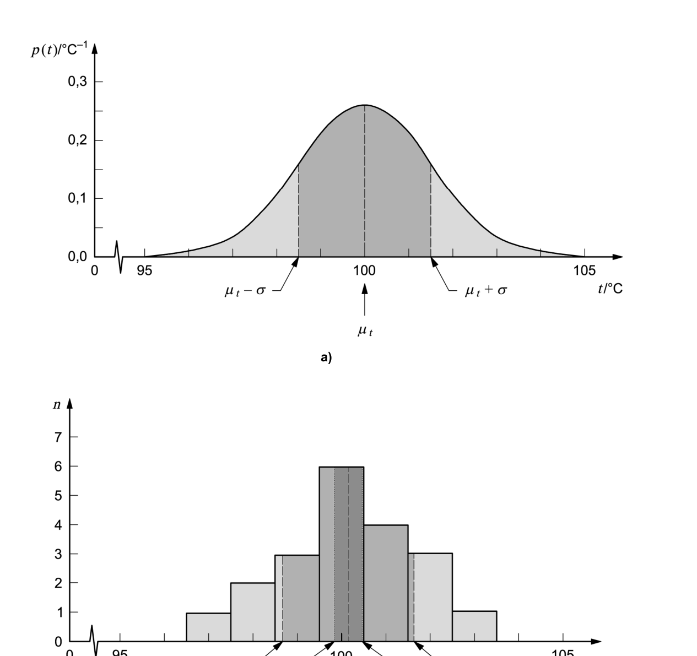
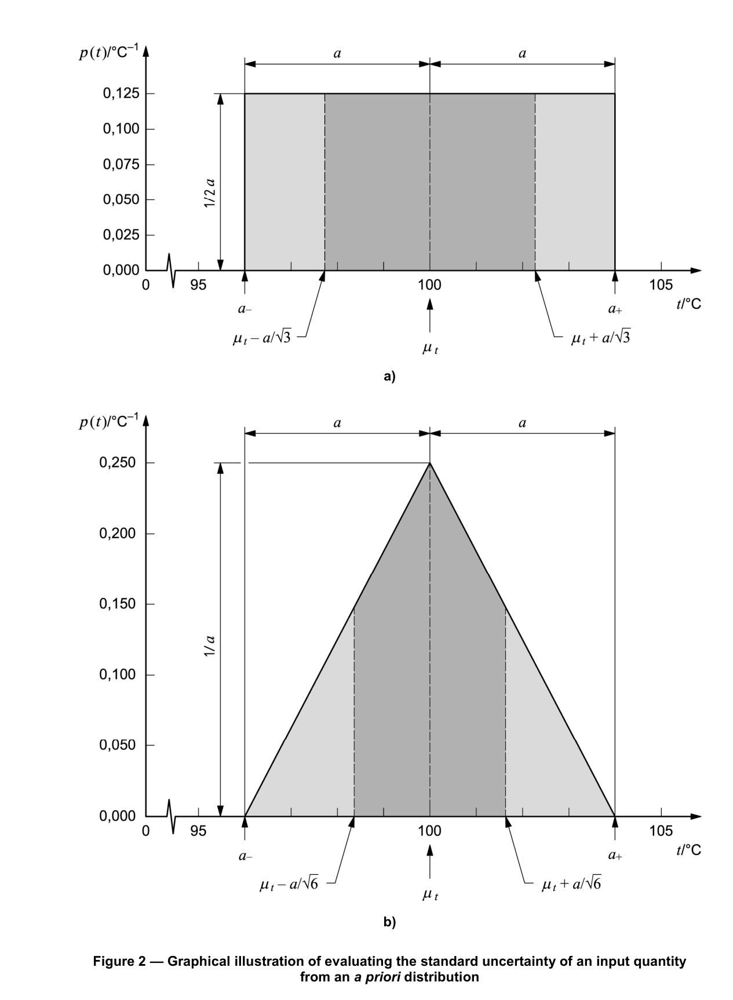

# 측정 데이터의 평가 — 측정 불확도 표현 지침 (JCGM 2008, GUM) — 발췌 번역

- 원제: Evaluation of measurement data — Guide to the expression of uncertainty in measurement (JCGM 100:2008, GUM 1995 with minor corrections)
- 원문: 같은 폴더의 `JCGM_100_2008_E.pdf` (Joint Committee for Guides in Metrology, 2008. 본문 쪽수는 원문 인쇄 쪽 번호 기준)
- 번역 범위: **발췌**. 134쪽 중 다음 부분만 옮겼다.
  - 0 서론 (0.1~0.7)
  - 1 범위 (1.1~1.4)
  - 3 기본 개념 (3.1~3.4)
  - 4 표준 불확도의 평가 (4.1~4.4)
  - 5 합성 표준 불확도의 결정 (5.1~5.2)
  - 6 확장 불확도의 결정 (6.1~6.3)
  - 7 불확도의 보고 (7.1~7.2)
  - 8 불확도 평가·표현 절차 요약
  - 부록 F.2.2 (지시 장치의 분해능, 히스테리시스, 수치 계산의 유한 정밀도 등 — F.2.2.1~F.2.2.3)
  - 제외: 머리말(Foreword), 2 정의, 부록 A~E, F.1, F.2.1, F.2.3 이후, G, H, J, 참고문헌, 색인. 본문에서 제외 부분을 참조하는 번호(예: "C.2.20 참조", "G.4")는 원문 그대로 둔다.
- 그림: 원문 그림 2개(4.4의 그림 1, 그림 2)를 `그림/`에 넣고 본문에서 처음 언급되는 곳에 삽입
- 용어: measurand=측정량, input quantity=입력량, output quantity=출력량, standard uncertainty=표준 불확도, combined standard uncertainty=합성 표준 불확도, expanded uncertainty=확장 불확도, coverage factor=포함 인자, level of confidence=신뢰 수준, sensitivity coefficient=감도 계수, degrees of freedom=자유도, Type A/Type B evaluation=A형/B형 평가, correction=보정값, systematic/random effect=계통/우연 효과, repeatability=반복성(반복정밀도), resolution=분해능, hysteresis=히스테리시스.

## 0 서론 (Introduction)

**0.1** 물리량의 측정 결과를 보고할 때에는, 그 결과를 사용하는 사람이 결과의 신뢰성을 평가할 수 있도록 결과의 품질에 대한 어떤 정량적 지표를 반드시 제시해야 한다. 그런 지표가 없으면 측정 결과들끼리, 또는 규격이나 표준에 주어진 기준값과 비교할 수 없다. 따라서 측정 결과의 품질을 특성화하는, 즉 그 불확도(uncertainty)를 평가하고 표현하는, 쉽게 실행할 수 있고 이해하기 쉬우며 일반적으로 받아들여지는 절차가 필요하다.

**0.2** 정량화할 수 있는 속성으로서의 불확도 개념은 측정의 역사에서 비교적 새로운 것이다. 반면 오차와 오차 해석은 오랫동안 측정 과학, 즉 계량학(metrology)의 관행의 일부였다. 알려져 있거나 의심되는 모든 오차 성분을 평가하고 적절한 보정을 적용한 뒤에도, 제시된 결과의 정확함에 대해, 즉 측정 결과가 측정되는 양의 값을 얼마나 잘 나타내는지에 대해 여전히 불확도가 남는다는 것이 이제 널리 인정된다.

**0.3** 국제단위계(SI)가 거의 보편적으로 쓰이면서 모든 과학·기술 측정에 일관성이 생긴 것처럼, 측정 불확도의 평가와 표현에 대한 세계적 합의가 있으면 과학, 공학, 상업, 산업, 규제 분야의 방대한 측정 결과들의 의미를 쉽게 이해하고 올바르게 해석할 수 있을 것이다. 세계 시장의 시대에는 서로 다른 나라에서 수행된 측정을 쉽게 비교할 수 있도록 불확도를 평가하고 표현하는 방법이 전 세계적으로 통일되어야 한다.

**0.4** 측정 결과의 불확도를 평가하고 표현하는 이상적인 방법은 다음과 같아야 한다.

- **보편적(universal)**: 이 방법은 모든 종류의 측정과 측정에 쓰이는 모든 유형의 입력 데이터에 적용할 수 있어야 한다.

불확도를 표현하는 데 실제로 쓰이는 양은 다음과 같아야 한다.

- **내적으로 일관됨(internally consistent)**: 그것에 기여하는 성분들로부터 직접 유도할 수 있어야 하며, 이 성분들을 어떻게 묶는지와 성분을 하위 성분으로 어떻게 분해하는지에 무관해야 한다.
- **전이 가능함(transferable)**: 한 결과에 대해 평가된 불확도를, 그 첫 결과가 쓰이는 다른 측정의 불확도를 평가할 때 성분으로 직접 쓸 수 있어야 한다.

또한 많은 산업·상업 응용과 보건·안전 분야에서는, 측정 대상인 양에 합리적으로 귀속될 수 있는 값들의 분포의 큰 부분을 포함할 것으로 기대되는 구간을 측정 결과 주위에 제시해야 하는 경우가 많다. 따라서 측정 불확도를 평가하고 표현하는 이상적인 방법은 그런 구간, 특히 요구되는 것과 현실적으로 부합하는 포함 확률(coverage probability) 또는 신뢰 수준(level of confidence)을 갖는 구간을 쉽게 제공할 수 있어야 한다.

**0.5** 이 지침 문서의 바탕이 되는 접근은 CIPM의 요청(머리말 참조)에 따라 BIPM이 소집한 불확도 표기 작업반(Working Group on the Statement of Uncertainties)의 권고 INC-1 (1980)[2]에 개략된 것이다. 이 접근의 정당성은 부록 E에서 논의하며, 이 접근은 위에 개략한 요구 사항을 모두 만족한다. 현재 쓰이는 다른 방법 대부분은 그렇지 않다. 권고 INC-1 (1980)은 CIPM이 자체 권고 1 (CI-1981)[3]과 1 (CI-1986)[4]에서 승인하고 재확인하였다. 이 CIPM 권고들의 영어 번역은 부록 A(각각 A.2와 A.3 참조)에 수록되어 있다. 권고 INC-1 (1980)은 이 문서의 기초이므로, 영어 번역을 0.7에 수록하고 공식 문서인 프랑스어 원문을 A.1에 수록한다.

**0.6** 이 지침 문서에서 규정하는 측정 불확도 평가·표현 절차의 간결한 요약은 8절에 있으며, 여러 예제가 부록 H에 자세히 제시되어 있다. 다른 부록들은 계량학의 일반 용어(부록 B), 기본 통계 용어와 개념(부록 C), "참"값, 오차, 불확도(부록 D), 불확도 성분 평가를 위한 실무적 제안(부록 F), 자유도와 신뢰 수준(부록 G), 문서 전체에서 쓰이는 주요 수학 기호(부록 J), 참고문헌(Bibliography)을 다룬다. 문서 끝에는 알파벳순 색인이 있다.

**0.7** 권고 INC-1 (1980) 실험 불확도의 표현 (Recommendation INC-1 (1980) Expression of experimental uncertainties)

1) 측정 결과의 불확도는 일반적으로 여러 성분으로 이루어지며, 이 성분들은 그 수치를 추정하는 방식에 따라 두 범주로 묶을 수 있다.
   - A. 통계적 방법으로 평가하는 것,
   - B. 다른 수단으로 평가하는 것.

   범주 A 또는 B로의 분류와 이전에 쓰던 "우연(random)" 불확도와 "계통(systematic)" 불확도로의 분류 사이에 항상 단순한 대응이 있는 것은 아니다. "계통 불확도"라는 용어는 오해를 부를 수 있으므로 피해야 한다.

   불확도에 대한 상세한 보고는 성분의 완전한 목록으로 이루어져야 하며, 각 성분에 대해 그 수치를 얻는 데 쓴 방법을 명시해야 한다.

2) 범주 A의 성분은 추정 분산 $s_i^2$(또는 추정 "표준편차" $s_i$)와 자유도 $\nu_i$로 특성화된다. 적절한 경우 공분산을 제시해야 한다.

3) 범주 B의 성분은 존재한다고 가정하는 대응 분산의 근사로 간주할 수 있는 양 $u_j^2$로 특성화해야 한다. 양 $u_j^2$는 분산처럼, 양 $u_j$는 표준편차처럼 다룰 수 있다. 적절한 경우 공분산도 비슷한 방식으로 다루어야 한다.

4) 합성 불확도는 분산 합성의 통상적인 방법을 적용하여 얻은 수치로 특성화해야 한다. 합성 불확도와 그 성분은 "표준편차"의 형태로 표현해야 한다.

5) 특정 응용에서 전체 불확도를 얻기 위해 합성 불확도에 어떤 인자를 곱할 필요가 있으면, 사용한 곱 인자를 반드시 명시해야 한다.

## 1 범위 (Scope)

**1.1** 이 지침은 작업 현장에서 기초 연구에 이르기까지 여러 정확도 수준과 많은 분야에서 따를 수 있는, 측정 불확도의 평가와 표현에 대한 일반 규칙을 정한다. 따라서 이 지침의 원칙은 다음에 필요한 측정을 포함하여 폭넓은 측정에 적용되도록 의도된 것이다.

- 생산에서 품질 관리와 품질 보증의 유지
- 법규의 준수와 집행
- 과학과 공학의 기초 연구, 응용 연구 및 개발의 수행
- 국가 표준으로의 소급성(traceability)을 확보하기 위해 국가 측정 체계 전반에서 표준기와 계측기를 교정하고 시험을 수행하는 것
- 표준 물질을 포함한 국제·국가 물리 기준 표준의 개발, 유지, 비교

**1.2** 이 지침은 주로, 본질적으로 유일한 값으로 특성화될 수 있는 잘 정의된 물리량—측정량(measurand)—의 측정에서 불확도를 표현하는 것과 관련된다. 관심 현상이 값들의 분포로만 나타날 수 있거나 시간 같은 하나 이상의 파라미터에 의존하면, 그 기술에 필요한 측정량은 그 분포나 그 의존성을 기술하는 양들의 집합이다.

**1.3** 이 지침은 실험, 측정 방법, 복잡한 구성 요소와 시스템의 개념 설계와 이론 해석에 관련된 불확도를 평가하고 표현하는 데에도 적용할 수 있다. 측정 결과와 그 불확도는 개념적일 수 있고 전적으로 가상의 데이터에 기반할 수 있으므로, 이 지침에서 쓰는 "측정 결과"라는 용어는 이 넓은 맥락에서 해석해야 한다.

**1.4** 이 지침은 상세하고 기술 특정적인 지시보다는 측정 불확도의 평가와 표현에 대한 일반 규칙을 제공한다. 또한 특정 측정 결과의 불확도가 일단 평가된 뒤 그것이 여러 목적—예컨대 그 결과가 다른 비슷한 결과와 양립하는지 결론을 내리거나, 제조 공정의 공차 한계를 정하거나, 어떤 조치를 안전하게 취할 수 있는지 결정하는 것—에 어떻게 쓰일 수 있는지는 논의하지 않는다. 따라서 특정 측정 분야에 고유한 문제나 불확도의 정량적 표현의 다양한 용도를 다루는, 이 지침에 기반한 특정 표준을 개발할 필요가 있을 수 있다.* 이런 표준은 이 지침의 단순화된 판일 수 있지만, 다루는 측정과 용도의 정확도 수준과 복잡성에 적합한 세부를 포함해야 한다.

> 비고 (NOTE): 예를 들어 시험 방법의 정밀도를 정할 때처럼, 측정 불확도의 개념이 완전히 적용될 수 없다고 여겨지는 상황이 있을 수 있다(예: 참고문헌 [5] 참조).

> \* 2008년판 각주: 이 지침이 처음 발행된 이후, 이 문서에서 파생된 여러 일반 및 특정 응용 문서가 발행되었다. 참고로, 이 문서들의 (망라적이지 않은) 목록은 http://www.bipm.org/en/committees/jc/jcgm/wg1_bibliography.html 에서 찾을 수 있다.

## 3 기본 개념 (Basic concepts)

기본 개념에 대한 추가 논의는 "참"값, 오차, 불확도의 개념에 초점을 맞추고 이 개념들의 그림 설명을 포함하는 부록 D와, 이 지침의 바탕인 권고 INC-1 (1980)의 동기와 통계적 근거를 탐구하는 부록 E에서 찾을 수 있다. 부록 J는 지침 전체에서 쓰이는 주요 수학 기호의 용어집이다.

### 3.1 측정 (Measurement)

**3.1.1** 측정(measurement, B.2.5)의 목적은 측정량(measurand, B.2.9)의 값(value, B.2.2), 즉 측정할 특정량(particular quantity, B.2.1, 비고 1)의 값을 정하는 것이다. 따라서 측정은 측정량, 측정 방법(method of measurement, B.2.7), 측정 절차(measurement procedure, B.2.8)를 적절히 규정하는 데서 시작한다.

> 비고: "참값(true value)"이라는 용어(부록 D 참조)는 D.3.5에 제시한 이유로 이 지침에서 쓰지 않는다. "측정량의 값"(또는 양의 값)과 "측정량의 참값"(또는 양의 참값)이라는 용어는 동등한 것으로 본다.

**3.1.2** 일반적으로 측정 결과(result of a measurement, B.2.11)는 측정량 값의 근사 또는 추정값(estimate, C.2.26)일 뿐이므로, 그 추정값의 불확도(uncertainty, B.2.18)에 대한 진술이 함께 있을 때에만 완전하다.

**3.1.3** 실제로 측정량에 요구되는 규정이나 정의는 요구되는 측정 정확도(accuracy of measurement, B.2.14)에 따라 정해진다. 측정량은 요구 정확도에 대해 충분히 완전하게 정의되어, 측정과 관련된 모든 실용적 목적에서 그 값이 유일해야 한다. 이 지침에서 "측정량의 값"이라는 표현은 이런 의미로 쓰인다.

> 보기 (EXAMPLE): 공칭 1미터 길이의 강철 막대의 길이를 마이크로미터 정확도로 정하려면, 그 규정에는 길이를 정의하는 온도와 압력이 포함되어야 한다. 따라서 측정량은 예를 들어 25,00 °C* 및 101 325 Pa에서의 막대 길이(와 막대를 지지하는 방식처럼 필요하다고 여겨지는 다른 정의 파라미터)로 규정해야 한다. 그러나 길이를 밀리미터 정확도로만 정하면 된다면, 그 규정에 정의 온도나 압력, 또는 다른 정의 파라미터의 값이 필요하지 않을 것이다.

> 비고: 측정량을 불완전하게 정의하면 측정 결과의 불확도 평가에 반드시 포함해야 할 만큼 큰 불확도 성분이 생길 수 있다(D.1.1, D.3.4, D.6.2 참조).

**3.1.4** 많은 경우 측정 결과는 반복성 조건(repeatability conditions, B.2.15, 비고 1)에서 얻은 일련의 관측값을 바탕으로 정해진다.

**3.1.5** 반복 관측값의 변동은 측정 결과에 영향을 줄 수 있는 영향량(influence quantities, B.2.10)이 완전히 일정하게 유지되지 않기 때문에 생긴다고 가정한다.

**3.1.6** 반복 관측값의 집합을 측정 결과로 변환하는 측정의 수학적 모델은 매우 중요하다. 관측값 외에도 일반적으로 정확히 알려지지 않은 여러 영향량을 포함하기 때문이다. 이런 지식의 부족은 반복 관측값의 변동이나 수학적 모델 자체에 관련된 불확도와 마찬가지로 측정 결과의 불확도에 기여한다.

**3.1.7** 이 지침은 측정량을 스칼라(단일 양)로 다룬다. 같은 측정에서 동시에 정해지는 관련 측정량들의 집합으로 확장하려면, 스칼라 측정량과 그 분산(C.2.11, C.2.20, C.3.2)을 벡터 측정량과 공분산 행렬(C.3.5)로 대체해야 한다. 이 지침에서 그런 대체는 예제(H.2, H.3, H.4 참조)에서만 고려한다.

> \* 2008년판 각주: 제22차 CGPM(2003) 결의 10에 따르면 "... 소수점 기호는 줄 위의 점이나 줄 위의 쉼표 중 하나여야 한다...". JCGM은 영어 문서에서 줄 위의 점을 채택하기로 결정했다. 그러나 이 문서에서는 1995년 인쇄판과의 일관성을 위해 소수점 쉼표를 유지했다.

### 3.2 오차, 효과, 보정 (Errors, effects, and corrections)

**3.2.1** 일반적으로 측정에는 측정 결과에 오차(error, B.2.19)를 일으키는 불완전성이 있다. 전통적으로 오차는 두 성분, 즉 우연(random, B.2.21) 성분과 계통(systematic, B.2.22) 성분을 갖는 것으로 본다.

> 비고: 오차는 이상화된 개념이며 오차를 정확히 알 수는 없다.

**3.2.2** 우연 오차는 아마도 영향량의 예측할 수 없거나 확률적인 시간적·공간적 변동에서 생긴다. 이런 변동의 효과(이하 우연 효과라 함)는 측정량의 반복 관측값에 변동을 일으킨다. 측정 결과의 우연 오차를 보상하는 것은 불가능하지만, 대개 관측 횟수를 늘려 줄일 수 있다. 그 기대값(expectation 또는 expected value, C.2.9, C.3.1)은 0이다.

> 비고 1: 일련의 관측값의 산술평균(평균)의 실험 표준편차(4.2.3 참조)는 일부 출판물에서 그렇게 부르기도 하지만 평균의 우연 오차가 아니다. 그것은 우연 효과로 인한 평균의 불확도의 척도이다. 이 효과로 인한 평균의 오차의 정확한 값은 알 수 없다.

> 비고 2: 이 지침에서는 "오차"와 "불확도"라는 용어를 구별하는 데 큰 주의를 기울인다. 이 둘은 동의어가 아니라 완전히 다른 개념을 나타내므로, 서로 혼동하거나 잘못 써서는 안 된다.

**3.2.3** 계통 오차는 우연 오차와 마찬가지로 제거할 수는 없지만 역시 흔히 줄일 수 있다. 계통 오차가 측정 결과에 대한 영향량의 알려진 효과(이하 계통 효과라 함)에서 생기면, 그 효과를 정량화할 수 있으며, 그 크기가 요구 측정 정확도에 비해 유의하면 그 효과를 보상하기 위해 보정값(correction, B.2.23)이나 보정 인자(correction factor, B.2.24)를 적용할 수 있다. 보정 후에는 계통 효과로 인한 오차의 기대값이 0이라고 가정한다.

> 비고: 계통 효과를 보상하기 위해 측정 결과에 적용한 보정값의 불확도는, 때때로 그렇게 불리듯 그 효과로 인한 측정 결과의 계통 오차(흔히 편향(bias)이라 함)가 아니다. 그것은 보정값의 요구 값에 대한 불완전한 지식으로 인한 결과의 불확도의 척도이다. 계통 효과의 불완전한 보상으로 인한 오차는 정확히 알 수 없다. "오차"와 "불확도"라는 용어는 올바르게 써야 하며 둘을 구별하는 데 주의해야 한다.

**3.2.4** 측정 결과는 알려진 모든 유의한 계통 효과에 대해 보정되었으며, 그런 효과를 식별하려는 모든 노력을 기울였다고 가정한다.

> 보기: 고임피던스 저항기 양단의 전위차(측정량)를 정하는 데 쓰는 전압계의 유한 임피던스로 인한 보정값을 적용하여, 전압계의 부하 효과로 인한 측정 결과에 대한 계통 효과를 줄인다. 그러나 보정값을 추정하는 데 쓰이며 다른 측정으로 얻은 전압계와 저항기의 임피던스 값 자체도 불확실하다. 이 불확도들은 보정값으로 인한, 따라서 전압계의 유한 임피던스로 인한 계통 효과로 인한 전위차 결정의 불확도 성분을 평가하는 데 쓰인다.

> 비고 1: 계통 효과를 제거하기 위해 측정 표준과 표준 물질을 써서 측정 기기와 시스템을 조정하거나 교정하는 경우가 많다. 그러나 이 표준과 물질에 관련된 불확도는 여전히 고려해야 한다.

> 비고 2: 알려진 유의한 계통 효과에 대한 보정을 적용하지 않는 경우는 6.3.1의 비고와 F.2.4.5에서 논의한다.

### 3.3 불확도 (Uncertainty)

**3.3.1** 측정 결과의 불확도는 측정량의 값에 대한 정확한 지식의 부족을 반영한다(2.2 참조). 알려진 계통 효과에 대해 보정한 뒤의 측정 결과도, 우연 효과와 계통 효과에 대한 결과의 불완전한 보정에서 생기는 불확도 때문에 여전히 측정량 값의 추정값일 뿐이다.

> 비고: (보정 후) 측정 결과는, 큰 불확도를 가질 수 있음에도 불구하고, 알 수 없는 방식으로 측정량의 값에 매우 가까울 수 있다(따라서 무시할 만한 오차를 가질 수 있다). 따라서 측정 결과의 불확도를 남아 있는 미지의 오차와 혼동해서는 안 된다.

**3.3.2** 실제로 측정에는 다음을 포함하여 불확도의 가능한 원천이 많다.

- a) 측정량의 불완전한 정의
- b) 측정량 정의의 불완전한 실현
- c) 대표성 없는 표본 추출 — 측정한 표본이 정의된 측정량을 대표하지 않을 수 있음
- d) 환경 조건이 측정에 미치는 효과에 대한 지식 부족 또는 환경 조건의 불완전한 측정
- e) 아날로그 계기를 읽을 때의 개인적 편향
- f) 계기의 유한한 분해능(resolution) 또는 식별 문턱(discrimination threshold)
- g) 측정 표준과 표준 물질의 부정확한 값
- h) 외부 출처에서 얻어 데이터 처리 알고리즘에 쓰는 상수와 기타 파라미터의 부정확한 값
- i) 측정 방법과 절차에 포함된 근사와 가정
- j) 겉보기에 동일한 조건에서 측정량의 반복 관측값의 변동

이 원천들은 반드시 독립적인 것은 아니며, 원천 a)~i)의 일부는 원천 j)에 기여할 수 있다. 물론 알려지지 않은 계통 효과는 측정 결과의 불확도 평가에서 고려할 수 없지만 그 오차에는 기여한다.

**3.3.3** 불확도 표기 작업반의 권고 INC-1 (1980)은 불확도 성분을 평가 방법에 따라 "A"와 "B" 두 범주로 묶는다(0.7, 2.3.2, 2.3.3 참조). 이 범주는 불확도에 적용되는 것이며 "우연"과 "계통"이라는 말을 대체하는 것이 아니다. 알려진 계통 효과에 대한 보정값의 불확도는 어떤 경우에는 A형 평가로, 다른 경우에는 B형 평가로 얻을 수 있으며, 우연 효과를 특성화하는 불확도도 마찬가지이다.

> 비고: 일부 출판물에서는 불확도 성분을 "우연"과 "계통"으로 분류하고 각각 우연 효과와 알려진 계통 효과에서 생기는 오차와 연관시킨다. 이런 불확도 성분의 분류는 일반적으로 적용할 때 모호할 수 있다. 예를 들어 한 측정에서의 "우연" 불확도 성분이, 첫 측정의 결과를 입력 자료로 쓰는 다른 측정에서는 "계통" 불확도 성분이 될 수 있다. 성분 자체가 아니라 불확도 성분을 평가하는 방법을 분류하면 이런 모호함을 피한다. 동시에 이는 두 다른 방법으로 평가된 개별 성분을 특정 목적에 쓰기 위해 지정된 그룹으로 모으는 것을 막지 않는다(3.4.3 참조).

**3.3.4** A형과 B형 분류의 목적은 불확도 성분을 평가하는 두 가지 다른 방법을 나타내는 것이며 논의의 편의를 위한 것일 뿐이다. 이 분류는 두 유형의 평가로 얻은 성분의 성질에 어떤 차이가 있음을 나타내려는 것이 아니다. 두 유형의 평가 모두 확률 분포(probability distributions, C.2.3)에 기반하며, 어느 유형으로 얻은 불확도 성분이든 분산이나 표준편차로 정량화된다.

**3.3.5** A형 평가로 얻은 불확도 성분을 특성화하는 추정 분산 $u^2$는 일련의 반복 관측값에서 계산되며, 익숙한 통계적 추정 분산 $s^2$이다(4.2 참조). 따라서 $u^2$의 양의 제곱근인 추정 표준편차(estimated standard deviation, C.2.12, C.2.21, C.3.3) $u$는 $u=s$이며, 편의상 A형 표준 불확도라 부르기도 한다. B형 평가로 얻은 불확도 성분의 경우, 추정 분산 $u^2$는 이용 가능한 지식을 써서 평가하며(4.3 참조), 추정 표준편차 $u$를 B형 표준 불확도라 부르기도 한다.

따라서 A형 표준 불확도는 관측된 도수 분포(frequency distribution, C.2.18)에서 유도된 확률 밀도 함수(probability density function, C.2.5)에서 얻고, B형 표준 불확도는 어떤 사건이 일어날 것이라는 믿음의 정도[흔히 주관적 확률(subjective probability, C.2.1)이라 함]에 기반한 가정된 확률 밀도 함수에서 얻는다. 두 접근 모두 공인된 확률 해석을 쓴다.

> 비고: 불확도 성분의 B형 평가는 대개 비교적 신뢰할 수 있는 정보의 집합에 기반한다(4.3.1 참조).

**3.3.6** 측정 결과가 여러 다른 양의 값에서 얻어질 때, 그 결과의 표준 불확도를 합성 표준 불확도(combined standard uncertainty)라 하며 $u_c$로 나타낸다. 이는 결과에 관련된 추정 표준편차이며, 이 지침에서 불확도 전파 법칙(law of propagation of uncertainty, 5절 참조)이라 부르는 것을 써서, 어떻게 평가되었든 모든 분산 및 공분산(covariance, C.3.4) 성분으로부터 얻은 합성 분산의 양의 제곱근과 같다.

**3.3.7** 일부 산업·상업 응용의 필요와 보건·안전 분야의 요구 사항을 충족하기 위해, 합성 표준 불확도 $u_c$에 포함 인자(coverage factor) $k$를 곱하여 확장 불확도(expanded uncertainty) $U$를 얻는다. $U$의 의도된 목적은 측정량에 합리적으로 귀속될 수 있는 값들의 분포의 큰 부분을 포함할 것으로 기대되는 구간을 측정 결과 주위에 제공하는 것이다. 대개 2~3 범위인 인자 $k$의 선택은 그 구간에 요구되는 포함 확률 또는 신뢰 수준에 기반한다(6절 참조).

> 비고: 포함 인자 $k$는 항상 명시해야 한다. 그래야 측정된 양의 표준 불확도를 복원하여, 그 양에 의존할 수 있는 다른 측정 결과의 합성 표준 불확도 계산에 쓸 수 있다.

### 3.4 실무적 고려 사항 (Practical considerations)

**3.4.1** 측정 결과가 의존하는 모든 양을 변화시키면 그 불확도를 통계적 수단으로 평가할 수 있다. 그러나 시간과 자원의 제약 때문에 실제로 이것이 가능한 경우는 드물므로, 측정 결과의 불확도는 대개 측정의 수학적 모델과 불확도 전파 법칙을 써서 평가한다. 따라서 이 지침에는 측정을 요구 측정 정확도가 부과하는 정도까지 수학적으로 모델링할 수 있다는 가정이 암묵적으로 깔려 있다.

**3.4.2** 수학적 모델은 불완전할 수 있으므로, 불확도 평가가 가능한 한 관측 데이터에 기반할 수 있도록 관련된 모든 양을 실행 가능한 최대한까지 변화시켜야 한다. 실행 가능하면 언제나, 장기 정량 데이터에 근거한 측정의 경험적 모델의 사용, 그리고 측정이 통계적 관리 상태에 있는지 보여 줄 수 있는 점검 표준(check standard)과 관리도(control chart)의 사용이 신뢰할 수 있는 불확도 평가를 얻기 위한 노력의 일부가 되어야 한다. 같은 측정량에 대한 독립적인 결정의 결과를 포함한 관측 데이터가 모델이 불완전함을 보여 주면 수학적 모델은 언제나 수정해야 한다. 잘 설계된 실험은 신뢰할 수 있는 불확도 평가를 크게 쉽게 하며, 측정 기술의 중요한 부분이다.

**3.4.3** 측정 시스템이 제대로 기능하는지 판단하기 위해, 관측 표준편차로 측정한 출력값의 실험적으로 관측된 변동성을, 측정을 특성화하는 여러 불확도 성분을 합성하여 얻은 예측 표준편차와 비교하는 경우가 많다. 이런 경우에는 이 출력값의 실험적으로 관측된 변동성에 기여할 수 있는 성분(A형 평가로 얻었든 B형 평가로 얻었든)만 고려해야 한다.

> 비고: 변동성에 기여하는 성분과 기여하지 않는 성분을 적절히 이름 붙인 두 개의 별도 그룹으로 모으면 이런 분석이 쉬워질 수 있다.

**3.4.4** 어떤 경우에는 계통 효과에 대한 보정값의 불확도를 측정 결과의 불확도 평가에 포함할 필요가 없다. 불확도를 평가했더라도, 측정 결과의 합성 표준 불확도에 대한 그 기여가 무의미하면 무시할 수 있다. 보정값 자체가 합성 표준 불확도에 비해 무의미하면 그것도 무시할 수 있다.

**3.4.5** 실제로, 특히 법정 계량 분야에서는, 기기를 측정 표준과 비교하여 시험하는데 표준과 비교 절차에 관련된 불확도가 시험의 요구 정확도에 비해 무시할 만한 경우가 흔하다. 예로 잘 교정된 분동 세트를 써서 상업용 저울의 정확도를 시험하는 것이 있다. 이런 경우 불확도 성분이 무시할 만큼 작으므로, 측정은 시험 대상 기기의 오차를 정하는 것으로 볼 수 있다(F.2.4.2도 참조).

**3.4.6** 측정 결과가 제공하는 측정량 값의 추정값은 때때로 국제단위계(SI)의 해당 단위가 아니라 측정 표준의 채택값으로 표현된다. 이런 경우 측정 결과에 귀속할 수 있는 불확도의 크기는 그 결과를 해당 SI 단위로 표현할 때보다 상당히 작을 수 있다. (사실상 측정량이 측정할 양의 값과 표준의 채택값의 비로 재정의된 것이다.)

> 보기: 고품질 제너(Zener) 전압 표준기를 CIPM이 국제적 사용을 위해 권고한 조지프슨 상수의 협약값에 기반한 조지프슨 효과 전압 기준과 비교하여 교정한다. 교정된 제너 표준기의 전위차 $V_S$의 상대 합성 표준 불확도 $u_c(V_S)/V_S$(5.1.6 참조)는 $V_S$를 협약값으로 보고할 때 $2\times10^{-8}$이지만, 조지프슨 상수의 SI 값에 관련된 추가 불확도 때문에 $V_S$를 전위차의 SI 단위인 볼트(V)로 보고할 때는 $u_c(V_S)/V_S$가 $4\times10^{-7}$이다.

**3.4.7** 데이터를 기록하거나 분석할 때의 실수(blunder)는 측정 결과에 유의한 미지의 오차를 들일 수 있다. 큰 실수는 대개 데이터를 제대로 검토하면 식별할 수 있다. 작은 실수는 우연 변동에 가려지거나 심지어 우연 변동처럼 보일 수 있다. 불확도의 척도는 이런 실수를 설명하려는 것이 아니다.

**3.4.8** 이 지침은 불확도를 평가하는 틀을 제공하지만 비판적 사고, 지적 정직성, 전문 기량을 대신할 수는 없다. 불확도 평가는 일상적인 작업도 순수하게 수학적인 작업도 아니며, 측정량과 측정의 성질에 대한 상세한 지식에 의존한다. 따라서 측정 결과에 대해 제시하는 불확도의 품질과 유용성은 궁극적으로 그 값의 할당에 기여하는 사람들의 이해, 비판적 분석, 성실성에 달려 있다.

## 4 표준 불확도의 평가 (Evaluating standard uncertainty)

주로 실무적 성격의, 불확도 성분 평가에 대한 추가 안내는 부록 F에서 찾을 수 있다.

### 4.1 측정의 모델링 (Modelling the measurement)

**4.1.1** 대부분의 경우 측정량 $Y$는 직접 측정되지 않고, $N$개의 다른 양 $X_1, X_2, \ldots, X_N$으로부터 함수 관계 $f$를 통해 정해진다.

$$
Y=f(X_1,X_2,\ldots,X_N) \tag{1}
$$

> 비고 1: 표기를 절약하기 위해, 이 지침에서는 물리량(측정량)과, 그 양의 관측에서 나올 수 있는 결과를 나타내는 확률 변수(4.2.1 참조)에 같은 기호를 쓴다. $X_i$가 특정 확률 분포를 가진다고 할 때 그 기호는 후자의 의미로 쓰인다. 물리량 자체는 본질적으로 유일한 값으로 특성화될 수 있다고 가정한다(1.2와 3.1.3 참조).

> 비고 2: 일련의 관측에서 $X_i$의 $k$번째 관측값은 $X_{i,k}$로 나타낸다. 따라서 $R$이 저항기의 저항을 나타내면, 저항의 $k$번째 관측값은 $R_k$로 나타낸다.

> 비고 3: $X_i$의 추정값(엄밀히 말하면 그 기대값의 추정값)은 $x_i$로 나타낸다.

> 보기: 정의 온도 $t_0$에서 저항 $R_0$이고 저항의 선형 온도 계수가 $\alpha$인 온도 의존 저항기의 단자에 전위차 $V$를 가하면, 온도 $t$에서 저항기가 소비하는 전력 $P$(측정량)는 다음에 따라 $V$, $R_0$, $\alpha$, $t$에 의존한다.
>
> $$P=f(V,R_0,\alpha,t)=V^2\big/\left\{R_0\left[1+\alpha(t-t_0)\right]\right\}$$

> 비고: $P$를 측정하는 다른 방법은 다른 수학식으로 모델링될 것이다.

**4.1.2** 출력량 $Y$가 의존하는 입력량 $X_1, X_2, \ldots, X_N$은 그 자체로 측정량으로 볼 수 있으며, 계통 효과에 대한 보정값과 보정 인자를 포함한 다른 양에 의존할 수 있어서, 결코 명시적으로 쓸 수 없는 복잡한 함수 관계 $f$로 이어질 수 있다. 또한 $f$는 실험적으로 정해질 수도 있고(5.1.4 참조), 수치적으로 계산해야 하는 알고리즘으로만 존재할 수도 있다. 이 지침에 나오는 함수 $f$는 이런 넓은 맥락에서, 특히 측정 결과에 유의한 불확도 성분을 줄 수 있는 모든 보정값과 보정 인자를 포함한 모든 양을 담은 함수로 해석해야 한다. 따라서 데이터가 $f$가 측정 결과의 요구 정확도가 부과하는 정도까지 측정을 모델링하지 못함을 보여 주면, 그 부족함을 없애기 위해 $f$에 추가 입력량을 포함해야 한다(3.4.2 참조). 이를 위해 측정량에 영향을 주는 현상에 대한 불완전한 지식을 반영하는 입력량을 도입해야 할 수도 있다. 4.1.1의 보기에서는 저항기 전체에 걸친 알려진 불균일 온도 분포, 가능한 비선형 저항 온도 계수, 또는 저항의 기압 의존 가능성을 설명하기 위해 추가 입력량이 필요할 수 있다.

> 비고: 그럼에도 식 (1)은 $Y=X_1-X_2$처럼 기본적일 수도 있다. 이 식은 예를 들어 같은 양 $X$의 두 결정값의 비교를 모델링한다.

**4.1.3** 입력량 $X_1, X_2, \ldots, X_N$의 집합은 다음과 같이 분류할 수 있다.

- 현재 측정에서 값과 불확도를 직접 정하는 양. 이 값과 불확도는 예를 들어 단일 관측, 반복 관측, 또는 경험에 기반한 판단에서 얻을 수 있으며, 계기 지시값에 대한 보정값과 주위 온도, 기압, 습도 같은 영향량에 대한 보정값의 결정을 포함할 수 있다.
- 값과 불확도를 외부 출처에서 측정으로 가져오는 양. 예를 들어 교정된 측정 표준, 인증 표준 물질, 핸드북에서 얻은 참조 데이터에 관련된 양이 있다.

**4.1.4** $y$로 나타내는 측정량 $Y$의 추정값은 $N$개의 양 $X_1, X_2, \ldots, X_N$의 값에 대한 입력 추정값 $x_1, x_2, \ldots, x_N$을 써서 식 (1)로부터 얻는다. 따라서 측정 결과인 출력 추정값 $y$는 다음과 같다.

$$
y=f(x_1,x_2,\ldots,x_N) \tag{2}
$$

> 비고: 어떤 경우에는 추정값 $y$를 다음으로 얻을 수 있다.
>
> $$y=\overline{Y}=\frac{1}{n}\sum_{k=1}^{n}Y_k=\frac{1}{n}\sum_{k=1}^{n}f(X_{1,k},X_{2,k},\ldots,X_{N,k})$$
>
> 즉 $y$를 $Y$의 $n$개 독립 결정값 $Y_k$의 산술평균(4.2.1 참조)으로 취하는 것이며, 각 결정값은 같은 불확도를 갖고 각각 같은 시각에 얻은 $N$개 입력량 $X_i$의 관측값 완전 집합에 기반한다. $f$가 입력량 $X_1, X_2, \ldots, X_N$의 비선형 함수일 때는, 개별 관측값 $X_{i,k}$의 산술평균 $\overline{X}_i=\frac{1}{n}\sum_{k=1}^{n}X_{i,k}$를 써서 $y=f(\overline{X}_1,\overline{X}_2,\ldots,\overline{X}_N)$로 구하는 것보다 이 평균 방식이 나을 수 있다. 그러나 $f$가 $X_i$의 선형 함수이면 두 접근은 같다(H.2와 H.4 참조).

**4.1.5** 출력 추정값 또는 측정 결과 $y$에 관련된 추정 표준편차는 합성 표준 불확도라 하며 $u_c(y)$로 나타내는데, 이는 각 입력 추정값 $x_i$에 관련된 추정 표준편차, 즉 표준 불확도라 하며 $u(x_i)$로 나타내는 것으로부터 정해진다(3.3.5와 3.3.6 참조).

**4.1.6** 각 입력 추정값 $x_i$와 그에 관련된 표준 불확도 $u(x_i)$는 입력량 $X_i$의 가능한 값들의 분포로부터 얻는다. 이 확률 분포는 도수 기반, 즉 $X_i$의 일련의 관측값 $X_{i,k}$에 기반할 수도 있고, 사전(a priori) 분포일 수도 있다. 표준 불확도 성분의 A형 평가는 도수 분포에 근거하고 B형 평가는 사전 분포에 근거한다. 두 경우 모두 분포는 우리 지식의 상태를 나타내는 데 쓰이는 모델이라는 점을 인식해야 한다.

### 4.2 표준 불확도의 A형 평가 (Type A evaluation of standard uncertainty)

**4.2.1** 대부분의 경우, 무작위로 변하는 양 $q$[확률 변수(random variable, C.2.2)]로서 같은 측정 조건(B.2.15 참조)에서 $n$개의 독립 관측값 $q_k$를 얻은 양의 기대값 $\mu_q$에 대해 이용할 수 있는 최선의 추정값은 $n$개 관측값의 산술평균 $\overline{q}$(C.2.19)이다.

$$
\overline{q}=\frac{1}{n}\sum_{k=1}^{n}q_k \tag{3}
$$

따라서 $n$개의 독립 반복 관측값 $X_{i,k}$로부터 추정하는 입력량 $X_i$에 대해서는, 식 (3)으로 얻은 산술평균 $\overline{X}_i$를 식 (2)의 입력 추정값 $x_i$로 써서 측정 결과 $y$를 정한다. 즉 $x_i=\overline{X}_i$이다. 반복 관측값으로 평가하지 않는 입력 추정값은 4.1.3의 두 번째 범주에 나타낸 것 같은 다른 방법으로 얻어야 한다.

**4.2.2** 개별 관측값 $q_k$는 영향량의 무작위 변동, 즉 우연 효과(3.2.2 참조) 때문에 값이 다르다. $q$의 확률 분포의 분산 $\sigma^2$을 추정하는 관측값의 실험 분산은 다음과 같다.

$$
s^2(q_k)=\frac{1}{n-1}\sum_{j=1}^{n}\left(q_j-\overline{q}\right)^2 \tag{4}
$$

이 분산 추정값과 그 양의 제곱근 $s(q_k)$, 즉 실험 표준편차(experimental standard deviation, B.2.17)는 관측값 $q_k$의 변동성, 더 구체적으로는 평균 $\overline{q}$ 주위의 산포를 특성화한다.

**4.2.3** 평균의 분산 $\sigma^2(\overline{q})=\sigma^2/n$의 최선 추정값은 다음과 같다.

$$
s^2(\overline{q})=\frac{s^2(q_k)}{n} \tag{5}
$$

평균의 실험 분산 $s^2(\overline{q})$와, 그 양의 제곱근과 같은 평균의 실험 표준편차 $s(\overline{q})$(B.2.17, 비고 2)는 $\overline{q}$가 $q$의 기대값 $\mu_q$를 얼마나 잘 추정하는지를 정량화하며, 어느 쪽이든 $\overline{q}$의 불확도의 척도로 쓸 수 있다.

따라서 $n$개의 독립 반복 관측값 $X_{i,k}$로 정하는 입력량 $X_i$에 대해, 그 추정값 $x_i=\overline{X}_i$의 표준 불확도 $u(x_i)$는 $u(x_i)=s(\overline{X}_i)$이며, $s^2(\overline{X}_i)$는 식 (5)에 따라 계산한다. 편의상 $u^2(x_i)=s^2(\overline{X}_i)$와 $u(x_i)=s(\overline{X}_i)$를 각각 A형 분산과 A형 표준 불확도라 부르기도 한다.

> 비고 1: 관측 횟수 $n$은 $\overline{q}$가 확률 변수 $q$의 기대값 $\mu_q$의 신뢰할 수 있는 추정값이 되고, $s^2(\overline{q})$가 분산 $\sigma^2(\overline{q})=\sigma^2/n$의 신뢰할 수 있는 추정값이 되도록 충분히 커야 한다(4.3.2 비고 참조). 신뢰 구간을 구성할 때는 $s^2(\overline{q})$와 $\sigma^2(\overline{q})$의 차이를 고려해야 한다(6.2.2 참조). 이 경우 $q$의 확률 분포가 정규 분포(4.3.4 참조)이면 그 차이는 $t$-분포를 통해 고려한다(G.3.2 참조).

> 비고 2: 분산 $s^2(\overline{q})$가 더 근본적인 양이지만, 표준편차 $s(\overline{q})$는 $q$와 같은 차원을 갖고 분산보다 값을 이해하기 쉬우므로 실제로는 더 편리하다.

**4.2.4** 통계적 관리 상태에 있고 잘 특성화된 측정의 경우, 그 측정을 특성화하는 합동(pooled) 분산 추정값 $s_p^2$(또는 합동 실험 표준편차 $s_p$)를 이용할 수 있을 수 있다. 이런 경우 측정량 $q$의 값을 $n$개의 독립 관측값으로 정할 때, 관측값의 산술평균 $\overline{q}$의 실험 분산은 $s^2(q_k)/n$보다 $s_p^2/n$으로 더 잘 추정되며, 표준 불확도는 $u=s_p/\sqrt{n}$이다(H.3.6의 비고도 참조).

**4.2.5** 입력량 $X_i$의 추정값 $x_i$를 최소제곱법으로 실험 데이터에 맞춘 곡선에서 얻는 경우가 많다. 곡선을 특성화하는 맞춤 파라미터와 예측된 점들의 추정 분산과 그에 따른 표준 불확도는 대개 잘 알려진 통계 절차로 계산할 수 있다(H.3과 참고문헌 [8] 참조).

**4.2.6** $u(x_i)$의 자유도(degrees of freedom, C.2.31) $\nu_i$(G.3 참조)는, 4.2.1과 4.2.3에서처럼 $x_i=\overline{X}_i$와 $u(x_i)=s(\overline{X}_i)$를 $n$개의 독립 관측값으로 계산하는 단순한 경우 $n-1$과 같으며, 불확도 성분의 A형 평가를 문서화할 때는 항상 제시해야 한다.

**4.2.7** 입력량의 관측값의 무작위 변동이 예컨대 시간적으로 상관되어 있으면, 4.2.1과 4.2.3에 주어진 평균과 평균의 실험 표준편차는 원하는 통계량(statistics, C.2.23)의 부적절한 추정량(estimators, C.2.25)일 수 있다. 이런 경우 관측값은 상관된 무작위 변동 측정 계열을 다루도록 특별히 설계된 통계적 방법으로 분석해야 한다.

> 비고: 이런 특수 방법은 주파수 표준의 측정을 다루는 데 쓰인다. 그러나 다른 계량량에 대해서도 단기 측정에서 장기 측정으로 갈수록 무상관 무작위 변동의 가정이 더는 성립하지 않을 수 있으며, 이 측정들을 다루는 데에도 특수 방법을 쓸 수 있다(예: Allan 분산의 상세한 논의는 참고문헌 [9] 참조).

**4.2.8** 4.2.1~4.2.7의 표준 불확도 A형 평가에 대한 논의는 망라적인 것이 아니다. 통계적 방법으로 다룰 수 있는 상황은 많으며, 일부는 꽤 복잡하다. 중요한 예로, 게이지 블록이나 분동 같은 값을 모르는 물적 기물을 값을 아는 기준 표준과 비교한 결과에서 단기 및 장기 무작위 변동으로 생기는 불확도를 평가하기 위해, 흔히 최소제곱법에 기반한 교정 설계(calibration design)를 쓰는 것이 있다. 이처럼 비교적 단순한 측정 상황에서는, 측정량이 의존하는 양의 여러 다른 값에 대해 측정량을 측정하는 내포된(nested) 측정 순서로 이루어진 설계에서 얻은 데이터의 통계 분석, 즉 이른바 분산 분석(analysis of variance, H.5 참조)으로 불확도 성분을 평가할 수 있는 경우가 많다.

> 비고: 교정 사슬의 낮은 단계에서는 기준 표준이 국가 또는 1차 표준 기관에서 교정되었으므로 정확히 알려져 있다고 흔히 가정하며, 이때 교정 결과의 불확도는 측정을 특성화하는 합동 실험 표준편차로 평가한 단일 A형 표준 불확도일 수 있다.

### 4.3 표준 불확도의 B형 평가 (Type B evaluation of standard uncertainty)

**4.3.1** 반복 관측값으로 얻지 않은 입력량 $X_i$의 추정값 $x_i$에 대해, 관련 추정 분산 $u^2(x_i)$ 또는 표준 불확도 $u(x_i)$는 $X_i$의 가능한 변동성에 대해 이용할 수 있는 모든 정보에 기반한 과학적 판단으로 평가한다. 정보의 집합에는 다음이 포함될 수 있다.

- 이전 측정 데이터
- 관련 재료와 계기의 거동과 특성에 대한 경험 또는 일반 지식
- 제조자의 사양
- 교정 성적서와 기타 성적서에 제공된 데이터
- 핸드북에서 가져온 참조 데이터에 부여된 불확도

편의상 이렇게 평가한 $u^2(x_i)$와 $u(x_i)$를 각각 B형 분산과 B형 표준 불확도라 부르기도 한다.

> 비고: $x_i$를 사전 분포로부터 얻는 경우, 관련 분산은 $u^2(X_i)$로 쓰는 것이 적절하지만, 단순하게 하기 위해 이 지침 전체에서 $u^2(x_i)$와 $u(x_i)$를 쓴다.

**4.3.2** 표준 불확도의 B형 평가를 위해 이용 가능한 정보의 집합을 올바르게 쓰려면 경험과 일반 지식에 기반한 통찰이 필요하며, 이는 연습으로 익힐 수 있는 기량이다. 특히 A형 평가가 비교적 적은 수의 통계적으로 독립인 관측값에 기반하는 측정 상황에서는, 표준 불확도의 B형 평가가 A형 평가만큼 신뢰할 수 있다는 점을 인식해야 한다.

> 비고: 4.2.3 비고 1에서 $\overline{q}$의 확률 분포가 정규이면, $\sigma[s(\overline{q})]/\sigma(\overline{q})$, 즉 $\sigma(\overline{q})$에 대한 $s(\overline{q})$의 상대 표준편차는 근사적으로 $[2(n-1)]^{-1/2}$이다. 따라서 $\sigma[s(\overline{q})]$를 $s(\overline{q})$의 불확도로 취하면, 관측값 $n=10$개일 때 $s(\overline{q})$의 상대 불확도는 24 %이고, $n=50$개일 때는 10 %이다. (추가 값은 부록 E의 표 E.1에 있다.)

**4.3.3** 추정값 $x_i$를 제조자 사양, 교정 성적서, 핸드북 또는 기타 출처에서 가져왔고, 거기 제시된 불확도가 표준편차의 특정 배수라고 명시되어 있으면, 표준 불확도 $u(x_i)$는 단순히 제시값을 그 배수로 나눈 것이고 추정 분산 $u^2(x_i)$는 그 몫의 제곱이다.

> 보기: 교정 성적서에 공칭값 1킬로그램인 스테인리스강 질량 표준 $m_S$의 질량이 1 000,000 325 g이며 "이 값의 불확도는 3 표준편차 수준에서 240 µg"이라고 적혀 있다. 그러면 질량 표준의 표준 불확도는 단순히 $u(m_S)=(240\ \mu\text{g})/3=80\ \mu\text{g}$이다. 이는 상대 표준 불확도 $u(m_S)/m_S$로 $80\times10^{-9}$에 해당한다(5.1.6 참조). 추정 분산은 $u^2(m_S)=(80\ \mu\text{g})^2=6{,}4\times10^{-9}\ \text{g}^2$이다.

> 비고: 많은 경우 제시된 불확도를 얻은 개별 성분에 대한 정보는 거의 또는 전혀 제공되지 않는다. 측정 결과의 합성 표준 불확도를 계산할 때 모든 표준 불확도를 같은 방식으로 다루므로(5절 참조), 이 지침의 관행에 따라 불확도를 표현하는 데 이는 일반적으로 중요하지 않다.

**4.3.4** $x_i$에 대해 제시된 불확도가 4.3.3처럼 반드시 표준편차의 배수로 주어지는 것은 아니다. 그 대신 제시된 불확도가 90 %, 95 %, 또는 99 % 신뢰 수준의 구간을 정의한다고 적혀 있을 수 있다(6.2.2 참조). 달리 표시되어 있지 않으면, 제시된 불확도를 계산하는 데 정규 분포(normal distribution, C.2.14)를 썼다고 가정하고, 제시된 불확도를 정규 분포의 적절한 인자로 나누어 $x_i$의 표준 불확도를 복원할 수 있다. 위 세 신뢰 수준에 대응하는 인자는 1,64; 1,96; 2,58이다(부록 G의 표 G.1도 참조).

> 비고: 사용한 포함 인자를 항상 제시하도록 강조하는, 불확도 보고에 관한 이 지침의 권고(7.2.3 참조)에 따라 불확도가 주어졌다면 이런 가정이 필요 없을 것이다.

> 보기: 교정 성적서에 공칭값 10옴인 표준 저항기 $R_S$의 저항이 23 °C에서 10,000 742 Ω ± 129 µΩ이며 "제시된 불확도 129 µΩ은 신뢰 수준 99 %의 구간을 정의한다"고 적혀 있다. 저항기의 표준 불확도는 $u(R_S)=(129\ \mu\Omega)/2{,}58=50\ \mu\Omega$로 취할 수 있으며, 이는 상대 표준 불확도 $u(R_S)/R_S$로 $5{,}0\times10^{-6}$에 해당한다(5.1.6 참조). 추정 분산은 $u^2(R_S)=(50\ \mu\Omega)^2=2{,}5\times10^{-9}\ \Omega^2$이다.

**4.3.5** 이용 가능한 정보에 근거하여 "입력량 $X_i$의 값이 구간 $a_-$에서 $a_+$ 안에 있을 가능성이 반반이다"라고(다시 말해 $X_i$가 이 구간 안에 있을 확률이 0,5, 즉 50 %라고) 말할 수 있는 경우를 생각하자. $X_i$의 가능한 값들의 분포가 근사적으로 정규라고 가정할 수 있으면, $X_i$의 최선 추정값 $x_i$는 구간의 중점으로 취할 수 있다. 또한 구간의 반폭을 $a=(a_+-a_-)/2$로 나타내면 $u(x_i)=1{,}48a$로 취할 수 있다. 기대값 $\mu$, 표준편차 $\sigma$인 정규 분포에서 구간 $\mu\pm\sigma/1{,}48$이 분포의 약 50 %를 포함하기 때문이다.

> 보기: 부품의 치수를 정하는 기계공이 그 길이가 확률 0,5로 10,07 mm에서 10,15 mm 구간 안에 있다고 추정하고, $l=(10{,}11\pm0{,}04)$ mm라고 보고한다. 이는 ±0,04 mm가 신뢰 수준 50 %의 구간을 정의한다는 뜻이다. 그러면 $a=0{,}04$ mm이며, $l$의 가능한 값에 정규 분포를 가정하면 길이의 표준 불확도는 $u(l)=1{,}48\times0{,}04\ \text{mm}\approx0{,}06$ mm이고 추정 분산은 $u^2(l)=(1{,}48\times0{,}04\ \text{mm})^2=3{,}5\times10^{-3}\ \text{mm}^2$이다.

**4.3.6** 4.3.5와 비슷하지만, 이용 가능한 정보에 근거하여 "$X_i$의 값이 구간 $a_-$에서 $a_+$ 안에 있을 가능성이 약 3분의 2이다"라고(다시 말해 $X_i$가 이 구간 안에 있을 확률이 약 0,67이라고) 말할 수 있는 경우를 생각하자. 그러면 $u(x_i)=a$로 취하는 것이 합리적이다. 기대값 $\mu$, 표준편차 $\sigma$인 정규 분포에서 구간 $\mu\pm\sigma$가 분포의 약 68,3 %를 포함하기 때문이다.

> 비고: 확률 $p=2/3$에 대응하는 실제 정규 편차 0,967 42를 써서 $u(x_i)=a/0{,}967\ 42=1{,}033a$로 쓴다면, $u(x_i)$의 값에 분명히 정당화되는 것보다 훨씬 큰 의미를 부여하는 셈이 될 것이다.

**4.3.7** 다른 경우에는 $X_i$에 대해 한계(상한과 하한)만 추정할 수 있을 수 있다. 특히 "$X_i$의 값이 구간 $a_-$에서 $a_+$ 안에 있을 확률은 모든 실용적 목적에서 1이고, $X_i$가 이 구간 밖에 있을 확률은 본질적으로 0이다"라고 말할 수 있는 경우이다. 구간 안에서 $X_i$의 가능한 값에 대한 구체적 지식이 없으면, $X_i$가 구간 안 어디에나 있을 확률이 같다고 가정할 수밖에 없다(가능한 값의 균일 분포 또는 직사각형 분포 — 4.4.5와 그림 2 a) 참조). 그러면 $X_i$의 기대값 $x_i$는 구간의 중점 $x_i=(a_-+a_+)/2$이고, 관련 분산은 다음과 같다.

$$
u^2(x_i)=(a_+-a_-)^2/12 \tag{6}
$$

한계 사이의 차 $a_+-a_-$를 $2a$로 나타내면 식 (6)은 다음이 된다.

$$
u^2(x_i)=a^2/3 \tag{7}
$$

> 비고: 이런 방식으로 정한 불확도 성분이 측정 결과의 불확도에 유의하게 기여하면, 그것을 더 평가하기 위해 추가 데이터를 얻는 것이 신중하다.

> 보기 1: 한 핸드북은 20 °C에서 순수 구리의 선열팽창 계수 $\alpha_{20}(\text{Cu})$ 값을 $16{,}52\times10^{-6}$ °C⁻¹로 주고 "이 값의 오차는 $0{,}40\times10^{-6}$ °C⁻¹를 넘지 않아야 한다"고만 적는다. 이 제한된 정보에 근거하면, $\alpha_{20}(\text{Cu})$의 값이 $16{,}12\times10^{-6}$ °C⁻¹에서 $16{,}92\times10^{-6}$ °C⁻¹ 구간 안에 같은 확률로 있으며 이 구간 밖에 있을 가능성은 매우 낮다고 가정하는 것이 비합리적이지 않다. 그러면 반폭 $a=0{,}40\times10^{-6}$ °C⁻¹인 $\alpha_{20}(\text{Cu})$ 가능한 값의 대칭 직사각형 분포의 분산은 식 (7)로부터 $u^2(\alpha_{20})=(0{,}40\times10^{-6}\ ^\circ\text{C}^{-1})^2/3=53{,}3\times10^{-15}$ °C⁻²이고, 표준 불확도는 $u(\alpha_{20})=(0{,}40\times10^{-6}\ ^\circ\text{C}^{-1})/\sqrt{3}=0{,}23\times10^{-6}$ °C⁻¹이다.

> 보기 2: 디지털 전압계의 제조자 사양에 "계기를 교정한 뒤 1년에서 2년 사이에 1 V 범위에서의 정확도는 지시값의 $14\times10^{-6}$배 더하기 범위의 $2\times10^{-6}$배"라고 적혀 있다. 교정 20개월 뒤 이 계기를 1 V 범위에서 전위차 $V$를 측정하는 데 쓰고, $V$의 여러 독립 반복 관측값의 산술평균이 $\overline{V}=0{,}928\ 571$ V, A형 표준 불확도 $u(\overline{V})=12\ \mu$V로 얻어졌다고 하자. 제시된 정확도가 $\overline{V}$에 대한 가산 보정값 $\Delta\overline{V}$(기대값 0, 한계 안 어디에나 있을 확률이 같음)에 대칭 한계를 준다고 가정하면, 제조자 사양에 관련된 표준 불확도를 B형 평가로 얻을 수 있다. 그러면 $\Delta\overline{V}$ 가능한 값의 대칭 직사각형 분포의 반폭 $a$는 $a=(14\times10^{-6})\times(0{,}928\ 571\ \text{V})+(2\times10^{-6})\times(1\ \text{V})=15\ \mu$V이고, 식 (7)로부터 $u^2(\Delta\overline{V})=75\ \mu\text{V}^2$, $u(\Delta\overline{V})=8{,}7\ \mu$V이다. 단순하게 같은 기호 $V$로 나타내는 측정량 $V$의 값의 추정값은 $V=\overline{V}+\Delta\overline{V}=0{,}928\ 571$ V이다. 이 추정값의 합성 표준 불확도는 $\overline{V}$의 12 µV A형 표준 불확도와 $\Delta\overline{V}$의 8,7 µV B형 표준 불확도를 합성하여 얻을 수 있다. 표준 불확도 성분을 합성하는 일반적 방법은 5절에 있으며, 이 특정 예는 5.1.5에서 다룬다.

**4.3.8** 4.3.7에서 입력량 $X_i$의 상한과 하한 $a_+$, $a_-$가 최선 추정값 $x_i$에 대해 대칭이 아닐 수 있다. 더 구체적으로, 하한을 $a_-=x_i-b_-$, 상한을 $a_+=x_i-b_+$[역주: 원문 표기 그대로. 문맥상 $a_+=x_i+b_+$]로 쓰면 $b_-\ne b_+$이다. 이 경우 $x_i$($X_i$의 기대값으로 가정)가 구간 $a_-$~$a_+$의 중심에 있지 않으므로, $X_i$의 확률 분포는 구간 전체에서 균일할 수 없다. 그러나 적절한 분포를 고를 만큼 충분한 정보가 없을 수 있으며, 모델이 다르면 분산의 식도 달라진다. 그런 정보가 없으면 가장 단순한 근사는 다음과 같다.

$$
u^2(x_i)=\frac{(b_++b_-)^2}{12}=\frac{(a_+-a_-)^2}{12} \tag{8}
$$

이는 전체 폭이 $b_++b_-$인 직사각형 분포의 분산이다. (비대칭 분포는 F.2.4.4와 G.5.3에서도 논의한다.)

> 보기: 4.3.7의 보기 1에서 계수 값이 핸드북에 $\alpha_{20}(\text{Cu})=16{,}52\times10^{-6}$ °C⁻¹로 주어지고 "가능한 최소값은 $16{,}40\times10^{-6}$ °C⁻¹, 가능한 최대값은 $16{,}92\times10^{-6}$ °C⁻¹"라고 적혀 있으면, $b_-=0{,}12\times10^{-6}$ °C⁻¹, $b_+=0{,}40\times10^{-6}$ °C⁻¹이고, 식 (8)로부터 $u(\alpha_{20})=0{,}15\times10^{-6}$ °C⁻¹이다.

> 비고 1: 한계가 비대칭인 많은 실제 측정 상황에서는, $X_i$의 새 추정값 $x'_i$가 한계의 중점 $x'_i=(a_-+a_+)/2$에 오도록 추정값 $x_i$에 크기 $(b_+-b_-)/2$의 보정을 적용하는 것이 적절할 수 있다. 이렇게 하면 상황이 새 값 $b'_+=b'_-=(b_++b_-)/2=(a_+-a_-)/2=a$를 갖는 4.3.7의 경우로 환원된다.

> 비고 2: 최대 엔트로피 원리에 근거하면, 비대칭 경우의 확률 밀도 함수는 $p(X_i)=A\exp[-\lambda(X_i-x_i)]$임을 보일 수 있다. 여기서 $A=[b_-\exp(\lambda b_-)+b_+\exp(-\lambda b_+)]^{-1}$이고 $\lambda=\{\exp[\lambda(b_-+b_+)]-1\}/\{b_-\exp[\lambda(b_-+b_+)]+b_+\}$이다. 이로부터 분산 $u^2(x_i)=b_+b_--(b_+-b_-)/\lambda$를 얻으며, $b_+>b_-$이면 $\lambda>0$, $b_+<b_-$이면 $\lambda<0$이다.

**4.3.9** 4.3.7에서는 추정 한계 $a_-$~$a_+$ 안에서 $X_i$의 가능한 값에 대한 구체적 지식이 없었으므로, $X_i$가 그 한계 안의 어떤 값이든 같은 확률로 취하고 밖에 있을 확률은 0이라고 가정할 수밖에 없었다. 확률 분포의 이런 계단 함수 불연속은 흔히 비물리적이다. 많은 경우 한계 근처의 값이 중점 근처의 값보다 가능성이 낮다고 기대하는 것이 더 현실적이다. 그러면 대칭 직사각형 분포를, 같은 기울기의 옆변(이등변 사다리꼴), 폭 $a_+-a_-=2a$의 밑변, 폭 $2a\beta$의 윗변($0\le\beta\le1$)을 갖는 대칭 사다리꼴 분포로 대체하는 것이 합리적이다. $\beta\to1$이면 이 사다리꼴 분포는 4.3.7의 직사각형 분포에 가까워지고, $\beta=0$이면 삼각형 분포가 된다[4.4.6과 그림 2 b) 참조]. $X_i$에 이런 사다리꼴 분포를 가정하면, $X_i$의 기대값은 $x_i=(a_-+a_+)/2$이고 관련 분산은 다음과 같다.

$$
u^2(x_i)=a^2(1+\beta^2)/6 \tag{9a}
$$

삼각형 분포 $\beta=0$에서는 다음이 된다.

$$
u^2(x_i)=a^2/6 \tag{9b}
$$

> 비고 1: 기대값 $\mu$, 표준편차 $\sigma$인 정규 분포에서 구간 $\mu\pm3\sigma$는 분포의 약 99,73 %를 포함한다. 따라서 상한과 하한 $a_+$, $a_-$가 100 % 한계가 아니라 99,73 % 한계를 정의하고, 4.3.7처럼 한계 사이의 $X_i$에 대한 구체적 지식이 없는 것이 아니라 $X_i$가 근사적으로 정규 분포한다고 가정할 수 있다면, $u^2(x_i)=a^2/9$이다. 비교하면 반폭 $a$인 대칭 직사각형 분포의 분산은 $a^2/3$[식 (7)]이고, 반폭 $a$인 대칭 삼각형 분포의 분산은 $a^2/6$[식 (9b)]이다. 세 분포를 정당화하는 데 필요한 정보량의 큰 차이를 생각하면 세 분포의 분산 크기는 놀랄 만큼 비슷하다.

> 비고 2: 사다리꼴 분포는 두 직사각형 분포의 합성곱과 같다[10]. 하나는 사다리꼴의 평균 반폭과 같은 반폭 $a_1=a(1+\beta)/2$를, 다른 하나는 사다리꼴의 한 삼각형 부분의 평균 폭과 같은 반폭 $a_2=a(1-\beta)/2$를 갖는다. 분포의 분산은 $u^2=a_1^2/3+a_2^2/3$이다. 합성곱 분포는 폭 $2a_1$ 자체가 폭 $2a_2$의 직사각형 분포로 나타나는 불확도를 갖는 직사각형 분포로 해석할 수 있으며, 입력량의 한계를 정확히 알지 못한다는 사실을 모델링한다. 그러나 $a_2$가 $a_1$의 30 %만큼 커도 $u$는 $a_1/\sqrt{3}$을 5 % 미만으로 초과한다.

**4.3.10** 불확도 성분을 "이중으로 계산"하지 않는 것이 중요하다. 특정 효과로 생기는 불확도 성분을 B형 평가로 얻었다면, 그 효과가 관측값의 관측된 변동성에 기여하지 않는 정도에서만 측정 결과의 합성 표준 불확도 계산에 독립 불확도 성분으로 포함해야 한다. 관측된 변동성에 기여하는 효과 부분으로 인한 불확도는 관측값의 통계 분석으로 얻은 불확도 성분에 이미 포함되어 있기 때문이다.

**4.3.11** 4.3.3~4.3.9의 표준 불확도 B형 평가에 대한 논의는 예시적인 것일 뿐이다. 또한 3.4.1과 3.4.2에서 강조했듯이 불확도 평가는 가능한 한 최대한 정량적 데이터에 기반해야 한다.

### 4.4 표준 불확도 평가의 그림 설명 (Graphical illustration of evaluating standard uncertainty)

**4.4.1** 그림 1은 반복 관측으로 표본을 추출하는, $X_i$의 가능한 측정값의 미지 분포, 즉 $X_i$의 확률 분포로부터 입력량 $X_i$의 값을 추정하고 그 추정값의 불확도를 평가하는 것을 나타낸다.

*그림 1 — 반복 관측값으로부터 입력량의 표준 불확도를 평가하는 것의 그림 설명. a) 정규 분포의 확률 밀도 함수, b) 20개 관측값의 히스토그램 (본문 4.4.2~4.4.3 참조)*

**4.4.2** 그림 1 a)에서는 입력량 $X_i$가 온도 $t$이고, 그 미지 분포가 기대값 $\mu_t=100$ °C, 표준편차 $\sigma=1{,}5$ °C인 정규 분포라고 가정한다. 그러면 그 확률 밀도 함수(C.2.14 참조)는 다음과 같다.

$$
p(t)=\frac{1}{\sigma\sqrt{2\pi}}\exp\left[-\frac{1}{2}\left(\frac{t-\mu_t}{\sigma}\right)^2\right]
$$

> 비고: 확률 밀도 함수 $p(z)$의 정의는 관계 $\int p(z)\,dz=1$이 만족될 것을 요구한다.

**4.4.3** 그림 1 b)는 그림 1 a)의 분포에서 무작위로 취했다고 가정한 온도 $t$의 반복 관측값 $t_k$ $n=20$개의 히스토그램을 보여 준다. 히스토그램을 얻기 위해, 값이 표 1에 주어진 20개의 관측값 또는 표본을 폭 1 °C의 구간으로 묶는다. (물론 데이터의 통계 분석에 히스토그램 작성이 필요한 것은 아니다.)

**표 1 — 1 °C 구간으로 묶은 온도 $t$의 반복 관측값 20개** (Twenty repeated observations of the temperature t grouped in 1 °C intervals)

| 구간 $t_1\le t<t_2$: $t_1$/°C | $t_2$/°C | 온도 $t$/°C |
|---|---|---|
| 94,5 | 95,5 | — |
| 95,5 | 96,5 | — |
| 96,5 | 97,5 | 96,90 |
| 97,5 | 98,5 | 98,18; 98,25 |
| 98,5 | 99,5 | 98,61; 99,03; 99,49 |
| 99,5 | 100,5 | 99,56; 99,74; 99,89; 100,07; 100,33; 100,42 |
| 100,5 | 101,5 | 100,68; 100,95; 101,11; 101,20 |
| 101,5 | 102,5 | 101,57; 101,84; 102,36 |
| 102,5 | 103,5 | 102,72 |
| 103,5 | 104,5 | — |
| 104,5 | 105,5 | — |

식 (3)에 따라 계산한 $n=20$개 관측값의 산술평균 $\overline{t}$는 $\overline{t}=100{,}145$ °C ≈ 100,14 °C이며, 이용 가능한 데이터에 기반한 $t$의 기대값 $\mu_t$의 최선 추정값으로 가정한다. 식 (4)로 계산한 실험 표준편차 $s(t_k)$는 $s(t_k)=1{,}489$ °C ≈ 1,49 °C이고, 식 (5)로 계산한 평균의 실험 표준편차 $s(\overline{t})$, 즉 평균 $\overline{t}$의 표준 불확도 $u(\overline{t})$는 $u(\overline{t})=s(\overline{t})=s(t_k)/\sqrt{20}=0{,}333$ °C ≈ 0,33 °C이다. (이후 계산을 위해서는 모든 자릿수를 유지할 것이다.)

> 비고: 고분해능 디지털 전자 온도계가 널리 쓰인다는 점을 고려하면 표 1의 데이터가 그럴듯하지 않은 것은 아니지만, 이는 설명을 위한 것이며 반드시 실제 측정을 기술한 것으로 해석해서는 안 된다.

**4.4.4** 그림 2는 이용 가능한 모든 정보에 기반한, $X_i$의 가능한 값의 사전 분포, 즉 $X_i$의 확률 분포로부터 입력량 $X_i$의 값을 추정하고 그 추정값의 불확도를 평가하는 것을 나타낸다. 보인 두 경우 모두 입력량은 다시 온도 $t$라고 가정한다.

*그림 2 — 사전 분포로부터 입력량의 표준 불확도를 평가하는 것의 그림 설명. a) 직사각형 분포(4.4.5), b) 삼각형 분포(4.4.6)*

**4.4.5** 그림 2 a)에 보인 경우에는, 입력량 $t$에 대해 이용할 수 있는 정보가 적어서, 할 수 있는 것은 $t$가 하한 $a_-=96$ °C, 상한 $a_+=104$ °C, 따라서 반폭 $a=(a_+-a_-)/2=4$ °C인 대칭 직사각형 사전 확률 분포로 기술된다고 가정하는 것뿐이라고 가정한다(4.3.7 참조). 그러면 $t$의 확률 밀도 함수는 다음과 같다.

$$
p(t)=1/(2a),\quad a_-\le t\le a_+;\qquad p(t)=0,\quad\text{그 밖의 경우(otherwise)}.
$$

4.3.7에 나타냈듯이 $t$의 최선 추정값은 그 기대값 $\mu_t=(a_++a_-)/2=100$ °C이며, 이는 C.3.1에서 나온다. 이 추정값의 표준 불확도는 $u(\mu_t)=a/\sqrt{3}\approx2{,}3$ °C이며, 이는 C.3.2에서 나온다[식 (7) 참조].

**4.4.6** 그림 2 b)에 보인 경우에는, $t$에 관해 이용할 수 있는 정보가 덜 제한적이어서, $t$를 4.4.5와 같은 하한 $a_-=96$ °C, 같은 상한 $a_+=104$ °C, 따라서 같은 반폭 $a=(a_+-a_-)/2=4$ °C를 갖는 대칭 삼각형 사전 확률 분포로 기술할 수 있다고 가정한다(4.3.9 참조). 그러면 $t$의 확률 밀도 함수는 다음과 같다.

$$
\begin{aligned}
p(t)&=(t-a_-)/a^2,&&a_-\le t\le(a_++a_-)/2\\
p(t)&=(a_+-t)/a^2,&&(a_++a_-)/2\le t\le a_+\\
p(t)&=0,&&\text{그 밖의 경우(otherwise)}.
\end{aligned}
$$

4.3.9에 나타냈듯이 $t$의 기대값은 $\mu_t=(a_++a_-)/2=100$ °C이며, 이는 C.3.1에서 나온다. 이 추정값의 표준 불확도는 $u(\mu_t)=a/\sqrt{6}\approx1{,}6$ °C이며, 이는 C.3.2에서 나온다[식 (9b) 참조].

위의 값 $u(\mu_t)=1{,}6$ °C는 다음과 비교할 수 있다. 4.4.5에서 같은 8 °C 폭의 직사각형 분포로부터 얻은 $u(\mu_t)=2{,}3$ °C, 분포의 99 %를 포함하는 $-2{,}58\sigma$에서 $+2{,}58\sigma$까지의 폭이 거의 8 °C인 그림 1 a) 정규 분포의 $\sigma=1{,}5$ °C, 그리고 같은 정규 분포에서 무작위로 취했다고 가정한 20개 관측값으로부터 4.4.3에서 얻은 $u(\overline{t})=0{,}33$ °C이다.

## 5 합성 표준 불확도의 결정 (Determining combined standard uncertainty)

### 5.1 상관이 없는 입력량 (Uncorrelated input quantities)

이 항은 모든 입력량이 독립(C.3.7)인 경우를 다룬다. 둘 이상의 입력량이 관계되어 있는 경우, 즉 상호 의존적이거나 상관되어 있는(C.2.8) 경우는 5.2에서 논의한다.

**5.1.1** 측정량 $Y$의 추정값이며 따라서 측정 결과인 $y$의 표준 불확도는 입력 추정값 $x_1, x_2, \ldots, x_N$의 표준 불확도를 적절히 합성하여 얻는다(4.1 참조). 추정값 $y$의 이 합성 표준 불확도를 $u_c(y)$로 나타낸다.

> 비고: 4.3.1의 비고에 제시한 것과 비슷한 이유로, 모든 경우에 기호 $u_c(y)$와 $u_c^2(y)$를 쓴다.

**5.1.2** 합성 표준 불확도 $u_c(y)$는 합성 분산 $u_c^2(y)$의 양의 제곱근이며, 합성 분산은 다음과 같다.

$$
u_c^2(y)=\sum_{i=1}^{N}\left(\frac{\partial f}{\partial x_i}\right)^2u^2(x_i) \tag{10}
$$

여기서 $f$는 식 (1)에 주어진 함수이다. 각 $u(x_i)$는 4.2(A형 평가) 또는 4.3(B형 평가)에 기술한 대로 평가한 표준 불확도이다. 합성 표준 불확도 $u_c(y)$는 추정 표준편차이며, 측정량 $Y$에 합리적으로 귀속될 수 있는 값들의 산포를 특성화한다(2.2.3 참조).

식 (10)과, 상관된 입력량에 대한 그 대응식 (13)은 둘 다 $Y=f(X_1,X_2,\ldots,X_N)$의 1차 테일러 급수 근사에 기반하며, 이 지침에서 **불확도 전파 법칙(law of propagation of uncertainty)** 이라 부르는 것을 표현한다(E.3.1과 E.3.2 참조).

> 비고: $f$의 비선형성이 유의하면, $u_c^2(y)$의 식 (10)에 테일러 급수 전개의 고차 항을 포함해야 한다. 각 $X_i$의 분포가 정규이면, 식 (10)의 항에 더해야 할 그다음 고차의 가장 중요한 항은 다음과 같다.
>
> $$\sum_{i=1}^{N}\sum_{j=1}^{N}\left[\frac{1}{2}\left(\frac{\partial^2f}{\partial x_i\partial x_j}\right)^2+\frac{\partial f}{\partial x_i}\frac{\partial^3f}{\partial x_i\partial x_j^2}\right]u^2(x_i)u^2(x_j)$$
>
> $u_c^2(y)$에 대한 고차 항의 기여를 고려해야 하는 상황의 예는 H.1을 보라.

**5.1.3** 편미분 $\partial f/\partial x_i$는 $X_i=x_i$에서 계산한 $\partial f/\partial X_i$와 같다(아래 비고 1 참조). 흔히 감도 계수(sensitivity coefficients)라 부르는 이 미분은 입력 추정값 $x_1, x_2, \ldots, x_N$의 값 변화에 따라 출력 추정값 $y$가 어떻게 변하는지를 기술한다. 특히 입력 추정값 $x_i$의 작은 변화 $\Delta x_i$가 만드는 $y$의 변화는 $(\Delta y)_i=(\partial f/\partial x_i)(\Delta x_i)$로 주어진다. 이 변화가 추정값 $x_i$의 표준 불확도로 생긴다면, 대응하는 $y$의 변동은 $(\partial f/\partial x_i)u(x_i)$이다. 따라서 합성 분산 $u_c^2(y)$는 각 입력 추정값 $x_i$에 관련된 추정 분산이 만드는, 출력 추정값 $y$에 관련된 추정 분산을 각각 나타내는 항들의 합으로 볼 수 있다. 이는 식 (10)을 다음과 같이 쓸 것을 시사한다.

$$
u_c^2(y)=\sum_{i=1}^{N}\left[c_iu(x_i)\right]^2\equiv\sum_{i=1}^{N}u_i^2(y) \tag{11a}
$$

여기서

$$
c_i\equiv\partial f/\partial x_i,\qquad u_i(y)\equiv|c_i|u(x_i) \tag{11b}
$$

> 비고 1: 엄밀히 말하면 편미분은 $X_i$의 기대값에서 계산한 $\partial f/\partial x_i=\partial f/\partial X_i$이다. 그러나 실제로는 편미분을 다음으로 추정한다.
>
> $$\frac{\partial f}{\partial x_i}=\left.\frac{\partial f}{\partial X_i}\right|_{x_1,x_2,\ldots,x_N}$$

> 비고 2: 합성 표준 불확도 $u_c(y)$는 식 (11a)의 $c_iu(x_i)$를 다음으로 대체하여 수치적으로 계산할 수 있다.
>
> $$Z_i=\frac{1}{2}\left\{f\left[x_1,\ldots,x_i+u(x_i),\ldots,x_N\right]-f\left[x_1,\ldots,x_i-u(x_i),\ldots,x_N\right]\right\}$$
>
> 즉 $u_i(y)$는 $x_i$가 $+u(x_i)$와 $-u(x_i)$만큼 변할 때의 $y$의 변화를 계산하여 수치적으로 평가한다. 그러면 $u_i(y)$의 값은 $|Z_i|$로, 대응하는 감도 계수 $c_i$의 값은 $Z_i/u(x_i)$로 취할 수 있다.

> 보기: 4.1.1의 보기에서, 표기를 단순하게 하기 위해 양과 그 추정값에 같은 기호를 쓰면
>
> $$c_1\equiv\partial P/\partial V=2V/\{R_0[1+\alpha(t-t_0)]\}=2P/V$$
> $$c_2\equiv\partial P/\partial R_0=-V^2/\{R_0^2[1+\alpha(t-t_0)]\}=-P/R_0$$
> $$c_3\equiv\partial P/\partial\alpha=-V^2(t-t_0)/\{R_0[1+\alpha(t-t_0)]^2\}=-P(t-t_0)/[1+\alpha(t-t_0)]$$
> $$c_4\equiv\partial P/\partial t=-V^2\alpha/\{R_0[1+\alpha(t-t_0)]^2\}=-P\alpha/[1+\alpha(t-t_0)]$$
>
> 이고,
>
> $$\begin{aligned}u^2(P)&=\left(\frac{\partial P}{\partial V}\right)^2u^2(V)+\left(\frac{\partial P}{\partial R_0}\right)^2u^2(R_0)+\left(\frac{\partial P}{\partial\alpha}\right)^2u^2(\alpha)+\left(\frac{\partial P}{\partial t}\right)^2u^2(t)\\&=[c_1u(V)]^2+[c_2u(R_0)]^2+[c_3u(\alpha)]^2+[c_4u(t)]^2\\&=u_1^2(P)+u_2^2(P)+u_3^2(P)+u_4^2(P)\end{aligned}$$
>
> 이다.

**5.1.4** 감도 계수 $\partial f/\partial x_i$는 함수 $f$로부터 계산하는 대신 실험적으로 정하기도 한다. 나머지 입력량을 일정하게 유지한 채 특정 $X_i$의 변화가 만드는 $Y$의 변화를 측정하는 것이다. 이 경우 함수 $f$(또는 몇몇 감도 계수만 그렇게 정할 때는 그 일부)에 대한 지식은 그에 따라 측정된 감도 계수에 기반한 경험적 1차 테일러 급수 전개로 축소된다.

**5.1.5** 측정량 $Y$에 대한 식 (1)을 입력량 $X_i$의 공칭값 $X_{i,0}$ 주위에서 전개하면, 1차까지(대개 충분한 근사) $Y=Y_0+c_1\delta_1+c_2\delta_2+\cdots+c_N\delta_N$이다. 여기서 $Y_0=f(X_{1,0},X_{2,0},\ldots,X_{N,0})$, $c_i=(\partial f/\partial X_i)$를 $X_i=X_{i,0}$에서 계산한 것, $\delta_i=X_i-X_{i,0}$이다. 따라서 불확도 해석을 위해서는 입력량을 $X_i$에서 $\delta_i$로 변환하여 측정량을 그 변수의 선형 함수로 근사하는 것이 보통이다(E.3.1 참조).

> 보기: 4.3.7의 보기 2로부터 측정량 $V$의 값의 추정값은 $V=\overline{V}+\Delta\overline{V}$이며, 여기서 $\overline{V}=0{,}928\ 571$ V, $u(\overline{V})=12\ \mu$V, 가산 보정값 $\Delta\overline{V}=0$, $u(\Delta\overline{V})=8{,}7\ \mu$V이다. $\partial V/\partial\overline{V}=1$이고 $\partial V/\partial(\Delta\overline{V})=1$이므로, $V$에 관련된 합성 분산은 다음과 같다.
>
> $$u_c^2(V)=u^2(\overline{V})+u^2(\Delta\overline{V})=(12\ \mu\text{V})^2+(8{,}7\ \mu\text{V})^2=219\times10^{-12}\ \text{V}^2$$
>
> 합성 표준 불확도는 $u_c(V)=15\ \mu$V이며, 이는 상대 합성 표준 불확도 $u_c(V)/V$로 $16\times10^{-6}$에 해당한다(5.1.6 참조). 이는 측정량이 이미 그것이 의존하는 양들의 선형 함수이고 계수가 $c_i=+1$인 경우의 예이다. 식 (10)으로부터 $Y=c_1X_1+c_2X_2+\cdots+c_NX_N$이고 상수 $c_i=+1$ 또는 $-1$이면 $u_c^2(y)=\sum_{i=1}^{N}u^2(x_i)$임이 나온다.

**5.1.6** $Y$가 $Y=cX_1^{p_1}X_2^{p_2}\cdots X_N^{p_N}$ 꼴이고 지수 $p_i$가 무시할 만한 불확도를 갖는 알려진 양수 또는 음수이면, 합성 분산 식 (10)은 다음과 같이 표현할 수 있다.

$$
\left[u_c(y)/y\right]^2=\sum_{i=1}^{N}\left[p_iu(x_i)/x_i\right]^2 \tag{12}
$$

이는 식 (11a)와 같은 꼴이지만, 합성 분산 $u_c^2(y)$를 상대 합성 분산 $[u_c(y)/y]^2$로, 각 입력 추정값에 관련된 추정 분산 $u^2(x_i)$를 추정 상대 분산 $[u(x_i)/x_i]^2$로 나타낸 것이다. [상대 합성 표준 불확도는 $u_c(y)/|y|$이고 각 입력 추정값의 상대 표준 불확도는 $u(x_i)/|x_i|$이며, $|y|\ne0$, $|x_i|\ne0$이다.]

> 비고 1: $Y$가 이 꼴이면, $X_i=X_{i,0}(1+\delta_i)$로 두어 변수의 선형 함수로 쉽게 변환할 수 있다(5.1.5 참조). 그러면 다음 근사 관계가 나온다: $(Y-Y_0)/Y_0=\sum_{i=1}^{N}p_i\delta_i$. 한편 로그 변환 $Z=\ln Y$와 $W_i=\ln X_i$는 새 변수로 정확한 선형화를 준다: $Z=\ln c+\sum_{i=1}^{N}p_iW_i$.

> 비고 2: 각 $p_i$가 $+1$ 또는 $-1$이면 식 (12)는 $[u_c(y)/y]^2=\sum_{i=1}^{N}[u(x_i)/x_i]^2$이 된다. 이는 이 특수한 경우 추정값 $y$에 관련된 상대 합성 분산이 단순히 입력 추정값 $x_i$에 관련된 추정 상대 분산의 합과 같음을 보여 준다.

### 5.2 상관된 입력량 (Correlated input quantities)

**5.2.1** 식 (10)과, 식 (11a), (12)처럼 그로부터 유도된 식은 입력량 $X_i$가 독립이거나 상관이 없을 때에만 유효하다(불변이라고 가정하는 물리량이 아니라 확률 변수에 대한 것이다 — 4.1.1, 비고 1 참조). $X_i$ 중 일부가 유의하게 상관되어 있으면 그 상관을 고려해야 한다.

**5.2.2** 입력량이 상관되어 있을 때, 측정 결과에 관련된 합성 분산 $u_c^2(y)$의 적절한 식은 다음과 같다.

$$
u_c^2(y)=\sum_{i=1}^{N}\sum_{j=1}^{N}\frac{\partial f}{\partial x_i}\frac{\partial f}{\partial x_j}u(x_i,x_j)=\sum_{i=1}^{N}\left(\frac{\partial f}{\partial x_i}\right)^2u^2(x_i)+2\sum_{i=1}^{N-1}\sum_{j=i+1}^{N}\frac{\partial f}{\partial x_i}\frac{\partial f}{\partial x_j}u(x_i,x_j) \tag{13}
$$

여기서 $x_i$와 $x_j$는 $X_i$와 $X_j$의 추정값이고, $u(x_i,x_j)=u(x_j,x_i)$는 $x_i$와 $x_j$에 관련된 추정 공분산이다. $x_i$와 $x_j$ 사이의 상관 정도는 추정 상관 계수(correlation coefficient, C.3.6)로 특성화된다.

$$
r(x_i,x_j)=\frac{u(x_i,x_j)}{u(x_i)u(x_j)} \tag{14}
$$

여기서 $r(x_i,x_j)=r(x_j,x_i)$이고 $-1\le r(x_i,x_j)\le+1$이다. 추정값 $x_i$와 $x_j$가 독립이면 $r(x_i,x_j)=0$이며, 한쪽의 변화가 다른 쪽의 기대되는 변화를 뜻하지 않는다. (더 많은 논의는 C.2.8, C.3.6, C.3.7 참조.)

공분산보다 해석하기 쉬운 상관 계수로 나타내면, 식 (13)의 공분산 항은 다음과 같이 쓸 수 있다.

$$
2\sum_{i=1}^{N-1}\sum_{j=i+1}^{N}\frac{\partial f}{\partial x_i}\frac{\partial f}{\partial x_j}u(x_i)u(x_j)r(x_i,x_j) \tag{15}
$$

그러면 식 (13)은 식 (11b)의 도움으로 다음이 된다.

$$
u_c^2(y)=\sum_{i=1}^{N}c_i^2u^2(x_i)+2\sum_{i=1}^{N-1}\sum_{j=i+1}^{N}c_ic_ju(x_i)u(x_j)r(x_i,x_j) \tag{16}
$$

> 비고 1: 모든 입력 추정값이 상관 계수 $r(x_i,x_j)=+1$로 상관되어 있는 매우 특수한 경우, 식 (16)은 다음으로 줄어든다.
>
> $$u_c^2(y)=\left[\sum_{i=1}^{N}c_iu(x_i)\right]^2=\left[\sum_{i=1}^{N}\frac{\partial f}{\partial x_i}u(x_i)\right]^2$$
>
> 따라서 합성 표준 불확도 $u_c(y)$는 단순히 각 입력 추정값 $x_i$의 표준 불확도가 만드는 출력 추정값 $y$의 변동을 나타내는 항들의 선형 합이다(5.1.3 참조). [이 선형 합은 비슷한 꼴이지만 일반적인 오차 전파 법칙과 혼동해서는 안 된다. 표준 불확도는 오차가 아니다(E.3.2 참조).]

> 보기: 공칭 저항 $R_i=1\,000\ \Omega$인 저항기 10개를, 교정 성적서에 주어진 표준 불확도 $u(R_s)=100$ mΩ으로 특성화된 같은 1 000 Ω 표준 저항기 $R_s$에 대해 무시할 만한 비교 불확도로 교정한다. 공칭값 10 kΩ의 기준 저항 $R_{\text{ref}}$를 얻기 위해 저항을 무시할 수 있는 도선으로 저항기들을 직렬 연결한다. 따라서 $R_{\text{ref}}=f(R_i)=\sum_{i=1}^{10}R_i$이다. 각 저항기 쌍에 대해 $r(x_i,x_j)=r(R_i,R_j)=+1$이므로(F.1.2.3, 보기 2 참조) 이 비고의 식이 적용된다. 각 저항기에 대해 $\partial f/\partial x_i=\partial R_{\text{ref}}/\partial R_i=1$이고 $u(x_i)=u(R_i)=u(R_s)$이므로(F.1.2.3, 보기 2 참조), 그 식은 $R_{\text{ref}}$의 합성 표준 불확도로 $u_c(R_{\text{ref}})=\sum_{i=1}^{10}u(R_s)=10\times(100\ \text{m}\Omega)=1\ \Omega$을 준다. 식 (10)에서 얻은 결과 $u_c(R_{\text{ref}})=\left[\sum_{i=1}^{10}u^2(R_s)\right]^{1/2}=0{,}32\ \Omega$은 교정된 10개 저항기 값이 모두 상관되어 있음을 고려하지 않으므로 틀렸다.

> 비고 2: 추정 분산 $u^2(x_i)$와 추정 공분산 $u(x_i,x_j)$는 원소 $u_{ij}$를 갖는 공분산 행렬의 원소로 볼 수 있다. 행렬의 대각 원소 $u_{ii}$는 분산 $u^2(x_i)$이고, 비대각 원소 $u_{ij}$($i\ne j$)는 공분산 $u(x_i,x_j)=u(x_j,x_i)$이다. 두 입력 추정값이 상관이 없으면, 그에 관련된 공분산과 공분산 행렬의 대응 원소 $u_{ij}$와 $u_{ji}$는 0이다. 입력 추정값이 모두 상관이 없으면 모든 비대각 원소가 0이고 공분산 행렬은 대각 행렬이다. (C.3.5도 참조.)

> 비고 3: 수치 계산을 위해 식 (16)은 $u_c^2(y)=\sum_{i=1}^{N}\sum_{j=1}^{N}Z_iZ_jr(x_i,x_j)$로 쓸 수 있으며, 여기서 $Z_i$는 5.1.3 비고 2에 주어져 있다.

> 비고 4: 5.1.6에서 고려한 특수 꼴의 $X_i$가 상관되어 있으면, 다음 항을 식 (12)의 우변에 더해야 한다.
>
> $$2\sum_{i=1}^{N-1}\sum_{j=i+1}^{N}\left[p_iu(x_i)/x_i\right]\left[p_ju(x_j)/x_j\right]r(x_i,x_j)$$

**5.2.3** 무작위로 변하는 두 양 $q$와 $r$의 기대값 $\mu_q$와 $\mu_r$을 추정하는 두 산술평균 $\overline{q}$와 $\overline{r}$을 생각하고, $\overline{q}$와 $\overline{r}$이 같은 측정 조건(B.2.15 참조)에서 만든 $q$와 $r$의 $n$개 독립 동시 관측 쌍으로 계산된다고 하자. 그러면 $\overline{q}$와 $\overline{r}$의 공분산(C.3.4 참조)은 다음으로 추정된다.

$$
s(\overline{q},\overline{r})=\frac{1}{n(n-1)}\sum_{k=1}^{n}(q_k-\overline{q})(r_k-\overline{r}) \tag{17}
$$

여기서 $q_k$와 $r_k$는 양 $q$와 $r$의 개별 관측값이고, $\overline{q}$와 $\overline{r}$은 식 (3)에 따라 관측값으로 계산한다. 관측값이 실제로 상관이 없으면 계산된 공분산은 0 근처일 것으로 기대된다.

따라서 독립 반복 동시 관측 쌍으로 정한 평균 $\overline{X}_i$와 $\overline{X}_j$로 추정하는, 상관된 두 입력량 $X_i$와 $X_j$의 추정 공분산은 $u(x_i,x_j)=s(\overline{X}_i,\overline{X}_j)$이며, $s(\overline{X}_i,\overline{X}_j)$는 식 (17)에 따라 계산한다. 식 (17)의 이런 적용은 공분산의 A형 평가이다. $\overline{X}_i$와 $\overline{X}_j$의 추정 상관 계수는 식 (14)로부터 얻는다: $r(x_i,x_j)=r(\overline{X}_i,\overline{X}_j)=s(\overline{X}_i,\overline{X}_j)/[s(\overline{X}_i)s(\overline{X}_j)]$.

> 비고: 식 (17)로 계산한 공분산을 써야 하는 예는 H.2와 H.4에 있다.

**5.2.4** 두 입력량을 정하는 데 유의한 표준 불확도를 갖는 같은 측정 기기, 물리적 측정 표준, 또는 참조 자료를 쓰면 두 입력량 사이에 유의한 상관이 있을 수 있다. 예를 들어 어떤 온도계를 입력량 $X_i$의 값 추정에 필요한 온도 보정값을 정하는 데 쓰고, 같은 온도계를 입력량 $X_j$의 추정에 필요한 비슷한 온도 보정값을 정하는 데 쓰면, 두 입력량은 유의하게 상관될 수 있다. 그러나 이 예에서 $X_i$와 $X_j$를 보정되지 않은 양으로 재정의하고, 온도계의 교정 곡선을 정의하는 양들을 독립 표준 불확도를 갖는 추가 입력량으로 포함하면, $X_i$와 $X_j$ 사이의 상관이 제거된다. (더 많은 논의는 F.1.2.3과 F.1.2.4 참조.)

**5.2.5** 입력량 사이의 상관이 존재하고 유의하면 무시할 수 없다. 관련 공분산은 가능하면 상관된 입력량을 변화시켜 실험적으로 평가하거나(C.3.6, 비고 3 참조), 해당 양들의 상관된 변동성에 대해 이용 가능한 정보의 집합을 써서 평가해야 한다(공분산의 B형 평가). 주위 온도, 기압, 습도 같은 공통 영향의 효과로 생기는 입력량 사이의 상관 정도를 추정할 때는 경험과 일반 지식에 기반한 통찰(4.3.1과 4.3.2 참조)이 특히 필요하다. 다행히 많은 경우 이런 영향의 효과는 상호 의존성이 무시할 만하며, 영향받는 입력량은 상관이 없다고 가정할 수 있다. 그러나 상관이 없다고 가정할 수 없다면, 5.2.4에 나타낸 것처럼 공통 영향을 추가 독립 입력량으로 도입하여 상관 자체를 피할 수 있다.

## 6 확장 불확도의 결정 (Determining expanded uncertainty)

### 6.1 서론 (Introduction)

**6.1.1** 이 지침의 바탕인 불확도 표기 작업반의 권고 INC-1 (1980)(서론 참조)과, INC-1 (1980)을 승인하고 재확인한 CIPM의 권고 1 (CI-1981)과 1 (CI-1986)(A.2와 A.3 참조)은 측정 결과의 불확도를 정량적으로 표현하는 파라미터로 합성 표준 불확도 $u_c(y)$를 쓸 것을 주창한다. 실제로 CIPM은 두 번째 권고에서 현재 합성 표준 불확도 $u_c(y)$라 부르는 것을 "CIPM과 자문위원회(Comités Consultatifs)의 후원으로 수행되는 모든 국제 비교나 기타 작업의 결과를 제시할 때 모든 참여자가" 쓸 것을 요청했다.

**6.1.2** $u_c(y)$는 측정 결과의 불확도를 표현하는 데 보편적으로 쓸 수 있지만, 일부 상업·산업·규제 응용과 보건·안전이 관련된 경우에는, 측정량에 합리적으로 귀속될 수 있는 값들의 분포의 큰 부분을 포함할 것으로 기대되는 구간을 측정 결과 주위에 정의하는 불확도 척도를 제시해야 하는 경우가 많다. 작업반은 이 요구의 존재를 인식했고, 이것이 권고 INC-1 (1980)의 5항으로 이어졌다. 이는 CIPM의 권고 1 (CI-1986)에도 반영되어 있다.

### 6.2 확장 불확도 (Expanded uncertainty)

**6.2.1** 6.1.2에 나타낸 종류의 구간을 제공하라는 요구를 충족하는 추가 불확도 척도를 확장 불확도(expanded uncertainty)라 하며 $U$로 나타낸다. 확장 불확도 $U$는 합성 표준 불확도 $u_c(y)$에 포함 인자(coverage factor) $k$를 곱하여 얻는다.

$$
U=ku_c(y) \tag{18}
$$

그러면 측정 결과는 $Y=y\pm U$로 편리하게 표현되며, 이는 측정량 $Y$에 귀속할 수 있는 값의 최선 추정값이 $y$이고, $y-U$에서 $y+U$까지가 $Y$에 합리적으로 귀속될 수 있는 값들의 분포의 큰 부분을 포함할 것으로 기대되는 구간이라는 뜻으로 해석한다. 이런 구간은 $y-U\le Y\le y+U$로도 표현한다.

**6.2.2** 신뢰 구간(confidence interval, C.2.27, C.2.28)과 신뢰 수준(confidence level, C.2.29)이라는 용어는 통계학에서 특정한 정의를 가지며, $u_c(y)$에 기여하는 모든 불확도 성분이 A형 평가로 얻어진다는 것을 포함한 특정 조건이 충족될 때에만 $U$로 정의되는 구간에 적용할 수 있다. 따라서 이 지침에서는 $U$로 정의되는 구간을 가리킬 때 "구간"이라는 말을 "신뢰"라는 말로 수식하지 않으며, 그 구간과 관련하여 "confidence level"이라는 용어 대신 "level of confidence"라는 용어를 쓴다. 더 구체적으로, $U$는 측정 결과와 그 합성 표준 불확도로 특성화되는 확률 분포의 큰 비율 $p$를 포함하는 구간을 측정 결과 주위에 정의하는 것으로 해석하며, $p$는 그 구간의 포함 확률(coverage probability) 또는 신뢰 수준(level of confidence)이다. [역주: 원문은 통계학의 "confidence level"과 GUM의 "level of confidence"를 구별하지만 국문에서는 둘 다 "신뢰 수준"으로 옮겨지는 경우가 많다. 여기서 "신뢰 수준"은 후자를 뜻한다.]

**6.2.3** 실행 가능하면 언제나 $U$로 정의되는 구간에 관련된 신뢰 수준 $p$를 추정하고 명시해야 한다. $u_c(y)$에 상수를 곱하는 것은 새로운 정보를 제공하지 않고 이미 이용할 수 있던 정보를 다른 형태로 제시하는 것임을 인식해야 한다. 그러나 대부분의 경우 신뢰 수준 $p$(특히 1에 가까운 $p$ 값)는 꽤 불확실하다는 점도 인식해야 한다. 이는 $y$와 $u_c(y)$로 특성화되는 확률 분포에 대한 지식이 (특히 극단 부분에서) 제한적이기 때문일 뿐 아니라, $u_c(y)$ 자체의 불확도 때문이기도 하다(2.3.5 비고 2, 6.3.2, 6.3.3과 부록 G, 특히 G.6.6 참조).

> 비고: 불확도 척도가 $u_c(y)$일 때와 $U$일 때 측정 결과를 기술하는 바람직한 방법은 각각 7.2.2와 7.2.4를 보라.

### 6.3 포함 인자의 선택 (Choosing a coverage factor)

**6.3.1** 포함 인자 $k$의 값은 구간 $y-U$에서 $y+U$에 요구되는 신뢰 수준에 근거하여 고른다. 일반적으로 $k$는 2~3 범위에 있다. 그러나 특수한 응용에서는 $k$가 이 범위 밖에 있을 수 있다. 측정 결과가 쓰일 용도에 대한 폭넓은 경험과 완전한 지식은 $k$의 적절한 값을 고르는 데 도움이 될 수 있다.

> 비고: 때로는 계통 효과에 대한 알려진 보정값 $b$를 보고된 측정 결과에 적용하지 않고, 그 대신 결과에 부여한 "불확도"를 키워서 그 효과를 고려하려는 경우를 볼 수 있다. 이는 피해야 한다. 알려진 유의한 계통 효과에 대한 보정을 측정 결과에 적용하지 않는 것은 매우 특별한 상황에서만 허용된다(특정 사례와 그 처리 방법은 F.2.4.5 참조). 측정 결과의 불확도를 평가하는 것을 어떤 양에 안전 한계를 부여하는 것과 혼동해서는 안 된다.

**6.3.2** 이상적으로는, 95 % 또는 99 % 같은 특정 신뢰 수준 $p$에 대응하는 구간 $Y=y\pm U=y\pm ku_c(y)$를 주는 포함 인자 $k$의 특정 값을 고를 수 있기를 바랄 것이다. 같은 말로, 주어진 $k$ 값에 대해 그 구간에 관련된 신뢰 수준을 분명하게 말할 수 있기를 바랄 것이다. 그러나 이는 측정 결과 $y$와 그 합성 표준 불확도 $u_c(y)$로 특성화되는 확률 분포에 대한 폭넓은 지식을 요구하므로 실제로 하기 쉽지 않다. 이 파라미터들이 결정적으로 중요하긴 하지만, 그것만으로는 정확히 알려진 신뢰 수준을 갖는 구간을 세우기에 불충분하다.

**6.3.3** 권고 INC-1 (1980)은 $k$와 $p$ 사이의 관계를 어떻게 세워야 하는지 규정하지 않는다. 이 문제는 부록 G에서 논의하며, 근사적 해결을 위한 바람직한 방법을 G.4에 제시하고 G.6.4에 요약한다. 그러나 $y$와 $u_c(y)$로 특성화되는 확률 분포가 근사적으로 정규이고 $u_c(y)$의 유효 자유도가 상당히 큰 측정 상황에서는, G.6.6에서 논의하는 더 간단한 접근으로 충분한 경우가 많다. 실제로 자주 일어나는 이런 경우에는, $k=2$로 하면 약 95 % 신뢰 수준의 구간이, $k=3$으로 하면 약 99 % 신뢰 수준의 구간이 만들어진다고 가정할 수 있다.

> 비고: $u_c(y)$의 유효 자유도를 추정하는 방법은 G.4에 있다. 그러면 부록 G의 표 G.2를 써서 이 해결책이 특정 측정에 적절한지 판단하는 데 도움을 받을 수 있다(G.6.6 참조).

## 7 불확도의 보고 (Reporting uncertainty)

### 7.1 일반 지침 (General guidance)

**7.1.1** 일반적으로 측정 위계를 올라갈수록 측정 결과와 그 불확도를 어떻게 얻었는지에 대해 더 많은 세부가 필요하다. 그럼에도 이 위계의 어느 수준에서든—시장의 상업·규제 활동, 산업의 엔지니어링 작업, 하위 교정 시설, 산업 연구개발, 학술 연구, 산업 1차 표준 및 교정 기관, 국가 표준 기관과 BIPM을 포함하여—측정의 재평가에 필요한 모든 정보를 그것이 필요한 다른 사람들이 이용할 수 있어야 한다. 주된 차이는 위계 사슬의 낮은 수준에서는 필요한 정보의 더 많은 부분을 발행된 교정·시험 시스템 보고서, 시험 규격, 교정·시험 성적서, 사용 설명서, 국제 표준, 국가 표준, 지역 규정의 형태로 이용할 수 있게 할 수 있다는 점이다.

**7.1.2** 교정 결과를 성적서로 보고할 때 흔히 그렇듯이, 결과의 불확도를 어떻게 평가했는지를 포함한 측정의 세부를 발행 문서를 참조하는 방식으로 제공할 때에는, 이 출판물들이 실제로 쓰이는 측정 절차와 일치하도록 최신 상태로 유지하는 것이 필수적이다.

**7.1.3** 산업과 상업에서는 매일 수많은 측정이 불확도에 대한 명시적 보고 없이 이루어진다. 그러나 그중 많은 것이 주기적 교정이나 법정 검사를 받는 계기로 수행된다. 계기가 그 사양이나 적용되는 기존 규범 문서에 부합하는 것으로 알려져 있으면, 그 지시값의 불확도는 이 사양이나 규범 문서에서 추론할 수 있다.

**7.1.4** 실제로 측정 결과를 문서화하는 데 필요한 정보의 양은 그 의도된 용도에 따라 다르지만, 무엇이 필요한지에 대한 기본 원칙은 변하지 않는다. 측정 결과와 그 불확도를 보고할 때는 정보를 너무 적게 주기보다 너무 많이 주는 쪽으로 실수하는 것이 낫다. 예를 들어 다음을 해야 한다.

- a) 실험 관측값과 입력 데이터로부터 측정 결과와 그 불확도를 계산하는 데 쓴 방법을 분명히 기술한다.
- b) 모든 불확도 성분을 나열하고, 그것들을 어떻게 평가했는지 완전히 문서화한다.
- c) 데이터 해석의 각 중요한 단계를 쉽게 따라갈 수 있고 필요하면 보고된 결과의 계산을 독립적으로 반복할 수 있도록 데이터 해석을 제시한다.
- d) 해석에 쓴 모든 보정값과 상수, 그리고 그 출처를 제시한다.

위 목록의 점검 방법은 스스로 "새로운 정보나 데이터를 얻게 되면 내 결과를 나중에 갱신할 수 있을 만큼 충분한 정보를 충분히 명확한 방식으로 제공했는가?"라고 물어보는 것이다.

### 7.2 구체적 지침 (Specific guidance)

**7.2.1** 측정 결과를 보고하면서 불확도 척도가 합성 표준 불확도 $u_c(y)$일 때는 다음을 해야 한다.

- a) 측정량 $Y$를 어떻게 정의하는지 완전히 기술한다.
- b) 측정량 $Y$의 추정값 $y$와 그 합성 표준 불확도 $u_c(y)$를 제시한다. $y$와 $u_c(y)$의 단위는 항상 제시해야 한다.
- c) 적절한 경우 상대 합성 표준 불확도 $u_c(y)/|y|$, $|y|\ne0$을 포함한다.
- d) 7.2.7에 개략한 정보를 제시하거나 그것을 담은 발행 문서를 참조한다.

측정 결과의 의도된 사용자에게 유용하다고 판단되면, 예를 들어 향후 포함 인자 계산을 돕거나 측정의 이해를 돕기 위해 다음을 나타낼 수 있다.

- 추정 유효 자유도 $\nu_{\text{eff}}$(G.4 참조)
- A형 및 B형 합성 표준 불확도 $u_{cA}(y)$와 $u_{cB}(y)$, 그리고 그 추정 유효 자유도 $\nu_{\text{effA}}$와 $\nu_{\text{effB}}$(G.4.1, 비고 3 참조)

**7.2.2** 불확도 척도가 $u_c(y)$일 때는 오해를 막기 위해 측정의 수치 결과를 다음 네 가지 방법 중 하나로 기술하는 것이 바람직하다. (값을 보고하는 양은 공칭 100 g의 질량 표준 $m_S$라고 가정한다. 결과를 보고하는 문서의 다른 곳에서 $u_c$를 정의했으면 간결함을 위해 괄호 안의 말은 생략해도 된다.)

1) "$m_S$ = 100,021 47 g, (합성 표준 불확도) $u_c$ = 0,35 mg."
2) "$m_S$ = 100,021 47(35) g, 여기서 괄호 안의 수는 제시된 결과의 대응하는 마지막 자릿수에 맞춘 (합성 표준 불확도) $u_c$의 수치이다."
3) "$m_S$ = 100,021 47(0,000 35) g, 여기서 괄호 안의 수는 제시된 결과의 단위로 나타낸 (합성 표준 불확도) $u_c$의 수치이다."
4) "$m_S$ = (100,021 47 ± 0,000 35) g, 여기서 기호 ± 뒤의 수는 (합성 표준 불확도) $u_c$의 수치이며 신뢰 구간이 아니다."

> 비고: ± 형식은 전통적으로 높은 신뢰 수준에 대응하는 구간을 나타내는 데 쓰여 왔으므로 확장 불확도와 혼동될 수 있어(7.2.4 참조) 가능하면 피해야 한다. 또한 4)의 단서의 목적이 그런 혼동을 막는 것이지만, $Y=y\pm u_c(y)$라고 쓰면, 특히 단서를 실수로 빠뜨리면, $k=1$인 확장 불확도를 의도했고 구간 $y-u_c(y)\le Y\le y+u_c(y)$가 특정 신뢰 수준 $p$, 즉 정규 분포에 관련된 신뢰 수준(G.1.3 참조)을 갖는다는 뜻으로 여전히 오해될 수 있다. 6.3.2와 부록 G에 나타냈듯이 $u_c(y)$를 이렇게 해석하는 것은 대개 정당화하기 어렵다.

**7.2.3** 측정 결과를 보고하면서 불확도 척도가 확장 불확도 $U=ku_c(y)$일 때는 다음을 해야 한다.

- a) 측정량 $Y$를 어떻게 정의하는지 완전히 기술한다.
- b) 측정 결과를 $Y=y\pm U$로 기술하고 $y$와 $U$의 단위를 제시한다.
- c) 적절한 경우 상대 확장 불확도 $U/|y|$, $|y|\ne0$을 포함한다.
- d) $U$를 얻는 데 쓴 $k$ 값을 제시한다[또는 결과 사용자의 편의를 위해 $k$와 $u_c(y)$를 모두 제시한다].
- e) 구간 $y\pm U$에 관련된 근사 신뢰 수준을 제시하고 그것을 어떻게 정했는지 기술한다.
- f) 7.2.7에 개략한 정보를 제시하거나 그것을 담은 발행 문서를 참조한다.

**7.2.4** 불확도 척도가 $U$일 때는, 최대한 명확하게 하기 위해 측정의 수치 결과를 다음 보기처럼 기술하는 것이 바람직하다. (결과를 보고하는 문서의 다른 곳에서 $U$, $u_c$, $k$를 정의했으면 간결함을 위해 괄호 안의 말은 생략해도 된다.)

"$m_S$ = (100,021 47 ± 0,000 79) g, 여기서 기호 ± 뒤의 수는 (확장 불확도) $U=ku_c$의 수치이며, $U$는 (합성 표준 불확도) $u_c$ = 0,35 mg와 자유도 $\nu=9$의 $t$-분포에 기반한 (포함 인자) $k$ = 2,26으로부터 정했고, 신뢰 수준 95 %를 갖는 것으로 추정되는 구간을 정의한다."

**7.2.5** 측정이 둘 이상의 측정량을 동시에 정하면, 즉 둘 이상의 출력 추정값 $y_i$를 제공하면(H.2, H.3, H.4 참조), $y_i$와 $u_c(y_i)$를 제시하는 것에 더해 공분산 행렬 원소 $u(y_i,y_j)$ 또는 상관 계수 행렬의 원소 $r(y_i,y_j)$(C.3.6, 비고 2)를 제시한다(가급적 둘 다).

**7.2.6** 추정값 $y$와 그 표준 불확도 $u_c(y)$ 또는 확장 불확도 $U$의 수치를 지나치게 많은 자릿수로 제시해서는 안 된다. $u_c(y)$와 $U$[그리고 입력 추정값 $x_i$의 표준 불확도 $u(x_i)$]는 대개 많아야 유효 숫자 두 자리로 제시하면 충분하지만, 어떤 경우에는 이후 계산에서 반올림 오차를 피하기 위해 추가 자릿수를 유지해야 할 수 있다. 최종 결과를 보고할 때는 불확도를 가장 가까운 자릿수로 반올림하기보다 올림하는 것이 적절할 때도 있다. 예를 들어 $u_c(y)$ = 10,47 mΩ은 11 mΩ으로 올림할 수 있다. 그러나 상식이 우선해야 하며, $u(x_i)$ = 28,05 kHz 같은 값은 28 kHz로 내림해야 한다. 출력 및 입력 추정값은 그 불확도와 일관되도록 반올림해야 한다. 예를 들어 $y$ = 10,057 62 Ω이고 $u_c(y)$ = 27 mΩ이면 $y$는 10,058 Ω으로 반올림해야 한다. 상관 계수는 절대값이 1에 가까우면 세 자리 정확도로 제시해야 한다.

**7.2.7** 측정 결과와 그 불확도를 어떻게 얻었는지 기술하는 상세 보고서에서는 7.1.4의 권고를 따라야 하며, 따라서 다음을 해야 한다.

- a) 각 입력 추정값 $x_i$의 값과 그 표준 불확도 $u(x_i)$를, 그것들을 어떻게 얻었는지에 대한 기술과 함께 제시한다.
- b) 상관된 모든 입력 추정값에 관련된 추정 공분산 또는 추정 상관 계수(가급적 둘 다)와, 그것들을 얻는 데 쓴 방법을 제시한다.
- c) 각 입력 추정값의 표준 불확도에 대한 자유도와 그것을 어떻게 얻었는지 제시한다.
- d) 함수 관계 $Y=f(X_1,X_2,\ldots,X_N)$를 제시하고, 유용하다고 판단되면 편미분 또는 감도 계수 $\partial f/\partial x_i$를 제시한다. 다만 실험적으로 정한 그런 계수는 모두 제시해야 한다.

> 비고: 함수 관계 $f$는 극히 복잡하거나 명시적으로 존재하지 않고 컴퓨터 프로그램으로만 존재할 수 있으므로, $f$와 그 미분을 항상 제시할 수 있는 것은 아니다. 그러면 함수 $f$를 일반적인 말로 기술하거나 사용한 프로그램을 적절한 참조로 인용할 수 있다. 이런 경우 측정량 $Y$의 추정값 $y$와 그 합성 표준 불확도 $u_c(y)$를 어떻게 얻었는지 분명하게 하는 것이 중요하다.

## 8 불확도 평가·표현 절차 요약 (Summary of procedure for evaluating and expressing uncertainty)

이 지침에 제시한, 측정 결과의 불확도를 평가하고 표현하기 위해 따를 단계는 다음과 같이 요약할 수 있다.

1) 측정량 $Y$와 $Y$가 의존하는 입력량 $X_i$ 사이의 관계를 수학적으로 표현한다: $Y=f(X_1,X_2,\ldots,X_N)$. 함수 $f$는 측정 결과에 유의한 불확도 성분을 줄 수 있는, 모든 보정값과 보정 인자를 포함한 모든 양을 담아야 한다(4.1.1과 4.1.2 참조).

2) 일련의 관측값의 통계 분석에 근거하거나 다른 수단으로 입력량 $X_i$의 추정값 $x_i$를 정한다(4.1.3 참조).

3) 각 입력 추정값 $x_i$의 표준 불확도 $u(x_i)$를 평가한다. 일련의 관측값의 통계 분석으로 얻은 입력 추정값의 경우, 표준 불확도는 4.2(표준 불확도의 A형 평가)에 기술한 대로 평가한다. 다른 수단으로 얻은 입력 추정값의 경우, 표준 불확도 $u(x_i)$는 4.3(표준 불확도의 B형 평가)에 기술한 대로 평가한다.

4) 상관된 입력 추정값이 있으면 그에 관련된 공분산을 평가한다(5.2 참조).

5) 2단계에서 얻은 추정값 $x_i$를 입력량 $X_i$에 써서 함수 관계 $f$로부터 측정 결과, 즉 측정량 $Y$의 추정값 $y$를 계산한다(4.1.4 참조).

6) 5절에 기술한 대로 입력 추정값에 관련된 표준 불확도와 공분산으로부터 측정 결과 $y$의 합성 표준 불확도 $u_c(y)$를 정한다. 측정이 둘 이상의 출력량을 동시에 정하면 그 공분산을 계산한다(7.2.5, H.2, H.3, H.4 참조).

7) 측정량 $Y$에 합리적으로 귀속될 수 있는 값들의 분포의 큰 부분을 포함할 것으로 기대되는 구간 $y-U$에서 $y+U$를 제공하는 것이 목적인 확장 불확도 $U$를 제시해야 하면, 합성 표준 불확도 $u_c(y)$에 보통 2~3 범위의 포함 인자 $k$를 곱하여 $U=ku_c(y)$를 얻는다. 구간에 요구되는 신뢰 수준에 근거하여 $k$를 고른다(6.2, 6.3, 그리고 특히 지정된 값에 가까운 신뢰 수준을 갖는 구간을 만드는 $k$ 값의 선택을 논의하는 부록 G 참조).

8) 측정 결과 $y$를 그 합성 표준 불확도 $u_c(y)$ 또는 확장 불확도 $U$와 함께 7.2.1과 7.2.3에서 논의한 대로 보고한다. 7.2.2와 7.2.4에서 권고한 형식 중 하나를 쓴다. 7절에도 개략했듯이 $y$와 $u_c(y)$ 또는 $U$를 어떻게 얻었는지 기술한다.

## 부록 F.2.2 수학적으로 결정되는 분포 (Mathematically determinate distributions)

(발췌. 부록 F "불확도 성분 평가를 위한 실무 안내"의 F.2 "다른 수단으로 평가하는 성분: 표준 불확도의 B형 평가" 가운데 F.2.2 전체)

**F.2.2.1 디지털 지시의 분해능 (The resolution of a digital indication)**

디지털 계기의 불확도 원천 하나는 그 지시 장치의 분해능(resolution)이다. 예를 들어 반복 지시값이 모두 같더라도, 반복성에 귀속할 수 있는 측정의 불확도는 0이 아니다. 같은 지시값을 주는, 알려진 구간에 걸친 계기 입력 신호의 범위가 있기 때문이다. 지시 장치의 분해능이 $\delta x$이면, 주어진 지시값 $X$를 만드는 자극의 값은 구간 $X-\delta x/2$에서 $X+\delta x/2$ 안 어디에나 같은 확률로 있을 수 있다. 따라서 자극은 폭 $\delta x$의 직사각형 확률 분포(4.3.7과 4.4.5 참조)로 기술되며, 분산은 $u^2=(\delta x)^2/12$이고, 이는 어떤 지시값에 대해서도 표준 불확도 $u=0{,}29\delta x$를 뜻한다.

따라서 최소 유효 자릿수가 1 g인 지시 장치를 갖는 계량 기기는 장치의 분해능으로 인한 분산 $u^2=(1/12)\ \text{g}^2$와 표준 불확도 $u=(1/\sqrt{12})\ \text{g}=0{,}29$ g을 가진다.

**F.2.2.2 히스테리시스 (Hysteresis)**

어떤 종류의 히스테리시스(hysteresis)는 비슷한 종류의 불확도를 일으킬 수 있다. 계기의 지시값은 연속된 읽음값이 증가하는지 감소하는지에 따라 고정되고 알려진 양만큼 다를 수 있다. 신중한 운용자는 연속된 읽음값의 방향을 기록하고 적절한 보정을 한다. 그러나 히스테리시스의 방향을 항상 관측할 수 있는 것은 아니다. 계기 안에서 평형점 주위로 숨은 진동이 있어서, 지시값이 마지막으로 그 점에 어느 방향에서 접근했는지에 따라 달라질 수 있다. 그 원인으로 인한 가능한 읽음값의 범위가 $\delta x$이면 분산은 다시 $u^2=(\delta x)^2/12$이고, 히스테리시스로 인한 표준 불확도는 $u=0{,}29\delta x$이다.

**F.2.2.3 유한 정밀도 산술 (Finite-precision arithmetic)**

컴퓨터에 의한 자동 데이터 처리에서 생기는 수의 반올림이나 절사도 불확도의 원천이 될 수 있다. 예를 들어 워드 길이가 16비트인 컴퓨터를 생각하자. 계산 과정에서 이 워드 길이를 가진 수를 16번째 비트에서만 다른 다른 수에서 빼면, 유효 비트가 하나만 남는다. 이런 사건은 "조건이 나쁜(ill-conditioned)" 알고리즘을 계산할 때 일어날 수 있으며, 예측하기 어려울 수 있다. 계산에서 가장 중요한 입력량(출력량의 크기에 비례하는 것이 흔히 하나 있다)을 출력량이 변할 때까지 작은 증분으로 늘려서 불확도를 경험적으로 정할 수 있다. 이런 방법으로 얻을 수 있는 출력량의 가장 작은 변화를 불확도의 척도로 취할 수 있다. 그것이 $\delta x$이면 분산은 $u^2=(\delta x)^2/12$이고 $u=0{,}29\delta x$이다.

> 비고: 제한된 워드 길이의 기계에서 수행한 계산 결과를, 상당히 더 긴 워드 길이의 기계에서 수행한 같은 계산 결과와 비교하여 불확도 평가를 점검할 수 있다.
