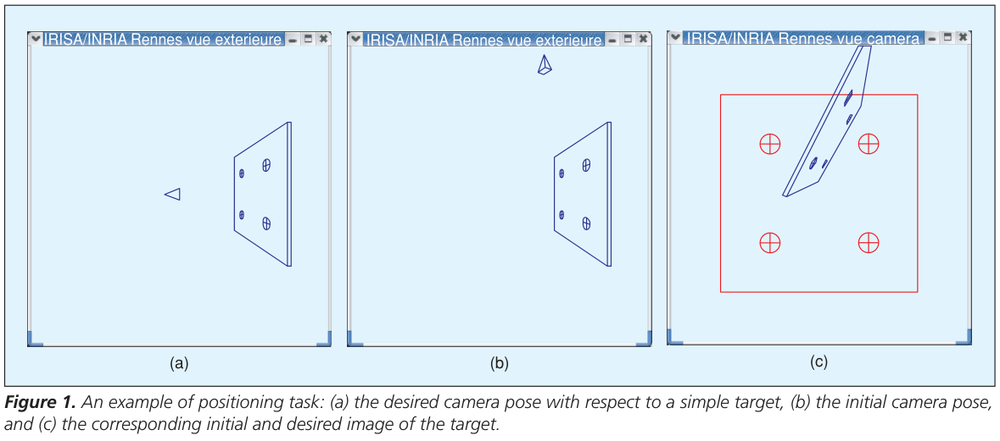
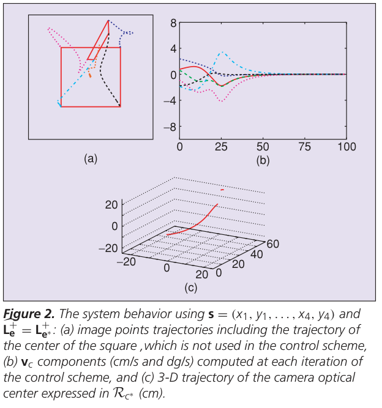
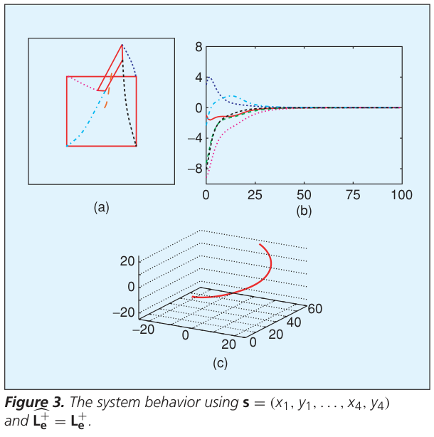
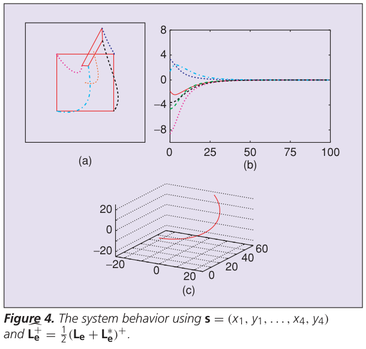
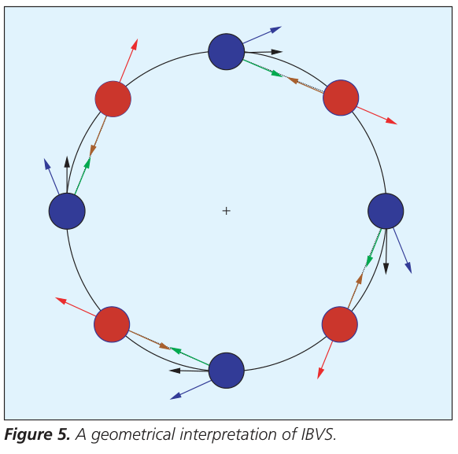
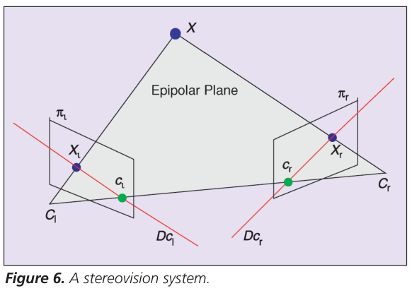
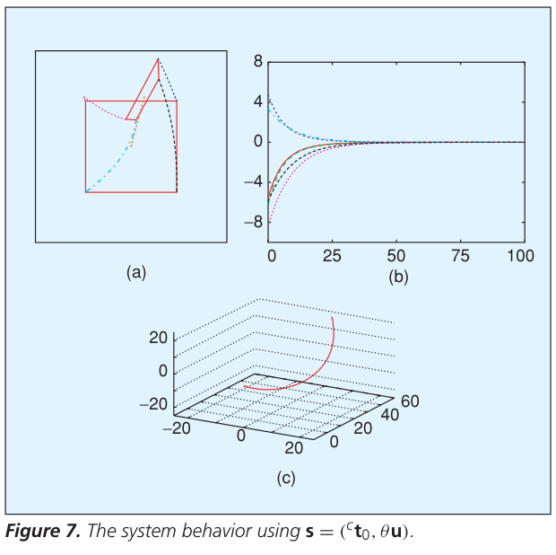
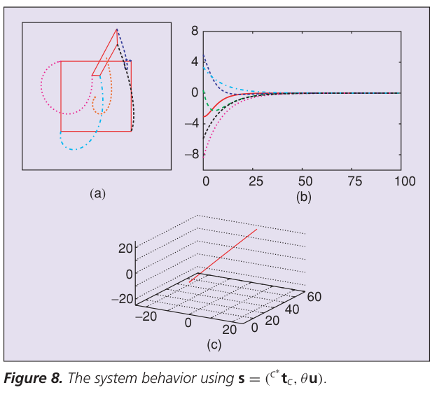
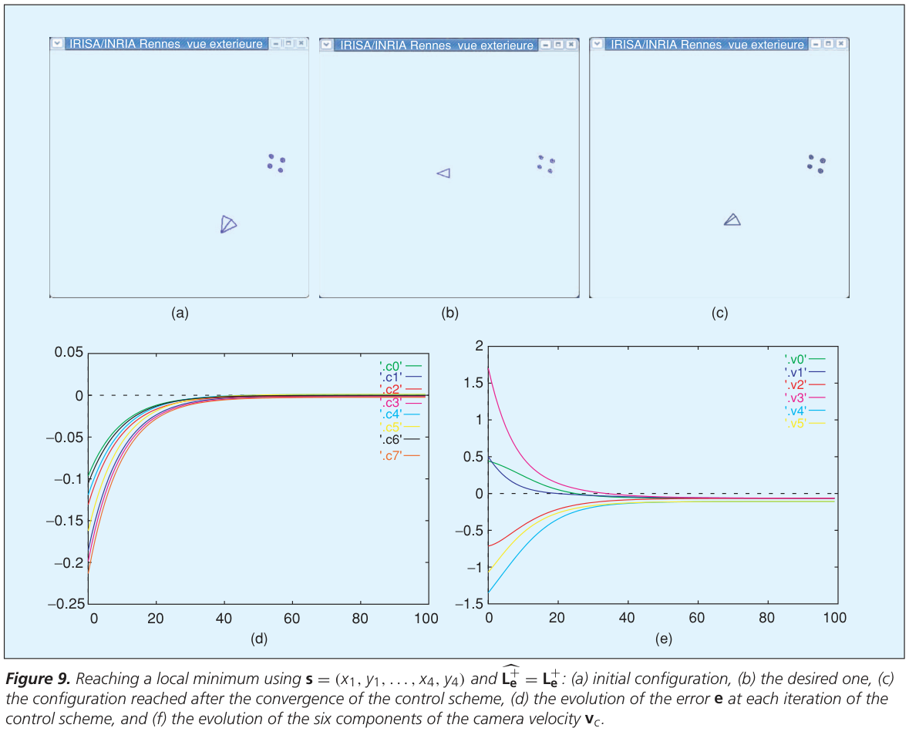
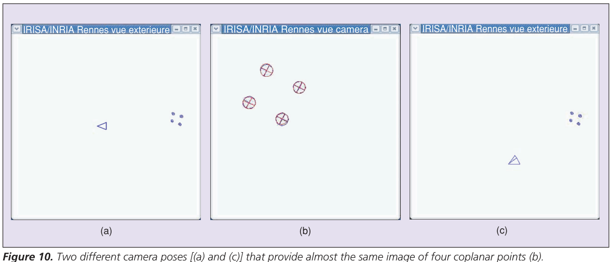

# 시각 서보 제어 제1부: 기본 접근법 (Chaumette 2006)

- 원제: Visual Servo Control Part I: Basic Approaches
- 저자: François Chaumette, Seth Hutchinson
- 원문: 같은 폴더의 `Chaumette2006_VisualServoControl_PartI.pdf` (IEEE Robotics & Automation Magazine, vol. 13, no. 4, pp. 82–90, December 2006, TUTORIAL)
- 번역 범위: 전문
- 그림: 원문 그림 10개를 `그림/`에 넣고 본문에서 처음 언급되는 곳에 삽입
- 원문에는 절 번호가 없다. 아래 번호는 찾아보기 편하도록 번역에서 붙인 것이며, 소절 제목은 원문 그대로 옮겼다.

## 초록

이 글은 시각 서보 제어(visual servo control) — 서보 루프 안에서 컴퓨터 비전 데이터를 사용해 로봇의 움직임을 제어하는 것 — 를 주제로 한 두 편짜리 연재의 첫 번째 글이다. 이 글에서는 현재 이 분야에서 충분히 확립된 기본 기법들을 설명한다. 먼저 시각 서보 제어 문제의 정식화를 개괄한다. 이어서 두 가지 전형적인 시각 서보 제어 방식인 영상 기반 시각 서보 제어(image-based visual servo control)와 위치 기반 시각 서보 제어(position-based visual servo control)를 설명한다. 마지막으로 이 두 방식에 관련된 성능과 안정성 문제를 논의하며, 이는 고급 기법을 다루는 연재의 두 번째 글의 동기가 된다.

## 1. 서론 (Introduction)

시각 서보 제어는 컴퓨터 비전 데이터를 사용해 로봇의 움직임을 제어하는 것을 말한다. 비전 데이터는 로봇 매니퓰레이터나 이동 로봇에 직접 장착된 카메라에서 얻을 수 있는데, 이 경우 로봇의 움직임이 카메라의 움직임을 유발한다. 또는 카메라를 작업 공간에 고정해 정지된 위치에서 로봇의 움직임을 관찰하게 할 수도 있다. 예를 들어 팬-틸트 헤드에 장착된 여러 대의 카메라가 로봇의 움직임을 관찰하는 것과 같은 다른 구성도 생각할 수 있다. 이 모든 경우의 수학적 전개는 비슷하며, 이 튜토리얼에서는 주로 전자, 즉 이른바 아이-인-핸드(eye-in-hand) 경우에 초점을 맞춘다.

시각 서보 제어는 영상 처리, 컴퓨터 비전, 제어 이론의 기법에 의존한다. 이 모든 것을 한 편의 글에서 깊이 다룰 수는 없으므로, 여기서는 주로 제어와 관련된 문제, 그리고 시각 서보 제어 연구에 고유하게 관련되는 컴퓨터 비전의 특정 기하학적 측면에 초점을 맞춘다. 특징 추적(feature tracking)이나 3차원(3-D) 자세 추정(pose estimation)과 관련된 문제는 따로 다루지 않는다. 둘 다 그 자체로 별도의 튜토리얼이 필요한 주제이다.

## 2. 시각 서보의 기본 구성 요소 (The Basic Components of Visual Servoing)

모든 비전 기반 제어 방식의 목표는 오차 $\mathbf{e}(t)$를 최소화하는 것이며, 오차는 보통 다음과 같이 정의된다.

$$\mathbf{e}(t) = \mathbf{s}(\mathbf{m}(t), \mathbf{a}) - \mathbf{s}^* . \tag{1}$$

이 정식화는 매우 일반적이어서, 아래에서 보듯 다양한 접근법을 포괄한다. (1)의 파라미터는 다음과 같이 정의된다. 벡터 $\mathbf{m}(t)$는 영상 측정값의 집합이다(예: 관심점들의 영상 좌표, 또는 물체 무게중심의 영상 좌표). 이 영상 측정값들은 $k$개의 시각 특징(visual feature)으로 이루어진 벡터 $\mathbf{s}(\mathbf{m}(t), \mathbf{a})$를 계산하는 데 쓰이며, 여기서 $\mathbf{a}$는 시스템에 대한 잠재적인 추가 지식(예: 대략적인 카메라 내부 파라미터나 물체의 3-D 모델)을 나타내는 파라미터 집합이다. 벡터 $\mathbf{s}^*$는 특징의 목표값(desired value)을 담는다.

튜토리얼의 제1부(이 글)에서는 목표 자세가 고정되어 있고 표적이 움직이지 않는 경우, 즉 $\mathbf{s}^*$가 상수이고 $\mathbf{s}$의 변화가 카메라 운동에만 의존하는 경우를 다룬다. 또한 여기서는 6 자유도(6 DOF)를 갖는 카메라의 운동을 제어하는 경우, 예를 들어 6 자유도 팔의 엔드이펙터에 카메라가 부착된 경우를 고려한다. 더 일반적인 경우는 튜토리얼의 제2부에서 다룬다.

시각 서보 방식들은 주로 $\mathbf{s}$를 설계하는 방식에서 차이가 난다. 이 글에서는 매우 다른 두 가지 접근법을 살펴본다. 먼저 영상 기반 시각 서보 제어(IBVS)를 설명하는데, 여기서 $\mathbf{s}$는 영상 데이터에서 바로 얻을 수 있는 특징들의 집합으로 이루어진다. 다음으로 위치 기반 시각 서보 제어(PBVS)를 설명하는데, 여기서 $\mathbf{s}$는 영상 측정값으로부터 추정해야 하는 3-D 파라미터들의 집합으로 이루어진다.

일단 $\mathbf{s}$를 선택하면 제어 방식의 설계는 꽤 단순할 수 있다. 아마 가장 직접적인 접근은 속도 제어기를 설계하는 것이다. 이를 위해서는 $\mathbf{s}$의 시간 변화와 카메라 속도 사이의 관계가 필요하다. 카메라의 공간 속도(spatial velocity)를 $\mathbf{v}_c = (\boldsymbol{v}_c, \boldsymbol{\omega}_c)$로 나타내자. 여기서 $\boldsymbol{v}_c$는 카메라 좌표계 원점의 순간 선속도이고 $\boldsymbol{\omega}_c$는 카메라 좌표계의 순간 각속도이다. $\dot{\mathbf{s}}$와 $\mathbf{v}_c$의 관계는 다음과 같다.

$$\dot{\mathbf{s}} = \mathbf{L_s}\mathbf{v}_c , \tag{2}$$

여기서 $\mathbf{L_s} \in \mathbb{R}^{k\times 6}$을 $\mathbf{s}$에 관한 상호작용 행렬(interaction matrix)이라 한다. 시각 서보 문헌에서는 특징 야코비안(feature Jacobian)이라는 용어도 어느 정도 혼용된다.

(1)과 (2)로부터 카메라 속도와 오차의 시간 변화 사이의 관계를 곧바로 얻는다.

$$\dot{\mathbf{e}} = \mathbf{L_e}\mathbf{v}_c , \tag{3}$$

여기서 $\mathbf{L_e} = \mathbf{L_s}$이다. $\mathbf{v}_c$를 로봇 제어기의 입력으로 보고, 예를 들어 오차의 지수적이고 분리된(decoupled) 감소(즉 $\dot{\mathbf{e}} = -\lambda\mathbf{e}$)를 보장하고자 한다면, (3)을 써서 다음을 얻는다.

$$\mathbf{v}_c = -\lambda \mathbf{L_e}^{+}\mathbf{e}, \tag{4}$$

여기서 $\mathbf{L_e}^{+} \in \mathbb{R}^{6\times k}$는 $\mathbf{L_e}$의 무어-펜로즈 유사역행렬(Moore-Penrose pseudoinverse)로 선택하며, $\mathbf{L_e}$가 완전 계수(full rank) 6일 때 $\mathbf{L_e}^{+} = (\mathbf{L_e}^\top\mathbf{L_e})^{-1}\mathbf{L_e}^\top$이다. 이 선택은 $\|\dot{\mathbf{e}} - \lambda\mathbf{L_e}\mathbf{L_e}^{+}\mathbf{e}\|$와 $\|\mathbf{v}_c\|$를 최소로 만든다. $k = 6$일 때 $\det \mathbf{L_e} \neq 0$이면 $\mathbf{L_e}$를 역변환할 수 있어[역주: 원문 "it it possible"은 오기], 제어 $\mathbf{v}_c = -\lambda\mathbf{L_e}^{-1}\mathbf{e}$를 얻는다.

실제 시각 서보 시스템에서는 $\mathbf{L_e}$나 $\mathbf{L_e}^{+}$를 실제로 완벽하게 아는 것이 불가능하다. 따라서 이 두 행렬 중 하나의 근사 또는 추정이 이루어져야 한다. 이후에는 상호작용 행렬의 근사의 유사역행렬과 상호작용 행렬의 유사역행렬의 근사를 모두 기호 $\widehat{\mathbf{L}_\mathbf{e}^{+}}$로 나타낸다. 이 표기를 쓰면 제어 법칙은 실제로 다음과 같다.

$$\mathbf{v}_c = -\lambda \widehat{\mathbf{L}_\mathbf{e}^{+}}\mathbf{e}. \tag{5}$$

이것이 대부분의 시각 서보 제어기가 구현하는 기본 설계이다. 남은 일은 세부 사항을 채우는 것뿐이다. $\mathbf{s}$를 어떻게 선택해야 하는가? 그러면 $\mathbf{L_s}$의 형태는 무엇인가? $\widehat{\mathbf{L}_\mathbf{e}^{+}}$를 어떻게 추정해야 하는가? 그 결과 얻는 폐루프 시스템의 성능 특성은 무엇인가? 이 질문들을 글의 나머지 부분에서 다룬다.

## 3. 고전적 영상 기반 시각 서보 (Classical Image-Based Visual Servo)

전통적인 영상 기반 제어 방식[1], [2]은 점 집합의 영상 평면 좌표를 사용해 집합 $\mathbf{s}$를 정의한다(다른 선택도 가능하지만, 그 논의는 튜토리얼 제2부로 미룬다). 영상 측정값 $\mathbf{m}$은 보통 영상 점들의 화소 좌표이며(유일한 선택은 아니다), (1)의 $\mathbf{s} = \mathbf{s}(\mathbf{m}, \mathbf{a})$ 정의에서 파라미터 $\mathbf{a}$는 화소로 표현된 영상 측정값을 특징으로 바꾸는 데 필요한 카메라 내부 파라미터에 다름 아니다.

### 상호작용 행렬 (The Interaction Matrix)

더 정확히 말하면, 카메라 좌표계에서 좌표가 $\mathbf{X} = (X, Y, Z)$인 3-D 점이 영상에 좌표 $\mathbf{x} = (x, y)$인 2-D 점으로 투영될 때 다음이 성립한다.

$$\begin{cases} x = X/Z = (u - c_u)/f\alpha \\ y = Y/Z = (v - c_v)/f, \end{cases} \tag{6}$$

여기서 $\mathbf{m} = (u, v)$는 화소 단위로 표현된 영상 점의 좌표이고, $\mathbf{a} = (c_u, c_v, f, \alpha)$는 카메라 내부 파라미터 집합이다. $c_u$와 $c_v$는 주점(principal point)의 좌표, $f$는 초점 거리, $\alpha$는 화소 크기의 비이다. 이 경우 $\mathbf{s} = \mathbf{x} = (x, y)$, 즉 점의 영상 평면 좌표로 둔다. 결상 기하와 원근 투영의 세부 사항은 [3], [4]를 비롯한 많은 컴퓨터 비전 교재에서 찾을 수 있다.

투영 방정식 (6)을 시간에 대해 미분하면 다음을 얻는다.

$$\begin{cases} \dot{x} = \dot{X}/Z - X\dot{Z}/Z^2 = (\dot{X} - x\dot{Z})/Z \\ \dot{y} = \dot{Y}/Z - Y\dot{Z}/Z^2 = (\dot{Y} - y\dot{Z})/Z. \end{cases} \tag{7}$$

잘 알려진 다음 식을 써서 3-D 점의 속도를 카메라 공간 속도와 관련지을 수 있다.

$$\dot{\mathbf{X}} = -\boldsymbol{v}_c - \boldsymbol{\omega}_c \times \mathbf{X} \Leftrightarrow \begin{cases} \dot{X} = -v_x - \omega_y Z + \omega_z Y \\ \dot{Y} = -v_y - \omega_z X + \omega_x Z \\ \dot{Z} = -v_z - \omega_x Y + \omega_y X. \end{cases} \tag{8}$$

(8)을 (7)에 대입하고 항을 묶으면 다음을 얻는다.

$$\begin{cases} \dot{x} = -v_x/Z + x v_z/Z + xy\omega_x - (1 + x^2)\omega_y + y\omega_z \\ \dot{y} = -v_y/Z + y v_z/Z + (1 + y^2)\omega_x - xy\omega_y - x\omega_z \end{cases} \tag{9}$$

이는 다음과 같이 쓸 수 있다.

$$\dot{\mathbf{x}} = \mathbf{L_x}\mathbf{v}_c , \tag{10}$$

여기서 $\mathbf{x}$에 관한 상호작용 행렬 $\mathbf{L_x}$는 다음과 같다.

$$\mathbf{L_x} = \begin{bmatrix} \frac{-1}{Z} & 0 & \frac{x}{Z} & xy & -(1 + x^2) & y \\ 0 & \frac{-1}{Z} & \frac{y}{Z} & 1 + y^2 & -xy & -x \end{bmatrix}. \tag{11}$$

행렬 $\mathbf{L_x}$에서 값 $Z$는 카메라 좌표계에 대한 점의 깊이이다. 따라서 이 형태의 상호작용 행렬을 쓰는 모든 제어 방식은 $Z$ 값을 추정하거나 근사해야 한다. 마찬가지로 $x$와 $y$의 계산에는 카메라 내부 파라미터가 관여한다. 그러므로 $\mathbf{L_x}$를 (4)에 *직접* 쓸 수는 없으며, 추정값 또는 근사값 $\widehat{\mathbf{L}_\mathbf{x}}$를 써야 한다. 이에 대해서는 아래에서 더 자세히 논의한다.

6 자유도를 제어하려면 적어도 세 점이 필요하다(즉 $k \geq 6$이어야 한다). 특징 벡터 $\mathbf{x} = (\mathbf{x}_1, \mathbf{x}_2, \mathbf{x}_3)$을 쓰면, 세 점의 상호작용 행렬을 단순히 쌓아서 다음을 얻는다.

$$\mathbf{L_x} = \begin{bmatrix} \mathbf{L}_{\mathbf{x}_1} \\ \mathbf{L}_{\mathbf{x}_2} \\ \mathbf{L}_{\mathbf{x}_3} \end{bmatrix}.$$

이 경우 $\mathbf{L_x}$가 특이(singular)해지는 형상(configuration)이 존재한다[5]. 또한 $\mathbf{e} = 0$이 되는 서로 다른 카메라 자세가 네 개 존재하며, 즉 전역 최솟값이 네 개 존재하고 이들을 구별하는 것은 불가능하다[6]. 이러한 이유로 보통 세 점보다 많은 점을 사용한다.

### 상호작용 행렬의 근사 (Approximating the Interaction Matrix)

제어 법칙에 쓸 추정값 $\widehat{\mathbf{L}_\mathbf{e}^{+}}$를 구성하는 데는 여러 선택지가 있다. 물론 널리 쓰이는 한 방식은, $\mathbf{L_e} = \mathbf{L_x}$를 알고 있다면, 즉 각 점의 현재 깊이 $Z$를 알 수 있다면 $\widehat{\mathbf{L}_\mathbf{e}^{+}} = \mathbf{L_e}^{+}$로 선택하는 것이다[7]. 실제로는 이 파라미터들을 제어 방식의 매 반복마다 추정해야 한다. 이 글에서 제시하는 기본 방법들은 다음 절에서 간단히 소개할 고전적 자세 추정 방법을 사용한다. 또 다른 널리 쓰이는 접근은 $\widehat{\mathbf{L}_\mathbf{e}^{+}} = \mathbf{L}_{\mathbf{e}^*}^{+}$로 선택하는 것이며, 여기서 $\mathbf{L}_{\mathbf{e}^*}$는 목표 위치 $\mathbf{e} = \mathbf{e}^* = 0$에서의 $\mathbf{L_e}$ 값이다[8]. 이 경우 $\widehat{\mathbf{L}_\mathbf{e}^{+}}$는 상수이고 각 점의 목표 깊이만 설정하면 되므로, 시각 서보 동안 변하는 3-D 파라미터를 추정할 필요가 없다. 마지막으로, $\widehat{\mathbf{L}_\mathbf{e}^{+}} = 1/2(\mathbf{L_e} + \mathbf{L}_{\mathbf{e}^*})^{+}$라는 선택이 최근 [9]에서 제안되었다. 이 방법에는 $\mathbf{L_e}$가 관여하므로 각 점의 현재 깊이도 알 수 있어야 한다.

이 제어 방식들의 거동을 한 예로 보여 준다. 목표는 정사각형을 영상 중앙의 정사각형으로 관측하도록 카메라를 위치시키는 것이다(그림 1 참조). $\mathbf{s}$는 정사각형을 이루는 네 점의 $x$, $y$ 좌표를 포함하도록 정의한다. 초기 카메라 자세는 목표 자세에서 멀리 떨어지도록, 특히 IBVS에서 가장 문제가 되는 것으로 알려진 회전 운동 측면에서 멀리 떨어지도록 선택했음에 유의하라. 이하의 시뮬레이션에서는 완벽한 조건에서 서로 다른 거동을 비교할 수 있도록 잡음이나 모델링 오차를 넣지 않았다.

*그림 1 — 위치 결정 작업의 예: (a) 단순한 표적에 대한 목표 카메라 자세, (b) 초기 카메라 자세, (c) 이에 대응하는 표적의 초기 영상과 목표 영상.*

$\widehat{\mathbf{L}_\mathbf{e}^{+}} = \mathbf{L}_{\mathbf{e}^*}^{+}$를 써서 얻은 결과를 그림 2에 나타냈다. 큰 변위가 필요한데도 시스템은 수렴한다는 점에 주목하라. 그러나 수렴에서 먼 곳(즉 처음 30회 정도의 반복)에서는 영상 내 거동도, 계산된 카메라 속도 성분도, 카메라의 3-D 궤적도 바람직한 성질을 보이지 않는다.

*그림 2 — $\mathbf{s} = (x_1, y_1, \ldots, x_4, y_4)$와 $\widehat{\mathbf{L}_\mathbf{e}^{+}} = \mathbf{L}_{\mathbf{e}^*}^{+}$를 쓸 때의 시스템 거동: (a) 영상 점 궤적(제어 방식에는 쓰이지 않는 정사각형 중심의 궤적 포함), (b) 제어 방식의 매 반복에서 계산된 $\mathbf{v}_c$ 성분(cm/s 및 dg/s), (c) $\mathcal{R}_{c^*}$에서 표현한 카메라 광학 중심의 3-D 궤적(cm).*

$\widehat{\mathbf{L}_\mathbf{e}^{+}} = \mathbf{L_e}^{+}$를 써서 얻은 결과는 그림 3에 나타냈다. 이 경우 영상 내 점들의 궤적은 거의 직선이지만, 3-D에서 유발되는 거동은 $\widehat{\mathbf{L}_\mathbf{e}^{+}} = \mathbf{L}_{\mathbf{e}^*}^{+}$의 경우보다도 덜 만족스럽다. 서보 초기의 큰 카메라 속도는 궤적 시작 부분에서 $\widehat{\mathbf{L}_\mathbf{e}^{+}}$의 조건수(condition number)가 크다는 것을 나타내며, 카메라 궤적은 직선과 거리가 멀다.

*그림 3 — $\mathbf{s} = (x_1, y_1, \ldots, x_4, y_4)$와 $\widehat{\mathbf{L}_\mathbf{e}^{+}} = \mathbf{L_e}^{+}$를 쓸 때의 시스템 거동.*

$\widehat{\mathbf{L}_\mathbf{e}^{+}} = 1/2(\mathbf{L_e} + \mathbf{L}_{\mathbf{e}^*})^{+}$라는 선택은 실제로 좋은 성능을 낸다. 실제로 그림 4에서 볼 수 있듯이 카메라 속도 성분에 큰 진동이 없으며, 영상과 3-D 모두에서 매끄러운 궤적을 낸다.

*그림 4 — $\mathbf{s} = (x_1, y_1, \ldots, x_4, y_4)$와 $\widehat{\mathbf{L}_\mathbf{e}^{+}} = \frac{1}{2}(\mathbf{L_e} + \mathbf{L}_\mathbf{e}^{*})^{+}$를 쓸 때의 시스템 거동.*

### IBVS의 기하학적 해석 (A Geometrical Interpretation of IBVS)

위에서 정의한 제어 방식들의 거동을 기하학적으로 해석하는 것은 꽤 쉽다. 그림 5에 보인 예는 초기 형상(파란색)에서 영상 평면과 평행한 네 개의 동일 평면 점으로 이루어진 목표 형상(빨간색)까지 광축 둘레의 순수 회전에 해당한다.

*그림 5 — IBVS의 기하학적 해석.*

위에서 설명했듯이 제어 방식에 $\mathbf{L_e}^{+}$를 쓰면 오차 $\mathbf{e}$의 지수적 감소를 보장하려 한다. 이는 $x$, $y$ 영상 점 좌표가 이 오차를 구성할 때, 가능하다면 영상 내 점들의 궤적이 초기 위치에서 목표 위치까지 직선을 따른다는 뜻이다. 이것이 그림에서 녹색으로 그린 영상 운동이다. 이 영상 운동을 실현하는 카메라 운동은 쉽게 유도할 수 있으며, 실제로 광축 둘레의 회전 운동으로 이루어지지만 광축을 따라 뒤로 물러나는 평행이동(병진) 운동이 결합된다[10]. 이 예상치 못한 운동은 특징의 선택과 상호작용 행렬의 세 번째 열과 여섯 번째 열 사이의 결합(coupling) 때문이다. 초기 형상과 목표 형상 사이의 회전이 매우 크면 이 현상이 증폭되며, $\pi$ rad 회전이라는 특수한 경우에는 제어 방식이 회전 운동을 전혀 유발하지 않게 된다[11]. 반면 회전이 작으면 이 현상은 거의 사라진다. 결론적으로 거동은 국소적으로(즉 오차가 작을 때) 만족스럽지만, 오차가 클 때는 불만족스러울 수 있다. 이 글의 마지막 부분에서 보겠지만, 이러한 결과는 IBVS에 대해 얻을 수 있는 국소 점근 안정성 결과와 일치한다.

대신 제어 방식에 $\mathbf{L}_{\mathbf{e}^*}^{+}$를 쓰면, 생성되는 영상 운동은 그림 5에 파란색으로 그린 것임을 쉽게 보일 수 있다. 실제로 앞과 같은 제어 방식을 생각하되 $\mathbf{s}^*$에서 출발해 $\mathbf{s}$에 도달한다고 하면 다음을 얻는다.

$$\mathbf{v}_c = -\lambda \mathbf{L}_{\mathbf{e}^*}^{+}(\mathbf{s}^* - \mathbf{s}),$$

이는 다시 빨간 점에서 파란 점으로 가는 직선 궤적을 유발하여 갈색으로 그린 영상 운동을 일으킨다. 원래 문제로 돌아가면, 제어 방식은 정확히 반대 방향의 카메라 속도를 계산한다.

$$\mathbf{v}_c = -\lambda \mathbf{L}_{\mathbf{e}^*}^{+}(\mathbf{s} - \mathbf{s}^*)$$

따라서 빨간 점에서 빨간색으로 그린 영상 운동을 생성한다. 파란 점에서 변환하면, 이 카메라 속도는 파란 영상 운동을 생성하며, 이는 다시 광축 둘레의 회전 운동에 해당하되 이번에는 광축을 따라 앞으로 나아가는 예상치 못한 운동이 결합된다. 큰 오차와 작은 오차에 대해 앞과 같은 분석을 할 수 있다. 덧붙이면, 오차가 크게 줄어들자마자 두 제어 방식은 서로 가까워져 같은 방식으로 수렴하며($\mathbf{e} = \mathbf{e}^*$일 때 $\mathbf{L_e} = \mathbf{L}_{\mathbf{e}^*}$이므로), 오차가 0으로 갈 때 검은색으로 그린 영상 운동과 광축 둘레의 회전만으로 이루어진 카메라 운동이라는 좋은 거동을 보인다.

대신 $\widehat{\mathbf{L}_\mathbf{e}^{+}} = 1/2(\mathbf{L_e} + \mathbf{L}_{\mathbf{e}^*})^{+}$를 쓰면, $\mathbf{L_e}$와 $\mathbf{L}_{\mathbf{e}^*}$의 평균을 고려하는 것이 오차가 클 때에도 검은색으로 그린 영상 운동을 생성한다는 것은 직관적으로 분명하다. $\pi$ rad 둘레의 회전을 제외한 모든 경우에, 이제 카메라 운동은 예상치 못한 평행이동 운동 없이 광축 둘레의 순수 회전이 된다.

### 스테레오비전 시스템을 이용한 IBVS (IBVS with a Stereovision System)

IBVS 접근법을 다중 카메라 시스템으로 확장하는 것은 간단하다. 스테레오비전 시스템을 쓰고 3-D 점이 왼쪽과 오른쪽 영상 모두에서 보이면(그림 6 참조), 시각 특징으로 다음을 쓸 수 있다.

*그림 6 — 스테레오비전 시스템.*

$$\mathbf{s} = \mathbf{x}_s = (\mathbf{x}_l, \mathbf{x}_r) = (x_l, y_l, x_r, y_r),$$

즉 관측된 점의 왼쪽·오른쪽 영상에서의 $x$, $y$ 좌표를 $\mathbf{s}$에 단순히 쌓아서 점을 표현하는 것이다[12]. 그러나 (10)에 주어진 형태는 왼쪽 또는 오른쪽 카메라 좌표계에서 표현된 것이므로, 대응하는 상호작용 행렬을 구성할 때 주의해야 한다. 더 정확히는 다음과 같다.

$$\begin{cases} \dot{\mathbf{x}}_l = \mathbf{L}_{\mathbf{x}_l}\mathbf{v}_l \\ \dot{\mathbf{x}}_r = \mathbf{L}_{\mathbf{x}_r}\mathbf{v}_r, \end{cases}$$

여기서 $\mathbf{v}_l$과 $\mathbf{v}_r$은 각각 왼쪽과 오른쪽 카메라의 공간 속도이고, $\mathbf{L}_{\mathbf{x}_l}$과 $\mathbf{L}_{\mathbf{x}_r}$의 해석적 형태는 (11)로 주어진다.

스테레오비전 시스템에 강체로 연결된 센서 좌표계를 선택하면 다음을 얻는다.

$$\dot{\mathbf{x}}_s = \begin{bmatrix} \dot{\mathbf{x}}_l \\ \dot{\mathbf{x}}_r \end{bmatrix} = \mathbf{L}_{\mathbf{x}_s}\mathbf{v}_s ,$$

여기서 $\mathbf{x}_s$에 관한 상호작용 행렬은, 왼쪽 또는 오른쪽 카메라 좌표계에서 표현된 속도를 센서 좌표계로 변환하는 공간 운동 변환 행렬(spatial motion transform matrix) $\mathbf{V}$를 써서 구할 수 있다. $\mathbf{V}$는 다음과 같다[13].

$$\mathbf{V} = \begin{bmatrix} \mathbf{R} & [\mathbf{t}]_\times\mathbf{R} \\ \mathbf{0} & \mathbf{R} \end{bmatrix}, \tag{12}$$

여기서 $[\mathbf{t}]_\times$는 벡터 $\mathbf{t}$에 대응하는 반대칭 행렬(skew symmetric matrix)이고, $(\mathbf{R}, \mathbf{t}) \in SE(3)$은 카메라 좌표계에서 센서 좌표계로의 강체 변환이다. 이 행렬들의 수치 값은 스테레오비전 시스템의 보정(캘리브레이션) 단계에서 직접 얻는다. 이 식을 쓰면 다음을 얻는다.

$$\mathbf{L}_{\mathbf{x}_s} = \begin{bmatrix} \mathbf{L}_{\mathbf{x}_l}\,{}^{l}\mathbf{V}_s \\ \mathbf{L}_{\mathbf{x}_r}\,{}^{r}\mathbf{V}_s \end{bmatrix}.$$

$\mathbf{L}_{\mathbf{x}_s} \in \mathbb{R}^{4\times 6}$은 스테레오비전 시스템에서 3-D 점의 원근 투영들을 연결하는 에피폴라 구속(epipolar constraint) 때문에 항상 계수(rank)가 3임에 유의하라(그림 6 참조). 또 다른 간단한 해석은 3-D 점이 세 개의 독립 파라미터로 표현되므로, 그 점을 관측하는 어떤 센서를 쓰더라도 세 개보다 많은 독립 파라미터를 찾는 것은 불가능하다는 것이다.

시스템의 6 자유도를 제어하려면 적어도 세 점을 고려해야 하며, 두 점만 고려할 때 상호작용 행렬의 계수는 5이다.

스테레오비전 시스템을 쓰면 두 영상 모두에서 관측된 어떤 점의 3-D 좌표든 단순한 삼각측량(triangulation) 과정으로 쉽게 추정할 수 있으므로, 이 3-D 좌표를 특징 집합 $\mathbf{s}$에 쓰는 것이 가능하고 꽤 자연스럽다. 그러한 접근은 $\mathbf{s}$에 3-D 파라미터를 필요로 하므로, 엄밀히 말하면 위치 기반 접근이 된다.

## 4. 위치 기반 시각 서보 (Position-Based Visual Servo)

위치 기반 제어 방식(PBVS)[2], [14], [15]은 어떤 기준 좌표계에 대한 카메라의 자세를 써서 $\mathbf{s}$를 정의한다. 한 영상의 측정값 집합으로부터 그 자세를 계산하려면 카메라 내부 파라미터와 관측되는 물체의 3-D 모델을 알아야 한다. 이 고전적인 컴퓨터 비전 문제를 *3-D 위치 추정 문제(3-D localization problem)* 라 한다. 이 문제는 이 튜토리얼의 범위를 벗어나지만, 문헌에는 많은 해법이 제시되어 있다(예: [16]과 [17] 참조).

그러면 카메라 자세를 표현하는 데 쓰는 파라미터화로 $\mathbf{s}$를 정의하는 것이 일반적이다. (1)의 $\mathbf{s}$ 정의에 관여하는 파라미터 $\mathbf{a}$는 이제 카메라 내부 파라미터와 물체의 3-D 모델임에 유의하라.

세 개의 좌표계, 즉 현재 카메라 좌표계 $\mathcal{F}_c$, 목표 카메라 좌표계 $\mathcal{F}_{c^*}$, 물체에 부착된 기준 좌표계 $\mathcal{F}_o$를 고려하는 것이 편리하다. 여기서는 좌표 집합이 어느 좌표계에 대해 정의되는지를 앞쪽 위첨자로 나타내는 표준 표기를 쓴다. 따라서 좌표 벡터 ${}^{c}\mathbf{t}_o$와 ${}^{c^*}\mathbf{t}_o$는 물체 좌표계 원점의 좌표를 각각 현재 카메라 좌표계와 목표 카메라 좌표계에 대해 표현한 것이다. 또한 $\mathbf{R} = {}^{c^*}\mathbf{R}_c$를 목표 좌표계에 대한 현재 카메라 좌표계의 방향을 주는 회전 행렬이라 하자.

$\mathbf{s}$를 $(\mathbf{t}, \theta\mathbf{u})$로 정의할 수 있다. 여기서 $\mathbf{t}$는 평행이동 벡터이고 $\theta\mathbf{u}$는 회전에 대한 각-축(angle/axis) 파라미터화이다. 이제 $\mathbf{t}$에 대한 두 가지 선택과 그에 대응하는 제어 법칙을 논의한다.

$\mathbf{t}$를 물체 좌표계 $\mathcal{F}_o$에 대해 정의하면 $\mathbf{s} = ({}^{c}\mathbf{t}_o, \theta\mathbf{u})$, $\mathbf{s}^* = ({}^{c^*}\mathbf{t}_o, \mathbf{0})$, $\mathbf{e} = ({}^{c}\mathbf{t}_o - {}^{c^*}\mathbf{t}_o, \theta\mathbf{u})$를 얻는다. 이 경우 $\mathbf{e}$에 관한 상호작용 행렬은 다음과 같다.

$$\mathbf{L_e} = \begin{bmatrix} -\mathbf{I}_3 & [{}^{c}\mathbf{t}_o]_\times \\ \mathbf{0} & \mathbf{L}_{\theta\mathbf{u}} \end{bmatrix}, \tag{13}$$

여기서 $\mathbf{I}_3$은 $3\times 3$ 단위 행렬이고 $\mathbf{L}_{\theta\mathbf{u}}$는 다음과 같다[18].

$$\mathbf{L}_{\theta\mathbf{u}} = \mathbf{I}_3 - \frac{\theta}{2}[\mathbf{u}]_\times + \left(1 - \frac{\operatorname{sinc}\theta}{\operatorname{sinc}^2\frac{\theta}{2}}\right)[\mathbf{u}]_\times^2, \tag{14}$$

여기서 $\operatorname{sinc} x$는 $x \operatorname{sinc} x = \sin x$이고 $\operatorname{sinc} 0 = 1$이 되도록 정의한 싱크 함수(sinus cardinal)이다.

글의 첫 부분에서 제시한 전개를 따르면 다음 제어 방식을 얻는다.

$$\mathbf{v}_c = -\lambda \widehat{\mathbf{L}_\mathbf{e}^{-1}}\mathbf{e},$$

$\mathbf{s}$의 차원 $k$가 카메라 자유도 수인 6이기 때문이다. 다음과 같이 두면

$$\widehat{\mathbf{L}_\mathbf{e}^{-1}} = \begin{bmatrix} -\mathbf{I}_3 & [{}^{c}\mathbf{t}_o]_\times\mathbf{L}_{\theta\mathbf{u}}^{-1} \\ \mathbf{0} & \mathbf{L}_{\theta\mathbf{u}}^{-1} \end{bmatrix}, \tag{15}$$

간단한 전개 후 다음을 얻는다.

$$\begin{cases} \boldsymbol{v}_c = -\lambda\left(({}^{c^*}\mathbf{t}_o - {}^{c}\mathbf{t}_o) + [{}^{c}\mathbf{t}_o]_\times\theta\mathbf{u}\right) \\ \boldsymbol{\omega}_c = -\lambda\theta\mathbf{u}, \end{cases} \tag{16}$$

$\mathbf{L}_{\theta\mathbf{u}}$가 $\mathbf{L}_{\theta\mathbf{u}}^{-1}\theta\mathbf{u} = \theta\mathbf{u}$를 만족하기 때문이다.

이 PBVS 방식은 회전 운동이 지수적으로 감소하는 속도로 측지선(geodesic)을 따르게 하고, $\mathbf{s}$에 관여하는 평행이동 파라미터들도 같은 속도로 감소하게 한다. 이것이 그림 7에서 카메라 속도 성분이 보기 좋게 지수적으로 감소하는 이유이다. 또한 물체 좌표계 원점의 영상 내 궤적은 순수한 직선을 따른다(여기서는 네 점의 중심을 이 원점으로 선택했다). 반면 카메라 궤적은 직선을 따르지 않는다.

*그림 7 — $\mathbf{s} = ({}^{c}\mathbf{t}_0, \theta\mathbf{u})$를 쓸 때의 시스템 거동.*

$\mathbf{s} = ({}^{c^*}\mathbf{t}_c, \theta\mathbf{u})$를 써서 또 다른 PBVS 방식을 설계할 수 있다. 이 경우 $\mathbf{s}^* = \mathbf{0}$, $\mathbf{e} = \mathbf{s}$이고 다음이 성립한다.

$$\mathbf{L_e} = \begin{bmatrix} \mathbf{R} & \mathbf{0} \\ \mathbf{0} & \mathbf{L}_{\theta\mathbf{u}} \end{bmatrix}. \tag{17}$$

평행이동 운동과 회전 운동이 분리(decoupling)되어 있음에 주목하라. 이 덕분에 다음과 같은 간단한 제어 방식을 얻을 수 있다.

$$\begin{cases} \boldsymbol{v}_c = -\lambda\mathbf{R}^\top\,{}^{c^*}\mathbf{t}_c \\ \boldsymbol{\omega}_c = -\lambda\theta\mathbf{u}. \end{cases} \tag{18}$$

이 경우 그림 8에서 볼 수 있듯이, (18)에 관여하는 자세 파라미터가 완벽하게 추정된다면 카메라 궤적은 순수한 직선이 되지만, 영상 궤적은 앞의 경우보다 덜 만족스럽다. 일부 점이 카메라 시야를 벗어나는 특정 형상을 찾을 수도 있다.

*그림 8 — $\mathbf{s} = ({}^{c^*}\mathbf{t}_c, \theta\mathbf{u})$를 쓸 때의 시스템 거동.*

## 5. 안정성 해석 (Stability Analysis)

이 절에서는 제어기의 안정성에 관련된 근본적인 문제들을 다룬다. 폐루프 시각 서보 시스템의 안정성을 평가하기 위해 리아푸노프(Lyapunov) 해석을 사용한다. 특히 오차 노름의 제곱 $\mathcal{L} = 1/2\|\mathbf{e}(t)\|^2$로 정의한 후보 리아푸노프 함수를 생각하자. 그 도함수는 다음과 같다.

$$\begin{aligned} \dot{\mathcal{L}} &= \mathbf{e}^\top\dot{\mathbf{e}} \\ &= -\lambda\mathbf{e}^\top\mathbf{L_e}\widehat{\mathbf{L}_\mathbf{e}^{+}}\mathbf{e}. \end{aligned}$$

따라서 다음 충분조건이 보장되면 시스템의 전역 점근 안정성(global asymptotic stability)을 얻는다.

$$\mathbf{L_e}\widehat{\mathbf{L}_\mathbf{e}^{+}} > 0. \tag{19}$$

특징의 수가 카메라 자유도의 수와 같고(즉 $k = 6$), 특징을 선택하고 제어 방식을 설계할 때 $\mathbf{L_e}$와 $\widehat{\mathbf{L}_\mathbf{e}^{+}}$가 완전 계수 6이 되도록 했다면, $\widehat{\mathbf{L}_\mathbf{e}^{+}}$에 관여하는 근사가 너무 거칠지 않은 한 조건 (19)가 보장된다.

이제 이를 IBVS와 PBVS의 특정 경우에 적용해 본다.

### IBVS의 안정성 해석 (Stability Analysis of IBVS)

앞서 논의했듯이 대부분의 IBVS 접근에서는 $k > 6$이다. 따라서 $\mathbf{L_e}\widehat{\mathbf{L}_\mathbf{e}^{+}} \in \mathbb{R}^{k\times k}$의 계수가 최대 6이므로 조건 (19)는 결코 보장될 수 없다. 즉 $\mathbf{L_e}\widehat{\mathbf{L}_\mathbf{e}^{+}}$는 자명하지 않은 영공간(null space)을 가진다. 이 경우 $\mathbf{e} \in \operatorname{Ker}\widehat{\mathbf{L}_\mathbf{e}^{+}}$인 형상이 국소 최솟값(local minima)에 해당한다. 그러한 국소 최솟값에 도달하는 예를 그림 9에 나타냈다. 그림 9(d)에서 볼 수 있듯이 $\mathbf{e}$의 각 성분은 같은 수렴 속도로 보기 좋게 지수적으로 감소하여 영상에서 직선 궤적을 실현하지만, 도달한 오차는 정확히 0이 아니며, 그림 9(c)로부터 시스템이 목표 형상에서 멀리 떨어진 국소 최솟값으로 끌려갔음이 분명하다. 따라서 IBVS에 대해서는 국소 점근 안정성(local asymptotic stability)만 얻을 수 있다.

*그림 9 — $\mathbf{s} = (x_1, y_1, \ldots, x_4, y_4)$와 $\widehat{\mathbf{L}_\mathbf{e}^{+}} = \mathbf{L_e}^{+}$를 써서 국소 최솟값에 도달하는 예: (a) 초기 형상, (b) 목표 형상, (c) 제어 방식이 수렴한 뒤 도달한 형상, (d) 제어 방식의 매 반복에서 오차 $\mathbf{e}$의 변화, (f) 카메라 속도 $\mathbf{v}_c$의 여섯 성분의 변화. [역주: 원문 캡션의 "(f)"는 그림의 (e)를 가리킨다.]*

$k > 6$일 때의 국소 점근 안정성을 연구하기 위해, 먼저 $\mathbf{e}' = \widehat{\mathbf{L}_\mathbf{e}^{+}}\mathbf{e}$인 새 오차 $\mathbf{e}'$를 정의하자. 이 오차의 시간 도함수는 다음과 같다.

$$\begin{aligned} \dot{\mathbf{e}}' &= \widehat{\mathbf{L}_\mathbf{e}^{+}}\dot{\mathbf{e}} + \dot{\widehat{\mathbf{L}_\mathbf{e}^{+}}}\mathbf{e} \\ &= (\widehat{\mathbf{L}_\mathbf{e}^{+}}\mathbf{L_e} + \mathbf{O})\mathbf{v}_c , \end{aligned}$$

여기서 $\mathbf{O} \in \mathbb{R}^{6\times 6}$은 $\widehat{\mathbf{L}_\mathbf{e}^{+}}$의 선택과 무관하게 $\mathbf{e} = 0$일 때 0이다[19]. 제어 방식 (5)를 쓰면 다음을 얻는다.

$$\dot{\mathbf{e}}' = -\lambda(\widehat{\mathbf{L}_\mathbf{e}^{+}}\mathbf{L_e} + \mathbf{O})\mathbf{e}',$$

이 시스템은 다음 조건이 성립하면 $\mathbf{e} = \mathbf{e}^* = 0$의 근방에서 국소 점근 안정한 것으로 알려져 있다.

$$\widehat{\mathbf{L}_\mathbf{e}^{+}}\mathbf{L_e} > 0, \tag{20}$$

여기서 $\widehat{\mathbf{L}_\mathbf{e}^{+}}\mathbf{L_e} \in \mathbb{R}^{6\times 6}$이다. 실제로 국소 점근 안정성에 관심이 있다면 선형화된 시스템 $\dot{\mathbf{e}}' = -\lambda\widehat{\mathbf{L}_\mathbf{e}^{+}}\mathbf{L_e}\mathbf{e}'$만 고려하면 된다[20].

다시 한번, 특징을 선택하고 제어 방식을 설계할 때 $\mathbf{L_e}$와 $\widehat{\mathbf{L}_\mathbf{e}^{+}}$가 완전 계수 6이 되도록 했다면, $\widehat{\mathbf{L}_\mathbf{e}^{+}}$에 관여하는 근사가 너무 거칠지 않은 한 조건 (20)이 보장된다.

국소 점근 안정성의 증명을 마무리하려면, $\mathbf{e}^*$의 작은 근방과 대응하는 자세 $\mathbf{p}^*$의 작은 근방 안에 $\mathbf{e} \in \operatorname{Ker}\widehat{\mathbf{L}_\mathbf{e}^{+}}$인 형상 $\mathbf{e} \neq \mathbf{e}^*$가 존재하지 않음을 보여야 한다. 그러한 형상은 $\mathbf{v}_c = 0$이고 $\mathbf{e} \neq \mathbf{e}^*$인 국소 최솟값에 해당한다. 그러한 자세 $\mathbf{p}$가 존재한다면, $\mathbf{p}^*$ 주변의 근방을 좁혀 $\mathbf{p}$에서 $\mathbf{p}^*$에 도달하는 카메라 속도 $\mathbf{v}$가 존재하게 할 수 있다. 이 카메라 속도는 오차의 변화 $\dot{\mathbf{e}} = \mathbf{L_e}\mathbf{v}$를 유발한다. 그러나 $\widehat{\mathbf{L}_\mathbf{e}^{+}}\mathbf{L_e} > 0$이므로 그러한 변화는 $\operatorname{Ker}\widehat{\mathbf{L}_\mathbf{e}^{+}}$에 속할 수 없다. 따라서 $\mathbf{p}^*$의 근방에서 $\mathbf{v}_c = 0$일 필요충분조건은 $\dot{\mathbf{e}} = 0$, 즉 $\mathbf{e} = \mathbf{e}^*$이다.

$k > 6$일 때 국소 점근 안정성은 보장할 수 있지만 전역 점근 안정성은 보장할 수 없다. 예를 들어 그림 9에 보인 것처럼, 위에서 고려한 근방 바깥에 $\mathbf{e} \in \operatorname{Ker}\widehat{\mathbf{L}_\mathbf{e}^{+}}$인 형상에 해당하는 국소 최솟값이 존재할 수 있다. 실제로는 이 근방이 놀라울 정도로 꽤 크다고 하더라도, 안정성과 수렴이 보장되는 근방의 크기를 결정하는 것은 여전히 미해결 문제이다.

### PBVS의 안정성 해석 (Stability Analysis of PBVS)

PBVS의 안정성 성질은 꽤 매력적으로 보인다. (14)에 주어진 $\mathbf{L}_{\theta\mathbf{u}}$는 $\theta \neq 2k\pi$일 때 정칙(nonsingular)이므로, 모든 자세 파라미터가 완벽하다는 강한 가정 아래 $\mathbf{L_e}\widehat{\mathbf{L}_\mathbf{e}^{-1}} = \mathbf{I}_6$이 되어 (19)로부터 시스템의 전역 점근 안정성을 얻는다. (13)과 (17)에 주어진 상호작용 행렬은 $\mathbf{L}_{\theta\mathbf{u}}$가 정칙일 때 완전 계수이므로, 이는 앞서 제시한 두 PBVS 방법 모두에 성립한다.

강건성(robustness)에 관해서는, 피드백이 영상 측정값과 시스템 보정 파라미터의 함수인 *추정된* 양들로 계산된다. 첫 번째 PBVS 방법에 대해(두 번째 방법의 분석도 유사하다), (13)에 주어진 상호작용 행렬은 완벽하게 추정된 자세 파라미터에 해당하지만, 추정된 자세 파라미터는 보정 오차로 인해 편향(bias)되거나 잡음으로 인해 부정확하고 불안정할 수 있으므로 실제 행렬은 알 수 없다[11]. 참된 양정(positivity) 조건 (19)는 실제로 다음과 같이 써야 한다.

$$\mathbf{L}_{\hat{\mathbf{e}}}\widehat{\mathbf{L}_{\hat{\mathbf{e}}}^{-1}} > 0, \tag{21}$$

여기서 $\widehat{\mathbf{L}_{\hat{\mathbf{e}}}^{-1}}$은 (15)로 주어지지만 $\mathbf{L}_{\hat{\mathbf{e}}}$는 알 수 없으며 (13)으로 주어지지 않는다. 실제로 영상에서 점의 위치를 계산할 때의 작은 오차조차 시스템의 정확도와 안정성에 크게 영향을 줄 수 있는 자세 오차로 이어질 수 있다(그림 10 참조).

*그림 10 — 네 개의 동일 평면 점에 대해 거의 같은 영상 (b)를 주는 서로 다른 두 카메라 자세 [(a)와 (c)].*

## 6. 결론 (Conclusions)

여기까지 오면 IBVS와 PBVS 중 어느 쪽이 더 우수한 제어 전략인지 궁금할 것이다. 대부분의 공학적 질문이 그렇듯 확정적인 답은 없고, 고려해야 할 성능상의 트레이드오프(tradeoff)들만 있을 뿐이다.

안정성 문제에 관해서는, 어떤 전략도 완벽한 성질을 주지 못함을 보았다. 관여하는 3-D 파라미터에 관해서는, IBVS에서는 이들이 $\mathbf{L_e}$에, 따라서 안정성 조건 (20)에 나타나므로 올바른 추정이 중요하다. 따라서 추정이 나쁘면 시스템이 불안정해질 수 있지만, 대략적인 추정은 로봇이 목표 자세에 도달하기 위해 수행하는 궤적에 섭동만 일으킬 뿐 도달한 자세의 정확도에는 영향을 주지 않는다. 반면 PBVS에서는 자세가 0으로 조절해야 할 오차 $\mathbf{e}$와 $\mathbf{L_e}$ 양쪽에 나타나므로 자세의 올바른 추정이 결정적이다. 따라서 대략적인 추정은 실현되는 궤적에 섭동을 일으킬 뿐만 아니라 수렴 후 도달한 자세의 정확도에도 영향을 준다.

사실 PBVS에서는 비전 센서를 3-D 센서로 간주한다. 제어 방식이 여기서는 데카르트 공간에서 표현된 $\mathbf{s}$의 거동을 부과하므로, 이론적으로 카메라가 그 공간에서는 최적 궤적을 따르게 하지만 일반적으로 영상 공간에서는 그렇지 않다. 영상 하나만 쓸 때는 영상 측정값의 작은 오차조차 시스템의 정확도에 크게 영향을 줄 수 있는 자세 오차로 이어질 수 있다. 따라서 이 접근법의 주된 질문은 다음과 같다. 비전 센서를 3-D 센서로 간주할 수 있는가?

반면 IBVS에서는 특징이 영상 공간에서 직접 표현되므로 비전 센서를 2차원(2-D) 센서로 간주한다. 이는 단안 카메라를 쓸 때 더 현실적이며, 덕분에 IBVS는 보정 오차와 영상 잡음에 대해 놀라울 만큼 강건하다. 그러나 IBVS에도 단점이 없지 않다. 실현해야 할 변위가 크면 카메라가 국소 최솟값에 도달하거나 상호작용 행렬의 특이점을 통과할 수 있다. 또한 카메라 운동이 앞서 논의한 것과 같이 예측할 수 없고 흔히 최적이 아닌 데카르트 궤적을 따를 수 있다.

이 글에서 제시하고 논의한 두 가지 기본 접근법이 실제로 대부분의 경우 만족스러운 결과를 내기는 하지만, 각각의 단점은 많은 연구와 개선으로 이어졌다. 두 시점(view)으로부터의 3-D 재구성에 관한 컴퓨터 비전의 결과도 성공적으로 적용되어, 3-D 물체 모델에 대한 지식을 불필요하게 만들었다. 이러한 다양한 접근법들이 이 튜토리얼 제2부에서 다룰 주요 내용 중 하나가 될 것이다.

## 참고문헌

[1] J. Feddema and O. Mitchell, "Vision-guided servoing with feature-based trajectory generation," IEEE Trans. Robot. Automat., vol. 5, pp. 691–700, Oct. 1989.
[2] L. Weiss, A. Sanderson, and C. Neuman, "Dynamic sensor-based control of robots with visual feedback," IEEE J. Robot. Automat., vol. 3, pp. 404–417, Oct. 1987.
[3] D. Forsyth and J. Ponce, Computer Vision: A Modern Approach. Upper Saddle River, NJ: Prentice Hall, 2003.
[4] Y. Ma, S. Soatto, J. Kosecka, and S. Sastry, An Invitation to 3-D Vision: From Images to Geometric Models. New York: Springer-Verlag, 2003.
[5] H. Michel and P. Rives, "Singularities in the determination of the situation of a robot effector from the perspective view of three points," INRIA Research Report, Tech. Rep. 1850, Feb. 1993.
[6] M. Fischler and R. Bolles, "Random sample consensus: A paradigm for model fitting with applications to image analysis and automated cartography," Communicat. ACM, vol. 24, pp. 381–395, June 1981.
[7] S. Hutchinson, G. Hager, and P. Corke, "A tutorial on visual servo control," IEEE Trans. Robot. Automat., vol. 12, pp. 651–670, Oct. 1996.
[8] B. Espiau, F. Chaumette, and P. Rives, "A new approach to visual servoing in robotics," IEEE Trans. Robotics and Automation, vol. 8, pp. 313–326, June 1992.
[9] E. Malis, "Improving vision-based control using efficient second-order minimization techniques," in Proc. IEEE Int. Conf. Robot. Automat., pp. 1843–1848, Apr. 2004.
[10] P. Corke and S. Hutchinson, "A new partitioned approach to image-based visual servo control," IEEE Trans. Robot. Automat., vol. 17, no. 4, pp. 507–515, 2001.
[11] F. Chaumette, "Potential problems of stability and convergence in image-based and position-based visual servoing," in The Confluence of Vision and Control, vol. 237, Lecture Notes in Control and Information Sciences, D. Kriegman, G. Hager, and S. Morse, Eds. New York: Springer-Verlag, 1998, pp. 66–78.
[12] G. Hager, W. Chang, and A. Morse, "Robot feedback control based on stereo vision: Towards calibration-free hand-eye coordination," IEEE Control Syst. Mag., vol. 15, pp. 30–39, Feb. 1995.
[13] R. Paul, Robot Manipulators: Mathematics, Programming and Control. Cambridge, MA: MIT Press, 1982.
[14] W. Wilson, C. Hulls, and G. Bell, "Relative end-effector control using cartesian position based visual servoing," IEEE Trans. Robot. Automat., vol. 12, pp. 684–696, Oct. 1996.
[15] B. Thuilot, P. Martinet, L. Cordesses, and J. Gallice, "Position based visual servoing: Keeping the object in the field of vision," in Proc. IEEE Int. Conf. Robot. Automat., pp. 1624–1629, May 2002.
[16] D. Dementhon and L. Davis, "Model-based object pose in 25 lines of code," Int. J. Comput. Vis., vol. 15, pp. 123–141, June 1995.
[17] D. Lowe, "Three-dimensional object recognition from single two-dimensional images," Artif. Intell., vol. 31, no. 3, pp. 355–395, 1987.
[18] E. Malis, F. Chaumette, and S. Boudet, "2-1/2D visual servoing," IEEE Trans. Robot. Automat., vol. 15, pp. 238–250, Apr. 1999.
[19] E. Malis, "Visual servoing invariant to changes in camera intrinsic parameters," IEEE Trans. Robot. Automat., vol. 20, pp. 72–81, Feb. 2004.
[20] A. Isidori, Nonlinear Control Systems, 3rd ed. New York: Springer-Verlag, 1995.

*연락처(Address for Correspondence): François Chaumette, IRISA/INRIA Rennes, Campus de Beaulieu, 35 042 Rennes cedex, France. E-mail: Francois.Chaumette@irisa.fr.*
