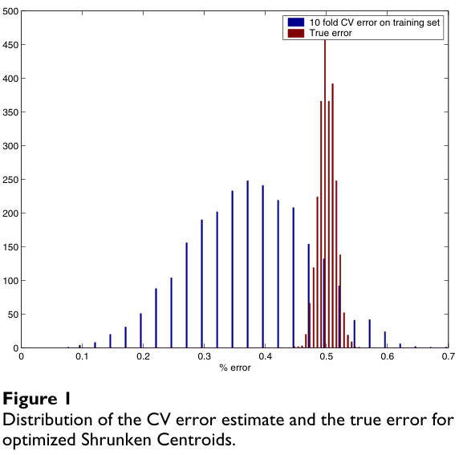
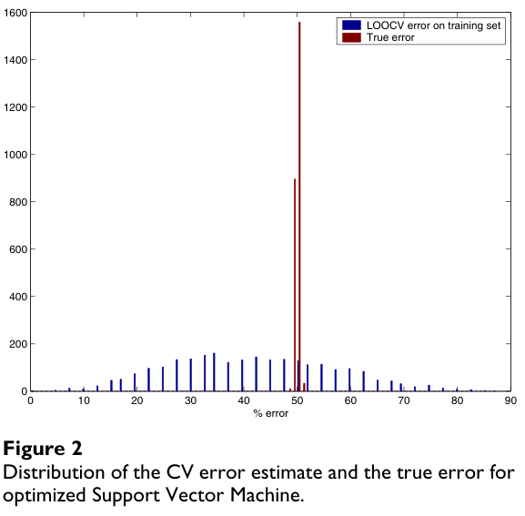
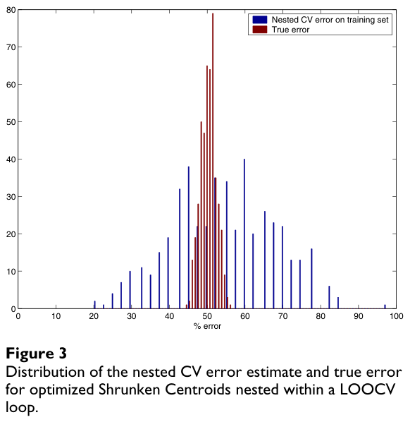
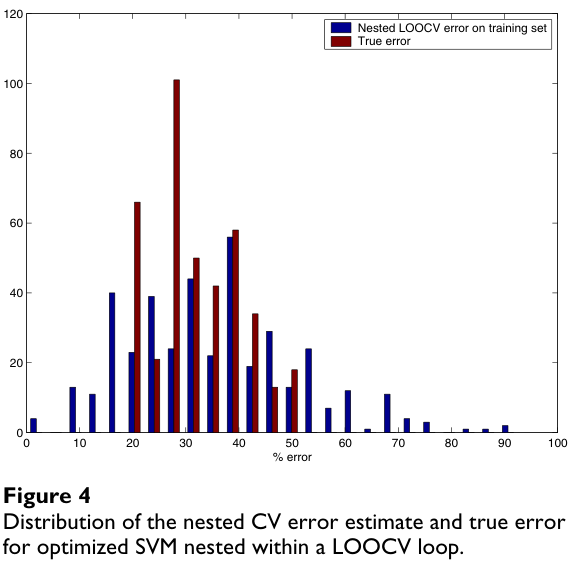

# 모델 선택에 교차검증을 쓸 때 오차 추정의 편향 (Varma 2006)

- 원제: Bias in error estimation when using cross-validation for model selection
- 저자: Sudhir Varma*†, Richard Simon† (Biometric Research Branch, National Cancer Institute, Bethesda MD, USA; *교신저자, †동등 기여)
- 원문: 같은 폴더의 `Varma2006_BiasInErrorEstimation_CV.pdf` (BMC Bioinformatics 2006, 7:91, doi:10.1186/1471-2105-7-91, Research article, Open Access)
- 번역 범위: 전문
- 그림: 원문 그림 4개를 `그림/`에 넣고 본문에서 처음 언급되는 곳에 삽입. 표 1은 마크다운 표로 옮김
- 원문에는 절 번호가 없다. 아래 번호는 번역에서 붙인 것이다. 수식 번호는 원문 그대로이며, 원문에는 (7)이 없다.

## 초록 (Abstract)

**배경(Background):** 교차검증(cross-validation, CV)은 분류기의 예측 오차를 추정하는 효과적인 방법이다. 최근 몇몇 논문은 CV 오차 추정값을 최소화하는 분류기 파라미터 값을 골라 분류기를 최적화하는 방법을 제안했다. 우리는 최적화된 분류기의 CV 오차 추정값을 독립 데이터에서 기대되는 참 오차(true error)의 추정값으로 쓰는 것이 타당한지 평가했다.

**결과(Results):** 두 종류의 분류기, 즉 수축 중심(Shrunken Centroids)과 서포트 벡터 머신(Support Vector Machines, SVM)의 분류 파라미터를 최적화하는 데 CV를 사용했다. 두 클래스 사이에 특징의 분포 차이가 없는 무작위 훈련 데이터셋을 만들었다. 이 "귀무(null)" 데이터셋을 써서 CV 오차 추정값을 최소화하는 분류기 파라미터 값을 선택했다. 수축 중심에는 10겹(10-fold) CV를, SVM에는 단일 표본 제외 교차검증(Leave-One-Out-CV, LOOCV)을 사용했다. 참 오차를 추정하기 위해 독립 시험 데이터를 만들었다. "귀무" 데이터와 "비귀무(non null)"(클래스 간 차등 발현이 있는) 데이터로, 내부 CV 루프는 파라미터 조정(tuning)에, 외부 CV는 오차 추정값 계산에 쓰는 중첩(nested) CV 절차도 시험했다.

최적 파라미터를 가진 분류기의 CV 오차 추정값은, 그 분류기가 독립 데이터에서 낼 참 오차에 대해 상당히 편향(bias)된 추정값임이 밝혀졌다. "귀무" 데이터셋에서는 두 클래스 사이에 실제 차이가 없는데도, 최적 파라미터를 가진 수축 중심의 CV 오차 추정값은 모의 훈련 데이터셋의 18.5%에서 30% 미만이었다. 최적 파라미터를 가진 SVM의 경우 추정 오차율은 "귀무" 데이터셋의 38%에서 30% 미만이었다. 독립 시험 세트에서 최적화된 분류기의 성능은 우연 수준보다 나을 것이 없었다.

중첩 CV 절차는 편향을 상당히 줄이며, "귀무"와 "비귀무" 데이터 분포 모두에 대해 수축 중심과 SVM 분류기 모두에서 독립 시험 세트로 얻은 오차와 매우 가까운 오차 추정값을 준다.

**결론(Conclusion):** CV로 조정된 분류기에 대해 CV로 오차 추정값을 계산하면 참 오차에 대해 유의하게 편향된 추정값을 얻음을 보인다. 잘 정의된 알고리즘으로 개발된 분류기의 참 오차를 추정하기 위해 CV를 올바르게 쓰려면, 분류기 파라미터 조정을 포함한 알고리즘의 모든 단계를 각 CV 루프 안에서 반복해야 한다. 중첩 CV 절차는 참 오차에 대해 거의 불편(unbiased)인 추정값을 제공한다.

*출판: 2006년 2월 23일 / 접수: 2005년 4월 28일 / 게재 승인: 2006년 2월 23일. 이 글은 http://www.biomedcentral.com/1471-2105/7/91 에서 볼 수 있다. © 2006 Varma and Simon; licensee BioMed Central Ltd. 이 글은 크리에이티브 커먼즈 저작자표시 라이선스(http://creativecommons.org/licenses/by/2.0)에 따라 배포되는 오픈 액세스 논문으로, 원저작물을 적절히 인용하는 한 어떤 매체에서든 제한 없는 사용, 배포, 복제를 허용한다.*

## 1. 배경 (Background)

마이크로어레이 데이터의 고유한 특성은 수많은 분석 방법의 개발을 자극했다. 마이크로어레이 데이터는 측정된 특징 수에 비해 표본 수가 매우 적다는 점이 두드러진다. 기존 기계학습 방법 대부분은 그 반대가 성립하는 데이터, 즉 표본 수가 특징 수보다 훨씬 많은 데이터에서 개발되었다. 그 결과 그러한 분석 방법들은 마이크로어레이 데이터셋에 맞게 수정되어야 한다.

한 예가 데이터셋을 훈련 데이터와 시험 데이터로 나누는 흔한 패러다임이다. 훈련 데이터는 특징 선택과 분류기 훈련에 쓰인다. 최종 분류기가 정해지면 그것으로 시험 표본의 클래스를 예측할 수 있다. 충분히 큰(이상적으로는 무한한) 시험 데이터셋에서의 평균 오차가 분류기의 참 오차를 준다.

표본 수 $n$이 작을 때는 분류기를 시험하는 데 쓰는 데이터가 분류기를 훈련하는 데 쓴 데이터의 일부가 아니도록 하는 것이 중요하다. 분류기를 훈련할 때 쓴 바로 그 표본으로 시험하면 참 오차의 재대입(re-substitution) 추정값을 얻는데, 이는 $n$이 작을 때 거짓으로 낮은(보통 0인) 오차 추정값을 주는 것으로 알려져 있다.

마이크로어레이 데이터에서는 표본 수가 너무 적어서 표본을 큰 훈련 세트와 시험 세트로 나누는 것이 보통 불가능하다. 교차검증(CV)은 충분히 큰 훈련 세트와 시험 세트가 없다는 문제의 한 가지 해법이다[1]. CV에서는 (표본 분할의 경우처럼) 고정된 분류기를 시험하는 대신, 고정된 분류기 훈련 알고리즘을 다룬다. 분류기 훈련 알고리즘은 표본 집합을 받아 특징 선택과 분류기 훈련을 수행하고, 하나의 잘 정의된 분류기를 반환한다. CV에서는 데이터의 일부를 떼어 두고(left out) 나머지를 분류기 훈련 알고리즘이 분류기를 개발하는 데 쓴다. 이렇게 얻은 분류기로 떼어 둔 표본의 클래스를 예측한다. 이 루프를 떼어 두는 부분을 바꿔 가며 반복한다. 이렇게 전체 데이터셋에서 얻은 평균 오차(CV 오차 추정값)는, 전체 데이터셋에 분류기 훈련 알고리즘을 적용했을 때 얻을 분류기의 참 오차에 대한 추정값으로 해석할 수 있다. 떼어 두는 데이터가 표본 하나뿐인 경우(Leave-One-Out-CV), CV 오차 추정값은 전체 데이터셋에 분류기 훈련 알고리즘을 적용해 얻을 분류기가 독립 시험 세트에서 낼 것으로 기대되는 참 오차에 대해 거의 불편인 추정값임을 보일 수 있다(Theorem 10.8, 8).

그러나 CV 방법은 분류기 훈련의 모든 측면이 CV 루프 안에서 이루어질 때에만 불편임이 증명되어 있다. 이는 분류기 훈련의 모든 측면, 예컨대 특징 선택, 분류기 유형 선택, 분류기 파라미터 조정이 각 CV 루프에서 떼어 두지 않은 데이터에 대해 이루어져야 함을 뜻한다. 이 원칙을 어떤 식으로든 어기면 참 오차에 대해 매우 편향된 추정값이 나올 수 있음이 밝혀져 있다. 한 가지 방식은 모든 훈련 데이터를 써서 두 클래스를 구별하는 유전자를 고르고, CV 루프 안에서는 분류기 파라미터만 바꾸는 것이다. 이는 특징 선택을 각 루프에서 떼어 두지 않은 데이터에 대해 따로 해야 한다는 원칙을 어긴다. Simon 등[2], Ambroise와 McLachlan[3], Reunanen[4]이 지적했듯이, 이는 참 오차에 대해 매우 편향된 추정값을 주며 재대입 추정값보다 크게 낫지 않다. 두 클래스 사이에 실제 차이가 없는 데이터에서도 0에 가까운 과도하게 낙관적인 오차 추정값을 얻는다.

원칙을 어기는 또 다른 방식은 어떤 종류든 분류기 파라미터 선택을 CV 루프 밖에서 하는 것이다. 그러한 분류기 파라미터의 예로는 최근접 이웃(Nearest Neighbor) 분류기의 이웃 수나 서포트 벡터 머신(SVM) 분류기의 커널 파라미터가 있다. 주어진 데이터셋에 대해 이 파라미터들의 최적값을 찾기 위해, 서로 다른 파라미터 값으로 그 데이터셋의 CV 오차 추정값을 계산할 수 있다. 그런 다음 CV 오차 추정값이 최소인 분류기 파라미터를 골라 최종 분류기를 만든다. 최종 분류기는 선택된 최적 분류기 파라미터를 써서 전체 데이터셋으로 훈련한다.

이는 래퍼 방법(wrapper method)이라는 일반 용어에 해당하는데, CV 알고리즘이 CV 오차를 최소화하려는 탐색 알고리즘 안에 "감싸져(wrapped)" 있는 방식이다. 이러한 래퍼 방법은 분류기 파라미터를 데이터에 따라 적응시키는 데 매우 유용함이 입증되었다.

그러나 여기에는 CV 루프 밖에서 이루어지는 일종의 추가적인 분류기 훈련(분류기 파라미터 선택의 형태로)이 포함된다. 이는 모든 훈련이 CV 루프 안에서 떼어 두지 않은 데이터에 대해 이루어진다는 가정을 어긴다. 따라서 참 오차의 불편 추정이라는 보장이 유효하지 않으며 편향의 가능성이 있다. 다시 말해, CV 오차 추정값을 최소화하는 분류기 파라미터에 대한 CV 오차 추정값은, 최적 분류기 파라미터로 전체 데이터에서 훈련한 최종 분류기의 참 오차에 대해 편향된 추정값일 수 있다.

우리는 두 가지 래퍼 알고리즘으로 이 가능성을 조사한다. 첫째는 Tibshirani 등[5]의 수축 중심 방법으로, 수축 정도를 조절하는 분류기 파라미터 $\Delta$의 최적값을 10겹 CV 오차를 최소화하는 값으로 구한다. 둘째는 Peng 등[6]이 제안한 서포트 벡터 머신의 변형으로, 단일 표본 제외 교차검증(LOOCV) 오차를 최소화하는 SVM 커널 파라미터를 선택한다. 첫 번째 논문은 파라미터의 최적값을 정하는 데 훈련 세트의 CV 오차 추정값과 시험 세트의 오차를 모두 사용하여, 시험 세트를 훈련 과정의 일부로 만든다. 두 번째 논문은 훈련 세트에서 얻은 최소 CV 오차 추정값만 제시한다. 두 논문 모두 독립 시험 세트에서 얻은 참 오차는 제시하지 않는다.

CV 오차 추정값을 최소화하는 분류기 파라미터의 선택은 일종의 훈련이므로, 분류기 훈련 알고리즘의 일부로 포함되어야 한다. 따라서 이 경우 분류기 훈련 알고리즘은 완전한 *래퍼 알고리즘(wrapper algorithm)* 이며, 데이터셋이 주어지면 분류기를 다음과 같이 훈련한다. 먼저 분류기 조정 파라미터의 여러 값에 대해 CV 오차 추정값을 계산한다. 그런 다음 CV 오차 추정값이 가장 작은 파라미터를 써서 모든 데이터로 분류기를 만든다. 이는 분류기 훈련 알고리즘의 정의, *즉* 데이터셋을 받아 하나의 잘 정의된 분류기를 반환하는 알고리즘이라는 정의를 만족한다.

이제 잘 정의된 분류기 훈련 알고리즘인 래퍼 알고리즘이 있으므로, CV를 써서 그것이 반환하는 분류기의 참 오차 추정값을 얻을 수 있다. 완전한 래퍼 알고리즘(최적 분류기 파라미터를 찾기 위한 자체 CV 루프를 포함한)을 오차 추정값을 계산하는 또 다른 CV 루프 안에 넣을 수 있다. 이는 보통의 CV 방법과 다를 바 없음에 유의하라. 여기서는 특정 분류기(*예:* 최근접 이웃)의 오차 추정값을 찾는 데 CV를 쓰는 대신, 최적화된 분류기(*예:* CV 오차 추정값을 최소화하여 이웃 표본 수의 최적값을 정한 최근접 이웃)의 오차 추정값을 찾는 데 CV를 쓴다. 따라서 CV 루프가 두 개 있다. 내부 루프는 래퍼 알고리즘의 일부이고, 외부 루프는 참 오차의 추정값을 계산한다. 비슷한 방법을 Izuka 등[7]이 사용했다. 이 글에서는 이 *중첩 CV(nested CV)* 접근을 쓸 때 편향에 미치는 영향을 조사한다.

### 수축 중심 (Shrunken centroids)

이 분류기는 원래 Tibshirani 등[5]이 제안했으며, 최근접 중심(nearest centroid) 분류기의 확장이다. 최근접 중심 분류기에서는 훈련 세트를 써서 두 클래스의 중심 $\bar{\mathbf{x}}_1$과 $\bar{\mathbf{x}}_2$(유전자들의 평균 발현)를 계산한다. 새 표본을 두 중심과 비교하여 가장 가까운 중심의 클래스로 분류한다. 수축 중심 방법에서는 클래스 내 표준편차로 표준화한 뒤, 파라미터 $\Delta$를 써서 클래스 중심을 전체 중심 쪽으로 수축시킨다. 클래스 $k$에 속하는 중심은 다음과 같이 전체 중심 $\bar{x}$(모든 클래스의 표본을 합친 평균)에 더 가까워진다.

$$\bar{\mathbf{x}}_k = \bar{\mathbf{x}} + \mathbf{m}_k(\mathbf{s} + s_0)\operatorname{sign}(\mathbf{d}_k)\left(|\mathbf{d}_k| - \Delta\right)_+ \tag{1}$$

[역주: 좌변 $\bar{\mathbf{x}}_k$는 원문 표기 그대로이며, 수축된(shrunken) 중심을 뜻한다.]

여기서 $\mathbf{s}$는 모든 유전자에 대한 합동(pooled) 클래스 내 표준편차 벡터, $s_0$는 $\mathbf{s}$ 원소들의 중앙값이며, $\mathbf{d}_k$는 다음과 같다.

$$\mathbf{d}_k = \frac{\bar{\mathbf{x}}_k - \bar{\mathbf{x}}}{\mathbf{m}_k(\mathbf{s} + s_0)} \tag{2}$$

또한 $(\ldots)_+$는 괄호 안 양의 양수 부분, *즉* 그 양이 0보다 크면 그 양과 같고 그렇지 않으면 0인 값을 나타낸다. 따라서 차등 발현이 크지 않은 유전자는 더 판별력 있는 유전자보다 분류에 덜 기여한다. 파라미터 $\Delta$를 바꾸어 사용하는 유전자 수를 바꿀 수 있다.

원 논문에서는 특정 $\Delta$ 선택에 대한 CV 오차 추정값을 얻는 데 10겹 CV를 쓴다. 훈련 데이터만으로 $\Delta$를 선택하는 객관적 지침은 주어지지 않는다. 저자들은 $\Delta$를 바꾸어 가며 훈련 세트의 CV 오차 추정값과 시험 데이터의 오차를 동시에 최소화하는 값을 쓴다. 따라서 시험 세트가 분류기 파라미터 선택에 쓰이며, 이는 문제가 된다.

### 서포트 벡터 머신 (Support Vector Machines)

Peng *등*은 유전 알고리즘(genetic algorithms, GA)과 재귀적 특징 제거(recursive feature elimination, RFE)를 서포트 벡터 머신(SVM) 분류기와 결합한 특징 선택 방법을 제시한다[6]. SVM은 Vapnik[8]이 도입했으며, *마진(margin)*, 즉 훈련 표본과 선형 분리 초평면 사이의 거리를 최대화하면서 서로 다른 클래스에 속하는 데이터를 분리하는 선형 초평면이다.

두 클래스를 1과 -1로 나타내자. $p$개의 측정값(*예:* 유전자 발현)으로 이루어진 표본 $\mathbf{x}$에 대해, *선형 초평면 분류기(linear hyperplane classifier)* $c(\mathbf{x})$는 다음에 따라 클래스를 예측한다.

$$c(x) = \begin{cases} 1 & \text{if } \mathbf{x}\mathbf{w}' \geq 0 \\ -1 & \text{if } \mathbf{x}\mathbf{w}' < 0 \end{cases} \tag{3}$$

여기서 가중치 벡터는 $\mathbf{w} = \langle w_0\, w_1 \ldots w_p\rangle$이고, 증강 표본 벡터 $\hat{\mathbf{x}}$는 표본 $\mathbf{x}$에 상수 1을 덧붙여 얻은 것, *즉* $\hat{\mathbf{x}} = \langle 1, x_1, \ldots, x_p\rangle$이다. [역주: 원문 (3)에는 $\mathbf{x}\mathbf{w}'$로 인쇄되어 있으나 본문 정의상 증강 벡터 $\hat{\mathbf{x}}$를 뜻한다.]

클래스 $y \in \{-1, 1\}$인 표본 $\mathbf{x}$의 *마진*은 $y\,\hat{\mathbf{x}}\mathbf{w}'$로 정의되며 SVM에서 매우 중요한 역할을 한다. 올바르게 분류된 표본의 마진은 양수이고 잘못 분류된 표본의 마진은 음수이다. 분류기의 마진은 모든 훈련 표본의 마진 중 가장 작은 값으로 정의된다. SVM은 마진을 최대화하면서 가중치 벡터의 노름 $\langle\mathbf{w}, \mathbf{w}\rangle$을 최소화하는 $\mathbf{w}$를 찾으려 한다. 이는 다음 비용 함수를 최소화하는 것과 같다.

$$\Phi(\mathbf{w}) = \frac{1}{2}\langle\mathbf{w}, \mathbf{w}\rangle + C\sum_{i=1}^{n}\xi_i(\mathbf{w}) \tag{4}$$

여기서

$$\xi_i(\mathbf{w}) = (1 - y_i\,\hat{\mathbf{x}}_i\,\mathbf{w}^t)_+ \tag{5}$$

이고, $(\ldots)_+$는 앞에서와 같이 괄호 안 양의 양수 부분, *즉* 그 양이 0보다 크면 그 양과 같고 그렇지 않으면 0인 값을 나타낸다.

가중치 벡터의 노름이 커질수록 분류기의 용량(capacity)이 커지므로, 파라미터 $C$는 마진의 크기와 분류기의 용량 사이의 트레이드오프도 조절한다.

표본은 스칼라곱 형태로만 표현되면 되므로, *커널(kernel)* 을 도입하여 이 정식화를 비선형 분류기로 확장할 수 있다. 커널은 변환된 공간에서의 스칼라곱의 함수 표현이다. 그러한 변환은 내적 $\langle\mathbf{x}_1, \mathbf{x}_2\rangle$가 커널 $K(\mathbf{x}_1, \mathbf{x}_2)$로 바뀌는 것 외에는 최적화 문제를 바꾸지 않음을 보일 수 있다. 변환된 공간의 차원이 매우 높은(또는 무한한) 경우, 보통 변환한 뒤 스칼라곱을 하는 것보다 커널을 계산하는 것이 더 쉽다.

가우시안 커널 SVM(방사 기저 함수(radial basis function) 커널이라고도 한다)에서 커널은 다음과 같다.

$$K(\mathbf{x}_1, \mathbf{x}_2) = \exp(-\gamma\,\|\mathbf{x}_1 - \mathbf{x}_2\|^2) \tag{6}$$

커널 함수의 퍼짐은 $\gamma$로 주어지며, 커널을 데이터에 맞추기 위해 이를 바꿀 수 있다. $\gamma$ 값이 클수록 특징 벡터의 대응 변환이 더 뾰족해지고 분류기의 용량이 커진다.

Peng *등*은 커널 파라미터를 조정하는 데 단일 표본 제외 교차검증(LOOCV) 오차를 사용한다. LOOCV는 매 반복마다 표본 하나를 떼어 두는 CV 방식이다. 얻은 평균 분류 오차는 참 오차에 대한 거의 불편인 추정값이다. (6)에서는[역주: 문맥상 참고문헌 [6]을 가리킨다] 훈련 데이터를 써서 적절한 커널(선형, 가우시안, 다항식 중에서)과 LOOCV 오차 추정값을 최소화하는 파라미터 집합을 선택한다. 그러나 독립 시험 세트는 쓰지 않으며, 훈련 세트에서의 최종 LOOCV 오차 추정값만 보고한다.

## 2. 결과 (Results)

### 구현 (Implementation)

각 시뮬레이션마다 40개 표본으로 이루어진 세트를 적어도 1000개 생성했으며, 그중 20개는 클래스 1, 나머지 20개는 클래스 2에 속했다. 각 표본은 6000개 특징(합성 유전자 발현)의 벡터였다. 일부 경우에는 두 클래스 사이에 차등 발현되는 유전자가 없는 "귀무" 데이터셋을 사용했다. 각 유전자에 대해 두 클래스의 모집단 평균 발현은 같았으며, 즉 0이었다. 따라서 어떤 특징도 두 클래스를 진정으로 판별하지 못한다. 중첩 CV 접근을 검증하기 위해 "비귀무" 분포에서 생성한 데이터도 사용했다. 이 경우 "귀무 분포"(즉 두 클래스 사이에 유전자 발현 차이가 없음)를 쓰는 대신, (6000개 중) 10개 유전자가 두 클래스 사이에 모집단 평균 차등 발현 1을 갖도록 고정하여 차등 발현을 모의했다. 한 클래스의 표본은 평균 0, 단위 분산의 다변량 정규분포에서 뽑았고, 두 번째 클래스의 표본은 10개 유전자가 평균 1, 단위 분산 정규분포를, 나머지 5990개 유전자가 평균 0, 단위 분산 정규분포를 따랐다.

### 수축 중심 (Shrunken centroids)

이는 MATLAB™(Ver. 6.5, The Mathworks)으로 구현했다. 이 경우 두 클래스 사이에 차이가 없는 "귀무" 데이터셋을 사용했다. 40개 표본으로 된 각 데이터셋에 대해, 0.01에서 1 사이의 $\Delta$ 값에 대해 수축 중심 분류기의 10겹 CV 오차를 계산했다. 10겹 CV 오차 $CV(\Delta)$가 최소인 $\Delta$ 값을 정했다.

$$\Delta^* = \arg\min\,(CV(\Delta)$$

[역주: 원문에서 닫는 괄호가 빠져 있다.]

두 $\Delta$ 값의 오차가 같으면 큰 값을 선택했다(이는 가중치가 0이 아닌 유전자 수가 더 적은 쪽에 해당한다).

CV 오차 추정값 $CV(\Delta^*)$가 파라미터 값 $\Delta^*$로 40개 표본을 모두 써서 만든 분류기의 참 오차에 대해 불편 추정값인지 판단하기 위해, 40개 표본 전부와 파라미터 값 $\Delta^*$를 써서 수축 중심 분류기를 만들었다. 이를 *최적화된 수축 중심(optimized Shrunken Centroids)* 분류기라 부른다. 이 분류기로 "귀무" 데이터 분포를 써서 독립적으로 생성한 20000개 표본의 클래스를 예측했다. 이 시험 표본들은 훈련 세트의 일부가 아니므로, 그에 대한 평균 오차가 참 오차 $TE(\Delta^*)$를 준다.

이 과정을 모의된 40개 표본 데이터셋 각각에 대해 반복하여 $CV(\Delta^*)$와 $TE(\Delta^*)$의 경험적 분포를 얻었다.

### 서포트 벡터 머신 (Support Vector Machine)

SVM의 경우에도 같은 종류의 분석을 수행했다. 합성 데이터를 만드는 데 "귀무" 데이터 분포를 사용했다. 계산 효율을 위해 (6)에서 쓴 완전한 알고리즘은 고려하지 않는다[역주: 문맥상 참고문헌 [6]]. 특징 선택에 재귀적 특징 제거(RFE) 대신 2표본 $t$-통계량을 써서 절댓값 $t$-통계량이 가장 큰 세 특징을 선택했다. 탐색 전략으로 유전 알고리즘(GA) 대신 고정된 가우시안 커널을 쓰는 단순화된 알고리즘을 사용했다. 조정한 분류기 파라미터는 $C$(식 4의 트레이드오프 파라미터)와 $\gamma$(커널 파라미터)였다. 여기서 한 것처럼 최적화 대상 파라미터 집합을 줄이면 얻는 편향의 크기가 줄어들 수 있음에 유의해야 한다.

$C$와 $\gamma$ 값의 격자 위 각 점에 대해 단일 표본 제외 교차검증(LOOCV)으로 CV 오차 추정값을 계산했다($C$는 $2^{-5}$에서 $2^{15}$까지, $\gamma$는 $2^{-15}$에서 $2^{3}$까지 변화시켰다). CV 오차 추정값은 40개 표본을 하나씩 차례로 떼어 두고, 나머지 39개 표본에서 $t$-통계량으로 최선의 특징 3개를 선택한 뒤, 고정된 $C$와 $\gamma$ 값으로 SVM 분류기를 만들어 계산했다. 이 분류기로 떼어 둔 표본의 클래스를 예측했다. 40개 표본에 대한 평균 오차가 사용한 $C$와 $\gamma$ 값에 대한 CV 오차 추정값 $CV(C, \gamma)$이다. 이를 모든 격자 값에 대해 반복했다. 분류기 개발에는 Chang과 Lin[9]이 개발한 LIBSVM 패키지를 사용했다.

수축 중심 분석과 마찬가지로, CV 오차 추정값을 최소화하는 파라미터 값을 찾는다.

$$(C^*, \gamma^*) = \arg\min\,(CV(C, \gamma))$$

참 오차를 계산하기 위해, 40개 표본 전부와 40개 표본 전부에 기초한 상위 3개 특징을 써서 파라미터 $C^*$와 $\gamma^*$를 갖는 SVM 분류기를 만들었다. 이를 *최적화된 SVM(optimized SVM)* 분류기라 부른다. 이 분류기로 훈련 세트와 같은 분포(즉 "귀무" 분포)를 갖는 20000개 표본의 큰 시험 세트의 클래스를 예측했다. 시험 세트에서의 평균 오차가 참 오차 $TE(C^*, \gamma^*)$를 준다.

### 수축 중심과 SVM에 대한 중첩 CV (Nested CV with shrunken centroids and SVM)

10겹 CV로 $\Delta$를 최적화한 수축 중심 분류기(최적화된 수축 중심 분류기)에 대해 중첩 CV 접근을 평가했다. 데이터셋 생성에는 "귀무" 데이터 분포를 사용했다. 분류기 파라미터의 최적값 $\Delta^*$를 찾는 것과 참 오차 $TE(\Delta^*)$를 찾는 것은 위에서 설명한 것과 정확히 같이 했다. 달라지는 것은 참 오차의 새 추정값을 계산하는 방식뿐이다. 최적 $\Delta$에 대한 CV 오차 추정값 $CV(\Delta^*)$ 대신 중첩 CV 오차 추정값을 사용했다. 중첩 CV 오차 추정값은 다음과 같이 계산한다. (40개 중) 표본 하나를 떼어 두고, 나머지 39개 표본에서 10겹 CV를 최소화하여 수축 중심 분류기의 $\Delta$를 선택했다. 이는 래퍼 알고리즘이 40개 대신 39개 표본으로 제한된다는 점만 빼면 위와 정확히 같다. 래퍼 알고리즘은 39개 표본을 써서 $\Delta$의 최적값을 정하고, 같은 39개 표본과 이 표본들에 기초해 선택된 최적값으로 분류기를 만든다. 이 분류기로 떼어 둔 표본의 클래스를 예측한다. 이를 40개 표본 각각을 차례로 떼어 두며 수행했다. 표본들에 대한 평균 오차가 최적화된 수축 중심 분류기의 중첩 CV 오차 추정값 $CV_{nest}(\Delta^*)$이다. 이를 여러 합성 데이터셋에 대해 반복하면 $CV_{nest}(\Delta^*)$와 $TE(\Delta^*)$의 경험적 분포를 얻는다.

중첩 CV 접근은 최적화된 SVM 분류기에 대해서도 평가했다. 여기서는 훈련 표본(40개)과 시험 표본(20000개)을 만드는 데 "비귀무" 데이터 분포를 사용했다. 중첩 CV를 써서 파라미터 $C$와 $\gamma$에 대해 최적화된 SVM 분류기의 중첩 CV 오차 추정값 $CV_{nest}(C^*, \gamma^*)$를 구한다. 평가하는 분류기 훈련 알고리즘이 앞에서 자세히 설명한 최적화된 SVM 분류기 알고리즘이라는 점만 빼면, 절차는 위에서 최적화된 수축 중심에 대해 설명한 것과 정확히 같다.

그림 1은 최적화된 수축 중심 분류기에 대해, 최적 $\Delta$에 대한 CV 오차 추정값 $CV(\Delta^*)$와 최적 $\Delta$에 대한 참 오차 $TE(\Delta^*)$의 경험적 분포를 보여 준다. 그림 2는 최적화된 SVM 분류기에 대한 $CV(C^*, \gamma^*)$와 $TE(C^*, \gamma^*)$의 분포를 보여 준다. 두 그래프 모두에서 CV 오차 추정값은 평균 참 오차보다 뚜렷이 작은 평균을 중심으로 분포한다. 두 시뮬레이션 모두 "귀무" 데이터로 수행했으므로 참 오차는 50%를 중심으로 분포하는 반면, CV 오차 추정값은 평균이 더 낮다. 수치 결과는 표 1에 나타냈다. 평균 참 오차가 50%(*즉* 클래스를 무작위로 고르는 것과 같음)인데도, 훈련 세트에서의 CV 오차 추정값은 최적화된 수축 중심 분류기에서 평균 37.8%, 최적화된 SVM 분류기에서 평균 41.7%이다. 무작위 훈련 데이터셋의 5분의 1 이상에서 두 분류기의 편향이 20%를 넘는다.

*그림 1 — 최적화된 수축 중심에 대한 CV 오차 추정값과 참 오차의 분포. (범례: 10 fold CV error on training set = 훈련 세트의 10겹 CV 오차, True error = 참 오차; 가로축 % error = 오차(%))*

*그림 2 — 최적화된 서포트 벡터 머신에 대한 CV 오차 추정값과 참 오차의 분포. (범례: LOOCV error on training set = 훈련 세트의 LOOCV 오차, True error = 참 오차)*

**표 1: 결과(Results).**

| 분류기 유형 (Classifier type) | 훈련 오차<30%인 비율 (Percentage of times training error<30%) | 편향>20%인 비율 (Percentage of times bias>20%) | 최적화된 분류기의 평균 CV 오차 추정값 (Mean CV error estimate for optimized classifier) | 최적화된 분류기의 평균 참 오차 (Mean true error of optimized classifier) | 평균 편향 (Mean bias) |
|---|---|---|---|---|---|
| "귀무" 데이터에서의 수축 중심 (Shrunken centroids on "null" data) | 18.5% | 22.2% | 37.8% | 50.0% | -12.2% |
| "귀무" 데이터에서의 SVM (SVM on "null" data) | 22.2% | 25.3% | 41.7% | 50.0% | -8.3% |

[역주: 초록에서는 SVM의 추정 오차율이 "귀무" 데이터셋의 38%에서 30% 미만이었다고 했으나, 표 1에는 22.2%로 되어 있다. 원문 그대로 옮겼다.]

그림 3은 최적화된 수축 중심에 대한 중첩 CV 오차 추정값 $CV_{nest}(\Delta^*)$와 참 오차 $TE(\Delta^*)$의 분포를 보여 준다. 참 오차에 대해 거의 불편인 추정값을 얻는다. 평균 중첩 CV 오차 추정값은 참 오차를 약간 과대추정하는데(50.0%에 비해 54.2%), 이는 각 중첩 CV 반복에서 쓰는 분류기는 39개 표본에 기초한 반면 시험 세트에 쓰는 분류기는 40개 표본으로 훈련되기 때문이다.

*그림 3 — LOOCV 루프 안에 중첩된 최적화된 수축 중심에 대한 중첩 CV 오차 추정값과 참 오차의 분포. (범례: Nested CV error on training set = 훈련 세트의 중첩 CV 오차, True error = 참 오차)*

그림 4는 "비귀무" 데이터셋에서 최적화된 SVM 알고리즘에 대한 중첩 CV 오차 추정값 $CV_{nest}(C^*, \gamma^*)$와 참 오차 $TE(C^*, \gamma^*)$의 분포를 보여 준다. 참 오차 32.0%에 비해 평균 중첩 CV 오차 추정값 35.3%를 얻는다. 시험 오차에 비해 훈련 오차의 추정값이 더 높은 것은, 다시 중첩 CV 반복에서 분류기를 만드는 데 더 적은 수의 표본(39 대 40)을 쓰기 때문이라고 볼 수 있다.

*그림 4 — LOOCV 루프 안에 중첩된 최적화된 SVM에 대한 중첩 CV 오차 추정값과 참 오차의 분포. (범례: Nested LOOCV error on training set = 훈련 세트의 중첩 LOOCV 오차, True error = 참 오차)*

## 3. 결론 (Conclusion)

우리의 결과는, 교차검증 오차율을 최소화하여 분류기 파라미터를 최적화하는 것이 합리적이기는 하지만, 그 결과 얻는 최소 CV 오차 추정값은 최종 분류기가 독립 데이터에서 낼 것으로 기대되는 참 오차의 불편 추정값이 아님을 보여 준다. CV 오차 추정값과 참 오차의 차이는 5분의 1 이상의 경우에 20%를 넘을 수 있으며, 이는 전체 정확도가 그리 높지 않은 분류 문제(생존이나 치료 반응 예측과 같은)에서 매우 중대할 수 있다.

우리 연구에서는 두 가지 서로 다른 재표본추출(resampling) 방법(10겹 CV와 LOOCV)에서 이 편향을 관찰했다. 이 편향이, 크기는 다를 수 있더라도, 다른 교차검증 방식에서도 나타날까? 편향은 조정 파라미터의 서로 다른 값에 대한 예측 오차 추정값의 변동성 때문에 생기므로 일반적인 현상이다. 이는 다음의 간단한 설명으로 직관적으로 알 수 있다.

분류기 파라미터 $\alpha$가 이산 값 $\alpha_1, \alpha_2, \ldots, \alpha_k$만 가질 수 있고, 참 예측 오차 $E$가 파라미터 값과 무관하다고 가정하자. 따라서 파라미터의 모든 값이 같은 참 오차를 준다. 그러나 재표본추출로 추정한 오차의 변동성 때문에, 서로 다른 파라미터 값은 서로 다른 예측 오차 추정값으로 이어진다. 오차 추정값을 $e_1, e_2, \ldots, e_k$로 나타내자. 재표본추출 방법이 중앙값 불편(median unbiased)이라고 가정하면, 오차들의 최솟값이 $E$보다 작을 확률은 쉽게 알 수 있다.

$$\Pr(\min\{e_2, \ldots, e_k\} < E) = 1 - \left(\frac{1}{2}\right)^K \tag{8}$$

[역주: 원문 표기 그대로이다. 집합은 $e_1$부터, 지수는 $k$로 읽는 것이 자연스럽다.]

이는 $K$가 클 때, 재표본추출 오차의 최솟값을 고르면 참 오차에 대해 편향된 추정값을 줄 확률이 높음을 뜻한다.

파라미터 선택을 하지 않더라도, 오차를 추정하는 모든 재표본추출 방법은 어느 정도의 편향과 분산을 가진다(11). 위에서 LOOCV 방법의 편향(참 오차를 과대추정)을 언급했는데, 이는 CV 루프에서는 훈련 표본의 부분집합으로 분류기를 만드는 반면 최종 분류기는 모든 표본으로 만들기 때문에 생긴다. 이를 *고유 편향(inherent bias)* 이라 부른다. 그러나 결과에서 보였듯이, 추가적인 파라미터 선택을 하면 추정값의 분산이 추가적인 *파라미터 선택 편향(parameter selection bias)* 을 낳는다. 파라미터 선택 편향은 고유 편향에 더해져 재표본추출 절차의 총 편향을 이룬다. 고유 편향은 음수일 수도 양수일 수도 있음(*즉* 오차 추정값이 참 오차보다 낮을 수도 높을 수도 있음)에 유의해야 한다. 반면 파라미터 선택 편향은 항상 음수이다.

파라미터 선택 편향은 분산이 더 작은 재표본추출 방법, *예:* .632 부트스트랩[10]과 부트스트랩 CV[11]에서 더 작다. 그러나 분산이 낮은 방법도 큰 고유 편향(양수이든 음수이든)을 가질 수 있다[12]. 오차 추정값을 해석할 때 염두에 두어야 할 것은 총 편향(*즉* 고유 편향과 파라미터 선택 편향의 합)이다. 고유 편향이 양수이면 파라미터 선택 편향이 그것을 상쇄하여 오차 추정값을 참 오차에 더 가깝게 만들 수도 있다. 그러나 고유 편향이 음수이면 파라미터 선택 편향이 그것을 악화시킨다.

교차검증은 분류기의 조정 파라미터를 선택하는 데 유용한 방법일 수 있지만, 그 결과 얻는 분류기의 일반화 오차는 올바르게 추정해야 한다. 이는 파라미터 조정에 쓴 데이터와 독립인 큰 검증 세트로 할 수 있다. 그러나 이는 훈련 세트와 검증 세트로 나눌 수 있을 만큼 많은 표본을 필요로 한다. 이 논문에서 사용했고 Izuka *등*[7]의 방법이 보여 주는 또 다른 방법은, 파라미터의 CV 조정에 쓰지 않는 표본 일부를 떼어 두는 것이다. 그런 다음 축소된 훈련 세트로 조정된 분류기를 개발하고 떼어 둔 표본으로 시험한다. 이 절차를 떼어 두는 표본 집합을 여러 번 바꿔 가며 반복한다. 이는 사실상 두 개의 중첩 CV 루프이다. 외부 루프는 일반화 오차를 추정하고, 내부 CV는 파라미터 조정에 쓰인다. 외부 루프의 각 단계에서 떼어 두는 표본 수가 너무 크지 않으면, 이는 참 오차에 대해 거의 불편인 추정값을 준다.

## 참고문헌

1. Duda RO, Hart PE, Stork DG: Pattern classification. John Wiley and Sons Inc 2001, Ch.9:483-486.
2. Simon R, Radmacher MD, Dobbin K, McShane LM: Pitfalls in the use of DNA microarray data for diagnostic and prognostic classification. J Natl Cancer Inst 2003, 95:14-18.
3. Ambroise C, McLachlan GJ: Selection bias in gene extraction on the basis of microarray gene-expression data. PNAS 99(10):6562-6566. 2002 May 14
4. Reunanen J: Overfitting in making comparisons between variable selection methods. J Machine Learning Research 2003, 3:1371-1382.
5. Tibshirani R, Hastie T, Narasimhan B, Chu G: Diagnosis of multiple cancer types by shrunken centroids of gene expression. PNAS 99(10):6567-6572. 2002 May 14
6. Peng S, Xu Q, Ling XB, Peng X, Du W, Chen L: Molecular classification of cancer types from microarray data using the combination of genetic algorithms and support vector machines. FEBS Lett 555(2):358-362. 2003 Dec 4
7. Izuka N, Oka M, Yamada-Okabe H, Nishida M, Maeda Y, Mori N, Takao T, Tamesa T, Tangoku A, Tabushi H, Hamada K, Nakayama H, Ishitsuka H, Miyamoto T, Hirabayashi A, Uchimura S, Hamamoto Y: Oligonucleotide microarray for prediction of early intrahepatic recurrence of hepatocellular carcinoma after curative resection. Lancet 2003, 361:923-929.
8. Vapnik VN: Statistical learning theory. Volume Ch.10. John Wiley and Sons, Inc. New York; 1998.
9. Chang C-C, Lin C-H: LIBSVM – A Library for Support Vector Machines. [http://www.csie.ntu.edu.tw/~cjlin/libsvm/].
10. Efron B, Tibshirani RJ: Improvements on cross-validation: The .632+ bootstrap method. J Am Stat Assoc 1997, 92:548-560.
11. Fu WJ, Carroll RJ, Wang S: Estimating misclassification error with small samples via bootstrap cross-validation. Bioinformatics 2005, 21(9):1979-1986.
12. Molinaro AM, Simon R, Pfeiffer RM: Prediction error estimation: a comparison of resampling methods. Bioinformatics 2005, 21(15):3301-7.

*(원문 8쪽의 BioMed Central 투고 안내 광고는 논문 본문이 아니므로 옮기지 않았다.)*
