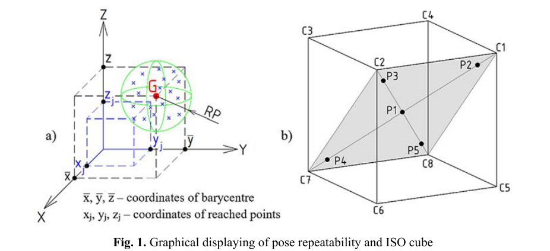
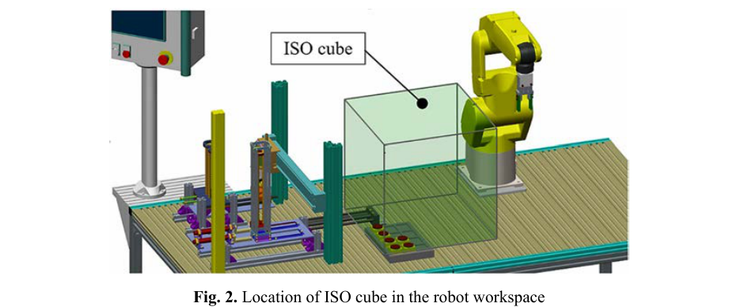
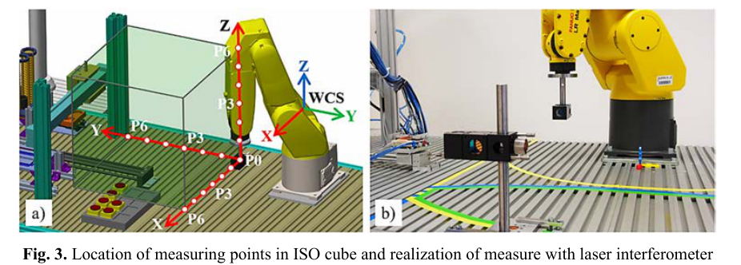
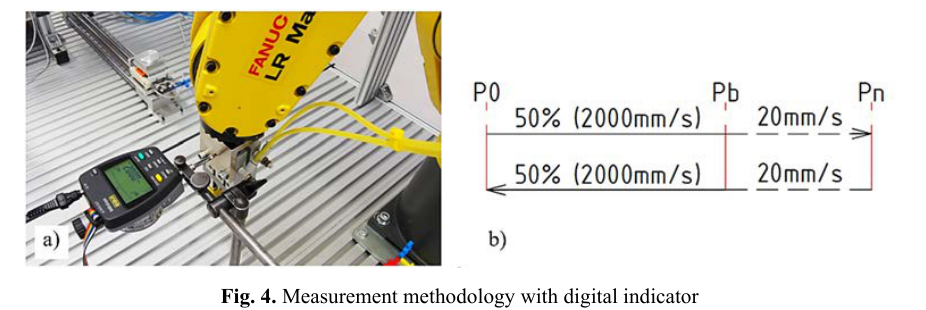
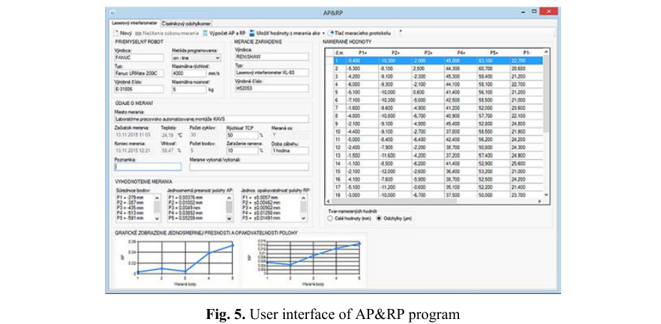
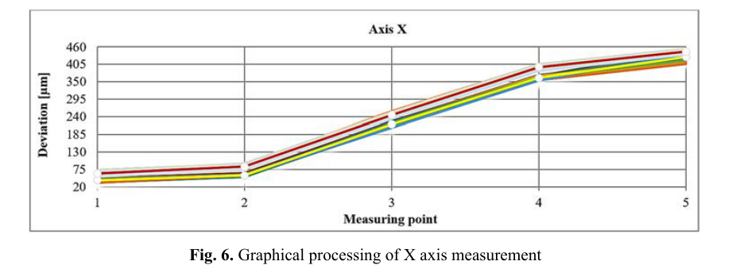
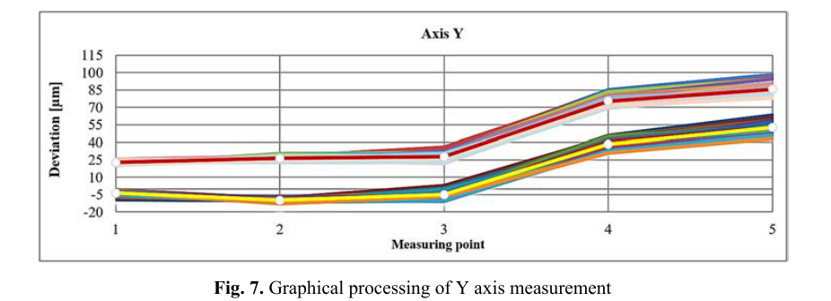
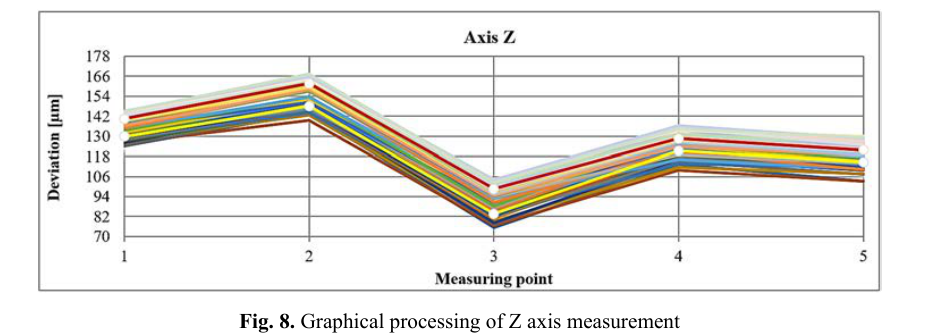
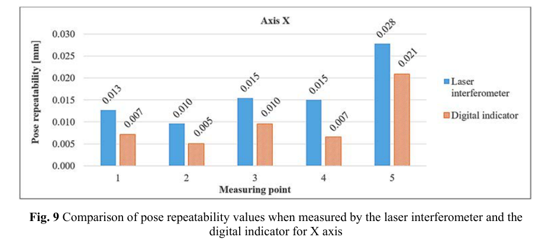
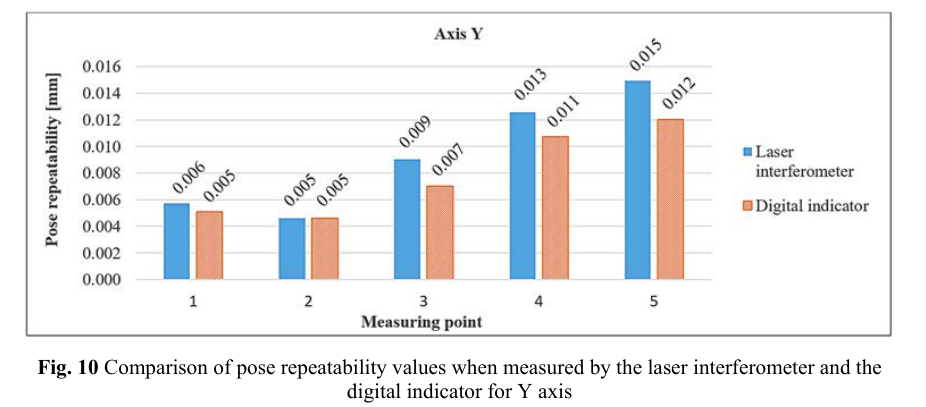

# 산업용 로봇의 자세 반복정밀도 측정 (Kuric 2018)

- 원제: Measurement of industrial robot pose repeatability
- 저자: Ivan Kuric¹, Vladimír Tlach¹,*, Zuzana Ságová¹, Miroslav Císar¹, Igor Gritsuk² (¹University of Žilina, Faculty of Mechanical Engineering, Department of Automation and Production Systems, Univerzitná 1, 010 26 Žilina, Slovak Republic; ²Kherson State Maritime Academy, Department of Operation of Ship Power Plants, 73000 Kherson, 20 Ushakova avenue, Ukraine; *교신저자)
- 원문: 같은 폴더의 `Kuric2018_MATEC_RobotPoseRepeatability.pdf` (MATEC Web of Conferences 244, 01015 (2018), ITEP'18, https://doi.org/10.1051/matecconf/201824401015, CC BY 4.0)
- 번역 범위: 전문
- 그림: 원문 그림 10개를 `그림/`에 넣고 본문에서 처음 언급되는 곳에 삽입. 표 1은 마크다운 표로 옮김

## 초록 (Abstract)

이 논문은 산업용 로봇 Fanuc LR Mate 200iC의 자세 반복정밀도(pose repeatability) 측정을 다룬다. 측정에는 레이저 간섭계(laser interferometer) Renishaw XL-80과 디지털 인디케이터(digital indicator) Mitutoyo Absolute Digimatic ID-F를 사용한다. 측정 방법론은 로봇 작업 공간 중 가장 많이 쓰이는 부분에 놓인 이른바 ISO 큐브(ISO cube)에 기반한다. 논문에서는 해법의 개별 단계, 측정 데이터의 분석과 결과를 제시한다.

**키워드(Keywords):** 산업용 로봇(Industrial robot), 자세 반복정밀도(Pose repeatability), 레이저 간섭계(Laser interferometer), 디지털 인디케이터(Digital indicator)

## 1 서론 (Introduction)

산업용 로봇의 본래 역할은 사람을 육체적으로 힘들고 단조로운 작업, 그리고 유해하고 위험한 환경에서의 작업으로부터 해방시키는 것이었다. 생산 설비가 발전하고 생산 유연성이 높아짐에 따라 산업용 로봇에 대한 요구 사항도 높아지고 새로운 적용 분야가 생겨나고 있다. [1, 1] [역주: 원문 표기 그대로이며, [1, 2]의 오기로 보인다.] 그 추세 중 하나는 지금까지 전용 장치가 수행해 온 작업에 산업용 로봇을 쓰거나, 산업용 로봇으로 CNC 공작기계를 조작하는 것과 같은 비생산 작업을 수행하는 것이다. 동시에 자동화로 인해 산업용 로봇의 수는 꾸준히 늘고 있다. IFK(International Federation of Robotics)[역주: 원문 표기 그대로이며, IFR의 오기로 보인다]가 발표한 보도자료에 따르면, 2020년에는 전 세계적으로 300만 대 이상의 산업용 로봇 증가가 예상된다[3].

특정 용도를 위한 산업용 로봇의 선택은 가반하중(payload), 자유도 수, 작업 공간 크기에 따른 로봇의 도달 거리 등과 같은 기본 기준으로 결정된다. [4] 산업용 로봇의 특성은 성능 기준(performance criteria)을 통해 더 자세히 볼 수 있다. 산업용 로봇 제조사가 해당 데이터시트에 기재하는 성능 기준 중 가장 자주 언급되는 것 하나가 반복정밀도 값이다. 더 구체적으로는 자세 반복정밀도로, 로봇이 같은 방향에서 같은 위치로 반복해서 되돌아오는 능력을 나타낸다. [5]

자세 반복정밀도와 그 밖의 많은 성능 특성은 국제 표준 ISO 9283에 정의되어 있다. 이 표준은 개별 성능 기준의 의미와 그 계산 방법을 권장 절차 및 측정 조건과 함께 정의한다. [6] 이 문제와 관련된 또 다른 문서는 국제표준화기구(International Standards Organization)가 1995년에 발행한 기술 보고서 ISO/TR 13309이다. 그 목적은 ISO 9283 표준에 따른 성능 기준 측정을 위한 계측 방법과 장치를 개관하는 것이다.

산업용 로봇의 성능 기준 측정은 다양한 측정 장치와 측정 방법을 필요로 하는 복잡한 작업이다. 이 문제는 많은 과학 논문에서 다루어진다. [7] 가장 자주 측정되는 성능 기준에는 정확도(accuracy)와 반복정밀도가 있다. 측정은 레이저 트래커(laser tracker)[8, 9], 인디케이터[10, 11], 카메라 시스템[12, 13] 등 다양한 측정 장치로 이루어진다. 본래 CNC 공작기계의 상태를 평가하기 위한 측정 장치가 점점 더 많이 쓰이고 있다. 레이저 간섭계와 볼바(ballbar) 측정 장치가 그것이다[5].

이 논문은 Renishaw XL-80 레이저 간섭계와 Mitutoyo Absolute Digimatic ID-F 디지털 인디케이터를 써서 산업용 로봇 Fanuc LR Mate 200iC의 자세 반복정밀도를 측정하는 것을 다룬다.

## 2 산업용 로봇 위치 결정의 자세 반복정밀도 (Pose repeatability of industrial robot positioning)

자세 반복정밀도(RP)는 로봇의 TCP(Tool Centre Point, 공구 중심점)가 같은 방향에서 항상 같은(프로그램된) 위치로 되돌아오는 능력을 뜻한다. 요구 위치에 한 방향으로 접근하면 산업용 로봇 개별 관절의 백래시(backlash) 영향과 그것이 측정 결과에 미치는 영향이 최소화된다. 양방향 또는 다방향 반복정밀도는 단방향 반복정밀도보다 몇 배 클 수 있다. [5]

그림으로 나타내면(그림 1.a), 자세 반복정밀도는 이른바 무게중심(barycenter)에 중심을 둔 구의 반지름이다. 무게중심(G)은 공간상 좌표가 해당 로봇이 반복해서 도달한 TCP 위치들로부터 계산한 평균값에 해당하는 점을 나타낸다.

*그림 1 — 자세 반복정밀도와 ISO 큐브의 그림 표현. (그림 안 범례: $\bar{x}, \bar{y}, \bar{z}$ – 무게중심의 좌표, $x_j, y_j, z_j$ – 도달한 점들의 좌표)*

자세 반복정밀도 측정에 관해 ISO 9283 표준은 이른바 ISO 큐브에 기반한 절차를 제시한다. 이는 로봇 작업 공간에서 가장 자주 쓰일 것으로 예상되는 곳에 놓인 가상의 정육면체이다. ISO 큐브는 허용 가능한 최대 부피를 가져야 하며, 6축 로봇의 경우 다섯 개의 측정점 P1–P5가 있는 경사 평면을 가진다(그림 1.b). 측정 과정 자체는 적어도 30회의 사이클로 이루어지며, 그동안 로봇의 TCP 점이 다섯 측정점 사이를 규정된 방식으로 이동한다. TCP 점의 각 위치는 바로 로봇 관절의 백래시 영향을 최소화하기 위해 단방향 접근으로 도달한다. [역주: 원문에는 이 문장 앞에 "13"이라는 숫자가 붙어 있다. 참고문헌 번호가 잘못 들어간 것으로 보인다.]

## 3 측정 방법론 (Measurement methodology)

이 논문은 산업용 로봇 Fanuc LR Mate 200iC에서 자세 반복정밀도를 측정하는 절차를 제시한다. 이 로봇은 직렬 기구학(serial kinematics) 로봇으로, 질리나 대학교 자동화·생산시스템학과 실험실에 있다. 로봇은 자동 조립 작업장의 일부로서, 최종 조립과 조립 제품의 핸들링에 관련된 작업을 수행한다. 표준 권고에 따라 모서리 길이 470mm의 가상 ISO 큐브를 로봇 작업 공간에 배치했다(그림 2). 큐브의 각 모서리는 로봇의 월드 좌표계(World Coordinate System, WCS) 축과 평행하다. ISO 큐브의 크기와 위치는 작업장에서 로봇의 작업과 관련된 작업 공간 영역을 최대한 덮도록 선택했다.

*그림 2 — 로봇 작업 공간에서 ISO 큐브의 위치.*

### 3.1 레이저 간섭계 Renishaw XL-80 (Laser Interferometer Renishaw XL-80)

레이저 간섭계 Renishaw XL-80은 주로 공작기계 측정에 쓰인다. 이 시스템은 XL-80 레이저 유닛, 환경 조건(온도, 압력, 습도)을 감지하는 XC-80 보상 유닛, 그리고 측정 광학계로 이루어진다. 선택한 측정 광학계에 따라 이 장치로 여러 종류의 측정을 수행할 수 있다. 산업용 로봇의 자세 반복정밀도 측정에는 선형 측정(linear measurement)을 사용했다. 선형 측정의 원리는 반사경(이동 거울)을 송출된 레이저 빔을 따라 움직이는 것이다. 측정이 레이저 빔을 따라 직선상에서 이루어지므로, ISO 9283이 정의하는 경사 평면 위의 다섯 점을 측정하는 것은 불가능하다.

제안된 방법은 X, Y, Z축을 따른 세 번의 개별 측정으로 이루어진다. 세 측정 모두의 시작점은 ISO 큐브의 꼭짓점에 있는 P0이다(그림 3a). 각 측정마다 ISO 큐브의 모서리를 따라 간격을 둔 다섯 측정점(P1–P5)을 선택한다. 이 점들에 앞서 언급한 점 P0과 점 P6을 추가한다. 이 두 점에서는 측정하지 않지만, Renishaw LaserXL 측정 프로그램이 반복되는 측정 사이클을 감지하는 데 쓰인다. 덕분에 전체 측정 과정을 자동화할 수 있다. 측정 중 로봇의 TCP 점은 P0과 P6 사이를 이동하며, 양방향 모두에서 측정 위치에 정지해 도달한다. 이런 측정에서는 측정값을 통해 무엇보다 로봇 관절의 백래시 영향을 관찰할 수 있다.

*그림 3 — ISO 큐브 안 측정점의 위치와 레이저 간섭계를 이용한 측정의 실현.*

P1–P5 각 점을 운동의 양의 방향(P0 – P6)으로 30회, 음의 방향(P6 – P0)으로 30회 측정했다. 측정 중 로봇 팔 끝에는 0.75kg의 하중이 걸렸는데, 여기에는 측정 광학 장치와 그것을 로봇 팔 끝에 고정하기 위한 부속품이 포함되었다. 로봇이 놓인 작업장(그림 3b)의 목적은 시연과 전문 과정 교육이므로, 측정은 TCP 점 속도 2m/s(로봇 최대 속도의 50%)에서 이루어졌다. 선택한 속도는 해당 작업장에서 사용하는 속도이다.

### 3.2 디지털 인디케이터 Mitutoyo Absolute Digimatic ID-F (Digital indicator Mitutoyo Absolute Digimatic ID-F)

산업용 로봇의 성능 기준을 인디케이터로 측정하는 것은 비교적 간단하고 비용이 많이 들지 않는 해법이다. 자세 반복정밀도 측정을 위해 분해능 0.001mm의 디지털 인디케이터 Mitutoyo Absolute Digimatic ID-F를 선택했다. Fanuc LR Mate 200iC 로봇의 반복정밀도는 제조사가 ±0.02mm로 명시하고 있다. 해당 로봇의 반복정밀도 측정을 가능하게 하려면, 적어도 한 자릿수 더 정밀한 측정 장치를 선택해야 한다.

*그림 4 — 디지털 인디케이터를 이용한 측정 방법론. (그림 b의 표기: P0에서 Pb까지 50%(2000mm/s), Pb에서 Pn까지 20mm/s)*

측정 방법론은 레이저 간섭계 측정에 최대한 가깝도록 선택했다. 그러나 선택한 인디케이터의 측정 범위가 모든 측정점을 덮지 못하므로, 측정하는 각 축은 P1부터 P5까지의 점을 덮기 위해 다섯 번의 개별 측정으로 이루어져야 한다. 측정 중 인디케이터 접촉자는, 그리퍼를 로봇 팔 끝에 고정하는 플랜지에 대어진다(그림 4a). 이 그리퍼는 로봇이 조립 작업장에서 작업할 때 쓰는 것이다. 그리핑 헤드가 달린 플랜지는 로봇 팔 끝에 0.71kg의 하중이 된다. 측정은 앞서 언급한 이유로 50% 속도에서 이루어졌다. 작업이 최대 속도로 이루어지지는 않지만, 이 속도에서도 인디케이터 접촉부가 큰 힘으로 충격을 받아 측정 시스템이 손상될 수 있다. 따라서 P0과 측정점 Pq 사이의 경로에 보조점 Pb를 두고, 여기서 속도가 20mm/s로 줄어들게 했다(그림 4b).

## 4 측정의 평가 (Evaluation of measurement)

이 논문에서 제시하는 측정 데이터의 처리와 평가에는, 우리 학과에서 학위 논문으로 만든 AP & RP 프로그램(그림 5)을 사용했다. 이 프로그램은 레이저 간섭계와 디지털 인디케이터로 측정한 경우의 자세 정확도(pose accuracy)와 자세 반복정밀도 측정을 계산하고 처리하도록 설계되었다. 레이저 간섭계의 경우 측정 데이터는 Renishaw LaserXL 프로그램이 기록하며, 그 출력은 \*.rtl 파일이다. 이 파일을 AP & RP에 불러와 처리한다. 디지털 인디케이터로 측정할 때는, 앞서 언급한 프로그램이 측정값 처리뿐 아니라 직렬 통신을 통한 측정값 수신에도 쓰인다. 또한 정렬된 측정값을 Microsoft Excel과 텍스트 파일의 두 가지 파일 형식으로 저장할 수 있다.

*그림 5 — AP&RP 프로그램의 사용자 인터페이스.*

두 측정 장치 모두 자세 반복정밀도의 계산은 표본 표준편차 $S_{Pq}$에 기반한 관계식 (1)로 한다.

$$RP_{Pq} = \pm 3S_{Pq} = \pm 3\sqrt{\frac{1}{n-1}\sum_{j=1}^{n}\left(Pq_j - \overline{Pq}\right)^2} \tag{1}$$

여기서 Pq는 측정점이다.

### 4.1 레이저 간섭계에 의한 측정의 평가 (Evaluation of measurement by laser interferometer)

자세 반복정밀도는 AP&RP 프로그램에서 계산했으며, X, Y, Z축에 대한 측정값의 평균은 표 1에 주어져 있다. Fanuc LR Mate 200iC 제조사는 로봇의 반복정밀도 값을 ± 0.02mm로 명시한다. 이는 로봇이 작업 공간의 어느 영역에서든 프로그램된 위치에 도달해야 하는 일종의 평균 반복정밀도이다. 이 값을 표 1의 값과 비교하면, 계산된 반복정밀도 값이 제조사가 보고한 값을 확인해 준다고 말할 수 있다. 오히려 더 좋다.

**표 1.** 자세 반복정밀도의 평균값 (The average value of pose repeatability)

| 측정 축 (Axis of measuring) | X축 (Axis X) | Y축 (Axis Y) | Z축 (Axis Z) |
|---|---|---|---|
| 자세 반복정밀도의 평균값 (The average value of pose repeatability) | ±0,016mm | ±0,009mm | ±0,012mm |

그림 6, 그림 7, 그림 8은 로봇 TCP 점 운동의 양의 방향과 음의 방향 모두에 대한 측정값을 그래프로 처리한 것이다. 개별 차트를 바탕으로 측정 결과를 더 자세히 볼 수 있으며, 몇 가지 결론을 내릴 수 있다.

*그림 6 — X축 측정의 그래프 처리. (세로축 Deviation [µm] = 편차, 가로축 Measuring point = 측정점)*

*그림 7 — Y축 측정의 그래프 처리.*

*그림 8 — Z축 측정의 그래프 처리.*

X축과 Y축(그림 6, 그림 7) 측정의 경우, 로봇의 TCP 점이 측정 시작점에서 멀어질수록 자세 반복정밀도 값이 커진다. 이 경향은 직렬 기구학의 결과일 가능성이 높다. 직렬 기구학에서는 로봇 팔이 더 많이 뻗을수록 팔 끝에 작용하는 굽힘력의 영향이 커진다. 이 주장은 Z축에 대한 차트 결과(그림 8)에서도 뒷받침되는데, 거기서는 그만큼 뚜렷한 증가 경향이 관찰되지 않는다.

양방향 측정 방법을 택했으므로, 측정값의 그래프 처리에서 로봇 관절의 백래시 발현을 관찰할 수 있다. 백래시가 가장 뚜렷하게 나타나는 것은 Y축 방향 측정이다(그림 7). 그래프는 두 개의 분리된 값 다발로 이루어지는데, 아래 다발은 운동의 양의 방향(P0 – P6)에서 얻은 값들이고 위 다발은 운동의 음의 방향(P6 – P0)에서 얻은 값들이다. 두 다발의 평균값 차이는 로봇 관절의 백래시 때문이다. 얻은 측정값으로는 특정 로봇 관절의 백래시 값을 결정할 수 없다. 이는 측정 과정에서 로봇 팔의 운동이 여러 제어 축의 동시 운동으로 이루어지기 때문이다. 또한 측정 축 X, Y, Z에서 백래시가 서로 다르게 나타나는 것은 로봇 관절의 운동 범위가 다르기 때문이다.

동시에, 제시한 모든 결과는 선택한 ISO 큐브 안의 로봇 작업 공간 부분과 선택한 측정 조건에만 해당한다는 점에 유의해야 한다. 작업 공간의 다른 영역에서는 이러한 주장이 성립하지 않을 수 있다.

### 4.2 디지털 편차계에 의한 측정의 평가 (Evaluation of Measurement by Digital Deviation Meter)

인디케이터 접촉자를 그리퍼의 플랜지에 대는 측정 방법을 택했기 때문에, 운동의 양의 방향(시작점 P0에서의 측정)으로는 Z축을 측정할 수 없다. 반대로 시작점을 P6으로 하여 Z축 음의 방향 측정을 하면, 인디케이터를 잡는 데 쓴 마그네틱 스탠드가 짧아서 점 P1과 P2에서만 측정할 수 있다. 이런 이유로 실험은 X축과 Y축 운동의 양의 방향으로만 수행했다.

그림 9와 그림 10은 레이저 간섭계와 디지털 인디케이터로 측정했을 때의 자세 반복정밀도 값을 그래프로 비교한 것이다. 각 점을 측정한 뒤 인디케이터를 다시 설정했으므로, 두 측정 축에서 평균 자세 반복정밀도를 평가할 수는 없다. 비교 결과, 두 측정 축 모두에서 디지털 인디케이터를 쓸 때 더 좋은 반복정밀도가 얻어진다. 이 결과는 측정점에 도달하기 전 점 Pb에서 로봇 속도가 줄어든 데 원인이 있을 수 있다.

또한 측정값은 레이저 간섭계 측정의 경우와 마찬가지로, 로봇 팔이 뻗은 정도에 따라 자세 반복정밀도 값이 증가하는 같은 경향을 보인다.

*그림 9 — X축에 대해 레이저 간섭계와 디지털 인디케이터로 측정했을 때의 자세 반복정밀도 값 비교. (세로축 Pose repeatability [mm], 파란색 Laser interferometer = 레이저 간섭계, 주황색 Digital indicator = 디지털 인디케이터)*

*그림 10 — Y축에 대해 레이저 간섭계와 디지털 인디케이터로 측정했을 때의 자세 반복정밀도 값 비교.*

## 5 결론 (Conclusion)

이 논문은 산업용 로봇 Fanuc LR Mate 200iC의 자세 반복정밀도 측정을 제시한다. 측정 방법론은 로봇 작업 공간 중 가장 흔히 쓰이는 영역에 놓인 이른바 ISO 큐브에 기반한다. 개별 실험은 레이저 간섭계와 디지털 인디케이터를 써서 수행한다.

두 측정 장치로 얻은 측정 결과는 자동화·생산시스템학과에서 학위 논문으로 개발한 AP&RP 프로그램에서 처리했다. 이 프로그램은 레이저 간섭계와 디지털 인디케이터로 얻은 측정 데이터의 처리를 단순화하도록 설계되었다.

자세 반복정밀도 결과를 평가하면, 작업 공간 중 선택한 영역에서 로봇의 반복정밀도는 제조사가 명시한 반복정밀도 값(± 0.02mm)에 부합한다고 말할 수 있다. 동시에 로봇 팔이 뻗은 정도에 따라 반복정밀도 값이 증가하는 경향이 관찰되었으며, 이는 로봇 팔 끝에 작용하는 굽힘력 때문일 수 있다. 또한 디지털 인디케이터 측정에서 더 좋은 결과가 얻어진다는 사실을 언급했지만, 이는 선택한 측정 경로와 관련되었을 가능성이 가장 크다. 디지털 인디케이터 측정이 레이저 간섭계 측정에 최대한 가깝도록 측정 절차를 선택했지만, 어떤 차이는 피할 수 없었다. 구체적으로는 위치에 도달하기 전 로봇 TCP 점의 감속이다. 두 측정 사이의 차이를 일으킨 것은 아마도 바로 이 속도 감소였을 것이다. 그러나 이 이론을 검증하려면, 앞으로 두 측정 장치의 측정 절차를 통일하여 측정을 반복할 필요가 있다.

*이 연구는 슬로바키아 연구개발청(Slovak Research and Development Agency)의 계약 번호 APVV-16-0283의 지원을 받았다.*

*심사위원(Reviewers): Sorin Grozav, Radu Cotetiu. 교신저자: vladimir.tlach@fstroj.uniza.sk*

## 참고문헌

1. I. Kuric, V. Bulej, M. Sága, P. Pokorný, Development of simulation software for mobile robot path planning within multilayer map system based on metric and topological maps. International journal of advanced robotic systems, 14, (2017)
2. B. Mičieta, M. Edl, M. Krajčovič, Ľ. Dulina, P. Bubeník, L. Ďurica, V. Biňasová, Delegate MASs for Coordination and Control of One-Directional AGV Systems: A Proof-of-Concept. International journal of advanced manufacturing technology, 94, 415-431 (2018)
3. C. Heer, Robots double worldwide by 2020. International Federation of Robotics. [online] Available on Internet: https://ifr.org/ifr-press-releases/news/robots-double-worldwide-by-2020
4. A. Sapietová, M. Sága, I. Kuric, Š. Václav, Application of optimization algorithms for robot systems designing. International Journal of Advanced Robotic Systems, 15 (2018)
5. M. Slamani, A. Nubiola, I. A. Bonev. Assessment of the positioning performance of an industrial robot. Industrial Robot: An International Journal, 39, 57-68 (2012)
6. A. Nubiola, I. A. Bonev. Absolute calibration of an ABB IRB 1600 robot using a laser tracker. Robotics and Computer-Integrated Manufacturing, 29, 236-245 (2013)
7. W. S. Newman, C. E. Birkhimer, R. J. Horning, A. T. Wilkey. Calibration of a Motoman P8 robot based on laser tracking. Robotics and Automation, 2000. Proceedings. ICRA'00. IEEE International Conference on. 4, 3597-3602 (2000)
8. A. Şirinterlikçi, M. Tiryakioğlu, A. Bird, A. Harris, K. Kweder. Repeatability and Accuracy of an Industrial Robot: Laboratory Experience for a Design of Experiments Course. Technology Interface Journal, 9 (2009)
9. J. Brethé, D. Lefebvre. Risk ellipsoids and granularity ration for industrial robot. International Journal of Factory Automation Robotics and Soft computing, 2, 93-101 (2007)
10. J. Józwik, D. Ostrowski, P. Jarosz, D. Mika. Industrial robot repeatability testing with high speed camera Phantom v2511. Advances in Science and Technology Research Journal, 10, 86-96 (2016)
11. M. Abderrahim, A. Khamis, S. Garrido, L. Moreno. Accuracy and Calibration Issues of Industrial Manipulators. Industrial Robotics- Programming, Simulation and Applications, 131-146 (2007)
12. A. Nubiola, M. Slamani, I. A. Bonev. A new method for measuring a large set of poses with a single telescoping ballbar. Precision Engineering, 37, 451-460 (2013)
13. STN ISO 9283 Manipulating Industrial Robots – Performance criteria and related test methods (1995)

[역주: 본문의 인용 번호와 참고문헌 목록 내용이 일부 맞지 않는다(예: 본문은 "인디케이터 [10, 11], 카메라 시스템 [12, 13]"이라 했으나 [10]은 고속 카메라, [12]는 볼바, [13]은 ISO 9283 문서이다). 원문 그대로 두었다.]
