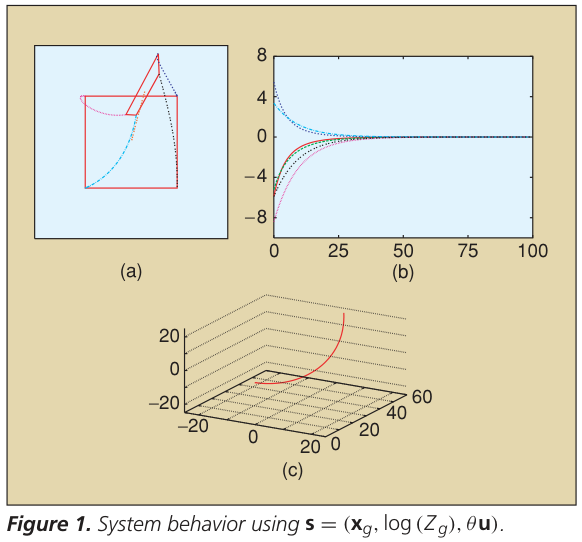
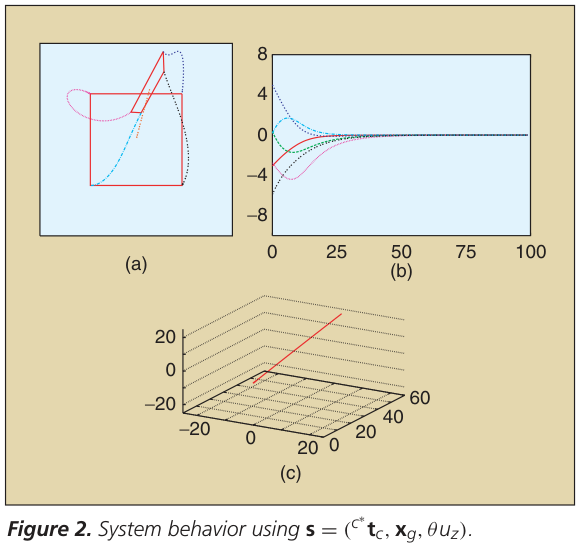
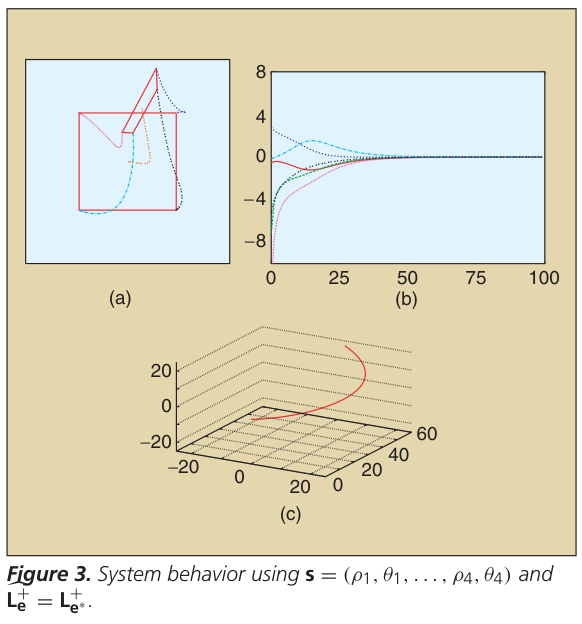
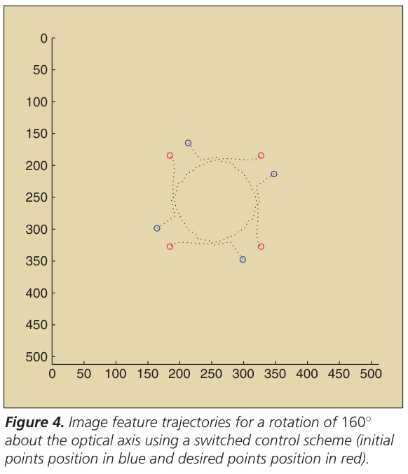
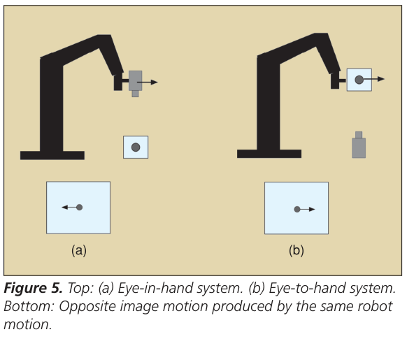

# 시각 서보 제어 제2부: 고급 접근법 (Chaumette 2007)

- 원제: Visual Servo Control — Part II: Advanced Approaches
- 저자: François Chaumette, Seth Hutchinson
- 원문: 같은 폴더의 `Chaumette2007_VisualServoControl_PartII.pdf` (IEEE Robotics & Automation Magazine, vol. 14, no. 1, pp. 109–118, March 2007, TUTORIAL)
- 번역 범위: 전문(본문, 그림 캡션, 키워드, 저자 소개 포함). 원문 지면의 강조 인용문(pull quote)은 본문 문장을 되풀이한 것이므로 해당 위치에 인용 블록으로 옮겼다.
- 그림: 원문 그림 5개를 `그림/`에 넣고 본문에서 처음 언급되는 곳에 삽입
- 원문에는 절 번호가 없다. 아래 번호는 번역에서 붙인 것이며, 소절 제목은 원문 그대로 옮겼다. 수식 번호 (1)~(19)는 제2부 원문 번호이다.

## 초록 (도입부)

이 글은 시각 서보 제어에 관한 두 편짜리 튜토리얼의 두 번째 글이다. 제1부(*IEEE Robotics and Automation Magazine, vol. 13, no. 4*)에서는 기본 개념을 소개하고 기본 접근법들을 설명했다. 여기서는 더 고급의 개념을 논의하고 최근의 여러 접근법을 제시한다.

튜토리얼 제1부에서 설명했듯이, 시각 서보 방식은 다음 관계에 의존한다.

$$\dot{\mathbf{s}} = \mathbf{L_s}\mathbf{v}_c \tag{1}$$

여기서 $\mathbf{s}$는 기하학적 특징의 집합이며, 그 시간 도함수 $\dot{\mathbf{s}}$는 상호작용 행렬(interaction matrix) $\mathbf{L_s}$를 통해 카메라의 공간 속도 $\mathbf{v}_c$와 선형으로 관련된다. 이 관계를 써서, 시각 특징의 현재값 $\mathbf{s}$와 목표값 $\mathbf{s}^*$ 사이의 오차 $\mathbf{e} = \mathbf{s} - \mathbf{s}^*$를 최소화하도록 제어 방식을 설계한다.

고전적인 비례 제어 방식은 다음과 같다.

$$\mathbf{v}_c = -\lambda\widehat{\mathbf{L}_\mathbf{e}^{+}}\mathbf{e}, \tag{2}$$

여기서 $\mathbf{L_e}$는 다음으로 정의되고

$$\dot{\mathbf{e}} = \mathbf{L_e}\mathbf{v}_c , \tag{3}$$

$\widehat{\mathbf{L}_\mathbf{e}^{+}}$는 $\mathbf{L_e}$의 유사역행렬(pseudo-inverse)의 근사이다. 시각 서보 방식은 영상 측정값에서 직접 얻을 수 없는 3차원(3-D) 파라미터 값을 필요로 하므로 근사를 써야 한다. 위치 기반 시각 서보(PBVS) 방식에서는 3-D 파라미터가 오차 $\mathbf{e}$와 상호작용 행렬 양쪽에 나타나고, 기본 영상 기반 시각 서보(IBVS)에서는 고려하는 각 점의 깊이가 평행이동(병진) 운동에 관한 상호작용 행렬의 계수에 나타난다는 것을 상기하라. 이는 제어 방식에 $\widehat{\mathbf{L}_\mathbf{e}^{+}} = \widehat{\mathbf{L}_{\mathbf{e}^*}}^{+}$를 쓰는 경우에도 마찬가지인데, 다만 이 경우에는 목표 자세에 대한 각 점의 깊이 $Z^*$만 필요하며 이는 일반적으로 실제로 얻기 어렵지 않다. 다른 모든 경우에는 제어 방식의 매 반복마다 현재 깊이를 추정해야 한다.

튜토리얼 제2부는 상호작용 행렬을 추정하는 두 가지 접근법을 설명하는 것으로 시작한다. 먼저 에피폴라 기하(epipolar geometry)를 써서 3-D 파라미터를 추정하고 이를 상호작용 행렬 구성에 쓰는 방법을 설명한다. 이어서 $\widehat{\mathbf{L}_\mathbf{e}^{+}}$의 수치 값을 직접 추정하는 방법을 설명한다. 이 방법들을 갖춘 다음, 시각 서보 제어의 더 고급 기법들을 제시한다. 이 기법들은 PBVS와 IBVS 방법의 상대적인 단점을 보완하는 것을 목표로 한다. 그다음 표적 추적 작업, 즉 표적 물체가 정지해 있지 않은 작업을 고려한다. 마지막으로 아이-인-핸드(eye-in-hand) 시스템과 아이-투-핸드(eye-to-hand) 시스템을 모두 고려할 수 있게 해 주는 모델링 문제의 일반화를 제시한다.

## 1. 3-D 파라미터의 추정 (Estimation of 3-D Parameters)

보정(캘리브레이션)된 스테레오 비전 시스템을 쓰면, 튜토리얼 제1부에서 언급했듯이 모든 3-D 파라미터를 삼각측량으로 쉽게 결정할 수 있다. 마찬가지로 물체의 3-D 모델을 알면 모든 3-D 파라미터를 자세 추정 알고리즘으로 계산할 수 있다. 그러나 그러한 추정은 영상 잡음 때문에 꽤 불안정할 수 있다. 서로 다른 시점에서 관측한 같은 장면의 영상들을 연결하는 에피폴라 기하를 써서 3-D 파라미터를 추정하는 것도 가능하다. 실제로 시각 서보에서는 일반적으로 두 영상, 즉 현재 영상과 목표 영상을 얻을 수 있다. 이와 달리, 시각 서보 작업 동안 영상 측정이 이루어짐에 따라 상호작용 행렬을 직접 추정할 수도 있다. 여기서는 두 접근법을 모두 논의한다.

> *에피폴라 기하를 써서 3-D 파라미터를 추정할 수 있으며, 이를 상호작용 행렬 구성에 쓸 수 있다.* (원문 강조 인용문)

### 에피폴라 기하 (Epipolar Geometry)

현재 영상과 목표 영상의 영상 측정값 사이의 대응 집합이 주어지면, 기초 행렬(fundamental matrix), 또는 카메라가 보정되어 있다면 본질 행렬(essential matrix)을 복원할 수 있으며[1], 이를 시각 서보에 쓸 수 있다[2]. 실제로 본질 행렬로부터 두 시점 사이의 회전과, 스칼라 배수까지의(up to a scalar factor) 평행이동을 추정할 수 있다. 그러나 시각 서보의 수렴 근처, 즉 현재 영상과 목표 영상이 비슷할 때는 에피폴라 기하가 퇴화(degenerate)하여 두 시점 사이의 부분 자세를 정확히 추정할 수 없다. 이런 이유로 일반적으로 호모그래피(homography)를 쓰는 것이 선호된다.

$\mathbf{x}_i$와 $\mathbf{x}_i^*$를 현재 영상과 목표 영상에서 한 점의 동차 영상 좌표라 하자. 그러면 $\mathbf{x}_i$는 다음과 같이 $\mathbf{x}_i^*$와 관련된다.

$$\mathbf{x}_i = \mathbf{H}_i\mathbf{x}_i^*,$$

여기서 $\mathbf{H}_i$는 호모그래피 행렬이다.

모든 특징점이 하나의 3-D 평면 위에 있으면, 모든 $i$에 대해 $\mathbf{x}_i = \mathbf{H}\mathbf{x}_i^*$인 단일 호모그래피 행렬 $\mathbf{H}$가 존재한다. 이 호모그래피는 목표 영상과 현재 영상에서 대응된 네 점의 위치를 써서 추정할 수 있다. 모든 특징점이 같은 3-D 평면에 속하지 않으면, 세 점을 써서 그러한 평면을 정의하고 다섯 개의 추가 점으로 $\mathbf{H}$를 추정한다[3].

$\mathbf{H}$를 얻으면 다음과 같이 분해할 수 있다.

$$\mathbf{H} = \mathbf{R} + \frac{\mathbf{t}}{d^*}\mathbf{n}^{*\top}, \tag{4}$$

여기서 $\mathbf{R}$은 현재와 목표 카메라 좌표계의 방향을 연결하는 회전 행렬, $\mathbf{n}^*$은 목표 좌표계에서 표현한 선택된 3-D 평면의 법선, $d^*$는 목표 좌표계에서 3-D 평면까지의 거리, $\mathbf{t}$는 현재 좌표계와 목표 좌표계 사이의 평행이동이다. 따라서 $\mathbf{H}$로부터 $\mathbf{R}$, $\mathbf{t}/d^*$, $\mathbf{n}$을 복원할 수 있다. 사실 이 양들에 대해 두 개의 해가 존재하지만[4], 목표 자세에 대한 약간의 지식을 써서 올바른 해를 고르는 것은 꽤 쉽다. 또한 임의의 표적 점의 깊이를 공통 스케일 배수까지 추정할 수도 있다[5]. 따라서 고전적 IBVS에 나타나는 각 점의 미지 깊이는 하나의 상수 파라미터의 함수로 표현할 수 있다. 마찬가지로 PBVS에 필요한 자세 파라미터도 평행이동 항에 대해 스칼라 배수까지 복원할 수 있다. 따라서 튜토리얼 제1부에서 설명한 PBVS 방식을 이 접근법으로 다시 볼 수 있으며, 새 오차는 스칼라 배수까지의 평행이동과 회전의 각-축 파라미터화로 정의된다. 이 접근법은 다음 절에서 설명할 혼합(hybrid) 시각 서보 방식에도 쓰였다.

### 직접 추정 (Direct Estimation)

앞에서 설명한 접근법은 상호작용 행렬의 해석적 형태에 나타나는 미지의 3-D 파라미터를 추정하는 데 쓸 수 있다. 오프라인 학습 단계나 온라인 추정 방식을 써서 그 수치 값을 직접 추정하는 것도 가능하다. PBVS에서는 상호작용 행렬의 모든 계수가 제어 방식에 쓰이는 특징 $\mathbf{s}$로부터 직접 얻어지므로, 이 아이디어는 IBVS에서만 유용하다.

상호작용 행렬을 수치적으로 추정하기 위해 제안된 모든 방법은 알려진 또는 측정된 카메라 운동으로 인한 특징의 변화를 관측하는 데 의존한다. 더 정확히는, 카메라 운동 $\Delta\mathbf{v}_c$로 인한 특징의 변화 $\Delta\mathbf{s}$를 측정하면 (1)로부터 다음을 얻는다.

$$\mathbf{L_s}\Delta\mathbf{v}_c = \Delta\mathbf{s},$$

이는 $k$개의 방정식을 주는 반면, $\mathbf{L_s}$에는 $k\times 6$개의 미지값이 있다. 따라서 $N > 6$인 $N$개의 독립적인 카메라 운동 집합을 쓰면 다음을 풀어 $\mathbf{L_s}$를 추정할 수 있다.

$$\mathbf{L_s}\mathbf{A} = \mathbf{B},$$

여기서 $\mathbf{A} \in \mathbb{R}^{6\times N}$과 $\mathbf{B} \in \mathbb{R}^{k\times N}$의 열은 각각 카메라 운동 집합과 그에 대응하는 특징 변화 집합으로 이루어진다. 최소제곱 해는 물론 다음과 같다.

$$\widehat{\mathbf{L}_\mathbf{s}} = \mathbf{B}\mathbf{A}^{+}. \tag{5}$$

신경망에 기반한 방법들도 $\mathbf{L_s}$를 추정하기 위해 개발되었다[6], [7]. $\mathbf{L_s}^{+}$의 수치 값을 직접 추정할 수도 있으며, 이는 실제로 더 나은 거동을 준다[8]. 이 경우 기본 관계는 다음과 같다.

$$\mathbf{L_s}^{+}\Delta\mathbf{s} = \Delta\mathbf{v}_c ,$$

이는 여섯 개의 방정식을 준다. $N > k$인 $N$개의 측정값 집합을 쓰면 이제 다음을 얻는다.

$$\widehat{\mathbf{L}_\mathbf{s}^{+}} = \mathbf{A}\mathbf{B}^{+}. \tag{6}$$

첫 번째 경우 (5)에서는 $\mathbf{L_s}$의 여섯 열을 여섯 개의 선형 시스템을 풀어 추정하는 반면, 두 번째 경우 (6)에서는 $\mathbf{L_s}^{+}$의 $k$개 열을 $k$개의 선형 시스템을 풀어 추정하며, 이것이 결과의 차이를 설명한다.

상호작용 행렬을 온라인으로 추정하는 것은 최적화 문제로 볼 수 있으며, 따라서 많은 연구자가 최적화 방법에서 파생된 접근법을 연구했다. 이 방법들은 보통 시스템 방정식 (1)을 이산화하고, 반복 갱신 방식을 써서 각 단계에서 $\widehat{\mathbf{L}_\mathbf{s}}$의 추정을 다듬는다. 그러한 온라인 반복 정식화 중 하나는 다음과 같은 브로이든(Broyden) 갱신 규칙을 쓴다[9], [10].

$$\widehat{\mathbf{L}_\mathbf{s}}(t+1) = \widehat{\mathbf{L}_\mathbf{s}}(t) + \frac{\alpha}{\Delta\mathbf{v}_c^\top\Delta\mathbf{v}_c}\left(\Delta\mathbf{x} - \widehat{\mathbf{L}_\mathbf{s}}(t)\Delta\mathbf{v}_c\right)\Delta\mathbf{v}_c^\top,$$

여기서 $\alpha$는 갱신 속도를 정한다. 이 방법은 [11]에서 움직이는 물체의 경우로 일반화되었다.

이러한 수치 추정을 제어 방식에 쓰는 주된 이점은 모든 모델링 및 보정 단계를 피할 수 있다는 것이다. 이는 상호작용 행렬을 해석적 형태로 얻을 수 없는 특징을 쓸 때 특히 유용하다. 예를 들어 [12]에서는 영상의 주성분 분석(Principal Component Analysis)의 주요 고유값을 시각 서보 방식에 사용했다. 이 방법들의 단점은 이론적인 안정성 및 강건성 해석을 할 수 없다는 것이다.

> *이러한 수치 추정을 제어 방식에 쓰는 주된 이점은 모든 모델링 및 보정 단계를 피할 수 있다는 것이다.* (원문 강조 인용문)

## 2. 고급 시각 서보 제어 방식 (Advanced Visual Servo Control Schemes)

이제 기본 IBVS와 PBVS의 거동을 개선하기 위해 제안된 시각 서보 제어 방식들을 설명한다. 처음 소개하는 방식들은 이들 방식 각각의 장점을 결합하면서 단점은 피하려 한다.

### 혼합 시각 서보 (Hybrid Visual Servo)

PBVS에서 쓰는 다음과 같은 $\boldsymbol{\omega}_c$에 대한 영리한 제어 법칙을 쓸 수 있다고 하자.

$$\boldsymbol{\omega}_c = -\lambda\,\theta\mathbf{u}, \tag{7}$$

여기서 $\theta\mathbf{u}$는 물체의 3-D 모델이 있으면 자세 추정 알고리즘으로부터, 또는 에피폴라 기하나 호모그래피로 추정한 부분 자세로부터 얻는다. 이를 전통적인 IBVS와 함께 어떻게 쓸 수 있을까?

평행이동 자유도를 제어하는 데 쓰는 특징 벡터 $\mathbf{s}_t$와 오차 $\mathbf{e}_t$를 고려하면, 상호작용 행렬을 다음과 같이 분할할 수 있다.

$$\begin{aligned} \dot{\mathbf{s}}_t &= \mathbf{L}_{\mathbf{s}_t}\mathbf{v}_c \\ &= \begin{bmatrix} \mathbf{L}_v & \mathbf{L}_\omega \end{bmatrix}\begin{bmatrix} \boldsymbol{v}_c \\ \boldsymbol{\omega}_c \end{bmatrix} \\ &= \mathbf{L}_v\boldsymbol{v}_c + \mathbf{L}_\omega\boldsymbol{\omega}_c . \end{aligned}$$

이제 $\dot{\mathbf{e}}_t = -\lambda\mathbf{e}_t$로 두면, 원하는 평행이동 제어 입력을 다음과 같이 풀 수 있다.

$$\begin{aligned} -\lambda\mathbf{e}_t &= \dot{\mathbf{e}}_t = \dot{\mathbf{s}}_t = \mathbf{L}_v\boldsymbol{v}_c + \mathbf{L}_\omega\boldsymbol{\omega}_c \\ &\Rightarrow \boldsymbol{v}_c = -\mathbf{L}_v^{+}(\lambda\mathbf{e}_t + \mathbf{L}_\omega\boldsymbol{\omega}_c). \end{aligned} \tag{8}$$

양 $(\lambda\mathbf{e}_t + \mathbf{L}_\omega\boldsymbol{\omega}_c)$는 원래 오차와 $\boldsymbol{\omega}_c$로 인한 회전 운동이 유발할 오차를 결합한 수정된 오차 항으로 생각할 수 있다. 평행이동 제어 입력 $\boldsymbol{v}_c = -\mathbf{L}_v^{+}(\lambda\mathbf{e}_t + \mathbf{L}_\omega\boldsymbol{\omega}_c)$는 이 오차를 0으로 만든다.

2.5차원(2 1/2-D) 시각 서보[13]로 알려진 방법이 IBVS와 PBVS를 결합하면서 이러한 분할을 처음으로 활용했다. 더 정확히는, [13]에서 $\mathbf{s}_t$는 한 영상 점의 좌표와 그 깊이의 로그로 선택되어, $\mathbf{L}_v$가 항상 역행렬이 존재하는 삼각 행렬이 된다. 더 정확히는 $\mathbf{s}_t = (\mathbf{x}, \log Z)$, $\mathbf{s}_t^* = (\mathbf{x}^*, \log Z^*)$, $\mathbf{e}_t = (\mathbf{x} - \mathbf{x}^*, \log\rho_Z)$이며, 여기서 $\rho_Z = Z/Z^*$이고 다음과 같다.

$$\mathbf{L}_v = \frac{1}{Z^*\rho_Z}\begin{bmatrix} -1 & 0 & x \\ 0 & -1 & y \\ 0 & 0 & -1 \end{bmatrix}$$

$$\mathbf{L}_\omega = \begin{bmatrix} xy & -(1 + x^2) & y \\ 1 + y^2 & -xy & -x \\ -y & x & 0 \end{bmatrix}.$$

비율 $\rho_Z$는 앞서 설명한 부분 자세 추정 알고리즘에서 직접 얻을 수 있음에 유의하라.

시각 서보 제어 방식의 일반적인 전역 표현으로 돌아가면, $\mathbf{e} = (\mathbf{e}_t, \theta\mathbf{u})$이고 $\mathbf{L_e}$는 다음과 같다.

$$\mathbf{L_e} = \begin{bmatrix} \mathbf{L}_v & \mathbf{L}_\omega \\ \mathbf{0} & \mathbf{L}_{\theta\mathbf{u}} \end{bmatrix},$$

여기에 (2)를 적용하면 제어 법칙 (7)과 (8)을 곧바로 얻는다.

서로 다른 제어 방식의 거동을 비교하기 위해 튜토리얼 제1부에서 고른 예를 다시 생각하면, (8)을 써서 얻은 결과는 그림 1과 같다. 여기서 $\mathbf{s}_t$에서 고려한 점은 표적의 무게중심 $\mathbf{x}_g$이다. 이 점의 영상 궤적은 예상대로 직선이고, 카메라 속도 성분이 보기 좋게 감소하며, 이 방식은 첫 번째 PBVS 접근법과 매우 가깝다는 점에 주목하라.

*그림 1 — $\mathbf{s} = (\mathbf{x}_g, \log(Z_g), \theta\mathbf{u})$를 쓸 때의 시스템 거동.*

안정성에 관해서는, 이 방식이 완벽한 조건에서 전역 점근 안정하다는 것이 분명하다(튜토리얼 제1부의 안정성 해석 참조: 여기서는 단순한 경우 $k = 6$이다). 또한 상호작용 행렬 $\mathbf{L_e}$의 삼각 형태 덕분에, 호모그래피 추정 접근법[14]을 써서 보정 오차가 있을 때 이 방식의 안정성을 해석하는 것이 가능했다. 마지막으로, 이 방식에 관여하는 유일한 미지 상수 파라미터 $Z^*$는 적응(adaptive) 기법을 써서 온라인으로 추정할 수 있다[15].

다른 혼합 방식도 설계할 수 있다. 예를 들어 [16]에서는 $\mathbf{s}_t$의 세 번째 성분을 달리 선택해 모든 표적 점이 가능한 한 카메라 시야 안에 머물도록 했다. 또 다른 예가 [17]에서 제안되었다. 이 경우 $\mathbf{s}$는 $\mathbf{s} = ({}^{c^*}\mathbf{t}_c, \mathbf{x}_g, \theta u_z)$로 선택되며, 다음 형태의 블록 삼각 상호작용 행렬을 준다.

$$\mathbf{L_e} = \begin{bmatrix} \mathbf{R} & \mathbf{0} \\ \mathbf{L}'_v & \mathbf{L}'_\omega \end{bmatrix},$$

여기서 $\mathbf{L}'_v$와 $\mathbf{L}'_\omega$는 쉽게 계산할 수 있다. 이 방식에서는 완벽한 조건에서 카메라 궤적이 직선이고(${}^{c^*}\mathbf{t}_c$가 $\mathbf{s}$의 일부이므로), 물체 무게중심의 영상 궤적도 직선이다($\mathbf{x}_g$도 $\mathbf{s}$의 일부이므로). 카메라의 평행이동 자유도는 3-D 직선을 실현하는 데 쓰이고[역주: 원문 "straigth"는 오기], 카메라의 회전 자유도는 2차원(2-D) 직선을 실현하고 평행이동 운동으로 인한 $\mathbf{x}_g$의 2-D 운동도 보상하는 데 쓰인다[역주: 원문 "transational"은 오기]. 그림 2에서 볼 수 있듯이 이 방식은 실제로 특히 만족스럽다.

*그림 2 — $\mathbf{s} = ({}^{c^*}\mathbf{t}_c, \mathbf{x}_g, \theta u_z)$를 쓸 때의 시스템 거동.*

마지막으로 2-D와 3-D 특징을 다른 방식으로 결합할 수도 있다. 예를 들어 [18]에서는 화소로 표현된 영상 점 집합의 2-D 동차 좌표에 그 깊이를 곱한 것을 $\mathbf{s}$로 쓰는 방법, 즉 $\mathbf{s} = (u_1 Z_1, v_1 Z_1, Z_1, \ldots, u_n Z_n, v_n Z_n, Z_n)$이 제안되었다. 고전적 IBVS와 마찬가지로, 이 경우 카메라의 6 자유도를 제어하려면 적어도 세 점을 써야 하므로 중복(redundant) 특징 집합을 얻는다(여기서는 $k \geq 9$). 그러나 [19]에서 이 중복 특징 선택에는 끌어당기는(attractive) 국소 최솟값이 없음이 증명되었다.

### 분할 시각 서보 (Partitioned Visual Servo)

앞서 설명한 혼합 시각 서보 방식들은, 일부는 2-D로 일부는 3-D로 정의된 적절한 시각 특징을 선택하여 회전 운동을 평행이동 운동으로부터 분리하도록 설계되었다(그래서 2.5-D 시각 서보라 불렀다). 이 연구는 일부 연구자들에게 영상에서 직접 표현된 특징만 써서 비슷한 분리 성질을 보이는 특징을 찾도록 영감을 주었다. 더 정확히는, 목표는 각각이 오직 하나의 자유도와만 관련되는 여섯 개의 특징을 찾는 것이다(이 경우 상호작용 행렬은 대각 행렬이다). 궁극의 목표(성배, Grail)는 원소가 상수이고 가능한 한 단위 행렬에 가까운 대각 상호작용 행렬을 찾아, 순수하고 직접적이며 단순한 선형 제어 문제로 만드는 것이다.

이 분야의 첫 연구는 광축과 관련된 운동을 분리하도록 상호작용 행렬을 분할했다[20]. 실제로 $\mathbf{s}$를 어떻게 선택하든 다음이 성립한다.

$$\begin{aligned} \dot{\mathbf{s}} &= \mathbf{L_s}\mathbf{v}_c \\ &= \mathbf{L}_{xy}\mathbf{v}_{xy} + \mathbf{L}_z\mathbf{v}_z \\ &= \dot{\mathbf{s}}_{xy} + \dot{\mathbf{s}}_z , \end{aligned}$$

여기서 $\mathbf{L}_{xy}$는 $\mathbf{L_s}$의 첫째, 둘째, 넷째, 다섯째 열을 포함하고 $\mathbf{L}_z$는 $\mathbf{L_s}$의 셋째와 여섯째 열을 포함한다. 마찬가지로 $\mathbf{v}_{xy} = (v_x, v_y, \omega_x, \omega_y)$이고 $\mathbf{v}_z = (v_z, \omega_z)$이다. 여기서 $\dot{\mathbf{s}}_z = \mathbf{L}_z\mathbf{v}_z$는 광축을 따른 카메라 운동과 광축 둘레의 회전으로 인한 $\dot{\mathbf{s}}$의 성분을 주고, $\dot{\mathbf{s}}_{xy} = \mathbf{L}_{xy}\mathbf{v}_{xy}$는 카메라 $x$, $y$축을 따른 속도와 그 둘레의 회전으로 인한 $\dot{\mathbf{s}}$의 성분을 준다.

앞에서처럼 $\dot{\mathbf{e}} = -\lambda\mathbf{e}$로 두면 다음을 얻는다.

$$-\lambda\mathbf{e} = \dot{\mathbf{e}} = \dot{\mathbf{s}} = \mathbf{L}_{xy}\mathbf{v}_{xy} + \mathbf{L}_z\mathbf{v}_z ,$$

이는 다음으로 이어진다.

$$\mathbf{v}_{xy} = -\mathbf{L}_{xy}^{+}(\lambda\mathbf{e}(t) + \mathbf{L}_z\mathbf{v}_z).$$

앞에서처럼 $(\lambda\mathbf{e}(t) + \mathbf{L}_z\mathbf{v}_z)$를 원래 오차를 포함하면서 $\mathbf{v}_z$가 유발할 오차를 고려한 수정된 오차로 생각할 수 있다.

이 결과가 주어지면 남은 일은 $\mathbf{s}$와 $\mathbf{v}_z$를 선택하는 것뿐이다. 기본 IBVS와 마찬가지로 영상 점 집합의 좌표를 $\mathbf{s}$에 쓸 수 있고, $\mathbf{v}_z$를 결정하기 위해 두 개의 새로운 영상 특징을 정의할 수 있다.

- $\alpha$를, $0 \leq \alpha < 2\pi$로, 영상 평면의 수평축과 두 특징점을 잇는 방향 있는 선분 사이의 각으로 정의한다. $\alpha$가 광축 둘레의 회전과 밀접하게 관련되어 있음은 분명하다.
- $\sigma^2$을 이 점들이 정의하는 다각형의 넓이로 정의한다. 마찬가지로 $\sigma^2$은 광축을 따른 평행이동과 밀접하게 관련된다.

이 특징들을 써서 [20]에서는 $\mathbf{v}_z$를 다음과 같이 정의했다.

$$\begin{cases} v_z = \lambda_{v_z}\ln\frac{\sigma^*}{\sigma} \\ \omega_z = \lambda_{\omega_z}(\alpha^* - \alpha). \end{cases}$$

### 영상 점의 원통 좌표를 이용한 IBVS (IBVS with Cylindrical Coordinates of Image Points)

[21]에서 제안된 것처럼, 또 다른 선택지는 영상 점의 데카르트 좌표 $(x, y)$ 대신 원통 좌표 $(\rho, \theta)$를 쓰는 것이다. 이들은 다음과 같이 정의된다.

$$\rho = \sqrt{x^2 + y^2} \qquad \theta = \arctan\frac{y}{x} \tag{9}$$

단 $\rho \neq 0$이어야 하며, 그렇지 않으면 $\theta$가 정의되지 않는다. (9)로부터 다음을 유도한다.

$$\dot{\rho} = (x\dot{x} + y\dot{y})/\rho \qquad \dot{\theta} = (x\dot{y} - y\dot{x})/\rho^2 .$$

튜토리얼 제1부에 주어진 상호작용 행렬 $\mathbf{L_x}$를 써서 $\dot{x}$와 $\dot{y}$를 표현하고, $x$를 $\rho\cos\theta$로, $y$를 $\rho\sin\theta$로 치환하면 곧바로 다음을 얻는다.

$$\begin{aligned} \mathbf{L}_\rho &= \begin{bmatrix} \frac{-c}{Z} & \frac{-s}{Z} & \frac{\rho}{Z} & (1 + \rho^2)s & -(1 + \rho^2)c & 0 \end{bmatrix} \\ \mathbf{L}_\theta &= \begin{bmatrix} \frac{s}{\rho Z} & \frac{-c}{\rho Z} & 0 & c/\rho & s/\rho & -1 \end{bmatrix}, \end{aligned}$$

여기서 $c = \cos\theta$, $s = \sin\theta$이다. $\mathbf{L}_\rho$와 $\mathbf{L}_\theta$의 셋째와 여섯째 열을 보면, 앞서 선택한 두 영상 특징 $\sigma$와 $\alpha$가 그랬듯이 $\rho$는 $\omega_z$에 대해 불변이고 $\theta$는 $v_z$에 대해 불변이며 $\omega_z$와 선형으로 관련됨을 알 수 있다. 이것이 이 경우에 얻은 거동이 꽤 만족스러운 이유를 설명한다. 실제로 앞과 같은 예를 고려하고 이제 $\mathbf{s} = (\rho_1, \theta_1, \ldots, \rho_4, \theta_4)$와 $\widehat{\mathbf{L}_\mathbf{e}^{+}} = \mathbf{L}_{\mathbf{e}^*}^{+}$(즉 상수 행렬)를 쓰면, 그림 3에 보인 시스템 거동은 $\mathbf{s} = (x_1, y_1, \ldots, x_4, y_4)$와 함께 $\widehat{\mathbf{L}_\mathbf{e}^{+}} = (\mathbf{L_e}/2 + \mathbf{L}_{\mathbf{e}^*}/2)^{+}$를 쓰는 경우와 같은 좋은 성질을 가진다. 튜토리얼 제1부에서 설명한 IBVS의 기하학적 해석에 쓴 예로 돌아가면, 상호작용 행렬의 셋째와 여섯째 열 사이의 분리 덕분에 얻는 거동 역시 예상대로일 것이다.

*그림 3 — $\mathbf{s} = (\rho_1, \theta_1, \ldots, \rho_4, \theta_4)$와 $\widehat{\mathbf{L}_\mathbf{e}^{+}} = \mathbf{L}_{\mathbf{e}^*}^{+}$를 쓸 때의 시스템 거동.*

### 고급 IBVS 방식 (Advanced IBVS Schemes)

지금까지 제시한 모든 IBVS 방식에서는 주로 영상 점 좌표를 $\mathbf{s}$에 넣는 경우를 고려했다. 물론 다른 기하 프리미티브(geometrical primitive)도 쓸 수 있다. 그렇게 하는 데는 여러 이유가 있다. 첫째, 카메라가 관측하는 장면을 항상 점의 집합만으로 기술할 수 있는 것은 아니며, 이 경우 영상 처리는 직선의 집합이나 물체의 윤곽과 같은 다른 종류의 측정값을 제공한다. 둘째, 더 풍부한 기하 프리미티브는 분할 시스템 설계의 동기가 된 분리와 선형화 문제를 개선할 수 있다. 마지막으로, 달성해야 할 로봇 작업은 카메라와 관측 물체 사이의 가상 연결(virtual linkage, 또는 고정구 fixture)로 표현될 수 있으며[22], [23], 때로는 점-대-직선(point-to-line)[24](관측된 점이 지정된 직선 위에 있어야 함을 뜻한다)과 같은 프리미티브 사이의 구속으로 직접 표현되기도 한다.

첫 번째 점에 관해서는, 선분, 직선, 구, 원, 원기둥과 같은 넓은 부류의 기하 프리미티브의 원근 투영에 관한 상호작용 행렬을 구할 수 있다. 그 결과는 [25]와 [22]에 주어져 있다. 최근에는 평면 물체에 대응하는 임의의 영상 모멘트(image moment)에 관한 상호작용 행렬의 해석적 형태가 계산되었다. 이로써 임의 형상의 평면 물체를 고려할 수 있게 되었다[26]. 영상에서 점들의 집합을 측정하는 경우에도 모멘트를 쓸 수 있다[27]. 두 경우 모두 모멘트를 쓰면 물체의 무게중심이나 방향과 같은 직관적인 기하 특징을 쓸 수 있다. 모멘트의 적절한 조합을 선택하면, 좋은 분리 및 선형화 성질을 갖는 분할 시스템을 결정할 수 있다[26], [27].

이 모든 특징(기하 프리미티브, 모멘트)에 대해, 영상 점의 경우와 마찬가지로 고려하는 프리미티브나 물체의 깊이가 평행이동 자유도에 관한 상호작용 행렬의 계수에 나타남에 유의하라. 따라서 일반적으로 이 깊이의 추정이 여전히 필요하다. 예외는 드물게 있는데, 예를 들어 모멘트를 적절히 정규화하면 특정한 경우에 상수인 목표 깊이만 상호작용 행렬에 나타나게 할 수 있다[27].

## 3. 성능 최적화와 계획 (Performance Optimization and Planning)

어떤 의미에서 분할 방법은 개별 자유도에 서로 다른 특징과 제어기를 할당해 시스템 성능을 최적화하려는 시도이다. 이렇게 하면 설계자는 제어기를 자유도에 할당할 때 일종의 오프라인 최적화를 수행하는 셈이다. 다양한 시스템 성능 척도를 최적화하는 제어기를 명시적으로 설계하는 것도 가능하다. 이 절에서는 그중 몇 가지를 설명한다.

### 최적 제어와 여유자유도 프레임워크 (Optimal Control and Redundancy Framework)

그러한 접근의 예가 [28]과 [29]에 있으며, 여기서는 상태와 제어 입력의 선형 결합을 최소화하는 이득을 고르기 위해 선형 이차 가우시안(LQG) 제어 설계를 사용한다. 이 접근은 추적 오차(제어기가 $\mathbf{s} - \mathbf{s}^*$를 0으로 만들려 하므로)와 로봇 운동 사이의 트레이드오프를 명시적으로 균형 잡는다. 비슷한 제어 접근이 [30]에서 제안되었는데, 여기서는 관절 한계 회피를 위치 결정 작업과 동시에 고려한다.

영상에서 로봇 운동의 관측 가능성(observability)을 명시적으로 표현하는 최적성 기준을 정식화할 수도 있다. 예를 들어 상호작용 행렬의 특이값 분해는 어느 자유도가 가장 잘 드러나 쉽게 제어될 수 있는지 보여 주며, 상호작용 행렬의 조건수는 운동의 가시성에 대한 일종의 전역 척도를 준다. 이 개념은 [31]에서는 분해능(resolvability), [32]에서는 운동 지각성(motion perceptibility)이라 불렸다. 특정 자유도를 따라서든 전역적으로든 이 척도들을 최대화하도록 특징을 선택하고 제어기를 설계하면, 시각 서보 시스템의 성능을 개선할 수 있다.

최적 제어 접근을 써서 제어 방식을 설계할 때 고려하는 구속들은 어떤 경우에는 서로 모순될 수 있으며, 이 때문에 최소화할 목적 함수의 국소 최솟값으로 시스템이 실패할 수 있다. 예를 들어 로봇 관절 한계에서 멀어지기 위해 생성된 운동이 목표 자세에 가까이 가기 위해 생성된 운동과 정확히 반대여서 전체 운동이 0이 되는 일이 생길 수 있다. 이 잠재적 문제를 피하기 위해 로보틱스에서 고전적인 경사 투영법(gradient projection method)을 쓸 수 있다. 이 방법을 시각 서보에 적용하는 것이 [25]와 [23]에서 제안되었다. 이 접근은 부차 구속 $\mathbf{e}_s$를 비전 기반 작업 $\mathbf{e}$의 영공간에 투영하여, 이들이 $\mathbf{e}$를 0으로 조절하는 데 영향을 주지 않게 하는 것이다.

$$\mathbf{e}_g = \widehat{\mathbf{L}_\mathbf{e}^{+}}\mathbf{e} + \mathbf{P_e}\mathbf{e}_s ,$$

여기서 $\mathbf{e}_g$는 새로 고려하는 전역 작업이고, $\mathbf{P_e} = (\mathbf{I}_6 - \widehat{\mathbf{L}_\mathbf{e}^{+}}\widehat{\mathbf{L}_\mathbf{e}})$는 $\forall\mathbf{e}_s$에 대해 $\widehat{\mathbf{L}_\mathbf{e}}\mathbf{P_e}\mathbf{e}_s = 0$을 만족한다. 이 접근으로 로봇 관절 한계를 회피하는 방법이 [33]에 제시되었다. 그러나 비전 기반 작업이 카메라의 모든 자유도를 구속하면, $\widehat{\mathbf{L}_\mathbf{e}}$가 완전 계수 6일 때 $\forall\mathbf{e}_s$에 대해 $\mathbf{P_e}\mathbf{e}_s = 0$이므로 부차 구속을 고려할 수 없다. 그 경우에는 국소 최솟값이 없는 항법 함수(navigation function)와 같은 전역 목적 함수에 구속을 넣어야 한다[34], [35].

### 전환 방식 (Switching Schemes)

앞서 설명한 분할 방법들은 개별 제어기를 특정 자유도에 할당해 성능을 최적화하려 한다. 여러 제어기를 써서 성능을 최적화하는 또 다른 방법은, 최적화할 기준에 따라 매 순간 어느 제어기를 쓸지 선택하는 전환(switching) 방식을 설계하는 것이다.

IBVS 제어기와 PBVS 제어기를 써서 간단한 전환 제어기를 다음과 같이 설계할 수 있다[36]. 시스템이 IBVS 제어기를 쓰며 시작한다고 하자. PBVS 제어기에 대한 리아푸노프 함수 $\mathcal{L} = \frac{1}{2}\|\mathbf{e}(t)\|^2$, $\mathbf{e}(t) = ({}^{c}\mathbf{t}_o - {}^{c^*}\mathbf{t}_o, \theta\mathbf{u})$를 생각하자. 어느 시점에든 이 리아푸노프 함수 값이 문턱값 $\gamma_P$를 넘으면 시스템은 PBVS 제어기로 전환한다. PBVS 제어기를 쓰는 동안 어느 시점에든 IBVS 제어기에 대한 리아푸노프 함수 값이 문턱값을 넘으면, 즉 $\mathcal{L} = \frac{1}{2}\|\mathbf{e}(t)\|^2 > \gamma_I$이면 시스템은 IBVS 제어기로 전환한다. 이 방식에서는 특정 제어기에 대한 리아푸노프 함수가 문턱값을 넘으면 그 제어기가 호출되어 대응하는 리아푸노프 함수 값을 줄인다. 전환 문턱값을 적절히 선택하면, 시스템은 IBVS와 PBVS 각각의 상대적 장점을 활용하면서 단점을 피할 수 있다.

이 시스템의 예를 광축 둘레 160° 회전의 경우에 대해 그림 4에 나타냈다. 시스템은 IBVS 모드로 시작하며 특징들이 처음에는 영상 내 목표 위치를 향해 직선으로 움직인다는 점에 주목하라. 그러나 카메라가 뒤로 물러나면서 시스템은 PBVS로 전환하며, 이로써 카메라는 광축 둘레의 회전 운동과 앞으로 나아가는 평행이동 운동을 결합해 목표 위치에 도달하고, 영상에서 관측되는 원형 궤적을 만든다.

*그림 4 — 전환 제어 방식을 써서 광축 둘레로 160° 회전할 때의 영상 특징 궤적(초기 점 위치는 파란색, 목표 점 위치는 빨간색).*

> *IBVS 제어기와 PBVS 제어기를 써서 간단한 전환 제어기를 설계할 수 있다.* (원문 강조 인용문)

시간적 전환 방식의 다른 예로는, 관측되는 표적의 가시성을 보장하기 위해 [37]에서 개발된 방식을 들 수 있다.

### 특징 궤적 계획 (Feature Trajectory Planning)

최적화 문제를 계획 단계에서 오프라인으로 다룰 수도 있다. 그 경우 장애물 회피[38], 관절 한계 및 가림(occlusion) 회피, 표적의 가시성 보장[5]과 같은 여러 구속을 동시에 고려할 수 있다. 구속을 만족하면서 카메라가 목표 자세에 도달하게 하는 특징 궤적 $\mathbf{s}^*(t)$는 잘 알려진 포텐셜 장(potential field) 접근과 같은 경로 계획 기법을 써서 결정한다.

경로 계획과 궤적 추종을 결합하면 모델링 오차에 대한 시각 서보의 강건성을 크게 향상시킬 수 있다. 실제로 모델링 오차는 오차 $\mathbf{s} - \mathbf{s}^*$가 클 때는 큰 영향을 줄 수 있지만, 작을 때는 영향이 적다. 계획 단계에서 $\mathbf{s}^*(0) = \mathbf{s}(0)$인 목표 특징 궤적 $\mathbf{s}^*(t)$를 설계해 두면, 제어 방식을 $\mathbf{s}^*$가 변한다는 사실을 고려하도록 쉽게 수정하여 오차 $\mathbf{s} - \mathbf{s}^*$를 작게 유지할 수 있다. 더 정확히는 이제 다음이 성립한다.

$$\dot{\mathbf{e}} = \dot{\mathbf{s}} - \dot{\mathbf{s}}^* = \mathbf{L_e}\mathbf{v}_c - \dot{\mathbf{s}}^*,$$

이로부터 평소처럼 원하는 거동으로 $\dot{\mathbf{e}} = -\lambda\mathbf{e}$를 선택하면 다음을 유도한다.

$$\mathbf{v}_c = -\lambda\widehat{\mathbf{L}_\mathbf{e}^{+}}\mathbf{e} + \widehat{\mathbf{L}_\mathbf{e}^{+}}\dot{\mathbf{s}}^*.$$

이 제어 법칙의 새로운 둘째 항은 $\mathbf{s}^*$의 변화를 예측(anticipate)하여, 그것이 만들어 낼 추적 오차를 제거한다. 다음 절에서 보겠지만, 움직이는 표적을 추적하는 경우에도 제어 법칙의 형태는 비슷하다.

## 4. 표적 추적 (Target Tracking)

이제 움직이는 표적과 특징의 상수 목표값 $\mathbf{s}^*$의 경우를 고려한다. 변하는 목표 특징 $\mathbf{s}^*(t)$로의 일반화는 바로 할 수 있다. 이제 오차의 시간 변화는 다음과 같다.

$$\dot{\mathbf{e}} = \dot{\mathbf{s}} = \mathbf{L_e}\mathbf{v}_c + \frac{\partial\mathbf{e}}{\partial t}, \tag{10}$$

여기서 항 $\frac{\partial\mathbf{e}}{\partial t}$는 일반적으로 알 수 없는 표적 운동으로 인한 $\mathbf{e}$의 시간 변화를 나타낸다. 제어 법칙을 여전히 $\mathbf{e}$의 지수적이고 분리된 감소(즉 다시 $\dot{\mathbf{e}} = -\lambda\mathbf{e}$)를 보장하도록 설계하면, (10)을 써서 이제 다음을 얻는다.

$$\mathbf{v}_c = -\lambda\widehat{\mathbf{L}_\mathbf{e}^{+}}\mathbf{e} - \widehat{\mathbf{L}_\mathbf{e}^{+}}\widehat{\frac{\partial\mathbf{e}}{\partial t}}, \tag{11}$$

여기서 $\widehat{\frac{\partial\mathbf{e}}{\partial t}}$는 $\frac{\partial\mathbf{e}}{\partial t}$의 추정 또는 근사이다. 표적 운동을 보상하려면 이 항을 제어 법칙에 넣어야 한다.

루프를 닫으면, 즉 (11)을 (10)에 대입하면 다음을 얻는다.

$$\dot{\mathbf{e}} = -\lambda\mathbf{L_e}\widehat{\mathbf{L}_\mathbf{e}^{+}}\mathbf{e} - \mathbf{L_e}\widehat{\mathbf{L}_\mathbf{e}^{+}}\widehat{\frac{\partial\mathbf{e}}{\partial t}} + \frac{\partial\mathbf{e}}{\partial t}. \tag{12}$$

$\mathbf{L_e}\widehat{\mathbf{L}_\mathbf{e}^{+}} > 0$이더라도, 추정 $\widehat{\frac{\partial\mathbf{e}}{\partial t}}$가 다음을 만족할 만큼 충분히 정확해야만 오차가 0으로 수렴한다.

$$\mathbf{L_e}\widehat{\mathbf{L}_\mathbf{e}^{+}}\widehat{\frac{\partial\mathbf{e}}{\partial t}} = \frac{\partial\mathbf{e}}{\partial t}.$$

그렇지 않으면 추적 오차가 관측된다. 실제로 (12)를 단순화한 스칼라 미분방정식 $\dot{e} = -\lambda e + b$를 풀기만 해도 $e(t) = e(0)\exp(-\lambda t) + b/\lambda$를 얻으며, 이는 $b/\lambda$로 수렴한다. 한편으로 이득 $\lambda$를 크게 하면 추적 오차가 줄어들지만, 다른 한편으로 이득을 너무 크게 하면 시스템이 불안정해질 수 있다. 따라서 $b$를 가능한 한 작게 만들어야 한다.

물론 시스템이 $\frac{\partial\mathbf{e}}{\partial t} = 0$임이 알려져 있다면(즉 카메라가 움직이지 않는 물체를 관측한다면), 가장 단순한 추정 $\widehat{\frac{\partial\mathbf{e}}{\partial t}} = 0$으로도 추적 오차는 나타나지 않는다. 그렇지 않은 경우, 추적 오차를 제거하는 자동 제어의 고전적 방법은 제어 법칙에 적분 항을 넣어 표적 운동을 보상하는 것이다. 그 경우 다음과 같다.

$$\widehat{\frac{\partial\mathbf{e}}{\partial t}} = \mu\sum_j \mathbf{e}(j),$$

여기서 $\mu$는 조정해야 하는 적분 이득이다. 이 방식은 표적이 등속일 때만 추적 오차를 제거할 수 있다. 피드포워드(feedforward) 제어에 기반한 다른 방법들은, 카메라 속도를 얻을 수 있을 때 영상 측정값과 카메라 속도를 통해 항 $\widehat{\frac{\partial\mathbf{e}}{\partial t}}$를 직접 추정한다. 실제로 (10)으로부터 다음을 얻는다.

$$\widehat{\frac{\partial\mathbf{e}}{\partial t}} = \widehat{\dot{\mathbf{e}}} - \widehat{\mathbf{L}_\mathbf{e}}\widehat{\mathbf{v}_c},$$

여기서 $\widehat{\dot{\mathbf{e}}}$는 예를 들어 $\widehat{\dot{\mathbf{e}}}(t) = (\mathbf{e}(t) - \mathbf{e}(t - \Delta t))/\Delta t$로 얻을 수 있으며, $\Delta t$는 제어 루프의 주기이다. 그런 다음 칼만 필터(Kalman filter)[39]나 더 정교한 필터링 방법[40]을 써서 추정값을 개선할 수 있다. 표적 속도나 표적 궤적에 대한 지식이 있다면, 물론 이를 써서 운동을 평활화하거나 예측할 수 있다[41]–[43]. 예를 들어 [44]에서는 의료 로보틱스에서 시각 서보를 응용할 때 심장과 호흡의 주기 운동을 보상한다. 마지막으로, 예를 들어 예측 제어기(predictive controller)[45]를 써서 표적 운동이 유발하는 섭동을 가능한 한 빨리 제거하는 다른 방법들도 개발되었다[28].

## 5. 관절 공간에서 제어되는 아이-인-핸드 및 아이-투-핸드 시스템 (Eye-in-Hand and Eye-to-Hand Systems Controlled in the Joint Space)

앞 절들에서는 카메라 속도의 여섯 성분을 로봇 제어기의 입력으로 고려했다. 예를 들어 로봇의 자유도가 6보다 적어 이 운동을 실현할 수 없게 되면, 제어 방식은 관절 공간에서 표현되어야 한다. 이 절에서는 이를 어떻게 할 수 있는지 설명하고, 그 과정에서 아이-투-핸드 시스템에 대한 정식화를 전개한다.

> *관절 공간에서는 아이-투-핸드 구성과 아이-인-핸드 구성 모두에 대해 시스템 방정식이 같은 형태를 가진다.* (원문 강조 인용문)

관절 공간에서는 아이-투-핸드 구성과 아이-인-핸드 구성 모두에 대해 시스템 방정식이 다음과 같은 같은 형태를 가진다.

$$\dot{\mathbf{s}} = \mathbf{J_s}\dot{\mathbf{q}} + \frac{\partial\mathbf{s}}{\partial t}. \tag{13}$$

여기서 $\mathbf{J_s} \in \mathbb{R}^{k\times n}$은 상호작용 행렬과 연결될 수 있는 특징 야코비안 행렬이고, $n$은 로봇 관절의 수이다.

아이-인-핸드 시스템[그림 5(a) 참조]에서 $(\partial\mathbf{s}/\partial t)$는 잠재적인 물체 운동으로 인한 $\mathbf{s}$의 시간 변화이고, $\mathbf{J_s}$는 다음과 같다.

$$\mathbf{J_s} = \mathbf{L_s}\,{}^{c}\mathbf{V}_N\mathbf{J}(\mathbf{q}), \tag{14}$$

*그림 5 — 위: (a) 아이-인-핸드 시스템. (b) 아이-투-핸드 시스템. 아래: 같은 로봇 운동이 만들어 내는 반대 방향의 영상 운동.*

여기서

- ${}^{c}\mathbf{V}_N$은 비전 센서 좌표계에서 엔드이펙터 좌표계로의 공간 운동 변환 행렬(튜토리얼 제1부에서 정의한 것)이다. 이는 보통 상수 행렬이다(비전 센서가 엔드이펙터에 강체로 부착되어 있는 한). 폐루프 제어 방식의 강건성 덕분에, 시각 서보에서는 이 변환 행렬의 대략적인 근사로 충분하다. 필요하면 고전적인 핸드-아이 보정 방법으로 정확히 추정할 수 있다[46].
- $\mathbf{J}(\mathbf{q})$는 엔드이펙터 좌표계에서 표현한 로봇 야코비안이다.

아이-투-핸드 시스템[그림 5(b) 참조]에서 $(\partial\mathbf{s}/\partial t)$는 이제 잠재적인 비전 센서 운동으로 인한 $\mathbf{s}$의 시간 변화이고, $\mathbf{J_s}$는 다음과 같이 표현할 수 있다.

$$\begin{aligned} \mathbf{J_s} &= -\mathbf{L_s}\,{}^{c}\mathbf{V}_N\,{}^{N}\mathbf{J}(\mathbf{q}) & (15) \\ &= -\mathbf{L_s}\,{}^{c}\mathbf{V}_0\,{}^{0}\mathbf{J}(\mathbf{q}). & (16) \end{aligned}$$

(15)에서는 엔드이펙터 좌표계에서 표현한 고전적 로봇 야코비안 ${}^{N}\mathbf{J}(\mathbf{q})$를 쓰지만, 비전 센서 좌표계에서 엔드이펙터 좌표계로의 공간 운동 변환 행렬 ${}^{c}\mathbf{V}_N$이 서보 내내 변하므로, 제어 방식의 매 반복마다 보통 자세 추정 방법으로 추정해야 한다.

(16)에서는 로봇 야코비안 ${}^{0}\mathbf{J}(\mathbf{q})$를 로봇 기준 좌표계에서 표현하며, 비전 센서 좌표계에서 그 기준 좌표계로의 공간 운동 변환 행렬 ${}^{c}\mathbf{x}_0$는 카메라가 움직이지 않는 한 상수이다[역주: 원문 표기 그대로이며, 문맥상 ${}^{c}\mathbf{V}_0$를 가리킨다]. 실제로 편리한 이 경우에는 보통 ${}^{c}\mathbf{V}_0$의 대략적인 근사로 충분하다.

모델링 단계가 끝나면, 앞에서 쓴 절차를 그대로 따라 관절 공간에서 표현된 제어 방식을 설계하고 제어 방식의 안정성을 보장하는 충분조건을 구하는 것은 꽤 쉽다. 다시 $\mathbf{e} = \mathbf{s} - \mathbf{s}^*$와 $\mathbf{e}$의 지수적이고 분리된 감소를 고려하면 다음을 얻는다.

$$\dot{\mathbf{q}} = -\lambda\widehat{\mathbf{J}_\mathbf{e}^{+}}\mathbf{e} - \widehat{\mathbf{J}_\mathbf{e}^{+}}\widehat{\frac{\partial\mathbf{e}}{\partial t}}. \tag{17}$$

$k = n$이면, 리아푸노프 함수 $\mathcal{L} = \frac{1}{2}\|\mathbf{e}(t)\|^2$을 고려할 때 전역 점근 안정성을 보장하는 충분조건은 다음과 같다.

$$\mathbf{J_e}\widehat{\mathbf{J}_\mathbf{e}^{+}} > 0. \tag{18}$$

$k > n$이면, 기본 IBVS의 안정성 해석 전개(튜토리얼 제1부 참조)를 따라 시스템의 국소 점근 안정성을 보장하는 다음 조건을 얻는다.

$$\widehat{\mathbf{J}_\mathbf{e}^{+}}\mathbf{J_e} > 0 \tag{19}$$

실제 카메라 외부 파라미터는 $\mathbf{J_e}$에 나타나는 반면, 추정된 외부 파라미터는 $\widehat{\mathbf{J}_\mathbf{e}^{+}}$에 쓰인다는 점에 유의하라. 따라서 카메라 외부 파라미터에 대한 제어 방식의 강건성을 해석할 수 있다. 앞에서 설명한 브로이든 갱신 규칙을 써서 $\mathbf{J_e}$나 $\mathbf{J}_\mathbf{e}^{+}$의 수치 값을 직접 추정할 수도 있다.

마지막으로, 추적 오차를 제거하려면 다음을 보장해야 한다.

$$\mathbf{J_e}\widehat{\mathbf{J}_\mathbf{e}^{+}}\widehat{\frac{\partial\mathbf{e}}{\partial t}} = \frac{\partial\mathbf{e}}{\partial t}.$$

끝으로, 로봇이 6 자유도를 가지더라도 일반적으로 (2)를 써서 먼저 $\mathbf{v}_c$를 계산한 다음 로봇 역야코비안으로 $\dot{\mathbf{q}}$를 유도하는 것과, (17)을 써서 $\dot{\mathbf{q}}$를 직접 계산하는 것은 같지 않다는 점에 유의하자. 실제로 로봇 야코비안 $\mathbf{J}(\mathbf{q})$는 특이한 반면 특징 야코비안 $\mathbf{J_s}$는 특이하지 않은 경우가 생길 수 있다($k < n$일 때 그럴 수 있다). 또한 유사역행렬의 성질상 (2)를 쓰면 $\|\mathbf{v}_c\|$가 최소가 되고, (17)을 쓰면 $\|\dot{\mathbf{q}}\|$가 최소가 된다. $\widehat{\mathbf{J}_\mathbf{e}^{+}} \neq \mathbf{J}^{+}(\mathbf{q})\,{}^{N}\mathbf{V}_c\widehat{\mathbf{L}_\mathbf{e}^{+}}$가 되자마자 두 제어 방식은 달라지며 서로 다른 로봇 궤적을 유발한다. 따라서 상태 공간의 선택이 중요하다.

## 6. 결론 (Conclusion)

이 튜토리얼에서는 속도 제어기만 고려했다. 이는 대부분의 고전적인 로봇 팔에 편리하다. 그러나 고속 작업을 하거나, 이동형 비홀로노믹(nonholonomic) 로봇 또는 저구동(underactuated) 로봇을 다룰 때는 물론 로봇의 동역학을 고려해야 한다. 센서에 관해서는 고전적 원근 카메라에서 나오는 기하 특징만 고려했다. 영상 운동과 관련된 특징이나 다른 비전 센서(어안 카메라, 반사굴절(catadioptric) 카메라, 초음파 프로브 등)에서 나오는 특징은, 적절한 시각 특징을 고르기 위해 모델링 문제를 다시 살펴볼 필요가 있다. 마지막으로, 제어 방식 수준에서 시각 특징을 다른 센서(힘 센서, 근접 센서 등)에서 오는 데이터와 융합하면 새로운 연구 주제를 다룰 수 있을 것이다. 실내외 환경의 이동 로봇, 항공·우주·수중 로봇, 그리고 의료 로봇 분야에서도 시각 서보의 수많은 야심 찬 응용을 생각할 수 있다. 따라서 시각 서보 분야의 풍성한 연구는 아직 끝이 보이지 않는다.

> *시각 서보의 수많은 야심 찬 응용을 생각할 수 있다.* (원문 강조 인용문)

## 키워드 (Keywords)

시각 서보(visual servo), 로봇 제어(robot control).

## 참고문헌

[1] Y. Ma, S. Soatto, J. Kosecka, and S. Sastry, An Invitation to 3-D Vision: From Images to Geometric Models. New York: Springer-Verlag, 2003.
[2] R. Basri, E. Rivlin, and I. Shimshoni, "Visual homing: Surfing on the epipoles," Int. J. Comput. Vision, vol. 33, pp. 117–137, Sept. 1999.
[3] E. Malis, F. Chaumette, and S. Boudet, "2 1/2 D visual servoing with respect to unknown objects through a new estimation scheme of camera displacement," Int. J. Comput. Vision, vol. 37, pp. 79–97, June 2000.
[4] O. Faugeras, Three-dimensional computer vision: a geometric viewpoint. Cambridge, MA: MIT Press, 1993.
[5] Y. Mezouar and F. Chaumette, "Path planning for robust image-based control," IEEE Trans. Robot. Automa., vol. 18, no. 4 pp. 534–549, Aug. 2002.
[6] I. Suh, "Visual servoing of robot manipulators by fuzzy membership function based neural networks," in Visual Servoing, K. Hashimoto, Ed. (World Scientific Series in Robotics and Automated Systems). Singapore: World Scientific Press, 1993, vol. 7, pp. 285–315.
[7] G. Wells, C. Venaille, and C. Torras, "Vision-based robot positioning using neural networks," Image Vision Comput., vol. 14, pp. 75–732, Dec. 1996.
[8] J.-T. Lapresté, F. Jurie, and F. Chaumette, "An efficient method to compute the inverse jacobian matrix in visual servoing," in Proc. IEEE Int. Conf. Robotics Automation, New Orleans, LA, Apr. 2004, pp. 727–732.
[9] K. Hosada and M. Asada, "Versatile visual servoing without knowledge of true jacobian," in Proc. IEEE/RSJ Int. Conf. Intelligent Robots Systems, Munchen, Germany, Sept. 1994, pp. 186–193.
[10] M. Jägersand, O. Fuentes, and R. Nelson, "Experimental evaluation of uncalibrated visual servoing for precision manipulation," in Proc. IEEE Int. Conf. Robotics and Automation, Albuquerque, NM, Apr. 1997, pp. 2874–2880.
[11] J. Piepmeier, G.M. Murray, and H. Lipkin, "Uncalibrated dynamic visual servoing," IEEE Trans. Robot. Automat., vol. 20, no. 1, pp. 143–147, Feb. 2004.
[12] K. Deguchi, "Direct interpretation of dynamic images and camera motion for visual servoing without image feature correspondence," J. Robot. Mechatron., vol. 9, no. 2, pp. 104–110, 1997.
[13] E. Malis, F. Chaumette, and S. Boudet, "2-1/2D visual servoing," IEEE Trans. Robot. Automat., vol. 15, no. 2, pp. 238–250, Apr. 1999.
[14] E. Malis and F. Chaumette, "Theoretical improvements in the stability analysis of a new class of model-free visual servoing methods," IEEE Trans. Robot. Automat., vol. 18, no. 2, pp. 176–186, Apr. 2002.
[15] J. Chen, D. Dawson, W. Dixon, and A. Behal, "Adaptive homography-based visual servo tracking for fixed and camera-in-hand configurations," IEEE Trans. Control Syst. Technol., vol. 13, no. 9, pp. 814–825, Sept. 2005.
[16] G. Morel, T. Leibezeit, J. Szewczyk, S. Boudet, and J. Pot, "Explicit incorporation of 2D constraints in vision-based control of robot manipulators," in Proc. Int. Symp. Experimental Robotics, 2000, vol. 250 LNCIS Series, pp. 99–108.
[17] F. Chaumette and E. Malis, "2 1/2 D visual servoing: a possible solution to improve image-based and position-based visual servoings," in Proc. IEEE Int. Conf. Robotics Automation, San Fransisco, CA, Apr. 2000, pp. 630–635.
[18] E. Cervera, A.D. Pobil, F. Berry, and P. Martinet, "Improving image-based visual servoing with three-dimensional features," Int. J. Robot. Res., vol. 22, pp. 821–840, Oct. 2004.
[19] F. Schramm, G. Morel, A. Micaelli, and A. Lottin, "Extended-2D visual servoing," in Proc. IEEE Int. Conf. Robotics Automation, New Orleans, LA, Apr. 2004, pp. 267–273.
[20] P. Corke and S. Hutchinson, "A new partitioned approach to image-based visual servo control," IEEE Trans. Robotics Automation, vol. 17, no. 4, pp. 507–515, Aug. 2001.
[21] M. Iwatsuki and N. Okiyama, "A new formulation of visual servoing based on cylindrical coordinate system," IEEE Trans. Robot. Automat., vol. 21, no. 2, pp. 266–273, Apr. 2005.
[22] F. Chaumette, P. Rives, and B. Espiau, "Classification and realization of the different vision-based tasks," in Visual Servoing, K. Hashimoto, Ed. (Robotics and Automated Systems). Singapore: World Scientific, 1993, vol. 7, pp. 199–228.
[23] A. Castano and S. Hutchinson, "Visual compliance: task directed visual servo control," IEEE Trans. Robot. Automat., vol. 10, no. 3, pp. 334–342, June 1994.
[24] G. Hager, "A modular system for robust positioning using feedback from stereo vision," IEEE Trans. Robot. Automat., vol. 13, no. 4, pp. 582–595, Aug. 1997.
[25] B. Espiau, F. Chaumette, and P. Rives, "A new approach to visual servoing in robotics," IEEE Trans. Robot. Automat., vol. 8, no. 3, pp. 313–326, June 1992.
[26] F. Chaumette, "Image moments: A general and useful set of features for visual servoing," IEEE Trans. Robot. Automat., vol. 20, no. 4, pp. 713–723, Aug. 2004.
[27] O. Tahri and F. Chaumette, "Point-based and region-based image moments for visual servoing of planar objects," IEEE Trans. Robot., vol. 21, no. 6, pp. 1116–1127, Dec. 2005.
[28] N. Papanikolopoulos, P. Khosla, and T. Kanade, "Visual tracking of a moving target by a camera mounted on a robot: A combination of vision and control," IEEE Trans. Robot. Automat., vol. 9, no. 1, pp. 14–35, Feb. 1993.
[29] K. Hashimoto and H. Kimura, "LQ optimal and nonlinear approaches to visual servoing," in Visual Servoing, K. Hashimoto, Ed. (Robotics and Automated Systems). Singapore: Wolrd Scientific, 1993, vol. 7, pp. 165–198.
[30] B. Nelson and P. Khosla, "Strategies for increasing the tracking region of an eye-in-hand system by singularity and joint limit avoidance," Int. J. Robot. Res., vol. 14, pp. 225–269, June 1995.
[31] B. Nelson and P. Khosla, "Force and vision resolvability for assimilating disparate sensory feedback," IEEE Trans. Robot. Automat., vol. 12, no. 5, pp. 714–731, Oct. 1996.
[32] R. Sharma and S. Hutchinson, "Motion perceptibility and its application to active vision-based servo control," IEEE Trans. Robot. Automat., vol. 13, no. 4, pp. 607–617, Aug. 1997.
[33] E. Marchand, F. Chaumette, and A. Rizzo, "Using the task function approach to avoid robot joint limits and kinematic singularities in visual servoing," in Proc. IEEE/RSJ Int. Conf. Intelligent Robots Systems, Osaka, Japan, Nov. 1996, pp. 1083–1090.
[34] E. Marchand and G. Hager, "Dynamic sensor planning in visual servoing," in Proc. IEEE Int. Conf. Robotics Automation, Leuven, Belgium, May 1998, pp. 1988–1993.
[35] N. Cowan, J. Weingarten, and D. Koditschek, "Visual servoing via navigation functions," IEEE Trans. Robot. Automat., vol. 18, no. 4, pp. 521–533, Aug. 2002.
[36] N. Gans and S. Hutchinson, "An asymptotically stable switched system visual controller for eye in hand robots," in Proc. IEEE/RSJ Int. Conf. Intelligent Robots Systems, Las Vegas, NV, Oct. 2003, pp. 735–742.
[37] G. Chesi, K. Hashimoto, D. Prattichizio, and A. Vicino, "Keeping features in the field of view in eye-in-hand visual servoing: A switching approach," IEEE Trans. Robot. Automat., vol. 20, no. 5, pp. 908–913, Oct. 2004.
[38] K. Hosoda, K. Sakamato, and M. Asada, "Trajectory generation for obstacle avoidance of uncalibrated stereo visual servoing without 3D reconstruction," in Proc. IEEE/RSJ Int. Conf. Intelligent Robots Systems, vol. 3, Pittsburgh, PA, Aug. 1995, pp. 29–34.
[39] P. Corke and M. Goods, "Controller design for high performance visual servoing," in Proc. 12th World Congr. IFAC'93, Sydney, Australia, July 1993, pp. 395–398.
[40] F. Bensalah and F. Chaumette, "Compensation of abrupt motion changes in target tracking by visual servoing," in Proc. IEEE/RSJ Int. Conf. Intelligent Robots Systems, Pittsburgh, PA, Aug. 1995, pp. 181–187.
[41] P. Allen, B. Yoshimi, A. Timcenko, and P. Michelman, "Automated tracking and grasping of a moving object with a robotic hand-eye system," IEEE Trans. Robot. Automat., vol. 9, no. 2, pp. 152–165, Apr. 1993.
[42] K. Hashimoto and H. Kimura, "Visual servoing with non linear observer," in Proc. IEEE Int. Conf. Robotics Automation, Nagoya, Japan, Apr. 1995, pp. 484–489.
[43] A. Rizzi and D. Koditschek, "An active visual estimator for dexterous manipulation," IEEE Trans. Robot. Automat., vol. 12, no. 5, pp. 697–713, Oct. 1996.
[44] R. Ginhoux, J. Gangloff, M. de Mathelin, L. Soler, M.A. Sanchez, and J. Marescaux, "Active filtering of physiological motion in robotized surgery using predictive control," IEEE Trans. Robot., vol. 21, no. 1, pp. 67–79, Feb. 2005.
[45] J. Gangloff and M. de Mathelin, "Visual servoing of a 6 dof manipulator for unknown 3-D profile following," IEEE Trans. Robot. Automat., vol. 18, no. 4, pp. 511–520, Aug. 2002.
[46] R. Tsai and R. Lenz, "A new technique for fully autonomous and efficient 3D robotics hand-eye calibration," IEEE Trans. Robot. Automat., vol. 5, no. 3, pp. 345–358, June 1989.

## 저자 소개

**François Chaumette**는 1987년 프랑스 낭트의 École Nationale Supérieure de Mécanique를 졸업했다. 1990년 프랑스 렌의 렌 대학교에서 컴퓨터 과학 박사 학위를 받았다. 1990년부터 렌의 IRISA에서 일했으며, 현재 INRIA의 "Directeur de Recherches"이자 Lagadic 그룹의 책임자이다. 연구 관심사는 로보틱스와 컴퓨터 비전, 특히 시각 서보와 능동 지각(active perception)이다. 로보틱스와 컴퓨터 비전 주제로 150편 이상의 논문을 공저했으며, 지난 5년간 로보틱스와 컴퓨터 비전 관련 주요 학회의 프로그램 위원으로 활동했다. Chaumette 박사[역주: 원문 "Dr, Cahumette"는 오기]는 1991년 자동 제어 분야 최우수 프랑스 박사 논문으로 AFCET/CNRS 상을 받았다. 또한 Ezio Malis와 함께 2002 King-Sun Fu Memorial Best IEEE Transactions on Robotics and Automation Paper Award를 받았다. 2001년부터 2005년까지 *IEEE Transactions on Robotics*의 부편집장(Associate Editor)을 지냈다.

**Seth Hutchinson**은 1988년 인디애나주 웨스트라파예트의 퍼듀 대학교에서 박사 학위를 받았다. 1990년 일리노이 대학교 어배너-섐페인 교수진에 합류했으며, 현재 전기·컴퓨터공학과, Coordinated Science Laboratory, Beckman Institute for Advanced Science and Technology의 교수이다. Hutchinson 박사는 RAS Conference Editorial Board의 편집장(Editor-in-Chief)이며, *International Journal of Robotics Research*와 *Journal of Intelligent Service Robotics*의 편집위원이다. 1997년부터 2005년까지 IEEE TRANSACTIONS ON ROBOTICS AND AUTOMATION(현 IEEE TRANSACTIONS ON ROBOTICS)의 부편집장과 선임 편집장(Senior Editor)을 지냈다. 1996년에는 시각 서보 제어를 주제로 한 TRANSACTIONS 특별 섹션의 객원 편집자였고, 1994년에는 시각 서보에 관한 IEEE 워크숍의 공동 의장이었다. 1996년과 1998년에 공저한 논문이 King-Sun Fu Memorial Best Transactions Paper Award의 최종 후보에 올랐다. 1992년부터 1996년까지 IEEE Robotics and Automation Society의 Computer and Robot Vision 기술위원회 공동 의장이었으며, 로보틱스와 컴퓨터 비전 관련 50개 이상의 학회 프로그램 위원으로 활동했다. 로보틱스와 컴퓨터 비전 주제로 100편 이상의 논문을 발표했으며, *Principles of Robot Motion: Theory, Algorithms, and Implementations*(Cambrudge, MA: MIT Press)와 *Robot Modeling and Control*(New York: Wiley)의 공저자이다.

*연락처(Address for Correspondence): François Chaumette, IRISA/INRIA Rennes, Campus de Beaulieu, 35 042 Rennes cedex, France. E-mail: Francois.Chaumette@irisa.fr.*
