# 모델 선택에서의 과적합과 그에 따른 성능 평가의 선택 편향 (Cawley 2010)

- 원제: On Over-fitting in Model Selection and Subsequent Selection Bias in Performance Evaluation
- 원문: 같은 폴더의 `Cawley2010_JMLR_OverfittingModelSelection.pdf` (Journal of Machine Learning Research 11 (2010) 2079–2107. 투고 10/09, 수정 3/10, 게재 7/10. 저자 Gavin C. Cawley, Nicola L. C. Talbot, School of Computing Sciences, University of East Anglia. 편집자 Isabelle Guyon)
- 번역 범위: 전문 (본문·각주·표·그림 캡션·감사의 글. 참고문헌은 원문 그대로)
- 그림: 원문 그림 14개를 `그림/`에 넣고 본문에서 처음 언급되는 곳에 삽입

## 초록

기계학습 알고리즘의 모델 선택(model selection) 전략은 보통 적절한 모델 선택 기준을 수치적으로 최적화하는 과정을 포함하며, 이 기준은 흔히 k-겹 교차검증(k-fold cross-validation)과 같은 일반화 성능 추정량에 기반한다. 이러한 추정량의 오차는 편향(bias)과 분산(variance) 성분으로 나눌 수 있다. 비편향성(unbiasedness)은 모델 선택 기준의 유익한 성질로 자주 언급되지만, 우리는 낮은 분산이 적어도 그만큼 중요하다는 것을 보인다. 무시할 수 없는 분산은 모델을 훈련할 때뿐 아니라 모델 선택에서도 과적합(over-fitting)의 가능성을 만들기 때문이다. 이 관찰은 돌이켜보면 다소 자명할 수 있으나, 모델 선택 기준의 과적합으로 인한 성능 저하는 놀라울 만큼 클 수 있으며, 이 관찰은 지금까지 기계학습 문헌에서 별로 주목받지 못한 것으로 보인다. 이 논문에서 우리는 이러한 형태의 과적합이 미치는 영향이 학습 알고리즘 간 성능 차이와 비슷한 크기인 경우가 많으므로 실증 평가에서 무시할 수 없음을 보인다. 나아가, 흔히 쓰이는 일부 성능 평가 관행이 이러한 과적합의 결과로 일종의 선택 편향(selection bias)에 취약하며 따라서 신뢰할 수 없음을 보인다. 모델 선택에서의 과적합과 그에 따른 성능 평가의 선택 편향을 피하는 방법을 논의하며, 이것이 모범 관행(best practice)에 포함되기를 바란다. 이 연구는 교차검증 기반 모델 선택에 집중하지만, 결과는 매우 일반적이어서 베이즈 증거(Bayesian evidence)의 최대화나 성능 한계(performance bound)의 최적화를 포함해, 유한한 데이터 표본에서 평가되는 모델 선택 기준의 최적화를 수반하는 모든 모델 선택 관행에 적용된다.

키워드: 모델 선택, 성능 평가, 편향-분산 트레이드오프, 선택 편향, 과적합

## 1. 서론 (Introduction)

이 논문은 기계학습 방법의 실제 응용과 새로운 기계학습 알고리즘 개발 양쪽에서 모범 관행의 핵심 요소를 이루는, 서로 밀접하게 관련된 두 주제, 즉 모델 선택과 성능 평가를 다룬다. 대다수 기계학습 알고리즘은 어떤 형태의 다단계 추론(multi-level inference)에 기반하며, 여기서 모델은 모델 파라미터 집합과 초매개변수(hyper-parameter) 집합으로 정의된다(Guyon et al., 2009). 예를 들어 커널 학습 방법에서 파라미터는 커널 전개의 계수에 해당하고, 초매개변수에는 정칙화(regularisation) 파라미터, 커널 함수의 선택 및 관련 커널 파라미터가 포함된다. 파라미터와 초매개변수의 이러한 구분은 보통 계산 편의를 위해 이루어진다. 예컨대 커널 머신의 경우 초매개변수 값이 고정되면 파라미터는 보통 효율적인 알고리즘이 있는 볼록 최적화 문제의 해로 주어진다. 따라서 이 구조를 활용해 한 쌍의 중첩 루프로 모델을 반복적으로 적합하는 것이 합리적이다. 바깥 루프에서는 모델 선택 기준을 최적화하도록 초매개변수를 조정하고(모델 선택), 안쪽 루프에서는 훈련 기준을 최적화하도록 파라미터를 정한다(모델 적합/훈련). 우리의 이전 연구(Cawley and Talbot, 2007)에서는 모델 선택 기준의 분산 때문에 훈련 중에 일어나는 더 익숙한 형태의 과적합뿐 아니라 모델 선택 중에도 과적합이 일어날 수 있음을 지적하고, 모델 선택 기준을 정칙화함으로써 이를 어느 정도 완화할 수 있음을 보였다. 이 논문의 첫 부분은 모델 선택에서의 과적합 문제를 예시와 함께 더 자세히 논의하고, 실제 응용에서 바람직하며 기계학습 알고리즘의 공정한 비교에 필요한, 달성 가능한 최선의 성능을 얻기 위해 이런 형태의 과적합을 피하는 방법을 기술한다.

비편향적이고 강건한¹ 성능 평가는 의심할 여지 없이 기계학습 연구의 초석이다. 폭넓은 학습 과제에 걸쳐 경쟁 알고리즘의 상대 성능을 신뢰성 있게 가늠하지 못하면, 향후 연구 방향을 정하는 데 필요한 현재 접근법의 강점과 약점을 명확히 파악할 수 없다. 이 주제는 논문의 두 번째 부분에서 다루며, 특히 모델 선택에서의 과적합 때문에 생길 수 있는 바람직하지 않은 낙관적 편향(optimistic bias)에 초점을 둔다. 이 현상은 본질적으로 Ambroise and McLachlan (2002)이 마이크로어레이 분류에서 관찰한, 성능 평가 전에 특징 선택을 수행해서 생긴 선택 편향과 유사하며, 비슷한 해법을 공유한다. 우리는 기계학습 커뮤니티에서 흔히 쓰이는, 겉보기에는 꽤 무해한 일부 성능 평가 프로토콜이 이러한 편향에 취약하여 허위 결과를 낼 수 있음을 보인다. 이 편향을 피하려면 모델 선택을 모델 적합 과정의 불가분의 일부로 취급하고, 새로운 데이터 표본에 모델을 적합할 때마다 새로 수행해야 한다. 나아가 모델 선택으로 인한 성능 차이가 학습 알고리즘 간 성능 차이와 비슷한 크기인 경우가 많음을 보이므로, 기계학습 알고리즘의 성능을 단독으로 평가하는 것은 더 이상 의미가 없어 보이며, 대신 학습 알고리즘/모델 선택 절차의 조합을 비교해야 한다. 그러나 이는 강건하고 비편향적인 성능 평가에 중첩 교차검증(nested cross-validation) 또는 "이중 교차(double cross)"(Stone, 1974)와 같은, 더 엄격하고 계산량이 많은 프로토콜이 필요할 가능성이 높다는 뜻이다.

이 논문에서 논의하는 방법이나 알고리즘 중 새로운 것은 없다. 이 연구의 새로운 기여는 두 번째 추론 수준(즉, 모델 선택)에서의 과적합이 최신 기계학습 알고리즘의 일반화 성능에 매우 상당한 악영향을 미칠 수 있음을 실증적으로 보인 것이다. 또한 이것이 기계학습 커뮤니티에서 흔히 쓰이는 평가 프로토콜을 사용한 성능 평가에서 오해를 부르는 낙관적 편향으로 이어질 수 있음을 보인 것도 새롭다. 이 논문은 모델 선택과 성능 평가의 모범 관행을 장려하는 데 어느 정도 교육적 가치가 있도록 의도했지만, 모델 선택에서의 과적합이 중대한 문제라는 관찰이 이 분야에서 꼭 필요한 알고리즘적·이론적 발전을 촉진하기를 또한 바란다.

논문의 나머지 구성은 다음과 같다. 2절은 대부분의 실험에서 기본 분류기로 사용한 커널 릿지 회귀 분류기를 간략히 개관하고, 3절은 사용한 데이터 세트를 기술한다. 4절은 모델 선택 기준의 분산이 모델 선택에서의 과적합으로 이어져 일반화 성능을 떨어뜨릴 수 있으므로 중요함을 보인다. 모델 선택에서의 과적합을 피하는 여러 방법도 논의한다. 5절은 모델 선택을 모델링 절차의 불가분의 일부로 보지 않으면 모델 선택에서의 과적합이 편향된 성능 평가를 낳을 수 있음을 보인다. 겉보기에는 무해하고 널리 쓰이는 두 가지 성능 평가 프로토콜이 이 문제의 영향을 받음을 보인다. 마지막으로 6절에서 연구를 요약한다.

> 각주 1. 여기서 "강건한(robust)"이라는 용어는 훈련·검증·시험 세트를 만들기 위한 데이터의 표집과 분할 같은, 무관한 실험 요인에 둔감함을 뜻한다. 이는 보통 교차검증(Stone, 1974)이나 부트스트랩(Efron and Tibshirani, 1994) 같은 계산량이 많은 재표집(resampling) 기법으로 달성된다.

## 2. 커널 릿지 회귀 (Kernel Ridge Regression)

이 절에서는 이후 실증 예시 대부분에서 기본 분류기로 사용하는 커널 릿지 회귀(Kernel Ridge Regression, KRR) 분류기(Saunders et al., 1998)를 간략히 개관한다. 이 분류기는 최소제곱 서포트 벡터 머신(Least-Squares Support Vector Machine)(Suykens et al., 2002), 정칙화 최소제곱(Regularised Least Squares)(Rifkin and Lippert, 2007), 정칙화 네트워크(Regularisation Network)(Poggio and Girosi, 1990) 등으로도 알려져 있다. 레이블이 붙은 훈련 데이터 $\mathcal{D} = \{(\mathbf{x}_i, y_i)\}_{i=1}^{\ell}$가 주어졌다고 하자. 여기서 $\mathbf{x}_i \in \mathcal{X} \subset \mathbb{R}^d$는 $i$번째 예제를 기술하는 입력 특징 벡터이고, $y_i \in \{-1,+1\}$은 $i$번째 예제가 양성 클래스 $\mathcal{C}^+$에서 추출되었으면 $y_i=+1$, 음성 클래스 $\mathcal{C}^-$에서 추출되었으면 $y_i=-1$인 지시 변수이다. 또한 양성 예제가 $\ell^+$개, 음성 예제가 $\ell^- = \ell - \ell^+$개 있다고 하자. 커널 릿지 회귀 분류기는 고정된 특징 공간 $\phi : \mathcal{X} \to \mathcal{F}$에서 $\mathcal{C}^-$와 $\mathcal{C}^+$에서 추출된 예제를 구별할 수 있는 선형 모델 $f(\mathbf{x}) = \mathbf{w}\cdot\phi(\mathbf{x}) + b$를 구성하는 것을 목표로 하며, 다음과 같이 분류한다.

$$\mathbf{x} \in \begin{cases} \mathcal{C}^+ & \text{if } f(\mathbf{x}) \ge 0 \\ \mathcal{C}^- & \text{otherwise} \end{cases}.$$

그러나 특징 공간 $\mathcal{F}$를 직접 지정하는 대신, 특징 공간 $\mathcal{F}$에서 벡터들의 상(image) 사이의 내적을 주는 커널 함수 $\mathcal{K} : \mathcal{X}\times\mathcal{X} \to \mathbb{R}$, 즉 $\mathcal{K}(\mathbf{x},\mathbf{x}') = \phi(\mathbf{x})\cdot\phi(\mathbf{x}')$로 특징 공간을 유도한다. 이 연구 전반에서 쓰는 흔한 커널 함수는 가우시안 방사 기저 함수(radial basis function, RBF) 커널이다.

$$\mathcal{K}(\mathbf{x},\mathbf{x}') = \exp\left\{-\eta\|\mathbf{x}-\mathbf{x}'\|^2\right\}, \tag{1}$$

여기서 $\eta$는 커널 함수의 민감도를 조절하는 커널 파라미터이다. 다만 커널 함수를 함축된 특징 공간에서 점들 사이의 내적을 계산하는 것으로 해석하는 것은 커널 행렬 $\mathbf{K} = [k_{ij} = \mathcal{K}(\mathbf{x}_i,\mathbf{x}_j)]_{i,j=1}^{\ell}$이 양의 정부호(positive definite)인(Mercer, 1909), 즉

$$\mathbf{a}^T\mathbf{K}\mathbf{a} > 0, \quad \forall\, \mathbf{a} \ne \mathbf{0}$$

인 모든 커널에 대해 유효하다. 모델 파라미터 $(\mathbf{w}, b)$는 정칙화된(Tikhonov and Arsenin, 1977) 최소제곱 손실 함수의 최솟값으로 주어진다.

$$L = \frac{1}{2}\|\mathbf{w}\|^2 + \frac{1}{2\lambda}\sum_{i=1}^{\ell}\left[y_i - \mathbf{w}\cdot\phi(\mathbf{x}_i) - b\right]^2, \tag{2}$$

여기서 $\lambda$는 편향-분산 트레이드오프(Geman et al., 1992)를 조절하는 정칙화 파라미터이다. 시험 데이터에 대한 커널 머신의 정확도는 초매개변수, 이 경우 $\lambda$와 $\eta$의 좋은 값을 고르는 데 결정적으로 좌우된다. 이러한 초매개변수의 최적값을 찾는 과정을 모델 선택이라 한다. 표현자 정리(representer theorem)(Kimeldorf and Wahba, 1971)에 따르면 이 최적화 문제의 해는 다음 형태의 전개로 쓸 수 있다.

$$\mathbf{w} = \sum_{i=1}^{\ell}\alpha_i\phi(\mathbf{x}_i) \implies f(\mathbf{x}) = \sum_{i=1}^{\ell}\alpha_i\mathcal{K}(\mathbf{x}_i,\mathbf{x}) + b.$$

그러면 커널 머신의 쌍대 파라미터(dual parameter) $\boldsymbol{\alpha}$는 다음 연립 일차 방정식의 해로 주어진다.

$$\begin{bmatrix} \mathbf{K}+\lambda\mathbf{I} & \mathbf{1} \\ \mathbf{1}^T & 0 \end{bmatrix}\begin{bmatrix}\boldsymbol{\alpha} \\ b\end{bmatrix} = \begin{bmatrix}\mathbf{y} \\ 0\end{bmatrix}. \tag{3}$$

여기서 $\mathbf{y} = (y_1, y_2, \ldots, y_\ell)^T$이며, 이 방정식은 $\mathbf{K}+\lambda\mathbf{I}$의 촐레스키 분해(Cholesky factorisation)로 $O(\ell^3)$ 연산의 계산 복잡도로 효율적으로 풀 수 있다(Suykens et al., 2002). 커널 릿지 회귀 분류기는 단순하고 효율적이어서 모델 선택 같은 실무적 문제를 비교적 소규모로 실증 조사하기에 이상적인 후보이다.

### 2.1 효율적인 단일 관측치 제외 교차검증 (Efficient Leave-One-Out Cross-Validation)

교차검증(예: Stone, 1974)은 모델 선택과 성능 평가 모두를 위한 단순하고 효과적인 방법으로, 기계학습 커뮤니티에서 널리 쓰인다. k-겹 교차검증에서는 데이터를 대략 같은 크기의 서로소인 k개 부분집합으로 무작위 분할한다. 교차검증 절차의 $i$번째 겹(fold)에서는 나머지 $k-1$개 부분집합으로 훈련한 모델의 일반화 성능을 추정하는 데 $i$번째 부분집합을 쓴다. k개 겹 전체에서 관측된 일반화 성능의 평균은 전체 표본으로 훈련한 모델의 일반화 성능에 대한 (약간 비관적으로 편향된) 추정치를 준다. 각 부분집합이 패턴 하나만 포함하는 가장 극단적인 형태의 교차검증을 단일 관측치 제외 교차검증(leave-one-out cross-validation, LOO)이라 한다(Lachenbruch and Mickey, 1968; Luntz and Brailovsky, 1969). 커널 릿지 회귀의 매력적인 특징은 훈련 알고리즘의 부산물로 최소 비용으로 닫힌 형태의 단일 관측치 제외 교차검증을 수행할 수 있다는 점이다(Cawley and Talbot, 2003). (3)의 좌변 행렬을 $\mathbf{C}$라 하면, 단일 관측치 제외 과정의 $i$번째 겹에서 $i$번째 훈련 패턴의 잔차는 다음과 같다.

$$r_i^{(-i)} = y_i - \hat{y}_i^{(-i)} = \frac{\alpha_i}{C_{ii}^{-1}},$$

여기서 $\hat{y}_i^{(-j)}$는 단일 관측치 제외 절차의 $j$번째 겹에서 $i$번째 관측치에 대한 커널 릿지 회귀 머신의 출력이고, $C_{ii}^{-1}$은 행렬 $\mathbf{C}$의 역행렬 주대각선의 $i$번째 원소이다. 비슷한 방법이 최소제곱 선형 회귀에서 오랫동안 쓰여 왔다(예: Stone, 1974; Weisberg, 1985). 커널 머신의 최적 모델 파라미터는 단순한 연립 일차 방정식 (3)의 해로 주어지지만, 일반화 성능을 최대화하려면 초매개변수 $\boldsymbol{\theta} = (\lambda, \eta)$의 좋은 값을 정하기 위한 어떤 형태의 모델 선택이 필요하다. 여기서 기술한 해석적 단일 관측치 제외 교차검증 절차는 효율적인 모델 선택 전략의 기반으로 쉽게 응용할 수 있다(Chapelle et al., 2002; Cawley and Talbot, 2003; Bo et al., 2006 참조). 연속적인 모델 선택 기준을 얻기 위해 Allen의 예측 잔차 제곱합(Predicted REsidual Sum-of-Squares, PRESS) 통계량(Allen, 1974)을 채택한다.

$$\mathrm{PRESS}(\boldsymbol{\theta}) = \sum_{i=1}^{\ell}\left[r_i^{(-i)}\right]^2.$$

PRESS 기준은 척도 켤레 기울기 하강법(scaled conjugate gradient descent)(Williams, 1991)이나 Nelder-Mead 단체법(simplex)(Nelder and Mead, 1965) 절차로 효율적으로 최적화할 수 있다. 커널 릿지 회귀 분류기의 훈련과 모델 선택 절차의 자세한 내용은 Cawley (2006)를 참조하라. 자동 모델 선택을 포함한 커널 릿지 회귀 분류기의 공개 MATLAB 구현은 Generalised Kernel Machine (GKM)(Cawley et al., 2007) 툴박스²로 제공된다.

> 각주 2. 툴박스는 http://theoval.cmp.uea.ac.uk/˜gcc/projects/gkm 에서 찾을 수 있다.

## 3. 실증 예시에 사용한 데이터 세트 (Data Sets used in Empirical Demonstrations)

이 절에서는 모델 선택에서의 과적합 문제를 예시하고 그것이 성능 평가에 도입할 수 있는 편향을 보이기 위해 이 연구에서 사용한 벤치마크 데이터 세트를 기술한다.

### 3.1 합성 벤치마크 (A Synthetic Benchmark)

Ripley (1996)가 도입한 것에 기반한 합성 벤치마크를, 다음 절에서 모델 선택에서의 과적합의 성격을 예시하는 데 널리 사용한다. 데이터는 네 개의 구형(spherical) 이변량 가우시안 분포에서 같은 확률로 추출된다. 네 가우시안 모두 공통 분산 $\sigma^2 = 0.04$를 가진다. 양성 클래스에 속하는 패턴은 $[+0.4,+0.7]$과 $[-0.3,+0.7]$을 중심으로 하는 가우시안에서, 음성 패턴은 $[-0.7,+0.3]$과 $[+0.3,+0.3]$을 중심으로 하는 가우시안에서 추출된다. 그림 1은 256개 패턴으로 이루어진 합성 벤치마크의 한 실현(realisation)을 보이며, 베이즈 최적 결정 경계와 양성 클래스에 속할 사후 확률이 0.1과 0.9인 등고선을 함께 나타낸다. 이 벤치마크의 베이즈 오차는 약 12.38%이다. 이 벤치마크는 우선 베이즈 최적 결정 경계를 알고 있다는 점에서 유용하며, 또한 데이터를 무한히 공급할 수 있어 여러 기댓값을 수치적으로 근사할 수 있다는 점에서도 유용하다.

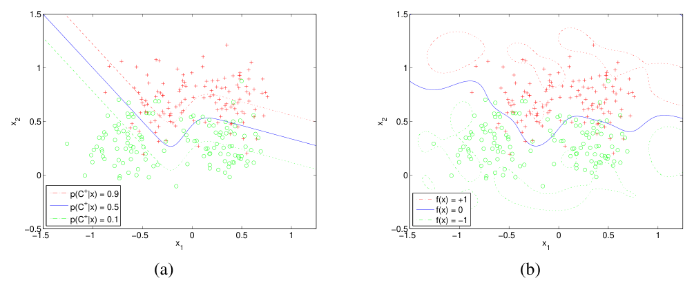
*그림 1 — 합성 벤치마크 데이터 세트의 한 실현. (a) 베이즈 최적 결정 경계, (b) 실제 시험 MSE를 최소화하도록 초매개변수를 조정한 자동 관련성 결정(automatic relevance determination, ARD) 커널 기반 커널 릿지 회귀 분류기.*

### 3.2 강건한 성능 평가를 위한 벤치마크 모음 (A Suite of Benchmarks for Robust Performance Evaluation)

모델 선택에서의 과적합의 성격을 예시하는 것에 더해, 그것이 실제 응용에서 심각한 우려 사항이며 고려하지 않으면 편향된 성능 평가로 이어질 수 있음을 보여야 한다. 표 1은 Rätsch et al. (2001)이 도입한 13개 벤치마크 데이터 세트 모음의 세부 사항을 보인다. 각 벤치마크는 UCI 기계학습 저장소의 데이터 세트에 기반하며, 훈련 세트와 시험 세트의 여러 실현을 이루도록 미리 정의된 100개 분할(더 큰 image와 splice 데이터 세트는 20개)이 추가되어 있다. 여러 벤치마크를 쓰면 특정 분류기의 귀납적 편향(inductive bias)에 잘 맞는 데이터 세트를 고를 가능성이 줄어들어 평가가 더 강건해진다. 마찬가지로 여러 분할을 쓰면 훈련·시험 세트를 만들기 위한 데이터 표집에 대한 민감도에 강건해진다. 따라서 이 벤치마크 모음의 결과는 실제로 볼 것으로 예상되는 모델 선택에서의 과적합 영향의 크기를 합리적으로 보여 준다.

*표 1: 실증 비교에 사용한 데이터 세트의 세부 사항.*

| 데이터 세트 (Data Set) | 훈련 패턴 수 | 시험 패턴 수 | 반복(실현) 수 | 입력 특징 수 |
|---|---|---|---|---|
| banana | 400 | 4900 | 100 | 2 |
| breast cancer | 200 | 77 | 100 | 9 |
| diabetis | 468 | 300 | 100 | 8 |
| flare solar | 666 | 400 | 100 | 9 |
| german | 700 | 300 | 100 | 20 |
| heart | 170 | 100 | 100 | 13 |
| image | 1300 | 1010 | 20 | 18 |
| ringnorm | 400 | 7000 | 100 | 20 |
| splice | 1000 | 2175 | 20 | 60 |
| thyroid | 140 | 75 | 100 | 5 |
| titanic | 150 | 2051 | 100 | 3 |
| twonorm | 400 | 7000 | 100 | 20 |
| waveform | 400 | 4600 | 100 | 21 |

## 4. 모델 선택에서의 과적합 (Over-fitting in Model Selection)

먼저 실측값(ground truth)을 알 수 있는 합성 벤치마크 문제를 사용해, 유한한 데이터 표본에 기반한 모델 선택 기준을 과적합하는 것이 가능함을 보인다. 여기서 "모델 선택에서의 과적합"이란 일반화 성능이 더 이상 개선되지 않고 이어서 하락하기 시작하는 지점을 넘어서까지 모델 선택 기준을 최소화하는 것을 뜻한다. 그림 1 (b)는 합성 문제에 대한 커널 릿지 회귀 분류기의 출력을 보이며, 여기서는 가우시안 방사 기저 함수 커널의 자동 관련성 결정(Automatic Relevance Determination, ARD) 변형을 사용했다.

$$\mathcal{K}(\mathbf{x},\mathbf{x}') = \exp\left\{-\sum_{i=1}^{d}\eta_i(x_i - x_i')^2\right\},$$

이 커널은 특징마다 별도의 척도 파라미터 $\eta_i$를 가진다. 훨씬 큰 4096개 표본의 훈련 세트를 사용했고, 초매개변수는 실제 시험 평균제곱오차(mean squared error, MSE)를 최소화하도록 조정했다. 이 모델은 12.50%의 오류율을 달성했으며, 이는 이런 형태의 모델이 적어도 원리상 이 문제의 베이즈 오류율에 근접할 수 있음을 시사하므로 모델 오지정(mis-specification)에 대한 우려는 거의 없다.

이 벤치마크에 대해 각각 64개 표본으로 이루어진 독립적인 실현 1000개를 추가로 생성했다. 각 실현마다 ARD 커널 기반 커널 릿지 회귀 분류기를 구성하고, 평균제곱오차의 4-겹 교차검증 추정치를 최소화하도록 초매개변수를 조정했다. 각 모델의 실제 일반화 성능은 데이터 세트의 기저 생성 모델을 사용해 수치적으로 추정했다. 그림 2 (a)는 벤치마크의 1000개 실현 전체에 대해 평균한, 평균제곱오차의 실제 시험 기댓값과 교차검증 추정치를 보인다. 예상대로 모델 선택 기준을 이루는 평균제곱오차의 교차검증 추정치는 단조 감소한다. 그러나 실제 시험 MSE의 기댓값은 처음에는 초매개변수가 일반화를 실제로 개선하는 방향으로 수정되면서 감소하지만, 비교적 짧은 시간(약 30–40회 반복) 후에는 초매개변수가 표본의 무의미한 통계적 특이성을 이용하는 방향으로 조정되면서 시험 오차가 다시 천천히 올라가기 시작한다. 이는 훈련에서의 과적합의 성격을 예시하는 데 쓰이는 고전적 그래프, 예컨대 Bishop (1995)의 책 그림 9.7과 매우 비슷한 형태를 만든다. 그림 2 (b)는 데이터의 특정 실현 하나에 대한 같은 통계량을 보이며, 과적합이 어떤 경우에는 상당히 클 수 있음을 보여 준다. 분명히 이 경우 모델 선택 과정에서 어떤 형태의 조기 종료(early-stopping)를 했다면 일반화가 개선되었을 것이다. 훈련 중 과적합의 고전적 징후가 모델 선택 중 교차검증 오차와 시험 오차의 변화에서도 나타남을 보였으므로, 다음 절에서는 이러한 형태의 과적합의 기원을 모델 선택 기준의 편향과 분산의 관점에서 논의한다.

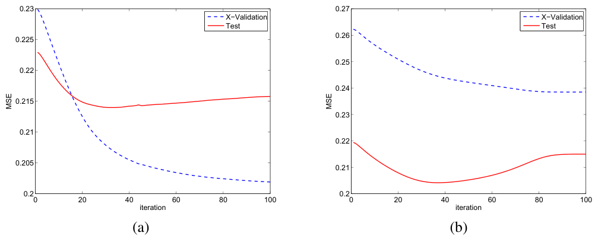
*그림 2 — 합성 벤치마크 데이터 세트로 훈련한 커널 릿지 회귀 분류기에 대해, 모델 선택 과정의 반복 횟수(모델 선택 기준 최소화의 최적화 단계)에 따른 4-겹 교차검증 평균제곱오차의 기댓값과 실제 시험 평균제곱오차의 변화 (a), 그리고 데이터 세트의 특정 실현 하나에 대한 그 통계량들의 변화 (b).*

### 4.1 모델 선택에서의 편향과 분산 (Bias and Variance in Model Selection)

모델 선택 기준은 일반적으로 유한한 데이터 표본에서 평가되는 일반화 성능 추정량에 기반한다. 여기에는 분할 표본(split sample) 추정량, 교차검증(Stone, 1974), 부트스트랩 방법(Efron and Tibshirani, 1994) 같은 재표집 방법뿐 아니라, 더 느슨하게는 베이즈 증거(MacKay, 1992; Rasmussen and Williams, 2006)와 반지름-마진 한계(radius-margin bound)(Vapnik, 1998) 같은 이론적 성능 한계도 포함된다. 추정량의 오차는 편향과 분산의 두 성분으로 분해할 수 있다. 초매개변수 $\boldsymbol{\theta}$를 가진 모델의 실제 일반화 성능을 $G(\boldsymbol{\theta})$, $n$개 패턴으로 이루어진 유한 표본 $\mathcal{D}$에서 평가한 일반화 성능 추정치를 $g(\boldsymbol{\theta};\mathcal{D})$라 하자. 그러면 추정량의 기대 제곱 오차는 다음 형태로 쓸 수 있다(Geman et al., 1992; Duda et al., 2001).

$$E_{\mathcal{D}}\left\{[g(\boldsymbol{\theta};\mathcal{D}) - G(\boldsymbol{\theta})]^2\right\} = \left[E_{\mathcal{D}}\{g(\boldsymbol{\theta};\mathcal{D}) - G(\boldsymbol{\theta})\}\right]^2 + E_{\mathcal{D}}\left\{\left[g(\boldsymbol{\theta};\mathcal{D}) - E_{\mathcal{D}'}\{g(\boldsymbol{\theta};\mathcal{D}')\}\right]^2\right\},$$

여기서 $E_{\mathcal{D}}\{\cdot\}$는 크기 $n$인 독립 표본 $\mathcal{D}$에 대한 기댓값을 나타낸다. 첫째 항인 편향의 제곱은 추정량의 기댓값과 미지의 실제 일반화 오차 값의 차이를 나타낸다. 분산이라 불리는 둘째 항은 추정량이 평가되는 데이터 $\mathcal{D}$의 표집 때문에 추정량이 그 기댓값 주변에서 변동하는 정도를 반영한다. 분명히 기대 제곱 오차가 낮으면 $g(\cdot)$가 모델 선택 기준으로서 잘 작동하리라 합리적으로 기대할 수 있다. 그러나 실제로는 기대 제곱 오차가 상당할 수 있으며, 이 경우 최적의 일반화를 신뢰성 있게 달성하는 데 편향과 분산 중 어느 성분이 더 중요한지 묻는 것은 흥미롭다.

단일 관측치 제외 교차검증이 실제 일반화 성능의 거의 비편향된 추정치를 준다는 것은 쉽게 보일 수 있으며(Luntz and Brailovsky, 1969), 이는 모델 선택 상황에서 단일 관측치 제외 추정량의 유리한 성질로 자주 인용된다(예: Vapnik, 1998; Chapelle et al., 2002). 그러나 성능 평가가 아닌 모델 선택을 목적으로 할 때 비편향성 자체는 상대적으로 중요하지 않으며, 주된 요구 사항은 단지 모델 선택 기준의 최솟값이 초매개변수 공간에서 실제 시험 오차의 최솟값을 신뢰성 있게 가리키는 것뿐이다. 이 점을 그림 3에 예시했다. 그림 3은 (구성상) 비편향인 모델 선택 기준 (a)와 분명히 편향된 기준 (b)의 가상 예를 보인다. 비편향성은 모델 선택 기준의 기댓값 $E_{\mathcal{D}}\{g(\boldsymbol{\theta};\mathcal{D})\}$의 최솟값이 시험 오차 $G(\boldsymbol{\theta})$의 최솟값과 일치함을 보장한다. 그러나 실제로는 모델 선택 기준을 평가할 유한한 데이터 표본 $\mathcal{D}_i$만 있으므로, 관심 대상은 $g(\boldsymbol{\theta};\mathcal{D}_i)$의 최솟값이다. 그림 3 (a)에서 볼 수 있듯이 추정량이 비편향이지만 분산이 커서, 데이터 표본마다 최솟값이 나타나는 $\boldsymbol{\theta}$ 값이 크게 흩어지므로, $g(\boldsymbol{\theta};\mathcal{D}_i)$는 실제로는 나쁜 모델 선택 기준이 될 가능성이 크다. 반면 그림 3 (b)는 분산이 더 낮은 기준을 보이며, 개별 표본에 대한 $g'(\boldsymbol{\theta};\mathcal{D}_i)$의 최솟값이 실제 시험 오차의 최솟값에 훨씬 가까이 놓이므로, 편향되어 있음에도 더 나은 모델 선택 기준이다. 이는 비편향성이 모델 선택 기준의 형태가 평균적으로 옳다는 뜻이므로 안심이 되기는 하지만, 특정 표본에서 평가한 선택 기준의 최솟값이 좋은 일반화를 주도록 보장하는 것은 기준의 분산이므로 분산 역시 매우 중요함을 보여 준다.

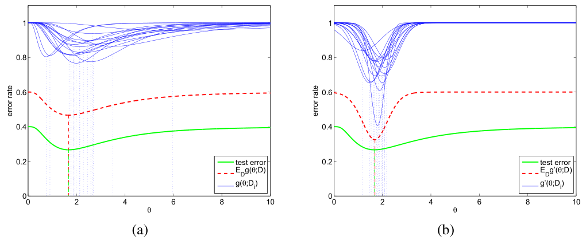
*그림 3 — 비편향 모델 선택 기준 (a)와 편향된 모델 선택 기준 (b)의 가상 예. 편향된 모델 선택 기준 (b)는 상당히 편향되어 있음에도 분산이 낮으므로 더 효과적인 모델 선택 기준이 될 가능성이 크다는 점에 유의하라. 명확성을 위해 실제 오류율과 모델 선택 기준의 기댓값은 각각 −0.6과 −0.4만큼 수직으로 이동시켜 나타냈다.*

### 4.2 모델 선택에서의 과적합의 영향 (The Effects of Over-fitting in Model Selection)

이 절에서는 역시 합성 벤치마크에 기반한 더 현실적인 예를 사용해 모델 선택 기준의 분산이 미치는 영향을 조사한다. 이 벤치마크는 기저 생성 모델을 알고 있으므로 실제 시험 오차를 평가할 수 있다. 모델 선택에서의 과적합이 훈련 표본의 과소적합(under-fitting)과 과적합을 모두 일으킬 수 있음을 보인다. 256개 패턴으로 된 고정 훈련 세트를 생성해, 단순 RBF 커널 (1)을 사용하는 커널 릿지 회귀 분류기를 훈련한다. 이때 초매개변수 설정은 정칙화 파라미터 $\lambda$와 커널 파라미터 $\eta$의 합리적인 값 범위를 덮는 촘촘한 격자로 정한다. 그림을 명확하게 하기 위해 관심 통계량으로 평활 오류율(smoothed error rate)(Bo et al., 2006)

$$\mathrm{SER}(\boldsymbol{\theta}) = \frac{1}{2n}\sum_{i=1}^{n}\left[1 - y_i\tanh\{\gamma f(\mathbf{x}_i)\}\right]$$

을 사용한다. 여기서 $\gamma$는 적용되는 평활화 정도를 조절하는 파라미터이다(전체에 걸쳐 $\gamma = 8$을 사용하지만 정확한 값은 중요하지 않다). 그림 4 (a)는 초매개변수의 함수로서 실제 시험 평활 오류율을 보인다. 두 초매개변수가 모두 척도 파라미터이므로 두 축 모두 로그 표현을 쓴다. 실제 시험 평활 오류율은 초매개변수의 대략 단봉(unimodal) 함수이며, 최적 일반화를 주는 초매개변수 설정을 가리키는 하나의 뚜렷한 최솟값을 가진다.

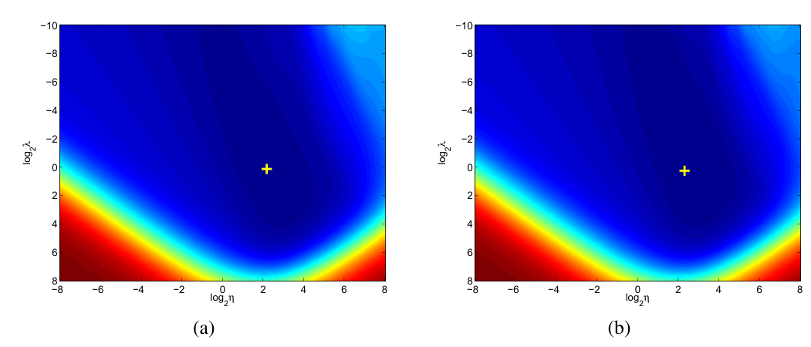
*그림 4 — 커널 릿지 회귀 분류기에 대해 초매개변수의 함수로서 나타낸 실제 시험 평활 오류율 (a)와, 64개 표본으로 된 무작위 검증 세트 100개에 대한 평균 평활 오류율 (b). 각 경우 최솟값을 노란 십자 +로 표시했다.*

그러나 실제 응용에서는 실제 시험 오차를 일반적으로 알 수 없으므로 어떤 종류의 추정량에 의존해야 한다. 모델 선택에 쓸 수 있는 가장 단순한 추정량은 독립된 검증 세트에서 계산한 오차, 즉 분할 표본 추정량(split-sample estimator)이다. 분할 표본 추정량이 비편향이리라 기대하는 것은 전적으로 합리적으로 보인다. 그림 4 (b)는 각각 64개 패턴으로 된 무작위 검증 세트 100개에 대해 분할 표본 추정량을 사용한 평균 평활 오류율을 보인다. 각 경우 같은 고정 훈련 세트를 사용했음에 유의하라. 이 그림은 그림 4 (a)의 실제 평활 오차와 매우 비슷하여, 분할 표본 추정량이 실제로 대략 비편향임을 보여 준다.

분할 표본 추정량은 비편향이지만, 특히 이 경우처럼 검증 세트가 (의도적으로) 비교적 작으면 분산이 클 수 있다. 그림 5는 64개 패턴 검증 세트의 선택된 여섯 실현에 대한 평활 오류율의 분할 표본 추정치를 보인다. 분명히 분할 표본 오차 추정치는 더 이상 매끄럽지 않으며 단봉도 아니다. 더 중요하게는, 검증 세트 오차를 최소화하여 선택한 초매개변수 값, 따라서 실제 일반화 성능이 검증 세트를 구성한 특정 데이터 표본에 의존한다. 그림 6은 분할 표본 추정량의 분산 때문에 심하게 과소적합된 모델 (a)부터 심하게 과적합된 모델 (f)까지, 그 사이의 다양한 모델이 나올 수 있음을 보인다.

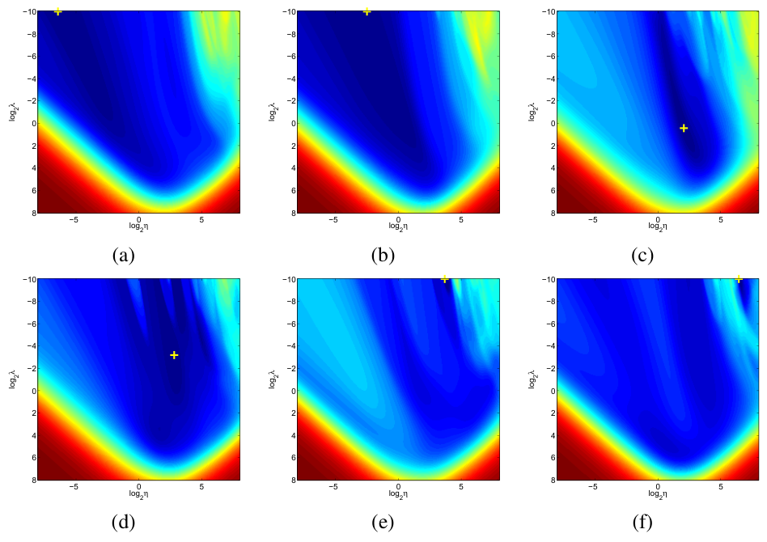
*그림 5 — 검증 세트의 무작위 실현 여섯 개에 대해, 초매개변수의 함수로서 나타낸 커널 릿지 회귀 머신의 평활 오류율 분할 표본 추정치 등고선 그림. 최솟값을 십자 +로 표시했다.*

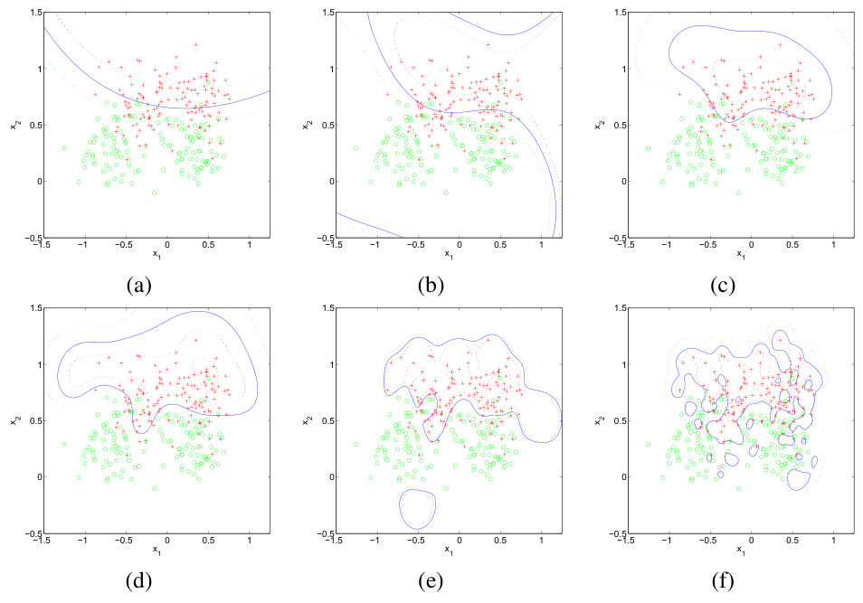
*그림 6 — 검증 세트의 무작위 실현 여섯 개(그림 5에 표시)에 대한 평활 오류율에 따라 선택한 초매개변수를 사용한 합성 벤치마크의 커널 릿지 회귀 모델. 모델 선택 기준의 분산으로 인해 과소적합 (a)와 (b)에서 잘 적합된 (c)와 (d)를 거쳐 과적합 (e)와 (f)에 이르는 모델이 나올 수 있다.*

그림 7 (a)는 검증 세트의 무작위 실현 100개를 사용한 분할 표본 기반 모델 선택으로 합성 벤치마크에 대해 구한 커널 릿지 회귀 분류기의 검증 세트 오류율과 실제 오류율의 산점도를 보인다. 분명히 분할 표본 기반 모델 선택 절차는 보통 잘 작동한다. 그러나 검증 세트를 이루는 표본에 따라 성능에 상당한 변동도 있다. 또한 검증 세트 오차는 모델 선택 중 직접 최소화되었으므로 강하게 편향되어 있으며, (당연히) 성능 추정에 사용해서는 안 된다는 것도 볼 수 있다.

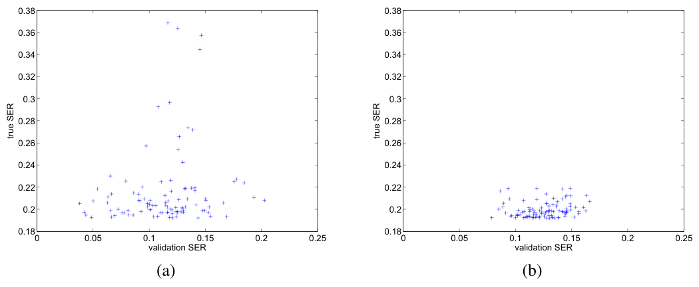
*그림 7 — (a) 64개, (b) 256개 패턴으로 된 무작위 생성 검증 세트 100개에 대해, 검증 세트 평활 오류율의 함수로서 나타낸 실제 시험 평활 오류율의 산점도.*

이 절에서는 검증 세트의 크기가 제한되어 분산이 비교적 큰 분할 표본 기반 모델 선택 전략을 의도적으로 사용했음에 유의하라. 모델 선택 기준의 분산을 줄이는 간단한 방법은 기준을 평가하는 검증 표본의 크기를 늘리는 것이다. 그림 8은 64개 (a)와 256개 (b) 표본으로 된 검증 세트의 실현 100개를 사용해 얻은 최적 초매개변수 설정을 보인다. 더 큰 검증 세트를 쓰면 초매개변수 값이 실제 최적값 주변에 더 촘촘하게 모인다는 것을 분명히 볼 수 있다. 또한 초매개변수가 초매개변수 공간의 넓은 골짜기 바닥을 따라 집중되어 있어서, 선택된 값이 최적값과 다를 때에도 여전히 좋은 일반화를 주는 위치에 놓인다는 점에도 주목하라. 이는 그림 7 (b)에서 더 잘 드러나는데, 그림 7 (a)의 작은 검증 세트에 비해 큰 검증 세트에서는 실제 평활 오류율이 훨씬 촘촘하게 모이고 이상치도 적다.

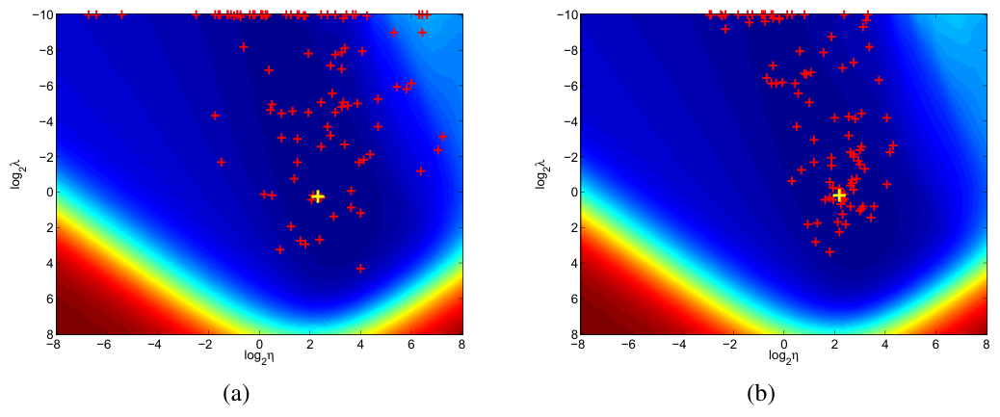
*그림 8 — (a) 64개, (b) 256개 패턴으로 된 무작위 생성 검증 세트 100개에 대한 평균 검증 세트 평활 오류율의 등고선 그림. 평균 검증 세트 오차의 최솟값은 큰 (노란) 십자로, 검증 세트 각 실현의 최솟값은 작은 (빨간) 십자로 표시했다.*

벤치마크의 실현마다 성능이 달라진다는 사실은, 단일 분할의 데이터 표집이 임의로 한 분류기를 다른 분류기보다 유리하게 할 수 있으므로, 기계학습 알고리즘의 평가는 항상 훈련/검증 세트와 시험 세트를 만들기 위한 데이터의 여러 분할을 포함해야 함을 시사한다. 이를 그림 9에 예시했다. 그림 9는 Rätsch et al. (2001)에서 사용한 banana 벤치마크 데이터 세트(자세한 내용은 5.1절 참조)의 무작위 실현 100개에 대한 가우시안 프로세스 분류기와 커널 로지스틱 회귀 분류기(각각 GPC와 KLR)의 시험 오류율을 보인다. 데이터의 64개 실현에서는 GPC가 KLR보다 우수하지만, 36개에서는 KLR이 GPC보다 우수하다. 평균적으로는 GPC가 더 낫지만(이 경우 차이는 통계적으로 유의하지 않다) 그렇다. 만약 분류기를 뒤의 36개 실현 중 하나에서만 평가했다면, 그 벤치마크에서 KLR 분류기가 GPC보다 우수하다고 잘못 결론 내렸을 수도 있다. 그러나 두 알고리즘 간 성능 차이가 데이터의 무작위 표집으로 인한 성능 변동보다 작다면, 통계적으로 유의하더라도 실무적으로는 의미가 없을 가능성이 크다는 점도 지적해야 한다. 최적의 분류기를 고르는 것보다 데이터를 더 수집하는 편이 더 큰 성능 개선을 가져올 가능성이 높기 때문이다.

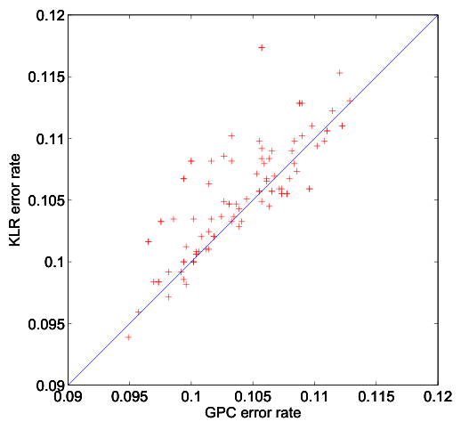
*그림 9 — banana 벤치마크의 실현 100개에 대한 가우시안 프로세스 분류기와 커널 로지스틱 회귀 분류기(각각 GPC와 KLR)의 시험 세트 오차 산점도.*

### 4.3 모델 선택에서의 과적합은 실제로 진짜 우려 사항인가? (Is Over-fitting in Model Selection Really a Genuine Concern in Practice?)

이 절의 앞부분에서는 합성 벤치마크 데이터 세트를 사용해 모델 선택 기준의 분산이 미치는 해로운 영향을 보였지만, 이것만으로는 모델 선택에서의 과적합이 실제 응용이나 기계학습 알고리즘 개발에서 진짜 우려 사항임을 입증하기에 충분하지 않다. 표 2는 3.2절에 기술한 13개 벤치마크에 대해 RBF 및 ARD 커널 함수를 쓴 커널 릿지 회귀(KRR) 분류기로 얻은 결과를 보인다. 각 경우, 각 벤치마크의 각 실현마다 Nelder-Mead 단체법(Nelder and Mead, 1965)으로 PRESS 통계량을 최소화하여 모델 선택을 독립적으로 수행했다. 대부분의 벤치마크에서 기본 RBF 커널을 사용했을 때 (Wilcoxon 부호 순위 검정에 따라) 유의하게 더 낮은 시험 오차가 달성된다. ARD 커널은 13개 중 하나(image)에서만 통계적 우위를 달성한다. 모델들이 중첩되어 있어(RBF 커널은 ARD 커널의 특수한 경우) ARD 커널로 달성할 수 있는 최적 성능이 RBF 커널로 달성할 수 있는 성능 이상임이 보장되므로, 이는 어쩌면 놀라운 결과이다. 실제로 ARD 커널의 성능이 나쁜 이유는 모델 선택에서 조정할 커널 파라미터가 훨씬 많아 모델 선택 기준을 최적화하는 데 쓸 수 있는 자유도가 많기 때문이다. 사용한 기준의 분산이 무시할 수 없을 정도라면, 여기에는 기준을 평가하는 특정 데이터 표본의 통계적 특이성을 이용하는 최적화도 포함되므로 과적합의 여지가 더 커진다. 표 2는 모델 선택 후의 PRESS 통계량 평균값도 보이는데, 대부분의 ARD 모델이 대응하는 RBF 모델보다 PRESS 통계량 값은 더 낮으면서 시험 오류율은 더 높다는 사실은 모델 선택 기준의 과적합을 강하게 시사한다. 이는 특히 초매개변수가 많거나 데이터 공급이 제한된 경우 모델 선택에서의 과적합이 실제 응용에서 중대한 문제가 될 수 있음을 분명히 보여 준다.

표 3은 기댓값 전파(expectation-propagation) 기반 가우시안 프로세스 분류기(EP-GPC)(Rasmussen and Williams, 2006)를 사용해 수행한 같은 실험의 결과를 보인다. 여기서 초매개변수는 각 벤치마크마다 개별적으로, 각 실현에 대해 독립적으로 베이즈 증거를 최대화하여 조정했다. 단일 관측치 제외 교차검증 기반 PRESS 기준이 높은 분산을 보인다는 것은 알려져 있지만, (역시 유한한 데이터 표본에서 평가되는) 증거의 분산은 덜 자주 논의된다. 여기서도 RBF 공분산 함수가 더 일반적인 ARD 공분산 함수보다 우수한 경우가 많고, 역시 시험 오류율이 모델의 증거와 음의 상관관계를 보이는 경우가 많음을 발견한다. 이는 증거의 과적합 역시 가우시안 프로세스 분류기에서 중대한 실제 문제임을 보여 준다.

*표 2: 13개 벤치마크 데이터 세트(Rätsch et al., 2001)에서 표준 방사 기저 함수(RBF) 커널과 자동 관련성 결정(ARD) 커널을 모두 사용한 커널 릿지 회귀(KRR) 분류기의 오류율. 굵게 표시한 결과는 같은 분류기를 다른 커널 함수로 사용해 얻은 것보다 통계적으로 우수한 오류율, 또는 유의하게 더 낮은 PRESS 통계량을 나타낸다.*

| 데이터 세트 | 시험 오류율 RBF | 시험 오류율 ARD | PRESS RBF | PRESS ARD |
|---|---|---|---|---|
| banana | 10.610 ± 0.051 | 10.638 ± 0.052 | 60.808 ± 0.636 | 60.957 ± 0.624 |
| breast cancer | **26.727 ± 0.466** | 28.766 ± 0.391 | 70.632 ± 0.328 | **66.789 ± 0.385** |
| diabetis | **23.293 ± 0.169** | 24.520 ± 0.215 | 146.143 ± 0.452 | **141.465 ± 0.606** |
| flare solar | 34.140 ± 0.175 | 34.375 ± 0.175 | 267.332 ± 0.480 | **263.858 ± 0.550** |
| german | **23.540 ± 0.214** | 25.847 ± 0.267 | 228.256 ± 0.666 | **221.743 ± 0.822** |
| heart | **16.730 ± 0.359** | 22.810 ± 0.411 | 42.576 ± 0.356 | **37.023 ± 0.494** |
| image | 2.990 ± 0.159 | **2.188 ± 0.134** | 74.056 ± 1.685 | **44.488 ± 1.222** |
| ringnorm | **1.613 ± 0.015** | 2.750 ± 0.042 | 28.324 ± 0.246 | **27.680 ± 0.231** |
| splice | 10.777 ± 0.144 | 9.943 ± 0.520 | 186.814 ± 2.174 | **130.888 ± 6.574** |
| thyroid | 4.747 ± 0.235 | 4.693 ± 0.202 | 9.099 ± 0.152 | **6.816 ± 0.164** |
| titanic | 22.483 ± 0.085 | 22.562 ± 0.109 | 48.332 ± 0.622 | **47.801 ± 0.623** |
| twonorm | **2.846 ± 0.021** | 4.292 ± 0.086 | **32.539 ± 0.279** | 35.620 ± 0.490 |
| waveform | **9.792 ± 0.045** | 11.836 ± 0.085 | 61.658 ± 0.596 | **56.424 ± 0.637** |

*표 3: 표준 방사 기저 함수(RBF) 커널과 자동 관련성 결정(ARD) 커널을 모두 사용한 기댓값 전파 기반 가우시안 프로세스 분류기(EP-GPC)의 오류율. 굵게 표시한 결과는 같은 분류기를 다른 커널 함수로 사용해 얻은 것보다 통계적으로 우수한 오류율, 또는 유의하게 더 높은 증거를 나타낸다.*

| 데이터 세트 | 시험 오류율 RBF | 시험 오류율 ARD | −Log 증거 RBF | −Log 증거 ARD |
|---|---|---|---|---|
| banana | **10.413 ± 0.046** | 10.459 ± 0.049 | 116.894 ± 0.917 | **116.459 ± 0.923** |
| breast cancer | **26.506 ± 0.487** | 27.948 ± 0.492 | 110.628 ± 0.366 | **107.181 ± 0.388** |
| diabetis | **23.280 ± 0.182** | 23.853 ± 0.193 | 230.211 ± 0.553 | **222.305 ± 0.581** |
| flare solar | 34.200 ± 0.175 | **33.578 ± 0.181** | 394.697 ± 0.546 | **384.374 ± 0.512** |
| german | **23.363 ± 0.211** | 23.757 ± 0.217 | 359.181 ± 0.778 | **346.048 ± 0.835** |
| heart | **16.670 ± 0.290** | 19.770 ± 0.365 | 73.464 ± 0.493 | **67.811 ± 0.571** |
| image | 2.817 ± 0.121 | **2.188 ± 0.076** | 205.061 ± 1.687 | **123.896 ± 1.184** |
| ringnorm | **4.406 ± 0.064** | 8.589 ± 0.097 | 121.260 ± 0.499 | **91.356 ± 0.583** |
| splice | 11.609 ± 0.180 | **8.618 ± 0.924** | 365.208 ± 3.137 | **242.464 ± 16.980** |
| thyroid | 4.373 ± 0.219 | 4.227 ± 0.216 | 25.461 ± 0.182 | **18.867 ± 0.170** |
| titanic | 22.637 ± 0.134 | 22.725 ± 0.133 | 78.952 ± 0.670 | **78.373 ± 0.683** |
| twonorm | **3.060 ± 0.034** | 4.025 ± 0.068 | 45.901 ± 0.577 | **42.044 ± 0.610** |
| waveform | **10.100 ± 0.047** | 11.418 ± 0.091 | 105.925 ± 0.954 | **91.239 ± 0.962** |

[역주] 굵게 표시는 원문 PDF의 굵은 글꼴 정보를 그대로 옮긴 것이다.

### 4.4 모델 선택에서의 과적합 피하기 (Avoiding Over-fitting in Model Selection)

유한한 데이터 표본에서 평가되는 모델 선택 기준을 직접 최적화할 때는 언제나 모델 선택에서의 과적합이 가능하다고 말하는 것이 합리적으로 보인다. 훈련에서의 과적합처럼, 모델 선택에서의 과적합은 데이터 표본이 작고 조정할 초매개변수 수가 비교적 많을 때 가장 심할 가능성이 크다. 마찬가지로 추가 데이터를 얻을 수 없다고 가정하면, 모델 선택 기준의 과적합 문제에 대한 잠재적 해법은 훈련 기준의 과적합 문제에 대해 검증된 해법, 즉 정칙화(Cawley and Talbot, 2007), 조기 종료(Qi et al., 2004), 모델 또는 초매개변수 평균화(Cawley, 2006; Hall and Robinson, 2009)와 비슷할 가능성이 크다. 또는 초매개변수의 수를 최소화할 수도 있다. 예컨대 커널 파라미터를 단순히 파라미터로 취급해 첫 번째 추론 수준에서 최적화하고, 모델의 전체 복잡도를 조절하는 정칙화 초매개변수 하나만 두는 방식이다. 학습과 모델 선택 모두에서 과적합 문제가 가장 큰 매우 작은 데이터 세트의 경우, 선호되는 접근법은 모델 선택을 아예 없애고 초매개변수를 최적화하는 대신 적분해 없애는 완전 베이즈 접근법(예: Williams and Barber, 1998)을 택하는 것이다. 또 다른 접근법은 랜덤 포레스트(Random Forest, RF) 방법(Breiman, 2001) 같은 앙상블 접근법으로 모델 선택을 아예 피하는 것이다. 그러나 이런 방법이 흔히 최고 수준의 성능을 달성하기는 하지만, 예컨대 커널이나 공분산 함수의 설계를 통해 계층적 모델에 전문 지식을 담는 것이 더 쉬운 경우가 많으므로, 안타깝게도 RF 같은 접근법이 만병통치약은 아니다.

모델 선택에서의 과적합 문제는 첫 번째 추론 수준에서의 과적합과 같은 성격이지만, 수학적으로 다루기 어렵다는 점이 모델 선택 기준의 최적화를 통한 모델 선택의 이론적 분석을 제한해 온 것으로 보인다. 예를 들어 단일 관측치 제외 교차검증에 관해 Kulkarni et al. (1998)은 "이 추정치의 실무적 중요성에도 불구하고 그 성질에 대해 알려진 것은 비교적 적다. 가용한 이론은 *삭제 추정치(deleted estimate)를 최소화하는 데 기반한 파라미터 선택을 분석하는 문제에 관해서는* 특히 빈약하다."(강조는 저자)라고 논평한다. 일부 점근적 결과(Stone, 1977; Shao, 1993; Toussaint, 1974)가 있지만, 이는 유한하고 흔히 상당히 제한된 데이터 표본에서 평가되는 모델 선택 기준을 사용해 초매개변수 값을 최적화함으로써 과적합이 일어나는, 여기서 고려하는 상황과 직접 관련되지 않는다. 일부 모델에 대해서는 교차검증 오차의 분산 추정치가 있지만(Luntz and Brailovsky, 1969; Vapnik, 1982), Bengio and Grandvalet (2004)은 (k-겹) 교차검증의 분산에 대한 비편향 추정치가 존재하지 않음을 보였다. 더 최근에는 안정성(stability) 개념에 기반한 단일 관측치 제외 교차검증 오차의 한계가 제안되었다(Kearns and Ron, 1999; Bousquet and Elisseeff, 2002; Zhang, 2003). 이 절에서 우리는 모델 선택에서의 과적합이 기계학습에서 진짜 문제임을 보였으며, 따라서 이는 추가적인 이론적 분석으로 크게 득을 볼 수 있는 분야일 가능성이 크다.

## 5. 성능 추정에서의 편향 (Bias in Performance Estimation)

모델 선택에서의 과적합으로 인해 생기는, 잠재적으로 상당한 성능 평가 편향을 피하는 것은 개념적으로 간단하다. 핵심은 훈련과 모델 선택을 함께 모델 적합 절차의 불가분의 일부로 취급하고, 평가 과정의 어느 시점에서도 둘을 따로 수행하지 않도록 하는 것이다. 이 원칙을 지키지 않는, 잠재적으로 편향된 평가 프로토콜의 두 가지 예를 제시한다. 일부 데이터 세트에서 관측된 편향의 크기는 학습 알고리즘 간 성능 차이보다 훨씬 크므로, 얻은 결과에 근거해 쉽게 잘못된 추론을 내릴 수 있다. 이는 실증 연구에서 이 문제가 얼마나 중요한지를 부각한다. 또한 편향의 크기가 비교에 포함된 학습 알고리즘과 모델 선택 알고리즘에 따라 달라지며, 모델 선택에서 과적합되기 쉬운 조합이 편향된 프로토콜에서 유리해짐을 보인다. 이는 다른 연구에 대한 편향이 있을 수 있음을 인정하더라도, 잠재적으로 편향된 프로토콜에 기반한 연구는 내적 일관성(internally consistent)이 없다는 뜻이다.

### 5.1 비편향 성능 평가 방법론 (An Unbiased Performance Evaluation Methodology)

먼저 모델 선택에서 일어날 수 있는 모든 과적합을 올바르게 반영하는 비편향 성능 프로토콜을 기술한다. 세 분류기를 비편향 프로토콜로 평가하는데, 이 프로토콜에서는 각 데이터 세트의 각 실현마다 모델 선택을 따로 수행한다. 모델 선택 과정이 재표집 절차의 각 겹 안에서 독립적으로 수행되므로 이를 "내부(internal)" 프로토콜이라 부른다. 이렇게 하면 성능 추정치에 모델 선택 기준의 과적합으로 인한 오차를 올바르게 반영하는 성분이 포함된다. 사용한 분류기는 다음과 같다. RBF-KRR — 2절에 기술한 대로 Allen의 PRESS 통계량 최소화에 기반해 모델 선택을 하는, 방사 기저 함수 커널을 쓴 커널 릿지 회귀. RBF-KLR — 로그 우도(log-likelihood)의 근사 단일 관측치 제외 교차검증 추정치(Cawley and Talbot, 2008)에 기반해 모델 선택을 하는, 방사 기저 함수 커널을 쓴 커널 로지스틱 회귀. EP-GPC — 주변 우도(marginal likelihood) 최대화(예: Rasmussen and Williams, 2006)에 기반해 모델 선택을 하는, 등방성 제곱 지수(isotropic squared exponential) 공분산 함수를 쓴 기댓값 전파 기반 가우시안 프로세스 분류기. 이 분류기들을 비편향 프로토콜로 사용해 얻은 평균 오류율을 표 4에 보인다. 이 경우 모든 방법의 평균 순위가 아주 조금만 다르므로, 어느 분류기가 다른 분류기보다 통계적으로 유의하게 우수하다는 증거는 거의 없다. 그림 10은 이 결과를 도식으로 보여 주는 임계 차이 도표(critical difference diagram)(Demšar, 2006)이다. 임계 차이 도표는 벤치마크 데이터 세트 모음에 걸친 분류기 집합의 평균 순위를 표시하며, 통계적으로 비슷한 성능을 보이는 분류기 무리(clique)를 막대로 연결한다. 한 분류기가 다른 분류기보다 통계적으로 우수하다고 하기 위해 필요한 평균 순위의 임계 차이도 "CD"라는 레이블로 함께 표시한다.

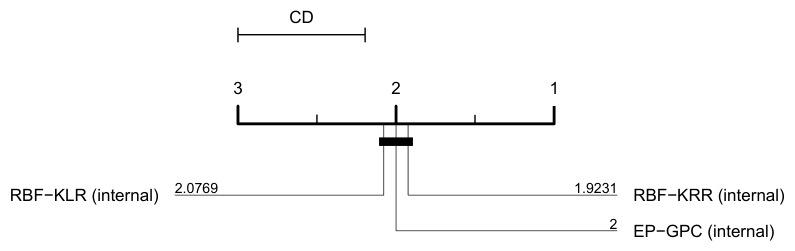
*그림 10 — 내부 모델 선택 프로토콜을 쓴 세 분류기의 평균 순위를 보이는 임계 차이 도표(Demšar, 2006).*

*표 4: 13개 벤치마크 데이터 세트 모음에 대한 세 분류기의 오류율 추정치. 각 방법의 결과는 각 데이터 세트의 실현 100개(image와 splice 데이터 세트는 20개)에 대한 시험 데이터 평균 오류율과 그에 따른 표준오차의 형태로 제시한다.*

| 데이터 세트 | GPC (internal) | KLR (internal) | KRR (internal) |
|---|---|---|---|
| banana | 10.413 ± 0.046 | 10.567 ± 0.051 | 10.610 ± 0.051 |
| breast cancer | 26.506 ± 0.487 | 26.636 ± 0.467 | 26.727 ± 0.466 |
| diabetis | 23.280 ± 0.182 | 23.387 ± 0.180 | 23.293 ± 0.169 |
| flare solar | 34.200 ± 0.175 | 34.197 ± 0.170 | 34.140 ± 0.175 |
| german | 23.363 ± 0.211 | 23.493 ± 0.208 | 23.540 ± 0.214 |
| heart | 16.670 ± 0.290 | 16.810 ± 0.315 | 16.730 ± 0.359 |
| image | 2.817 ± 0.121 | 3.094 ± 0.130 | 2.990 ± 0.159 |
| ringnorm | 4.406 ± 0.064 | 1.681 ± 0.031 | 1.613 ± 0.015 |
| splice | 11.609 ± 0.180 | 11.248 ± 0.177 | 10.777 ± 0.144 |
| thyroid | 4.373 ± 0.219 | 4.293 ± 0.222 | 4.747 ± 0.235 |
| titanic | 22.637 ± 0.134 | 22.473 ± 0.103 | 22.483 ± 0.085 |
| twonorm | 3.060 ± 0.034 | 2.944 ± 0.042 | 2.846 ± 0.021 |
| waveform | 10.100 ± 0.047 | 9.918 ± 0.043 | 9.792 ± 0.045 |

세 방법 모두 구조적으로 비슷한 모델을 만들어 내므로, 통계적으로 유의한 우위의 증거가 거의 없다는 것은 그리 놀랍지 않다. 그러나 이 모델들은 모델 선택 절차에서 크게 다르다. EP-GPC는 더 강한 통계적 가정에 기반하므로 그 가정이 정당화되는 경우에는 뛰어나지만, 모델이 오지정된 경우(예: ringnorm 벤치마크)에는 나쁜 성능을 보일 것으로 예상된다. 반면 교차검증 기반 모델 선택 절차는 더 실용적이며, 훨씬 약한 가정에 기반하므로 더 일관된 수준의 정확도를 줄 것으로 예상할 수 있다.

### 5.2 편향된 평가 방법론의 예 (An Example of Biased Evaluation Methodology)

3.2절에 기술한 벤치마크 데이터 세트 모음과 함께 가장 자주 쓰이는 성능 평가 프로토콜은 각 데이터 세트의 처음 다섯 실현에 대해서만 모델 선택을 독립적으로 수행한다. 그런 다음 이 다섯 겹에 대한 초매개변수의 중앙값(median)을 정하고, 이를 이후 각 실현의 오류율을 평가하는 데 사용한다. 이 "중앙값(median)" 성능 평가 프로토콜은 이 벤치마크 데이터 세트 모음을 대중화한 바로 그 논문(Rätsch et al., 2001)에서 도입되었으며, 널리 채택되었다(예: Mika et al., 1999; Weston, 1999; Billings and Lee, 2002; Chapelle et al., 2002; Chu et al., 2003; Stewart, 2003; Mika et al., 2003; Gold et al., 2005; Peña Centeno and D., 2006; Andelić et al., 2006; An et al., 2007; Chen et al., 2009). 이 프로토콜의 원래 동기는 당시 가용한 워크스테이션으로는 내부 모델 선택 프로토콜의 계산 비용이 감당할 수 없을 만큼 컸다는 것(Rätsch et al., 2001)으로, 당시에는 지극히 합리적이었지만 이제는 더 이상 그렇지 않다.³ 그러나 중앙값을 사용하면 이 "중앙값" 프로토콜로 얻은 성능 추정치에 낙관적 편향이 생길 것으로 예상할 수 있다. 첫째, 처음 다섯 실현을 이루는 훈련 데이터 전부가 재표집의 모든 겹에서 사용되는 분류기의 모델 선택 과정에 사용되었다. 이는 각 겹의 시험 데이터 일부가 모델 선택 중에 이미 "보였으므로" 더 이상 통계적으로 "순수"하지 않다는 뜻이다. 둘째, 그리고 더 중요하게, 중앙값 연산은 분산 감소 단계로 작용하므로, 다섯 초매개변수 집합의 중앙값은 평균적으로 그것을 도출한 다섯 개 중 어느 것보다도 나을 가능성이 크다. 마지막으로, 초매개변수가 이제 고정되었으므로, 각 실현에서 훈련·시험 분할을 위한 데이터 표집의 특이성 때문에 모델 선택 기준을 과적합할 여지가 더 이상 없다.

> 각주 3. 이 논문에 제시된 모든 실험 결과는 현대적인 리눅스 워크스테이션 한 대로 얻었다.

*표 5: 13개 벤치마크 데이터 세트 모음에 대한 세 분류기의 오류율 추정치. 각 방법의 결과는 각 데이터 세트의 실현 100개(image와 splice 데이터 세트는 20개)에 대한 시험 데이터 평균 오류율과 그에 따른 표준오차의 형태로 제시한다.* [역주: 원문 캡션이 표 4와 같지만, 실제 내용은 RBF-KRR 한 분류기의 내부·중앙값 프로토콜 결과와 편향이다.]

| 데이터 세트 | KRR (internal) | KRR (median) | 편향 (Bias) |
|---|---|---|---|
| banana | 10.610 ± 0.051 | 10.384 ± 0.042 | 0.226 ± 0.034 |
| breast cancer | 26.727 ± 0.466 | 26.377 ± 0.441 | 0.351 ± 0.195 |
| diabetis | 23.293 ± 0.169 | 23.150 ± 0.157 | 0.143 ± 0.074 |
| flare solar | 34.140 ± 0.175 | 34.013 ± 0.166 | 0.128 ± 0.082 |
| german | 23.540 ± 0.214 | 23.380 ± 0.220 | 0.160 ± 0.067 |
| heart | 16.730 ± 0.359 | 15.720 ± 0.306 | 1.010 ± 0.186 |
| image | 2.990 ± 0.159 | 2.802 ± 0.129 | 0.188 ± 0.095 |
| ringnorm | 1.613 ± 0.015 | 1.573 ± 0.010 | 0.040 ± 0.010 |
| splice | 10.777 ± 0.144 | 10.763 ± 0.137 | 0.014 ± 0.055 |
| thyroid | 4.747 ± 0.235 | 4.560 ± 0.200 | 0.187 ± 0.100 |
| titanic | 22.483 ± 0.085 | 22.407 ± 0.102 | 0.076 ± 0.077 |
| twonorm | 2.846 ± 0.021 | 2.868 ± 0.017 | -0.022 ± 0.014 |
| waveform | 9.792 ± 0.045 | 9.821 ± 0.039 | -0.029 ± 0.020 |

먼저 내부 프로토콜과 중앙값 프로토콜로 얻은 결과가 같은 척도로 비교할 수 없으므로(not commensurate) 서로 다른 방법으로 얻은 결과를 직접 비교할 수 없음을 보인다. 표 5는 RBF-KRR 분류기를 내부 및 중앙값 성능 평가 프로토콜로 평가해 얻은 오류율과 그로 인한 편향, 즉 내부 프로토콜과 중앙값 프로토콜로 얻은 평균 오류율의 차이를 보인다. 중앙값 프로토콜이 거의 모든 벤치마크(twonorm과 waveform은 예외)에서 양의 편향을 도입하며, 일부 벤치마크에서는 편향이 상당히 클 수 있음을 분명히 볼 수 있다. 실제로 여러 벤치마크, 특히 breast cancer, german, heart, thyroid에서는 편향이 비편향 프로토콜로 평가한 분류기 간의 전형적인 성능 차이보다 크다. Demšar (2006)는 여러 데이터 세트에 걸쳐 한 분류기가 다른 분류기보다 우수한지의 통계적 유의성을 판정하는 데 Wilcoxon 부호 순위 검정을 권장한다. 표 4와 5의 EP-GPC (internal), RBF-KLR (internal), RBF-KRR (median) 데이터에 이 검정을 적용하면, RBF-KRR (median) 분류기가 95% 유의수준에서 나머지 분류기보다 통계적으로 우수한 것으로 나타난다. 이 결과를 요약한 임계 차이 도표를 그림 12에 보인다. 그러나 이 성능 차이는 순전히 모델 선택에서의 과적합 영향을 줄인 결과일 뿐이며, 분류기와 모델 선택 방법 조합의 실제 운용 성능을 반영하지 않으므로 전적으로 허위(spurious)이다. 그렇다면 내부 프로토콜과 중앙값 프로토콜로 얻은 결과는 직접 비교할 수 없으며, 편향된 프로토콜과 비편향 프로토콜을 사용한 서로 다른 연구의 결과를 비교해서는 신뢰할 만한 추론을 내릴 수 없음이 분명하다.

#### 5.2.1 편향은 오로지 시험 표본의 부주의한 재사용 때문인가? (Is the Bias Solely Due to Inadvertent Re-use of Test Samples?)

중앙값 프로토콜에서 관측된 편향에 대한 한 가지 설명은, 초매개변수 조정에 사용된 벤치마크의 처음 다섯 실현의 훈련 표본 일부가 성능 분석에 쓰이는 벤치마크의 다른 실현의 시험 세트에도 나타난다는 것이다. 이 절에서는 이러한 시험 표본의 부주의한 재사용이 편향의 유일한 원인이 아님을 보인다. i.i.d. 데이터를 무한히 공급할 수 있는 합성 벤치마크를 사용해 내부 프로토콜과 중앙값 프로토콜을 100회 반복 수행했다. 다만 이 경우 각 실현에서 64개 패턴으로 된 훈련 세트 100개와 4096개 표본으로 된 큰 시험 세트를 모두 서로소가 되도록 생성했다. 이는 남은 편향의 원천이 처음 다섯 겹에 대한 초매개변수의 중앙값을 취해 분산을 줄임으로써 모델 선택에서의 과적합이 완화되는 것뿐이라는 뜻이다(Hall and Robinson, 2009 참조). 그림 11은 100회 반복에 대한 내부 프로토콜과 중앙값 프로토콜의 평균 시험 오차를 보이며, 시험 데이터의 부주의한 재사용이 전혀 없는데도 중앙값 프로토콜에서 매우 뚜렷한 낙관적 편향(Wilcoxon 부호 순위 검정에 따라 통계적으로 매우 유의, $p < 0.001$)을 보여 준다.

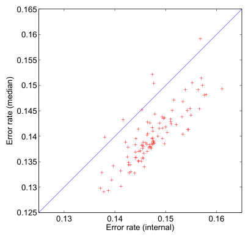
*그림 11 — 시험 데이터의 부주의한 재사용이 없는 합성 벤치마크에 대한 내부 및 중앙값 평가 프로토콜의 평균 오류율.*

#### 5.2.2 중앙값 프로토콜은 내적으로 일관적인가? (Is the Median Protocol Internally Consistent?)

중앙값 프로토콜이 낙관적 편향을 도입하고, 내부 프로토콜과 중앙값 프로토콜로 얻은 결과가 비교 가능하지 않음을 확인했으므로, 다음으로 중앙값 프로토콜이 내적으로 일관적인지, 즉 중앙값 프로토콜이 분류기의 올바른 순위를 주는지에 주목한다. 표 6은 중앙값 프로토콜로 평가한 세 분류기의 성능을 보이며, 대응하는 임계 차이 도표는 그림 13에 보인다. 이 경우 Friedman 검정에 따르면 분류기 간 성능 차이는 통계적으로 유의하지 않지만, 중앙값 프로토콜의 편향이 한 분류기, 즉 RBF-KRR을 다른 분류기들보다 훨씬 강하게 유리하게 했음을 분명히 볼 수 있다. 그렇다면 다른 경우에는 중앙값 프로토콜의 편향이, 아마 우연히 유리한 데이터 세트 선택 때문에 생긴 작은 성능 차이를 증폭해 그것이 허위로 통계적으로 유의하게 보이는 지경까지 만들 수도 있다. 이는 중앙값 프로토콜이 신뢰할 수 없으며 어쩌면 사용을 중단해야(deprecated) 함을 시사한다.

*표 6: 13개 벤치마크 데이터 세트 모음에 대한 세 분류기의 오류율 추정치. 각 방법의 결과는 각 데이터 세트의 실현 100개(image와 splice 데이터 세트는 20개)에 대한 시험 데이터 평균 오류율과 그에 따른 표준오차의 형태로 제시한다.*

| 데이터 세트 | EP-GPC (median) | RBF-KLR (median) | RBF-KRR (median) |
|---|---|---|---|
| banana | 10.371 ± 0.045 | 10.407 ± 0.047 | 10.384 ± 0.042 |
| breast cancer | 26.117 ± 0.472 | 26.130 ± 0.474 | 26.377 ± 0.441 |
| diabetis | 23.333 ± 0.191 | 23.300 ± 0.177 | 23.150 ± 0.157 |
| flare solar | 34.150 ± 0.170 | 34.212 ± 0.176 | 34.013 ± 0.166 |
| german | 23.160 ± 0.216 | 23.203 ± 0.218 | 23.380 ± 0.220 |
| heart | 16.400 ± 0.273 | 16.120 ± 0.295 | 15.720 ± 0.306 |
| image | 2.851 ± 0.102 | 3.030 ± 0.120 | 2.802 ± 0.129 |
| ringnorm | 4.400 ± 0.064 | 1.574 ± 0.011 | 1.573 ± 0.010 |
| splice | 11.607 ± 0.184 | 11.172 ± 0.168 | 10.763 ± 0.137 |
| thyroid | 4.307 ± 0.217 | 4.040 ± 0.221 | 4.560 ± 0.200 |
| titanic | 22.490 ± 0.095 | 22.591 ± 0.135 | 22.407 ± 0.102 |
| twonorm | 3.241 ± 0.039 | 3.068 ± 0.033 | 2.868 ± 0.017 |
| waveform | 10.163 ± 0.045 | 9.888 ± 0.042 | 9.821 ± 0.039 |

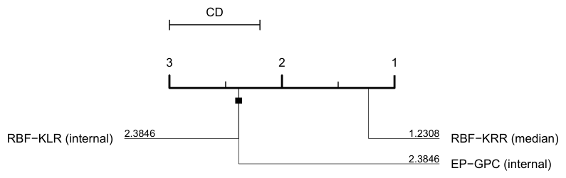
*그림 12 — 내부 모델 선택 프로토콜을 쓴 EP-GPC와 RBF-KLR, 그리고 낙관적으로 편향된 중앙값 프로토콜을 쓴 RBF-KLR 세 분류기의 평균 순위를 보이는 임계 차이 도표(Demšar, 2006)(그림 10 참조).* [역주: 캡션의 "중앙값 프로토콜을 쓴 RBF-KLR"은 도표상 RBF-KRR (median)의 오기로 보이나 원문대로 옮겼다.]

다음으로, 각 벤치마크 데이터 세트에 대해 중앙값 프로토콜이 서로 다른 분류기에 도입하는 편향의 크기에 통계적으로 유의한 차이가 있는지 판정하는 통계 분석을 수행한다.⁴ 먼저 RBF KRR과 RBF EP-GPC 분류기에 대해 중앙값 프로토콜 사용으로 도입된 편향을, 내부 프로토콜과 중앙값 프로토콜로 추정한 시험 세트 오차의 차이로 계산했다. 그런 다음 Wilcoxon 부호 순위 검정을 사용해 벤치마크의 실현 100개(image와 splice 벤치마크는 20개)에 걸쳐 편향에 통계적으로 유의한 차이가 있는지 판정했다. 얻은 결과를 표 7에 보인다. 13개 벤치마크 중 다섯 개에서 p-값이 0.05 미만이며, 각 경우 중앙값 프로토콜이 RBF KRR 분류기에 유리하도록 유의하게 편향되어 있음을 나타낸다. 분명히 중앙값 프로토콜은 서로 다른 분류기의 추정 시험 오류율에 같은 크기의 편향을 부과하지 않으므로, 기계학습 알고리즘의 성능을 비교하는 신뢰할 만한 프로토콜이 되지 못한다.

> 각주 4. 이 특정 형태의 분석을 제안해 준 익명의 심사자에게 감사한다.

*표 7: Wilcoxon 부호 순위 검정을 사용해, 중앙값 프로토콜이 RBF-KRR과 RBF-EP-GPC의 시험 오류율에 도입한 편향을 통계 분석한 결과.*

| 데이터 세트 | RBF-KRR 편향 | RBF-EP-GPC 편향 | Wilcoxon p-값 |
|---|---|---|---|
| banana | 0.226 ± 0.034 | 0.043 ± 0.012 | < 0.05 |
| breast cancer | 0.351 ± 0.195 | 0.390 ± 0.186 | 0.934 |
| diabetis | 0.143 ± 0.074 | -0.053 ± 0.051 | < 0.05 |
| flare solar | 0.128 ± 0.082 | 0.050 ± 0.090 | 0.214 |
| german | 0.160 ± 0.067 | 0.203 ± 0.051 | 0.458 |
| heart | 1.010 ± 0.186 | 0.270 ± 0.120 | < 0.05 |
| image | 0.188 ± 0.095 | -0.035 ± 0.032 | 0.060 |
| ringnorm | 0.040 ± 0.010 | 0.006 ± 0.002 | < 0.05 |
| splice | 0.014 ± 0.055 | 0.002 ± 0.014 | 0.860 |
| thyroid | 0.187 ± 0.100 | 0.067 ± 0.064 | 0.159 |
| titanic | 0.076 ± 0.077 | 0.147 ± 0.090 | 0.846 |
| twonorm | -0.022 ± 0.014 | -0.180 ± 0.032 | < 0.05 |
| waveform | -0.029 ± 0.020 | -0.064 ± 0.022 | 0.244 |

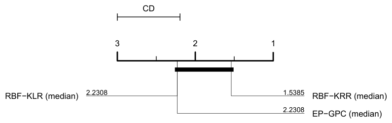
*그림 13 — 중앙값 모델 선택 프로토콜을 쓴 세 분류기의 평균 순위를 보이는 임계 차이 도표(그림 10 참조).*

이 절의 마지막 예시로, 중앙값 프로토콜이 도입하는 편향의 크기가 분산이 큰 모델 선택 기준일수록 더 크다는 것을 보인다. 이는 중앙값 프로토콜이 가장 신뢰할 수 없는 모델 선택 절차를 가장 유리하게 하며, 그 결과 분류기-모델 선택 절차 조합의 상대 성능조차 신뢰성 있게 나타내지 못한다는 뜻이다. 다시 RBF-KRR 모델을 기본 분류기로 사용하지만, 이번에는 반복 분할 표본(repeated split-sample) 모델 선택 기준을 쓴다. 이 기준에서는 데이터를 9:1 비율의 서로소인 훈련 세트와 검증 세트로 무작위로 반복 분할하고, 검증 세트들에 대한 평균 평균제곱오차를 최적화하도록 초매개변수를 조정한다. 이렇게 하면 반복 횟수를 바꿔 모델 선택 기준의 분산을 조절할 수 있으며, 겹의 수가 커질수록 분산이 줄어든다. 그림 14 (a)는 이전 실험과 같이 모델 선택을 수행한 EP-GPC와 RBF-KLR 분류기, 그리고 반복 분할 표본 모델 선택을 쓴 RBF-KRR의 평균 순위를 겹의 수의 함수로 보인다. 각 경우 비편향 내부 평가 프로토콜을 사용했다. 분명히 겹의 수가 작으면(다섯 이하) 사용한 기준의 분산이 커서 모델 선택에서 과적합이 일어나므로 RBF-KRR 모델의 성능이 나쁘다. 그러나 겹의 수가 늘어나면 모델 선택 기준의 분산이 줄어들고 세 알고리즘의 성능은 매우 비슷해진다. 그림 14 (b)는 편향된 중앙값 프로토콜을 사용한 대응 결과를 보인다. 초매개변수를 평균하면 모델 선택 기준의 겉보기 분산이 줄어들고, 이것이 겹의 수가 작을 때 RBF-KRR 모델의 나쁜 성능을 가린다. 이는 중앙값 프로토콜이 도입하는 편향이 최악의 모델 선택 기준을 가장 유리하게 한다는 것을 보여 주며, 이는 상당히 우려할 만한 일이다.

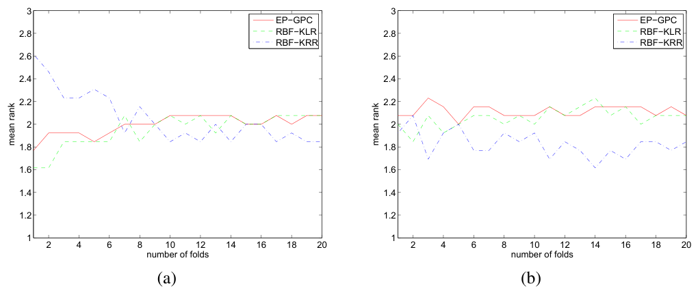
*그림 14 — 커널 릿지 회귀(RBF-KRR) 머신이 사용하는 반복 분할 표본 모델 선택 절차의 겹의 수에 따른 세 분류기의 평균 순위. (a) 비편향 내부 프로토콜 사용, (b) 편향된 중앙값 프로토콜 사용.*

### 5.3 편향된 평가 방법론의 또 다른 예 (Another Example of Biased Evaluation Methodology)

기계학습 연구에서 가끔 관찰되는 한 편향된 평가 프로토콜에서는, 흔히 "예비 연구(preliminary study)"의 일부로 대화식으로, 가용한 데이터 전부를 사용해 초기 모델 선택 단계를 수행한다. 그런 다음 데이터를 반복적으로 재분할해 무작위의 서로소인 설계(design) 세트와 시험 세트의 쌍을 하나 이상 만든다. 이것들을 같은 고정 초매개변수 값으로 성능 평가에 사용한다. 이 관행은 언뜻 보기에 꽤 무해해 보일 수 있지만, 시험 데이터가 초매개변수 조정 과정에서 모델에 "보였으므로" 더 이상 통계적으로 순수하지 않다. 모델 선택에서의 과적합 위험이 없다면 이것이 심각한 문제가 되지 않겠지만, 그 위험 때문에 실제로는 초매개변수가 일반화 개선에 유리한 방향으로만이 아니라 이 특정 데이터 세트의 통계적 특이성을 이용하는 방향으로도 어느 정도 불가피하게 조정된다. 그 결과 초매개변수 설정은 이제 시험 분할을 이루는 데이터에 대한 부분적인 "기억"을 간직한다. 따라서 이런 방식으로 얻은 성능 추정치에는 낙관적 편향이 관찰될 것으로 예상해야 한다.

*표 8: 교차검증 과정의 외부와 내부에서 모델 선택을 하는 방식에 대해, 13개 벤치마크 데이터 세트에서 커널 릿지 회귀의 오류율 추정치. 각 접근법의 결과와 상대 편향은 각 데이터 세트의 실현 100개(image와 splice 데이터 세트는 20개)에 대한 평균 오류율과 그에 따른 표준오차의 형태로 제시한다.*

| 데이터 세트 | 외부 (External) | 내부 (Internal) | 편향 (Bias) |
|---|---|---|---|
| banana | 10.355 ± 0.146 | 10.495 ± 0.158 | 0.140 ± 0.035 |
| breast cancer | 26.280 ± 0.232 | 27.470 ± 0.250 | 1.190 ± 0.135 |
| diabetis | 22.891 ± 0.127 | 23.056 ± 0.134 | 0.165 ± 0.050 |
| flare solar | 34.518 ± 0.172 | 34.707 ± 0.179 | 0.189 ± 0.051 |
| german | 23.999 ± 0.117 | 24.217 ± 0.125 | 0.219 ± 0.045 |
| heart | 16.335 ± 0.214 | 16.571 ± 0.220 | 0.235 ± 0.073 |
| image | 3.081 ± 0.102 | 3.173 ± 0.112 | 0.092 ± 0.035 |
| ringnorm | 1.567 ± 0.058 | 1.607 ± 0.057 | 0.040 ± 0.014 |
| splice | 10.930 ± 0.219 | 11.170 ± 0.280 | 0.240 ± 0.152 |
| thyroid | 3.743 ± 0.137 | 4.279 ± 0.152 | 0.536 ± 0.073 |
| titanic | 22.167 ± 0.434 | 22.487 ± 0.442 | 0.320 ± 0.077 |
| twonorm | 2.480 ± 0.067 | 2.502 ± 0.070 | 0.022 ± 0.021 |
| waveform | 9.613 ± 0.168 | 9.815 ± 0.183 | 0.203 ± 0.064 |

표 8은 가우시안 방사 기저 함수 커널을 쓴 커널 릿지 회귀에 대해, 모델 선택 단계가 교차검증 절차의 외부 또는 내부에 있는 프로토콜로 얻은 시험 오류율의 10-겹 교차검증 추정치를 비교한다. 외부 프로토콜에서는 위에 기술한 대로 전체 설계 세트를 사용해 모델 선택을 한 번 수행한다. 내부 프로토콜에서는 모델 선택 단계를 교차검증의 각 겹에서 따로 수행한다. 따라서 내부 교차검증 절차는 최종 모델을 구성하는 데 실제로 사용되는 모델 선택과 학습 알고리즘 조합의 성능에 대해 더 현실적인 추정치를 준다. 표는 상대 편향(즉, 내부와 외부 교차검증 프로토콜 사이의 평균 차이)도 보인다. 외부 프로토콜은 더 엄격한 내부 교차검증 프로토콜에 비해 13개 벤치마크 모두에서 일관되게 낙관적인 편향을 분명히 보인다. 나아가 splice와 twonorm을 제외한 모든 벤치마크에서 편향이 통계적으로 유의하다(즉, 추정치 표준오차의 두 배보다 크다). 많은 경우 편향은 경쟁력 있는 학습 알고리즘 간에 관찰되는 전형적인 차이와 비슷한 크기이다(표 4 참조). 일부 경우, 예를 들어 banana와 thyroid 벤치마크에서는 편향이 놀라운 크기여서, 최고 수준의 학습 알고리즘과 경쟁력 없는 학습 알고리즘 사이의 실제 차이조차 가릴 만큼 클 가능성이 있다. 이는 외부 교차검증 프로토콜이 초매개변수 수가 적은 경우(이 경우 단 두 개)에도 잠재적으로 매우 큰 크기의 일관된 낙관적 편향을 보이므로 실제로 사용해서는 안 됨을 분명히 보여 준다.

## 6. 결론 (Conclusions)

이 논문에서 우리는 모델 선택과 성능 평가에서 편향과 분산의 중요성을 논의하고, 초매개변수 수가 비교적 적을 때에도 큰 분산이 모델 선택에서의 과적합과 그에 따른 나쁜 성능으로 이어질 수 있음을 보였다. 나아가 기존 여러 실증 연구에서 채택된 프로토콜이 성능 평가에 잠재적으로 심각한 형태의 선택 편향을 도입할 수 있음을 보였다. 다행히 모델 선택에서의 과적합은 정칙화나 조기 종료처럼 훈련 중 과적합을 막는 데 이미 효과적이었던 방법으로 극복할 수 있을 것으로 보인다. 지금까지 모델 선택에서의 과적합에는 거의 관심이 집중되지 않았지만, 이 논문에서 우리는 그것이 기계학습 알고리즘의 실제 응용과 실증 비교에서 진짜 함정임을 보였다. 성능 평가의 편향을 극복하려면 모델 선택을 모델 적합 절차의 불가분의 일부로 보아야 하며, 선택 편향을 막기 위해, 그리고 그것이 실제 운용의 모범 관행을 반영하므로, 각 시행에서 독립적으로 수행해야 한다. 따라서 엄격한 성능 평가에는 가용 데이터의 여러 무작위 분할을 사용하고 각 시행에서 모델 선택을 따로 수행하면서 넓은 범위의 데이터 세트에 걸쳐 성능을 평가하기 위해 상당한 처리 시간 투자가 필요하다. 그러나 이 단계들을 완전히 자동화하는 것은 간단하므로 수작업은 거의 필요 없다. 이러한 원칙에 따른 성능 평가는 가용 데이터의 서로 다른 표본에서 서로 다른 초매개변수 값 집합으로 모델을 반복 훈련해야 하므로 병렬 구현에도 잘 맞는다. 프로세서 설계가 더 빠른 클럭 속도보다 멀티코어 쪽으로 가는 최근 추세를 고려하면, 엄격한 성능 평가는 점점 시간이 덜 들게 될 것이므로, 잠재적으로 편향된 프로토콜을 계속 사용할 정당한 이유는 거의 없다.

## 감사의 글 (Acknowledgments)

저자들은 이 논문의 초고에 유익한 의견을 준 Gareth Janacek, Wenjia Wang과 익명의 심사자들, 그리고 모델 선택과 성능 예측에 관한 우리 연구의 영감을 준 WCCI-2006 성능 예측 챌린지(Performance Prediction Challenge) 및 워크숍의 조직자와 참가자들에게 감사한다. G. C. Cawley는 영국 공학·물리과학연구회(EPSRC) 과제 EP/F010508/1 - Advancing Machine Learning Methodology for New Classes of Prediction Problems의 지원을 받았다.

## 참고문헌

- D. M. Allen. The relationship between variable selection and prediction. Technometrics, 16:125–127, 1974.
- C. Ambroise and G. J. McLachlan. Selection bias in gene extraction on the basis of microarray gene-expression data. Proceedings of the National Academy of Sciences, 99(10):6562–6566, May 14 2002. doi: 10.1073/pnas.102102699.
- S. An, W. Liu, and S. Venkatesh. Fast cross-validation algorithms for least squares support vector machines and kernel ridge regression. Pattern Recognition, 40(8):2154–2162, August 2007. doi: 10.1016/j.patcog.2006.12.015.
- E. Andelić, M. Schafföner, M. Katz, S. E. Krüger, and A. Wendermuth. Kernel least-squares models using updates of the pseudoinverse. Neural Computation, 18(12):2928–2935, December 2006. doi: 10.1162/neco.2006.18.12.2928.
- Y. Bengio and Y. Grandvalet. No unbiased estimator of the variance of k-fold cross-validation. Journal of Machine Learning Research, 5:1089–1105, 2004.
- S. A. Billings and K. L. Lee. Nonlinear Fisher discriminant analysis using a minimum squared error cost function and the orthogonal least squares algorithm. Neural Networks, 15(2):263–270, March 2002. doi: 10.1016/S0893-6080(01)00142-3.
- C. M. Bishop. Neural Networks for Pattern Recognition. Oxford University Press, 1995.
- L. Bo, L. Wang, and L. Jiao. Feature scaling for kernel Fisher discriminant analysis using leave-one-out cross validation. Neural Computation, 18(4):961–978, April 2006. doi: 10.1162/neco.2006.18.4.961.
- O. Bousquet and A. Elisseeff. Stability and generalization. Journal of Machine Learning Research, 2:499–526, 2002.
- L. Breiman. Random forests. Machine Learning, 45(1):5–32, October 2001. doi: 10.1023/A:1010933404324.
- G. C. Cawley. Leave-one-out cross-validation based model selection criteria for weighted LS-SVMs. In Proceedings of the IEEE/INNS International Joint Conference on Neural Networks (IJCNN-06), pages 1661–1668, Vancouver, BC, Canada, July 16–21 2006. doi: 10.1109/IJCNN.2006.246634.
- G. C. Cawley and N. L. C. Talbot. Efficient leave-one-out cross-validation of kernel Fisher discriminant classifiers. Pattern Recognition, 36(11):2585–2592, November 2003. doi: 10.1016/S0031-3203(03)00136-5.
- G. C. Cawley and N. L. C. Talbot. Preventing over-fitting during model selection via Bayesian regularisation of the hyper-parameters. Journal of Machine Learning Research, 8:841–861, April 2007.
- G. C. Cawley and N. L. C. Talbot. Efficient approximate leave-one-out cross-validation for kernel logistic regression. Machine Learning, 71(2–3):243–264, June 2008. doi: 10.1007/s10994-008-5055-9.
- G. C. Cawley, G. J. Janacek, and N. L. C. Talbot. Generalised kernel machines. In Proceedings of the IEEE/INNS International Joint Conference on Neural Networks (IJCNN-07), pages 1720–1725, Orlando, Florida, USA, August 12–17 2007. doi: 10.1109/IJCNN.2007.4371217.
- O. Chapelle, V. Vapnik, O. Bousquet, and S. Mukherjee. Choosing multiple parameters for support vector machines. Machine Learning, 46(1–3):131–159, January 2002. doi: 10.1023/A:1012450327387.
- H. Chen, P. Tino, and X. Yao. Probabilistic classification vector machines. IEEE Transactions on Neural Networks, 20(6):901–914, June 2009. doi: 10.1109/TNN.2009.2014161.
- W. Chu, S. S. Keerthi, and C. J. Ong. Bayesian trigonometric support vector classifier. Neural Computation, 15(9):2227–2254, September 2003. doi: 10.1162/089976603322297368.
- J. Demšar. Statistical comparisons of classifiers over multiple data sets. Journal of Machine Learning Research, 7:1–30, 2006.
- R. O. Duda, P. E. Hart, and D. G. Stork. Pattern Classification. John Wiley and Sons, second edition, 2001.
- B. Efron and R. J. Tibshirani. Introduction to the Bootstrap. Monographs on Statistics and Applied Probability. Chapman & Hall, 1994.
- S. Geman, E. Bienenstock, and R. Doursat. Neural networks and the bias/variance dilemma. Neural Computation, 4(1):1–58, January 1992. doi: 10.1162/neco.1992.4.1.1.
- C. Gold, A. Holub, and P. Sollich. Bayesian approach to feature selection and parameter tuning for support vector machine classifiers. Neural Networks, 18(5):693–701, July/August 2005. doi: 10.1016/j.neunet.2005.06.044.
- I. Guyon, A. Saffari, G. Dror, and G. Cawley. Model selection: Beyond the Bayesian/frequentist divide. Journal of Machine Learning Research, 11:61–87, 2009.
- P. Hall and A. P. Robinson. Reducing the variability of crossvalidation for smoothing parameter choice. Biometrika, 96(1):175–186, March 2009. doi: doi:10.1093/biomet/asn068.
- M. Kearns and D. Ron. Algorithmic stability and sanity-check bounds for leave-one-out cross-validation. Neural Computation, 11(6):1427–1453, August 1999. doi: 10.1162/089976699300016304.
- G. S. Kimeldorf and G. Wahba. Some results on Tchebycheffian spline functions. Journal of Mathematical Analysis and Applications, 33:82–95, 1971.
- S. R. Kulkarni, G. Lugosi, and S. S. Venkatesh. Learning pattern classification — a survey. IEEE Transactions on Information Theory, 44(6):2178–2206, October 1998.
- P. A. Lachenbruch and M. R. Mickey. Estimation of error rates in discriminant analysis. Technometrics, 10(1):1–12, February 1968.
- A. Luntz and V. Brailovsky. On estimation of characters obtained in statistical procedure of recognition (in Russian). Techicheskaya Kibernetica, 3, 1969.
- D. J. C. MacKay. Bayesian interpolation. Neural Computation, 4(3):415–447, May 1992. doi: 10.1162/neco.1992.4.3.415.
- J. Mercer. Functions of positive and negative type and their connection with the theory of integral equations. Philosophical Transactions of the Royal Society of London, Series A, 209:415–446, 1909.
- S. Mika, G. Rätsch, J. Weston, B. Schölkopf, and K.-R. Müller. Fisher discriminant analysis with kernels. In Neural Networks for Signal Processing IX, Proceedings of the 1999 IEEE Signal Processing Society Workshop, pages 41–48, Maddison, WI, USA, 21–25 August 1999. doi: 10.1109/NNSP.1999.788121.
- S. Mika, G. Rätsch, J. Weston, B. Schölkpf, and K.-R. Müller. Contructing descriptive and discriminative nonlinear features: Rayleigh coefficients in kernel feature spaces. IEEE Transactions on Pattern Analysis and Machine Intelligence, 25(5):623–628, May 2003. doi: 10.1109/TPAMI.2003.1195996.
- J. A. Nelder and R. Mead. A simplex method for function minimization. Computer Journal, 7:308–313, 1965.
- T. Peña Centeno and Lawrence N. D. Optimising kernel parameters and regularisation coefficients for non-linear discriminant analysis. Journal of Machine Learning Research, 7:455–491, February 2006.
- T. Poggio and F. Girosi. Networks for approximation and learning. Proceedings of the IEEE, 78(9):1481–1497, September 1990. doi: 10.1109/5.58326.
- Y. Qi, T. P. Minka, R. W. Picard, and Z. Ghahramani. Predictive automatic relevance determination by expectation propagation. In Proceedings of the Twenty First International Conference on Machine Learning (ICML-04), pages 671–678, Banff, Alberta, Canada, July 4–8 2004.
- C. E. Rasmussen and C. K. I. Williams. Gaussian Processes for Machine Learning. Adaptive Computation and Machine Learning. MIT Press, 2006.
- G. Rätsch, T. Onoda, and K.-R. Müller. Soft margins for AdaBoost. Machine Learning, 42(3):287–320, March 2001. doi: 10.1023/A:1007618119488.
- R. M. Rifkin and R. A. Lippert. Notes on regularized least squares. Technical Report MIT-CSAIL-TR-2007-025, Computer Science and Artificial Intelligence Laboratory, MIT, May 2007.
- B. D. Ripley. Pattern Recognition and Neural Networks. Cambridge University Press, 1996.
- C. Saunders, A. Gammerman, and V. Vovk. Ridge regression learning algorithm in dual variables. In Proceedings of the Fifteenth International Conference on Machine Learning (ICML-98), pages 515–521. Morgan Kaufmann, 1998.
- J. Shao. Linear model selection by cross-validation. Journal of the American Statistical Society, 88:486–494, 1993.
- I. Stewart. On the optimal parameter choice for ν-support vector machines. IEEE Transactions on Pattern Analysis and Machine Intelligence, 25(10):1274–1284, October 2003. doi: 10.1109/TPAMI.2003.1233901.
- M. Stone. Cross-validatory choice and assessment of statistical predictions. Journal of the Royal Statistical Society, Series B (Statistical Methodology), 36(2):111–147, 1974.
- M. Stone. Asymptotics for and against cross-validation. Biometrika, 64(1):29–35, April 1977. doi: 10.1093/biomet/64.1.29.
- J. A. K. Suykens, T. Van Gestel, J. De Brabanter, B. De Moor, and J. Vanderwalle. Least Squares Support Vector Machine. World Scientific Publishing Company, Singapore, 2002. ISBN 981-238-151-1.
- A. N. Tikhonov and V. Y. Arsenin. Solutions of Ill-posed Problems. John Wiley, New York, 1977.
- G. Toussaint. Bibliography on estimation of misclassification. IEEE Transactions on Information Theory, IT-20(4):472–479, July 1974.
- V. N. Vapnik. Estimation of Dependences Based on Empirical Data. Springer, 1982.
- V. N. Vapnik. Statistical Learning Theory. Adaptive and learning systems for signal processing, communications and control series. Wiley, 1998.
- S. Weisberg. Applied Linear Regression. Probability and Mathematical Statistics. John Wiley & Sons, second edition, 1985.
- J. Weston. Leave-one-out support vector machines. In Proceedings of the Sixteenth International Joint Conference on Artificial Intelligence (IJCAI-99), pages 727–733, San Fransisco, CA, USA, 1999. Morgan Kaufmann.
- C. K. I. Williams and D. Barber. Bayesian classification with Gaussian processes. IEEE Transactions on Pattern Analysis and Machine Intelligence, 20(12):1342–1351, December 1998. doi: 10.1109/34.735807.
- P. M. Williams. A Marquardt algorithm for choosing the step size in backpropagation learning with conjugate gradients. Technical Report CSRP-229, University of Sussex, February 1991.
- T. Zhang. Leave-one-out bounds for kernel machines. Neural Computation, 15(6):1397–1437, June 2003. doi: 10.1162/089976603321780326.
