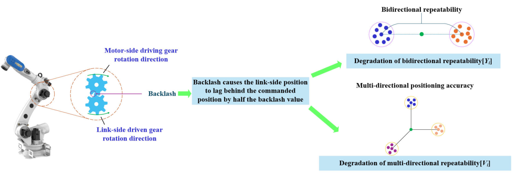
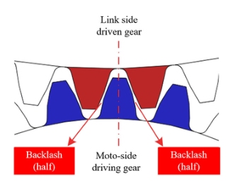
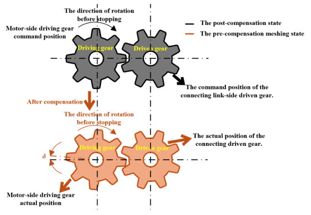
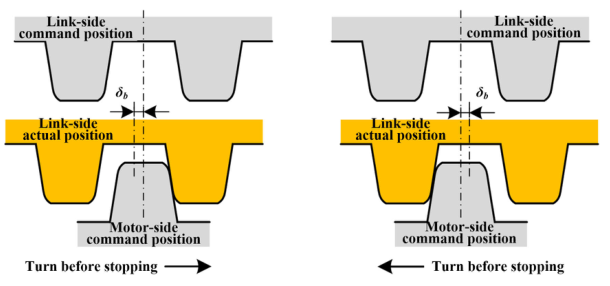
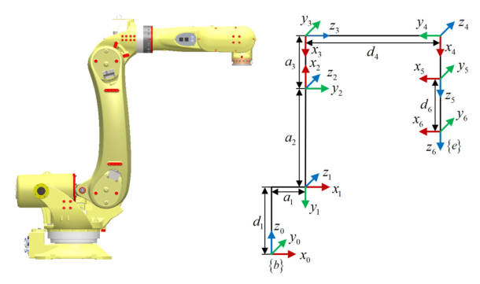
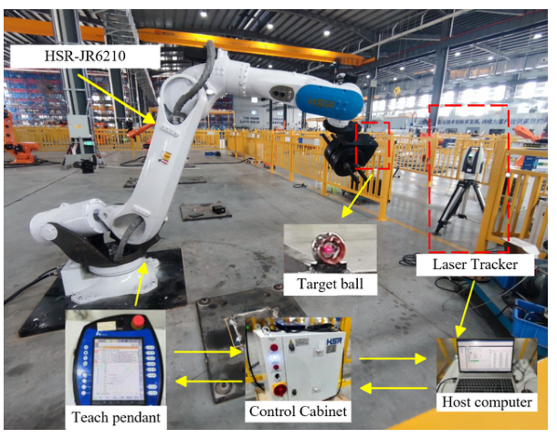
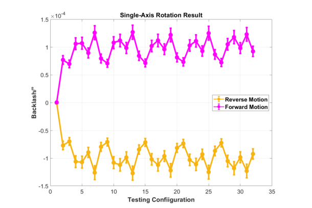
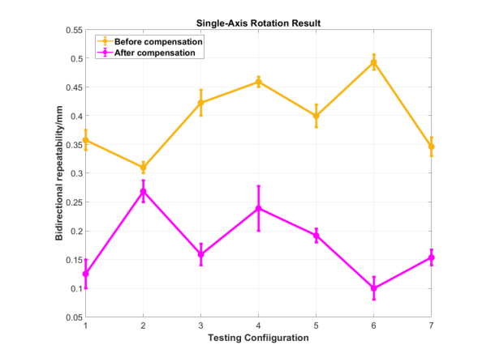
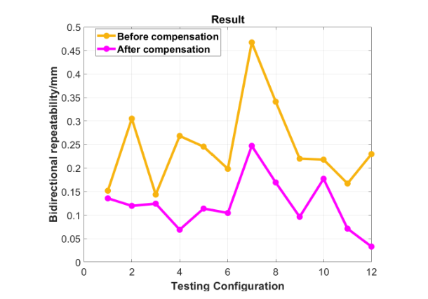
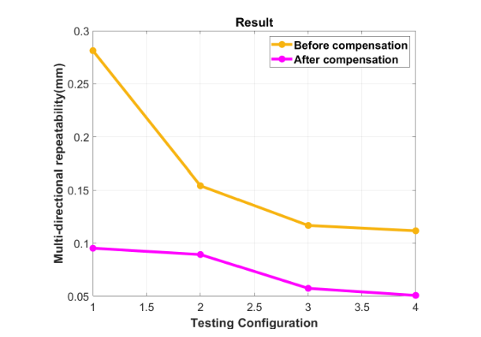

# 산업용 로봇의 반복정밀도를 높이기 위한 기어 백래시 식별·보상 방법 (Yao 2025)

- 원제: A Gear Backlash Identification and Compensation Method to Enhance Industrial Robot Repeatability
- 원문: 같은 폴더의 `Yao2025_IEEEAccess.pdf` (IEEE Access, vol. 14, pp. 2236–2248, 2026, DOI 10.1109/ACCESS.2025.3643729, CC BY 4.0 오픈 액세스)
- 번역 범위: 전문 (머리말 정보, 초록, I~VI절, 알고리즘 1, 표 1~5, 각주, 감사의 글, 저자 소개 포함. 참고문헌은 원문 그대로)
- 그림: 원문 그림 10개를 `그림/`에 넣고 본문에서 처음 언급되는 곳에 삽입

> 접수 2025년 11월 13일, 채택 2025년 12월 4일, 출판 2025년 12월 12일, 현재 판 2026년 1월 6일.
> Digital Object Identifier 10.1109/ACCESS.2025.3643729
>
> 저자: JINXIANG YAO (1,3,4), LIN YANG (2,4), RAN JU (3,4), XING ZHOU (3), MENG GAO (3,4), YOU XU (1), HAIBIN YANG (3,4), GENGCONG LIN (3,4), SHIFENG HUANG (3,4,5, IEEE 회원)
>
> 1 광둥기술사범대학(Guangdong Polytechnic Normal University) 자동차·교통공학부, 광저우 510665, 중국
> 2 화남이공대학(South China University of Technology) 기계·자동차공학부, 광저우 510641, 중국
> 3 포산 지능장비기술연구원(Foshan Institute of Intelligent Equipment Technology), 포산 528234, 중국
> 4 포산 화수 로봇(Foshan Huashu Robot Company Ltd.), 포산 528234, 중국
> 5 후난대학(Hunan University) 인공지능·로보틱스학부, 창사 410082, 중국
>
> 교신저자: You Xu (uhui@gpnu.edu.cn), Haibin Yang (yhb@hzncc.com), Gengcong Lin (1871881330@qq.com), Shifeng Huang (fenghkust@gmail.com)
>
> 이 연구는 장쑤성 우시 "Light of the Taihu Lake" 과학기술 프로그램(과제 번호 G20242022)과 광저우 과학기술계획 프로젝트(과제 번호 2025B03J0020, 2023B03J0002)의 일부 지원을 받았다.
>
> 이 원고의 심사를 조율하고 출판을 승인한 부편집장은 Zheng H. Zhu이다.

## 초록

산업용 로봇은 다자유도(degrees of freedom, DoF)와 고유한 유연성 덕분에 기계 제조에 널리 쓰인다. 그러나 백래시(backlash)는 엔드이펙터의 양방향 반복정밀도(bidirectional repeatability)와 다방향 반복정밀도(multi-directional repeatability)를 떨어뜨릴 뿐 아니라, 기하 오차에 비해 식별과 보상도 더 어렵게 만든다. 기존의 백래시 식별·보상 방법은 백래시 오차 전달 원리를 간과하며, 이 한계가 로봇 엔드이펙터의 양방향 반복정밀도와 다방향 반복정밀도 개선을 크게 가로막는다. 기존 연구와 달리, 이 논문은 백래시와 양방향·다방향 반복정밀도의 상관관계를 처음으로 체계적으로 논의하고, 모델링·식별·보상으로 이루어진 파이프라인을 제안한다. 백래시 오차 전달 원리에 따라 감속비 보정 계수(reduction ratio correction coefficient), 백래시, 관절 회전 방향을 포함하는 수학 모델을 세우고, 이를 고차 관절 의존 오차 항을 포함하는 로봇 기구학 오차 모델에 통합한다. 인접 좌표계 사이의 자세 편차가 백래시와 기구학 오차를 포함하는 선형 함수이므로, 이 함수를 테일러 전개(Taylor expansion)하여 고차 오차 항을 생략하고, 반복 재가중 최소제곱(iteratively reweighted least squares, IRLS) 알고리즘으로 백래시와 기구학 파라미터 오차를 함께 식별한다. 백래시와 보상 방향을 모두 고려하는 보상 방법도 제안하며, 보상 방향은 관절이 목표 위치에 도달하기 직전의 관절 속도로 정한다. 6자유도 로봇에서 단일 축 회전 식별·보상 방식과 이 논문이 제안한 새로운 방법을 비교하는 실험을 수행했다. 실험 결과, 기존 단일 축 방법은 관절마다 단일 축 운동을 반복해야 하므로 백래시 식별·보상 효율이 낮고 백래시가 다방향 반복정밀도에 주는 영향을 고려하지 못한다. 반면 제안 방법은 각 관절의 백래시를 빠르게 식별하고, 양방향 반복정밀도와 다방향 반복정밀도를 각각 47.97%, 53.44% 개선한다.

**색인어(INDEX TERMS)** 산업용 로봇, 백래시, 반복 재가중 최소제곱, 양방향 반복정밀도, 다방향 반복정밀도.

## I. 서론 (INTRODUCTION)

산업용 로봇은 높은 유연성과 다자유도 덕분에 기계 제조에서 레이저 절단 [1], 밀링 [2], 용접 [3]에 쓰이는 장치이다. 그러나 실제 응용에서 사이클 타임을 줄이고 운용 효율을 높이려면, 산업용 로봇 엔드이펙터는 자재 취급, 조립, 용접을 위해 높은 위치 정확도를 달성해야 한다 [4], [5], [6].

제조 공차, 조립 불완전성, 환경 교란은 산업용 로봇의 실제 기구학 파라미터와 공칭 기구학 파라미터 사이에 차이를 자주 일으키고, 그 결과 운동 수행 중 위치 오차가 생긴다. 위치 오차는 관례적으로 그 원인에 따라 기하 오차와 비기하 오차로 분류한다 [7], [8]. 기하 오차는 주로 링크 길이, 링크 오프셋, 관절 비틀림각(joint torsion angle), 관절각의 작은 편차를 포함한다. 비기하 오차는 백래시와 열변형 같은 간접 원인에서 생긴다. 이들 가운데 백래시는 본래 맞물린 기어가 열팽창으로 고착되지 않도록 일부러 설계한 것이다. 그러나 백래시의 존재는 고정밀 반복 작업에 로봇을 적용할 때 결정적인 제약이 된다.

이 한계를 해결하기 위해 연구자들은 백래시를 체계적으로 연구해 왔다. Qiao 등 [9]은 기하·비기하 오차로 인한 공구 중심점(tool center point, TCP) 정확도 저하를 감시하는 비용 효율적인 프레임워크를 제안하여, 로봇의 고장 예지·건전성 관리(Prognostics and Health Management, PHM)에 계측적 근거를 제공했다. Kubela 등 [10]은 KUKA 로봇의 관절 피드백 데이터를 이용해 백래시 편차의 사상 관계를 세우고 운동 반전 시점에 PID 보상을 적용하여 Y축 원 궤적 오차를 15% 줄였다. Kubela 등 [11]은 이후 KUKA 로봇의 가공 오차를 분석하고 RSI 모듈로 반전 속도를 온라인으로 동적으로 조정하여 백래시를 최소화했으며, 추가 하드웨어 없이 정확도를 10%–15% 개선했다.

이러한 선행 연구들은 기어 백래시의 정밀 보상을 위한 다차원적 기술 기반을 함께 제공하지만, 백래시에 대한 체계적이고 확정적인 오차 보상 메커니즘은 아직 확립되지 않았다.

백래시로 인한 로봇 엔드이펙터 위치 정확도 저하를 해결하기 위해, 학계는 주로 백래시 모델링과 보상에 집중해 왔다. Weigand 등 [12]은 비선형 강성과 보조 엔코더(secondary encoder)를 결합하여 백래시를 모델링하고 밀링 위치 오차를 10분의 1로 줄였다. Neubauer 등 [13]은 토크 부호에 따라 백래시 영향 가중치를 동적으로 조정하고 기하 보정을 결합하여 최대 위치 편차를 0.32 mm 이내로 억제했다. 이중 모터 구동 로봇 구조에 대해서는 Sun [14]이 가변 바이어스 토크 제어 전략을, Zhao 등 [15]이 백래시 보상용 복합 제어 알고리즘을 개발했다. 두 방법 모두 백래시로 인한 정상상태 오차와 동적 진동을 효과적으로 완화한다. Wang 등 [16]은 특성 기반 모델링과 이산 슬라이딩 모드 제어 전략을 통합하여 위치 오차를 80% 줄였다. Istiqphara 등 [17]은 백래시 접촉 상태 전이를 구간별 함수로 모델링하고, 부호 함수 진폭 제한 제어로 정상상태 관절각 오차를 0.05° 이내로 묶었다. He 등 [18]은 크리깅(Kriging) 대리 모델과 유전 최적화 알고리즘을 통합하여 히스테리시스 오차를 보상하고 절대 위치 정확도를 크게 높였다. 같은 저자들 [19]은 이후 이 방법을 유연 매니퓰레이터로 확장하고, 입력 백래시 효과를 완화하는 편미분방정식(PDE) 기반 경계 제어기를 구현했다. Cursi 등 [20]은 힘줄(tendon) 구동 수술 로봇에 대해 오프라인 백래시 보상과 증강 피드포워드 네트워크(AugNet)를 통합하여 평균 오차를 36% 줄였다. Ahmed 등 [21]은 적응형 종단 슬라이딩 모드 제어와 시간 지연 추정(time-delay estimation, TDE)을 통합하여, 백래시·외란·미지 동역학이 있는 n자유도 매니퓰레이터에서 유한 시간 고정밀 추종을 달성했다. Jaber 등 [22]은 TDE와 적응형 종단 슬라이딩 모드 제어를 통합하여 위치 피드백만 쓰는 모델 프리 제어기를 개발하고, 미지의 백래시와 외란이 있는 상황에서 유한 시간 고정밀 관절 추종을 달성했다. [역주: 참고문헌 [22]의 실제 제목은 웨이블릿 변환과 신경망 기반 백래시 고장 진단으로, 본문 서술과 맞지 않는다. 원문 그대로 옮김.]

모델링 방법과 보상 전략에서 진전이 있었지만, 기존 연구에서 백래시의 체계적 식별은 여전히 충분히 다뤄지지 않았으며, 이로 인해 모델 편향(bias)이 누적되고 결과적으로 보상 노력이 효과를 잃는다.

편차 누적과 보상 무력화를 완화하려면, 백래시 보상 기술을 발전시키는 데 정확한 백래시 식별이 반드시 필요하다. 그래서 학계는 체계적인 백래시 식별 방법 연구로 관심을 돌렸다. Giovannitti 등 [23]은 가변 강성 백래시 모델을 개발하고 공분산 행렬 적응 진화 전략(covariance matrix adaptation evolution strategy, CMA-ES)으로 식별하여 COMAU 로봇에서 정확한 백래시 상태 검출을 달성했다. Sigron 등 [24]은 SLSQP로 백래시를 동시 식별한 뒤 격자 자(grating ruler)와 온도 피드백으로 실시간 자세 보정을 수행하여 위치 오차를 크게 줄였다. Zhang 등 [25]은 백래시를 단일 축 정적 모델로 단순화하고 방향을 고려한 선행(look-ahead) 보정 전략을 구현하여 다축 원 경로 오차를 70% 넘게 줄였다. Ryu 등 [26]은 백래시를 토크 반전 시 잃는 각변위로 정의하고, 파라미터 결합에 따른 악조건(ill-conditioning)을 완화하기 위해 분산 보정을 구현하여 다양한 하중 조건에서도 정확도를 유지했다. Yamada 등 [27]은 백래시를 0.006 rad의 불감대(dead zone)로 모델링하고 부하측 엔코더로 식별했으며, 이중 엔코더 피드포워드 역제어기로 보상을 구현하여 토크 추종 성능을 크게 높였다. Woodside 등 [28]은 선형 보간 양방향 편차 모델로 백래시를 식별하고 온라인 피드포워드 보상을 구현하여 최대 반경 오차를 108 µm로 줄이고 진원도를 25% 개선했다. Alam 등 [29]은 국소 좌표계를 축 평균선에 정렬하고, D-H(Denavit-Hartenberg) 파라미터와 양방향 각도 편차를 각도와 방향의 함수로 식별하여 백래시 영향을 완화하면서 절대 정확도를 크게 높였다. Poignonec 등 [30]은 내시경 카메라로 힘줄 구동 연속체 로봇의 백래시를 현장(in-situ)에서 역추정·보상하여 영상 투영 오차를 89화소에서 40화소로 줄였다. Nguyen 등 [31]은 명시적 백래시 모델링 아래에서 모델 기반 식별과 인공신경망(ANN) 오차 보상을 통합하여 로봇 위치 정확도를 크게 높였다. Zhang 등 [32]은 관절각 불확도(uncertainty)와 측정 잡음을 정량화할 수 있는 베이즈 기구학 보정 프레임워크를 써서, 완전한 불확도 범위와 함께 관절 변수 오차 1% 미만을 달성했다.

기존 연구에서 다음 한계가 확인되었다. (1) 포괄적인 백래시 식별·보상 해법이 없다. (2) 백래시 오차 전달 원리를 간과하며, 이것이 로봇 엔드이펙터의 양방향 반복정밀도¹와 다방향 반복정밀도² 개선을 주로 제한한다. (3) 백래시 식별·보상은 기하 오차에 비해 더 복잡하다.

이 논문에서 제안하는 백래시 보상 방법의 예비 판은 학술대회 논문 [35]에서 처음 발표되었다. 그 선행 연구를 바탕으로, 이 논문은 다음과 같이 확장된 기여를 한다.

- 백래시와 엔드이펙터의 양방향·다방향 반복정밀도의 상관관계를 처음으로 체계적으로 논의한다.
- 백래시 오차 전달 원리에 따라 감속비 보정 계수, 백래시, 관절 회전 방향을 포함하는 수학 모델을 세우고, 이 모델을 고차 관절 의존 오차 항을 포함하는 로봇 기구학 오차 모델에 통합한다.
- 인접 좌표계 사이 자세 편차를 테일러 전개하고 고차 항을 무시한 뒤, 강건성과 적응성이 좋은 IRLS 알고리즘으로 백래시와 파라미터 오차를 식별한다.
- 6자유도 산업용 로봇에서 비교 검증 실험을 수행하여, 기존 단일 축 방식과 비교해 제안 방법의 효율성과 효과를 보인다.

이 논문의 나머지 구성은 다음과 같다. II절은 로봇 관절 안에서의 백래시 오차 전달 원리를 엄밀히 분석하여 이후 식별·보상의 기초를 놓는다. III절은 백래시 오차 전달 원리를 활용하여 백래시 모델을 로봇의 기구학 오차 모델에 넣고 IRLS 알고리즘으로 파라미터를 식별한다. IV절은 백래시 오차 전달 원리를 바탕으로 개발한 백래시 보상 방법을 소개한다. V절은 6자유도 산업용 로봇에서 제안한 백래시 식별·보상 방법을 실험으로 검증하고 결과를 분석한다. VI절은 결론을 제시한다.

> ¹ "양방향 반복정밀도(bidirectional repeatability)"라는 용어의 출처는 참고문헌 [33]에서 찾을 수 있다.
> ² "다방향 반복정밀도(multi-directional repeatability)"라는 용어의 출처는 참고문헌 [34]에서 찾을 수 있다.

## II. 백래시 오차 전달 원리 (PRINCIPLE OF BACKLASH ERROR TRANSMISSION)

그림 1에 보인 것처럼, 로봇 관절의 전동 부품은 열팽창에 의한 기계적 고착을 피하도록 맞물린 기어 이 사이에 작은 백래시를 일부러 두게 설계된다. 그럼에도 운전 중 마모 때문에 기어 전동계의 수명 동안 백래시는 불가피하게 커진다. 고하중 운전 조건에서는 마모로 커진 백래시가 정확도 저하 메커니즘을 더 증폭시키고, 로봇 엔드이펙터의 양방향 반복정밀도와 다방향 반복정밀도에 큰 영향을 준다. 따라서 백래시 오차 전달 원리를 엄밀히 조사하는 것이 꼭 필요하다.

*그림 1 — 백래시 오차가 양방향 반복정밀도와 다방향 반복정밀도로 전달되는 원리. (그림 속 문구: 모터측 구동 기어 회전 방향 / 링크측 피동 기어 회전 방향 / 백래시 → 백래시 때문에 링크측 위치가 지령 위치보다 백래시의 절반만큼 뒤처진다 → 양방향 반복정밀도 저하 $[Y_i]$ / 다방향 반복정밀도 저하 $[V_i]$)*

관절 전동계를 강체로 맞물린 기어 쌍으로 이상화한다. 모터측 구동 기어와 링크측 피동 기어 사이에 백래시가 없다면, 구동 기어가 원하는 각위치에 도달하는 즉시 피동 기어도 대응하는 원하는 각위치에 도달한다. 백래시는 피할 수 없지만, 설계 관점에서 링크측 피동 기어의 이상적 평형 위치를 정의할 필요가 있다. 이 이상적 평형 위치는 맞물린 이 면(tooth flank) 양쪽에 백래시를 대칭으로 나누며, 이 배치를 대칭 배분(symmetrical allocation)이라 한다. 그림 2에 보인 것처럼, 이론적으로 각 이 면은 전체 백래시의 절반씩을 갖고, 구동 기어와 피동 기어의 중심축을 지나는 선이 대칭축이 된다.

*그림 2 — 링크측 피동 기어의 이상화된 위치. (그림 속 문구: 링크측 피동 기어 / 모터측 구동 기어 / 백래시(절반))*

관절 백래시는 운동이 끝났을 때 모터측 지령 위치와 실제 링크측 위치 사이에 각위치 오프셋을 반드시 만든다. 그림 3에 보인 것처럼, 운동이 멈추면 구동 기어와 피동 기어는 한쪽 면만 접촉하는 상태가 된다. 검은 영역은 보상 전 기어 맞물림 상태, 주황 영역은 보상 후 기어 맞물림 상태를 나타낸다. 이 배치에서 구동 기어는 지령 위치에 정확히 놓이지만, 피동 기어는 이론 위치보다 전체 백래시의 절반만큼 뒤처진다. 이 차이는 전동 사슬을 따라 전파·증폭되어 결국 로봇 엔드이펙터의 위치 편차로 나타난다. 절대 위치 정확도는 기구학 보정 잔차, 열 드리프트, 제어 지연이 함께 지배하므로, 백래시는 전체 결정론적 오차의 한 성분일 뿐이며 보통 지배적이지 않다. 따라서 이 논문은 절대 위치 정확도보다 백래시의 반복정밀도 관련 특성에 집중한다.

*그림 3 — 링크측 피동 기어의 이상화된 위치. [역주: 원문 캡션이 그림 2와 같다. 내용은 보상 전후 기어 맞물림 상태이다. 또 그림 범례는 검은색=보상 후, 주황색=보상 전 맞물림 상태로 적혀 있어 본문 설명(검은색=보상 전, 주황색=보상 후)과 반대이다.] (그림 속 문구: 정지 전 회전 방향 / 모터측 구동 기어 지령 위치 / 구동 기어 / 피동 기어 / 연결된 링크측 피동 기어의 지령 위치 / 보상 후 / 모터측 구동 기어 실제 위치 / 연결된 피동 기어의 실제 위치 / $\delta$)*

국제 표준 ISO 9283에 따르면, 반복 위치 정밀도(repeat positioning accuracy)는 같은 지령 위치에 한 방향으로 연속 접근하여 얻은 통계적 평균 위치와 도달 위치 사이의 편차로 정의된다. 따라서 이것은 단방향 정확도 지표로 분류된다. 백래시 오차 전달 원리에 따르면, 백래시가 엔드이펙터 정확도에 주는 영향은 로봇 엔드이펙터의 양방향 반복정밀도와 다방향 반복정밀도에서 가장 두드러진다. 양방향 반복정밀도는 매우 중요하지만, 현재 대부분의 로봇 제조사 제품 설명서 사양에서 빠져 있고 ISO 9283에서도 다루지 않는다. 로봇과 공작기계의 핵심 정밀 운동 요구 조건이 비슷하므로, 이 논문은 CNC 공작기계용 국제 표준 ISO 230-2 [36]에 규정된 양방향 반복정밀도 평가 기준을 채택하고, ISO 9283 [37]의 다방향 반복정밀도 규정도 참조하여 실험으로 얻은 데이터 평가에 적용한다.

따라서 ISO 230-2의 정의를 사용한다. 양방향 반복정밀도는 같은 목표에 반대 방향에서 n번의 연속 측정 주기 동안 연속 접근하여 얻은 두 위치 측정 군집의 중심 사이 유클리드 거리로 정량 정의된다. ISO 9283에 따라, 다방향 반복정밀도는 공간에서 서로 직교하는 세 방향에서 n번의 연속 측정 주기 동안 목표에 연속 접근하여 얻은 측정 위치 군집 중심들 사이의 최대 거리로 정의된다.

ISO 230-2에 규정된 양방향 반복정밀도와 ISO 9283에 정의된 다방향 반복정밀도의 계산식을 각각 식 (1)과 (2)에 제시한다.

식 (2)에서 $V_i$는 i번째 점의 다방향 반복정밀도를 나타내고, $\bar{x}_h$, $\bar{y}_h$, $\bar{z}_h$는 한 궤적을 따라 지령점에 n번 반복 접근하여 얻은 중심 좌표, $\bar{x}_k$, $\bar{y}_k$, $\bar{z}_k$는 다른 궤적에 대한 중심 좌표이며, h와 k는 서로 반대인 접근 방향을 가리킨다. $\Delta P_h(Backlash)$와 $\Delta P_k(Backlash)$는 각각 h번째와 k번째 궤적 구간을 따라 이론점에 접근할 때 엔드이펙터에 생기는 백래시 유발 오차이다. $P_i$는 엔드이펙터의 목표 위치이고, $P(Others)$는 엔드이펙터가 목표 위치에 도달할 때 다른 파라미터에서 생기는 오차이다.

식 (1)에서 $R_i$는 i번째 점의 양방향 반복정밀도를 나타낸다. $S_i^{\uparrow}$는 로봇 엔드이펙터가 같은 지정 위치에 정방향으로 n번 반복 접근할 때의 위치 편차, $S_i^{\downarrow}$는 역방향에 대한 편차, $Y_i$는 로봇 엔드이펙터가 같은 지령 위치에 정방향과 역방향에서 각각 n번 접근할 때의 평균 위치를 나타낸다. $Y_i$의 식은 식 (3)에 제시한다.

식 (3)에서 $\bar{P}_i^{\uparrow}$는 같은 지령점에 정방향으로 반복 접근할 때 로봇 엔드이펙터 실제 위치의 평균값, $\bar{P}_i^{\downarrow}$는 역방향으로 반복 접근할 때 실제 위치의 평균값을 나타낸다. $\Delta P(Backlash)$는 엔드이펙터가 이론점에 도달할 때 생기는 백래시 유발 오차, $P_i$는 엔드이펙터의 목표 위치, $P(Others)$는 엔드이펙터가 목표 위치에 도달할 때 다른 파라미터가 유발하는 오차이다.

$$R_i = \max\left(3S_i^{\uparrow} + 3S_i^{\downarrow} + |Y_i|,\ 6S_i^{\uparrow},\ 6S_i^{\downarrow}\right) \tag{1}$$

$$\begin{aligned}
V_i &= \max\sqrt{(\bar{x}_h-\bar{x}_k)^2+(\bar{y}_h-\bar{y}_k)^2+(\bar{z}_h-\bar{z}_k)^2}\,h,\ k=1,2,3\\
&= \max(P_i + \Delta P_h(Backlash) + P(Others) - P_i + P_k(Backlash) - P(Others))\\
&= \max(\Delta P_h(Backlash) + \Delta P_k(Backlash))
\end{aligned} \tag{2}$$

$$\begin{aligned}
Y_i &= \bar{P}_i^{\uparrow} - \bar{P}_i^{\downarrow}\\
&= (P_i + \Delta P(Backlash) + \Delta P(Others)) - (P_i - \Delta P(Backlash) + \Delta P(Others))\\
&= 2\Delta P(Backlash)
\end{aligned} \tag{3}$$

백래시 오차 전달 원리와 식 (1)~(3)으로부터, 백래시가 로봇 엔드이펙터의 양방향 반복정밀도와 다방향 반복정밀도에 영향을 주는 주된 요인임을 추론할 수 있다.

요컨대 백래시는 정방향 운동 뒤든 역방향 운동 뒤든 링크측 위치를 지령 위치보다 백래시 값의 절반만큼 뒤처지게 한다. 이 논문은 이 백래시 오차 전달 원리를 겨냥하여 백래시 식별·보상 방법을 제안한다.

## III. 백래시 식별 방법 (BACKLASH IDENTIFICATION METHOD)

II절에서 밝힌 백래시 오차 전달 원리를 바탕으로, 이 절은 감속비 보정 계수, 백래시, 관절 회전 방향을 포함하는 백래시 수학 모델을 세우고 이를 기구학 오차 모델에 통합한다. IRLS 알고리즘의 강건성과 적응성이 좋으므로, 인접 좌표계 사이 자세 편차를 테일러 전개하여 고차 항을 무시하고, IRLS 알고리즘으로 백래시와 기구학 파라미터 오차를 함께 식별한다.

D-H 모델은 물리적 해석이 쉽고 모델링이 간단하며 적용 범위가 넓으므로, 이를 활용해 z−x 변환 규약으로 로봇 기구학을 수학적으로 정식화한다.

기존 D-H 기구학 모델에는 고유한 한계가 있다. 인접 관절 축이 평행하거나 거의 평행할 때 선택한 파라미터의 작은 섭동이 행렬 특이성을 일으킬 수 있다. 이 한계를 해결하기 위해, 이 논문은 Hayati [38]가 제안한 방법을 채택하여 i번째 관절의 D-H 파라미터에 $y_i$축 둘레의 비틀림각(twist angle) $\beta_i$를 더해 수정 D-H(MD-H) 모델을 만든다. 6자유도 산업용 로봇의 공칭 링크 파라미터를 식 (4)에 대입하면 엔드이펙터 좌표계 $\{e\}$에서 베이스 좌표계 $\{b\}$로의 동차 변환 행렬을 얻는다.

$$\begin{aligned}
\boldsymbol{T}_e^b &= \prod_{i=1}^{6}\left(D_{Z_{i-1}}(d_i)\,R_{Z_{i-1}}(q_i)\,D_{X_i}(a_i)\,R_{X_i}(\alpha_i)\,R_{Y_i}(\beta_i)\right) = \prod_{i=1}^{6}\boldsymbol{T}_i^{i-1}\\
&= \begin{bmatrix} n_x & o_x & a_x & p_x\\ n_y & o_y & a_y & p_y\\ n_z & o_z & a_z & p_z\\ 0&0&0&1\end{bmatrix}
= \begin{bmatrix} \boldsymbol{R}_e^b & \boldsymbol{P}_e^b\\ \boldsymbol{0}_{1\times3} & 1\end{bmatrix}
\end{aligned} \tag{4}$$

여기서 기호 $D_{X_i}$와 $D_{Z_{i-1}}$은 각각 i번째 좌표계의 x축 방향 평행이동과 (i-1)번째 좌표계의 z축 방향 평행이동에 해당하는 동차 변환 행렬을 나타내고, $R_{X_i}$와 $R_{Z_{i-1}}$은 각각 i번째 좌표계의 x축 둘레 회전과 (i-1)번째 좌표계의 z축 둘레 회전에 해당하는 동차 변환 행렬을 나타낸다.

식 (4)에서 i번째 관절의 파라미터는 다음과 같이 정의된다. $d_i$는 링크 오프셋, $q_i$는 관절각, $a_i$는 링크 길이, $\alpha_i$는 관절 비틀림각(joint torsion angle), $\beta_i$는 $y_i$축 둘레 비틀림각이다. $\boldsymbol{R}_e^b$와 $\boldsymbol{P}_e^b$는 각각 베이스 좌표계 $\{b\}$에 대한 엔드이펙터 좌표계 $\{e\}$의 회전 변환과 평행이동 변환을 나타낸다. 임의로 정한 관절각 집합에 대해, 베이스 좌표계에서 로봇 엔드이펙터의 지령 위치는 식 (4)로부터 수학적으로 바로 얻어진다.

i번째 관절에 대해, 관절 감속기의 감속비 보정 계수, 백래시, 관절 회전 방향을 고려한 실제 관절각 $q_{i,r}$은 식 (5)로 정식화된다.

$$q_{i,r} = q_{i,n}r_i + \zeta_i b_i \tag{5}$$

식 (5)에서 $q_{i,r}$은 i번째 관절의 실제 각도, $q_{i,n}$은 대응하는 지령 관절각이다. $r_i$는 i번째 관절의 감속비 보정 계수로, 오차가 없으면 기본값 1이다. $b_i$는 i번째 관절의 백래시 절반(half backlash)으로, 백래시가 없으면 기본값 0이다. $\zeta_i$는 식 (6)으로 정의되는 i번째 관절의 회전 방향이다.

$$\zeta_i = \begin{cases} 1, & v_{i,t} > 0\\ -1, & v_{i,t} < 0\end{cases} \tag{6}$$

식 (6)에서 $v_{i,t}$는 시각 t에 i번째 관절이 지령 위치에 도달하기 직전의 관절 속도를 나타낸다.

산업용 로봇의 조립과 제조 과정에서 이론 D-H 파라미터와 실제 D-H 파라미터 사이에 편차가 생긴다. 구체적으로 이 편차는 관절각($\Delta q_i$), 링크 길이($\Delta a_i$), 링크 오프셋($\Delta d_i$), 관절 비틀림각($\Delta\alpha_i$), $y_i$축 둘레 비틀림각($\Delta\beta_i$)의 오차로 나타난다. 따라서 감속비 보정 계수, 백래시, 관절 회전 방향을 기구학 오차 모델에 통합한다. 감속비 보정 계수와 백래시를 포함한, 로봇의 i번째와 (i-1)번째 좌표계 사이 동차 변환 행렬($\boldsymbol{T}_i^{i-1}$)은 페이지 하단에 보인 식 (7)과 같다.

$$\boldsymbol{T}_i^{i-1} = \begin{bmatrix}
c(q_{i,r})c\beta_i - s(q_{i,r})s\alpha_i s\beta_i & -s(q_{i,r})c\alpha_i & c(q_{i,r})s\beta_i + s(q_{i,r})s\alpha_i & a_i c(q_{i,r})\\
s(q_{i,r})c\beta_i + c(q_{i,r})s\alpha_i s\beta_i & c(q_{i,r})c\alpha_i & s(q_{i,r})s\beta_i - c(q_{i,r})s\alpha_i & a_i s(q_{i,r})\\
-c\alpha_i s\beta_i & s\alpha_i & c\alpha_i c\beta_i & d_i\\
0 & 0 & 0 & 1
\end{bmatrix} \tag{7}$$

이 가운데 위 파라미터들의 치환을 위해 식 (5)의 대응 관계를 식 (8)과 같이 넣을 수 있다.

$$\begin{aligned}
c(q_{i,r}) &= \cos(q_{i,n}r_i + \zeta_i b_i)\\
s(q_{i,r}) &= \sin(q_{i,n}r_i + \zeta_i b_i)\\
c\alpha_i = \cos\alpha_i,&\quad s\alpha_i = \sin\alpha_i\\
c\beta_i = \cos\beta_i,&\quad s\beta_i = \sin\beta_i
\end{aligned} \tag{8}$$

식 (7)과 오차 파라미터를 바탕으로 산업용 로봇의 인접 좌표계 사이 자세 오차 모델을 세운다. 공구 좌표계와 측정 좌표계 사이 오차, 베이스 좌표계와 측정 좌표계 사이 오차를 제안한 자세 오차 모델과 결합하여, 오차 파라미터와 엔드이펙터 자세 오차 사이의 선형 사상을 유도한다.

좌표계 {i-1}에 대한 좌표계 {i}의 미분 변환은 식 (9)로 주어진다.

$$d\boldsymbol{T}_i^{i-1} = \boldsymbol{T}_i^{i-1}\,\delta\boldsymbol{T}_i^{i-1} \tag{9}$$

식 (9)를 테일러 전개하고 고차 항을 무시하면 식 (10)을 얻는다.

$$\begin{aligned}
\delta\boldsymbol{T}_i^{i-1} = \left(\boldsymbol{T}_i^{i-1}\right)^{-1}\cdot\Big(&\frac{\partial\boldsymbol{T}_i^{i-1}}{\partial q_i}\Delta q_i + \frac{\partial\boldsymbol{T}_i^{i-1}}{\partial d_i}\Delta d_i\\
&+ \frac{\partial\boldsymbol{T}_i^{i-1}}{\partial a_i}\Delta a_i + \frac{\partial\boldsymbol{T}_i^{i-1}}{\partial \alpha_i}\Delta\alpha_i + \frac{\partial\boldsymbol{T}_i^{i-1}}{\partial \beta_i}\Delta\beta_i\\
&+ \frac{\partial\boldsymbol{T}_i^{i-1}}{\partial r_i}\Delta r_i + \frac{\partial\boldsymbol{T}_i^{i-1}}{\partial b_i}\Delta b_i\Big)
\end{aligned} \tag{10}$$

여기서 $\boldsymbol{T}_i^{i-1}$은 (i-1)번째 좌표계에 대한 i번째 좌표계의 이론 동차 변환 행렬, $d\boldsymbol{T}_i^{i-1}$은 (i-1)번째 좌표계에 대한 i번째 좌표계의 자세 편차, $\delta\boldsymbol{T}_i^{i-1}$은 대응하는 미분 변환 행렬이다. 파라미터 $\Delta q_i$, $\Delta d_i$, $\Delta a_i$, $\Delta\alpha_i$, $\Delta\beta_i$, $\Delta r_i$, $\Delta b_i$는 각각 각 관절의 관절각 오차, 링크 길이 오차, 링크 오프셋 오차, 관절 비틀림각 오차, $y_i$축 둘레 비틀림각 오차, 기어비 보정 계수 오차, 백래시 오차에 해당한다. [역주: 앞의 정의($d_i$=링크 오프셋, $a_i$=링크 길이)와 비교하면 $\Delta d_i$와 $\Delta a_i$의 설명 순서가 뒤바뀌어 있다. 원문 그대로 옮김.] 인접 좌표계 사이 자세 편차를 바탕으로, 공구 좌표계와 측정 좌표계 사이 오차, 베이스 좌표계와 측정 좌표계 사이 오차까지 고려하면, 로봇의 실제 엔드이펙터 자세는 식 (11)로 나타낼 수 있다.

$$\left(\boldsymbol{T}_t^w\right)_R = \left(\boldsymbol{T}_t^w\right)_n + d\boldsymbol{T}_b^w\left(\boldsymbol{T}_t^b\right)_n + \left(\boldsymbol{T}_e^w\right)_n d\boldsymbol{T}_t^e + \left(\boldsymbol{T}_w^b\right)_n\cdot\prod_{i=1}^{6}\left(\boldsymbol{T}_i^{i-1} + d\boldsymbol{T}_i^{i-1}\right) \tag{11}$$

여기서 $(\boldsymbol{T}_t^w)_R$은 공구 좌표계와 측정 좌표계 사이의 실제 동차 변환 행렬이다. $(\boldsymbol{T}_t^w)_n$은 공구 좌표계와 측정 좌표계 사이의 이론 동차 변환 행렬이다. $d\boldsymbol{T}_b^w$는 측정 좌표계와 측정 좌표계 사이의 자세 편차이다 [역주: 원문 그대로. 문맥상 측정 좌표계와 베이스 좌표계 사이로 보인다]. $(\boldsymbol{T}_t^b)_n$은 베이스 좌표계와 공구 좌표계 사이의 이론 동차 변환 행렬이다. $(\boldsymbol{T}_e^w)_n$은 측정 좌표계와 로봇 엔드이펙터 사이의 이론 동차 변환 행렬이다. $d\boldsymbol{T}_t^e$는 로봇 엔드이펙터와 공구 좌표계 사이의 자세 편차이다. $(\boldsymbol{T}_w^b)_n$은 베이스 좌표계와 측정 좌표계 사이의 이론 동차 변환 행렬이다.

식 (9)와 식 (11)을 결합하면 식 (12)를 얻을 수 있다.

$$\delta\boldsymbol{T}_t^w = \prod_{i=1}^{6}\left(\boldsymbol{T}_i^{i-1} + d\boldsymbol{T}_i^{i-1}\right) + \left(\boldsymbol{T}_t^b\right)_n^{-1}\delta\boldsymbol{T}_b^w\left(\boldsymbol{T}_t^b\right)_n + \left(\boldsymbol{T}_t^w\right)_n^{-1}\left(\boldsymbol{T}_t^w\right)_n\delta\boldsymbol{T}_t^e
= \begin{bmatrix} 0 & -\delta_z^n & \delta_y^n & \boldsymbol{d}_x^n\\ \delta_z^n & 0 & -\delta_x^n & \boldsymbol{d}_y^n\\ -\delta_y^n & \delta_x^n & 0 & \boldsymbol{d}_z^n\\ 0&0&0&1\end{bmatrix} \tag{12}$$

여기서 $\delta\boldsymbol{T}_t^w$는 측정 좌표계에 대한 로봇 엔드이펙터의 위치·자세 오차를 나타내는 오차 행렬로, 자세의 미분 변환에서 유도된다. $\Delta\boldsymbol{P} = [\boldsymbol{d}_x^n\ \boldsymbol{d}_y^n\ \boldsymbol{d}_z^n]^T$, $\Delta\boldsymbol{\delta} = [\delta_x^n\ \delta_y^n\ \delta_z^n]^T$로 두면, 이들은 측정 좌표계 {w}에 대한 로봇 엔드이펙터 공구 좌표계 {t}의 전체 위치 편차와 자세 편차를 나타낸다.

자세 편차를 무시하고, 레이저 트래커(laser tracker)로 로봇의 여러 자세에서 수집한 m세트의 엔드이펙터 위치 데이터를 이용하면, 기구학 오차 모델은 식 (13)으로 나타낼 수 있다.

여기서 $\Delta\boldsymbol{X}\in\mathbb{R}^{39\times1}$은 개별 파라미터 오차의 열벡터이다. 이 6자유도 산업용 로봇은 2축과 3축 사이에만 평행 관절이 있으므로, y축 둘레 비틀림각은 하나만 둔다. 또한 파라미터 공선성(collinearity) 분석 결과 파라미터 오차 $\Delta q_1$, $\Delta q_6$, $\Delta d_1$, $\Delta d_2$, $\Delta d_6$, $\Delta a_6$, $\Delta\alpha_6$은 중복(redundant)이어서 식별할 필요가 없다. 이 중복 파라미터를 제거하면 식별할 파라미터 오차 수가 51개에서 39개로 줄어든다. $\Delta\boldsymbol{q}$, $\Delta\boldsymbol{d}$, $\Delta\boldsymbol{a}$, $\Delta\boldsymbol{\alpha}$, $\Delta\boldsymbol{\beta}$, $\Delta\boldsymbol{r}$, $\Delta\boldsymbol{b}$는 각각 로봇 6개 관절의 관절각 오차 벡터, 링크 오프셋 오차 벡터, 링크 길이 오차 벡터, 관절 비틀림각 오차 벡터, y축 둘레 비틀림각 오차 벡터, 기어비 보정 계수 오차 벡터, 백래시 오차 벡터이다. $\Delta\boldsymbol{c} = [d_{cx}\ d_{cy}\ d_{cz}\ \delta_{cx}\ \delta_{cy}\ \delta_{cz}]^T$와 $\Delta\boldsymbol{t} = [d_{tx}\ d_{ty}\ d_{tz}]^T$는 각각 로봇 베이스 좌표계의 오차와 공구 좌표계의 편차를 나타낸다. $\Delta\boldsymbol{P}_m\in\mathbb{R}^{3m\times1}$은 m번째 측정 자세에서 산업용 로봇 엔드이펙터의 종합 오차 벡터이다. $\boldsymbol{J}_m\in\mathbb{R}^{3m\times39}$는 백래시를 포함하는 기구학 오차 모델의 야코비 행렬로, 식 (14)에 보인 것처럼 엔드이펙터 위치를 파라미터 오차와 백래시로 편미분하여 얻는다. m은 로봇의 측정 자세 수이다. n은 이론 자세를 나타낸다.

$$\Delta\boldsymbol{P}_m = \begin{bmatrix}\boldsymbol{d}_x^n\\ \boldsymbol{d}_y^n\\ \boldsymbol{d}_z^n\end{bmatrix} = \boldsymbol{J}_m\Delta\boldsymbol{X} \tag{13}$$

$$\boldsymbol{J}_m = \left[\frac{\partial\boldsymbol{P}_m}{\partial\boldsymbol{q}}\ \frac{\partial\boldsymbol{P}_m}{\partial\boldsymbol{d}}\ \frac{\partial\boldsymbol{P}_m}{\partial\boldsymbol{a}}\ \frac{\partial\boldsymbol{P}_m}{\partial\boldsymbol{\alpha}}\ \frac{\partial\boldsymbol{P}_m}{\partial\boldsymbol{\beta}}\ \frac{\partial\boldsymbol{P}_m}{\partial\boldsymbol{r}}\ \frac{\partial\boldsymbol{P}_m}{\partial\boldsymbol{b}}\ \frac{\partial\boldsymbol{P}_m}{\partial\boldsymbol{c}}\ \frac{\partial\boldsymbol{P}_m}{\partial\boldsymbol{t}}\right] \tag{14}$$

$$\Delta\boldsymbol{X} = \left[\Delta\boldsymbol{q}\ \Delta\boldsymbol{d}\ \Delta\boldsymbol{a}\ \Delta\boldsymbol{\alpha}\ \Delta\boldsymbol{\beta}\ \Delta\boldsymbol{r}\ \Delta\boldsymbol{b}\ \Delta\boldsymbol{c}\ \Delta\boldsymbol{t}\right]^T \tag{15}$$

IRLS 알고리즘은 최소제곱 알고리즘보다 강건성과 적응성이 크므로 백래시와 파라미터 오차 식별에 더 적합하다. 따라서 이 논문은 파라미터 식별에 IRLS 알고리즘을 채택하며, 식 (13)을 변형하여 식 (16)을 구성한다.

$$\Delta\boldsymbol{X} = \left(\boldsymbol{J}_m^T\boldsymbol{W}\boldsymbol{J}_m\right)^{-1}\boldsymbol{J}_m^T\boldsymbol{W}\Delta\boldsymbol{P}_m \tag{16}$$

여기서 $\boldsymbol{W}$는 가중치 행렬로, 식 (17)~(19)로 주어진다.

$$\boldsymbol{u} = \Delta\boldsymbol{P}_m - \boldsymbol{J}_m\Delta\boldsymbol{X} \tag{17}$$

$$w_i = \frac{1}{\max(\sigma, |u_i|)} \tag{18}$$

$$\boldsymbol{W} = \mathrm{diag}(w_1, w_2, \cdots, w_{3m}) \tag{19}$$

여기서 $\boldsymbol{u}$는 잔차 벡터, $w_i$는 가중치 행렬 $\boldsymbol{W}$의 i번째 대각 원소, $\sigma$는 잔차의 강건 척도 추정치이며, 그 계산은 식 (20)과 같다.

$$\sigma = 1.4628 \times \mathrm{median}\left(|u_i - \mathrm{median}(\boldsymbol{u})|\right) \tag{20}$$

[역주: 정규분포 기준 MAD 척도 상수는 보통 1.4826이다. 원문 값 1.4628을 그대로 옮김.]

식 (13)~(20)에 따라 계산을 수행한다. 잔차가 $10^{-6}$보다 작아지거나 반복 횟수가 100에 이르면 반복을 끝내고, 산업용 로봇의 관절각 오차, 링크 길이 오차, 링크 오프셋 오차, 관절 비틀림각 오차, y축 둘레 관절 비틀림각 오차, 기어비 계수 오차, 백래시를 식별 결과로 얻는다.

알고리즘 1은 제안한 IRLS 기반 알고리즘으로 구현한 백래시·기구학 파라미터 오차 식별 절차를 단계별로 요약한다.

> **알고리즘 1** 백래시와 기구학 파라미터 오차 식별을 위한 IRLS 알고리즘
>
> **입력:** m개 측정 위치의 위치 오차: $\Delta\boldsymbol{P}_m$;
> 이론 파라미터: $\boldsymbol{X} = [\boldsymbol{q}\ \boldsymbol{d}\ \boldsymbol{a}\ \alpha\ \beta\ \boldsymbol{r}\ \boldsymbol{b}\ \boldsymbol{bc}\ \boldsymbol{t}]^T$; [역주: 원문 표기 "bc" 그대로]
> m개 측정 위치에 대한 파라미터 오차 야코비 행렬 $\boldsymbol{J}_m$;
> 최대 반복 횟수: $K_{\max}$;
> 임계값: $\varepsilon$.
> **출력:** 식별된 파라미터 오차 벡터 $\Delta\boldsymbol{X}$.
>
> **for** k = 1 **to** $K_{\max}$ **do**
> 1: 모든 측정 위치에 대해 파라미터 오차 벡터와 잔차 벡터를 재귀적으로 계산한다. //식 (9)~식 (17)
> 2: 현재 반복의 잔차 노름이 미리 정한 수렴 임계값보다 작은지 수치적으로 판정한다.
> **if** $\|\boldsymbol{u}\| > \varepsilon$ **then**
> 3: 현재 반복의 잔차 노름이 임계값을 넘으면 가중치 행렬을 갱신한다. //식 (17)~식 (20)
> 4: 새 가중치 행렬을 바탕으로 다음 반복에서 파라미터 오차 벡터와 파라미터 오차 야코비 행렬을 그에 맞게 재귀적으로 갱신한다.
> $\boldsymbol{X}_{k+1} = \boldsymbol{X}_k + \Delta\boldsymbol{X}$
> $\boldsymbol{J}_m = \mathrm{Jacobian}(\boldsymbol{X})$ //식 (14)
> **else**
> 5: 현재 반복의 잔차 노름이 임계값 아래이면 현재의 전체 종합 파라미터 오차 벡터를 최적 결과로 출력한다.
> **return** $\Delta\boldsymbol{X}$
> 6: 반복 횟수가 미리 정한 최대 반복 횟수 100에 이르면 현재의 전체 종합 파라미터 오차 벡터를 최적 결과로 출력한다.
> **if** $K_{\max} = 100$ **then**
> **return** $\Delta\boldsymbol{X}$

이 절은 백래시 오차 전달 원리에 기반한 백래시 모델을 정식화하여 기구학 오차 모델에 넣고, IRLS 알고리즘으로 고정밀 파라미터 오차와 백래시를 성공적으로 식별한다.

## IV. 백래시 보상 방법 (BACKLASH COMPENSATION METHOD)

II절에서 보인 것처럼, 백래시는 모터의 지령 각위치와 링크의 실제 각위치 사이에 위치 오프셋을 만들고, 그 결과 로봇 엔드이펙터의 지령 위치와 실제 위치 사이에 편차가 생긴다. 그림 4에 보인 것처럼, 백래시는 정방향 운동 뒤든 역방향 운동 뒤든 링크측 위치를 지령 위치보다 백래시 값의 절반만큼 뒤처지게 한다. 따라서 보상하려면 구동 기어를 원래 운동 방향으로 백래시 크기의 절반만큼 추가로 회전시켜, 양방향 반복정밀도와 다방향 반복정밀도 모두에서 관찰되는 백래시 절반만큼의 지연을 상쇄해야 한다. 이 추가 회전으로 피동 기어가 의도한 지령 위치에 정확히 맞춰지고, 그 결과 로봇 엔드이펙터의 양방향 반복정밀도와 다방향 반복정밀도가 크게 개선된다.

*그림 4 — 모터측 지령 위치와 링크측 실제 위치의 대응 관계. (그림 속 문구: 링크측 지령 위치 / 링크측 실제 위치 / 모터측 지령 위치 / $\delta_b$ / 정지 전 회전 방향)*

이 절은 백래시 오차 전달 원리에 근거하여 제안하는 백래시 보상 방법을 제시하며, 구현은 이어지는 내용에서 자세히 설명한다.

먼저 III절에서 제안한 방법으로 매니퓰레이터의 6개 회전 관절 모두의 백래시 크기를 정밀하게 구하고, 이를 벡터 $\boldsymbol{B}(b_1, b_2, \cdots, b_6)$로 저장한다.

다음으로, 가장 최근 엔드이펙터 목표에 도달하기 직전 N개 보간점에 대응하는 관절각을 로봇 제어 시스템에서 추출한다. 제어 시스템은 시간 간격 t마다 보간점 하나를 생성한다. 이 관절각들을 $j = 1, 2, \cdots, N$에 대해 벡터 $\boldsymbol{PA}_j(q_{1,g_j}, q_{2,g_j}, \cdots, q_{6,g_j})$로 저장하며, $j = N$일 때 $\boldsymbol{PA}_j$는 가장 최근 엔드이펙터 목표의 관절 자세에 해당한다.

백래시 보상 방향을 정확히 정하려면 먼저 목표 도달 직전의 관절 속도를 구해야 한다. 이 속도는 N개의 보간 관절각과 목표 자세로 식 (21)과 같이 계산한다.

$$v_{i,g_o} = \frac{q_{i,g_{l+1}} - q_{i,g_l}}{t} \tag{21}$$

식 (21)에서 $v_{i,g_o}$는 o번째 궤적 구간에서 i번째 관절의 각속도를 나타내고, $q_{i,g_{l+1}}$과 $q_{i,g_l}$은 각각 (l+1)번째와 l번째 보간점에서 i번째 관절의 보간 관절각이다. 여기서 $i = 1, 2, \cdots, 6$, $l = 1, 2, \cdots, N-1$, $o = 1, 2, \cdots, N-1$이고, t는 앞서 정의한 보간 간격이다.

6개 관절 모두에 대해 계산한 각속도를 분석하면 각운동 방향이 일관됨을 알 수 있다. 따라서 구간마다 속도를 따로 분석할 필요는 없다. 식 (22)에 명시한 것처럼 (N-1)번째 궤적 구간의 각속도로 백래시 보상 방향을 정한다.

$$\delta_i = \begin{cases} 1, & v_{i,g_{N-1}} < 0\\ -1, & v_{i,g_{N-1}} > 0\end{cases} \tag{22}$$

여기서 i번째 관절의 백래시 보상 방향을 $\delta_i$로, (N-1)번째 궤적 구간에서 i번째 관절의 각속도를 $v_{i,g_{N-1}}$로 나타내며, $i = 1, 2, \cdots, 6$이다. [역주: 식 (22)의 부호는 속도와 반대 방향으로 보상하는 형태로, "원래 운동 방향으로 추가 회전"이라는 앞 문단 설명과 어긋나 보인다. 관절각·속도 부호 규약에 따라 해석이 달라질 수 있어 원문 그대로 옮김.]

최종적으로 백래시 보상 방향과 앞서 구한 백래시 값을 통합하여, 산업용 로봇의 백래시 보상 방법을 식 (23)으로 정식화한다.

$$q_{i,s} = q_{i,g_N} + \delta_i b_i \tag{23}$$

식 (23)에서 $q_{i,s}$는 목표 위치에서 i번째 관절의 백래시 보상된 관절각, $q_{i,g_N}$은 i번째 관절의 보상 전 관절각, $\delta_i$는 백래시 보상 방향, $b_i$는 앞서 구한 백래시 값이며, $i = 1, 2, \cdots, 6$이다.

따라서 목표 위치의 백래시 보상된 관절각을 공식적으로 $\boldsymbol{PB}_j(q_{1,s}, q_{2,s}, \cdots, q_{n,s})$로 지정한다. 이 벡터를 로봇 제어기로 보내면 엔드이펙터가 의도한 위치로 안내되고, 양방향 반복정밀도와 다방향 반복정밀도 모두에서 그에 상응하는 개선이 관찰된다.

결론적으로, 이 절은 보상 방향과 앞서 구한 백래시 크기를 통합한 단일 보상 방법을 제안한다. 관절 속도로 보상 방향을 정하고 앞서 구한 백래시 크기를 관절각 보상에 적용함으로써, 이 방법은 로봇 엔드이펙터의 양방향 반복정밀도와 다방향 반복정밀도를 모두 크게 개선한다.

## V. 실험 및 결과 (EXPERIMENTAL AND RESULTS)

이 절은 JR6210 6자유도 산업용 로봇을 실험 대상으로 삼는다. 이 로봇의 엔드이펙터 정격 가반 하중은 210 kg, 최대 도달 거리는 2700 mm이다. 물리적 구성과 링크 좌표계는 그림 5에, 공칭 기구학 파라미터는 표 1에 제시한다.

**표 1.** HSR-JR6210 로봇의 공칭 기구학 파라미터.

| 관절 $i$ | 관절각 $q_i/°$ | 링크 오프셋 $d_i$/mm | 링크 길이 $a_i$/mm | 관절 비틀림각 $\alpha_i/°$ |
|:---:|:---:|:---:|:---:|:---:|
| 1 | $q_1$ | 641.5 | 300 | -90 |
| 2 | $q_2$ | 0 | 1160 | 0 |
| 3 | $q_3$ | 0 | -230 | 90 |
| 4 | $q_4$ | 1251.4 | 0 | -90 |
| 5 | $q_5$ | 0 | 0 | 90 |
| 6 | $q_6$ | 240 | 0 | 0 |

*그림 5 — HSR-JR6210 로봇의 링크 좌표계.*

그림 6은 실험 구성을 보여 준다. 구성은 HSR-JR6210 중하중 로봇, 제어 캐비닛, 티치 펜던트, 호스트 컴퓨터, 외부 하중, 레이저 트래커, 타깃 구(target sphere)로 이루어진다. 측정 불확도가 15 µm + 6 µm/m인 Leica AT960 레이저 트래커로 로봇 엔드이펙터에 붙인 1.5인치 스테인리스강 타깃 구의 좌표를 측정했다. 구의 연마된 표면과 ±30° 수광각이 높은 충실도의 역반사를 보장하여, 서브밀리미터 위치 정확도를 가능하게 한다.

*그림 6 — 기어 백래시 식별과 오차 보상을 위한 실험 구성. (그림 속 문구: HSR-JR6210 / 타깃 볼 / 레이저 트래커 / 티치 펜던트 / 제어 캐비닛 / 호스트 컴퓨터)*

제안 방법의 효과를 더 잘 검증하기 위해, 이 연구는 단일 축 회전 실험과 다축 회전 실험을 모두 수행한다. 단일 축 실험에서는 원 점 분석(Circle Point Analysis, CPA) 방법으로 백래시를 식별·보상하고, 다축 실험에서는 제안 방법으로 검증한다. 마지막으로 두 실험의 결과를 식 (1)~(3)으로 분석한다.

### A. 단일 축 회전 실험 (SINGLE-AXIS ROTATION EXPERIMENT)

다방향 반복정밀도는 로봇 엔드이펙터가 셋 이상의 서로 다른 방향에서 같은 목표 위치에 접근해야 하고, 양방향 반복정밀도는 두 방향에서 같은 목표 위치에 도달해야 한다. 따라서 단일 축 회전 실험에서는 백래시 식별·보상으로 얻는 양방향 반복정밀도 개선만 고려하고, 다방향 반복정밀도에 대한 영향은 고려하지 않는다. 단일 축 회전을 통한 로봇 백래시 식별·보상 실험 절차는 다음과 같다.

1) 레이저 트래커 측정 범위 안에서 시험 대상 관절을 제외한 모든 관절을 잠근 채, 시험 대상 관절만 독립적으로 왕복 운동시키고 그 끝 위치를 레이저 트래커로 기록한다.

2) CPA 방법으로 시험 대상 관절의 여러 관절 위치에서 관절 백래시를 식별한다.

3) 앞서 구한 관절 백래시 값과 관절 회전 방향을 결합하여 양방향 반복정밀도용 실험 궤적을 설계하고, 레이저 트래커로 로봇 엔드이펙터의 위치 데이터를 수집했다.

4) 레이저 트래커로 수집한 데이터를 분석하여 식 (1)로 양방향 반복정밀도를 계산하고, 단일 축 회전을 통한 백래시 식별·보상의 효과를 평가한다.

1축 관절의 백래시가 로봇의 양방향 반복정밀도에 큰 영향을 주므로, 단일 축 실험은 1축 관절에 대해 수행하며, 각 관절의 측정 범위는 표 2에 제시한다.

**표 2.** 단일 축 회전 실험의 측정 범위.

| 관절/스텝 크기 | 관절1 | 관절2 | 관절3 | 관절4 | 관절5 | 관절6 |
|:---:|:---:|:---:|:---:|:---:|:---:|:---:|
| 관절1/1° | -16 16 | -90 -90 | 180 180 | 0 0 | 0 0 | 0 0 |

CPA 방법으로 식 (24)~(26)을 통해 각 로봇 관절의 백래시를 식별하며, 결과는 그림 7에 제시한다.

$$\left(x_{i,ja}, y_{i,ja}\right) = \left(\frac{x_{i,j1} + x_{i,j2}}{2}, \frac{y_{i,j1} + y_{i,j2}}{2}\right) \tag{24}$$

$$q_{i,j1} = \arctan\left(\frac{y_{i,j1}}{x_{i,j1}}\right) - \arctan\left(\frac{y_{i,ja}}{x_{i,ja}}\right) \tag{25}$$

$$q_{i,j2} = \arctan\left(\frac{y_{i,j2}}{x_{i,j2}}\right) - \arctan\left(\frac{y_{i,ja}}{x_{i,ja}}\right) \tag{26}$$

여기서 $(x_{i,j1}, y_{i,j1})$과 $(x_{i,j2}, y_{i,j2})$는 j번째 위치의 정방향·역방향 측정값, $(x_{i,ja}, y_{i,ja})$는 중심 측정값이다. $q_{i,j1}$은 정방향 측정값과 중심 사이 각도 오차, $q_{i,j2}$는 역방향 측정값과 중심 사이 각도 오차이며, 정방향·역방향 각도 오차가 모두 식별된 백래시 값에 해당한다.

이어서 단일 축 회전 실험으로 식별한 백래시를 그림 7에 제시한다. 그 다음 로봇이 미리 정한 궤적을 따라 세 번 반복 이동하도록 제어하고, 레이저 트래커로 보상 전후 로봇 엔드이펙터 위치를 기록한다.

*그림 7 — 관절 1의 백래시 식별 결과. (그래프: 단일 축 회전 결과, 가로축 시험 자세, 세로축 백래시/° ($\times10^{-4}$), 역방향 운동·정방향 운동)*

보상 전후의 양방향 반복정밀도를 식 (1)로 계산한다. 그림 8의 실험 결과는 백래시 보상 후 양방향 반복정밀도가 53.73% 개선되었음을 보여 준다.

*그림 8 — 백래시 보상 유무에 따른 양방향 반복정밀도. (그래프: 단일 축 회전 결과, 가로축 시험 자세 1~7, 세로축 양방향 반복정밀도/mm, 보상 전·보상 후)*

### B. 다축 회전 실험 (MULTI-AXIS ROTATION EXPERIMENT)

제안한 백래시 식별·보상 방법의 실험 검증은 다음과 같다.

1) III절의 식별 방법에 따라 m개의 미리 정한 위치에서 로봇 엔드이펙터의 자세 데이터를 레이저 트래커로 기록하고, IRLS 알고리즘으로 백래시, 기구학 오차, 공구 좌표계 오차, 베이스 좌표계 오차를 식별한다. 반복 횟수가 100에 이르거나 잔차가 $10^{-6}$ 아래로 떨어지면 반복을 끝내고 각 관절의 백래시 값을 얻는다.

2) 백래시 보상 효과를 평가하기 위해 양방향 반복정밀도와 다방향 반복정밀도용 실험 궤적을 설계하고, 각 축의 관절 속도를 호스트 컴퓨터로 동기 기록한다.

3) 기록한 관절 속도를 활용하여 IV절에서 제안한 방법으로 백래시 보상 방향을 정한다. 해당 보상 크기와 방향을 티치 펜던트로 수동 입력한 뒤, 로봇이 지정 경로를 따라 세 번 반복 주행하도록 지령하고, 레이저 트래커로 보상 전후 엔드이펙터 위치 데이터를 얻는다.

4) 레이저 트래커로 얻은 위치 데이터를 분석하여 양방향 반복정밀도와 다방향 반복정밀도를 계산하고, 이로써 제안 방법의 효과를 체계적으로 평가한다.

표 3은 III절에서 자세히 설명한 제안 식별 방법으로 얻은 HSR-JR6210 로봇의 기구학 D-H 파라미터 오차와 관절 백래시를 제시한다. 한편 표 4는 실제 베이스 좌표계와 공구 좌표계를 나열한다.

**표 3.** HSR-JR6210 로봇의 기구학 파라미터 오차와 백래시.

| $i$ | $\Delta\theta_i/°$ | $\Delta d_i$/mm | $\Delta a_i$/mm | $\Delta\alpha_i/°$ | $\Delta\beta_i/°$ | $\Delta r_i$ | $b_i/°$ |
|:---:|:---:|:---:|:---:|:---:|:---:|:---:|:---:|
| 1 | - | - | 1.2201 | -0.0390 | - | 1 | 0.0039 |
| 2 | 0.0709 | - | 1.3310 | 0.0171 | 0.0005 | 0.9988 | 0.0019 |
| 3 | -0.2037 | -1.4109 | -1.3543 | -0.0525 | - | 0.9988 | 0.0016 |
| 4 | 0.0048 | 0.5784 | -0.3910 | 0.0365 | - | 1.0001 | 0.0028 |
| 5 | -0.0008 | 0.2167 | 0.1649 | -0.0544 | - | 0.9995 | 0.0005 |
| 6 | - | - | - | - | - | 1 | 0.0001 |

ᵃ - 이 파라미터는 중복이거나 존재하지 않는다.

**표 4.** 실제 베이스 좌표계와 공구 좌표계.

| | X/mm | Y/mm | Z/mm | Rz/° | Ry/° | Rx° |
|:---:|:---:|:---:|:---:|:---:|:---:|:---:|
| base | -55.8721 | -4733.7163 | -1121.4400 | -0.6084 | -0.4430 | 89.0082 |
| tool | -450.3197 | -3.6325 | 112.7364 | - | - | - |

ᵃ - 이 파라미터는 중복이거나 존재하지 않는다.

이후 수집한 데이터를 식 (1)~(2)로 처리하여 양방향 반복정밀도와 다방향 반복정밀도를 얻었으며, 결과는 그림 9와 그림 10에 제시한다.

*그림 9 — 백래시 보상 유무에 따른 양방향 반복정밀도. (그래프: 결과, 가로축 시험 자세 1~12, 세로축 양방향 반복정밀도/mm, 보상 전·보상 후)*

*그림 10 — 백래시 보상 유무에 따른 다방향 반복정밀도. (그래프: 결과, 가로축 시험 자세 1~4, 세로축 다방향 반복정밀도(mm), 보상 전·보상 후)*

그림 9와 그림 10은 백래시 보상이 보상하지 않은 조건에 비해 양방향 반복정밀도를 47.97%, 다방향 반복정밀도를 53.44% 크게 높였음을 보여 주며, 백래시로 인한 편차를 줄이는 제안 방법의 효능을 명확히 입증한다. 또한 최대 위치 오차가 함께 6.2% 줄어든 것은, 백래시가 절대 위치 오차의 지배적 요인이 아니라는 II절의 이론적 주장을 뒷받침한다.

### C. 결과 (RESULTS)

표 5는 단일 축 회전 방법과 제안한 식별·백래시 보상 방법으로 얻은 양방향 반복정밀도 개선값의 최대·최소·평균과, 제안 방법으로 얻은 보상 후 다방향 반복정밀도 값을 함께 요약한다.

**표 5.** 실험 결과.

| 지표 | 단일 축 회전 Max | Mean | Min | 다축 회전 Max | Mean | Min |
|---|:---:|:---:|:---:|:---:|:---:|:---:|
| 양방향 반복정밀도 (보상 전)/mm | 0.4934 | 0.3983 | 0.3099 | 0.4670 | 0.2462 | 0.1435 |
| 양방향 반복정밀도 (보상 후)/mm | 0.2688 | 0.1767 | 0.0999 | 0.2471 | 0.1217 | 0.0330 |
| 다방향 반복정밀도 (보상 전)/mm | - | - | - | 0.2812 | 0.1856 | 0.1116 |
| 다방향 반복정밀도 (보상 후)/mm | - | - | - | 0.0951 | 0.0731 | 0.0506 |

ᵃ - 단일 축 회전 방법은 백래시가 다방향 반복정밀도에 주는 영향을 고려하지 않으므로 이 부분의 데이터는 수집하지 않았음을 나타낸다.

표 5를 보면, 단일 축 회전 기반 백래시 식별·보상 방법이 양방향 반복정밀도를 가장 크게 개선하지만, 백래시가 다방향 반복정밀도에 주는 영향을 고려하지 않으며 식별·보상 효율도 제안 방법에 미치지 못한다.

종합하면, 이 절에 제시한 실험 결과는 제안한 백래시 식별·보상 방법의 효능을 다시 한번 입증한다.

## VI. 요약 및 결론 (SUMMARY AND CONCLUSION)

이 논문은 백래시와 양방향·다방향 반복정밀도 사이의 관계를 처음으로 체계적으로 확립하고, 6자유도 산업용 로봇에서 백래시의 모델링·식별·보상을 종합적으로 조사했다. 백래시 오차 전달 원리를 바탕으로 백래시 모델을 세워 기구학 오차 모델에 통합했다. 이어서 인접 좌표계 사이 자세 오차를 테일러 급수 전개하고 고차 항을 무시했다. 그 다음 IRLS 알고리즘으로 파라미터 오차와 백래시를 식별하고, 백래시로 인한 양방향·다방향 반복정밀도 성능 저하를 크게 완화하는 효과적인 보상 방법을 제안했다.

HSR-JR6210 중하중 6자유도 산업용 로봇에서 수행한 실험 검증 결과, 보상하지 않은 상태에 비해 양방향 반복정밀도는 47.97%, 다방향 반복정밀도는 53.44% 개선되었다. 단일 축 회전 기반 백래시 식별·보상 방법과 비교하여, 제안 방법은 백래시로 인한 양방향·다방향 반복정밀도 저하를 정확하고 효율적으로 식별·보상하여 강건성과 효과를 확인했다.

실험 결과는 제안 방법이 백래시로 인한 정적 편차를 정확히 포착하고, 대응하는 보상 방법이 양방향 반복정밀도와 다방향 반복정밀도를 모두 크게 높인다는 것을 보여 준다. 향후 연구에서는 동적 조건에서 모델의 적응성을 더 높이고 지능형 온라인 학습 기반 기법을 개발하여, 고정밀 로봇 성능을 더욱 개선하기 위한 이론적·기술적 기반을 마련할 것이다.

## 감사의 글 (ACKNOWLEDGMENT)

(Jinxiang Yao와 Lin Yang은 이 연구에 동등하게 기여했다.)

## 참고문헌

[1] H. C. Lee, N. E. Pacheco, L. Fichera, and S. Russo, "When the end effector is a laser: A review of robotics in laser surgery," Adv. Intell. Syst., vol. 4, no. 10, Oct. 2022, Art. no. 2200130.
[2] W. Wang, Q. Guo, Z. Yang, Y. Jiang, and J. Xu, "A state-of-the-art review on robotic milling of complex parts with high efficiency and precision," Robot. Comput.-Integr. Manuf., vol. 79, Feb. 2023, Art. no. 102436.
[3] C. Zheng, Y. An, Z. Wang, H. Wu, X. Qin, B. Eynard, and Y. Zhang, "Hybrid offline programming method for robotic welding systems," Robot. Comput.-Integr. Manuf., vol. 73, Feb. 2022, Art. no. 102238.
[4] Z. Li, S. Li, and X. Luo, "An overview of calibration technology of industrial robots," IEEE/CAA J. Autom. Sinica, vol. 8, no. 1, pp. 23–36, Jan. 2021.
[5] A. Verl, A. Valente, S. N. Melkote, C. Brecher, E. Öztürk, and L. T. Tunç, "Robots in machining," CIRP Ann., vol. 68, no. 2, pp. 799–822, 2019.
[6] L. Ma, P. Bazzoli, P. M. Sammons, R. G. Landers, and D. A. Bristow, "Modeling and calibration of high-order joint-dependent kinematic errors for industrial robots," Robot. Comput.-Integr. Manuf., vol. 50, pp. 153–167, Apr. 2018.
[7] Z. Jiang, M. Huang, X. Tang, and Y. Guo, "A new calibration method for joint-dependent geometric errors of industrial robot based on multiple identification spaces," Robot. Comput.-Integr. Manuf., vol. 71, Oct. 2021, Art. no. 102175.
[8] F. Zhang, W. Shang, G. Li, and S. Cong, "Calibration of geometric parameters and error compensation of non-geometric parameters for cable-driven parallel robots," Mechatronics, vol. 77, Aug. 2021, Art. no. 102595.
[9] G. Qiao and B. A. Weiss, "Accuracy degradation analysis for industrial robot systems," in Proc. Manuf. Equip. Syst., vol. 3, Jun. 2017, p. 3.
[10] T. Kubela, A. Pochyly, and V. Singule, "Investigation of position accuracy of industrial robots and online methods for accuracy improvement in machining processes," in Proc. Int. Conf. Electr. Drives Power Electron. (EDPE), Sep. 2015, pp. 385–388.
[11] T. Kubela, A. Pochyly, and V. Singule, "Assessment of industrial robots accuracy in relation to accuracy improvement in machining processes," in Proc. IEEE Int. Power Electron. Motion Control Conf. (PEMC), Sep. 2016, pp. 720–725.
[12] J. Weigand, N. Gafur, and M. Ruskowski, "Flatness based control of an industrial robot joint using secondary encoders," Robot. Comput.-Integr. Manuf., vol. 68, Apr. 2021, Art. no. 102039.
[13] M. Neubauer, H. Gattringer, A. Müller, A. Steinhauser, and W. Höbarth, "A two-stage calibration method for industrial robots with joint and drive flexibilities," Mech. Sci., vol. 6, no. 2, pp. 191–201, Sep. 2015.
[14] L. Sun and H. Gu, "Backlash elimination control for robotic joints with dual–motor drive," CIRP Ann., vol. 13, no. 8, p. 291, 2024.
[15] Z. Zhao, K. Feng, X. Wang, C. Yang, X. Li, and K.-S. Hong, "Adaptive NN control for a flexible manipulator with input backlash and output constraint," IEEE Trans. Syst. Man, Cybern. Syst., vol. 54, no. 12, pp. 7472–7481, Dec. 2024.
[16] X. Wang, H. Liu, J. Ma, Y. Gao, and Y. Wu, "Compensation-based characteristic modeling and tracking control for electromechanical servo systems with backlash and torque disturbance," Int. J. Control, Autom. Syst., vol. 22, no. 6, pp. 1869–1882, Jun. 2024.
[17] S. Istiqphara, O. Wahyunggoro, and A. I. Cahyadi, "Equation discovery of KUKA 6-DoF industrial robotic manipulator dynamics with backlash using lasso model selection criteria," in Proc. 16th Int. Conf. Inf. Technol. Electr. Eng. (ICITEE), Oct. 2024, pp. 218–223.
[18] W. He, K. Guo, and J. Sun, "Analysis and compensation of kinematic and hysteresis errors in industrial robots," IEEE Access, vol. 12, pp. 164661–164671, 2024.
[19] W. He, X. He, M. Zou, and H. Li, "PDE model-based boundary control design for a flexible robotic manipulator with input backlash," IEEE Trans. Control Syst. Technol., vol. 27, no. 2, pp. 790–797, Mar. 2019.
[20] F. Cursi, W. Bai, E. M. Yeatman, and P. Kormushev, "Model learning with backlash compensation for a tendon-driven surgical robot," IEEE Robot. Autom. Lett., vol. 7, no. 3, pp. 7958–7965, Jul. 2022.
[21] S. Ahmed, H. Wang, and Y. Tian, "Adaptive high-order terminal sliding mode control based on time delay estimation for the robotic manipulators with backlash hysteresis," IEEE Trans. Syst. Man, Cybern. Syst., vol. 51, no. 2, pp. 1128–1137, Feb. 2021.
[22] A. A. Jaber and R. Bicker, "Industrial robot backlash fault diagnosis based on discrete wavelet transform and artificial neural network," Amer. J. Mech. Eng., vol. 4, no. 1, pp. 21–31, 2016.
[23] E. Giovannitti, S. Nabavi, G. Squillero, and A. Tonda, "A virtual sensor for backlash in robotic manipulators," J. Intell. Manuf., vol. 33, no. 7, pp. 1921–1937, Oct. 2022.
[24] P. Sigron, I. Aschwanden, and M. Bambach, "Compensation of geometric, backlash, and thermal drift errors using a universal industrial robot model," IEEE Trans. Autom. Sci. Eng., vol. 21, no. 4, pp. 6615–6627, Oct. 2024.
[25] R. Zhang, Z. Wang, N. Bailey, and P. Keogh, "Experimental assessment and feedforward control of backlash and stiction in industrial serial robots for low-speed operations," Int. J. Comput. Integr. Manuf., vol. 36, no. 3, pp. 393–410, Mar. 2023.
[26] S. Ryu and H. Moon, "Industrial manipulator calibration with geometric and non-geometric parameters for the enhanced positioning accuracy," J. Mech. Sci. Technol., vol. 37, no. 6, pp. 3103–3112, Jun. 2023.
[27] S. Yamada and H. Fujimoto, "Precise joint torque control method for two-inertia system with backlash using load-side encoder," IEEJ J. Ind. Appl., vol. 8, no. 1, pp. 75–83, 2019.
[28] M. R. Woodside, T. Cui, J. Emelko, S. Ibaraki, R. G. Landers, and D. A. Bristow, "A feedforward kinematic error controller with an angular positioning deviations model for backlash compensation of industrial robots," Manuf. Lett., vol. 41, pp. 1579–1584, Oct. 2024.
[29] M. M. Alam, S. Ibaraki, and K. Fukuda, "Kinematic modeling of six-axis industrial robot and its parameter identification: A tutorial," Int. J. Autom. Technol., vol. 15, no. 5, pp. 599–610, Sep. 2021.
[30] T. Poignonec, P. Zanne, B. Rosa, and F. Nageotte, "Towards in situ backlash estimation of continuum robots using an endoscopic camera," IEEE Robot. Autom. Lett., vol. 5, no. 3, pp. 4788–4795, Jul. 2020.
[31] H.-N. Nguyen, P.-N. Le, and H.-J. Kang, "A new calibration method for enhancing robot position accuracy by combining a robot model–based identification approach and an artificial neural network–based error compensation technique," Adv. Mech. Eng., vol. 11, no. 1, Jan. 2019, Art. no. 1687814018822935.
[32] D. Zhang, H. Liang, X.-A. Li, X. Jia, and F. Wang, "Kinematic calibration of industrial robot using Bayesian modeling framework," Rel. Eng. Syst. Saf., vol. 253, Jan. 2025, Art. no. 110543.
[33] M. Slamani, A. Nubiola, and I. A. Bonev, "Modeling and assessment of the backlash error of an industrial robot," Robotica, vol. 30, no. 7, pp. 1167–1175, Dec. 2012.
[34] W. He, P. Zhang, K. Guo, J. Sun, V. Sivalingam, and X. Huang, "Kinematic calibration and compensation of industrial robots based on extended joint space," IEEE Access, vol. 11, pp. 109331–109340, 2023.
[35] J. Yao, "Gear backlash compensation investigation for accuracy improvement in industrial robots," in Proc. 7th Int. Conf. Robotics, Intell. Control Artif. Intell., 2025.
[36] S. Koleva, M. Enchev, and K. Velev, "Assessing the uncertainty of the means for determining the positioning accuracy of the machine," J. Phys., Conf. Ser., vol. 2701, no. 1, Feb. 2024, Art. no. 012004.
[37] L. McGarry, J. Butterfield, and A. Murphy, "Assessment of ISO standardisation to identify an industrial robot's base frame," Robot. Comput.-Integr. Manuf., vol. 74, Apr. 2022, Art. no. 102275.
[38] M. Sung and Y. Choi, "Algorithmic modified Denavit–Hartenberg modeling for robotic manipulators using line geometry," Appl. Sci., vol. 15, no. 9, p. 4999, Apr. 2025.

## 저자 소개

**JINXIANG YAO**는 2023년 중국 광저우의 광둥기술사범대학에서 차량공학 학사 학위를 받았고, 현재 같은 대학에서 차량공학 석사 과정을 밟고 있다. 연구 관심 분야는 기구학 보정, 로봇 정확도 향상, 머신 비전이다.

**LIN YANG**은 2013년 화남이공대학에서 기계설계이론 석사 학위를 받았고, 현재 같은 대학에서 기계공학 박사 과정을 밟고 있다. 포산 화수 로보틱스(Foshan Huashu Robotics)의 수석 부총경리이기도 하다. 로봇 제품 개발, 로봇 정밀도 향상 연구, 로봇 산업화 핵심 기술, 산업 자동화를 중점적으로 연구한다. 국가 중점 연구개발 프로그램 "지능형 로봇" 특별 프로젝트, 산업 전환·고도화(중국제조 2025) 프로젝트, 지능형 제조 종합 표준화·신모델 응용, "과학기술의 경제 역량 강화 2020" 중점 프로젝트, 광둥성 중점 연구개발 프로그램 등 여러 핵심 연구 과제를 이끌거나 참여했다. 2021년 광둥성 기계공업 과학기술상 1등상을, 2023년 광둥성 과학기술진보상 2등상을 받았다.

**RAN JU**는 2021년 중국 난징의 난징항공항천대학에서 기계공학 학사 학위를, 2024년 중국 우한의 화중과학기술대학에서 기계공학 석사 학위를 받았다. 연구 관심 분야는 로봇 조작 기술과 데이터 기반 제어이다.

**XING ZHOU**는 2004년과 2007년 중국 우한의 화중과학기술대학에서 컴퓨터과학 학사와 석사 학위를 각각 받았고, 현재 같은 대학에서 로봇 운동 제어와 지능형 고장 진단 분야 박사 과정을 밟고 있다. 중국 포산의 포산 지능장비기술연구원 상무 부원장이기도 하다. 후베이성 과학기술진보상 1등상과 중국 특허 우수상(1회)을 받았다.

**MENG GAO**는 현재 광둥공업대학에서 기계공학 박사 과정을 밟고 있다. 포산 지능장비기술연구원 선임 엔지니어이기도 하다. 산업용 로봇을 중점적으로 다루며, 연구 관심 분야는 체화 지능(embodied intelligence), 로봇 제어, 진동 억제이다.

**YOU XU**는 2011년 중국 광저우의 중산대학에서 공학역학 학사와 박사 학위를 받았다. 현재 광저우의 광둥기술사범대학 교수이다. 연구 관심 분야는 정밀 역공학 장비의 연구개발이다. 광둥성 과학기술청의 기업 특별 파견위원이자 프로젝트 심사 전문가이며, Measurement Science and Technology 학술지 심사위원이기도 하다.

**HAIBIN YANG**은 기계공학 박사 학위를 받았다. 현재 포산 소재 중국 CNC 시스템 공학기술연구센터 소장, 중국 포산 지능장비기술연구원 부원장, 충칭 로봇 제어·서보 공학센터 학술위원회 위원장이다. 화수 6축 산업용 로봇, 4축 SCARA 로봇, 화수 II 로봇 제어기 개발에 참여하고 이를 이끌었다. 발명 특허 4건과 등록 특허 13건을 포함해 총 17건의 특허를 출원했다. 현재 연구 관심 분야는 지능형 제조 기술, 메카트로닉스, 네트워크 환경에서의 로봇 제어, CNC 기술, 지능형 로봇이다. 성·부 단위 과학기술진보상 1등상을 받았다.

**GENGCONG LIN**은 2020년 중국 광저우의 중카이농업공정학원(Zhongkai Agricultural Engineering College)에서 기계설계·제조·자동화 학사 학위를, 2023년 광저우의 광둥공업대학에서 기계공학 석사 학위를 받았다. 현재 포산 지능장비기술연구원 알고리즘 엔지니어이다. 산업용·협동 로봇을 전문으로 하며, 연구 관심 분야는 기구학 보정, 궤적 평활화, 충돌 감지, 유연성 보상, 진동 억제이다.

**SHIFENG HUANG** (IEEE 회원)은 2015년 중국 창사의 중남대학에서 기계설계·제조·자동화 학사 학위를, 2023년 중국 우한의 화중과학기술대학 기계과학·공학부에서 기계공학 박사 학위를 받았다. 현재 중국 후난대학 인공지능·로보틱스학부 조교수이다. 또한 포산 지능장비기술연구원 핵심기술실험실 실장을 맡고 있다. 산업용·협동 로봇 연구에 집중하며, 연구 관심 분야는 동역학 모델링과 식별, 시간 최적 궤적 계획, 물리적 인간-로봇 상호작용, 운동 제어, 진동 억제이다. 중국 기계공업 과학기술상의 "과학기술진보상"과 광둥성 과학기술진보상 등 성·부 단위 상을 여러 차례 받았다.
