# 히스테리시스 보상, 반복 학습, 비전 기반 측정을 통한 전자현미경 시편의 정밀 위치 결정 (van Hulst 2026)

- 원제: Precision Specimen Positioning in Electron Microscopy through Hysteresis Compensation, Iterative Learning, and Vision-Based Sensing
- 원문: 같은 폴더의 `vanHulst2026_arXiv2608.03669.pdf` (arXiv:2608.03669v2 [eess.SY], 2026년 8월 5일. IEEE 투고 원고. 저자 J.S. van Hulst, A.M.C. de Peffer, D. Herceg, E.M. Franken, E. Verschueren, W.P.M.H. Heemels, D.J. Antunes)
- 번역 범위: 전문 (머리말 고지·각주·본문·그림 캡션. 참고문헌은 원문 그대로)
- 그림: 원문 그림 13개를 `그림/`에 넣고 본문에서 처음 언급되는 곳에 삽입. 캡션 안의 색 범례 기호(선·마커)는 텍스트로 추출되지 않아 "(범례 기호)"로 표시했으니 그림을 참조할 것.

> 머리말 고지: J.S. van Hulst et al., "Precision Specimen Positioning in Electron Microscopy through Hysteresis Compensation, Iterative Learning, and Vision-Based Sensing." 이 연구는 IEEE에 게재 가능성 심사를 위해 투고되었다. 저작권은 예고 없이 이전될 수 있으며, 그 후에는 이 판에 더 이상 접근하지 못할 수 있다. © The Authors

> 각주(1쪽): 이 연구는 에인트호번 공과대학교와 여러 산업 파트너의 협력 연구 과제 Learning in Motion의 일부이다. 이 과제는 Holland High Tech(최상위 분야 High-Tech Systems and Materials)가 연구개발 민관 협력을 위한 PPP 혁신 보조금으로 공동 지원한다. J.S. van Hulst, A.M.C. de Peffer, D. Herceg, W.P.M.H. Heemels, D.J. Antunes는 에인트호번 공과대학교 기계공학과 Control Systems Technology 소속이다(PO Box 513, 5600MB Eindhoven, the Netherlands; e-mail: j.s.v.hulst@tue.nl). E.M. Franken과 E. Verschueren은 네덜란드 에인트호번의 Thermo Fisher Scientific 소속이다.

## 초록

전자현미경은 긴 행정(long stroke)에 걸쳐 나노미터 수준의 시편 위치 결정을 요구한다. 피에조 스테퍼 액추에이터(piezo-stepper actuator)는 이 작업에 잘 맞지만, 그 정확도는 히스테리시스(hysteresis), 기계적 정렬 오차(misalignment), 비동위치 측정(non-collocated sensing)에 의해 제한된다. 선행 연구는 단순화된 실험실 장치에서 이러한 한계를 다루었다. 그러나 완전한 전자현미경 스테이지로 확장하면 결합된 비선형 기구학이 도입되고, 무엇보다 전용 관심점(point-of-interest, POI) 센서가 없다. 이 논문은 실제 운용 중인 전자현미경 내부의 이러한 스테이지에서 정밀 위치 결정을 위한 통합 피드포워드(feedforward) 프레임워크를 제시한다. 먼저 소자별 히스테리시스 보상이 액추에이터 응답을 선형화한다. 전용 POI 센서가 없으므로, 상호상관(cross-correlation) 기반 영상 추적을 통해 EM 영상으로부터 POI 측정값을 구성한다. 이 측정값으로부터 POI 위치에 대한 엔코더 기반 대리 신호(proxy)를 구성한다. 그런 다음 정류각(commutation-angle) 영역 반복 학습 제어(iterative learning control, ILC)가 이 대리 신호를 오차 신호로 사용해 스테핑의 반복적 외란을 상쇄한다. 학습된 보정이 정류각으로 매개변수화되므로, 준정적(quasi-static) 범위의 구동 주파수 전반으로 이전(transfer)된다. 이 프레임워크는 실험실 장치에서 POI 추종 오차를 13배 이상, 실제 운용 중인 투과전자현미경에서 7~12배 줄인다.

색인어(Index Terms) — 피에조 액추에이터, 피드포워드 제어, 히스테리시스, 반복 학습 제어, 전자현미경, 비전 기반 측정.

## I. 서론 (Introduction)

전자현미경(electron microscopy, EM)은 고해상도 영상을 얻기 위해 긴 행정에 걸쳐 시편을 나노 수준으로 위치 결정해야 한다[1]. 대표적인 예가 전자 토모그래피(electron tomography)인데, 여기서는 시편의 3차원 구조를 재구성하기 위해 스테이지를 일련의 각도로 기울인다. 전자빔이 회전축을 정확히 지나는 경우는 드물기 때문에, 보정하지 않으면 스테이지가 회전함에 따라 시편이 시야 밖으로 표류한다. 스테이지는 각 기울기 각도에서 시편을 관심점에 유지하도록 재위치시켜야 하며, 잔류 오차는 재구성에 아티팩트를 유발한다. 따라서 결과 영상의 품질은 위치 결정 정확도에 달려 있다.

피에조 스테퍼 액추에이터(PSA)는 높은 강성과 큰 운동 범위를 겸비하므로 이 작업에 잘 맞는다[2], [3]. 그러나 여러 기생 효과가 위치 결정 정확도를 제한한다. 압전 재료의 히스테리시스는 인가 전압과 변위 사이에 비선형적이고 이력 의존적인 관계를 만든다. 제조 공차에서 비롯된 기계적 정렬 오차는 스테핑 중 반복적이고 주기적인 오차를 유발한다. 엔코더가 시편이 아닌 액추에이터에 위치하는 비동위치 측정은 이 효과들을 가중하는데, 준정적 구조 변형이 측정 위치와 실제 위치 사이의 불일치를 일으키기 때문이다. 축 사이의 기울기 유발 결합은 토모그래피 획득 중 위치 결정을 더욱 복잡하게 만든다.

압전 히스테리시스는 광범위하게 연구되어 왔다. Preisach, Prandtl–Ishlinskii, Duhem 모델 같은 고전적 물리 기반 모델은 해석적 모델링 틀을 제공한다[4], [5]. 이 모델들은 입력 이력에만 의존하는 속도 무관(rate-independent) 정식화부터 인가 전압의 속도도 고려하는 속도 의존(rate-dependent) 정식화까지 다양하다. 피에조 스테퍼 스테이지에 맞춘 최근의 데이터 기반 접근법은 히스테리시스 보상[6]과 피에조 파형 최적화[7]를 적용한다. 반복 학습 제어(ILC)는 정밀 위치 결정 시스템에서 반복적 외란을 상쇄하는 데 효과적임이 입증되었다[8], [9]. 히스테리시스 보상과 ILC의 결합은 히스테리시스와 정렬 오차 효과가 흔히 얽혀 있는 피에조 스테퍼 스테이지에서 특히 강력하다[10].

최근 [10]은 속도 의존 히스테리시스 보상과 정류각 영역 ILC를 결합하면 단일 피에조 스테퍼의 RMSD를 구동 주파수 2 Hz에서 8.7 nm까지 줄일 수 있음을 보였다. 이는 기존 피드포워드 대비 15배 개선이지만, 이 연구는 단일 액추에이터, 자명한 기구학, 관심점(POI)의 직접 정전용량 센서를 갖춘 단순화된 1자유도(1DOF) 실험실 장치에 의존했으며, 이는 피드포워드 설계와 검증을 위한 이상화된 환경을 제공했다.

이 결과를 완전한 EM 스테이지로 확장하는 데에는 몇 가지 추가 과제가 있다. 스테이지는 네 자유도, 즉 세 개의 평행이동 피에조 스테퍼 축과 하나의 회전축을 가진다. 비선형 기구학이 이들을 3D POI 위치와 연결한다. 현미경 내부에서는 POI에 직접 위치 센서를 둘 수 없다. 구조 변형과 기울기 유발 결합은 또한 엔코더 기반 추정치를 실제 POI 위치와 다르게 만든다. 영상 기반 운동 추정은 전자현미경에서 잘 확립되어 있으며, 예를 들어 극저온 EM 획득에서 빔 유발 시편 운동을 보정하는 데 쓰인다[11]. 특히 상호상관 기반 이동량(shift) 추정은 [12], [13]에서 보인 것처럼 EM 영상으로부터 POI 위치 신호를 생성할 수 있다. [12]에서는 이 신호를 열 표류(thermal drift)를 상쇄하기 위한 시편 수준 피드백에도 사용했다. 여기서 다루는 핵심 질문은 전용 POI 센서 없이, 실제 운용 중인 전자현미경에서 이러한 영상 기반 관측을 피드포워드 학습에 어떻게 사용하는가이다.

이 논문은 실제 운용 중인 전자현미경에서 정밀 시편 위치 결정을 위한 통합 프레임워크를 제시하며, [10]의 방법을 전용 POI 센서가 있는 단순화된 단일 PSA 실험실 장치에서 그런 센서가 없는 실제 EM 스테이지로 확장한다. 핵심 신규 기능은 EM 영상으로부터 재구성한 POI 실측값(ground truth)에 대해 피드포워드 보정을 학습하는 것으로, 이를 통해 전용 센서가 있든 없든 같은 학습 절차가 실행된다. 기여는 다음과 같다.

- 정류각 의존 센서 편차(sensor deviation)를 각 운용 환경에서 가용한 POI 측정으로부터 학습한다. 실험실 장치에서는 정전용량 측정값 $p_c$를, EM에서는 비전 기반 위치 추정치 $p_s$를 사용한다. 편차 신호는 준정적 굽힘에 대해 엔코더 측정값을 보정한다. 보정된 추정치 $\hat p$는 두 플랫폼 모두에서 피드포워드 학습을 구동하는 고속(high-rate) POI 대리 신호를 제공한다.
- [10]의 정류각 영역 ILC를 하나의 PSA에서 세 개로 확장하며, PSA별 오차 신호는 보정된 POI 추정치 $\hat p$로부터 역기구학을 통해 얻는다. 이 변환은 데이터로부터 식별되며, 측정이 평면 내 POI 운동만 관측하는 EM에서는 자명하지 않다. 또한 히스테리시스 보상을 이력 변수 $h$의 2-파라미터 아핀(affine) 함수로 축소하는데, 이는 [10]의 속도 의존 방사 기저 함수 모델을 단순화한 것이다.
- 모든 방법을 완전한 4자유도 실험실 장치와 실제 운용 중인 투과전자현미경에서 검증한다.

논문의 나머지 구성은 다음과 같다. II절은 위치 결정 스테이지, 좌표계, 문제 정의를 기술한다. III절은 두 가지 측정 방식과 센서 편차를 소개한다. IV절은 히스테리시스 보상과 ILC를 포함한 제어 설계를 제시한다. V절은 실험 결과를 보이고 VI절에서 논문을 맺는다.

## II. 시스템 기술 및 문제 정의 (System Description and Problem Definition)

위치 결정 스테이지는 두 환경, 즉 전자현미경 내부와 POI에서 직접 측정이 가능한 실험실 장치에서 연구된다.

### A. 위치 결정 스테이지 (Positioning Stage)

완전한 EM 위치 결정 스테이지는 세 개의 피에조 스테퍼 액추에이터($i \in \{1,2,3\}$)와, 스테이지 전체를 회전시키는 기울기 각 $\varphi \in \mathbb{R}$를 제공하는 회전 액추에이터 하나로 이루어진다. 각 피에조 스테퍼는 클램프(clamp) 압전 소자와 전단(shear) 압전 소자 두 쌍($C_1, S_1, C_2, S_2$)을 포함한다. 한 스테핑 주기는 정류각 $\alpha_i \in [0, 2\pi)$로 매개변수화된다. 전반 주기에서는 클램프 $C_2$가 전단 소자 $S_2$를 무버(mover)에 누르고, $S_2$가 측방으로 팽창해 무버를 변위시킨다. $S_2$가 행정 끝에 도달하면 $C_1$이 $S_1$을 맞물리고 $C_2$가 해제되어, 한 주기당 약 3 µm~4 µm의 순전진을 갖는 연속적인 걷기(walking) 운동을 만든다. 그림 1과 2는 피에조 스테퍼 구조와 소자에 인가되는 정류각 의존 전압을 보여 준다.

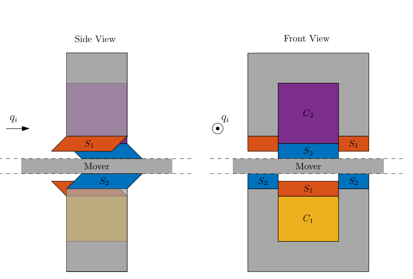
*그림 1 — [10]을 따른 피에조 스테퍼 액추에이터의 개략도(측면도·정면도). 클램프($C_1$, $C_2$)가 전단 소자($S_1$, $S_2$)를 무버에 누른다. 전단 소자가 무버와 접촉하고 있을 때 측방으로 팽창하거나 수축하여 무버를 $q_i$ 방향으로 밀거나 당긴다.*

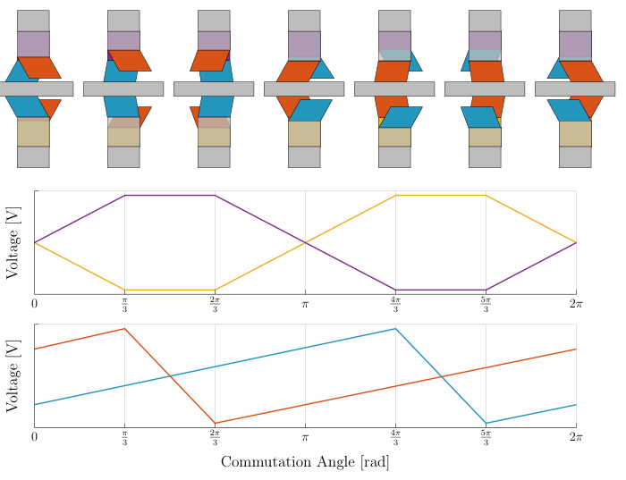
*그림 2 — [10]을 따른, 스테핑 운동을 얻기 위한 압전 소자의 전압 파형(가로축: 정류각 [rad], 세로축: 전압 [V]). 클램프(범례 기호)가 전단 소자(범례 기호)를 하나씩 무버에 누르고, 전단 소자가 무버를 측방으로 끌고 간다.*

그림 3은 두 운용 환경에서의 위치 결정 스테이지를 보여 준다. 모델 학습과 검증을 위해 정확히 같은 기하를 가진 별도의 4자유도 실험실 장치를 사용하며, 여기에는 POI에 정전용량 센서를 설치할 수 있다. 이 센서들은 $p_c \in \mathbb{R}^3$로 표기하는 직접 POI 측정값을 제공한다. EM 운용 중에는 이러한 센서를 쓸 수 없다. 대신 현미경은 $F_v = F_s/N_v$의 속도로 영상을 획득하는데, 여기서 $F_s$는 엔코더 샘플링 속도이고 $N_v$는 비전 갱신 사이의 프레임 수이다. $N_v$ 값은 카메라 모델과 획득 설정에 따라 다르며 보통 수십에서 수백 범위이다. 이 영상들을 처리하여 III-A절에 자세히 기술한 대로 평면 내 시편 이동량 추정치를 얻을 수 있다. 현미경 내부에 직접 POI 센서가 없다는 점이 이 연구의 핵심 과제 중 하나이다.

이 논문 전반에 두 가지 위치 변수가 등장한다. 엔코더 측정값 $q = [q_1, q_2, q_3]^\top \in \mathbb{R}^3$은 세 PSA에서 기록되는 선형 변위로, 센서 잡음을 포함한 실제 PSA 위치의 불완전한 관측이다. POI 좌표 $p = [p_x, p_y, p_z]^\top \in \mathbb{R}^3$은 관심점에서 시편의 직교 좌표 위치이다. 두 양 사이의 사상은 II-B절에서 논의한다.

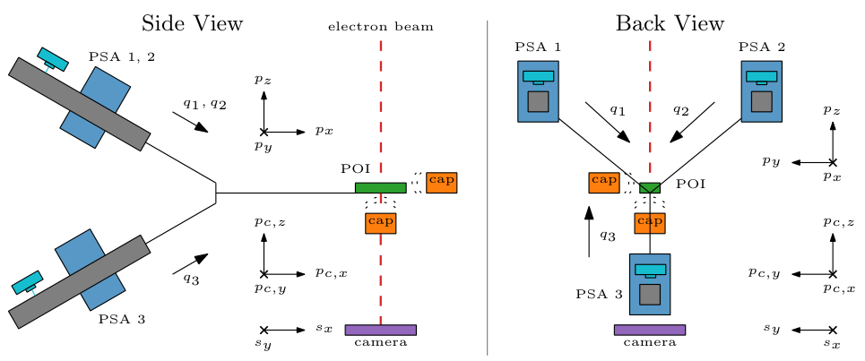
*그림 3 — 실험실 장치와 전자현미경 모두에 대한 운동 스테이지의 개략도(측면도·후면도). 정전용량 POI 센서(범례 기호)는 실험실 장치에만 있으며 $p_c$로 POI를 측정하고, 전자빔(범례 기호)과 EM 카메라(범례 기호)는 현미경에만 있으며 $p_s$로 POI를 측정한다. 세 피에조 스테퍼 축 $q_1, q_2, q_3$와 POI 위치 $p$를 함께 나타냈다.*

### B. 좌표 변환 (Coordinate Transformations)

비선형 순기구학(forward kinematics) 모델이 엔코더 측정값을 추정 POI 위치와 연결한다.

$$\hat p_0 = \Phi(q, \varphi). \tag{1}$$

여기서 $\Phi$는 기구학 모델이고 $\varphi$는 기울기 각이다. $\hat p_0$라는 표기는 이것이 실제 POI 위치 $p$가 아니라 모델 기반 추정치임을 강조한다. 모델 오차, 잡음, 동적 효과가 $\hat p_0$와 $p$ 사이의 불일치를 일으킨다. 대응하는 역기구학(inverse kinematics) 모델은 다음과 같이 표기한다.

$$\hat q = \Gamma(p, \varphi), \tag{2}$$

이는 원하는 POI 위치를 그 위치에 도달하는 데 필요한 피에조 좌표로 사상한다. 역기구학은 이후 POI 오차를 개별 피에조 좌표에 투영하는 데 사용된다(IV-B절).

기구학 사상 $\Phi$와 $\Gamma$는 스테이지의 공칭 강체 기하를 담는다. 실제 POI 위치는 여러 이유로 이 예측에서 벗어난다. 정류 중의 접촉력이 무버를 탄성 변형시켜, 정류각 $\alpha$에 대해 반복적인 준정적 엔코더–POI 오프셋을 만든다. 구조 유연성, 차등 열팽창, 기울기 의존 결합은 $\alpha$-주기적이지 않은 추가 편차를 일으킨다. 이 연구는 $\alpha$-주기적 오프셋만을 대상으로 하며, 이는 III-C절의 센서 편차로 보정된다.

### C. 문제 정의 (Problem Definition)

목표는 POI 추종 오차 $e_p(k) = r_p(k) - p(k)$를 최소화하는 것이다. 여기서 $k$는 이산 시간 샘플 인덱스, $r_p \in \mathbb{R}^3$는 원하는 POI 궤적, $p$는 실제 POI 위치이다. $p$는 현미경 내부에서 직접 측정할 수 없으므로 대신 POI 추정치 $p_e$를 사용하며, 그 형태는 운용 환경에 따라 다르고 III절에서 자세히 기술한다. 각 PSA는 개별적으로 구동되고 학습되므로, 오차는 피에조 좌표에서 평가한다. 즉 기준과 추정치를 역기구학으로 사상하여 축별로 비교한다.

$$\varepsilon_i(k) = [\Gamma(r_p(k), \varphi)]_i - [\Gamma(p_e(k), \varphi)]_i, \quad i \in \{1,2,3\}. \tag{3}$$

기구학 사상 $\Phi$는 각 고정된 $\varphi$에 대해 스테이지 작업 공간에서 가역이므로 $\Gamma$는 전단사(bijection)이며, $p_e = r_p$일 때 정확히 모든 $i$에 대해 $\varepsilon_i = 0$이다. 따라서 이 축별 오차를 0으로 만드는 것은 POI 오차를 없애는 것과 동치이다. 그러면 성능은 축별로 평균제곱근 편차(root-mean-square deviation)로 정량화한다.

$$\sigma_i = \sqrt{\frac{1}{N}\sum_{k=1}^{N}\varepsilon_i(k)^2}. \tag{4}$$

## III. POI 추정 (POI Estimation)

반복 학습 제어에는 엔코더 속도 $F_s$의 POI 오차 신호가 필요하다. 엔코더는 이 속도로 신호를 제공하지만, 정류 중의 접촉력이 무버를 탄성 변형시켜 실제 시편 위치에 대해 측정값을 편향시킨다. 이 편향을 보정하려면 보정을 학습할 기준이 되는 POI 실측 측정이 필요하다. 실험실 장치에서는 이 실측값이 정전용량 측정값 $p_c$이다. 그러한 센서가 없는 EM에서는 EM 영상에서 얻은 비전 기반 추정치 $p_s$이다. III-A절은 $p_s$를 얻는 방법을, III-B절은 기구학 사상을 보정(캘리브레이션)하는 방법을, III-C절은 학습된 보정이 엔코더 측정값을 고속 POI 대리 신호 $\hat p$로 바꾸는 방법을 기술한다.

### A. 비전 기반 위치 측정 (Vision-Based Position Sensing)

EM 영상은 평면 내 POI 정보의 독립적인 원천을 제공한다. 상호상관 기반 추적기가 연속 영상을 비교하여 평면 내 시편 변위를 추정한다[12], [13]. 추적기는 GPU에서 실행되어 카메라 프레임 속도로 처리할 수 있다[13]. 출력은 2D 프레임 간 이동량이다.

$$s(k) = [s_x(k), s_y(k)]^\top \in \mathbb{R}^2, \tag{5}$$

여기서 $k$는 카메라 프레임 인덱스이고 $s_x(k), s_y(k)$는 이전 프레임 이후 $p_x$, $p_y$ 방향 평면 내 시편 변위의 잡음 섞인 측정값이다. 추적기는 $F_v = F_s/N_v$로 샘플링되며 엔코더보다 상당히 느리다.

화소 수준 이동량을 물리적 길이 단위로 변환하는 것은 현미경의 광학 설정에 달려 있다. 평행 조명을 사용한다고 가정하면 지배적인 파라미터는 선택한 배율 값이다. 프레임 간 이동량이 크면 상관 피크가 넓어지고 이상치가 생길 수 있다. 여기서 고려하는 시편 운동은 충분히 느려서 이동량이 작게 유지되고 추적기가 신뢰할 만한 추정치를 낸다.

$s(k)$가 각 피에조 축의 운동을 얼마나 잘 포착하는지는 $\varphi$에 달려 있다. $\Phi$가 기울기를 통해 피에조 축을 평면 내 방향 및 평면 외 방향과 결합시키기 때문이다. $\varphi = 0$에서는 세 축 모두 평면 외 방향 $p_z$에 기여하므로 $s(k)$는 각 축 운동의 일부만 포착한다. $\varphi \approx \pi/6$ rad에서는 PSA 2의 축이 완전히 영상 평면에 놓여 그 전체 운동이 $s(k)$로 관측된다. $\varphi \approx -\pi/6$ rad에서는 대신 PSA 1의 축이 완전히 영상 평면에 놓인다. 보정 중에는 보정 대상 축의 포착 범위를 최대화하도록 기울기 각을 설정할 수 있다. 토모그래피 획득 중에는 $\varphi$가 영상 프로토콜로 정해지며 각 축의 포착 범위가 그에 따라 변한다.

기준 프레임 $k_0$에 대한 시편 위치는 연속된 프레임 간 이동량을 누적하여 추정한다. 추적기는 평면 내 운동만 관측하므로, 누적은 두 평면 내 좌표를 갱신하고 평면 외 좌표는 고정한다.

$$p_s(k) = p_s(k_0) + \sum_{j=k_0+1}^{k}\begin{bmatrix} s(j) \\ 0 \end{bmatrix} \in \mathbb{R}^3. \tag{6}$$

기준값 $p_s(k_0)$는 엔코더 기반 순기구학 추정치 $p_s(k_0) = \Phi(q(k_0), \varphi)$로 초기화하며, 이로써 $p_s$를 임의의 원점이 아니라 절대 POI 위치에 고정한다. 카메라 프레임 사이에는 $p_s$를 가장 최근 값으로 유지한다. 그 결과인 추정치 $p_s \in \mathbb{R}^3$는 다음 절에 기술하듯 센서 편차를 학습하기 위한 POI 실측값 역할을 한다.

### B. 기구학 보정 (Kinematic Calibration)

실제로 기구학 사상은 보정(캘리브레이션)으로 얻는다. 실험은 작업 공간의 작은 영역을 다루며, 그 영역에서 $\Phi$는 현재 기울기 각에서의 선형화로 잘 근사된다. 가용한 POI 측정을 $\bar p$로 나타내자. 실험실 장치에서는 $\bar p = p_c$, EM에서는 $\bar p = p_s$이다. $p_s$의 평면 내 성분만 측정되므로(6), EM 적합은 그 두 성분을 사용한다. 선형화를 식별하기 위해, $\bar p$와 $q$를 기록하면서 세 PSA를 모두 변위시키는 보정 이동을 수행한다. 두 신호를 샘플 $k_0$에서 이동 시작 시점에 대한 상대값으로 표현하면 좌표계 사이의 상수 오프셋이 제거되며, 선형화된 순사상은 다음 최소제곱 적합으로 구한다.

$$\hat K = \arg\min_{K}\sum_{k=1}^{N_K}\left\|\bar p(k) - \bar p(k_0) - K\big(q(k) - q(k_0)\big)\right\|_2^2, \tag{7}$$

여기서 $N_K$는 기록된 샘플 수이다. 적합 결과는 실험실 장치에서 $\hat K \in \mathbb{R}^{3\times3}$, EM에서 $\hat K \in \mathbb{R}^{2\times3}$이다.

실험실 장치에서는 $\hat K$가 가역이며, $[\Gamma(\bar p, \varphi)]_i$는 $\hat K^{-1}$의 $i$번째 행을 $\bar p - \bar p(k_0)$에 적용하고 $q_i(k_0)$를 더해 계산한다. EM에서는 $\hat K$의 역행렬이 없다. 측정된 두 성분으로는 세 피에조 좌표를 분리할 수 없기 때문이다. 그러나 모든 실험에서 한 번에 하나의 PSA만 스테핑하며, 그 운동은 측정에서 $\hat K$의 대응하는 열 $\kappa_i$를 따라 나타난다. 따라서 이 열에 투영하여 피에조 좌표를 복원하며, 행 벡터 $\kappa_i^\top/\|\kappa_i\|_2^2$가 $\hat K^{-1}$의 $i$번째 행을 대신한다. 이 복원은 PSA $i$ 단독 운동에 대해서는 정확하며, 여러 PSA를 동시에 스테핑하려면 평면 외 측정이 필요하다(III-A절).

### C. 엔코더 기반 POI 추정 (Encoder-Based POI Estimation)

엔코더 측정값에 순기구학 (1)을 적용하면 전체 엔코더 속도 $F_s$로 얻을 수 있는 기준 추정치 $\hat p_0 = \Phi(q, \varphi)$가 나온다. 그러나 이 추정치는 정류 중에 생기는 클램핑 유발 굽힘 효과를 고려하지 않는다. 클램프가 무버를 맞물리면, 그 결과 생기는 접촉력이 그림 4에 보인 것처럼 무버를 약간 변형시킨다. 엔코더가 무버 끝에 있지 않으므로 이 변형을 포착하지 못하며, 엔코더 측정값과 실제 POI 위치 사이에 불일치가 생긴다. 이 효과는 준정적이다. 즉 현재 정류각에는 의존하지만 스테핑 속도에는 의존하지 않으며, 이는 그림 5의 데이터로 확인된다.

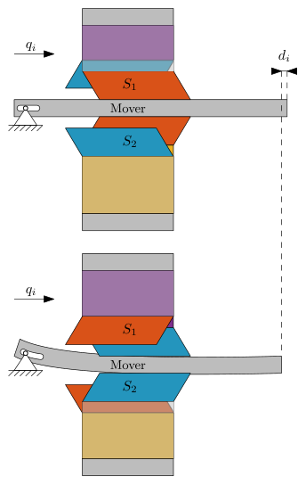
*그림 4 — 클램프 맞물림 중 굽힘 효과의 예시. 클램프와 전단 소자 사이의 접촉력이 국부 변형을 일으켜 무버의 유효 길이를 줄인다. 엔코더가 PSA에 위치하므로 이 변형을 포착하지 못하며, 그 결과 측정 위치와 실제 위치 사이에 정류각 의존 불일치가 생긴다.*

이 불일치를 보정하기 위해, 순기구학을 계산하기 전에 피에조 좌표에서 센서 편차를 적용한다. 변형이 정류각에 의존하므로 편차는 $\alpha$의 함수로 매개변수화한다.

$$\hat p = \Phi\big(q + \Delta(\alpha), \varphi\big), \tag{8}$$

여기서 $\Delta(\alpha) = [\Delta_1(\alpha_1), \Delta_2(\alpha_2), \Delta_3(\alpha_3)]^\top \in \mathbb{R}^3$은 PSA마다 하나씩 세 개의 스칼라 편차 함수를 모은 것이다. 각 $\Delta_i : [0, 2\pi) \to \mathbb{R}$는 PSA $i$의 정류각을 그 엔코더 측정값의 스칼라 보정으로 사상하는, 조회표(lookup table)에 저장된 구간별 선형 함수이다. 이 스칼라 함수들은 아래에서 자세히 기술하듯 POI 추정 잔차를 역기구학 $\Gamma$ (2)를 통해 개별 피에조 축에 투영하여 얻는다. 독립적인 PSA별 기여로의 분해는 스테이지의 물리적 구조로 뒷받침된다. 세 무버는 기계적으로 분리되어 있으므로 PSA $i$의 접촉력은 다른 두 무버에 굽힘 변형을 전파하지 않는다. 또한 $p$가 아닌 $q$를 보정하면 보정이 PSA당 스칼라로 유지되는 반면, POI 공간의 보정은 3성분 벡터가 필요하다.

센서 편차는 POI 측정 $\bar p$로부터 학습한다. 각 PSA $i$에 대해, PSA $i$가 스테핑하고 나머지는 정지해 있는 동안 여러 정류 주기에 걸쳐 $\bar p$와 엔코더 측정값 사이의 불일치를 기록한다. $p_s$는 엔코더보다 느리게 샘플링되지만, 기록이 많은 정류 주기에 걸치므로 샘플들이 전체 $\alpha$ 격자를 덮는다. 역기구학 $\Gamma$ (2)를 통해 POI 잔차를 피에조 축 $i$로 변환하면 원시 잔차를 얻는다.

$$d_i(k) = [\Gamma(\bar p(k), \varphi)]_i - q_i(k). \tag{9}$$

센서 편차는 기저 함수의 선형 결합으로 매개변수화한다.

$$\Delta_i(\alpha_i) = \psi_\Delta^\top(\alpha_i)\,\theta_{\Delta,i}, \tag{10}$$

여기서 $\psi_\Delta(\alpha_i) \in \mathbb{R}^{n_\Delta}$는 $n_\Delta$개의 기저 함수를 모은 것이고 $\theta_{\Delta,i} \in \mathbb{R}^{n_\Delta}$는 계수이다. 실제로는 단순성과 해석 가능성을 위해 $[0, 2\pi)$의 $n_\Delta$개 등간격 격자점 위의 구간별 선형 기저 함수를 사용한다. 기록된 $N_\Delta$개 샘플 전체에 대한 기저 함수 값을 쌓으면 행렬 $\Psi_\Delta = [\psi_\Delta(\alpha_i(1)), \ldots, \psi_\Delta(\alpha_i(N_\Delta))]^\top \in \mathbb{R}^{N_\Delta\times n_\Delta}$를 얻고, 잔차 샘플을 쌓으면 $\mathbf{d}_i \in \mathbb{R}^{N_\Delta}$를 얻는다. 계수는 잔차 제곱을 최소화하여 구한다.

$$\theta_{\Delta,i} = \arg\min_{\theta\in\mathbb{R}^{n_\Delta}}\sum_{k=1}^{N_\Delta}\big(d_i(k) - \psi_\Delta^\top(\alpha_i(k))\,\theta\big)^2. \tag{11}$$

모델이 파라미터에 대해 선형이므로, 최소화는 다음 닫힌 형태의 해를 가진 표준 선형 최소제곱 문제로 귀결된다.

$$\theta_{\Delta,i} = (\Psi_\Delta^\top\Psi_\Delta)^{-1}\Psi_\Delta^\top\mathbf{d}_i. \tag{12}$$

그림 5는 실험실 장치의 대표 PSA 하나에 대한 원시 잔차와 학습된 적합을 보인다.

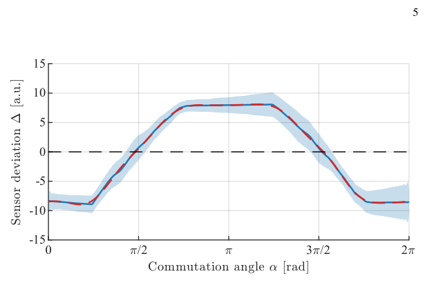
*그림 5 — 한 PSA에 대해 정류각 $\alpha_i$에 따른 평균 투영 엔코더–POI 잔차 $d_i$ (9)(범례 기호)와 학습된 구간별 선형 센서 편차 $\Delta_i(\alpha_i)$ (10)(범례 기호). 음영 영역은 잔차 샘플의 $\pm\sigma$를 나타낸다.*

센서 편차를 포함하면 잔차 $\bar p - \hat p$가 기준 잔차 $\bar p - \hat p_0$에 비해 크게 줄어들며, 이는 준정적 굽힘이 불일치의 지배적 원천임을 확인해 준다. 남은 잔차는 정적 보정으로는 포착되지 않는 유연 모드 진동 같은 모델링되지 않은 효과에 기인한다.

## IV. 피드포워드 제어 설계 (Feedforward Control Design)

그림 6은 제어 구조의 블록 선도를 보인다. 선도에서 $d_q$는 정렬 오차와 인계(handover) 과도 현상처럼 엔코더 측정값 $q$에 반영되는 액추에이터 수준의 외란을 나타내고, $d_p$는 클램프 유발 굽힘, 열 표류, 유연 모드 진동처럼 엔코더가 포착하지 못하는 액추에이터와 POI 사이의 외란을 나타낸다. 이 연구에서 제안하는 제어는 전적으로 피드포워드이며, 압전 소자에 인가되는 전압을 생성하는 정류(commutation) 블록 안에서 작동한다. 여기서 두 가지 수정이 이루어진다. 소자별 히스테리시스 보상(IV-A절)은 각 소자의 전압-변위 비선형성을 역변환한다. 그런 다음 정류각 영역 ILC(IV-B절)가 그림 2의 공칭 정류 파형을 수정하여 스테핑의 반복적인 $\alpha$-주기 외란을 상쇄한다. 위의 외란 중 피드포워드는 $\alpha$-주기 부분만 상쇄한다. 즉 정렬 오차와 인계 과도 현상은 ILC로, 클램프 유발 굽힘은 센서 편차로 상쇄한다. 두 구성 요소 모두 오프라인으로 보정된다.

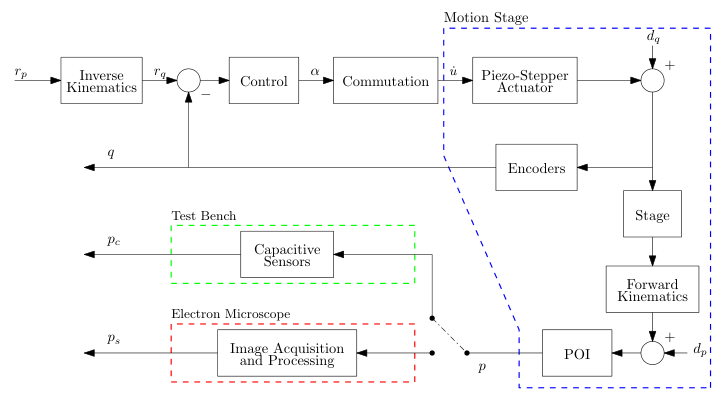
*그림 6 — 시스템의 신호 흐름을 보이는 블록 선도. POI 기준 $r_p$를 역기구학 $\Gamma$에 넣어 피에조 기준 $r_q$를 얻는다. 이 기준은 저수준 제어기가 추종한다. PSA는 정류 블록에서 전압 신호를 받으며, 이 블록에는 히스테리시스 보상과 ILC로 수정된 파형이 포함될 수 있다. 엔코더 신호 $q$는 피에조 위치의 측정값을 제공하며, POI 위치 $p$는 실험실 장치에서는 정전용량 센서로 $p_c$로서 직접 측정되거나, 현미경에서는 EM 영상으로부터 $p_s$로서 추정된다.*

### A. 피에조별 히스테리시스 보상 (Per-Piezo Hysteresis Compensation)

압전 재료의 히스테리시스는 인가 전압과 소자 변위 사이에 비선형적이고 이력 의존적인 관계를 만든다. 파형 생성기는 원하는 변위를 인가 전압으로 정확히 변환하기 위해 이 관계를 역변환해야 한다. 이 역변환은 IV-B절 ILC의 전제 조건이다. ILC는 정류각 $\alpha$에 대해 주기적인 외란을 보정하지만, 보상되지 않은 히스테리시스는 $\alpha$가 아니라 전압 이력에 의존하는 오차를 도입한다. 이러한 이력 의존 오차는 $\alpha$-주기적이지 않으므로 ILC 오차 신호를 오염시킨다[10].

보상은 세 PSA 각각에 독립적으로 적용되며, 각 PSA는 여러 압전 소자를 포함한다. [10]을 따라, 클램프 소자는 운동 방향별로 따로 다루고 전단 소자는 방향과 무관하게 다룬다. 모든 소자가 같은 구조이므로 모델 구조와 식별 절차는 모든 소자에 대해 동일하다. 아래 식은 일반적인 단일 소자에 대해 쓰므로 간결함을 위해 PSA 및 소자 인덱스를 생략한다.

소자의 전압-변위 관계는 하나의 곡선이 아니라 루프를 그린다. 이러한 루프는 연산자 기반 Preisach [4] 및 Prandtl–Ishlinskii [5] 모델부터 Ramberg–Osgood 모델[14] 같은 대수적 기술까지 다양한 모델로 포착된다. 피에조 스테퍼의 경우 루프는 가장 최근의 반전(reversal)에 의해 정해지므로, 관련 이력은 시각 $\bar t$의 그 반전 이후 전압의 편위(excursion)이다.

$$h(t) = |u(t) - u(\bar t)| \tag{13}$$

[6]의 메모리 소자(memory-element) 모델을 따라, 변위 속도는 이 이력에 의존하는 증분 이득으로 스케일된 전압 속도이다.

$$\dot y = M(h)\,\dot u, \tag{14}$$

여기서 $y$는 소자 변위, $u$는 인가 전압, $M > 0$은 증분 이득이다. 이는 그 메모리 소자 모델의 특수한 경우로, 각 가지(branch)에서 Ramberg–Osgood 히스테리시스와 일치한다.

개별 소자의 변위는 측정되지 않으므로 이득을 직접 측정할 수는 없다. 변위 속도가 전류에 비례하므로($\dot y = \xi\,\iota$, $\xi$는 미지 상수[15]) 소자 전류가 변위를 대신한다. 증분 모델 (14)에 사용하면, 전류 대 전압 속도의 비는 $\xi$를 제외하고 이득을 따른다.

$$m := \left|\frac{\iota}{\dot u}\right| \approx \frac{M}{\xi}, \tag{15}$$

샘플별 값은 $m(k)$이다. 이 대리 변수는 소자 자신의 전압과 전류만 사용하므로, 각 소자를 따로 식별할 수 있고 위치 측정이 필요 없다.

이득을 식별하기 위해, 각 소자를 0.1 Hz에서 50 Hz까지의 구동 주파수에 걸친 정상상태 전압 스윕으로 개루프 구동하면서 전압과 전류를 기록한다. 그림 7은 그 결과인 대리 변수 $m$을 이력 $h$에 대해 보인다. 측정값은 $h$에 대한 하나의 아핀 경향을 따르며, $R^2$는 클램프에서 0.944~0.985, 전단 소자에서 0.946~0.952이므로 이득의 속도 의존성은 작다. 다음 아핀 이득을 채택한다.

$$\hat M(h) = \theta_1 h + \theta_2, \tag{16}$$

절편 $\theta_2 > 0$은 반전 직후의 이득이고, 기울기 $\theta_1 \ge 0$은 편위 $h$에 따라 이득이 커지는 비율이다. 스윕이 여러 전압 속도에 걸쳐 있는데도 이 하나의 경향을 공유하므로, 여기서는 속도 무관 이득으로 충분하다. 이 아핀 이득은 전압 속도에 대한 의존성을 제거하여 [10]의 속도 의존 모델을 단순화한다.

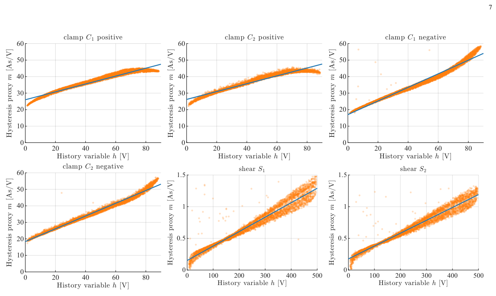
*그림 7 — 클램프 및 전단 소자에 대해 이력 변수 $h$ (18)에 대해 측정한 히스테리시스 대리 변수 $m$ (15). 각각 여러 구동 주파수에서 기록한 샘플을 합쳤으며(범례 기호), 아핀 적합 (16)(범례 기호)을 함께 나타냈다. (패널: clamp $C_1$/$C_2$ positive, clamp $C_1$/$C_2$ negative, shear $S_1$, shear $S_2$)*

이산 시간에서 소자 관계는 다음과 같다.

$$y(k) - y(k-1) = M\big(h(k)\big)\big(u(k) - u(k-1)\big), \tag{17}$$

샘플 $k$에서의 이력은

$$h(k) = \big|u(k) - u(\bar k)\big|, \tag{18}$$

이며 $\bar k$는 가장 최근 반전 샘플이다. $\hat M$의 파라미터는 최소제곱으로 대리 변수에 적합한다.

$$(\hat\theta_1, \hat\theta_2) = \arg\min_{(\theta_1,\theta_2)\in\mathbb{R}^2}\sum_{k=1}^{N_M}\big(m(k) - \theta_1 h(k) - \theta_2\big)^2, \tag{19}$$

이는 기록된 $N_M$개 샘플에 대한 것이며, $\dot u \approx 0$이어서 $m(k)$를 신뢰할 수 없는 반전 근처의 샘플은 제외한다. 위의 클램프·전단 구분에 따라, 각 클램프 소자는 두 스테핑 방향에 대해 따로 적합하고, 각 전단 소자는 하나의 파라미터 쌍으로 적합한다.

(17)을 역변환하고 $M$ 대신 식별된 $\hat M$을 사용하면 피드포워드 제어 법칙을 얻는다.

$$u(k) = u(k-1) + \frac{r(k) - r(k-1)}{\hat M\big(h(k-1)\big)}, \tag{20}$$

여기서 $r(k)$는 (ILC로 수정되었을 수 있는) 파형에서 나오는 기준 변위이다. $h(k)$는 인가되기 전의 전압 $u(k)$에 의존하므로, $h(k)$ 대신 이전 샘플의 이력 변수 $h(k-1)$을 사용한다.

대리 변수 (15)는 $\hat M$을 미지 상수 $\xi$를 제외하고만 식별하므로, 제어 법칙 (20)은 같은 스케일을 제외하고 의도한 변위에 도달한다. 이 스케일은 실제로 문제가 되지 않는다. 기준 $r$이 같은 단위를 가지며, 인가 전압이 한 정류 스텝 동안 소자의 전체 범위를 덮도록 그 진폭을 설정하므로 $\xi$가 기준에 흡수되기 때문이다[10].

### B. α 영역 외란 보상을 위한 ILC (ILC for α-Domain Disturbance Compensation)

[10]에서는 정전용량 센서로부터 얻은 무버 위치 오차를 사용해 하나의 PSA에 대해 하나의 보상 함수를 학습했다. 이 절에서는 보상 함수를 순차적으로 학습하여 접근법을 세 PSA로 확장한다. 각 PSA를 나머지가 정지해 있는 동안 개별적으로 보정하므로, POI 오차를 구동 중인 PSA에 모호함 없이 귀속시킬 수 있다. POI 오차는 고속 대리 신호 $\hat p$(III-C절)에서 얻어 역기구학을 통해 피에조 좌표에 투영한다.

ILC 보정은 전단 파형만 수정한다. 클램프 파형은 접촉 타이밍을 제어하며 ILC로 조정하지 않는다. 어느 시점에서든 하나의 전단 소자만 무버와 접촉하므로, 하나의 스칼라 보상 함수가 두 전단 파형을 동시에 수정한다. 양의 스테핑 방향과 음의 스테핑 방향에 대해 별도의 함수를 학습하므로, 세 PSA 전체에서 보상 함수는 모두 여섯 개이다.

PSA $i$를 보정하는 동안에는 그 PSA만 움직이고 다른 두 PSA는 정지해 있다. ILC는 POI 대리 신호 $p_e = \hat p$에서 계산한 (3)의 투영 오차 $\varepsilon_i$를 사용한다. PSA $i$만 움직이므로 이 오차는 그 PSA의 기여를 분리하며, 다른 두 좌표의 오차는 (측정 잡음과 기구학적 결합을 제외하면) 0 근처에 머물고 학습에 사용하지 않는다. 이 순차적 접근은 보정 절차를 단순화하고 각 보상 함수가 자기 PSA의 외란만 다루도록 보장한다.

IV-A절에서처럼 학습 절차는 모든 보상 함수에 대해 동일하므로, 아래 식은 일반적인 단일 경우에 대해 쓴다. PSA와 방향 인덱스는 생략하며 $\varepsilon$은 고려 중인 PSA의 투영 오차 $\varepsilon_i$를 나타낸다. ILC는 개루프 방식으로 수행된다. 피에조는 정류 주기를 일정한 속도로 걸어가며, 측정값은 다음 시행(trial)을 위한 피드포워드 보상을 갱신하는 데에만 쓰인다.

수정된 파형은 다음과 같다.

$$\tilde\rho(\alpha) = \rho(\alpha) + f(\alpha), \tag{21}$$

여기서 $\rho$는 공칭 파형이고 $f$는 학습된 보정이다. 보정이 시간이 아니라 $\alpha$로 매개변수화되므로, 한 스테핑 속도에서 학습한 보정은 스테이지가 준정적으로 거동하는 다른 모든 속도에 적용된다. 이렇게 수정된 파형을 IV-A절의 히스테리시스 보상과 함께 사용하면, 결과 소자 변위가 수정된 기준을 근사적으로 추종하고 무버가 의도한 궤적을 더 정확히 따른다.

시행 $j$에 대한 갱신 법칙은 다음과 같다.

$$f_{j+1}(k) = Q(z)\big(f_j(k) + L(z)\,\varepsilon_j(k)\big), \tag{22}$$

여기서 $Q$는 강건성 필터, $L$은 학습 필터이고, $G$는 소자 파형 수정 $f$에서 투영 PSA 오차 $\varepsilon$까지의 플랜트 전달을 나타낸다. (22)를 시스템에 대입하면 시행 간 오차 동역학 $\varepsilon_{j+1} = Q(1 - LG)\,\varepsilon_j$를 얻는다[8]. $L = G^{-1}$이고 $Q = 1$이면 인자 $(1 - LG)$가 사라져 초기 오차와 무관하게 $\varepsilon_{j+1} = 0$이 되므로, 한 번의 시행으로 완전한 보상이 달성된다. 그러나 실제로는 $G$를 완벽히 알 수 없고 $L$은 $G^{-1}$을 근사할 수밖에 없으므로, 모델 불일치에도 수렴을 보장하도록 $Q$를 설계해야 한다.

(22)의 단조 수렴을 위한 충분 조건은 다음과 같다[8].

$$\sup_{\omega\in[0,\pi]}\left|Q(e^{j\omega})\big(1 - L(e^{j\omega})\,G(e^{j\omega})\big)\right| < 1. \tag{23}$$

학습 필터는 $L = \hat G^{-1}$로 설정하며, 여기서 $\hat G$는 $G$의 파라메트릭 모델이다(아래에서 식별). 이상적으로는 학습된 보정을 모두 유지하기 위해 $|Q|$가 모든 곳에서 1에 가까워야 한다. 그러나 $\hat G$가 $G$에서 벗어나는 주파수에서는 인자 $(1 - LG)$가 더 이상 작지 않으며 $|Q| = 1$이면 (23)을 위반할 수 있다. 많은 응용에서 모델은 저주파에서 가장 정확하므로, $Q$를 저역통과 Butterworth 필터로 설계한다. 실제 시스템 거동을 더 가깝게 반영하기 위해, 수렴 조건은 측정 데이터에서 얻은 비파라메트릭 주파수 응답 $\bar G(e^{j\omega})$(아래 참조)에서 평가한다.

전단 소자 플랜트 모델은 [10]을 따라 최적 선형 근사(best-linear-approximation, BLA) 절차[16]로 식별한다. 정류각 $\alpha$를 무작위 위상 멀티사인(random-phase multisine) 신호로 섭동하고, 그 결과 변위를 보정된 엔코더 추정치 $\hat p$로 측정한다. BLA는 이 입출력 데이터로부터 비파라메트릭 주파수 응답 $\bar G(e^{j\omega})$를 추출하고, 여기에 저차 파라메트릭 모델 $\hat G$를 적합한다.

**비고 1 (Remark 1).** ILC는 피에조 좌표에서 작동한다. 투영 오차 $\varepsilon_i$와 파형 보정 $f$가 모두 $q$-영역에 있기 때문이다. 따라서 플랜트 모델 $\hat G$는 학습에 사용하는 센서 편차 보정 출력과 일관되게 식별해야 한다. 기록된 출력은 원시 엔코더 측정값 $q_i$가 아니라 투영된 보정 추정치 $[\Gamma(\hat p, \varphi)]_i$이며, 따라서 $\hat G$는 파형 수정에서 투영된 보정 오차까지의 전달을 포착한다. 두 출력은 가진 변수인 정류각 $\alpha$의 정적 함수 $\Delta_i(\alpha_i)$만큼 다르다. 정적 (비선형) 사상은 최적 선형 근사에 기껏해야 실수이고 주파수 무관한 상수를 기여하며, 나머지 효과는 $\bar G$의 분산만 높이는 확률적 비선형 왜곡이다[16]. 따라서 $\Delta_i$는 $\hat G$에 주파수 의존 동역학을 도입하지 않는다. $\hat G$ 식별과 ILC 실행 모두에 같은 보정 출력을 사용하므로, 이 상수는 $L = \hat G^{-1}$에 일관되게 흡수되며 수렴 조건 (23)은 영향을 받지 않는다.

(22)의 시간 영역 신호 $f_{j+1}(k)$는 $\alpha$의 함수로 변환해야 한다. 보상 함수는 기저 함수의 선형 결합으로 매개변수화한다.

$$f(\alpha) = \psi_f^\top(\alpha)\,\gamma, \tag{24}$$

여기서 $\psi_f(\alpha) \in \mathbb{R}^{n_f}$는 $n_f$개의 기저 함수를 모은 것이고 $\gamma \in \mathbb{R}^{n_f}$는 계수이다. 실제로는 $[0, 2\pi)$의 $n_f$개 등간격 격자점 위의 구간별 선형 기저 함수를 사용한다. 각 ILC 갱신 (22) 후에, 가중 잔차 제곱을 최소화하여 시간 영역 신호를 이 기저에 투영한다.

$$\gamma_{j+1} = \arg\min_{\gamma\in\mathbb{R}^{n_f}}\left\|\hat{\mathbf{G}}(\Psi_f\gamma - \mathbf{f}_{j+1})\right\|_2^2, \tag{25}$$

여기서 $\Psi_f = [\psi_f(\alpha(1)), \ldots, \psi_f(\alpha(N))]^\top$는 기저 함수 값을 쌓은 것이고, $\hat{\mathbf{G}}$는 $\hat G$의 리프티드(lifted) 임펄스 응답 행렬이며, $\mathbf{f}_{j+1}$은 시간 영역 신호 $f_{j+1}(k)$를 쌓은 것이다([10] 참조). 이 최소화는 (12)와 같은 구조이며 해는 다음과 같다.

$$\gamma_{j+1} = (\Psi_f^\top\hat{\mathbf{G}}^\top\hat{\mathbf{G}}\Psi_f)^{-1}\Psi_f^\top\hat{\mathbf{G}}^\top\hat{\mathbf{G}}\,\mathbf{f}_{j+1}. \tag{26}$$

$\hat{\mathbf{G}}$를 앞에 곱하면 투영이 보상 신호 자체가 아니라 예측 출력 오차를 최소화하게 된다. 기저 매개변수화와 투영은 수렴 해석을 바꾼다. 결합된 방식 (22)–(26)의 단조 수렴에 대한 정확한 필요충분조건은 $\Psi_f$와 $\hat{\mathbf{G}}$ 모두를 포함한다[10, Lemma 4.1], [17]. 그러나 [10, Theorem 4.2]는 주파수 영역 조건 (23)이 기저 선택과 무관하게 충분함을 보이므로, 여기서는 필터 설계에 그 조건을 사용한다. 그림 8은 각 PSA의 측정 FRF $\bar G$에서 (23)을 검증하며, 여기에는 대표 PSA에 대해 보인다. $Q$의 차단 주파수는 $|Q(1 - L\bar G)| < 1$을 유지하면서 가능한 한 높게 설계한다.

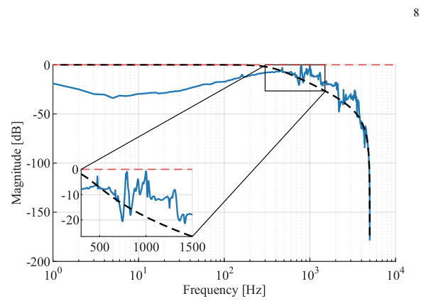
*그림 8 — 대표 PSA에 대한 ILC 수렴 조건 (23)의 검증. $|Q(1 - L\bar G)|$(범례 기호), $|Q|$(범례 기호), 0 dB 문턱(범례 기호)을 나타냈다. 삽입 그림은 여유가 가장 작은 1 kHz 부근을 확대한 것이며, 조건은 전체 주파수 범위에서 만족된다.*

## V. 실험 결과 (Experimental Results)

이 절에서는 프레임워크를 먼저 실험실 장치에서, 다음으로 실제 운용 중인 전자현미경에서 실험적으로 평가한다. 아래 결과의 모든 변위량은 임의 단위(arbitrary units, a.u.)로 보고하며, 이는 모든 그림과 값에 일관되게 적용한 하나의 고정 스케일링으로 얻은 것이다.

전반에 걸쳐 추종 오차는 피에조 좌표에서 평가한다. 한 번에 하나의 PSA만 스테핑하므로 그 오차는 하나의 스칼라이며, (3)에서처럼 위치 신호를 역기구학을 통해 그 PSA의 좌표에 투영하고 피에조 기준을 빼서 얻는다. 이 스칼라를 세 가지 위치 신호, 즉 원시 엔코더 추정치 $\hat p_0$, 센서 편차 보정 후 엔코더 추정치 $\hat p$, 그리고 실제 POI 측정값(실험실 장치에서는 정전용량 측정값 $p_c$, 현미경에서는 비전 기반 추정치 $p_s$)에 대해 보고한다. 실험실 장치에서는 세 PSA 모두에 대해 프레임워크를 보정했으며 개선 정도는 세 PSA에서 비슷하다. 따라서 아래 결과는 실험실 장치와 현미경 모두에서 대표 PSA 하나에 초점을 맞춘다. EM에서는 기울기 각 선택으로 그 축을 영상 평면에 정렬하므로(III-A절), 평면 내 영상 이동량이 그 축의 전체 운동을 관측한다.

실험 전반에서 네 가지 피드포워드 전략을 비교한다. 이들의 차이는 어떤 보상기가 활성화되어 있느냐에 있다.

- S1: 상수(보상되지 않은) 히스테리시스 모델과 수정되지 않은 공칭 파형 $\rho$를 쓰는 기존 피드포워드, 즉 $\hat M(h) = 1$, $\Delta(\alpha) = 0$, $f(\alpha) = 0$.
- S2: 속도 무관 히스테리시스 보상만 적용(IV-A절), $\Delta(\alpha) = 0$, $f(\alpha) = 0$.
- S3: 히스테리시스 보상과 ILC 적용, 센서 편차 보정 없음: $\Delta(\alpha) = 0$.
- S4: 전체 프레임워크: 히스테리시스 보상, 센서 편차 보정, ILC.

### A. ILC 수렴 (ILC Convergence)

ILC 보상은 구동 주파수 2 Hz에서 학습한다. 실험실 장치에서는 각 PSA에 대해 차례로, EM에서는 대표 PSA에 대해 학습한다. 보정이 $\alpha$로 매개변수화되므로, 이후 시험한 전체 주파수 범위에 걸쳐 적용된다. 그림 9는 실험실 장치의 대표 PSA에 대해 두 스테핑 방향 모두에서 연속된 ILC 시행에 따른 투영 추종 오차 $\varepsilon_i$ (3)의 RMSD를 보인다. 모든 시행에서 히스테리시스 보상이 활성화되어 있다.

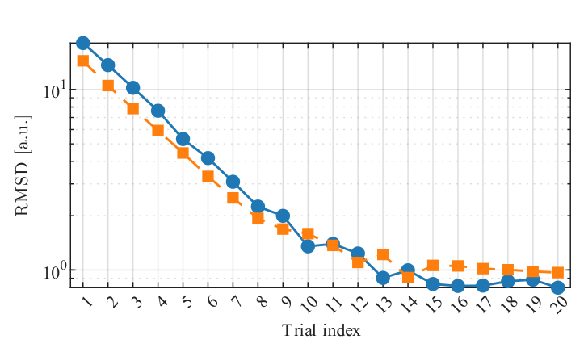
*그림 9 — ILC 시행 인덱스에 따른 투영 추종 오차 $\varepsilon_i$ (3)의 RMSD. 정방향 스테핑(범례 기호)과 역방향 스테핑(범례 기호)을 겹쳐 나타냈다. 모든 시행에서 히스테리시스 보상이 활성화되어 있다.*

### B. 실험실 장치에서의 위치 결정 성능 (Positioning Performance on the Lab Setup)

그림 10은 실험실 장치에서 0.1 Hz~10 Hz의 구동 주파수에 대해 전략 S1, S2, S3, S4의 정류각에 따른 POI 추종 오차를 비교한다. 그림 11은 구동 주파수별 오차를 요약한다.

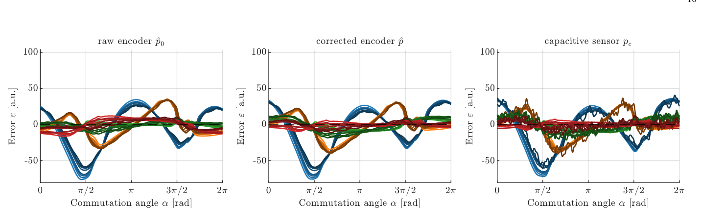
*그림 10 — 실험실 장치에서 정류각 $\alpha_i$에 따른 평균 투영 추종 오차 $\varepsilon_i$ (3)(양의 스테핑 방향). 왼쪽부터 $\hat p_0$(원시 엔코더), $\hat p$(센서 편차 보정 엔코더), $p_c$(정전용량 POI)로 평가했다. 각 패널은 전략 S1, S2, S3, S4(각 범례 기호)를 보이며, 선은 0.1 Hz(가장 밝음)에서 10 Hz(가장 어두움)로 갈수록 어두워진다.*

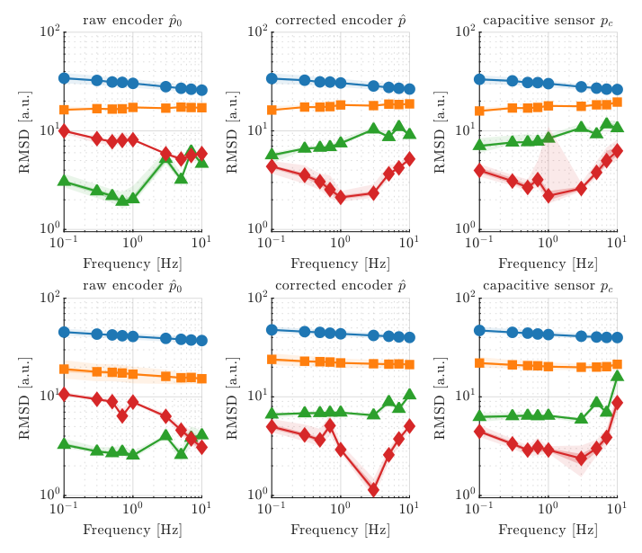
*그림 11 — 구동 주파수에 따른 투영 추종 오차 $\varepsilon_i$ (3)의 RMSD: S1, S2, S3, S4(각 범례 기호). 같은 색의 음영 띠는 반복 스텝에 대한 IQR과 5~95 백분위 범위를 나타낸다. 윗줄: 양의 스테핑, 아랫줄: 음의 스테핑. 각 줄에서 패널은 왼쪽부터 $\hat p_0$, $\hat p$, $p_c$에 해당한다.*

그림들로부터, 각 피드포워드 구성 요소가 POI 추종 개선에 기여함을 알 수 있다. 구동 주파수 1 Hz에서, 정전용량 센서로 측정한 POI RMSD는 양의 스테핑 방향에서 기존 전략 S1의 35.5 a.u.에서 전체 프레임워크 S4의 2.7 a.u.로, 음의 방향에서 48.5 a.u.에서 3.5 a.u.로 떨어진다. 각각 13배와 14배 감소이며, 같은 경향이 시험한 구동 주파수 전반에서 유지된다(그림 11). 시험한 가장 높은 구동 주파수에서는 S3와 S4의 성능이 약간 떨어지는데, 이는 주로 준정적 피드포워드가 대상으로 하지 않는 스테이지의 유연 모드 거동 때문이다.

그림 10은 또한 전략 S4의 원시 엔코더 오차가 S3보다 나쁘다는 것을 보여 준다. 이는 의도된 것이다. 센서 편차 보정을 ILC와 결합하면 엔코더 수준에서 형상화된(shaped) 0이 아닌 오차가 생기지만, 실제 제어 목표인 POI에서 오차를 줄이는 것이 바로 이 형상화된 오차이다.

### C. EM에서의 위치 결정 성능 (Positioning Performance on the EM)

위의 실험실 장치 결과는 POI의 정전용량 실측값을 사용해 피드포워드 구성 요소(히스테리시스 보상, 센서 편차, ILC)를 확인한다. EM에서는 실험실 장치와 같은 절차를 따라 피드포워드 모델을 재식별한다. 히스테리시스는 소자 전압과 전류로부터, 센서 편차는 $p_s$로부터, ILC 보상은 보정된 엔코더 추정치 $\hat p$로부터 식별한다.

그림 12는 실험실 장치에 대한 그림 10과 유사하게, EM 스테이지의 대표 PSA에 대해 0.5 Hz~2 Hz의 구동 주파수에서 정류각 $\alpha_i$의 함수로서 투영 추종 오차 $\varepsilon_i$를 보인다. EM의 잔차 구조는 실험실 장치의 것을 그대로 반영하며, 같은 물리적 효과가 존재하고 모델링 접근법이 실제 운용 현미경으로 이전됨을 확인해 준다. 그림 13은 실험실 장치에 대한 그림 11과 같은 방식으로, 구동 주파수에 따른 EM 추종 오차를 요약한다. 1 Hz에서 전체 프레임워크 S4는 POI RMSD를 양의 스테핑 방향에서 32.7 a.u.에서 4.7 a.u.로, 음의 방향에서 55.2 a.u.에서 4.7 a.u.로 줄여, 7배와 12배 감소를 보인다. 개선은 시험한 구동 주파수 전반에서 일관된다. 실험실 장치에 비해 약간의 성능 저하가 관찰되는데, ILC 기여에서만 그렇다. 이는 위치 의존 스테이지 동역학 때문이다. ILC 보상은 스테이지 원점(home) 위치에서 학습하는 반면, 비전 기반 검증은 다른 스테이지 위치에서 시편을 촬영해야 한다.

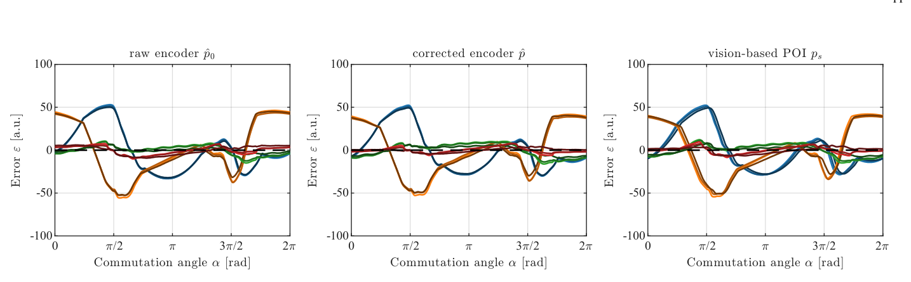
*그림 12 — EM 스테이지에서 정류각 $\alpha_i$에 따른 평균 투영 추종 오차 $\varepsilon_i$ (3)(양의 스테핑 방향). 왼쪽부터 $\hat p_0$(원시 엔코더), $\hat p$(센서 편차 보정 엔코더), $p_s$(비전 기반 POI)로 평가했다. 각 패널은 전략 S1, S2, S3, S4(각 범례 기호)를 보이며, 선은 0.5 Hz(가장 밝음)에서 2 Hz(가장 어두움)로 갈수록 어두워진다.*

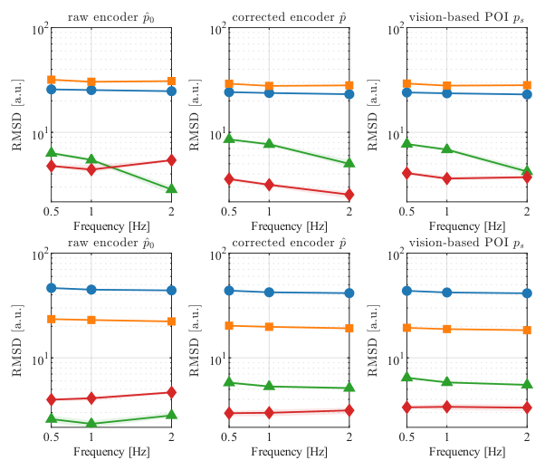
*그림 13 — EM 스테이지에서 구동 주파수에 따른 투영 추종 오차 $\varepsilon_i$ (3)의 RMSD: S1, S2, S3, S4(각 범례 기호). 같은 색의 음영 띠는 반복 스텝에 대한 IQR과 5~95 백분위 범위를 나타낸다. 윗줄: 양의 스테핑, 아랫줄: 음의 스테핑. 각 줄에서 패널은 왼쪽부터 $\hat p_0$, $\hat p$, $p_s$에 해당한다.*

## VI. 결론 (Conclusion)

이 논문은 실제 운용 중인 전자현미경에서 정밀 시편 위치 결정을 위한 통합 프레임워크를 제시했다. 이러한 장비의 위치 결정 정확도는 히스테리시스, 기계적 정렬 오차, 비동위치 측정, 그리고 열 표류 같은 비반복적 외란에 의해 제한된다. 이 연구는 단순화된 실험실 장치에서 이 과제들 중 몇 가지를 다룬 선행 연구[10]에 기반한다. 이 연구에서는 프레임워크를 실제 투과전자현미경에서의 운용으로 확장했다.

엔코더 좌표와 POI 좌표 사이의 간극은 정류각 의존 센서 편차로 메우며, 이는 클램프-전단 접촉력으로 인한 굽힘이라는 물리적 동기를 가진다. 편차는 가용한 실측 센서로부터 학습한다. 실험실 장치에서는 정전용량 센서 $p_c$, EM에서는 누적된 영상 추적기 이동량 $p_s$이다. 보정된 엔코더 추정치 $\hat p$는 두 환경 모두에서 피드포워드 학습을 구동하는 고속 POI 대리 신호를 제공한다. $\alpha$ 영역 ILC는 역기구학 $\Gamma$를 통해 POI 오차를 PSA별 신호로 투영함으로써 하나의 PSA에서 세 개로 확장된다. 히스테리시스 모델은 [10]에서 쓴 속도 의존 방사 기저 함수 정식화에서 단순화되었다. 새 모델은 이력 변수의 아핀 함수로, 파라미터 수를 방사 기저 함수의 개수에서 소자당 두 개로 줄인다.

실험실 장치에서 이 프레임워크는 1 Hz에서 POI RMSD를 13배(양의 스테핑), 14배(음의 스테핑) 줄이고, 전자현미경에서는 각각 7배와 12배 줄인다. 개선은 시험한 구동 주파수 범위 전반에서 일관되지만, 더 높은 구동 주파수에서는 아마도 유연 모드 거동 때문에 성능이 약간 저하된다. 중요한 점은, 현미경이 이미 획득하는 영상으로부터 보정을 학습하므로 POI에 센서가 전혀 없이 이 정확도에 도달한다는 것이다. 따라서 이 프레임워크는 측정 하드웨어를 추가하지 않고도 나노미터 수준의 시편 위치 결정을 가능하게 한다.

향후 연구 방향이 몇 가지 남아 있다. 첫째, 토모그래피 기울기 연속 촬영 중의 성능 향상을 실제로 검증해야 한다. 다음으로, 현재의 피드포워드 프레임워크를 [12]의 영상 기반 피드백과 결합하면 둘이 함께 반복적 외란과 비반복적 외란을 모두 제거할 수 있을 것이다. 이는 영상과 엔코더 측정을 융합하면 더욱 강력해진다. 그러면 저수준 피드백을 엔코더 신호만이 아니라 융합된 고속 POI 추정치로 구동할 수 있어 폐루프 성능을 크게 개선할 잠재력이 있다. 영상 디포커스(defocus)로부터 평면 외 좌표 $p_z$를 추정하면 비전 센서를 3차원으로 확장할 수 있을 것이다. 마지막으로, 유연 모드 진동은 반복적이지만 $\alpha$-주기적이지 않으므로 현재의 피드포워드는 이를 다루지 못한다. 입력 성형(input shaping) 같은 시간 영역 접근법이 이러한 잔차를 대상으로 할 수 있을 것이다.

## 참고문헌

- [1] D. B. Williams and B. C. Carter, Transmission Electron Microscopy, 2, Ed. Springer New York, 2009.
- [2] J. Li, R. Sedaghati, J. Dargahi, and D. Waechter, "Design and development of a new piezoelectric linear Inchworm actuator," Mechatronics, vol. 15, no. 6, pp. 651–681, jul 2005.
- [3] A. J. Fleming and K. K. Leang, Design, modeling and control of nanopositioning systems, 1st ed. Springer, 2014.
- [4] A. Visintin, Differential Models of Hysteresis, ser. Applied Mathematical Sciences. Berlin, Heidelberg: Springer Berlin Heidelberg, 1994, vol. 111.
- [5] P. Krejčí, Hysteresis, Convexity and Dissipation in Hyperbolic equations, ser. GAKUTO international series: mathematical sciences and applications. Gakkōtosho, 1996.
- [6] N. Strijbosch, K. Tiels, and T. Oomen, "Memory-Element-Based Hysteresis: Identification and Compensation of a Piezoelectric Actuator," IEEE Transactions on Control Systems Technology, vol. 31, no. 6, pp. 2863–2870, nov 2023.
- [7] L. Aarnoudse, N. Strijbosch, P. Tacx, E. Verschueren, and T. Oomen, "Compensating commutation-angle domain disturbances with application to waveform optimization for piezo stepper actuators," Mechatronics, vol. 94, no. February, p. 103016, 2023.
- [8] D. Bristow, M. Tharayil, and A. Alleyne, "A survey of iterative learning control," IEEE Control Systems, vol. 26, no. 3, pp. 96–114, jun 2006.
- [9] H.-S. Ahn, Y. Chen, and K. L. Moore, "Iterative Learning Control: Brief Survey and Categorization," IEEE Transactions on Systems, Man and Cybernetics, Part C (Applications and Reviews), vol. 37, no. 6, pp. 1099–1121, nov 2007.
- [10] M. van Meer, T. van Meijel, E. van Halsema, E. Verschueren, G. Witvoet, and T. Oomen, "Compensating hysteresis and mechanical misalignment in piezo-stepper actuators," Mechatronics, vol. 111, p. 103394, nov 2025.
- [11] S. Q. Zheng, E. Palovcak, J.-P. Armache, K. A. Verba, Y. Cheng, and D. A. Agard, "MotionCor2: anisotropic correction of beam-induced motion for improved cryo-electron microscopy," Nature Methods, vol. 14, no. 4, pp. 331–332, apr 2017.
- [12] E. van Horssen, B. Janssen, A. Kumar, D. Antunes, and W. Heemels, "Image-based feedback control for drift compensation in an electron microscope," IFAC Journal of Systems and Control, vol. 11, no. 2020, p. 100074, mar 2020.
- [13] J. S. van Hulst, E. M. Franken, B. J. Janssen, W. M. Heemels, and D. J. Antunes, "Tilt-based Aberration Estimation in Transmission Electron Microscopy," Mechatronics, vol. 117, p. 103529, jul 2026.
- [14] W. Ramberg and W. R. Osgood, "Description of stress-strain curves by three parameters," National Advisory Committee For Aeronautics, 1943.
- [15] D. Fang and J. Liu, "Basic Equations of Piezoelectric Materials," in Fracture Mechanics of Piezoelectric and Ferroelectric Solids. Berlin, Heidelberg: Springer Berlin Heidelberg, 2013, pp. 77–95.
- [16] R. Pintelon and J. Schoukens, System Identification: A Frequency Domain Approach. Wiley, 2012.
- [17] F. Boeren, A. Bareja, T. Kok, and T. Oomen, "Frequency-Domain ILC Approach for Repeating and Varying Tasks: With Application to Semiconductor Bonding Equipment," IEEE/ASME Transactions on Mechatronics, vol. 21, no. 6, pp. 2716–2727, dec 2016.
