# LCD 대평판 고정밀 얼라인먼트를 위한 비전 시스템 연구 (조성만 2009)

- 원제: A Study on Vision System for High Precision Alignment of Large LCD Flat Panel Display
- 저자: 조성만, 송춘삼, 김준현, 김종형* (Sung Man Cho, Chun-Sam Song, Joon Hyun Kim, and Jong-Hyeong Kim)
- 원문: 같은 폴더의 `Cho2009_ICROS_LCD_VisionAlignment.pdf` (제어·로봇·시스템학회 논문지 제15권 제9호, 2009. 9, pp. 909-915 / Journal of Institute of Control, Robotics and Systems Vol. 15, No. 9)
- 번역 범위: **국문 원문 정리(스캔본 판독)**. 원문이 국문 논문이므로 번역하지 않고, 텍스트 층이 없는 스캔본의 쪽 이미지를 읽어 본문 전문을 텍스트로 옮겼다. 영문 초록은 원문 그대로 두었다. 문장·띄어쓰기·영문 혼용 표기는 원문을 따르되, 판독이 불확실한 곳은 [판독 불확실]로 표시했다. 원문 오기는 고치지 않고 필요하면 [역주]를 달았다.
- 그림: 원문 그림 17개를 `그림/`에 넣고 본문에서 처음 언급되는 곳(또는 원문 배치 위치)에 삽입. 표 3개는 마크다운 표로 옮김.

## 초록 (Abstract, 원문 영문 그대로)

This work is to develop a vision system for high precision alignment between upper and lower plates required at the imprinting process of the large LCD flat panel. We compose a gantry-stage that has highly repeated accuracy for high precision alignment and achieves analysis about thermal transformations of stage itself. Position error in the stage is corrected by feedback control from the analysis. This system can confirm alignment mark of upper and lower plates by using two cameras at a time for the alignment of two plates. Pattern matching that uses geometric feature is proposed to consider the recognition problem for alignment mark of two plates. It is algorithm to correct central point and angle for the alignment from the recognized mark of upper and lower plates based on the special characteristics. At the alignment process, revision for error position is performed through Look and Move techniques.

**Keywords:** high precision alignment, thermal transformation, position error, pattern matching, look and move techniques

(각주) * 책임저자(Corresponding Author). 논문접수: 2009. 5. 15., 채택확정: 2009. 6. 15. 조성만: 서울산업대학교 MSP기술지원센터(csmani@snut.ac.kr). 송춘삼, 김준현: 서울테크노파크(cssong@snut.ac.kr/joonk61@hanafos.com). 김종형: 서울산업대학교 기계설계자동화공학부(johnkim@snut.ac.kr). ※ 본 논문은 서울시 산학연 협력사업(10890)과 부품소재개발사업(10027918)에서 지원하여 연구하였음.

## I. 서론

LCD는 현재 세계 평판 디스플레이 시장을 선도하고 있는 표시장치로 우리나라의 성장을 이끄는 주력산업이다[1]. 평판 디스플레이 산업에서 가장 큰 관심사는 성공적으로 대형 TV 시장에 진입하는 것이다. TV 시장 진입에 있어서 가장 핵심적인 요소는 패널의 가격이며, 업계는 이에 대한 대응책으로 대략 2010년도를 목표로 40인치 이상의 대형 패널 가격을 인치 당 10달러 이하로 내리고자 많은 노력을 기울이고 있다. 지금까지 패널 제조 원가를 낮추기 위한 가장 효과적인 방법은 기판의 크기를 키우는 방법이었다. 하지만 패널 제조 원가의 70% 이상을 점하는 재료와 부품 등의 원가 절감이 효과적으로 이루어지지 않는다면 기판의 크기를 키우는 것만으로는 제조원가 절감에 한계가 있다. 따라서 재료나 부품을 혁신적으로 절감할 수 있는 새로운 개념의 기술이나 공정, 장비의 개발이 반드시 필요하다.

최근 시도되고 있는 새로운 공정 기술의 대표적인 예로는, 가장 고가의 공정으로 알려진 노광공정을 비노광 공정으로 대체하거나, 역시 고가의 공정인 진공 장비에 의한 공정을 비진공 공정으로 대체하는 것이다. 현재 TFT-LCD의 TFT array와 C/F 제조장비의 가격 비중을 보면 노광 장비가 대략 55%, 진공장비가 대략 30% 정도 차지한다. 이러한 이유로 언급된 제조 원가 절감을 위한 방법 중 매우 높은 관심과 연구가 이루어지고 있는 것은 비노광 패턴 형성 방법의 임프린팅이다[2].

나노 임프린팅 기술을 대형화된 panel에 적용하기 위해서는 스템프를 LCD panel 위에 정확히 찍는 과정이 가장 중요하다. 특히, 이 중에서 대형 평판과 stamp 간의 정확한 위치 오차 보상은 가장 중요한 기술 중에 하나이다.

위치 오차를 줄이기 위해서는 고정밀도의 얼라인먼트(alignment)시스템이 요구 된다. 본 논문에서는 LCD 대평판 고정밀 얼라인을 위한 비전 시스템 설계하고, 스테이지의 열 변형에 대한 보정과정을 보여준다. 이때 고정밀 얼라인을 위한 영상처리 방법으로 얼라인 마크를 분석하여 사용된 얼라인 마크에 특화된 기하학적 특징치를 추출하고, 이를 바탕으로 고정밀 얼라인먼트를 수행한다.

## II. 비전 시스템 구성

본 연구에서 제작된 비전 시스템은 gantry stage와 LED 조명 시스템 및 두 개의 카메라 시스템으로 구성되어있다. 추구하는 목표는 비전 align 보정 정도 3㎛이내, 처리시간 0.5sec이내의 성능을 요구한다.

### 1. Gantry stage 구성

본 연구에서 사용된 stage는 gantry 타입의 X-Y stage로 구성되었다. 3㎛ 이내의 고정밀 위치를 결정하기 위해서는 반복 정밀도를 높여야 한다. 그러므로 1㎛ 이하의 반복정밀도를 가지는 X-Y gantry stage를 구성하였다. 그림 1은 설계된 X-Y gantry stage이고, 표 1은 스테이지의 상세이다.

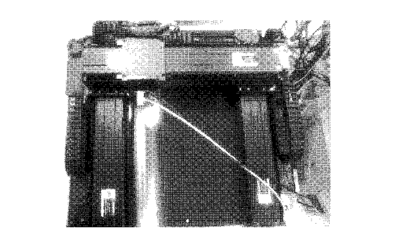
*그림 1 — 갠트리 스테이지. (Fig. 1. Gantry stage.)*

**표 1.** 갠트리 스테이지 주요 세부 사항. (Table 1. The Gantry stage principal specification.)

| Requirement | X-Axis Spec (Dual Motor) | Y-Axis (Single Motor) |
|---|---|---|
| Travel Length | 1000mm | 1000mm |
| Flatness | ±10㎛(All Travel) | ±10㎛(All Travel) |
| Straightness with Compensation | ±10㎛(All Travel) | ±10㎛(All Travel) |
| Position Accuracy | ±5㎛/500㎜ | ±5㎛/500㎜ |
| Position Repeatability | ±1㎛(All Travel) | ±1㎛(All Travel) |
| Resolution of Scale | 0.1㎛ | 0.1㎛ |
| Vibration Isolator | Passive type | Passive type |

### 2. 비전 시스템 구성

LCD 대평판 고정밀 얼라인을 위한 비전 시스템의 구성은 두 대의 카메라를 이용하여 한 번에 상/하판의 glass에 표시되어 있는 align mark를 동시에 관찰하는 시스템으로 구성하였다. 분해능은 940㎚/pixel로 설정 하였다. 조명 시스템은 카메라 동축 광원 장치와 외부 광원 장치로 구성되어 있으며, 외부 광원 장치는 0°~60°까지 조명의 각도를 이동시킬 수 있게 설계 되었다. 그림 2는 설계된 비전 시스템이며, 표 2는 구성요소 별 기능에 대한 설명이다.

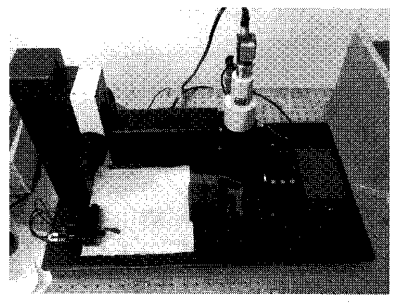
*그림 2 — 비전 시스템. (Fig. 2. Vision system.)*

**표 2.** 비전 시스템 세부 사항. (Table 2. Vision system specification.)

| Component | Model | Specification |
|---|---|---|
| Camera optical source device | CCS HLV-3M-RGB-3W | 3 color spot LED |
| Extra optical source device | HLV-24sw-3w | White spot Light, 12V, 2.8W |
| Cable | HFS-14-500 | spot type cable |
| Zoom Lens | IMZ-EA | Fiber type Zoom Lens X5 |
| Front Cover | TVF15 | X1.5 Front Cover Lens |
| Front Cover | TVF2 | X2 Front Cover Lens |
| Camera | HR-70 | B/W CCD Camera [1024(H)*768(W)] |
| Image board | Meteor2-MC | Component RGB interlaced, Progressive |
| F.O.V | HR-70 & IMZ-EA | 1mm x 1mm |
| WD | HR-70 & IMZ-EA | 75mm |

## III. Gantry stage 변형 보정

LCD 대평판 고정밀 얼라인을 하기 위해선 먼저 stage 자체의 열적, 기계적 변형에 따른 보정이 필요하다[3,4]. 본 연구에서는 옵토다이나믹스사의 APITM-100을 gantry-stage의 브리지에 장착하여 실시간으로 열 변형에 따른 stage의 오차를 측정 하였다. Stage 측정방법은 레이저 간섭계와 API를 스테이지의 브리지에 장착하여 각각 X축 측정값과 Y축 측정 값을 비교하였다. 이때 API를 이용한 측정은 스테이지를 이송시키며 X, Y좌표를 동시에 측정하였고, 레이저 간섭계는 스테이지의 X축, Y축을 각각 측정하였다. 리니어 가이드로 제작된 시스템이므로 구동 시 진동이 발생하여 충분한 안정화 시간을 충분히 가진 후 실험을 수행하였고, 20분 간격으로 100회 반복 수행하였다. 또한 실험실 온도를 20~25℃로 유지하였다. API를 이용하여 실시간으로 측정된 위치오차를 레이저 간섭계의 측정 오차와 비교 한 결과 최대 0.2㎛ 이내의 오차를 나타내었다. 이는 현재 상용화되어 있는 스테이지의 오차 범위 내 측정이 가능함을 보여준다. 그림 3은 동일한 스테이지의 변형을 API와 레이저 간섭계를 비교한 데이터이고, 그림 4는 안정화 시간에 따른 구동 오차를 나타낸다.

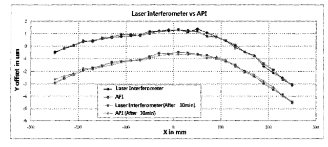
*그림 3 — 레이저 간섭계와 API 비교. (Fig. 3. Laser interferometer vs API.) 그래프 범례: Laser Interferometer, API, Laser Interferometer(After 30min), API(After 30min). 가로축 X in mm, 세로축 Y offset in um.*

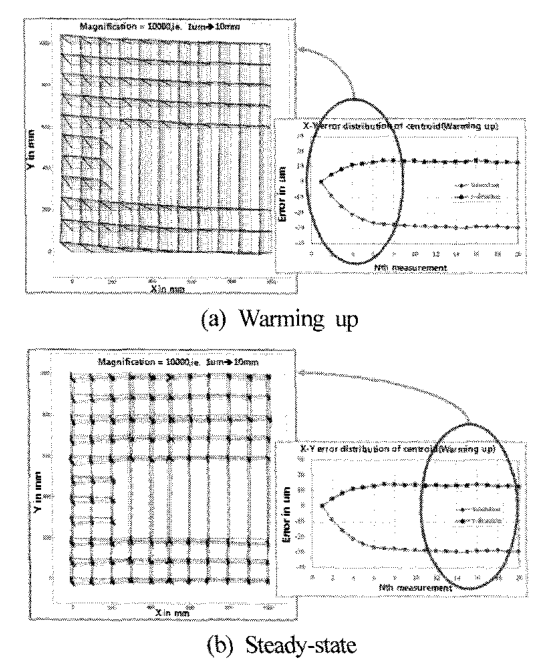
*그림 4 — X-Y 분포도. (Fig. 4. X-Y distribution of centroid.) (a) Warming up (b) Steady-state*

그림 5는 20분 간격으로 100번의 측정을 시행 한 결과이다. 실험 결과 스테이지는 최저 20㎛, 최고 26㎛의 값을 나타내었다. 이는 5℃의 온도 변화에서 최대 6㎛의 변형이 일어남을 나타낸다. 또한 이러한 패턴은 100번의 테스트 결과 비슷한 파형으로 나타났다. 이러한 파형에 최소제곱법을 이용하여 파형에 가까운 근사식을 만들고 이를 되먹임제어를 이용하여 오차에 대한 보정을 하였다.

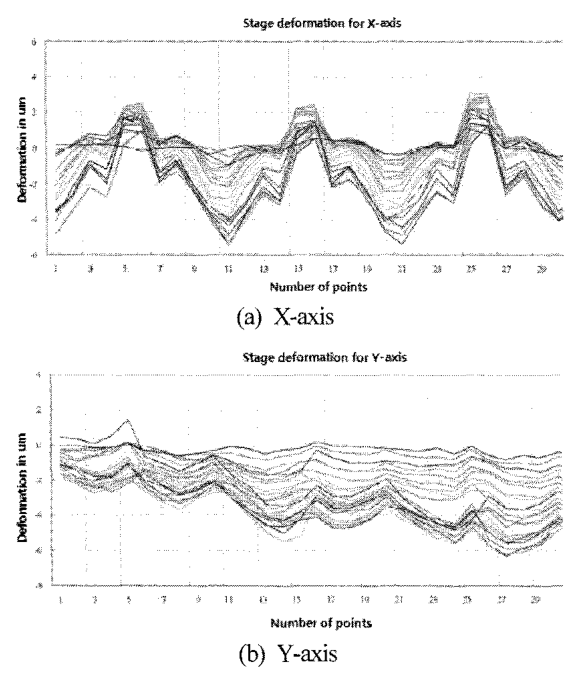
*그림 5 — X-Y 축 오차 측정. (Fig. 5. Test comparison for X-Y axis.) (a) X-axis (b) Y-axis*

최소제곱법을 이용한 오차 제어 근사식은 다음과 같다.

$$
y=ax^2+bx+c \tag{1}
$$

식 (1)을 잔차 방정식의 형태로 바꾸면 식 (2)가 된다.

$$
e=\sum_{i=0}^{n-1}\left(y-ax^2-bx-c\right)^2 \tag{2}
$$

n은 측정값의 개수를 나타낸다. 잔차 제곱의 합인 e의 값이 최소가 되는 값은 편미분을 통하여 구할 수 있다.

$$
\frac{\partial e}{\partial a}=0,\ \frac{\partial e}{\partial b}=0,\ \frac{\partial e}{\partial c}=0 \tag{3}
$$

편미분을 통하여 얻게 된 a, b, c 세 변수의 값을 식 (1)에 대입하여 근사식을 얻는다.

최소제곱법으로 얻어진 근사식을 통하여 스테이지 되먹임 제어를 수행한 결과는 그림 6에 나타냈다. 가는 선들은 보정 전을 나타낸 것이고 굵은 선은 초기 측정 후 되먹임 제어를 수행한 후의 상태를 나타낸다. 되먹임제어 전의 변형 오차는 최대 5.8㎛의 변형을 나타내었다. 되먹임 제어 이후 변형 오차는 최대 1.2㎛로 보정되었음을 볼 수 있다.

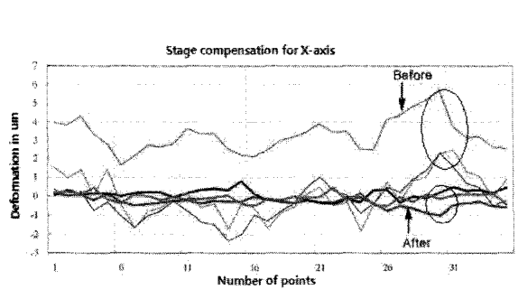
*그림 6 — 오차 보상 결과. (Fig. 6. Error interpolation result.) 그래프 제목 Stage compensation for X-axis, 표기 Before / After.*

## IV. Align 알고리즘

각종 산업 현장에서 사용되는 머신 비전 알고리즘이 갖춰야 할 가장 중요한 스펙은 빠른 계산 시간을 가지면서도 객체 인식의 신뢰성을 유지하는 것이다. 특히 얼라인먼트 공정과 같이 머신 비전 알고리즘이 피드백 루프를 따라 여러 주기에 걸쳐 적용 되는 분야는 빠른 계산 시간과 알고리즘의 안정성에 대한 중요성이 배가된다.

얼라인먼트 공정에서 머신 비전 환경은 배경이 비교적 단조롭고, 조명 환경의 변화가 크게 심하지 않으며, 검사 영상 내에서 찾아야 할 객체의 모양이 매우 단순하다는 특징이 있다. 이러한 비전 환경에서는 복잡하고 적용하기 어려운 알고리즘보다는 좀 더 단순하면서도 응용이 쉽지만 그 신뢰성은 보장될 수 있는 알고리즘이 필요하다.

영상에서 마크 객체를 분리하는 단순한 방법으로는 흑백 영상처리 기법을 들 수 있다. 찾고자 하는 객체를 문턱 값을 이용하여 분리하는 방법으로 영상 처리의 전처리 과정으로 많이 사용된다. 허나 고정된 문턱 값의 설정은 조명 및 환경에 따라 영상의 질이 바뀌게 되면 잡음을 많이 포함하게 된다. 이는 정확한 마크 객체 분리에 용이 하지 않다. 이에 고정된 문턱 값을 사용하지 않고 영상 자체의 명암도의 분포 및 선택된 객체의 명암도를 기반으로 문턱 값을 조정하는 동적 이진화(dynamic threshold)에 대한 연구가 진행되어 왔다[5].

본 연구에서는 기존에 많이 사용되어 왔던 신뢰성 있는 흑백 영상처리 기법들 중 동적 이진화 기법을 이용하여 검사 영역에서 마크 객체를 분리하고, 마크의 기하학적인 특징 점과 검사 영상을 매칭하여 중심점을 찾는 알고리즘을 제안한다.

### 1. Align key mark

본 연구에서 사용된 align key mark는 상판과 하판 두 가지 형태로 되어있다.

그림 7에서 상판의 align mark는 가운데가 비워진 정사각형이고, 하판의 align mark는 4개의 격자를 포함한 형태이다. 두 상/하판의 align mark의 중점을 일치시키는 형태로 align을 수행한다. 그림 7(c)는 상/하판의 mark를 align 시킨 모습이다. Align mark는 LCD panel에 볼드형태로 제작되었다. 그림 8은 실제 조명을 비추어 CCD 카메라를 통하여 획득된 영상이다.

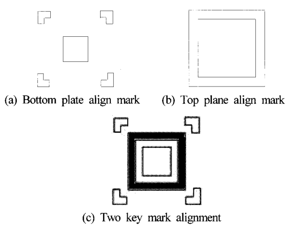
*그림 7 — 얼라인 마크. (Fig. 7. Align key mark.) (a) Bottom plate align mark (b) Top plane align mark (c) Two key mark alignment*

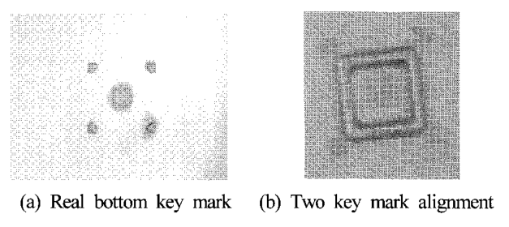
*그림 8 — 실제 얼라인 마크 영상 획득. (Fig. 8. Real align key mark acquisition.) (a) Real bottom key mark (b) Two key mark alignment*

### 2. 특징 값 추출

mark 인식 및 align을 수행하기 전에 key mark에 대한 특징 값을 추출해야 한다. 본 연구에서는 얼라인먼트 시스템에서 사용되는 마크의 기하학적인 모양을 분석하고, 그 기하학적인 패턴으로부터 얻어진 특정 픽셀(feature pixel)을 DB화하여 검사 영역 내부에서 마크 객체를 찾는 기하학적인 패턴 매칭 알고리즘을 제안한다.

#### 2.1 Harris Corner & Chain code detection

기하학적 특징치 중 하나인 코너의 위치에 대해서 1988년 C.Harris[6]는 설정된 윈도우를 상하좌우로 움직이며 윈도우 안의 픽셀 값의 변화를 분석하여 윈도우 내의 픽셀 값에 큰 변화가 일어나는 부분에 코너가 존재 한다는 알고리즘을 제시 하였다. 본 연구에서는 Harris 코너 알고리즘을 이용하여 align mark의 코너 점을 찾는다. 그림 9는 Harris 코너 알고리즘을 이용하여 코너 점을 찾은 영상이다.

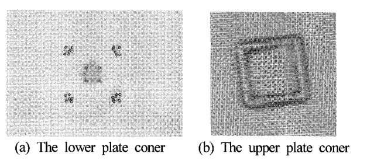
*그림 9 — Harris 코너 검출. (Fig. 9. Harris corner detection.) (a) The lower plate coner (b) The upper plate coner [역주: "coner"는 원문 표기]*

그림 9를 보면 Harris 코너 알고리즘을 사용한 영상에서 코너 이외의 부분에서 코너의 위치로 판정되는 부분이 나타난다. 이는 조명의 상태나 이물질의 영향에 의해서 픽셀 값에 차이가 발생하였을 경우 생겨 난 것으로 사료된다. 고정밀의 얼라인먼트를 하기위해서는 마크 인식에서 부터의 정확도가 있어야 하므로 이러한 노이즈를 최대한 줄여야 한다. 이러한 노이즈를 줄이기 위하여 chain code를 이용한 급전환점(sudden turning point)을 찾는 방법을 통하여 코너 위치에 있지 않은 점들을 제거한다[7]. Chain code를 수행하기 위하여 align mark 영상을 이진화 하고 단일 에지 성분을 얻기 위하여 세선화 하는 과정을 수행하였다. 그림 10은 chain code에 대한 설명을 그림으로 나타낸 것이다. 그림 10(a)는 인접한 화소사이의 방향성을 숫자로 나타내는 것을 보여주며, (b)는 코너 부분에서의 chain code가 어떻게 변화되는 지를 나타낸다. (b)의 그림에서 X표시는 (a)와 같은 윈도우의 시작위치가 된다. 본 논문에서는 12x1 마스크를 가지고 mark의 에지를 스캐닝 하면서 전환점을 찾는다.

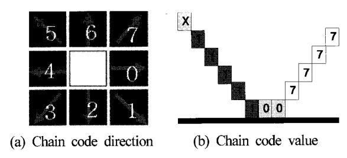
*그림 10 — 체인 코드 방법. (Fig. 10. Chain code.) (a) Chain code direction (b) Chain code value*

12x1 마스크에는 그림 10(a)에 의하여 방향정보가 담기게 된다. 그림 11은 급전환점을 찾는 방법을 보여준다.

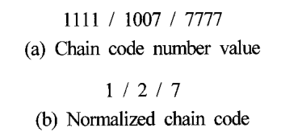
*그림 11 — 급전환점 검출. (Fig. 11. Sudden turning point detection.) (a) Chain code number value: 1111 / 1007 / 7777 (b) Normalized chain code: 1 / 2 / 7*

그림 11(a)는 마스크에 저장된 12개의 값을 보여준다. (b)는 4자리마다의 평균 값을 보여준다. (b)의 값에서 맨 처음 값과 마지막 값의 차이는 7-1=6으로 두 부분의 방향성의 차이는 4 이상의 값을 갖는다. 스캐닝 중에서 차이가 4이상일 경우 급전환점으로 지정하고 Harris 코너로 얻게 된 코너 점과의 비교를 통하여 일정 영역을 벗어나는 코너 점은 노이즈로 판별한다. 그림 12는 Harris 코너 와 chain code 알고리즘을 통하여 찾게 된 코너 점이다. 코너에 해당하는 픽셀을 DB화하여 검사 영역 내부에서 align mark 객체를 찾는 기하학적인 패턴 매칭 알고리즘에 적용한다.

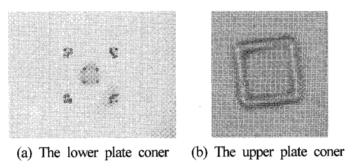
*그림 12 — Harris 코너 & 급전환점 검출. (Fig. 12. Harris corner & Sudden turning point detection.) (a) The lower plate coner (b) The upper plate coner*

#### 2.2 Geometric feature

마크 인식에 사용하게 될 기하학적 특징들은 본 연구에서 사용되는 align mark의 특징을 바탕으로 선정 하였다. 마크 인식은 DB화된 코너 점들의 정보를 가지고 이루어진다. 마크 인식에 사용된 기하학적 특징들은 다음과 같다.

1) Area(면적)

Area는 mark의 코너 점들의 좌표 값을 기반으로 선택된 영역내의 총 픽셀 수의 합이다. 하판 mark의 중심에 있는 사각형과 주위 4개의 격자 모양의 마크를 이루고 있는 픽셀 수의 합이다. M, N은 각각 x, y 방향의 픽셀 개수를 나타낸다. $B(x,y)$는 mark를 이루고 있는 픽셀들의 값을 나타낸다.

$$
Area=\sum_{x=0}^{M}\sum_{y=0}^{N}B(x,y),\quad 0<B(x,y)\le 255 \tag{4}
$$

2) Perimeter(둘레)

Perimeter는 mark의 코너 점들의 좌표 값을 기반으로 나타난 에지의 길이를 나타낸다. mark의 외곽을 이루고 있는 픽셀들의 개수의 합으로 나타난다.

3) Boundingbox

Boundingbox는 mark의 최외곽 코너 점들의 좌표 값을 기반으로 나타난다. 그림 13(a)에서 mark의 최외각 좌표 값을 기준으로 그려진 box의 길이를 boundingbox라 정의 한다.

4) Width/Height (W/H)

Width/Height는 boundingbox의 너비와 높이의 비를 나타낸다.

5) Centre Difference (C.D)

Centre difference는 각 코너를 나타내는 점들의 무게중심과 boundingbox의 중심과의 좌표 값의 차이를 나타낸다[7].

$$
C.D=\sqrt{(x_{bc}-x_c)^2+(y_{bc}-x_c)2} \tag{5}
$$

[역주] 식 (5)는 원문 표기 그대로 옮겼다. 원문의 두 번째 항은 $(y_{bc}-x_c)2$로 인쇄되어 있으나 문맥상 $(y_{bc}-y_c)^2$로 보인다.

$x_{bc}, y_{bc}$는 boundingbox의 $x, y$방향의 중심 좌표, $x_c, y_c$는 mark의 면적 중심을 나타낸다.

6) Second moment of the area(면적 2차 모멘트)

Second moment of the area는 코너 점들이 이루고 있는 모멘트와 boundingbox의 모멘트 사이의 각도의 차이를 나타낸다.

7) Radii & Diameter

Radii & Diameter는 하판 mark의 중심 사각형의 최외곽 코너 점들과 4개의 격자 모양을 이루고 있는 코너 점들과의 거리의 차이와 비를 나타낸다.

코너 점과 7개의 기하학적 특징 인자의 매칭 정도를 바탕으로 align mark의 인식을 수행한다. 그림 13은 기하학적 특징치를 나타낸 것이다[8].

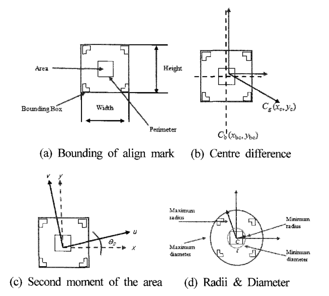
*그림 13 — 기하학적 특징. (Fig. 13. Geometric features.) (a) Bounding of align mark (b) Centre difference (c) Second moment of the area (d) Radii & Diameter*

#### 2.3 패턴 매칭

기하학적 특징치를 이용한 매칭은 각 특징치에 대한 매칭 정도에 의하여 결정된다. 7개의 기하학적 특징 인자들은 길이의 값과 각도의 형태로 나타난다. 기준 이미지를 선정하여 코너 점 및 7개의 기하학적 특징 인자를 추출하고, 추출된 인자의 값을 100단계로 나눈다. 테스트 이미지에서 코너 점과 7개의 기하학적 특징 인자를 추출하고 기준 이미지의 인자들과의 차를 내어 그 값이 포함하는 단계를 %화하여 매칭 정확도를 선정한다.

$$
F_r(n)\Leftarrow\left[F_s(n,i)\in\{F_o(n)-F_t(n)\}\right] \tag{6}
$$

$F_s(n,i)$의 범위는 식 (7)과 같다.

$$
\left(F_o(n)/100\right)\times(i-1)<F_s(n,i)<\left(F_o(n)/100\right)\times(i+1) \tag{7}
$$

$F_o(n)$는 기준 이미지의 7개의 특징 인자 값, $F_t(n)$는 테스트 이미지의 7개의 특징 인자 값, $F_s(n,i)$는 100단계로 나누어진 기준 이미지의 인자 값이다. 각 인자의 값을 100으로 나눈 값을 미분치로 하여 나타낸 값이다.

$F_r(n)$는 식 (6)을 만족하는 $F_s(n,i)$의 값이다. $i$는 1~100의 값을 가지며, $n$은 1~7의 값을 가진다. 최종 매칭 정도(score)는 식 (8)과 같다.

$$
Score=\left\{\sum_{n=1}^{7}F_r(n)\right\}/n \tag{8}
$$

**표 3.** 영상 처리 라이브러리. (Table 3. Image processing library.)

| Image processing library | function |
|---|---|
| Thresholding | Image thresholding :black & white |
| Labelling | Mark detection |
| Feature extraction | Feature analysis |
| Morphology | Noise delete |
| Matching | Image matching |
| Median filter | Noise delete |

매칭 정확도는 score 값을 백분율(%)화 하여 나타낸다.

### 3. Look and move 기법을 이용한 Align

카메라에서 측정된 영상은 영상처리를 통하여 key의 위치를 측정하게 된다. 이를 위하여 영상처리에 필요한 라이브러리를 제작하여 영상처리를 수행한다. 먼저, 영상처리를 통한 key의 위치 측정은 다음과 같은 순서로 진행된다. 카메라 캘리브레이션을 통하여 카메라의 영상 왜곡을 교정한 후에, 얻어진 영상으로부터, alignment는 그림 14에서 보는 바와 같이 구성된다. 먼저 영상이 들어오면 bottom-hat 변환과 dynamic-thresholding을 수행하여 영상을 이진화 시킨다. 이진화 된 영상에는 많은 노이즈가 섞여 있으므로 이 영상을 노이즈 제거와 라벨링을 이용하여 키의 영상만을 남기고 지운다. 노이즈 제거는 라벨링을 이용한 방법과 침식/팽창을 이용한 방법을 같이 사용한다. 이렇게 노이즈가 제거된 영상에 feature extraction 과 영상 매칭을 통하여 마크 인식한다. 마크 인식을 통하여 얻게된 영상을 바탕으로 중심점과 각도를 계산하여 align을 수행한다. 구체적인 align 방법은 먼저 상판의 위치를 측정하게 된다. 일반적으로 공정 중에 상판의 위치는 크게 변화되지 않지만, 정밀한 align을 위하여 상판의 위치를 먼저 측정하게 된다. 이후에 하판의 위치를 측정하게 된다. 이때 위치는 상판의 중심의 위치 좌표와 기울어진 정도를 나타내는 각도가 된다. 이를 바탕으로 스테이지를 구동하여 하판의 위치를 교정한 후에 다시 움직이지 않고 고정되어 있는 상판은 다시 측정하지 않고 하판의 위치를 측정하여 다시 스테이지를 구동한다. 이때 얼라인 오차 값이 기준 오차 이상이면 다시 한 번 모터 제어 피드백 루프가 진행되며, 얼라인 오차 값이 기준 오차 이하로 떨어질 때 까지 두 루프가 계속 반복된다. 영상처리에 필요한 라이브러리의 구성은 표 3과 같다.

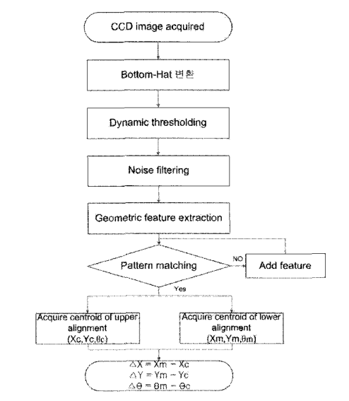
*그림 14 — 얼라인 순서도. (Fig. 14. Alignment process.) CCD image acquired → Bottom-Hat 변환 → Dynamic thresholding → Noise filtering → Geometric feature extraction → Pattern matching (NO: Add feature / Yes) → Acquire centroid of upper alignment (Xc,Yc,θc), Acquire centroid of lower alignment (Xm,Ym,θm) → ΔX = Xm − Xc, ΔY = Ym − Yc, Δθ = θm − θc*

## V. 실험 및 고찰

실험 장치는 1/3인치 CCD 카메라와 광학 5배율 렌즈를 사용하였다. FOV는 960㎛ x 720㎛이며, W.D는 75㎜ 이다. 해상도는 1024 x 768을 가진다. 하드웨어 분해능은 937.5㎚/pixel이다. 특징치 추출시 1/6 sub pixel을 수행하였다. sub pixel은 고정밀 얼라인먼트를 위하여 특징치 추출 및 alignment에 수행하였다. Align mark의 실제 크기는 80㎛ x 80㎛이다. 코너 점과 기하학적 특징치를 바탕으로 align mark 인식을 수행하였다. 알고리즘의 신뢰성을 높이고자 각기 다른 조명상태에서 마크 인식을 수행하였다. 그림 15는 align mark 인식 결과를 나타낸다. x, y, θ는 각각 좌표 및 틀어진 각도를 나타낸다. (a)는 original 영상으로 매칭에 해당하는 기하학적 특징치들에 대한 정보를 획득한다. (b)는 명암도가 전체적으로 낮은 영상에서의 매칭결과 이다. 97.8%의 매칭 정확도가 나타났다. (c)는 영상에 명암도가 그레디언트한 형태로 나타난다. 76.6%의 매칭 정확도가 나타났다. (d)는 영상이 블러드 효과가 나타난 형태이다. 62.4%의 매칭 정확도가 나타났다. (c)의 경우보다 (d)의 경우 매칭 정확도가 떨어진 원인은 영상의 블러드 효과로 인하여 기하학적 특징치 특히 코너 점을 검출하는데 있어서 많은 에러를 포함되기 때문으로 사료된다.

[역주] 본문은 (c)의 매칭 정확도를 76.6%로 적었으나 그림 15(c)의 캡션은 71.6%로 되어 있다. 원문 그대로 두었다.

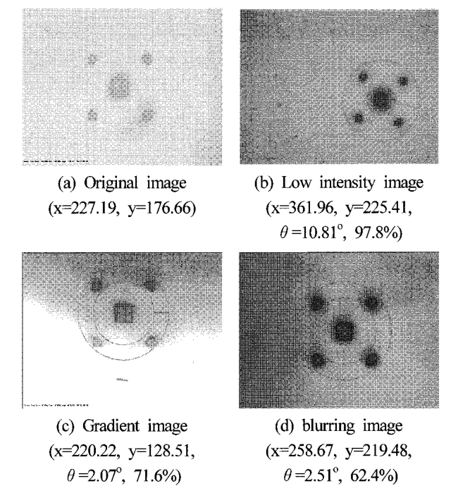
*그림 15 — 얼라인 마크 인식결과. (Fig. 15. Align mark recognition.) (a) Original image (x=227.19, y=176.66) (b) Low intensity image (x=361.96, y=225.41, θ=10.81°, 97.8%) (c) Gradient image (x=220.22, y=128.51, θ=2.07°, 71.6%) (d) blurring image (x=258.67, y=219.48, θ=2.51°, 62.4%)*

매칭 정확도는 얼라인먼트시 오차에 영향을 준다. 그림 16은 인식된 마크를 기반으로 룩 앤 무브 방식의 얼라인먼트를 결과를 나타낸다. 그림 16에서 U는 상판 mark의 위치, L은 하판 mark의 위치를 나타낸다. x, y, θ는 중심 좌표와 틀어진 각도를 나타낸다. (a)는 매칭 정확도 65.7%에 대한 얼라인먼트 수행결과이다. x=35.03, y=12.28 픽셀의 오차가 발생하였고 1.20°의 각도가 틀어졌다. (b)는 매칭 정확도 97.1%에 대한 얼라인먼트 수행결과이다. x=2.32, y=2.28 픽셀의 오차가 발생하였고 0.87°의 각도가 틀어졌다. 이를 수치로 계산하면 (a)는 30㎛ 이상 (b)는 3㎛ 이내의 오차 값을 나타낸다. 그림 17은 매칭 정확도별 오차 결과이다. x축은 매칭 정확도를 나타내며, y 축은 오차 값(um)을 나타낸다.

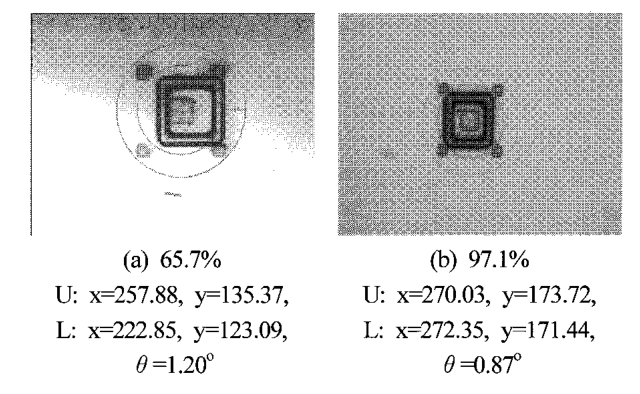
*그림 16 — 특화된 특징을 기반으로한 얼라인 결과. (Fig. 16. Alignment based on the special characteristics feature.) (a) 65.7% — U: x=257.88, y=135.37, L: x=222.85, y=123.09, θ=1.20° (b) 97.1% — U: x=270.03, y=173.72, L: x=272.35, y=171.44, θ=0.87°*

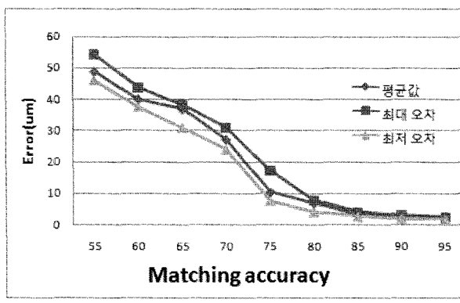
*그림 17 — 얼라인 오차 결과. (Fig. 17. Alignment error.) 범례: 평균값, 최대 오차, 최저 오차. 가로축 Matching accuracy(55~95), 세로축 Error(um).*

50% 이하의 매칭 정확도는 인식하지 않았다. 각 범주마다 7개의 데이터에 대한 평균값 및 최대, 최소 값을 나타낸 것이다. 매칭정확도가 85% 이상에서 최대, 최소, 평균값 모두 오차범위 3㎛ 이내에 들어오는 결과를 나타냈다. alignment 처리 시간은 최대 720㎳, 최소 320㎳, 평균 480㎳의 처리 속도를 나타내었다.

## VI. 결론

본 연구는 LCD 대평판 고정밀 얼라인 비전 시스템 개발에 있어서 고려해야할 stage의 변형 해석 및 align key mark의 인식과 align 과정을 보여준다. Stage의 열변형 해석은 API를 이용하여 수행 하였다. 고정밀의 align을 위하여 먼저 mark에 대한 분석을 수행하였고, 분석을 통하여 mark 인식에 필요한 geometric feature및 특화된 feature를 추출하였다. Mark인식은 geometric feature를 이용한 패턴 매칭 알고리즘을 사용하였고, Alignment는 중심점과 각도의 위치 오차를 기반으로 룩 앤 무브 기법을 통하여 align을 수행하였다. 얼라인먼트 결과 매칭 정확도 85% 이상에서 오차범위 3㎛ 이내의 결과를 얻을 수 있었다. 처리 속도는 평균 480㎳의 속도를 나타내었다. 매칭 정확도에 영향을 주는 주요 인자인 조명 시스템의 최적화에 대한 연구를 진행하면 추후 LCD 대평판 미세패턴형성 임프린트 공정 장비의 신뢰성을 높일 수 있을 것이다.

## 참고문헌

- [1] C. S. Song, J. H. Kim, and J. H. Kim, "A design for the automated process of LCD module assembly line," 한국공작기계학회 논문집, vol. 16, no. 5, pp. 162-165, 2007.
- [2] LG전자(주), "대면적 디스플레이용 나노급 초정밀 스테이지 개발에 관한 연구," 정보통신부, 2004.
- [3] 송영중, 신동훈, 정재일, "대면적 임프린트 장비의 스테이지 정렬운동 과정에서 LCD Glass 변형에 대한 시뮬레이션 연구," 한국공작기계학회 춘계학술대회 논문집, pp. 108-111, 2007.
- [4] 송춘삼, 조웅 김종형, "LCD 모듈 조립라인의 자동화 공정 설계," 한국공작기계학회 논문집, vol. 16, no. 5, pp. 162-165, 2007.
- [5] R. C. Gonzalez, and R. E. Woods, *Digital Image Processing*, 2nd Ed., Addison Wesley, USA, 1992.
- [6] C. Harris and M. J. Stephens, "A combined corner and edge detector," *In Alvey Vision Conference*, Manchester, pp. 147-152, 1988.
- [7] S. M. Cho, "X-ray image processing and pose estimation of polyhedral objects based on geometric features," Seoul National University of Technology, pp. 38-43, 2008.
- [8] 김철호 "고속 이송 강 코일 표면 결함 검사 시스템 개발에 관한 연구," 서울산업대학교, pp. 36-47, 2007.

## 저자 소개

- **조성만**: 2005년 서울산업대학교 기계설계자동화공학부 졸업. 2008년 동 대학원 석사. 2008년~현재 서울산업대학교 나노생산기술연구소 선임연구원. 관심분야는 머신 비전.
- **송춘삼**: 2004년 국민대학교 자동차전문대학원 설계 및 생산공학 석사. 2009년 동 대학원 박사. 2006년~현재 서울테크노파크 MSP기술지원센터 선임연구원. 관심분야는 마이크로 저온접합, 광학검사.
- **김준현**: 1993년 University of Missouri 기계공학 석사. 1998년 University of Florida 기계공학 박사. 2006년~현재 서울테크노파크 MSP기술지원센터 선임연구원. 관심분야는 집속이온빔.
- **김종형**: 1989년 한국과학기술원 생산공학 석사. 1995년 동 대학원 박사. 현재 서울산업대학교 기계설계자동화공학부 교수. 관심분야는 Machine Vision, Robotics.
