# 영상 정렬 운동을 위한 동일평면 XXY 스테이지의 시각 서보 운동 제어와 오차 분석 (Lee 2013)

- 원제: Vision Servo Motion Control and Error Analysis of a Coplanar XXY Stage for Image Alignment Motion
- 원문: 같은 폴더의 `Lee2013_MPE_XXY_stage.pdf` (Hau-Wei Lee, Chien-Hung Liu, Mathematical Problems in Engineering, Volume 2013, Article ID 592312, 12 pages, Hindawi Publishing Corporation, http://dx.doi.org/10.1155/2013/592312)
- 번역 범위: 전문(초록·본문·그림·표 캡션). 참고문헌은 원문 그대로 옮겼다.
- 그림: 원문 그림 18개(세부 그림 (a)~(f) 포함, 그림마다 한 장)를 `그림/`에 넣고 본문에서 처음 언급되는 곳에 삽입했다. 표 2개는 마크다운 표로 옮겼다. PDF 13쪽(데이터베이스 저작권 고지)은 끝에 옮겼다.

## 초록

최근 몇 년 사이 터치 패널을 갖춘 스마트폰 수요가 늘면서, 시각 서보(vision servo) 제어를 적용한 정렬 스테이지의 정렬/보상 시스템 수요도 늘었다. 전통적인 적층형(stacked-type) $XY\theta$ 스테이지는 조립 누적 오차가 있고 무겁기 때문에, 같은 평면 위의 세 구동기로 3자유도를 갖는 것이 특징인 동일평면(coplanar) 스테이지로 점차 대체되어 왔다. 가장 단순한 영상 정렬 방식은 카메라 두 대를 피드백 제어 장비로 사용하고, 작업물(work piece)을 작업 스테이지 위에 놓는 것이다. 작업물에는 보통 마크가 각인/표시되어 있다. 카메라가 영상을 획득하고 영상 처리로 카메라 안에서 마크의 위치를 얻으면, 스테이지를 움직이고 정렬 알고리즘을 사용하여 마크를 카메라 안의 지정 위치로 옮길 수 있다. 이 연구는 위치 결정 분해능이 1 $\mu$m인 동일평면 $XXY$ 스테이지를 사용하였다. 카메라 분해능이 화소당 약 3.75 $\mu$m이므로 부화소(subpixel) 기법을 사용하며, 정렬 시스템의 직선 및 각도 정렬 반복정밀도(repeatability)는 각각 1 $\mu$m와 5 arcsec에 이를 수 있다. 동일평면 $XXY$ 스테이지를 사용하여 정렬 운동을 위한 시각 서보 운동 제어를 1초 안에 완료한다.

> (첫 쪽 정보) 1 Center of Measurement Standard, Industrial Technology Research Institute, Hsinchu 30011, Taiwan. 2 Department of Mechanical Engineering, National Chung Hsing University, Taichung 402, Taiwan. 교신 저자: Chien-Hung Liu; carus@dragon.nchu.edu.tw. 2013년 9월 27일 접수, 2013년 10월 10일 게재 승인. 담당 편집위원: Teen-Hang Meen. Copyright © 2013 H.-W. Lee and C.-H. Liu. 이 논문은 크리에이티브 커먼즈 저작자표시 라이선스(Creative Commons Attribution License)로 배포되는 오픈 액세스 논문으로, 원저작물을 적절히 인용하는 한 어떤 매체로든 제한 없이 사용, 배포, 복제할 수 있다.

## 1. 서론 (Introduction)

광학 영상 정렬을 위한 디지털 영상 처리 기반 시각 서보 제어는 최근 몇 년간 MEMS, 바이오칩, 반도체, LED, LCD, 그리고 널리 쓰이는 터치 패널 등 여러 공정에 적용되어 왔다. 기본 정렬 시스템은 전하결합소자(CCD) 카메라 두 대와 고정밀 위치 결정/보상 스테이지로 구성된다. Kuo 등은 머신 비전을 이용한 정밀 나노 정렬 시스템을 제시하였다 [1]. 이 정렬 시스템은 압전 세라믹 모터로 구동하는 적층형 보상 스테이지를 사용하였다. 이 시스템은 원을 정렬 마크로 사용하고 카메라 한 대로 영상을 획득한다. 제안된 시스템은 $x$축과 $y$축 오차를 보상할 수 있으며 위치 오차는 60 nm 범위일 수 있다. 영상 정렬 시스템에서 또 하나의 핵심은 마크 인식이다. 마크 인식이 불충분하면 정렬 품질에 영향을 주는 오인식이 생길 수 있으며, 흔히 쓰이는 마크는 십자 마크이다. 마크가 원이면 PCB 검출에서 납땜 접합부와 혼동되기 쉽고, 마크가 직선이면 PCB의 배선이 마크로 오인될 수 있다고 생각할 수 있다. Lin 등은 부화소 영상 정합 방법 CPTRPT를 개발하였다 [2]. 결과는 평행이동과 회전의 평균 오차가 약 0.03화소와 0.1화소임을 보여 준다. 제안된 방법은 정확도가 좋지만 평균 실행 시간이 20.5 ms여서 고속/실시간 정렬에 적용하기 어렵다. Lee 등은 TFT-LCD 패턴의 실시간 임계 치수(critical dimension) 측정을 제안하였다 [3]. 개발된 시스템은 TFT-LCD 제조에 사용할 수 있으며 반복정밀도는 30 nm 미만이다. 패턴 탐색 시간은 약 12 ms($XY\theta$, 1회 탐색 기준)이다. 이 연구는 Canny [4]보다 단순한 에지 검출 방법도 제안한다. Huang과 Lin은 2009년에 카메라 한 대와 적층형 $XY$ 스테이지를 사용하여 $XY$ 방향 정렬을 수행하였다 [5]. 십자 기호를 마크로 사용하였고, 정상 상태 정렬 오차는 1 $\mu$m 미만이었다. 이 연구에서는 카메라 한 대로 $XY\theta$ 방향 정렬을 마칠 수 있었으나, 각도 분해능이 낮아 각도 정렬 정확도가 카메라 두 대 정렬 시스템보다 나빴다.

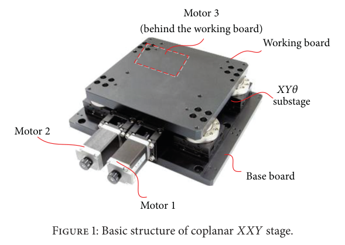
*그림 1 — 동일평면 $XXY$ 스테이지의 기본 구조. (Motor 1, Motor 2, Motor 3(작업판 뒤), 작업판(Working board), $XY\theta$ 서브스테이지, 베이스판(Base board))*

과거에는 적층형 $XY\theta$ 스테이지로 정렬을 수행하였다. 그러나 적층형 스테이지에는 보통 평면도 오차, 평행도 오차, 축 사이의 직각도 오차와 같은 누적 오차가 있다. 적층형 스테이지는 (동일평면 스테이지에 비해) 무겁고 무게 중심이 높으므로 이러한 오차가 정렬 정확도에 영향을 준다. 정렬 과정의 가속과 감속이 너무 크면 관성 때문에 행정(stroke)을 넘어설 가능성이 있다(역진자 시스템으로 볼 수 있다). 위의 문제를 해결하기 위해 최근 몇 년간 동일평면 $XY\theta$ 스테이지가 널리 사용되어 왔다. 압전 구동기를 사용하여 동일평면형 스테이지를 구성하는 것은 많은 논문에 제시되어 있으며, 좋은 위치 결정 정확도를 보였다 [6–9]. 그러나 터치 패널 합착(lamination)과 같은 제조 산업 응용에서는 압전 기반 스테이지가 너무 비싸고, 그런 초고정밀 보상 스테이지가 필요하지도 않다. Yim 등 [10]은 370 · 470 mm² 크기 UV-NIL용 고정밀 스테이지를 유연체(flexible bodies)로 모델링할 것을 제안하였다. 머신 비전을 사용하여 정렬 오차 보정을 위한 평행이동 제어와 회전 제어를 모두 수행하였다. 또한 3축 및 4축 스테이지 각각의 수직 운동을 분석하고 서로 비교하였다. 이 논문에서는 그림 1과 같은 동일평면 스테이지를 사용하여 정렬 운동을 위한 시각 서보 운동 제어를 구현하였다. 기구학 및 오차 분석을 수행하였고, 서보 제어와 영상 처리를 성공적으로 통합하여 정밀 시각 서보 제어를 구현하였다.

## 2. 동일평면 $XXY$ 스테이지의 설계 (Design of a Coplanar $XXY$ Stage)

동일평면 $XXY$ 스테이지(이하 $XXY$ 스테이지)는 세 구동기가 같은 평면 위에 있어 무게 중심이 낮다는 특징이 있다. 다시 말해 동일평면 $XXY$ 스테이지의 이동 속도는 적층형 $XY\theta$ 스테이지보다 빠를 수 있고, 작고 가볍다. 동일평면 $XXY$ 스테이지의 주된 장점은 전통적인 적층형 스테이지보다 스테이지 구성의 누적 오차가 작다는 것이다.

*2.1. 스테이지 구성(Stage Composition).* 그림 1과 같이 $XXY$ 스테이지는 네 가지 주요 구성 요소로 이루어진다.

(1) 베이스(Base): 기본 베이스는 $XXY$ 스테이지를 고정하며, 시스템 조립 후 평행도와 평면도를 검증하는 기준면이다.

(2) 모터(Motors): $XXY$ 스테이지는 같은 평면에 설치된 스테핑 모터 세 개로 구동된다. Motor 1과 Motor 2의 축 방향은 스테이지의 $X$ 방향과 평행하다. Motor 3은 작업 스테이지 아래에 있다(그림에 표시되지 않음). Motor 3의 축 방향은 스테이지의 $Y$ 방향과 평행하다.

(3) $XY\theta$ 서브스테이지($XY\theta$ substage): $XY\theta$ 서브스테이지는 작은 크로스 롤러 스테이지 두 개와 작은 회전 스테이지로 이루어져 세 운동 자유도를 갖는다. 동일평면 $XXY$ 스테이지는 작업 플랫폼 아래에 작은 $XY\theta$ 서브스테이지 네 개로 구성된다. $XY\theta$ 서브스테이지의 주된 목적은 $XXY$ 스테이지의 운동을 지지하고 구속 조건을 제공하는 것이다. $XXY$ 스테이지에서 세 모터는 각각 볼 스크루 세 개로 인접한 $XY\theta$ 서브스테이지 세 개에 연결되므로, 각 $XY\theta$ 서브스테이지는 한 방향으로만 구동된다(즉 나머지 방향은 자유롭게 움직인다). $XXY$ 스테이지에는 어떤 구동기에도 연결되지 않은 $XY\theta$ 서브스테이지가 하나 있으며, 이 논문에서는 이 $XY\theta$ 서브스테이지를 자유체(free body)라 부른다. 이런 구성 메커니즘으로 작업 플랫폼은 세 운동 자유도만 갖게 된다.

(4) 작업 스테이지(Working stage): 스테이지는 작업물이나 가공품을 싣는다. 각 $XY\theta$ 서브스테이지에는 누적 오차가 있지만, 네 $XY\theta$ 서브스테이지가 스테이지와 결합되면 작업 스테이지의 전체 정확도만 고려하면 되므로, $XXY$ 스테이지의 정확도는 $XY\theta$ 서브스테이지의 누적 오차에서 자유롭다. 스테이지 검증 시에는 각 $XY\theta$ 서브스테이지의 위치 결정 반복정밀도만 요구 사항을 충족하면 된다.

*2.2. 동일평면 스테이지의 기구학(Kinematic of Coplanar Stage).* $XXY$ 스테이지는 그림 2와 같이 $X$, $Y$, $\theta_z$의 3차원 운동을 한다. 스테이지의 직선 변위를 $\vec{s} = [\delta_x\ \ \delta_y]^T$(단위: mm), 스테이지의 각변위를 $\delta_\theta$(단위: radius) [역주: 원문 표기 그대로. radian의 오기로 보인다], 모터의 변위를 $\vec{m} = [m_1\ \ m_2\ \ m_3]^T$(단위: pulse)로 나타내면, 스테이지 변위와 모터 변위 사이의 기본 선형화 관계는 다음과 같다.

$$\begin{bmatrix}m_1\\ m_2\\ m_3\end{bmatrix} = \frac{R_m}{\ell_P}\begin{bmatrix}1 & 0 & k_a\\ 1 & 0 & k_b\\ 0 & 1 & k_c\end{bmatrix}\begin{bmatrix}\delta_x\\ \delta_y\\ \delta_\theta\end{bmatrix}, \tag{1}$$

여기서 $R_m$은 모터 분해능(단위: pulse/rev), $\ell_p$는 볼 스크루의 리드(단위: mm/rev), $k_a$, $k_b$, $k_c$는 각도 회전 파라미터이다. $k_a$, $k_b$, $k_c$는 스테이지 중심과, $\{m_1\}$, $\{m_2\}$, $\{m_3\}$ 좌표계에 연결된 $XYY$ 스테이지 중심 사이의 거리와 관련된다. [역주: 원문 표기 "XYY" 그대로.] 고정밀 운동 제어를 위해서는 기구학 식이 운동 중 $XXY$ 스테이지의 중심 편차를 고려해야 한다.

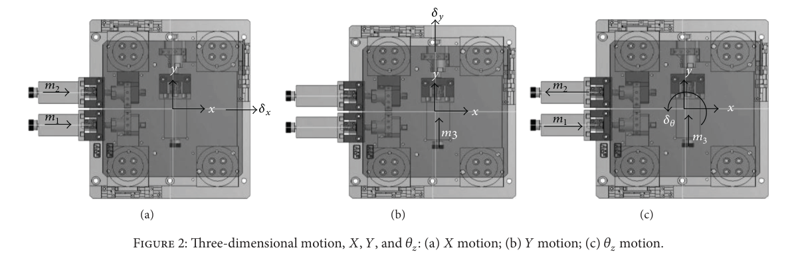
*그림 2 — 3차원 운동 $X$, $Y$, $\theta_z$: (a) $X$ 운동, (b) $Y$ 운동, (c) $\theta_z$ 운동.*

그림 3과 같이 스테이지 중심과 $i$번째 $XY\theta$ 서브스테이지 중심 사이의 위치 벡터가 $\vec{r}_i = [r_{ix}\ \ r_{iy}]^T$, $i = 1, 2, 3, 4$이면 다음을 얻는다.

$$m_i = \vec{t}_i\left(-\vec{r}_i + \vec{s} + \vec{r}_i^{\,\prime}\right), \tag{2}$$

$$\vec{r}_i^{\,\prime} = \mathbf{R}\cdot\vec{r}_i, \tag{3}$$

$$\mathbf{R} = \begin{bmatrix}\cos\delta_\theta & -\sin\delta_\theta\\ \sin\delta_\theta & \cos\delta_\theta\end{bmatrix}, \tag{4}$$

여기서 $\vec{t}_1$과 $\vec{t}_2$는 모두 $[R_m/\ell_p\ \ 0]$이고 $\vec{t}_3$는 $[0\ \ R_m/\ell_p]$이다. (2), (3), (4)를 선형화하면 (1)의 파라미터는 $k_a = -r_{1y}$, $k_b = -r_{2y}$, $k_c = r_{3x}$이다.

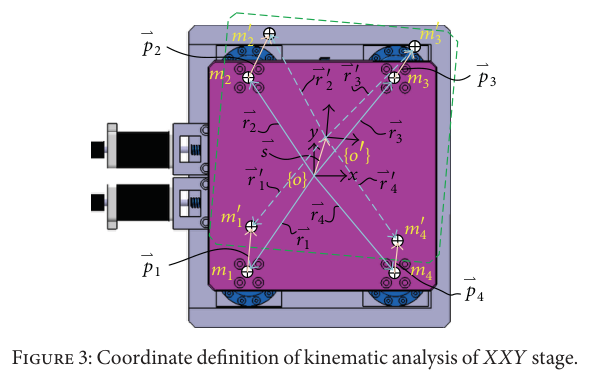
*그림 3 — $XXY$ 스테이지 기구학 해석의 좌표 정의.*

*2.3. 오차 분석(Error Analysis).* $XXY$ 스테이지는 $XY\theta$ 서브스테이지 네 개로 이루어진다. $XXY$ 스테이지를 조립할 때는 보통 설치 오차(setup error)가 포함된다. 설치 오차에는 진직도 오차 세 가지와 각도 오차 세 가지가 있다. 그림 4와 같이 모터 1에 연결된 $XY\theta$ 서브스테이지의 설계 위치는 $m_1$이다. 그러나 설치 오차 때문에 $XY\theta$ 서브스테이지의 실제 위치는 $m_{e1}$에 있다. 설치 오차 벡터를 $\vec{e}_1 = [e_x\ \ e_y\ \ e_z]^T$라 하면 다음을 얻는다.

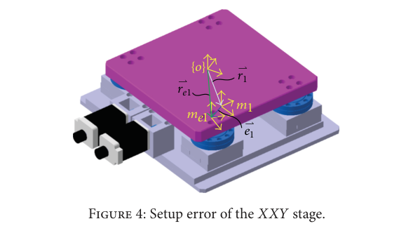
*그림 4 — $XXY$ 스테이지의 설치 오차.*

$$\vec{r}_{e1} = \vec{r}_1 + \vec{e}_1. \tag{5}$$

(2), (3), (5)에 따라 다음과 같이 쓸 수 있다.

$$\vec{p}_i = \mathbf{R}_{pi}\left[\mathbf{R}_{\mathrm{err}}\left(-\vec{r}_i - \vec{e} + \vec{s} + \mathbf{R}\cdot\vec{r}_i\right)\right], \tag{6}$$

여기서

$$\mathbf{R}_{\mathrm{err}} = \begin{bmatrix}\cos\beta\cos\gamma & \cos\gamma\sin\alpha\sin\beta - \cos\alpha\sin\gamma & \cos\alpha\cos\gamma\sin\beta + \sin\alpha\sin\gamma\\ \cos\beta\sin\gamma & \cos\alpha\cos\gamma + \sin\alpha\sin\beta\sin\gamma & \cos\alpha\sin\beta\sin\gamma - \cos\gamma\sin\alpha\\ -\sin\beta & \cos\beta\sin\alpha & \cos\alpha\cos\beta\end{bmatrix}, \tag{7}$$

$$\mathbf{R}_{pi} = \begin{bmatrix}1 & 0 & 0\\ 0 & 1 & 0\end{bmatrix}. \tag{8}$$

(7)은 각도 설치 오차 $\alpha$, $\beta$, $\gamma$의 행렬을 나타낸다는 점에 주목한다. 변위 벡터 $\vec{s}$와 거리 벡터 $\vec{r}_i$를 3차원 공간으로 확장하기 위해 둘을 $\vec{s} = [\delta_x\ \ \delta_y\ \ 0]^T$와 $\vec{r}_i = [r_{ix}\ \ r_{iy}\ \ 0]^T$로 다시 정의하였다. 설치 오차로 생기는 위치 결정 오차는 다음 식과 같이 민감도에 따라 추정할 수 있다.

$$\varepsilon(\upsilon) = \frac{\partial f_{\mathrm{err}}}{\partial\upsilon}, \tag{9}$$

여기서 $f_{\mathrm{err}}$는 설치 오차를 포함한 기구학 식이고 $\upsilon$는 설치 오차 원인이다. 스테이지 설치 오차로 인한 위치 결정 오차는 다음 식으로 추정할 수 있다.

$$E(\upsilon) = \varepsilon(\upsilon)\times\tau(\upsilon), \tag{10}$$

여기서 $\tau(\upsilon)$는 추정 오차 원인의 평가값을 나타낸다. (6)을 풀어 얻은 위치 결정 오차 추정 결과는 표 1과 같다. 이 추정에서는 $\vec{r}_1 = [-56\ \ -74\ \ 0]^T$, $\vec{r}_2 = [-56\ \ 74\ \ 0]^T$, $\vec{r}_3 = [56\ \ 74\ \ 0]^T$, $\vec{r}_4 = [56\ \ -74\ \ 0]^T$, $\vec{s} = [2\ \ 2\ \ 0]^T$, $\delta_\theta = 2^\circ$로 두었다. (2)에 따라 $\vec{s} = [0\ \ 0\ \ 0]$, $\delta_\theta = 0^\circ$에서 각 $XY\theta$ 스테이지의 목표 위치까지의 변위는 $\vec{p}_1 = [3.617\ \ -0.909]^T$, $\vec{p}_2 = [-1.548\ \ -0.999]^T$, $\vec{p}_3 = [-1.617\ \ 2.909]^T$임을 얻을 수 있다. 추정 결과는 또한 설치 오차 원인 $e_{x1}$, $e_{x2}$, $e_{y3}$, $e_{zi}$, $\alpha_i$, $\beta_i$가 위치 결정 정확도에 뚜렷한 영향을 주지 않음을 보여 주었다. 설치 오차 원인 $e_{zi}$, $\alpha_i$, $\beta_i$는 베이스판과 작업판의 평행도와 관련된다는 점에 주목한다. 추정 오차 경향은 그림 5와 같다.

**표 1** — 카메라 설치 오차가 있을 때의 유리 위치 추정 오차 (단위: mm, 도) (Estimated glass position error when the camera setup error is existed. (unit: mm, degrees).)

| $\upsilon$ | $\tau(\upsilon)$ | 추정 오차 $E_x$ | 추정 오차 $E_y$ | 추정 오차 $E_\theta$ |
|---|---|---|---|---|
| $m_1$ | | | | |
| $e_x$ | ±1 | 0 | 0 | 0 |
| $e_y$ | ±1 | ∓0.017 | ±0.013 | ∓0.013 |
| $e_z$ | ±1 | 0 | 0 | 0 |
| $\alpha$ | ±1 | 0 | 0 | 0 |
| $\beta$ | ±1 | 0 | 0 | 0 |
| $\gamma$ | ±1 | ∓2.608 | ±1.973 | ±2.020 |
| $m_2$ | ±1 | | | |
| $e_x$ | ±1 | 0 | 0 | 0° |
| $e_y$ | ±1 | ∓0.018 | ∓0.013 | ±0.014 |
| $e_z$ | ±1 | 0 | 0 | 0 |
| $\alpha$ | ±1 | 0 | 0 | 0 |
| $\beta$ | ±1 | 0 | 0 | 0 |
| $\gamma$ | ±1 | 0 | ∓0.02 | ∓0.02 |
| $m_3$ | ±1 | | | |
| $e_x$ | ±1 | 0 | ±0.035 | 0 |
| $e_y$ | ±1 | 0 | 0 | 0 |
| $e_z$ | ±1 | 0 | 0 | 0 |
| $\alpha$ | ±1 | 0 | 0 | 0 |
| $\beta$ | ±1 | 0 | 0 | 0 |
| $\gamma$ | ±1 | 0 | ∓0.029 | 0 |

[역주: 표 1의 $m_2$, $m_3$ 행에 붙은 ±1과 $m_2$ $e_x$ 행의 "0°"는 원문 그대로 옮겼다.]

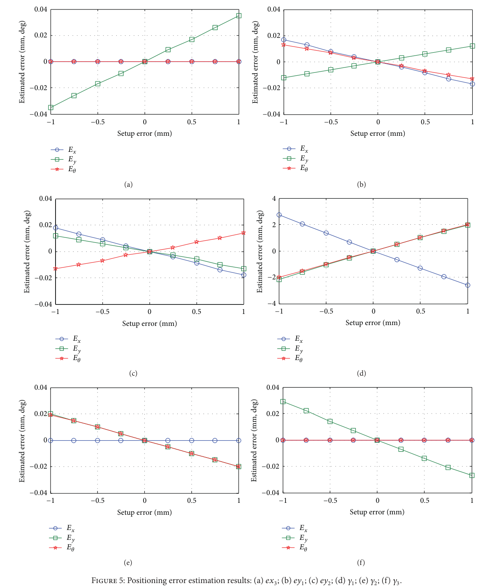
*그림 5 — 위치 결정 오차 추정 결과: (a) $ex_3$, (b) $ey_1$, (c) $ey_2$, (d) $\gamma_1$, (e) $\gamma_2$, (f) $\gamma_3$. (가로축: 설치 오차(Setup error, mm), 세로축: 추정 오차(Estimated error, mm, deg), 범례: $E_x$, $E_y$, $E_\theta$)*

## 3. 영상 비전 정렬 (Image Vision Alignment)

*3.1. 영상 정렬(Image Alignment).* 영상 정렬의 기본 개념은 그림 6과 같다. 주된 목적은 마크와 카메라 목표 위치 사이의 간격 거리를 없애는 것이며, 이를 $\vec{e}_1 = [x_1\ \ y_1]^T$와 $\vec{e}_2 = [x_2\ \ y_2]^T$라 가정한다. 이상적인 상태에서는 두 카메라 목표 위치 사이의 거리 $D_p$가 두 마크 사이의 거리 $D_c$와 같다. 정렬 식은 그림 7로부터 유도할 수 있다. 따라서 정렬 식은 (2)~(4)와 유사하게 다음과 같이 얻을 수 있다.

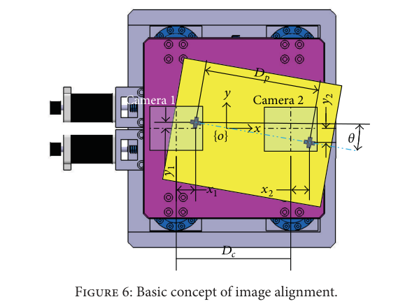
*그림 6 — 영상 정렬의 기본 개념.*

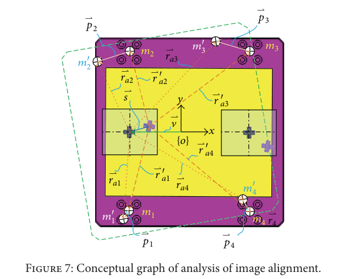
*그림 7 — 영상 정렬 해석의 개념도.*

$$\begin{aligned}m_i &= \vec{t}_i\left(-\vec{r}_{ai} + \vec{s} + \mathbf{R}\cdot\vec{r}_{ai}\right),\\ \vec{r}_{ai} &= \vec{r}_i - \vec{v} - \vec{s},\end{aligned} \tag{11}$$

여기서 $\vec{v}$는 $\{O\}$에서 카메라 목표 위치까지의 거리 벡터이다. 보인 것처럼, $XXY$ 스테이지를 정렬 스테이지로 사용하면 영상 정렬 절차가 매우 단순하다. 더 이상 스테이지 중심을 정렬의 기준점으로 사용할 필요가 없고, 마크 중심의 위치를 기준점으로 사용하여 스테이지의 변위를 계산하면 된다. 이 방법이 부동 기준점(floating reference point) 방법이다.

*3.2. 부동 기준점(Floating Reference Point).* 정렬에서의 위 장점 외에도, 부동 기준점 위치 결정 방식은 생산 라인 교체(replacement)에서 장점이 있다. 그림 8(a)와 같이 전통적인 고정 스테이지 기준점을 사용하면, 생산 라인을 바꾸기 전에 다음 생산 라인의 작업물 중심을 스테이지 기준점에 놓아야 한다. 다시 말해 제품이 많을수록 교체도 많다. 작업물 중심과 스테이지 기준점의 상대 위치 사이에 오차가 있으면 가공 품질에 영향을 준다. 그림 8(b)와 같이 부동 중심을 사용하면, 생산 라인은 한쪽에 맞춘 채로 바꿀 수 있으며, 크기가 다른 작업물에 대해서도 교체가 한 번이면 충분하다. 부동 기준점 기술은 임의의 위치를 기준점으로 정할 수 있으므로, 작업물과 $XXY$ 스테이지 중심 사이에 큰 오프셋이 있더라도 스테이지의 정렬 기능은 영향을 받지 않는다.

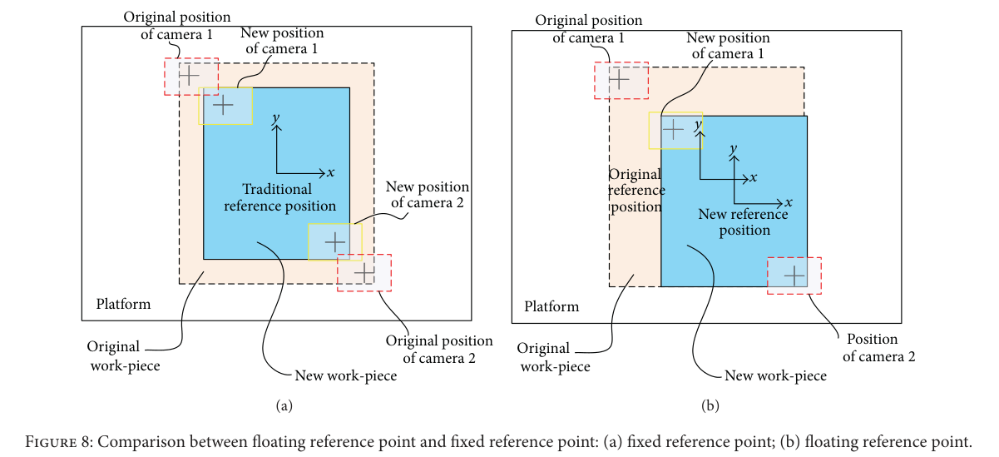
*그림 8 — 부동 기준점과 고정 기준점의 비교: (a) 고정 기준점, (b) 부동 기준점. (Original position of camera 1/2: 카메라 1/2의 원래 위치, New position of camera 1/2: 카메라 1/2의 새 위치, Traditional reference position: 전통적 기준 위치, Original/New reference position: 원래/새 기준 위치, Original/New work-piece: 원래/새 작업물, Platform: 플랫폼)*

*3.3. 마크 인식(Mark Recognition).* 영상 정렬에서는 정렬 스테이지와 정렬 알고리즘 외에 또 하나의 핵심이 마크 인식 능력이다. 마크 인식이 충분히 안정적이고 강건하지 않으면 정렬 정확도가 떨어진다. 실제 응용에서는 외부 환경의 변화와 마크 인식의 정확도를 고려한다. 그림 9는 여러 경우를 보여 준다. 001~004는 일반적인 경우, 005는 노출 부족, 006~009는 노출 과다, 0010~0013은 불완전한 마크, 0014는 마크가 없는 영상, 0015는 마크의 절반이 화면 밖으로 나간 경우, 0016과 0019는 잡음이 있는 사진이다. 위 현상들은 개연성 있는 경우로, 많은 연구에서 논의되어 왔다. 일반적으로 고정밀 정렬을 위해서는 패턴 영상이 충분히 선명하고 완전해야 하며 방향 각도가 작아야 한다. 이 연구의 영상 처리 절차는 다음과 같다. 영상 처리 중에 실제 영상(그림 10(a))과 패턴 영상(그림 10(b))을 이진화한다. 획득 영상은 그림 10(c)와 같이 이진화한 다음, 그림 10(d)와 같이 이진 영상을 평활화하고 형태학적 처리를 하여 더 깨끗한 이진 영상을 얻는다. 이진화된 영상을 패턴 영상과 비교한다. 일치하면 관심 영역(region of interest, ROI)을 설정한 다음, ROI 영상에서 패턴 영상을 뺀다(그림 10(e)).

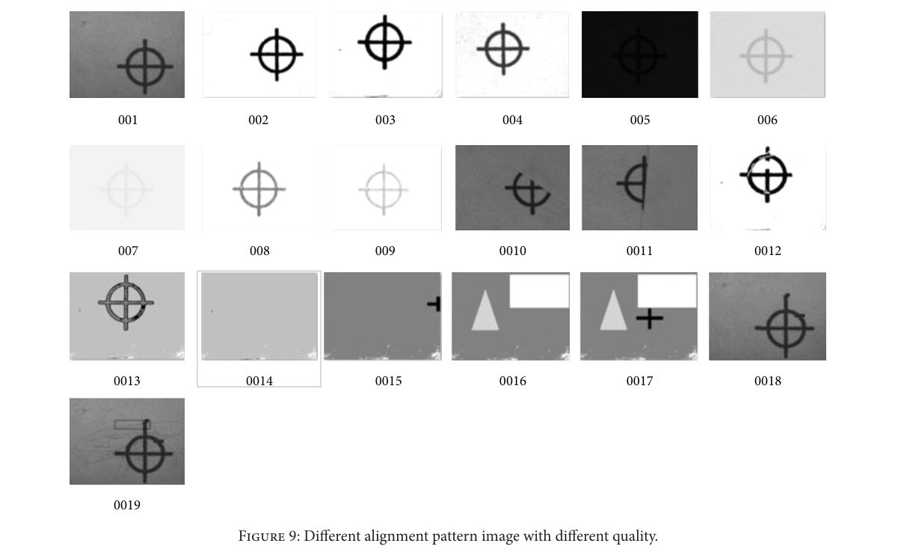
*그림 9 — 품질이 서로 다른 여러 정렬 패턴 영상(001~0019).*

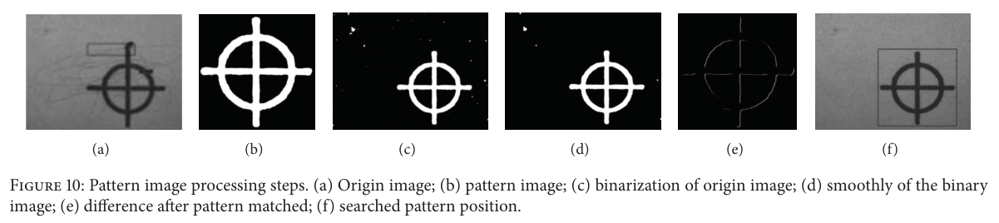
*그림 10 — 패턴 영상 처리 단계. (a) 원 영상, (b) 패턴 영상, (c) 원 영상의 이진화, (d) 이진 영상의 평활화, (e) 패턴 정합 뒤의 차이, (f) 탐색된 패턴 위치.*

탐색할 영상을 $I$, 패턴 영상을 $T$, 정합 점수를 $R$로 나타내자. 정합 점수는 다음 식으로 평가한다.

$$R(x, y) = \sum_{x}\sum_{y}\left[T(x', y') - I(x + x', y + y')\right]^2. \tag{12}$$

위 방법을 제곱 차 정합(square difference matching) 방법이라 한다. 완전히 일치하면 $R$은 0이고, 그렇지 않으면 잘못 일치할수록 $R$이 크다. $R$이 미리 정한 문턱값보다 작으면 표본 정합이 완료된다(그림 10(f)). 마크 인식 속도를 높이기 위해 이 연구에서는 영상 피라미드를 사용한다. 원 영상을 $I_0$, 패턴 영상을 $T_0$로 나타낸다. 원 영상과 패턴 영상의 1단계 영상 피라미드를 각각 $I_1$과 $T_1$, 2단계를 $I_2$와 $T_2$로 나타낸다. $I_1$과 $T_1$의 너비와 높이는 $T_0$와 $I_0$의 절반이다. $I_2$와 $T_2$의 영상 크기는 $I_0$와 $T_0$의 4분의 1이다. 따라서 $I_2$의 마크 인식 시간은 $I_0$보다 16배 빠르다. 탐색된 마크 위치를 $(x_2, y_2)$라 하자. 그러나 이 위치는 원 영상에서의 실제 마크 위치가 아니다. 그래서 $I_1$에 대해 마크 인식을 한다. 이번에는 전체 영상을 탐색할 필요가 없다. 직사각형 영역인 관심 범위(ROI)를 설정하고, ROI 안에서 마크 인식을 한다. ROI는 점 $(2x_2 - 0.5W_{T1} - 1, 2y_2 - 0.5H_{T1} - 1)$에서 점 $(2x_2 + 0.5W_{T1} + 1, 2y_2 + 0.5H_{T1} + 1)$까지이며, 여기서 $W_{TI}$와 $H_{T1}$은 $T_1$의 너비와 높이이다. 즉 두 번째 마크 인식의 영역은 $3\times3$으로 유지된다. 두 번째 마크 인식의 위치가 $(x_1, y_1)$이면, 마찬가지로 $I_0$에 대한 ROI를 설정한다. ROI의 왼쪽 위 점은 $(2x_1 - 0.5W_{T0} - 1, 2y_1 - 0.5H_{T0} - 1)$이고, ROI의 너비와 높이는 각각 $W_{T0} + 1$과 $H_{T0} + 1$이다. 여기서 $T_0$에 대한 마크 인식의 영역은 여전히 $3\times3$이다. 마크 인식 뒤에 마크 위치 $(x_0, y_0)$를 결정할 수 있다. 영상 피라미드는 영상을 작게 만들 뿐 아니라 크게 만들기도 한다. 위 절차를 한 번 하면, 처리된 영상 크기가 원 영상의 두 배가 될 때 마크 위치 $(x_1', y_1')$를 얻을 수 있다. 마크 위치를 원 영상으로 옮기면 마크 위치는 $(0.5x_1', 0.5y_1')$이다. 다시 말해 영상 피라미드 방법으로 영상을 $N$배 확대하면 마크 인식 분해능을 $N$배 높여 부화소 분해능을 얻을 수 있다. 그러나 $N$이 크면 마크 인식 시간이 길어진다.

## 4. 시스템 검증 (System Verification)

이 논문에서 시스템 검증에 사용한 동일평면 $XXY$ 스테이지는 Chiuan Yan Technology가 제작하였다. 운동 제어 카드는 NI PCI-7390이다. 산업용 카메라는 1X 저왜곡 텔레센트릭 렌즈를 장착한 Basler ace1300–30 gm이다. 광학 분해능은 약 3.75 $\mu$m이고, 시야(F.O.V)는 9.6 mm × 7.2 mm이다. 영상은 OpenCV로 처리한다. 스테이지는 Keyence GT2-H12K로 측정한다. 광학 시스템이 정렬 중일 때는 부화소를 사용하여 광학 시스템의 분해능을 4배 높인다. 즉 이론적으로 부화소 처리된 영상 분해능은 1 $\mu$m 미만이다.

*4.1. 스테이지 위치의 동기성(Synchronism of Stage Location).* $XXY$ 스테이지의 $X$ 방향 이동은 $m_1$과 $m_2$의 이동으로 이루어지므로, $m_1$과 $m_2$가 비동기이면 스테이지에 $\theta$ 변위가 생긴다. 그림 11과 같이 $XXY$ 스테이지가 $X$ 방향으로(0 mm에서 10 mm까지) 이동할 때 위치 결정 반복정밀도는 약 ±1 $\mu$m이다. 각도 오차는 매우 작고(5 arcsec 미만) 반복정밀도가 좋다. $Y$ 방향 간섭은 약 0.13%이다.

그림 11(e)와 11(f)로부터 $m_1$과 $m_2$의 평행도 성능이 좋음을 알 수 있다.

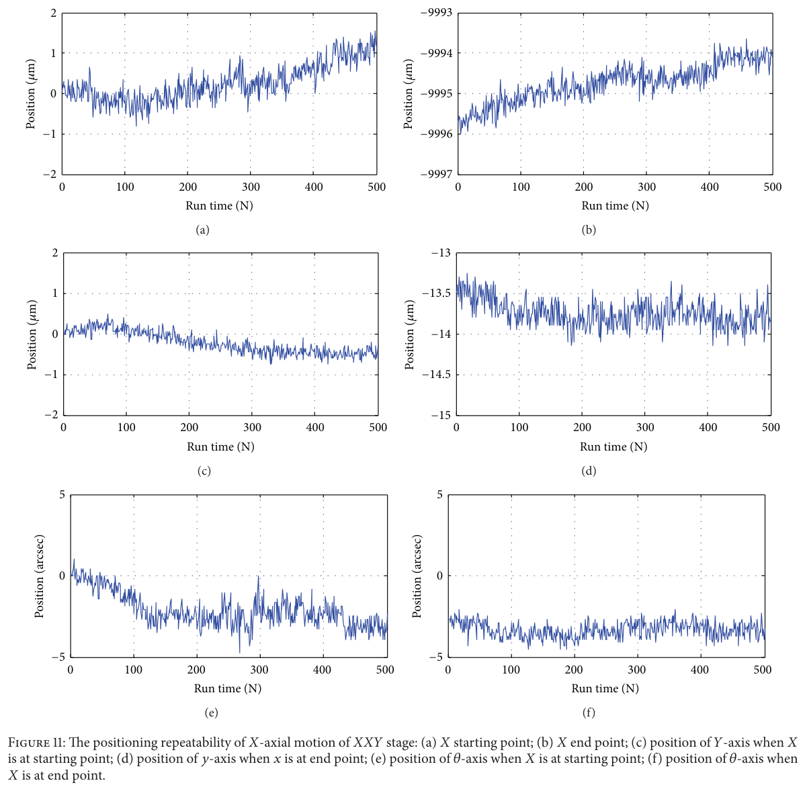
*그림 11 — $XXY$ 스테이지 $X$축 운동의 위치 결정 반복정밀도: (a) $X$ 시작점, (b) $X$ 끝점, (c) $X$가 시작점에 있을 때 $Y$축의 위치, (d) $x$가 끝점에 있을 때 $y$축의 위치, (e) $X$가 시작점에 있을 때 $\theta$축의 위치, (f) $X$가 끝점에 있을 때 $\theta$축의 위치. (가로축: 실행 횟수(Run time, N), 세로축: 위치(Position, $\mu$m 또는 arcsec))*

$XXY$ 스테이지의 $Y$ 방향 이동은 $m_3$의 이동으로 이루어진다. 그림 12와 같이 스테이지가 $Y$ 방향으로(0 mm에서 10 mm까지) 이동할 때 위치 결정 반복정밀도는 약 ±2 mm이다. [역주: 원문 표기 "±2 mm" 그대로. 그림 12의 축 단위로 보아 ±2 $\mu$m의 오기로 보인다.] $Y$가 행정 끝에 있을 때 각도 오차는 약 −109 arcsec이다. 반복정밀도는 여전히 좋으며, $X$ 방향 간섭은 약 0.35%이다. $X$ 방향의 큰 위치 결정 오차는 설치 오차 때문이 아니라 마찰력 때문이라고 추정한다. 그림 14와 같이 목표 변위를 $\delta_y$라 가정하면, 마찰력 때문에 모터 2의 $Y$ 방향 변위가 $\delta_y$보다 작다. 이 현상은 갠트리(gantry)형 스테이지와 유사하다. 그림 13은 회전 운동의 위치 결정 반복정밀도를 보여 주며, 스테이지를 0도에서 3도까지 회전하였다. 각도 위치 결정 반복정밀도는 ±0.001°(약 ±3 arcsec)이다.

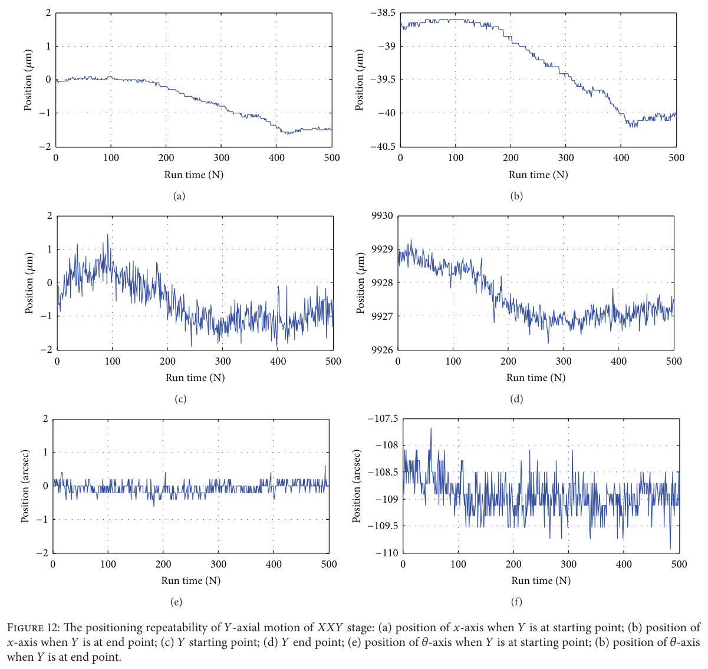
*그림 12 — $XXY$ 스테이지 $Y$축 운동의 위치 결정 반복정밀도: (a) $Y$가 시작점에 있을 때 $x$축의 위치, (b) $Y$가 끝점에 있을 때 $x$축의 위치, (c) $Y$ 시작점, (d) $Y$ 끝점, (e) $Y$가 시작점에 있을 때 $\theta$축의 위치, (b) $Y$가 끝점에 있을 때 $\theta$축의 위치. [역주: 마지막 항목 기호 "(b)"는 원문 그대로이며 (f)의 오기로 보인다.]*

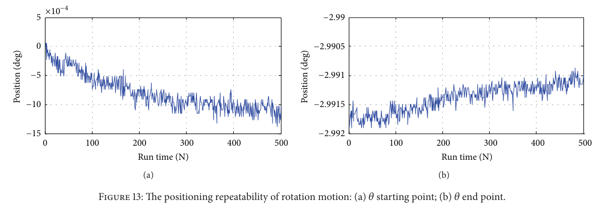
*그림 13 — 회전 운동의 위치 결정 반복정밀도: (a) $\theta$ 시작점, (b) $\theta$ 끝점. (세로축: 위치(Position, deg))*

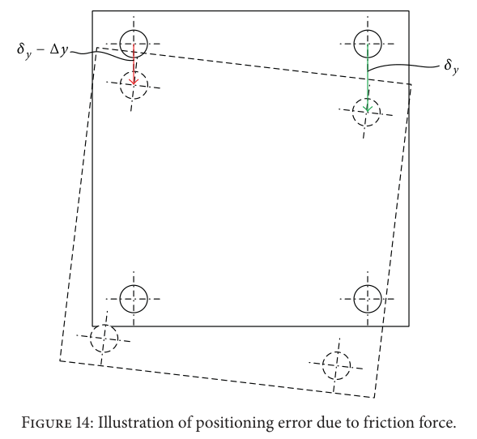
*그림 14 — 마찰력에 의한 위치 결정 오차의 도해.*

*4.2. 부동 기준점 시험(Floating Reference Point Test).* 부동 기준점의 실현 가능성을 검증하기 위해, 그림 15와 같이 CCD1에서 획득한 패턴 영상 중심(mark1)을 이동의 기준점으로 설정한다. 이상적으로는 기준 중심을 중심으로 스테이지를 회전해도 기준 중심이 바뀌지 않아야 한다. 표 2의 위쪽 부분은 mark1이 초기 중심 위치(−319.8 mm, 127.9 mm)에 있을 때 스테이지를 음의 각도로(한 번에 0.05°씩) 회전한 결과를 보여 준다. 표 2의 아래쪽 부분은 mark1이 초기 중심 위치(0 mm, 0 mm)에 있을 때 스테이지를 양의 각도로(한 번에 +0.05°씩) 회전한 결과를 보여 준다. [역주: 본문의 위치 단위 mm는 원문 그대로이며, 표 2의 단위는 $\mu$m이다.] 결과는 $X$ 방향과 $Y$ 방향의 기준 중심 차이량이 약 10 $\mu$m와 20 $\mu$m임을 보여 준다.

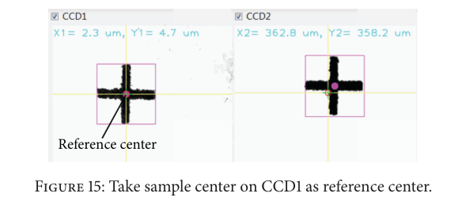
*그림 15 — CCD1의 표본 중심을 기준 중심으로 삼음. (Reference center: 기준 중심)*

**표 2** — CCD1 표본 중심을 중심으로 한 부동 기준점 이동 결과 (Result of floating reference point movement centered on CCD1 sample center.)

| 회전각(Rotation angle, degree) | 중심 위치 $x$ ($\mu$m) | 중심 위치 $y$ ($\mu$m) |
|---:|---:|---:|
| −0.5 | −326.7 | 113.7 |
| −0.45 | −326.0 | 116.0 |
| −0.4 | −326.7 | 113.7 |
| −0.35 | −326.7 | 114.4 |
| −0.3 | −325.2 | 119.2 |
| −0.25 | −323.3 | 123.9 |
| −0.2 | −322.9 | 130.2 |
| −0.15 | −323.7 | 130.2 |
| −0.1 | −322.9 | 128.6 |
| −0.05 | −321.4 | 124.7 |
| 0 | −319.8 | 127.9 |
| 0 | 0 | 0 |
| 0.05 | 1.5 | 0.8 |
| 0.1 | 1.5 | 1.6 |
| 0.15 | 2.3 | 3.9 |
| 0.2 | 3.8 | 2.4 |
| 0.25 | 5.4 | 2.4 |
| 0.3 | 6.1 | 6.3 |
| 0.35 | 6.9 | 4.7 |
| 0.4 | 7.7 | 7.9 |
| 0.45 | 9.2 | 14.2 |
| 0.5 | 10.7 | 17.4 |

*4.3. 정렬 반복정밀도 시험(Alignment Repeatability Test).* 실제 광학 정렬에는 그림 16과 같이 Chiuan Yan Technology가 제작한 터치 패널 검사기(정전용량 검사)를 시험 장비로 사용한다. 정렬 대상은 정전용량식 터치 패널 유리(10.5″, 232 mm(L) × 135 mm(W))였다. 시험 중에는 스테이지를 무작위로 움직여 유리가 정렬 목표점(또는 정렬 기준점)을 벗어나게 한 다음 정렬 절차를 시작하였다. 미리 정한 정렬 정확도는 ±1 $\mu$m였고, 각 정렬 운동의 최대 정렬 횟수는 3회였다. 실험 결과는 그림 17과 18에 나타내었다. 이 시스템의 각 정렬 운동은 1초보다 짧았고, 각 정렬 운동은 3회 이내의 보정으로 완료할 수 있었다. 시스템의 정렬 정확도는 ±1 $\mu$m와 ±5 arcsec였다.

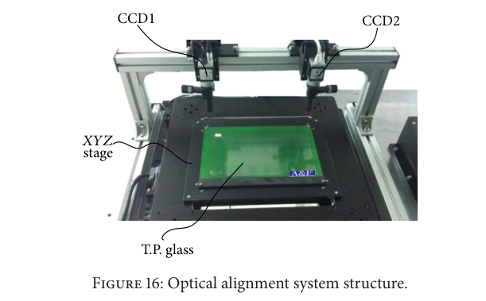
*그림 16 — 광학 정렬 시스템 구조. (CCD1, CCD2, $XYZ$ 스테이지(원문 표기 "XYZ stage"), T.P. 유리(T.P. glass))*

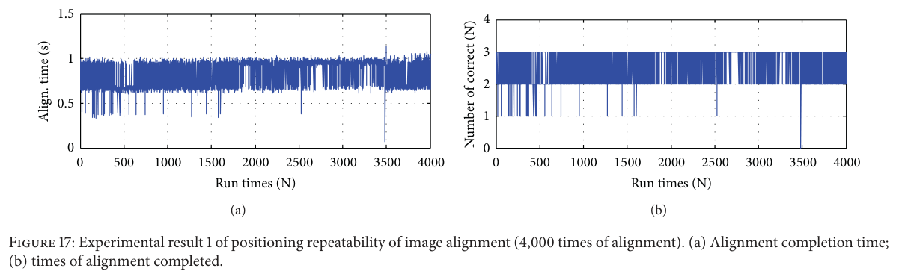
*그림 17 — 영상 정렬의 위치 결정 반복정밀도 실험 결과 1(정렬 4,000회). (a) 정렬 완료 시간, (b) 정렬 완료까지의 횟수. (가로축: 실행 횟수(Run times, N), 세로축: (a) 정렬 시간(Align. time, s), (b) 보정 횟수(Number of correct, N))*

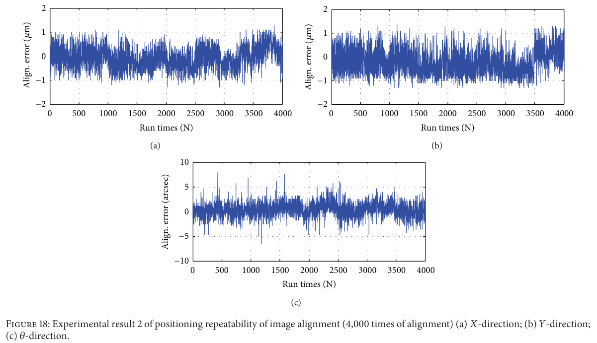
*그림 18 — 영상 정렬의 위치 결정 반복정밀도 실험 결과 2(정렬 4,000회). (a) $X$ 방향, (b) $Y$ 방향, (c) $\theta$ 방향. (세로축: 정렬 오차(Align. error, $\mu$m 또는 arcsec))*

## 5. 결론 (Conclusions)

이 논문은 특수 설계된 동일평면 $XXY$ 스테이지를 사용한 시각 서보 제어 및 영상 정렬 시스템을 제안하였다. 기구학 해석과 설치 오차의 영향도 논의하였다. 작업물 중심과 스테이지 기준점의 변화가 각 정렬 과정에 주는 영향을 줄이기 위해 부동 기준점 기반 영상 정렬 방법을 제시하였다. 이 방법은 작업물이 바뀔 때 적응성이 더 좋으며, 안정적인 동일평면 $XXY$ 스테이지 시스템이 있으면 고정밀 영상 정렬을 구현할 수 있다. 따라서 이 시스템은 좋은 안정성도 보인다. 이 시스템의 각 정렬 운동은 1초보다 짧았고, 각 정렬 운동은 3회 이내의 보정으로 완료할 수 있었다. 시스템의 정렬 정확도는 ±1 $\mu$m와 ±5 arcsec였다.

## 감사의 글 (Acknowledgment)

이 연구는 대만 국가과학위원회(National Science Council, Taiwan)의 지원을 받았다(NSC. 100-2221-E-005-091-MY3 및 NSC 101-2218-E-005-004-).

## 참고문헌

- [1] W. M. Kuo, S. F. Chuang, C. Y. Nian, and Y. S. Tarng, “Precision nano-alignment system using machine vision with motion controlled by piezoelectric motor,” Mechatronics, vol. 18, no. 1, pp. 21–34, 2008.
- [2] Y.-H. Lin, C.-H. Chen, and C.-C. Wei, “New method for subpixel image matching with rotation invariance by combining the parametric template method and the ring projection transform process,” Optical Engineering, vol. 45, no. 6, Article ID 067202, 2006.
- [3] J.-H. Lee, Y.-S. Kim, S.-R. Kim, I.-H. Lee, and H.-J. Pahk, “Real-time application of critical dimension measurement of TFT-LCD pattern using a newly proposed 2D image-processing algorithm,” Optics and Lasers in Engineering, vol. 46, no. 7, pp. 558–569, 2008.
- [4] Y.-S. Li, T. Y. Young, and J. A. Magerl, “Subpixel edge detection and estimation with a microprocessor-controlled line scan camera,” IEEE Transactions on Industrial Electronics and Control Instrumentation, vol. 35, no. 1, pp. 105–112, 1988.
- [5] S.-J. Huang and S.-Y. Lin, “Application of visual servo-control X-Y table in color filter cross mark alignment,” Sensors and Actuators A, vol. 152, no. 1, pp. 53–62, 2009.
- [6] S. Mori, Y. Sato, A. Sakurada, A. Naganawa, Y. Shibuya, and G. Obinata, “Nano-motion stage for high-speed and precision positioning on an X-Y plane,” IEEE Transactions on Magnetics, vol. 45, no. 11, pp. 4972–4978, 2009.
- [7] C. H. Liu and W.-Y. Jywe, “A four-degrees-of-freedom microstage for the compensation of eccentricity of a roundness measurement machine,” International Journal of Machine Tools and Manufacture, vol. 44, no. 4, pp. 365–371, 2004.
- [8] W.-Y. Jywe, Y.-R. Jeng, C.-H. Liu et al., “A novel 5DOF thin coplanar nanometer-scale stage,” Precision Engineering, vol. 32, no. 4, pp. 239–250, 2008.
- [9] C.-H. Liu, W.-Y. Jywe, Y.-R. Jeng, T.-H. Hsu, and Y.-T. Li, “Design and control of a long-traveling nano-positioning stage,” Precision Engineering, vol. 34, no. 3, pp. 497–506, 2010.
- [10] H. J. Yim, Y. H. Lee, S. H. Lee, J. Il Jeong, and S.-H. Lim, “Multi-layer alignment control of a large area nano-imprinting stage,” Journal of Mechanical Science and Technology, vol. 23, no. 4, pp. 1094–1097, 2009.

> (PDF 13쪽) 데이터베이스 저작권 고지: Mathematical Problems in Engineering의 저작권은 Hindawi Publishing Corporation에 있으며, 저작권자의 명시적 서면 허가 없이 그 내용을 여러 사이트에 복사·이메일로 보내거나 리스트서브에 게시할 수 없다. 다만 사용자는 개인 용도로 논문을 인쇄, 다운로드, 이메일로 보낼 수 있다.

