# 시각 서보에서의 측정 오차 (Kyrki 2004/2006)

- 원제: Measurement Errors in Visual Servoing
- 원문: 같은 폴더의 `Kyrki_MeasurementErrorsVisualServoing_preprint.pdf` (Elsevier Science 투고 사전 인쇄본, 2006년 4월 24일, 25쪽. 저자 V. Kyrki(Lappeenranta University of Technology), D. Kragic, H.I. Christensen(Royal Institute of Technology, Centre of Autonomous Systems). 일부 내용은 ICRA 2004 학회 논문 [7]로 발표됨)
- 번역 범위: 전문 (본문·각주·그림 캡션. 참고문헌은 원문 그대로)
- 그림: 원문 그림 13개를 `그림/`에 넣고 본문에서 처음 언급되는 곳에 삽입

> 각주: ∗ 교신 저자. 이메일 주소: kyrki@lut.fi (V. Kyrki), danik@nada.kth.se (D. Kragic), hic@nada.kth.se (H.I. Christensen). ¹ V. Kyrki는 핀란드 아카데미(Academy of Finland)의 연구비 지원을 받았다.

## 초록

이 논문은 시각 서보(visual servoing)에서의 측정 오차 문제를 다룬다. 비전 기반 상태 추정의 오차 특성과 그에 따른 제어의 불확도(uncertainty)를 조사한다. 주된 기여는 영상 오차가 자세 추정(pose estimation)과 시각 서보 제어 법칙을 거쳐 전파되는 과정의 분석이다. 이 분석을 사용해 두 가지 고전적 시각 서보 방법, 즉 위치 기반(position-based) 시각 서보와 2 1/2 D 시각 서보를 평가한다. 이 평가는 전환(switching) 제어나 분할(partitioning) 제어 같은 하이브리드 제어 시스템을 구축하고 분석하는 도구를 제공한다.

핵심어: 시각 서보, 측정 오차, 오차 추정

## 1. 서론 (Introduction)

로봇 운동의 폐루프 제어에 시각 피드백을 사용하는 것, 즉 시각 서보는 지난 20년 동안 상당한 주목을 받아 왔다[1], [2]. 핵심 연구 문제 대부분은 측정 오차와 시스템 모델링 오차가 있을 때 시각 서보 방법의 성능과 관련되어 있었다. 그 결과 영상 기반 및 위치 기반 시각 서보의 고유한 문제에 대처하기 위해 다수의 변형과 하이브리드 시각 서보 접근법이 문헌에서 제안되었다.

카메라 보정(캘리브레이션) 오차의 영향 같은 특정 문제는 [3]에서 연구되었다. 시스템의 제어 부분의 수렴 성질은 [4,5]에서 논의된 것처럼 대부분의 경우에 대해 알려져 있다. 시스템의 수렴은 필수적인 성능 특성이지만, 생성되는 로봇 궤적과 그 불확도에 대해서는 많은 것을 드러내지 않는다.

카메라 보정 절차는 지난 10년간 엄청나게 개선되었다. 그러나 완벽한 보정조차 영상 해상도의 제약을 극복하지 못하며, 영상 형성 과정은 제어에 불확도를 일으킨다. 이 사실에 동기를 얻어, 이 연구에서는 서로 다른 유형의 시각 서보 방법, 즉 위치 기반[1]과 하이브리드[6] 방법을 분석하고 비교하는 데 오차 전파(error propagation)를 사용할 것을 제안한다.

모델링 과정의 공통 기반을 마련하기 위해, 그림 1에 보인 이 연구에서 고려하는 시각 서보 시스템의 모델링을 위한 기본 표기부터 시작한다. 여기서 $s$는 영상 측정값을, ${}^oT_{c^*}$는 원하는 카메라 자세(위치와 방향)를 측정된 대상 물체와 관련짓는 강체 변환을 나타낸다. 마찬가지로 ${}^cT_o$는 카메라에 대한 물체의 현재 측정 자세이다. 시스템은 자세 추정, 서보 전략, 제어 전략의 세 부분으로 나뉜다. 이 모델은 대부분의 위치 기반 및 하이브리드 접근법에 사용할 수 있다. 이는 아이-인-핸드(eye-in-hand) 구성을 기반으로 하며, 서보의 목표는 카메라를 대상에 대해 원하는 자세로 가져가는 것으로 정의되는데, 이를 흔히 보여 주며 가르치기(teach-by-showing) 접근법이라 한다. 자세 추정 부분은 대상의 완전한 3-D 자세를 계산할 수도 있고, 호모그래피(homography) 또는 에피폴라(epipolar) 기반 기법을 사용해 부분 자세를 추론할 수도 있다. 하이브리드 접근법의 경우, 영상 특징을 특정 자유도를 제어하는 데 직접 사용한다. 서보 전략의 선택은 오차 함수의 모델링에 기반하므로 로봇 궤적에 큰 영향을 미친다. 반면 예컨대 비례 제어 법칙 같은 제어 전략은 특히 움직이는 대상의 경우 수렴 성질에 영향을 미친다. 관련 좌표계는 그림 2에 나타냈다.

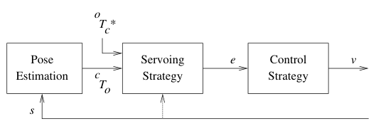
*그림 1 — 시스템 모델 (자세 추정 → 서보 전략 → 제어 전략).*

영상 오차 모델링 방법에 대해 시각 서보 접근법들을 비교하려면 공통 기준을 정의해야 한다. 영상 측정의 오차를 실제 액추에이터 운동까지 전파하여 시스템의 민감도를 연구하는 것이 합리적으로 보이므로, 직교 좌표(Cartesian) 제어기의 제어 출력을 기준으로 사용한다. 따라서 우리의 접근법은 영상 측정의 불확도에 대한 직교 좌표 제어의 불확도를 예측한다. 영상 평면 추적에는 매우 다양한 방법을 적용할 수 있으므로, 영상 측정의 불확도를 자세히 분석하기보다 영상 불확도를 가우시안 분포로 모델링한다. 이 논문에서는 대응(correspondence) 문제를 고려하지 않는다. 시각 서보에서는 대응을 프레임 간에 추적할 수 있어 대응 문제가 단순해지기 때문이다. 서보 모델을 하위 시스템으로 나누면 완전한 시스템의 거동뿐 아니라 그 구성 요소들도 비교할 수 있다. 나아가 오차 분석을 사용해 위치 기반 시각 서보[1]와 [6]에서 제안된 2.5D 시각 서보라 불리는 하이브리드 접근법을 비교한다.

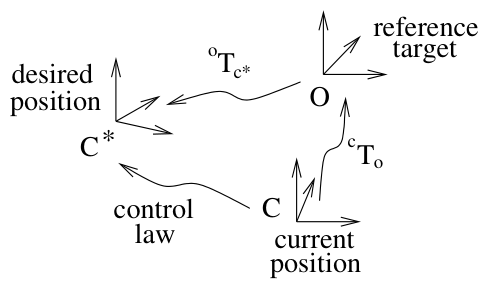
*그림 2 — 좌표계 (원하는 위치 $C^*$, 현재 위치 $C$, 기준 대상 $O$, 제어 법칙).*

논문의 나머지 구성은 다음과 같다. 2절에서 관련 연구를 개관하고 여기서 제시하는 연구의 동기를 제공한다. 3절에서는 자세 추정 알고리즘을 기술하고 그 오차 전파를 분석한다. 4절과 5절은 위치 기반 서보와 하이브리드 서보 및 그 분석을 제시한다. 6절은 자세 추정 불확도의 분석을 모든 최적화 기반 알고리즘으로 확장한다. 해석적 결과는 7절에서 몬테카를로(Monte-Carlo) 시뮬레이션 실험으로 검증하며, 7절에서는 서로 다른 접근법의 장점도 논의한다. 마지막으로 8절에서 요약과 결론을 제시한다. 이 연구의 일부는 [7]에서 발표되었다.

## 2. 관련 연구 (Related work)

이 논문에서 제시하는 연구는 자세 추정 알고리즘의 분석과 밀접하게 관련되어 있다. 가장 일반적인 접근법은 물체의 3D 모델이 주어지고 2D-3D 대응에 기반해 그 자세를 추정하는 경우를 고려한다. 널리 연구된 문제이지만, 제안된 방법 대부분은 반복적(iterative)이어서 "실시간"이 요구 사항인 시각 서보 맥락에서는 단점이 된다. 임의 개수의 특징점을 사용하는 점 특징 기반 자세 추정에 대해서는 몇 가지 닫힌 형태의 해가 있다[8–11]. 이 논문에서는 Fiore [10]가 제안한 알고리즘을 [12]와 [13]에서 제안된 방법과 함께 사용했다. 제안된 평가 틀에서는 다른 어떤 자세 추정 알고리즘도 사용할 수 있다는 점에 유의해야 한다.

구조-운동 복원(structure-from-motion) 연구에는 선형 오차 전파에 기반한 민감도 분석(예: [13])이 있지만, 저자들이 아는 한 자세 추정에 대해서는 그에 상응하는 분석이 발표되지 않았다. Haralick은 영상 잡음이 특정 문턱을 넘으면 자세 추정이 붕괴함을 실험적으로 보였다[14]. Ansar 등은 행렬 섭동 이론에서 유도한 오차의 상한을 결과로 하는 민감도 분석을 제시했다[11]. 그들의 실험은 그 한계가 매우 보수적이어서, 이 연구에서 다루는 것처럼 서로 다른 시스템을 비교하는 데에는 잘 맞지 않음을 보여 준다.

시각 서보의 오차 특성은 보통 다음 두 관점 중 하나에서 조사된다. 폐루프 시스템의 안정성, 또는 정상상태 오차이다[15]. 위치 기반 시각 서보(PBVS)의 수렴은 자세 추정에서의 안정성 상실로 저해될 수 있음이 알려져 있다[4]. 2.5D 서보는 부분 자세 추정이 불안정해지지 않는 한 이 문제를 겪지 않는 것으로 보인다[5]. Deng [15]은 정상상태 오차를 시각 서보의 민감도 척도로 사용할 것을 제안했다. 그러나 긴 궤적을 실행하는 경우에는, 예컨대 오차가 있을 때 적절한 궤적의 집합을 예측하기 위해 궤적을 따라 시스템의 민감도를 추정하는 것이 중요하다. 또 다른 접근법은 영상 데이터의 이상치(outlier)를 고려하는 것이다. Comport 등[16]은 이상치 처리를 제어 법칙에 내장하여 강건성을 높이는 방식을 제안했다. 이상치 제거는 영상 처리 단계에서 수행할 수도 있다[17].

최근 Gans 등[18]은 위치 기반 서보와 영상 기반 서보 사이를 전환하는 방식을 제안했다. 우리는 우리의 오차 모델링이 현재 미해결 문제인 전환 전략 설계에 사용될 수 있으리라 전망한다.

## 3. 자세 추정 (Pose estimation)

이 절에서는 먼저 사용한 자세 추정 알고리즘을 기술한다. 이는 Fiore [10]와 Weng 등[13]의 이전 연구에 기반한다. 이어서 오차 전파를 분석한다. 시각 서보에서는 특징을 프레임 간에 추적할 수 있어 대응 문제가 주로 자세의 초기 추정에만 적용되므로, 여기서는 대응 문제를 다루지 않는다. 초기에는 예컨대 관심점 기술자(interest point descriptor)를 사용해 대응을 찾을 수 있다(예: [19]).

### 3.1 추정 알고리즘 (Estimation algorithm)

외부 표정(exterior orientation) 문제로도 알려진 자세 추정은, 알려진 3D 특징점 집합 $\mathbf{a}_i$를 대응하는 영상 평면 투영 $(x_i, y_i)$ 집합과 정렬시키는, 평행이동 $\mathbf{t}$와 회전 $\mathbf{R}$로 이루어진 상사 변환(similarity transform)을 찾는다. 일반성을 잃지 않고 카메라의 초점 거리를 단위 길이로 가정할 수 있다. 그러면 평행이동과 회전은 다음 연립 방정식을 가장 잘 만족하는 것이다.

$$l_i\begin{bmatrix} x_i & y_i & 1\end{bmatrix}^T = s\mathbf{R}(\mathbf{a}_i + \mathbf{t}), \quad i = 1, \ldots, N \tag{1}$$

여기서 $l_i$는 사영 파라미터(projective parameter), $s$는 척도 인자, $N$은 특징점의 수이다.

이 연구에서는 먼저 [10]을 따라 파라미터 $l_i$를 푼다. 우변이 0이 되도록 (1)의 $N$개 방정식의 선형 결합을 찾는다. 3D 점에 대한 데이터 행렬 $\mathbf{P}$를

$$\mathbf{P} = \begin{pmatrix} \mathbf{a}_1 & \cdots & \mathbf{a}_N \\ 1 & \cdots & 1 \end{pmatrix} \tag{2}$$

로 정의하면, 다음을 만족하는 가중 행렬 $\mathbf{W} \in \mathbb{R}^{N\times(N-4)}$를 찾음으로써 선형 결합을 구할 수 있다.

$$\mathbf{P}\mathbf{W} = \mathbf{0}. \tag{3}$$

따라서 $\mathbf{W}$는 $\mathbf{P}$의 영공간(null space)을 나타내며, $\mathbf{P}$의 특잇값 분해(SVD)로부터 영공간에 대응하는 $\mathbf{P}$의 $N-4$개 우특이벡터(right singular vector)의 행렬로 구할 수 있다. 이 때문에 $\mathbf{W}$의 각 열에 대응하는 각 선형 결합에 대해 다음이 성립한다.

$$\sum_{i=1}^{N} w_{ij}\,l_i\begin{bmatrix} x_i \\ y_i \\ 1\end{bmatrix} = \mathbf{0} \quad \text{for } j = 1, \ldots, N-4. \tag{4}$$

사영 파라미터 벡터 $\mathbf{l} = [l_1, \ldots, l_N]$을 정의하면 이를 $\mathbf{G}\mathbf{l} = \mathbf{0}$으로 쓸 수 있으며, 여기서

$$\mathbf{G} = \begin{bmatrix} w_{1,1}\begin{bmatrix}x_1 & y_1 & 1\end{bmatrix}^T & \cdots & w_{N,1}\begin{bmatrix}x_N & y_N & 1\end{bmatrix}^T \\ \vdots & & \vdots \\ w_{1,1}\begin{bmatrix}x_1 & y_1 & 1\end{bmatrix}^T & \cdots & w_{N,1}\begin{bmatrix}x_N & y_N & 1\end{bmatrix}^T \end{bmatrix}. \tag{5}$$

[역주: 원문 (5)의 마지막 블록 행도 $w_{1,1}, \ldots, w_{N,1}$로 인쇄되어 있으나, 문맥상 $w_{1,N-4}, \ldots, w_{N,N-4}$를 뜻하는 것으로 보인다. 원문대로 옮겼다.]

$\mathbf{G}$의 세 번째 행마다 $\mathbf{W}$의 한 열이 된다는 점에 주목하면, $\mathbf{l}$은 $\mathbf{P}^T$가 생성하는 $\mathbf{W}$의 좌영공간(left null space)에 있어야 한다. 따라서 미지 벡터 $\boldsymbol{\alpha} \in \mathbb{R}^4$에 대해 $\mathbf{l} = \mathbf{P}^T\boldsymbol{\alpha}$로 쓸 수 있다. 그러면 $\boldsymbol{\alpha}$는 다음 동차 선형 연립 방정식의 해로 구할 수 있다.

$$\mathbf{C}\boldsymbol{\alpha} \equiv \begin{bmatrix} W_{1,1}\begin{pmatrix}x_1\\y_1\end{pmatrix} & \cdots & W_{N,1}\begin{pmatrix}x_N\\y_N\end{pmatrix} \\ \vdots & & \vdots \\ W_{1,N-4}\begin{pmatrix}x_1\\y_1\end{pmatrix} & \cdots & W_{N,N-4}\begin{pmatrix}x_N\\y_N\end{pmatrix}\end{bmatrix}\mathbf{P}^T\boldsymbol{\alpha} = \mathbf{0}. \tag{6}$$

보통 이 시스템은 과잉 결정(overconstrained)되어 있으며, 해는 $\mathbf{C}^T\mathbf{C}$의 가장 작은 고윳값에 대응하는 고유벡터로 구할 수 있다. 이로부터 사영 파라미터 집합 $\mathbf{l}$을 얻는다.

이제 척도를 포함한 절대 방향(absolute orientation)만 복원하면 된다. $l_i$를 알면 (1)을 다음과 같이 쓸 수 있다.

$$\mathbf{b}_i = s\mathbf{R}(\mathbf{a}_i + \mathbf{t}), \quad i = 1, \ldots, N \tag{7}$$

여기서 $\mathbf{b}_i = [l_ix_i, l_iy_i, l_i]^T$이다. 미지 척도 파라미터 $s$는 두 점 집합 $\mathbf{a}_i$와 $\mathbf{b}_i$를 중심화하고 중심화된 벡터들의 길이 비를 살펴 풀 수 있다. $\bar{\mathbf{a}}$와 $\bar{\mathbf{b}}$를 집합 $\mathbf{a}_i$와 $\mathbf{b}_i$의 평균이라 하자. 그러면 중심화된 벡터는 $\tilde{\mathbf{a}}_i = \mathbf{a}_i - \bar{\mathbf{a}}$, $\tilde{\mathbf{b}}_i = \mathbf{b}_i - \bar{\mathbf{b}}$로 정의할 수 있다. 중심화된 점 벡터의 길이는 회전에 불변이므로, 회전을 무시하고 다음으로부터 최적 최소제곱 척도를 구할 수 있다.

$$s = \frac{\sum_i \|\tilde{\mathbf{a}}_i\|\|\tilde{\mathbf{b}}_i\|}{\sum_i \|\tilde{\mathbf{a}}_i\|^2}. \tag{8}$$

$s$를 알면, 중심화된 점 집합 사이의 제곱 오차 합 $\sum_i\|\tilde{\mathbf{b}}_i - s\mathbf{R}\tilde{\mathbf{a}}_i\|_2^2$를 최소화하는 회전 행렬을 찾고자 하며, 이는 행렬 형태로

$$\|\mathbf{B} - \mathbf{R}\mathbf{A}\|_F^2 \tag{9}$$

로도 쓸 수 있다. 여기서

$$\mathbf{A} = s\begin{bmatrix}\tilde{\mathbf{a}}_1 & \ldots & \tilde{\mathbf{a}}_N\end{bmatrix}, \quad \mathbf{B} = \begin{bmatrix}\tilde{\mathbf{b}}_1 & \ldots & \tilde{\mathbf{b}}_N\end{bmatrix}$$

이고 $\|\cdot\|_F$는 프로베니우스 노름(Frobenius norm)을 나타낸다. 이른바 직교 프로크루스테스(Orthogonal Procrustes) 문제인 이 문제는 Fiore가 제안한 것처럼 SVD로 풀 수 있지만, 우리는 [13]에서 제시된 것처럼 단위 쿼터니언(unit quaternion)을 사용해 회전을 풀기로 한다. 그들이 이미 적합한 오차 분석을 제안했기 때문이다. 이 방법은 실제로는 이미 [12]에서 제안되었다. 다음에 방법의 개요를 제시하며, 세부 사항은 원 출처를 참고하기 바란다.

회전은 임의의 벡터 $\mathbf{a}$에 대해 다음을 만족하는 단위 쿼터니언 $\mathbf{q}$로 나타낼 수 있다.

$$\mathbf{q} * \mathbf{a} * \tilde{\mathbf{q}} \,\hat{=}\, \mathbf{R}\mathbf{a} \tag{10}$$

여기서 $\tilde{\mathbf{q}}$는 $\mathbf{q}$의 쿼터니언 켤레, $*$는 쿼터니언 곱, $\mathbf{R}$은 대응하는 회전 행렬이다. (10)에 사용한 쿼터니언 곱은, 벡터의 외적을 반대칭(skew-symmetric) 행렬로 쓰는 것과 비슷하게 행렬 곱으로 쓸 수 있다. 쿼터니언의 기본 성질을 사용해 약간 변형하면, 최소화 문제 (9)는 쿼터니언의 행렬 표현을 사용해 다음의 최소화로 쓸 수 있다.

$$\min_{\|\mathbf{q}\|=1}\mathbf{q}^T\mathbf{E}\mathbf{q} \tag{11}$$

여기서 $\mathbf{E}$는 다음과 같이 정의된다.

$$\mathbf{E} = \sum_{i=1}^{N}\mathbf{E}_i^T\mathbf{E}_i \quad \text{with} \quad \mathbf{E}_i = \begin{pmatrix} 0 & (\mathbf{A}_i - \mathbf{B}_i)^T \\ \mathbf{B}_i - \mathbf{A}_i & [\mathbf{A}_i + \mathbf{B}_i]_\times \end{pmatrix}. \tag{12}$$

여기서 $\mathbf{A}_i$와 $\mathbf{B}_i$는 각각 $\mathbf{A}$와 $\mathbf{B}$의 $i$번째 열을 나타내고, $[\cdot]_\times$는 외적에 대응하는 반대칭 행렬을 나타낸다. 회전을 나타내는 단위 쿼터니언 $\mathbf{q}$는 (11)의 최소화로, $\mathbf{E}$의 가장 작은 고윳값에 대응하는 고유벡터로 구할 수 있다.

쿼터니언 $\mathbf{q} = (q_0, q_1, q_2, q_3)^T$를 알면 회전 행렬은 다음과 같이 계산할 수 있다.

$$\mathbf{R} = \begin{pmatrix} q_0^2+q_1^2-q_2^2-q_3^2 & 2(q_1q_2-q_0q_3) & 2(q_1q_3+q_0q_2) \\ 2(q_1q_2+q_0q_3) & q_0^2-q_1^2+q_2^2-q_3^2 & 2(q_2q_3-q_0q_1) \\ 2(q_1q_3-q_0q_2) & 2(q_0q_1+q_2q_3) & q_0^2-q_1^2-q_2^2+q_3^2 \end{pmatrix}. \tag{13}$$

마지막으로 평행이동은 $\mathbf{t} = s^{-1}\mathbf{R}^T\bar{\mathbf{b}} - \bar{\mathbf{a}}$로 구하며, 여기서 $\bar{\mathbf{a}}$와 $\bar{\mathbf{b}}$는 점 집합의 무게중심이다.

### 3.2 오차 분석 (Error analysis)

이 논문의 오차 분석은 1차 오차 전파(first-order error propagation)[20]에 기반한다. 이 분석의 목표는 영상 평면 좌표의 분산에 대한 자세 추정치의 공분산을 구하는 것이다. 최악의 경우 오차 한계를 찾는 방식으로도 오차를 분석할 수 있지만, 이는 작은 오차에만 적합한 지나치게 보수적인 한계를 줄 수 있다. 실제로는 자세 추정에서 데이터의 중복 가능성(즉, 필요한 것보다 많은 특징을 가지는 것)이 잡음이 있을 때에도 안정적인 해를 찾게 해 준다.

이 논문에서는 자세 추정치의 오차가 특징의 영상 좌표에 있는 잡음에서 비롯된다고 가정한다. 그 원천에는 공간 양자화, 특징 검출, 카메라 왜곡이 포함된다. 그러나 체계적인 보정 오차는 없다고 가정하므로, 영상 잡음은 평균이 0인 확률 변수로 모델링할 수 있다. 또한 점들 사이의 오차는 상관되어 있지 않다고 가정한다.

$\mathbf{x}$를 특징의 영상 좌표 벡터 $\mathbf{x} = (x_1, \ldots, x_N, y_1, \ldots, y_N)^T$라 하자. 오차 분석 문제를, $\delta_\mathbf{t} = \mathbf{D}_\mathbf{t}\delta_\mathbf{x}$와 $\delta_\mathbf{R} = \mathbf{D}_\mathbf{R}\delta_\mathbf{x}$가 $\mathbf{x}$의 오차에 대한 $\mathbf{t}$와 $\mathbf{R}$의 선형 오차 추정치가 되도록 하는 행렬 $\mathbf{D}_\mathbf{t}$와 $\mathbf{D}_\mathbf{R}$을 찾는 문제로 정식화한다. 다시 말해 측정값 $\mathbf{x}$는 가산 잡음의 영향을 받아 $\mathbf{x} = \mathbf{x}_0 + \delta_\mathbf{x}$이며, $\mathbf{x}_0$는 참값이다. 그러면 함수 $\mathbf{t}(\mathbf{x})$에 대해 1차 테일러 전개를 사용해 현재 측정값 주변에서의 거동을 살핀다. 이로써 $\mathbf{t}(\mathbf{x})$의 오차 추정치를 $\delta_\mathbf{t}(\mathbf{x}) = \frac{\partial\mathbf{t}(\mathbf{x})}{\partial\mathbf{x}}\delta_\mathbf{x}$로 쓸 수 있다. 여기서 $\mathbf{D}_\mathbf{t}$는 단지 기울기 $\frac{\partial\mathbf{t}(\mathbf{x})}{\partial\mathbf{x}}$이다. 알고리즘의 여러 단계를 거치므로, 기울기를 구하는 데 미분의 연쇄 법칙을 사용할 수 있다. 즉 각 단계의 기울기를 따로 계산할 수 있다.

벡터에 대해 $\Gamma$로 공분산 행렬을 나타내자. 예: $\Gamma_\mathbf{x} = E[\delta_\mathbf{x}\delta_\mathbf{x}^T]$. 입력의 공분산과 선형 사상을 알면 회전과 평행이동의 공분산 행렬은 $\Gamma_\mathbf{R} = \mathbf{D}_\mathbf{R}\Gamma_\mathbf{x}\mathbf{D}_\mathbf{R}^T$, $\Gamma_\mathbf{t} = \mathbf{D}_\mathbf{t}\Gamma_\mathbf{x}\mathbf{D}_\mathbf{t}^T$로 쓸 수 있다. 행렬 $\mathbf{R}$은 행렬의 열들을 하나의 벡터로 이어 붙인 벡터 $\mathbf{r}$로 나타내야 한다는 점에 유의하라. 따라서 $\delta_\mathbf{R}$은 이 벡터의 오차이다. 이 표기는 행렬에 대응하는 벡터를 나타내는 데 채택하며, 예컨대 $\mathbf{c}$는 행렬 $\mathbf{C}$에 대응하는 벡터이다.

$\mathbf{D}_\mathbf{t}$와 $\mathbf{D}_\mathbf{R}$이 $\mathbf{x}$와 모든 $\mathbf{a}_i$의 값, 즉 영상 측정값과 물체 모델 모두에 의존한다는 것은 분명하다. 이제 오차를 자세 추정 알고리즘을 통해 전파한다. 먼저 (3)의 $\mathbf{W}$는 불확도가 없는 행렬 $\mathbf{P}$에만 의존함을 알 수 있다. 행렬 $\mathbf{C}$ (6)의 불확도는 $\mathbf{x}$에서 행렬 $\mathbf{C}$의 벡터 표현인 $\mathbf{c}$로의 변환을 나타내는 행렬 $\mathbf{G}_\mathbf{C}$($\delta_\mathbf{c} = \mathbf{G}_\mathbf{C}\delta_\mathbf{x}$)를 찾아 구할 수 있다. 이 연산은 선형이므로 근사가 필요 없다. 이 행렬은 다음과 같이 쉽게 구할 수 있다.

$$\mathbf{G}_\mathbf{C} = \begin{pmatrix} \mathbf{Q}_1 & \mathbf{0} & \mathbf{Q}_2 & \mathbf{0} & \mathbf{Q}_3 & \mathbf{0} & \mathbf{Q}_4 & \mathbf{0} \\ \mathbf{0} & \mathbf{Q}_1 & \mathbf{0} & \mathbf{Q}_2 & \mathbf{0} & \mathbf{Q}_3 & \mathbf{0} & \mathbf{Q}_4 \end{pmatrix}^T \tag{14}$$

여기서

$$\mathbf{Q}_i = \begin{pmatrix} W_{1,1}P_{i,1} & \cdots & W_{1,N-4}P_{i,1} \\ \vdots & & \vdots \\ W_{N,1}P_{i,N} & \cdots & W_{N,N-4}P_{i,N} \end{pmatrix}.$$

다음으로 $\mathbf{C}^T\mathbf{C}$의 오차에 대한 선형 추정치를 구한다. 벡터 $\delta_\mathbf{c}$에 대응하는 오차 행렬을 $\Delta_\mathbf{C}$로 나타내면, 선형 추정치는 다음과 같다.

$$\Delta_{\mathbf{C}^T\mathbf{C}} \approx \mathbf{C}^T\Delta_\mathbf{C} + \Delta_\mathbf{C}^T\mathbf{C}. \tag{15}$$

벡터 표기를 사용하면 이는 다음과 같이 쓸 수 있다.

$$\delta_{\mathbf{C}^T\mathbf{C}} \approx \mathbf{G}_{\mathbf{C}^T\mathbf{C}}\delta_\mathbf{c} = \mathbf{G}_{\mathbf{C}^T\mathbf{C}}\mathbf{G}_\mathbf{C}\delta_\mathbf{x} = \mathbf{D}_{\mathbf{C}^T\mathbf{C}}\delta_\mathbf{x} \tag{16}$$

여기서 $\mathbf{G}_{\mathbf{C}^T\mathbf{C}} = [\mathbf{K}_{ij}] + [\mathbf{L}_{ij}]$는 (15)를 사용해 정할 수 있다. $[\mathbf{K}_{ij}]$와 $[\mathbf{L}_{ij}]$는 $4\times2(N-4)$ 부분 행렬 $\mathbf{K}_{ij}$와 $\mathbf{L}_{ij}$로 이루어진 행렬이며, $\mathbf{K}_{ij}$는 $i = j$일 때 $\mathbf{C}^T$와 같고 그렇지 않으면 영행렬이다. $\mathbf{L}_{ij}$에서는 $j$번째 행이 $\mathbf{C}^T$의 $i$번째 행과 같고, 나머지 원소는 0이다.

고윳값 분해를 통해 오차를 전파하기 위해 Weng 등이 [13]에서 제시한 결과를 사용한다. $\mathbf{C}^T\mathbf{C}$의 가장 작은 고유벡터인 $\boldsymbol{\alpha}$의 선형 오차 항은 다음과 같다.

$$\begin{aligned}\delta_{\boldsymbol\alpha} &\approx \mathbf{H}\boldsymbol\Delta\mathbf{H}^T\Delta_{\mathbf{C}^T\mathbf{C}}\boldsymbol\alpha \\ &= \mathbf{H}\boldsymbol\Delta\mathbf{H}^T[\alpha_1I_4 \;\; \alpha_2I_4 \;\; \alpha_3I_4 \;\; \alpha_4I_4]\,\delta_{\mathbf{C}^T\mathbf{C}} \\ &= \mathbf{G}_{\boldsymbol\alpha}\delta_{\mathbf{C}^T\mathbf{C}} = \mathbf{G}_{\boldsymbol\alpha}\mathbf{D}_{\mathbf{C}^T\mathbf{C}}\delta_\mathbf{x} = \mathbf{D}_{\boldsymbol\alpha}\delta_\mathbf{x}\end{aligned} \tag{17}$$

여기서 $\mathbf{H}$는 $\mathbf{C}^T\mathbf{C}$의 고유벡터 행렬이고, $\boldsymbol\Delta$는 고윳값 $\lambda_i$로 다음과 같이 주어진다.

$$\boldsymbol\Delta = \mathrm{diag}\left\{0, (\lambda_1-\lambda_2)^{-1}, (\lambda_1-\lambda_3)^{-1}, (\lambda_1-\lambda_4)^{-1}\right\}.$$

증명은 [13]의 부록 A를 참조하라.

사영 파라미터는 $\boldsymbol\alpha$에 선형으로 의존하므로, 관련 오차를 $\delta_\mathbf{l} = \mathbf{P}^T\delta_{\boldsymbol\alpha} \approx \mathbf{P}^T\mathbf{D}_{\boldsymbol\alpha}\delta_\mathbf{x} = \mathbf{D}_\mathbf{l}\delta_\mathbf{x}$로 구할 수 있다.

이제 오차를 $\mathbf{b}_i$로 계속 전파한다.

$$\delta_\mathbf{B} = [\delta_{l_1x_1}, \cdots, \delta_{l_Nx_N}, \delta_{l_1y_1}, \cdots, \delta_{l_Ny_N}, \delta_{l_1}, \cdots, \delta_{l_N}]$$

이라 하자. 오차의 선형 근사는 다음과 같다.

$$\begin{aligned}\delta_\mathbf{B} &\approx \begin{pmatrix} \mathrm{diag}(\mathbf{l}) & \mathbf{0} & \mathrm{diag}(\mathbf{x}_{1\ldots N}) \\ \mathbf{0} & \mathrm{diag}(\mathbf{l}) & \mathrm{diag}(\mathbf{y}_{1\ldots N}) \\ \mathbf{0} & \mathbf{0} & \mathbf{I}\end{pmatrix}\begin{pmatrix}\delta_\mathbf{x} \\ \delta_\mathbf{l}\end{pmatrix} \\ &= \begin{pmatrix} \mathrm{diag}(\mathbf{l}) + \mathrm{diag}(\mathbf{x}_{1\ldots N})\mathbf{D}_\mathbf{l} & \mathbf{0} \\ \mathbf{0} & \mathrm{diag}(\mathbf{l}) + \mathrm{diag}(\mathbf{y}_{1\ldots N})\mathbf{D}_\mathbf{l} \\ & \mathbf{D}_\mathbf{l}\end{pmatrix}\delta_\mathbf{x} \\ &= \mathbf{D}_\mathbf{B}\delta_\mathbf{x}\end{aligned} \tag{18}$$

이하에서는 논의를 가능한 한 간결하게 하기 위해 오차 전파의 선형 단계는 세부 사항을 생략하되, 비선형 단계에서의 각 근사는 명시한다. 벡터 집합 $\mathbf{b}_i$를 중심화하는 것은 비선형 연산을 포함하지 않으므로 $\tilde{\mathbf{b}}_i$의 오차를 구하는 데 근사가 필요 없다. 그러면 $\delta_{\tilde{\mathbf{B}}} \approx \mathbf{D}_{\tilde{\mathbf{B}}}\delta_\mathbf{x}$이다. 척도를 계산할 때 $\delta_s \approx \mathbf{G}_s\delta_{\tilde{\mathbf{B}}}$이며, 여기서

$$\mathbf{G}_s = \frac{1}{\sum_i\|\tilde{\mathbf{a}}_i\|^2}\begin{pmatrix}\frac{\tilde b_{1,1}\|\mathbf{a}_1\|}{\|\tilde{\mathbf{b}}_1\|} & \cdots & \frac{\tilde b_{N,1}\|\mathbf{a}_N\|}{\|\tilde{\mathbf{b}}_N\|}\end{pmatrix} \tag{19}$$

이다.

앞서 언급했듯이, 이제 회전 행렬을 단위 쿼터니언을 사용해 추정한다. 이는 앞서 알려진 변수들의 비선형 결합인 행렬 $\mathbf{E}$의 가장 작은 고윳값에 대응하는 고유벡터를 구하는 또 하나의 경우이다. 그 오차 $\delta_\mathbf{E}$는 먼저 $\mathbf{B}$의 오차에 대해 선형인 $\mathbf{E}_i$의 오차를 구해서 얻을 수 있다. 행렬 곱 $\mathbf{E}_i^T\mathbf{E}_i$의 오차는 (15)와 같이 전파할 수 있다. 마지막으로 $\mathbf{E}$의 오차는 행렬 곱 $\delta_\mathbf{E} = \mathbf{G}_\mathbf{E}[\delta_{\tilde{\mathbf{B}}}^T, \delta_s]^T$로 근사할 수 있다.

이제 (17)에서 벡터 $\boldsymbol\alpha$에 대해 보인 것과 비슷한 방식으로 오차를 전파할 수 있다. 그 결과 회전을 나타내는 단위 쿼터니언 $\mathbf{q}$와 입력 오차에 대한 그 오차 $\delta_\mathbf{q} \approx \mathbf{G}_\mathbf{q}\delta_\mathbf{E} = \mathbf{D}_\mathbf{q}\delta_\mathbf{x}$를 얻는다. $\mathbf{R}$의 1차 섭동은 $\delta_\mathbf{R} \approx \mathbf{G}_\mathbf{R}\delta_\mathbf{q} = \mathbf{D}_\mathbf{R}\delta_\mathbf{x}$로 추정할 수 있으며, 여기서

$$\mathbf{G}_\mathbf{R} = 2\begin{pmatrix} q_0 & q_3 & -q_2 & -q_3 & q_0 & q_1 & q_3 & -q_1 & q_0 \\ q_1 & q_2 & q_3 & q_2 & -q_1 & q_0 & q_3 & -q_0 & -q_1 \\ -q_2 & q_1 & -q_0 & q_1 & q_2 & q_3 & q_0 & q_3 & -q_2 \\ -q_3 & q_0 & q_1 & -q_0 & -q_3 & q_2 & q_1 & q_2 & q_3 \end{pmatrix}^T \tag{20}$$

이며, 이는 (13)의 미분에서 직접 나온다. 평행이동의 오차는 마지막으로 1차 테일러 전개로부터 다음과 같이 추정할 수 있다.

$$\begin{aligned}\delta_\mathbf{t} &\approx \frac{1}{s}(\mathbf{R}^T\delta_{\bar{\mathbf{b}}} + \Delta_\mathbf{R}^T\bar{\mathbf{b}}) - \frac{1}{s^2}\delta_s\mathbf{R}^T\bar{\mathbf{b}} \\ &= \mathbf{G}_\mathbf{t}\delta_\mathbf{E} = \mathbf{D}_\mathbf{t}\delta_\mathbf{x}\end{aligned} \tag{21}$$

요약하면, 자세 추정치의 섭동을 입력 영상 섭동의 선형 변환으로 표현했다. 이로써 자세 파라미터의 공분산 행렬도 다음과 같이 쓸 수 있다.

$$\Gamma_\mathbf{R} = \mathbf{D}_\mathbf{R}\Gamma_\mathbf{x}\mathbf{D}_\mathbf{R}^T \qquad \Gamma_\mathbf{t} = \mathbf{D}_\mathbf{t}\Gamma_\mathbf{x}\mathbf{D}_\mathbf{t}^T. \tag{22}$$

다음 두 절에서는 두 가지 시각 서보 방법을 개관하고, 이 절에서 제시한 자세 추정치의 불확도를 제어의 불확도와 관련짓는다.

## 4. 위치 기반 시각 서보 (Position Based Visual Servoing)

위치 기반 시각 서보(PBVS)에서 과제 함수(task function)는 현재 위치와 원하는 위치 사이의 자세 변환으로 정의되며, 이는 변환 ${}^cT_{c^*}$로 표현할 수 있다(그림 2 참조). 입력 영상은 보통 카메라에서 물체로의 변환 ${}^cT_o$를 추정하는 데 쓰이며, 이를 물체에서 원하는 자세로의 변환 ${}^oT_{c^*}$와 합성하여 현재 자세에서 원하는 자세로의 관계를 구한다. 변환 행렬을 평행이동과 회전으로 분해하면 이는 다음과 같이 표현할 수 있다.

$$\begin{aligned}{}^cT_{c^*} = {}^cT_o\,{}^oT_{c^*} &= \begin{pmatrix}{}^c\mathbf{R}_o & {}^c\mathbf{t}_o \\ 0 & 1\end{pmatrix}\begin{pmatrix}{}^o\mathbf{R}_{c^*} & {}^o\mathbf{t}_{c^*} \\ 0 & 1\end{pmatrix} \\ &= \begin{pmatrix}{}^c\mathbf{R}_o\,{}^o\mathbf{R}_{c^*} & {}^c\mathbf{R}_o\,{}^o\mathbf{t}_{c^*} + {}^c\mathbf{t}_o \\ 0 & 1\end{pmatrix} = \begin{pmatrix}{}^c\mathbf{R}_{c^*} & {}^c\mathbf{t}_{c^*} \\ 0 & 1\end{pmatrix}\end{aligned} \tag{23}$$

그러면 위치에 대한 과제 함수는 벡터 ${}^c\mathbf{t}_{c^*}$이다. 방향에 대해서는, 회전 행렬을 회전축 $\mathbf{u} = (u_1, u_2, u_3)^T$와 각도 $\theta$로 분해할 수 있고, 둘을 곱해 다음을 사용하여 과제 함수 $\mathbf{u}\theta$를 얻을 수 있다.

$$\begin{aligned}\theta &= \mathrm{acos}\left(\frac{\mathrm{trace}(\mathbf{R}) - 1}{2}\right) \qquad \sin\theta = \sqrt{1 - \left(\frac{\mathrm{trace}(\mathbf{R}) - 1}{2}\right)^2} \\ u_1 &= \frac{R_{32} - R_{23}}{2\sin\theta} \qquad u_2 = \frac{R_{13} - R_{31}}{2\sin\theta} \qquad u_3 = \frac{R_{21} - R_{12}}{2\sin\theta}.\end{aligned} \tag{24}$$

따라서 위치 기반 제어기는 다음과 같이 쓸 수 있다.

$$\mathbf{v} = -\lambda\begin{pmatrix}{}^c\mathbf{t}_{c^*} \\ \mathbf{u}\theta\end{pmatrix}. \tag{25}$$

자세 추정 분석 결과에서 출발하여, 먼저 카메라에서 물체로의 변환을 살핀다. (1)의 영상 형성 모델에서 회전 행렬 $\mathbf{R}$은 카메라 좌표계에서 물체 좌표계로의 원하는 회전 ${}^c\mathbf{R}_o$이다. 평행이동의 기준 좌표계는 카메라가 아니라 물체에 대해 표현된다. 따라서 평행이동 벡터를 카메라 좌표계 축에 대응하도록 회전시키고, 회전 행렬과 평행이동 벡터 모두의 불확도를 사용해 이 회전된 벡터의 불확도를 구해야 한다. 따라서 불확도는 다음과 같이 표현할 수 있다.

$$\delta_{{}^c\mathbf{t}_o} \approx \mathbf{G}_{{}^c\mathbf{t}_o}\begin{pmatrix}\mathbf{D}_\mathbf{R} \\ \mathbf{D}_\mathbf{t}\end{pmatrix}\delta_\mathbf{x} = \mathbf{D}_{{}^c\mathbf{t}_o}\delta_\mathbf{x}. \tag{26}$$

원하는 위치에는 불확도가 없다고 가정하면, 현재 자세에서 원하는 자세로의 회전 오차는 $\Delta_{{}^c\mathbf{R}_{c^*}} \approx \Delta_{{}^c\mathbf{R}_o}\,{}^o\mathbf{R}_{c^*}$로 근사할 수 있으며, 이는 $\delta_{{}^c\mathbf{R}_{c^*}} \approx \mathbf{G}_{{}^c\mathbf{R}_{c^*}}\delta_{{}^c\mathbf{R}_o}$로 표현할 수 있다. 평행이동에 대해 대응하는 오차는 다음과 같이 쓸 수 있다.

$$\delta_{{}^c\mathbf{t}_{c^*}} \approx \Delta_{{}^c\mathbf{R}_o}\,{}^o\mathbf{t}_{c^*} + \delta_{{}^c\mathbf{t}_o} = \mathbf{G}_{{}^c\mathbf{t}_{c^*}}\begin{pmatrix}\delta_{{}^c\mathbf{R}_o} \\ \delta_{{}^c\mathbf{t}_o}\end{pmatrix} = \mathbf{D}_{{}^c\mathbf{t}_{c^*}}\delta_\mathbf{x}. \tag{27}$$

남은 것은 회전 행렬을 회전에 대한 제어 벡터로 변환하는 것이다. $\mathbf{u}\theta$ 형태를 사용하고 오차를 다음과 같이 추정한다.

$$\delta_{\mathbf{u}\theta} \approx \mathbf{G}_{\mathbf{u}\theta}\delta_{{}^c\mathbf{R}_{c^*}} = \mathbf{D}_{\mathbf{u}\theta}\delta_\mathbf{x}, \tag{28}$$

여기서 곱 $\mathbf{u}\theta$의 미분에 의해

$$\mathbf{G}_{\mathbf{u}\theta} = \mathbf{u}\delta_\theta + \theta\delta_\mathbf{u} = \mathbf{u}\mathbf{G}_\theta\delta_{{}^c\mathbf{R}_{c^*}} + \theta\mathbf{G}_\mathbf{u}\begin{pmatrix}\delta_{{}^c\mathbf{R}_{c^*}} \\ \delta_\theta\end{pmatrix}.$$

(24)의 $\theta$와 $\mathbf{u}$를 $\mathbf{R}$의 원소에 대해 편미분하면 다음과 같이 쓸 수 있다.

$$\mathbf{G}_\theta = -\frac{1}{2\sin\theta}(1, 0, 0, 0, 1, 0, 0, 0, 1) \tag{29}$$

및

$$\mathbf{G}_\mathbf{u} = \begin{pmatrix} 0 & 0 & 0 & 0 & 0 & \frac{1}{2\sin\theta} & 0 & -\frac{1}{2\sin\theta} & 0 & -\frac{u_1}{\tan\theta} \\ 0 & 0 & -\frac{1}{2\sin\theta} & 0 & 0 & 0 & \frac{1}{2\sin\theta} & 0 & 0 & -\frac{u_2}{\tan\theta} \\ 0 & \frac{1}{2\sin\theta} & 0 & -\frac{1}{2\sin\theta} & 0 & 0 & 0 & 0 & 0 & -\frac{u_3}{\tan\theta}\end{pmatrix}. \tag{30}$$

비례 제어를 사용한다고 가정하면, 제어 벡터 $\mathbf{v}$의 오차는 최종적으로 다음과 같이 추정된다.

$$\delta_\mathbf{v} = -\lambda\begin{pmatrix}\delta_{{}^c\mathbf{t}_{c^*}} \\ \delta_{\mathbf{u}\theta}\end{pmatrix} \approx \begin{pmatrix}-\lambda\mathbf{D}_{{}^c\mathbf{t}_{c^*}} \\ -\lambda\mathbf{D}_{\mathbf{u}\theta}\end{pmatrix}\delta_x = \mathbf{D}_\mathbf{v}\delta_\mathbf{x}. \tag{31}$$

이로써 제어 오차의 공분산 행렬도 $\Gamma_\mathbf{v} = E[\delta_\mathbf{v}\delta_\mathbf{v}^T] \approx \mathbf{D}_\mathbf{v}\Gamma_\mathbf{x}\mathbf{D}_\mathbf{v}^T$로 근사할 수 있다. 이제 이 공분산 행렬은 영상 측정의 불확도로 인한 제어의 불확도를 나타내며, 제어의 서로 다른 자유도에서의 불확도를 개별적으로 또는 함께 조사하는 데 사용할 수 있다.

## 5. 하이브리드 시각 서보 (Hybrid Visual Servoing)

2.5D 서보라 불리는 하이브리드 시각 서보 접근법은 원래 대상이 카메라 시야를 벗어나는 것(PBVS의 문제)을 피하고, 대상의 완전한 3D 모델 없이 서보를 수행하기에 적합한 방법으로 제시되었다[6]. 이는 호모그래피 분해를 이용한 척도 유클리드 재구성(scaled Euclidean reconstruction)을 사용하는 부분 자세 추정에 기반한다. 그러나 완전한 자세 추정과 함께 사용할 수도 있다.

이제 우리 연구에서 사용한, 완전한 자세 추정을 쓰는 2.5D 서보를 간략히 제시한다. 제어 방식은 현재 자세와 원하는 자세 사이의 추정된 3-D 회전을 사용해 방향을 제어하고, PBVS에서와 똑같이 벡터 $\mathbf{u}\theta$를 0으로 만드는 데 기반한다. 위치는 영상 좌표와 깊이 모두에서 원하는 위치로 구동되는 단일 점 특징을 사용해 제어한다. 따라서 서보 과정 동안 특징의 가시성이 보장된다. 과제 벡터는 다음과 같이 정의할 수 있다.

$$\mathbf{e} = [x - x^*, \; y - y^*, \; \log(Z/Z^*), \; \theta\mathbf{u}^T]^T \tag{32}$$

여기서 $(x, y)$는 영상에서 제어점의 위치, $Z$는 그 깊이이며, 별표는 원하는 값을 나타낸다. 그러면 운동 제어 법칙은 다음과 같다.

$$\mathbf{v} = -\lambda\begin{pmatrix}\mathbf{L}_v^{-1} & -\mathbf{L}_v^{-1}\mathbf{L}_{v\omega} \\ \mathbf{0} & \mathbf{I}\end{pmatrix}\mathbf{e} \tag{33}$$

여기서

$$\mathbf{L}_v^{-1} = \begin{pmatrix} -Z & 0 & -xZ \\ 0 & -Z & -yZ \\ 0 & 0 & -Z\end{pmatrix} \tag{34}$$

및

$$\mathbf{L}_{v\omega} = \begin{pmatrix} xy & -(1+x^2) & y \\ 1+y^2 & -xy & -x \\ -y & x & 0\end{pmatrix}. \tag{35}$$

우리의 틀(그림 1)에서 회전 $\mathbf{u}\theta$와 깊이 $Z$는 자세 추정을 사용해 계산하고, $x$와 $y$는 영상 측정에서 직접 나온다. 따라서 $Z$는 다음과 같이 쓸 수 있다.

$$[X, Y, Z]^T = {}^cT_o[\mathbf{a}^T, 1]^T. \tag{36}$$

회전에 대한 민감도는 앞 절에서 제시한 것과 같다. 그러나 서로 다른 변수의 오차 사이의 상관을 파악하기 위해 제어 벡터의 오차를 추정하고자 한다. 깊이의 오차는 추정된 회전과 평행이동의 오차로 다음과 같이 근사할 수 있다.

$$\delta_Z = \mathbf{G}_Z[\mathbf{D}_\mathbf{R}^T, \mathbf{D}_\mathbf{t}^T]^T\delta_\mathbf{x} \tag{37}$$

여기서 $\mathbf{G}_Z$는 (36)으로부터 정할 수 있다. 제어 출력 $\mathbf{v}$의 불확도는 $\delta_\mathbf{v} = \mathbf{G}_\mathbf{v}[\delta_x, \delta_y, \delta_Z, \delta_\mathbf{u}^T, \delta_\theta]^T = \mathbf{D}_\mathbf{v}\delta_\mathbf{x}$로 근사할 수 있으며, $\mathbf{G}_\mathbf{v}$는 (33)을 미분하여 다음과 같이 정할 수 있다.

$$\mathbf{G}_\mathbf{v} = -\lambda\begin{pmatrix}\mathbf{G}_{\mathbf{v}1} & \mathbf{G}_{\mathbf{v}2}\end{pmatrix}$$

$$\mathbf{G}_{\mathbf{v}1} = \begin{pmatrix} -Z - Z\log\frac{Z}{Z^*} & Zu_3\theta & -2x + x^* - x\log\frac{Z}{Z^*} - u_2\theta + yu_3\theta \\ -Zu_3\theta & -Z - Z\log\frac{Z}{Z^*} & -2y + y^* - y\log\frac{Z}{Z^*} + u_1\theta - xu_3\theta \\ Zu_2\theta & -Zu_1\theta & -\log\frac{Z}{Z^*} - 1 - yu_1\theta + xu_2\theta \\ 0 & 0 & 0 \\ 0 & 0 & 0 \\ 0 & 0 & 0\end{pmatrix}$$

$$\mathbf{G}_{\mathbf{v}2} = \begin{pmatrix} 0 & -Z\theta & yZ\theta & -Zu_2 + yZu_3 \\ Z\theta & 0 & -xZ\theta & Zu_1 - xZu_3 \\ -yZ\theta & xZ\theta & 0 & xZu_2 - yZu_1 \\ \theta & 0 & 0 & u_1 \\ 0 & \theta & 0 & u_2 \\ 0 & 0 & \theta & u_3\end{pmatrix}. \tag{38}$$

그러면 제어의 공분산은 근사적으로 $\Gamma_\mathbf{v} \approx \mathbf{D}_\mathbf{v}\Gamma_\mathbf{x}\mathbf{D}_\mathbf{v}^T$이다.

## 6. 최적화 기반 자세 추정 (Optimization based pose estimation)

이 절에서는 자세 추정의 오차 추정 결과를 모든 최적화 기반 자세 추정 알고리즘으로 확장하는 방법을 보인다. 분석 방법은 최소화의 입력이 교란될 때 최솟값의 위치가 어떻게 변하는지만 추정하므로, 특정 최적화 방법을 고려할 필요가 없다. 분석은 [20]에 기반한다.

최적화 기반 자세 추정은 영상 평면 오차를 최소화하는 것으로 정의할 수 있다.

$$e = \sum_i\left[\left(x_i - \frac{[1,0,0]^T\mathbf{R}(\mathbf{a}_i + \mathbf{t})}{[0,0,1]^T\mathbf{R}(\mathbf{a}_i + \mathbf{t})}\right)^2 + \left(y_i - \frac{[0,1,0]^T\mathbf{R}(\mathbf{a}_i + \mathbf{t})}{[0,0,1]^T\mathbf{R}(\mathbf{a}_i + \mathbf{t})}\right)^2\right]. \tag{39}$$

회전 행렬 $\mathbf{R}$은 아홉 개의 원소를 가지지만 자유도는 셋뿐이다. 최소화에서는 회전을 각-축 쌍으로 회전을 부호화하는 3원소 벡터 $\mathbf{w} = \theta\mathbf{u}$로 나타낼 수 있다.

1차 오차 전파를 사용해 2-D 및 3-D 점 좌표의 불확도가 최솟값의 위치에 미치는 영향을 살펴볼 수 있다. $\Theta = \{\mathbf{t}, \mathbf{w}\}$를 실제 자세 파라미터, $X = (\mathbf{a}_1, x_1, y_1, \ldots, \mathbf{a}_N, x_N, y_N)^T$를 오차 없는 좌표 집합이라 하자. 그러면 자세 파라미터에 대한 오차 함수의 기울기는 다음과 같이 쓸 수 있다.

$$\mathbf{g}(X, \Theta) = \frac{\partial e(X, \Theta)}{\partial\Theta}. \tag{40}$$

측정값을 $\hat X = X + \Delta X$, 대응하는 자세 파라미터를 $\hat\Theta = \Theta + \Delta\Theta$로 나타내면, 측정값을 사용해 $(X, \Theta)$에서의 기울기에 대한 1차 테일러 근사를 다음과 같이 쓸 수 있다.

$$\mathbf{g}(X, \Theta) = \mathbf{g}(\hat X, \hat\Theta) - \frac{\partial\mathbf{g}^T(\hat X, \hat\Theta)}{\partial X}\Delta X - \frac{\partial\mathbf{g}^T(\hat X, \hat\Theta)}{\partial\Theta}\Delta\Theta. \tag{41}$$

오차의 기울기 $\mathbf{g}(\cdot)$는 $(X, \Theta)$와 $(\hat X, \hat\Theta)$ 모두에서 0이어야 하므로, 1차 근사로

$$\Delta\Theta = -\left(\frac{\partial\mathbf{g}^T(\hat X, \hat\Theta)}{\partial\Theta}\right)^{-1}\frac{\partial\mathbf{g}^T(\hat X, \hat\Theta)}{\partial X}\Delta X = \mathbf{D}_{\Delta\Theta}\Delta X. \tag{42}$$

이것이 3.2절의 분석과 다른 점은, 이제 측정 불확도에 더해 3D 모델의 불확도도 고려할 수 있다는 것이다. 그러면 자세 파라미터의 불확도는 3절과 4절에서 보인 것처럼 시각 서보 법칙을 통해 전파할 수 있다. 기울기의 해석적 형태는 (39)와 (40)을 사용해 계산할 수 있지만 간결함을 위해 여기서는 생략한다.

닫힌 형태의 자세 추정과 마찬가지로, $X$의 공분산 행렬을 $\Gamma_X$로 나타내면 $\Theta$의 공분산을 다음과 같이 추정할 수 있다.

$$\Gamma_\Theta = \mathbf{D}_{\Delta\Theta}\Gamma_X\mathbf{D}_{\Delta\Theta}^T. \tag{43}$$

## 7. 실험적 평가 (Experimental evaluation)

이 절에서는 제시한 오차 분석을 검증하고 위치 기반 시각 서보와 하이브리드 시각 서보를 비교하기 위해 수행한 실험을 제시한다. 먼저 자세 추정 알고리즘을 고려하고, 이어서 시각 서보 접근법을 따로 조사한 뒤, 접근법들의 상대적 성질을 논의하며 마친다. 최적화 기반 자세 추정의 불확도 추정에 대한 실험도 수행했으며, 추정치가 유효함을 보여 주었지만 간결함을 위해 그 결과는 제시하지 않기로 한다.

### 7.1 자세 추정 (Pose estimation)

분석의 유효성은 몬테카를로 시뮬레이션으로 평가했다. 측정 불확도는 통계적 현상이며 몬테카를로 방법은 그러한 양을 평가할 수 있게 해 주므로 이 접근법을 택했다. 또한 실제 로봇과 비전 시스템으로는 로봇 운동의 실측값을 필요한 정확도까지 정확하게 추정할 수 없으므로 이 통계적 현상을 평가하기가 매우 어려웠을 것이다. 그림 3은 오차 추정의 유효 영역을 보인다. 영상 오차에 대한 평행이동의 편차는 그림 3의 왼쪽에, 회전각의 편차는 오른쪽에 나타냈다. 사용한 영상 좌표는 512 × 512 화소 해상도의 모의 카메라의 화소 좌표이다. 선은 예측된 편차이고, 십자는 1000회 몬테카를로 시뮬레이션에서 측정한 추정치이다. 몬테카를로 사례를 생성하기 위해, 서로 다른 분산의 가우시안 무작위 잡음을 올바른 점 위치에 더했다. 오차 추정의 붕괴점(breakdown point)은 영상 좌표의 표준편차가 약 5 화소일 때이다. 당연히 붕괴점은 특징점 배치에 따라 달라진다. 실험에 사용한 6-특징 대상과 그 점 편차를 그림 4의 왼쪽에 보인다. 보기 편하도록 512 × 512 영상 전체 중 일부만 보였으며, 시점은 이후 실험에서 사용하는 시각 서보의 초기 자세에 해당한다. 대상 물체의 가장 긴 치수는 0.5m이고 거리는 약 8m이다. 특징점 중 네 개는 한 평면에 놓여 있고 두 개는 약간 벗어나 있다. 오차 추정의 붕괴점은 자세 추정의 붕괴점과 일치한다는 점, 즉 자세 추정 알고리즘이 붕괴하기 시작할 때 오차 추정이 무효가 된다는 점에 유의해야 한다. 선형 오차 추정의 명백한 한계는, 붕괴가 주로 고차 현상이므로 붕괴점을 예측하지 못한다는 것이다.

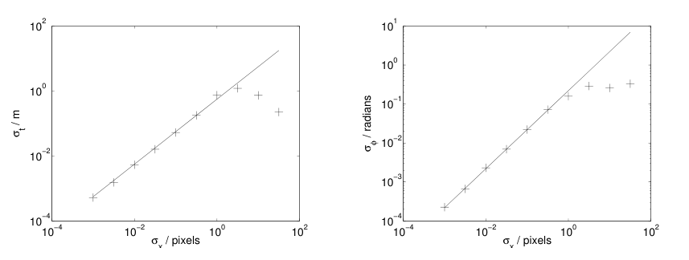
*그림 3 — 영상 오차에 대해 측정 및 예측한 자세 추정치의 편차: (왼쪽) 평행이동, (오른쪽) 회전각.*

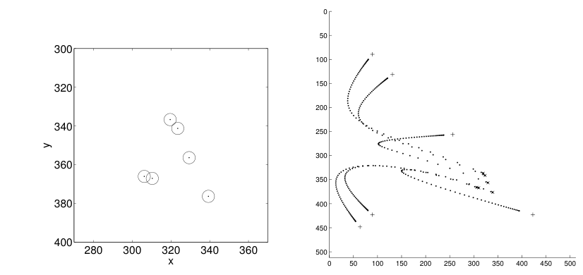
*그림 4 — (왼쪽) $\sigma_x = 10^{0.65} \approx 5$ 화소일 때 영상 점의 편차, (오른쪽) PBVS의 영상 평면 궤적.* [역주: 원문 텍스트 추출본에는 "σx = 100.65"로 나오나 이는 $10^{0.65}$의 위첨자가 풀린 것이다.]

점 배치는 자세 추정 정확도에 현저한 영향을 미친다. 이를 조사하기 위해 무작위 배치로 실험을 수행했다. 각 배치는 한 변이 1m인 정육면체 안에 균일하게 분포된 8개 점으로 이루어졌다. 다시 몬테카를로 시뮬레이션을 사용해 불확도를 조사했다. 그림 5에는 50개 무작위 배치에 대해 두 평행이동 자유도 축의 측정 및 예측 불확도를 보였다. 불확도는 미터로 표시했다. 실선은 예측이고 십자는 몬테카를로 추정치이다. 예측은 몬테카를로 측정과 높은 상관을 보이며, 상관 계수는 $\rho_X \approx 0.995$, $\rho_Y \approx 0.996$이다. 따라서 예측은 점 배치의 영향을 기술할 수 있다. 또 하나 주목할 점은 그림 5의 그래프에서 봉우리가 항상 일치하지는 않는다는 것이다. 이는 한 배치가 흔히 어떤 방향에서 다른 방향보다 불확도가 크다는 뜻이다.

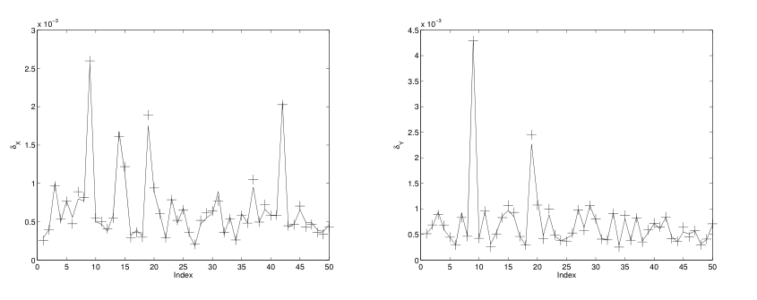
*그림 5 — 점 배치가 두 축에 미치는 영향(불확도, 미터 단위).*

정확도에 영향을 주는 또 다른 파라미터는 대상까지의 거리이다. 영상 좌표의 편차가 일정하다고 가정하고 몬테카를로 실험을 수행했다. 그림 6은 거리가 늘어남에 따라 불확도가 어떻게 커지는지 보인다. 다시 실선은 예측, 십자는 몬테카를로 추정치이다. 오차 거동을 보여 주기 위해 오차를 지수 인자로 스케일했으며, 거리는 미터, 각도는 라디안을 사용했다. 왼쪽 그래프는 거리에 대한 한 축의 평행이동 오차의 세제곱근을, 오른쪽은 회전각 오차의 제곱근을 보인다. 평행이동 오차는 거리의 세제곱에, 회전 오차는 거리의 제곱에 비례함을 쉽게 알 수 있다. 평행이동 오차의 세제곱 성질은 세 축 모두에서 관찰되었다.

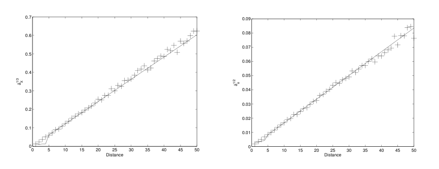
*그림 6 — 거리가 미치는 영향: (왼쪽) 평행이동, (오른쪽) 회전각.*

분석은 또한 x축 평행이동과 y축 주위 회전 사이에, 그리고 그 반대 사이에도 매우 높은 상관을 예측했다. 이러한 평행이동-회전 모호성은 구조-운동 복원에서 잘 알려진 현상이다.

### 7.2 위치 기반 서보 (Position-based servoing)

다음 실험들은 카메라가 처음에 모든 축 주위로 회전되어 있고 목표 위치로부터 비교적 멀리(원하는 거리의 약 10배) 위치한 서보 과제를 가정한다. 이로써 거리가 서보에 미치는 영향을 평가하고 서로 다른 축 주위 회전도 조사할 수 있다. 대상은 앞 절에서 제시한 것과 같다. 영상 평면에서 특징의 궤적은 그림 4의 오른쪽에 보였다.

분석의 유효성은 알려진 오차 분포로 특징 위치를 변위시키고 제어 출력의 편차를 측정하여 검증했다. 그림 7에는 y(점선)와 z(파선)의 평행이동 속도, 그리고 같은 축 주위 회전 속도의 예측 및 측정 편차를 보였다. 단위는 평행이동 속도는 m/s, 회전은 radian/s이다. 그림은 측정 편차와 예측 편차가 매우 잘 일치함을 보여 주며, 이는 이론적 분석이 유효함을 나타낸다. 오차는 제어기 이득 $\lambda$(식 31 참조)에 비례하며, 실험에서는 이를 단위값으로 설정했다는 점에 유의해야 한다. 따라서 그래프는 시간에 따른 거동을 조사하는 데에만 사용해야 하며 절댓값은 중요하지 않다.

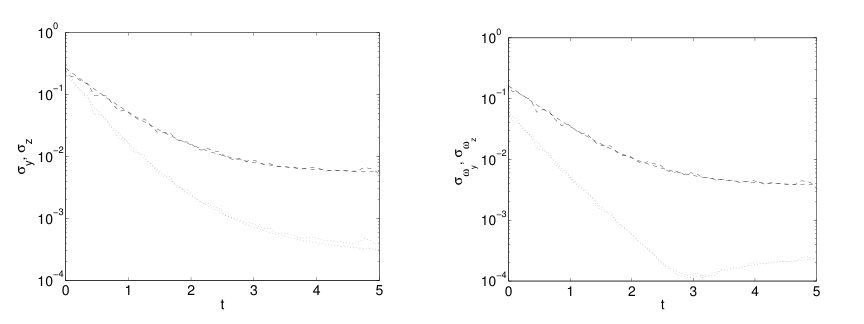
*그림 7 — PBVS 제어 출력의 측정 및 예측 편차: (왼쪽) 평행이동, (오른쪽) 회전.*

그림 8과 9는 위치 기반 서보의 오차 거동을 보여 준다. 결과는 월드 좌표계와 카메라 좌표계 모두로 제시하는데, 월드 좌표계는 직교 좌표 제어기의 관점에서 오차를 살피는 가장 자연스러운 방식이고, 카메라 좌표계는 오차의 방향적 성질에 대한 정보를 드러내기 때문이다. 그림에서 실선은 x축 평행이동과 회전, 점선은 y축, 파선은 z축에 해당한다.

그림 8의 왼쪽 열은 PBVS에서 직교 좌표 제어의 음의 지수형 속도를 보인다. 제어의 절대 편차(m/s)는 그림 8의 가운데에, 상대 편차(편차를 제어 출력으로 나눈 값)는 오른쪽에 나타냈다. 제어기의 이득이 영향을 미치므로 편차의 절댓값은 그다지 중요하지 않다는 점을 다시 유의해야 한다. 상대 오차에서는 제어 출력과 불확도가 같은 이득의 영향을 받으므로 이득의 영향이 상쇄된다. 그림 9는 카메라 좌표계에서의 거동을 보인다. 카메라 광축 방향의 제어가 영상 오차 측면에서 훨씬 신뢰할 만하며, 광축 주위의 회전(목표 위치에서 월드 y축과 일치)도 마찬가지임을 볼 수 있다. 목표 위치 근처에서는 광축에 수직인 축들의 제어에 차이가 거의 없어 보이지만, 처음에 물체가 아직 영상 평면에 정렬되지 않았을 때는 정확도에 약간의 차이가 있다. 그림 9 오른쪽 위 부분 그림에 보이는 최댓값은 대응하는 제어의 영점 교차(zero-crossing) 때문에 생긴다(이 영점 교차는 카메라 좌표계에서만 일어나며, PBVS가 직선 궤적을 보장하는 월드 좌표계에서는 일어나지 않음에 유의하라). 또 하나의 관찰은, 대상까지의 거리가 이미 꽤 작지만 대상이 아직 정확히 정렬되지 않았을 때 상대 오차가 궤적을 따라 최솟값을 가진다는 것이다. 이 최솟값 이후 상대 오차는 계속 증가하여, 그 오차가 실제로 존재한다면 서보가 불가능해질 수준에 이른다.

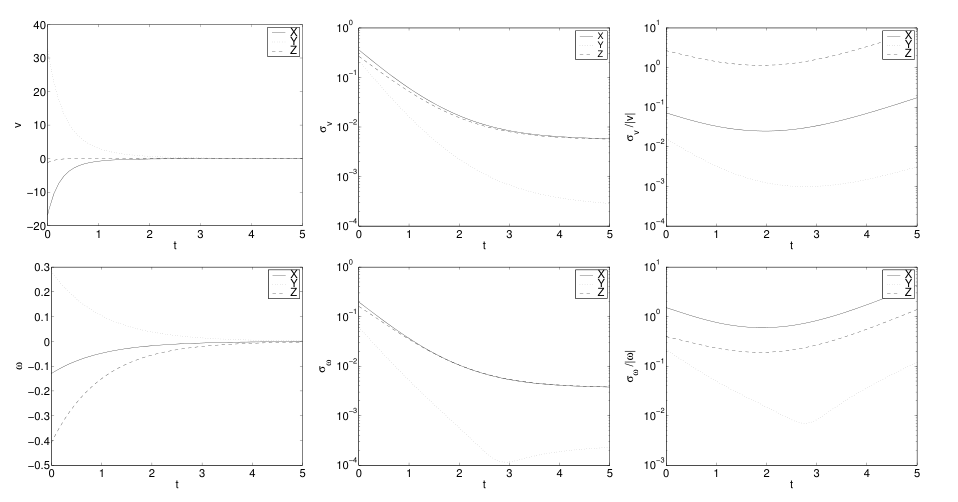
*그림 8 — 월드 좌표계에서의 PBVS 거동: (왼쪽 열) 속도/제어 출력, (가운데 열) 절대 오차, (오른쪽 열) 상대 오차, (윗줄) 평행이동, (아랫줄) 회전.*

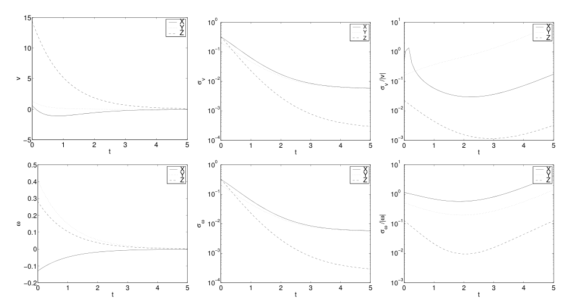
*그림 9 — 카메라 좌표계에서의 PBVS 거동: (왼쪽 열) 속도/제어 출력, (가운데 열) 절대 오차, (오른쪽 열) 상대 오차, (윗줄) 평행이동, (아랫줄) 회전.*

상대 오차는 특정 축 방향의 서보 유효성을 평가하는 데 사용할 수 있다. 상대 오차가 지배적이 되면(이를테면 제어의 3분의 1 이상), 그 축의 제어가 발산하기 시작할 수 있다. 대상은 월드 좌표계의 z 좌표에서 거의 완벽하게 정렬되어 있으므로, z 평행이동의 상대 오차는 운동 내내 매우 높으며, 이는 그 축을 제어할 이유가 없음을 시사하는 것으로 보인다.

### 7.3 하이브리드 시각 서보 (Hybrid visual servoing)

PBVS에 사용한 것과 같은 제어 과제를 하이브리드 접근법에도 사용했다. 분석 결과는 실험으로 검증했으며, 이를 그림 10에 보인다. 예측 편차는 측정값을 잘 따르는 것으로 보이며, 이는 분석이 유효함을 시사한다.

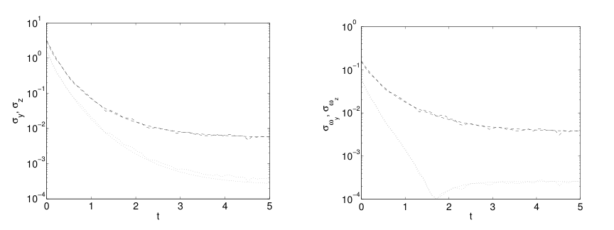
*그림 10 — HYBVS 제어 출력의 측정 및 예측 편차: (왼쪽) 평행이동, (오른쪽) 회전.*

HYBVS의 오차 거동은 월드 좌표계에 대해 그림 11, 카메라 좌표계에 대해 그림 12에서 볼 수 있다. 몇 가지 측면에서 거동은 PBVS와 비슷하다. 가장 중요하게, 광축을 따른 평행이동과 광축 주위 회전의 오차가 영상 평면에 평행한 축들보다 상당히 작다. 회전 거동은 PBVS와 닮았지만, 두 시스템의 궤적이 다르므로 동일하지 않다는 점에 유의하는 것이 중요하다. HYBVS가 깊이에서 더 빠른 수렴을 가진다는 것을 쉽게 알 수 있으며(그림 8과 11), 이것이 z축 회전의 일정 오차 영역에 더 빨리 도달하는 이유로 보인다(그림 8과 11). 상대 오차는 HYBVS의 또 다른 특성, 즉 직교 좌표 제어에서 영점 교차가 발생한다는 것을 보여 준다. 이는 평행이동의 상대 오차의 강한 봉우리에서 쉽게 볼 수 있다(그림 8). [역주: 문맥상 HYBVS의 그림 11을 가리키는 것으로 보이나 원문대로 옮겼다.] 상대 오차는 또한 자세 추정의 오차 때문에 제어가 발산할 가능성이 큰 영역을 시사한다. HYBVS의 경우 평행이동은 x와 y에서, 회전은 y와 z에서 적어도 어느 정도 제어할 수 있는 것으로 보인다. 여기서도 z축 평행이동이 월드 좌표계에서 x축 회전에 대응하므로 평행이동-회전 모호성을 다시 볼 수 있다.

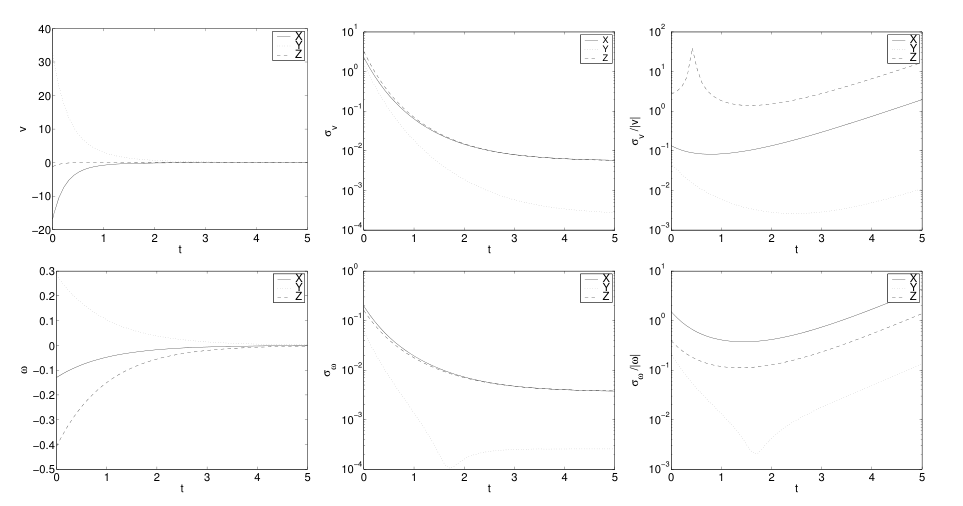
*그림 11 — 월드 좌표계에서의 HYBVS 거동: (왼쪽 열) 속도, (가운데 열) 절대 오차, (오른쪽 열) 상대 오차, (윗줄) 평행이동, (아랫줄) 회전.*

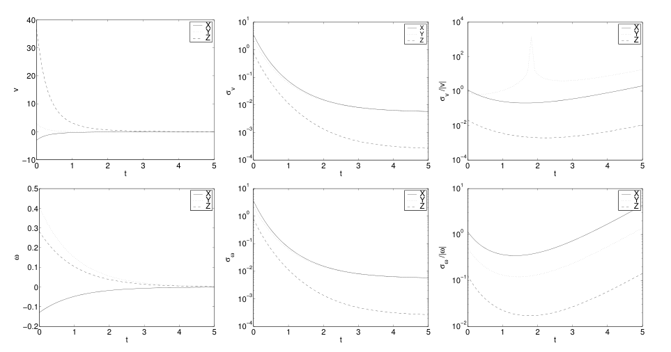
*그림 12 — 카메라 좌표계에서의 HYBVS 거동: (왼쪽 열) 속도, (가운데 열) 절대 오차, (오른쪽 열) 상대 오차, (윗줄) 평행이동, (아랫줄) 회전.*

### 7.4 논의 (Discussion)

PBVS와 HYBVS의 불확도를 시간에 대해 비교하려면 공통 기준 궤적을 정의해야 한다. 그림 13은 PBVS로 생성한 궤적을 따라 카메라를 이동시킬 때 HYBVS 제어의 추정 오차를 보인다. 따라서 시간에 따른 카메라 위치는 그림 8과 9에 대응한다. 오차는 월드 좌표계로 나타냈다. 그림 13의 평행이동에 대한 절대 및 상대 오차는 그림 8에 대응한다. 회전 부분은 회전 제어가 동일하여 PBVS의 경우와 같을 것이므로 오차를 보이지 않았다. 처음에는 PBVS가 HYBVS보다 절대 오차가 분명히 작다. 가능한 설명 하나는 두 방법이 서로 다른 궤적을 따른다는 것이다. 또 다른 문제는 PBVS는 모든 특징점을 자세 추정에 사용할 수 있는 반면, HYBVS는 영상 평면에 평행한 궤적을 제어하는 데 단일 점만 사용한다는 것이다. 상대 오차에는 몇 가지 유사점이 있으며, 특히 축의 순서가 같다. y를 따른 평행이동(광축에 가장 가깝고 초기 거리가 가장 긴 축)의 경우, 상대 오차 진폭은 비슷한 것으로 보인다. 약간의 초기 오차가 있는 x축의 경우, PBVS가 처음에는 오차에 덜 취약하지만 궤적 후반에는 오차가 비슷해진다. z축의 경우 HYBVS의 오차가 약간 작지만, 오차가 크므로 어느 쪽도 효율적인 제어에 사용할 수 있을 것 같지 않다. 또한 HYBVS의 상대 오차가 더 작은 이유는, 앞서 논의한 영점 교차의 존재에서 보았듯이 처음에 그 축을 수렴점에서 멀어지는 방향으로 제어하기 때문이다.

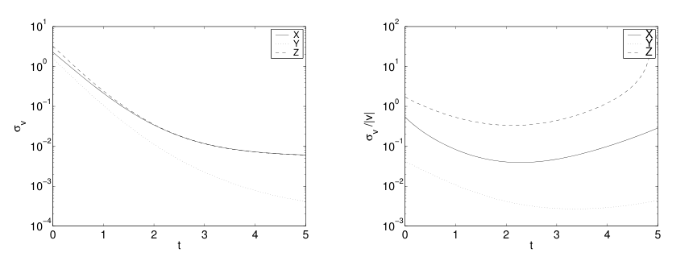
*그림 13 — PBVS 궤적에서의 HYBVS 평행이동 오차: (왼쪽) 절대, (오른쪽) 상대.*

## 8. 요약 및 결론 (Summary and Conclusion)

이 논문에서 우리는 시각 서보에서 측정 오차의 영향을 분석했다. 이 논문의 주된 기여는 영상 오차를 자세 추정과 시각 서보 제어 법칙을 통해 전파한다는 아이디어이다. 특히 비전 시스템의 성질과 그것이 제어 시스템의 성능에 미치는 영향을 조사했다. 두 가지 서보 접근법, 즉 i) 위치 기반, ii) 2 1/2D 시각 서보를 평가했다. 우리의 접근법에서는 특정 자세 추정 알고리즘과 두 가지 시각 서보 접근법을 사용해 분석을 수행했다. 일반적인 방법론은 다른 어떤 자세 추정 알고리즘과도 사용할 수 있으므로, 우리는 이 연구가 새로운 정보를 제공하며 우리의 분석 틀이 시각 서보에 적합하다는 예가 된다고 믿는다. 결과를 다른 서보 전략으로 확장하는 것도 가능하다. 특히 우리는 임의의 최적화 기반 자세 추정 접근법을 분석하는 방법을 보인다. 그러나 실시간 문제 때문에 닫힌 형태의 해가 시각 서보에 더 적합하다고 생각한다. 우리는 우리의 평가가 예컨대 전환[18]이나 분할[6]에 기반한 하이브리드 제어 시스템을 설계하는 유효한 도구를 제공한다고 믿는다.

향후 연구에서는 다음 질문들을 조사할 것이다. 이러한 불확도 척도를 사용해 실현 가능한 자유도만 제어할 수 있는가? 예를 들어 처음에 먼 자세에서 로봇을 먼저 더 합리적인 거리로 제어하고, 대상에 가까워지면 더 어려운 자유도를 제어하는 것이다. 최근 이런 유형의 제어를 구현하는 데 사용할 수 있는 적층(stacked) 제어기 구조가 제안되었다[21]. 또한 순수 영상 기반 시각 서보 제어 법칙을 통해 오차를 전파하고 이를 여기서 제시한 결과와 비교하고자 한다. 우리가 답하고자 하는 마지막 질문은, 특히 영상 기반 시각 서보의 경우 최적이거나 안정적인 거동을 얻도록 유리한 특징 배치를 찾는 데 이러한 유형의 평가를 사용할 수 있는가이다[22].

## 참고문헌

- [1] S. Hutchinson, G. D. Hager, P. I. Corke, A tutorial on visual servo control, IEEE Transactions on Robotics and Automation 12 (5) (1996) 651–670.
- [2] D. Kragic, H. Christensen, Survey on Visual Servoing for Manipulation, Tech. Rep. ISRN KTH/NA/P–02/01–SE, January 2002, CVAP259.
- [3] B. Espiau, Effect of camera calibration errors on visual servoing in robotics, in: 3rd International Symposium on Experimental Robotics, Kyoto, Japan, 1993, pp. 182–192.
- [4] F. Chaumette, Potential problems of stability and convergence in image-based and position-based visual servoing, in: The Confluence of Vision and Control, no. 237 in Lecture Notes in Control and Information Sciences, Springer-Verlag, 1998, pp. 66–78.
- [5] E. Malis, F. Chaumette, Theoretical improvements in the stability analysis of a new class of model-free visual servoing methods, IEEE Transactions on Robotics and Automation 18 (2) (2002) 176–186.
- [6] E. Malis, F. Chaumette, S. Boudet, 2-1/2-D visual servoing, IEEE Transactions on Robotics and Automation 15 (2) (1999) 238–250.
- [7] V. Kyrki, D. Kragic, H. I. Christensen, Measurement errors in visual servoing, in: IEEE International Conference on Robotics and Automation, Vol. 2, New Orleans, LA, USA, 2004, pp. 1861–1867.
- [8] M. A. Fischler, R. C. Bolles, Random sample consensus: A paradigm for model fitting with application to image analysis and automated cartography, Communications of ACM 24 (6) (1981) 381–395.
- [9] L. Quan, Z. Lan, Linear n-point camera pose determination, IEEE Transactions on Pattern Analysis and Machine Intelligence 21 (8) (1999) 774–780.
- [10] P. D. Fiore, Efficient linear solution of exterior orientation, IEEE Transactions on Pattern Analysis and Machine Intelligence 23 (2) (2001) 140–148.
- [11] A. Ansar, K. Daniilidis, Linear pose estimation from points or lines, IEEE Transactions on Pattern Analysis and Machine Intelligence 25 (5) (2003) 578–589.
- [12] B. K. P. Horn, Closed-form solution of absolute orientation using unit quaternions, Journal of the Optical Society of America 4 (4) (1987) 629–642.
- [13] J. Weng, T. S. Huang, N. Ahuja, Motion and structure from two perspective views: Algorithms, error analysis, and error estimation, IEEE Transaction on Pattern Analysis and Machine Intelligence 11 (5) (1989) 451–476.
- [14] R. M. Haralick, H. Joo, C.-N. Lee, X. Zhuang, V. G. Vaidya, M. B. Kim, Pose estimation from corresponding point data, IEEE Transactions on Systems, Man, and Cybernetics 19 (6) (1989) 1426–1446.
- [15] L. Deng, W. J. Wilson, F. Janabi-Sharifi, Characteristics of robot visual servoing methods and target model estimation, in: Proceedings of the 2002 IEEE International Symposium on Intelligent Control, Vancouver, Canada, 2002, pp. 684–689.
- [16] A. Comport, M. Pressigout, E. Marchand, F. Chaumette, A visual servoing control law that is robust to image outliers, in: Proceedings of the 2003 IEEE/RSJ Intl. Conference on Intelligent Robots and Systems, Las Vegas, Nevada, 2003, pp. 492–497.
- [17] D. Kragic, H. I. Christensen, Cue integration for visual servoing, IEEE Transactions on Robotics and Automation 17 (1) (2001) 18–27.
- [18] N. R. Gans, S. A. Hutchinson, An asymptotically stable switched system visual controller for eye in hand robots, in: Proceedings of the 2003 IEEE/RSJ Intl. Conference on Intelligent Robots and Systems, Las Vegas, Nevada, 2003, pp. 735–742.
- [19] D. G. Lowe, Distinctive image features from scale-invariant keypoints, International Journal of Computer Vision 60 (2) (2004) 91–110.
- [20] R. M. Haralick, Propagating covariance in computer vision, International Journal of Pattern Recognition and Artificial Intelligence 10 (5).
- [21] N. Mansard, F. Chaumette, Tasks sequencing for visual servoing, in: IEEE/RSJ International Conference on Intelligent Robots and Systems, Vol. 1, Sendai, Japan, 2004, pp. 992–997.
- [22] E. Malis, P. Rives, Robustness of image-based visual servoing with respect to depth distribution errors, in: IEEE International Conference on Robotics and Automation, 2003, pp. 1056–1061.
