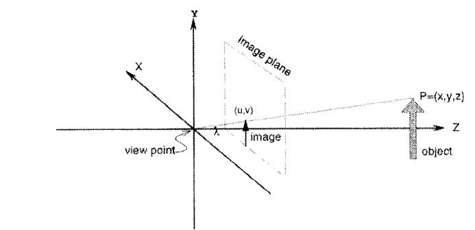
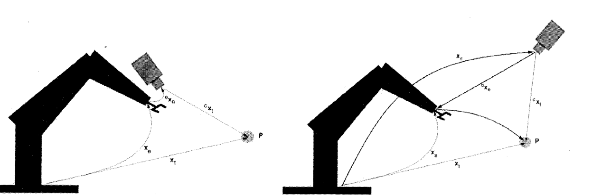
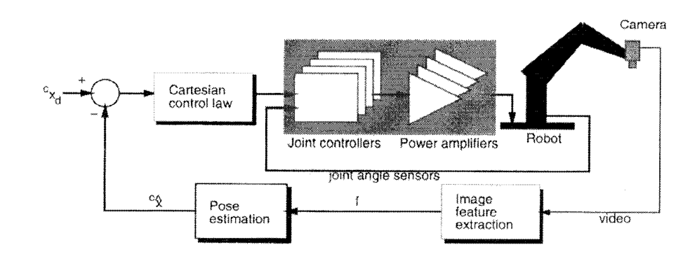
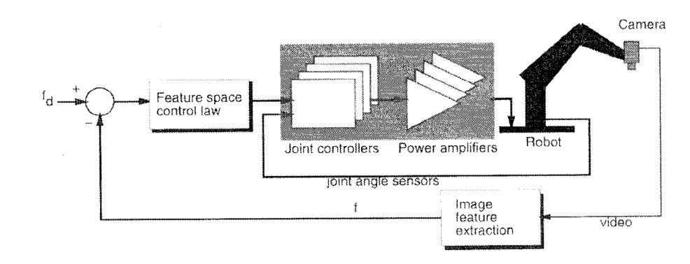
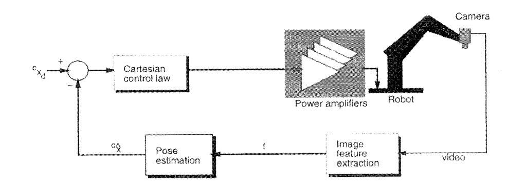
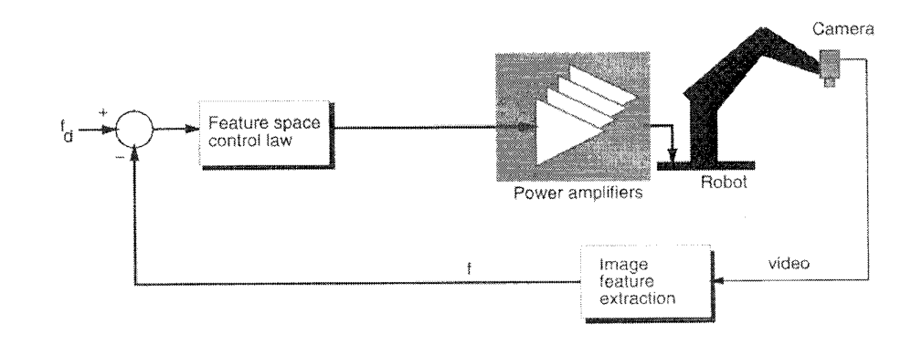

# 시각 서보 제어 튜토리얼 (Hutchinson 1996)

- 원제: A Tutorial on Visual Servo Control
- 저자: Seth Hutchinson, Gregory D. Hager, Peter I. Corke (모두 Member, IEEE)
- 원문: 같은 폴더의 `Hutchinson1996_TutorialVisualServo.pdf` (IEEE Transactions on Robotics and Automation, Vol. 12, No. 5, pp. 651-670, October 1996)
- 번역 범위: 전문. 원문 PDF는 텍스트 층이 없는 스캔본이므로 쪽 이미지를 직접 읽어 번역했다. 수식은 쪽 이미지에서 판독해 LaTeX로 옮겼으며, 판독이 불확실한 곳은 [판독 불확실]로 표시했다.
- 그림: 원문 그림 6개를 `그림/`에 넣고 본문에서 처음 언급되는 곳에 삽입

## 초록 (Abstract)

이 글은 로봇 매니퓰레이터의 시각 서보 제어(visual servo control)에 대한 튜토리얼 입문을 제공한다. 이 주제는 여러 분야에 걸쳐 있으므로 우리의 목표는 기본적인 개념 틀을 제공하는 데 한정된다. 먼저 로보틱스와 컴퓨터 비전에서 필요한 선수 주제들을 복습한다. 여기에는 좌표 변환, 속도 표현에 대한 간략한 복습과 영상 형성 과정의 기하학적 측면에 대한 설명이 포함된다. 다음으로 시각 서보 제어 시스템의 분류 체계(taxonomy)를 제시한다. 그런 다음 두 가지 주요 시스템 부류인 위치 기반(position-based) 시스템과 영상 기반(image-based) 시스템을 자세히 논의한다. 모든 시각 서보 시스템은 영상 열(sequence) 속에서 영상 특징(image feature)을 추적할 수 있어야 하므로, 특징 기반 및 상관(correlation) 기반 추적 방법에 대한 개관도 포함한다. 끝으로 시각 서보 제어 연구 분야의 현재 방향에 대한 몇 가지 소견으로 튜토리얼을 마무리한다.

(각주) 원고 접수 1995년 3월 24일, 수정 1996년 1월 19일. G. D. Hager는 ARPA grant N00014-93-1-1235, Army DURIP grant DAAH04-95-1-0058, National Science Foundation grant IRI-9420982, 그리고 Yale University 기금의 지원을 받았다. 이 논문은 Associate Editor J. Funda와 Editor S. E. Salcudean이 심사자 의견을 평가한 뒤 게재를 추천하였다. S. Hutchinson은 University of Illinois at Urbana-Champaign의 Department of Electrical and Computer Engineering, The Beckman Institute for Advanced Science and Technology 소속이다(Urbana, IL 61801 USA). G. D. Hager는 Yale University의 Department of Computer Science 소속이다(New Haven, CT 06520-8285 USA). P. I. Corke는 CSIRO Division of Manufacturing Technology 소속이다(Kenmore, Australia, 4069). Publisher Item Identifier S 1042-296X(96)07366-1.

## I. 서론 (Introduction)

오늘날 늘어나고 있는 로봇의 대다수는 로봇에 맞게 환경을 꾸밀 수 있는 공장에서 작동한다. 작업 환경과 물체 배치를 정확히 제어할 수 없는 응용에서는 로봇의 영향력이 훨씬 작았다. 이 한계는 대체로 현재 상용 로봇 시스템에 감각 능력이 본질적으로 부족한 데서 비롯된다. 센서 통합이 로봇의 다재다능함과 응용 영역을 넓히는 데 근본적이라는 사실은 오래전부터 인식되어 왔으나, 지금까지 제조업에 속하는 대부분의 로봇 응용에서는 비용 효율적이지 않은 것으로 드러났다. 로보틱스의 "개척지(frontier)"인 일상 세계에서의 작동은 이 연구에 새로운 동력을 제공한다. 제조 응용과 달리, 로봇에 맞게 "우리 세계"를 다시 설계하는 것은 비용 효율적이지 않을 것이다.

시각은 인간의 감각을 흉내 내며 환경을 비접촉으로 측정할 수 있게 해 주므로 유용한 로봇 센서이다. 시각 피드백 루프로 로봇의 위치를 보정하여 작업 정확도를 높일 수 있음을 기술한 Shirai와 Inoue[1]의 초기 연구 이래로, 로봇 매니퓰레이터의 시각 제어에 상당한 노력이 기울여져 왔다. 비전 시스템이 완전히 통합된 로봇 제어기는 이제 여러 업체에서 구할 수 있다. 일반적으로 시각 감지와 조작은 "보고(looking)" 나서 "움직이는(moving)" 개루프 방식으로 결합된다. 그 결과로 얻는 동작의 정확도는 시각 센서와 로봇 말단장치(end-effector)의 정확도에 직접 좌우된다.

이 하위 시스템들의 정확도를 높이는 대신, 시각 피드백 제어 루프를 사용하여 시스템 전체의 정확도—대부분의 응용에서 주된 관심사—를 높이는 대안이 있다. 이를 극단까지 밀고 가면, 머신 비전이 로봇 말단장치의 폐루프 위치 제어를 제공할 수 있다. 이것을 **시각 서보(visual servoing)** 라 부른다. 이 용어는 1979년 Hill과 Park[2]이 시스템이 사진 촬영과 이동을 번갈아 하던 이전의 "블록 세계(blocks world)" 실험과 자신들의 접근을 구별하기 위해 처음 도입한 것으로 보인다. 이 용어가 도입되기 전에는 덜 구체적인 용어인 시각 피드백(visual feedback)이 일반적으로 쓰였다. 이 글에서 시각 서보의 과제는 시각 정보를 이용하여 목표 물체나 목표 특징 집합에 대한 로봇 말단장치의 **자세(pose)** 를 제어하는 것이다. 이 과제는 이동 로봇에 대해서도 정의할 수 있으며, 이 경우 몇몇 랜드마크에 대한 차량의 자세 제어가 된다.

최초의 시각 서보 시스템이 1980년대 초에 보고된 이래 로봇의 시각 제어 분야의 진전은 상당히 느렸으나, 지난 몇 년 동안 발표된 연구가 눈에 띄게 늘었다. 이는 로봇 매니퓰레이터를 "서보"하기에 충분한 속도로 장면을 분석할 수 있는 문턱을 개인용 컴퓨터의 연산 능력이 넘어선 덕분이다. 그 이전에는 연구자들에게 특수하고 값비싼 파이프라인 화소 처리 하드웨어가 필요했다. 제안되거나 시제품이 만들어진 응용은 제조(컨베이어 벨트 위 물체 파지, 부품 결합), 원격조작, 미사일 추적 카메라, 과일 수확뿐 아니라 로봇 탁구, 저글링, 균형 잡기, 자동차 조향, 심지어 항공기 착륙에까지 걸쳐 있다. 이 분야 문헌에 대한 포괄적인 검토와 지금까지 보고된 역사·응용은 Corke[3]가 제공하며, 방대한 참고문헌 목록을 포함한다.

시각 서보는 고속 영상처리, 기구학, 동역학, 제어 이론, 실시간 컴퓨팅 등 여러 기본 분야의 성과가 융합된 것이다. 이는 **능동 비전(active vision)** 및 **운동으로부터의 구조 복원(structure from motion)** 연구와 공통점이 많지만, 계층적 작업 수준 로봇 제어 시스템에서 흔히 기술되는 시각의 사용과는 상당히 다르다. 제어와 비전 문제 다수는 "로봇 머리(robotic heads)"를 만드는 능동 비전 연구자들이 마주치는 문제와 비슷하다. 그러나 시각 서보의 과제는 환경을 단지 **관찰(observing)** 하는 것이 아니라 시각을 이용하여 환경을 조작하도록 로봇을 **제어(control)** 하는 것이다.

시각 서보에 대한 현재의 관심을 고려할 때, 이 주제에 대한 튜토리얼 입문을 제공하는 것은 적절하고 시의적절해 보인다. 우리의 목표는 일관된 용어와 명명법, 그리고 가능한 응용에 대한 이해를 제공함으로써 다른 사람들이 시각 서보 시스템을 만드는 것을 돕는 것이다. 이 분야에 처음 들어오는 사람들을 돕기 위해, 단순한 비전 하드웨어(디지타이저 하나)와 자유롭게 구할 수 있는 비전 소프트웨어[4]만 필요하고 로봇과 그 제어 시스템에 대한 가정이 적은 기법들을 기술할 것이다. 이는 높은 제어 성능이나 비전 성능이 요구되지 않는 많은 응용에 대한 조사를 시작하기에 충분하다.

이런 글을 쓰는 데 따르는 어려움 하나는 이 주제가 한 편의 글로는 적절히 다룰 수 없는 많은 분야에 걸쳐 있다는 점이다. 예를 들어 바탕에 있는 제어 문제는 근본적으로 비선형이며, 시각 인식·추적·재구성은 각각 독립된 분야이다. 그래서 우리는 각 분야의 몇몇 기본 측면에 집중하였고, 여기서 제공할 수 있는 것보다 더 자세한 내용을 찾는 독자를 위해 방대한 참고문헌을 제공하였다. 우리는 항상 실제로 잘 작동함을 확인했고 어느 정도 일반적 적용성이 있는 아이디어와 기법을 제시하는 쪽을 택했다. 또 다른 어려움은 현재 비전 기반 운동 제어 문헌이 빠르게 늘고 있다는 점인데, 이 문헌에는 관련된 많은 이론적·기술적 문제에 대한 해법과 유망한 접근이 담겨 있다. 여기서도 우리는 가장 근본적이라고 생각하는 개념을 제시하였고, 역시 독자에게 참고문헌을 참조하도록 안내한다.

이 글의 나머지는 다음과 같이 구성된다. II절은 좌표 변환, 자세 표현, 영상 형성의 관련 기초를 복습한다. III절에서는 시각 서보 제어 시스템의 분류 체계를 제시한다([5]에서 차용). 두 주요 시스템 부류인 위치 기반 시각 서보 시스템과 영상 기반 시각 서보 시스템을 각각 IV절과 V절에서 논의한다. 모든 시각 서보 시스템은 영상 열 속에서 영상 특징을 추적할 수 있어야 하므로, VI절은 널리 적용 가능하고 최소한의 특수 목적 하드웨어로 구현할 수 있는 시각 추적 접근 몇 가지를 기술한다. 끝으로 VII절은 시각 서보 제어 연구 분야의 현재 방향에 관한 여러 소견을 제시한다.

## II. 배경과 정의 (Background and Definitions)

이 절에서는 시각 서보 제어와 관련된 로보틱스 및 컴퓨터 비전의 몇몇 주제를 아주 간략히 개관한다. 먼저 좌표 변환과 작업 공간을 움직이는 강체의 속도를 나타내는 데 필요한 용어와 표기를 정의한다(II-A절과 II-B절). 이어서 영상 형성과 관련된 몇 가지 문제(II-C절과 II-D절)와 가능한 카메라/로봇 구성(II-E절)을 간략히 논의한다. 이 주제들에 익숙한 독자는 바로 III절로 넘어가도 된다.

### A. 좌표 변환 (Coordinate Transformations)

이 논문에서 $\mathcal{T}$로 나타내는 로봇의 작업 공간(task space)은 로봇 **도구(tool)** 가 도달할 수 있는 위치와 방향의 집합이다. 작업 공간은 단지 로봇 도구의 형상 공간(configuration space)이므로, 작업 공간은 매끄러운 $m$-다양체(manifold)이다(예: [6] 참조). 도구가 3차원 작업 공간에서 임의로 움직이는 단일 강체라면 $\mathcal{T}=SE^3=\Re^3\times SO^3$이고 $m=6$이다. 어떤 응용에서는 작업 공간이 $SE^3$의 부분 공간으로 제한될 수 있다. 예를 들어 집어 놓기(pick and place)에서는 순수 평행이동만 고려할 수 있고($\mathcal{T}=\Re^3$, 이때 $m=3$), 물체를 추적하며 시야 안에 두는 경우에는 회전만 고려할 수 있다($\mathcal{T}=SO^3$, 이때 $m=3$).

일반적으로 로봇 작업은 하나 이상의 좌표계(coordinate frame)에 대해 지정된다. 예를 들어 카메라는 카메라 좌표계에 대한 물체의 위치 정보를 제공하고, 물체를 잡는 데 쓰이는 형상은 물체에 부착된 좌표계에 대해 지정될 수 있다. 좌표계 $x$에 대한 점 $\boldsymbol{P}$의 좌표를 ${}^{x}\boldsymbol{P}$로 나타낸다. 두 좌표계 $x$와 $y$가 주어졌을 때, 좌표계 $x$에 대한 좌표계 $y$의 방향을 나타내는 회전 행렬을 ${}^{x}\boldsymbol{R}_y$로 나타낸다. 좌표계 $x$에 대한 좌표계 $y$ 원점의 위치는 벡터 ${}^{x}\boldsymbol{t}_y$로 나타낸다. 좌표계의 위치와 방향을 함께 **자세(pose)** 라 하며 ${}^{x}\boldsymbol{x}_y$로 나타낸다. 앞쪽 위 첨자 $x$가 지정되지 않으면 월드 좌표계를 가정한다.

자세를 이용해 **좌표 변환(coordinate transformation)** 을 지정할 수도 있다. 점에 좌표 변경을 적용하는 것을 함수 적용으로 표기한다. 특히 ${}^{y}\boldsymbol{P}$(좌표계 $y$에 대한 점 $\boldsymbol{P}$의 좌표)와 ${}^{x}\boldsymbol{x}_y$가 주어지면, 다음 좌표 변환 규칙을 적용하여 좌표계 $x$에 대한 $\boldsymbol{P}$의 좌표를 얻는다.

$$
{}^{x}\boldsymbol{P}={}^{x}\boldsymbol{x}_y({}^{y}\boldsymbol{P}) \tag{1}
$$
$$
={}^{x}\boldsymbol{R}_y\,{}^{y}\boldsymbol{P}+{}^{x}\boldsymbol{t}_y. \tag{2}
$$

이후에서는 표기 ${}^{x}\boldsymbol{x}_y$를 좌표 변환, 또는 회전 행렬과 평행이동 ${}^{x}\boldsymbol{R}_y$와 ${}^{x}\boldsymbol{t}_y$로 지정되는 자세 어느 쪽을 가리키는 데에도 쓴다. 마찬가지로 **자세**와 **좌표 변환**이라는 용어를 바꿔 가며 쓴다. 일반적으로 ${}^{x}\boldsymbol{x}_y$의 두 해석 사이에 모호함은 없을 것이다¹.

종종 원하는 좌표 변경을 얻기 위해 여러 좌표 변환을 합성해야 한다. 예를 들어 자세 ${}^{x}\boldsymbol{x}_y$와 ${}^{y}\boldsymbol{x}_z$가 주어졌다고 하자. ${}^{z}\boldsymbol{P}$가 주어지고 ${}^{x}\boldsymbol{P}$를 계산하려면 좌표 변환의 합성을 쓸 수 있다.

$$
{}^{x}\boldsymbol{P}={}^{x}\boldsymbol{x}_y({}^{y}\boldsymbol{P}) \tag{3}
$$
$$
={}^{x}\boldsymbol{x}_y({}^{y}\boldsymbol{x}_z({}^{z}\boldsymbol{P})) \tag{4}
$$
$$
=({}^{x}\boldsymbol{x}_y\circ{}^{y}\boldsymbol{x}_z)({}^{z}\boldsymbol{P}) \tag{5}
$$
$$
={}^{x}\boldsymbol{x}_z({}^{z}\boldsymbol{P}). \tag{6}
$$

여기서 보듯이 좌표 변환의 합성을 ${}^{x}\boldsymbol{x}_z={}^{x}\boldsymbol{x}_y\circ{}^{y}\boldsymbol{x}_z$로, 이에 대응하는 점 ${}^{z}\boldsymbol{P}$의 좌표 변환을 $({}^{x}\boldsymbol{x}_y\circ{}^{y}\boldsymbol{x}_z)({}^{z}\boldsymbol{P})$로 나타낸다. 대응하는 회전 행렬과 평행이동은 다음과 같다.

$$
{}^{x}\boldsymbol{R}_z={}^{x}\boldsymbol{R}_y\,{}^{y}\boldsymbol{R}_z \tag{7}
$$
$$
{}^{x}\boldsymbol{t}_z={}^{x}\boldsymbol{R}_y\,{}^{y}\boldsymbol{t}_z+{}^{x}\boldsymbol{t}_y. \tag{8}
$$

> ¹ 점을 과잉 매개변수화하면 제어에 필요한 몇몇 장치를 전개하기 어려워지므로, 우리는 더 흔한 동차 변환(homogeneous transform) 기반 표기를 쓰지 않았다.

자주 필요하게 될 몇몇 좌표계는 다음 위 첨자/아래 첨자로 가리킨다.

| 기호 | 의미 |
|---|---|
| $e$ | 로봇 말단장치에 부착된 좌표계 (The coordinate frame attached to the robot end effector) |
| $t$ | 목표물에 부착된 좌표계 (The coordinate frame attached to the target) |
| $0$ | 로봇의 베이스 좌표계 (The base frame for the robot) |
| $c_i$ | $i$번째 카메라의 좌표계 (The coordinate frame of the $i$th camera) |

$\mathcal{T}=SE^3$일 때, 월드 좌표계에 대한 말단장치 좌표계의 자세를 나타내기 위해 $\boldsymbol{x}_e\in\mathcal{T}$ 표기를 쓴다. 이 경우 흔히 평행이동 벡터와 세 각도(예: 롤, 피치, 요[7])로 자세를 매개변수화하는 편을 택한다. 이런 매개변수화는 본질적으로 국소적(local)이지만, 자세를 $\boldsymbol{x}_e\in\mathcal{T}$ 대신 벡터 $\boldsymbol{r}\in\Re^6$으로 나타내는 것이 종종 편리하다. 이 표기는 $\mathcal{T}\subseteq SE^3$인 경우에 쉽게 맞출 수 있다. 예를 들어 $\mathcal{T}=\Re^3$이면 작업 공간을 $\boldsymbol{r}=[x,y,z]^T$로 매개변수화한다. 이후에서는 일반성을 유지하기 위해, 특정 작업을 고려하는 경우가 아니면 $\boldsymbol{r}\in\Re^m$이라 가정한다.

### B. 강체의 속도 (The Velocity of a Rigid Object)

시각 서보 응용에서는 작업 공간 안의 어떤 물체(예: 매니퓰레이터 말단장치)의 속도와, 작업 공간을 관측한 영상에서 일어나는 대응 변화 사이의 관계에 관심을 두는 경우가 많다. 이 절에서는 작업 공간 안 물체의 속도를 나타내는 표기를 간략히 소개한다.

$\mathcal{T}\subseteq SE^3$인 작업 공간에서 움직이는 로봇 말단장치를 생각하자. 베이스 좌표에서 이 운동은 각속도 $\Omega(t)=[\omega_x(t),\omega_y(t),\omega_z(t)]^T$와 병진 속도 $\boldsymbol{T}(t)=[T_x(t),T_y(t),T_z(t)]^T$로 기술된다. 회전은 어떤 점을 중심으로 작용하는데, 따로 언급하지 않으면 그 점을 베이스 좌표계의 원점으로 둔다. $\boldsymbol{P}$를 말단장치에 강체로 부착된 점이라 하고, 그 베이스 좌표를 $[x,y,z]^T$라 하자. 베이스 좌표로 나타낸 $\boldsymbol{P}$ 좌표의 시간 미분은 다음과 같다.

$$
\dot x=z\omega_y-y\omega_z+T_x \tag{9}
$$
$$
\dot y=x\omega_z-z\omega_x+T_y \tag{10}
$$
$$
\dot z=y\omega_x-x\omega_y+T_z \tag{11}
$$

이를 벡터 표기로 쓰면 다음과 같다.

$$
\dot{\boldsymbol{P}}=\Omega\times\boldsymbol{P}+\boldsymbol{T}. \tag{12}
$$

외적(cross product)을 **반대칭 행렬(skew-symmetric matrix)** 로 나타낼 수 있음에 주목하면 이를 행렬 형태로 간결하게 쓸 수 있다.

$$
sk(\boldsymbol{P})=\begin{bmatrix}0&-z&y\ z&0&-x\ -y&x&0\end{bmatrix}
$$

그러면 다음과 같이 쓸 수 있다.

$$
\dot{\boldsymbol{P}}=-sk(\boldsymbol{P})\Omega+\boldsymbol{T}. \tag{13}
$$

$\boldsymbol{T}$와 $\Omega$는 함께 로보틱스 문헌에서 속도 스크루(velocity screw)라 부르는 것을 정의한다.

$$
\dot{\boldsymbol{r}}=\begin{bmatrix}T_x\T_y\T_z\ \omega_x\ \omega_y\ \omega_z\end{bmatrix}.
$$

회전 행렬 $\boldsymbol{R}$이 좌표축 둘레의 회전 집합으로 매개변수화될 때 $\dot{\boldsymbol{r}}$은 $\boldsymbol{r}$의 미분도 나타낸다는 점에 유의하라.

$3\times 6$ 행렬 $\boldsymbol{A}(\boldsymbol{P})=[I_3\,|\,-sk(\boldsymbol{P})]$를 정의하자. 여기서 $I_3$은 $3\times 3$ 단위 행렬이다. 그러면 (13)은 행렬 형태로 다음과 같이 다시 쓸 수 있다.

$$
\dot{\boldsymbol{P}}=\boldsymbol{A}(\boldsymbol{P})\dot{\boldsymbol{r}}. \tag{14}
$$

이제 말단장치 좌표로 표현된 점 ${}^{e}\boldsymbol{P}$가 주어지고, 로봇이 움직이는 동안 이 점의 베이스 좌표에서의 운동을 구하고자 한다고 하자. (1)과 (14)를 결합하면 다음을 얻는다.

$$
\dot{\boldsymbol{P}}=\boldsymbol{A}(\boldsymbol{x}_e({}^{e}\boldsymbol{P}))\dot{\boldsymbol{r}}. \tag{15}
$$

때로는 좌표계 사이에서 속도 스크루를 변환하는 것이 유용하다. 예를 들어 ${}^{e}\dot{\boldsymbol{r}}=[{}^{e}\boldsymbol{T};\,{}^{e}\Omega]^T$가 말단장치 좌표에서의 말단장치 속도라고 하자. 그러면 베이스 좌표에서의 등가 스크루는 다음과 같다.

$$
\dot{\boldsymbol{r}}=\begin{bmatrix}\boldsymbol{T}\ \Omega\end{bmatrix}=\begin{bmatrix}\boldsymbol{R}_e\,{}^{e}\boldsymbol{T}-\boldsymbol{R}_e\,{}^{e}\Omega\times\boldsymbol{t}_e\ \boldsymbol{R}_e\,{}^{e}\Omega\end{bmatrix}.
$$

### C. 카메라 투영 모델 (Camera Projection Models)

컴퓨터 비전 시스템이 제공하는 정보로 로봇을 제어하려면 영상 형성 과정의 기하학적 측면을 이해해야 한다. 각 카메라에는 센서가 놓인 영상 평면 위에 장면의 2D 투영을 만드는 렌즈가 있다. 이 투영 때문에 직접적인 깊이 정보가 사라지므로, 영상 평면 위의 각 점은 3D 공간의 한 광선(ray)에 대응한다. 따라서 영상 평면 점에 대응하는 3D 좌표를 정하려면 추가 정보가 필요하다. 이 정보는 여러 대의 카메라, 한 카메라로 얻은 여러 시점, 또는 목표물 위 여러 특징점 사이의 기하 관계에 대한 지식에서 얻을 수 있다. 이 절에서는 영상 형성 과정을 모델링하는 데 널리 쓰여 온 세 가지 투영 모델—원근 투영(perspective projection), 축척 정사영(scaled orthographic projection), 아핀 투영(affine projection)—을 기술한다. 각 투영 모델을 간략히 기술하지만, 튜토리얼의 나머지 부분에서는 원근 투영을 사용한다고 가정한다.

세 투영 모델 각각에 대해, 카메라 좌표계를 $x$축과 $y$축이 영상 평면의 기저를 이루고, $z$축이 영상 평면에 수직이며(광축 방향), 원점이 영상 평면 뒤 거리 $\lambda$에 있도록 둔다. 여기서 $\lambda$는 카메라 렌즈의 초점 거리이다. 이는 그림 1에 나타나 있다.

*그림 1 — 카메라/렌즈 시스템의 좌표계. (그림 속 표기: image plane=영상 평면, view point=시점, image=상, object=물체)*

1) **원근 투영(Perspective Projection)**: 카메라의 투영 기하를 원근 투영으로 모델링한다고 가정하면(예: [8] 참조), 카메라 좌표계 $c$에 대해 좌표가 표현된 점 ${}^{c}\boldsymbol{P}=[x,y,z]^T$는 다음과 같이 주어지는 좌표 $\boldsymbol{p}=[u,v]^T$로 영상 평면에 투영된다.

$$
\pi(x,y,z)=\begin{bmatrix}u\v\end{bmatrix}=\frac{\lambda}{z}\begin{bmatrix}x\y\end{bmatrix}. \tag{16}
$$

$\boldsymbol{P}$의 좌표가 좌표계 $x$에 대해 표현되어 있으면, 먼저 좌표 변환 ${}^{c}\boldsymbol{P}={}^{c}\boldsymbol{x}_x({}^{x}\boldsymbol{P})$를 수행해야 한다.

2) **축척 정사영(Scaled Orthographic Projection)**: 원근 투영은 직교 좌표에서 영상 좌표로의 비선형 사상이다. 많은 경우 이 사상을 선형인 축척 정사영으로 근사할 수 있다. 이 모델에서 점 ${}^{c}\boldsymbol{P}$의 영상 좌표는 다음과 같다.

$$
\begin{bmatrix}u\v\end{bmatrix}=s\begin{bmatrix}x\y\end{bmatrix} \tag{17}
$$

여기서 $s$는 고정된 축척 인자이다.

정사영 모델은 장면 안 점들의 상대 깊이가 카메라에서 장면까지의 거리에 비해 작은 장면에 유효하다. 예를 들어 지구 위를 나는 비행기나, 작업 공간에서 수 미터 떨어진 곳에 놓인 초점 거리가 긴 렌즈의 카메라가 그렇다.

3) **아핀 투영(Affine projection)**: 원근 투영의 또 다른 선형 근사로 아핀 투영이 있다. 이 경우 점 ${}^{c}\boldsymbol{P}$ 투영의 영상 좌표는 다음과 같다.

$$
\begin{bmatrix}u\v\end{bmatrix}=\boldsymbol{A}\,{}^{c}\boldsymbol{P}+\boldsymbol{c} \tag{18}
$$

여기서 $\boldsymbol{A}$는 임의의 $2\times 3$ 행렬이고 $\boldsymbol{c}$는 임의의 2-벡터이다.

축척 정사영은 아핀 투영의 특수한 경우임에 유의하라. 아핀 투영은 어떤 특정 촬영 상황에도 대응하지 않는다. 그 주된 장점은 카메라의 외부 기하(즉 공간 내 위치)와 렌즈 및 CCD의 내부 기하(즉 초점 거리, 화소 좌표로의 축척과 오프셋)를 모두 반영하는, 원근 투영에 대한 좋은 국소 근사라는 점이다. 모델이 순수하게 선형이므로 $\boldsymbol{A}$와 $\boldsymbol{c}$는 선형 회귀 기법[9]으로 쉽게 계산되며, 카메라 보정(calibration) 문제가 크게 단순해진다.

### D. 영상 특징과 영상 특징 파라미터 공간 (Image Features and the Image Feature Parameter Space)

컴퓨터 비전 문헌에서 **영상 특징(image feature)** 은 영상에서 추출할 수 있는 임의의 구조적 특징(예: 에지나 코너)이다. 일반적으로 영상 특징은 어떤 물체(예: 로봇 도구)의 물리적 특징이 카메라 영상 평면에 투영된 것에 대응한다. 좋은 특징점은 개스킷의 구멍[10]이나 인위적으로 만든 패턴[11], [12]처럼 장면의 서로 다른 시점에서 모호함 없이 위치를 찾을 수 있는 점이다. 우리는 **영상 특징 파라미터(image feature parameter)** 를 하나 이상의 영상 특징으로부터 계산할 수 있는 임의의 실수 값으로 정의한다². 시각 서보 제어에 쓰여 온 특징 파라미터로는 영상 안 점들의 영상 평면 좌표[11], [14]–[19], 영상 평면 위 두 점 사이의 거리와 그 두 점을 잇는 선의 방향[10], [20], 지각된 에지 길이[21], 투영된 면의 면적과 투영된 두 면의 상대 면적[21], 투영된 면의 도심(centroid)과 고차 모멘트[21]–[24], 영상 평면 위 직선의 파라미터[11], 영상 평면 위 타원의 파라미터[11] 등이 있다. 이 튜토리얼에서는 파라미터가 영상 평면 좌표인 점 특징으로 관심을 한정한다.

$k$개의 영상 특징 파라미터 집합이 주어지면 영상 특징 파라미터 벡터 $\boldsymbol{f}=[f_1\cdots f_k]^T$를 정의할 수 있다. 각 $f_i$는 (유계일 수도 있는) 실수 파라미터이므로 $\boldsymbol{f}=[f_1\cdots f_k]^T\in\mathcal{F}\subseteq\Re^k$이며, 여기서 $\mathcal{F}$는 **영상 특징 파라미터 공간(image feature parameter space)** 을 나타낸다.

말단장치의 위치와 방향에서 대응하는 영상 특징 파라미터로의 사상은 카메라의 투영 기하를 이용해 계산할 수 있다. 이 사상을 $\boldsymbol{F}$로 나타낸다.

$$
\boldsymbol{F}:\mathcal{T}\to\mathcal{F}. \tag{19}
$$

예를 들어 $\mathcal{F}\subseteq\Re^2$가 어떤 점 $\boldsymbol{P}$가 영상 평면에 투영된 $u,v$ 영상 평면 좌표의 공간이라면, 원근 투영을 가정할 때 $\boldsymbol{f}=[u,v]^T$이며 $u$와 $v$는 (16)으로 주어진다. (19)의 정확한 형태는 다음 절에서 논의하듯 부분적으로 카메라와 말단장치의 상대 구성에 따라 달라진다.

> ² Jang[13]은 우리가 특징 파라미터라 부르는 것을 영상 범함수(image functionals)로 형식적으로 정의한다.

### E. 카메라 구성 (Camera Configuration)

시각 서보 시스템은 일반적으로 두 가지 카메라 구성 중 하나를 사용한다. 말단장치 장착형, 또는 작업 공간 고정형이다.

첫째는 흔히 아이-인-핸드(eye-in-hand) 구성이라 부르며, 카메라가 로봇의 말단장치에 장착된다. 이 경우 카메라(들)의 자세와 말단장치의 자세 사이에 알려진, 흔히 일정한 관계가 있다. 이 관계를 자세 ${}^{e}\boldsymbol{x}_c$로 나타낸다. 카메라 좌표계에 대한 목표물³의 자세는 ${}^{c}\boldsymbol{x}_t$로 나타낸다. 이 자세들 사이의 관계는 그림 2에 나타나 있다.

두 번째 구성은 카메라(들)를 작업 공간에 고정한 것이다. 이 경우 카메라는 ${}^{0}\boldsymbol{x}_c$로 로봇의 베이스 좌표계와, ${}^{c}\boldsymbol{x}_t$로 물체와 관계된다.

> ³ **목표물(target)** 이라는 단어는 관심 물체, 즉 추적할 물체를 가리키는 데 쓴다.

*그림 2 — 말단장치 장착형 카메라 구성과 고정형 카메라 구성에서의 관련 좌표계(월드, 말단장치, 카메라, 목표물).*

이 경우 목표물의 카메라 영상은 물론 로봇 운동과 무관하다(목표물이 말단장치 자체가 아닌 한). 이것의 변형으로, 시각적으로 제어되는 로봇을 가장 좋은 위치에서 관찰하기 위해 카메라를 다른 로봇이나 팬/틸트 헤드에 장착하여 기민하게 움직이게 하는 방식이 있다[25].

어느 카메라 구성을 택하든, 시각 서보 작업을 실행하기 전에 초점 거리, 화소 간격(pixel pitch), 주점(principal point) 같은 카메라 내부 파라미터를 정하기 위해 카메라 보정을 수행해야 한다. 고정 카메라의 경우 월드 좌표계에 대한 카메라의 자세 ${}^{0}\boldsymbol{x}_c$를 정해야 하며, 이는 카메라 보정 절차로 정해지는 외부 파라미터에 담긴다. 아이-인-핸드의 경우 상대 자세 ${}^{e}\boldsymbol{x}_c$를 정해야 하며, 이를 핸드/아이 보정(hand/eye calibration) 문제라 한다. 보정은 컴퓨터 비전 분야의 오랜 연구 주제이다(보정 문제에 대한 좋은 해법은 여러 문헌, 예컨대 [26]–[28]에서 찾을 수 있다).

## III. 서보 아키텍처 (Servoing Architectures)

1980년 Sanderson과 Weiss[5]는 시각 서보 시스템의 분류 체계를 도입했으며, 이후의 모든 시각 서보 시스템은 이 체계로 분류할 수 있다. 그들의 체계는 본질적으로 두 가지 질문을 던진다.

1) 제어 구조가 계층적이어서 비전 시스템이 로봇의 관절 수준 제어기에 입력으로 설정점(set-point)을 제공하는가, 아니면 시각 제어기가 관절 수준 입력을 직접 계산하는가?

2) 오차 신호가 3D(작업 공간) 좌표로 정의되는가, 아니면 영상 특징으로 직접 정의되는가?

따라서 결과 분류 체계에는 네 가지 주요 범주가 있으며, 이제 이를 기술한다. 이 기본 구조들은 그림 3–6에 도식으로 나타나 있다.

*그림 3 — 동적 위치 기반 룩-앤-무브 구조. (그림 속 표기: Cartesian control law=직교 좌표 제어 법칙, Joint controllers=관절 제어기, Power amplifiers=전력 증폭기, Robot=로봇, Camera=카메라, joint angle sensors=관절 각도 센서, Pose estimation=자세 추정, Image feature extraction=영상 특징 추출, video=영상 신호)*

제어 아키텍처가 계층적이고 비전 시스템을 써서 관절 수준 제어기에 설정점 입력을 제공함으로써 관절 피드백을 내부 안정화에 활용한다면, 이를 **동적 룩-앤-무브(dynamic look-and-move)** 시스템이라 한다. 이와 달리 **직접 시각 서보(direct visual servo)**⁴는 로봇 제어기를 완전히 없애고 관절 입력을 직접 계산하는 시각 서보 제어기로 대체하여, 시각만으로 기구를 안정화한다.

여러 이유로 실제 구현된 시스템은 거의 모두 동적 룩-앤-무브 접근을 채택한다. 첫째, 비전에서 얻을 수 있는 샘플링 속도가 비교적 낮아서, 복잡한 비선형 동역학을 가진 로봇 말단장치를 직접 제어하는 것은 극히 어려운 제어 문제가 된다. 높은 샘플링 속도의 내부 피드백을 쓰면 일반적으로 시각 제어기에 이상화된 축 동역학을 제공하게 된다[29]. 둘째, 많은 로봇이 이미 직교 좌표 속도나 증분 위치 명령을 받는 인터페이스를 갖고 있다. 이는 시각 서보 시스템의 구성을 단순하게 하고, 방법의 이식성도 높인다. 셋째, 룩-앤-무브는 기구의 기구학적 특이점(kinematic singularity)을 시각 제어기와 분리하여, 로봇을 이상적인 직교 좌표 운동 장치로 간주할 수 있게 한다. 많은 분해 속도(resolved rate)[30] 제어기가 기구학적 특이점을 다루는 특수 기제를 갖추고 있으므로[31], 시스템 설계가 또다시 크게 단순해진다. 이 글에서는 룩-앤-무브 모델만 사용한다.

*그림 4 — 동적 영상 기반 룩-앤-무브 구조. (Feature space control law=특징 공간 제어 법칙)*

*그림 5 — Weiss에 따른 위치 기반 시각 서보(PBVS) 구조.*

*그림 6 — Weiss에 따른 영상 기반 시각 서보(IBVS) 구조.*

두 번째 주요 분류는 **위치 기반(position-based)** 제어와 **영상 기반(image-based)** 제어를 구별한다. **위치 기반** 제어에서는 영상에서 특징을 추출하고, 이를 목표물의 기하 모델 및 알려진 카메라 모델과 함께 써서 카메라에 대한 목표물의 자세를 추정한다. 피드백은 추정된 자세 공간에서 오차를 줄이도록 계산된다. **영상 기반** 서보에서는 제어 값이 영상 특징을 바탕으로 직접 계산된다. 영상 기반 접근은 계산 지연을 줄이고, 영상 해석의 필요성을 없애며, 센서 모델링과 카메라 보정으로 인한 오차를 없앨 수 있다. 그러나 플랜트가 비선형이고 강하게 결합되어 있으므로 제어기 설계에 상당한 난제를 안긴다.

시각 서보의 전형적인 응용 하나는 목표물에 대해 말단장치를 위치시키는 것이다. 예를 들어 많은 저자들이 파지를 위해 로봇 팔을 위치시키는 데 말단장치 장착 카메라를 쓴다. 대부분의 경우 제어 알고리즘은 **카메라**를 파지할 물체의 영상으로 정의되는 자세로 옮기는 것으로 표현된다. 물체에 대한 말단장치의 위치는 카메라와의 알려진 기구학 관계를 통해 간접적으로만 정해진다. 이 기구학 관계의 오차는 시스템이 관측할 수 없는 위치 결정 오차로 이어진다. 말단장치를 직접 관측하면 이런 오차를 감지하고 바로잡을 수 있다. 일반적으로 말단장치와 목표물 **양쪽**의 제어점을 관측할 수 없으면 시스템의 위치 결정 정확도는 보장되지 않는다[9], [32],

> ⁴ Sanderson과 Weiss는 이 유형의 시스템에 "visual servo"라는 용어를 썼으나, 그 뒤로 이 용어가 로봇 시스템의 모든 유형의 시각 제어를 가리키는 일반적 기술어로 받아들여졌다. 여기서는 혼동을 피하기 위해 "직접 시각 서보(direct visual servo)"라는 용어를 쓴다.

[33]. 이 구별을 강조하기 위해, 목표 물체만 관측하는 시스템을 **끝점 개루프(endpoint open-loop, EOL)** 시스템, 목표 물체와 로봇 말단장치를 모두 관측하는 시스템을 **끝점 폐루프(endpoint closed-loop, ECL)** 시스템이라 부른다. EOL 시스템과 ECL 시스템의 차이는 이후 논의에서 더 정확히 밝힌다.

일반적으로 말단장치나 다른 작업 관련 제어점의 직접 관측을 포함하기만 하면 EOL 시스템을 ECL 시스템으로 바꿀 수 있다. 따라서 이론적 관점에서는 ECL 시스템이 항상 EOL 시스템보다 바람직해 보일 것이다. 그러나 ECL 시스템은 목표 물체뿐 아니라 말단장치도 추적해야 하므로, ECL 제어기를 구현하려면 더 까다로운 비전 문제를 풀어야 하는 경우가 많고, 항상 만족시킬 수는 없는 시야(field-of-view) 제약이 시스템에 걸린다.

## IV. 위치 기반 시각 서보 제어 (Position-Based Visual Servo Control)

시각 서보 방법에 대한 논의를 위치 기반 시각 서보부터 시작한다. 앞 절에서 기술했듯이, 위치 기반 시각 서보에서는 영상에서 특징을 추출하여 카메라에 대한 목표물의 자세를 추정하는 데 쓴다. 이 값들을 이용하여 로봇의 현재 자세와 원하는 자세 사이의 오차를 작업 공간에서 정의한다. 이렇게 하여 위치 기반 제어는 제어 문제, 즉 피드백 신호의 계산을, 시각 데이터로부터 위치나 자세를 계산하는 데 관련된 추정 문제와 깔끔하게 분리한다.

이제 위치 결정 작업(positioning task)의 개념을 다음과 같이 형식화한다.

**정의 4.1:** **위치 결정 작업**은 함수 $\boldsymbol{E}:\mathcal{T}\to\Re^m$으로 나타낸다. 이 함수를 **기구학적 오차 함수(kinematic error function)** 라 한다. $\boldsymbol{E}(\boldsymbol{x}_e)=\boldsymbol{0}$이면 말단장치가 자세 $\boldsymbol{x}_e$에서 위치 결정 작업이 **완수(fulfilled)** 된다.

작업이 완수되는 일반 자세 $\boldsymbol{x}_e$를 생각하면, 오차 함수는 매니퓰레이터의 자유도 중 어떤 개수 $d\le m$을 구속한다. 값 $d$를 구속의 **차수(degree)** 라 한다. Espiau 등[11], [34]이 지적했듯이 기구학적 오차 함수는 말단장치와 목표물 사이의 **가상 기구학적 구속(virtual kinematic constraint)** 을 나타내는 것으로 생각할 수 있다.

적절한 기구학적 오차 함수를 정의하고 그 함수의 파라미터를 시각 데이터로 구체화하고 나면, 기구학적 오차 함수의 추정값을 0으로 줄이는 조절기(regulator)를 정의한다. 이 조절기는 매 순간 원하는 말단장치 속도 스크루 $\boldsymbol{u}\in\Re^6$을 만들어 로봇 제어 하위 시스템에 보낸다. 이 글에서는 $\boldsymbol{u}$를 계산하기 위해 선형 및 선형화 시스템에 대한 단순한 비례 제어 방법을 쓴다[35]. 이런 제어 법칙을 전개하는 형식화된 방법들이 있지만, 기구학적 오차 함수가 직교 좌표 공간에서 정의되므로 대부분의 문제에서는 기하학적 통찰로 조절기를 만들 수 있다. 그 과정은 먼저 작업을 완수할 상대 운동을 정하고, 그 운동을 만들어 낼 제어 법칙을 쓰는 것이다.

이 절의 나머지는 위치 기반 제어에 대한 사고 방식에 통찰을 주고, 다음 절에서 영상 기반 제어를 다룰 때 유용한 비교 대상이 될 여러 예제 문제를 제시한다. IV-A절은 직접 관측 가능한 특징점에 기반한 몇 가지 단순한 위치 결정 기본 동작(primitive)을 소개하며, 이것들을 조합해 더 복잡한 위치 결정 작업을 이룰 수 있다. 다음으로 IV-B절은 목표 물체 자세의 명시적 추정에 기반한 위치 결정 작업을 기술한다. 끝으로 IV-C절에서는 하나 이상의 카메라에서 얻은 시각 정보로 점의 위치와 물체의 자세를 계산하는 방법, 즉 시각 재구성(visual reconstruction) 문제를 간략히 기술한다.

### A. 점 특징 기반 운동 (Point-Feature Based Motions)

말단장치 좌표가 ${}^{e}\boldsymbol{P}$인 로봇 위의 어떤 점을 장면에서 보이는 고정된 정지점(stationing point) $\boldsymbol{S}$로 가져가는 위치 결정 작업부터 생각한다. 이를 **점-대-점 위치 결정(point-to-point positioning)** 이라 부른다. 카메라가 고정된 경우, 기구학적 오차 함수는 베이스 좌표에서 다음과 같이 정의할 수 있다.

$$
\boldsymbol{E}_{pp}(\boldsymbol{x}_e;\boldsymbol{S},{}^{e}\boldsymbol{P})=\boldsymbol{x}_e({}^{e}\boldsymbol{P})-\boldsymbol{S}. \tag{20}
$$

여기서, 그리고 이후에서도, 세미콜론 앞의 인수는 제어할 값(모든 경우에 매니퓰레이터 위치)이고, 세미콜론 뒤의 값들은 위치 결정 작업을 매개변수화한다.

$\boldsymbol{E}_{pp}$는 로봇 말단장치 위치에 대한 3자유도 기구학적 구속을 정의한다. 로봇 작업 공간이 $\mathcal{T}=\Re^3$으로 제한되면, 이 작업은 목표물에 대한 말단장치의 자세를 완전히 구속하는 강체 링크로 생각할 수 있다. $\mathcal{T}\subseteq SE^3$일 때, 이 구속은 물체와 로봇 말단장치 사이의 **가상 구면 관절(virtual spherical joint)** 을 정의한다.

$\mathcal{T}=\Re^3$이라 하자. 먼저 로봇 베이스 좌표계에 대해 보정된 하나 이상의 카메라가 카메라 좌표계에 대한 정지점 좌표의 추정값 ${}^{c}\hat{\boldsymbol{S}}$를 제공하는 경우를 생각한다. 오프라인 보정으로 얻은 베이스 좌표에서의 카메라 자세 추정값 $\hat{\boldsymbol{x}}_c$와 (1)을 이용하면 $\hat{\boldsymbol{S}}=\hat{\boldsymbol{x}}_c({}^{c}\hat{\boldsymbol{S}})$를 얻는다.

$\mathcal{T}=\Re^3$이므로 계산할 제어 입력은 원하는 로봇 병진 속도이며, 더 일반적인 말단장치 스크루와 구별하기 위해 이를 $\boldsymbol{u}_3$으로 나타낸다. (20)은 $\boldsymbol{x}_e$에 대해 선형이므로, 외부 외란이 없으면 비례 제어 법칙

$$
\boldsymbol{u}_3=-k\,\boldsymbol{E}_{pp}(\hat{\boldsymbol{x}}_e;\hat{\boldsymbol{x}}_c({}^{c}\hat{\boldsymbol{S}}),{}^{e}\boldsymbol{P})=-k\left(\hat{\boldsymbol{x}}_e({}^{e}\boldsymbol{P})-\hat{\boldsymbol{x}}_c({}^{c}\hat{\boldsymbol{S}})\right) \tag{21}
$$

이 시스템을 오차 함수 값이 0인 평형 상태로 몰고 간다는 것은 잘 알려져 있다[35]. 값 $k>0$은 비례 피드백 이득이다. 이 값도 오차를 가질 수 있음을 강조하기 위해 피드백 법칙에 $\hat{\boldsymbol{x}}_e$로 썼음에 유의하라.

식 (21)은 비전 기반 기하 추정값을 이용한 매니퓰레이터의 개루프 위치 결정과 등가이다. 이 방식의 변형들이 [36], [37]에서 쓰인다. 우리의 단순화된 동역학에서 매니퓰레이터는 $\boldsymbol{u}_3=0$일 때 정지한다. 식의 우변에 추정값이 포함되어 있으므로, $\hat{\boldsymbol{x}}_e$, $\hat{\boldsymbol{x}}_c$, 또는 ${}^{c}\hat{\boldsymbol{S}}$의 오차(각각 로봇 기구학, 카메라 보정, 시각 재구성)는 말단장치의 위치 결정 오차로 이어질 수 있다.

이제 카메라가 로봇에 장착되고 말단장치에 대해 보정된 상황을 생각하자. 이 경우 (20)을 말단장치 좌표로 표현할 수 있다.

$$
{}^{e}\boldsymbol{E}_{pp}(\boldsymbol{x}_e;\boldsymbol{S},{}^{e}\boldsymbol{P})={}^{e}\boldsymbol{P}-{}^{e}\boldsymbol{x}_0(\boldsymbol{S}). \tag{22}
$$

카메라(들)는 정지점의 추정값 ${}^{c}\hat{\boldsymbol{S}}$를 제공하며, 이를 카메라 보정과 로봇 기구학 정보와 결합하여 $\hat{\boldsymbol{S}}=(\hat{\boldsymbol{x}}_e\circ{}^{e}\hat{\boldsymbol{x}}_c)({}^{c}\hat{\boldsymbol{S}})$를 만들 수 있다. 이제 다음을 계산한다.

$$
\begin{aligned}
{}^{e}\boldsymbol{u}_3&=-k\,{}^{e}\boldsymbol{E}_{pp}(\hat{\boldsymbol{x}}_e;(\hat{\boldsymbol{x}}_e\circ{}^{e}\hat{\boldsymbol{x}}_c)({}^{c}\hat{\boldsymbol{S}}),{}^{e}\boldsymbol{P})\\
&=-k\left({}^{e}\boldsymbol{P}-({}^{e}\boldsymbol{x}_0\circ{}^{0}\hat{\boldsymbol{x}}_e\circ{}^{e}\hat{\boldsymbol{x}}_c)({}^{c}\hat{\boldsymbol{S}})\right)\\
&=-k\left({}^{e}\boldsymbol{P}-{}^{e}\hat{\boldsymbol{x}}_c({}^{c}\hat{\boldsymbol{S}})\right).
\end{aligned}\tag{23}
$$

$\hat{\boldsymbol{x}}_e$가 들어간 항이 사라졌음에 주목하라. 따라서 (23)은 더 단순할 뿐 아니라 위치 결정 정확도도 로봇 기구학의 정확도와 무관하다. 이는 시각 서보의 근본적 이점이다.

위의 모든 정식화는 ${}^{e}\boldsymbol{P}$에 대한 사전 지식을 전제하므로 EOL 시스템이다. 이를 ECL 시스템으로 바꾸기 위해, ${}^{e}\boldsymbol{P}$를 카메라 시스템이 직접 관측하고 추정한다고 가정한다. 이 경우 (21)과 (23)은 각각 다음과 같이 쓸 수 있다.

$$
\boldsymbol{u}_3=-k\,\boldsymbol{E}_{pp}(\hat{\boldsymbol{x}}_e;\hat{\boldsymbol{x}}_c({}^{c}\hat{\boldsymbol{S}}),\hat{\boldsymbol{x}}_c({}^{c}\hat{\boldsymbol{P}}))=-k\,\hat{\boldsymbol{x}}_c({}^{c}\hat{\boldsymbol{P}}-{}^{c}\hat{\boldsymbol{S}}) \tag{24}
$$
$$
{}^{e}\boldsymbol{u}_3=-k\,{}^{e}\boldsymbol{E}_{pp}(\hat{\boldsymbol{x}}_e;\hat{\boldsymbol{x}}_c({}^{c}\hat{\boldsymbol{S}}),{}^{e}\hat{\boldsymbol{x}}_c({}^{c}\hat{\boldsymbol{P}}))=-k\,{}^{e}\hat{\boldsymbol{x}}_c({}^{c}\hat{\boldsymbol{P}}-{}^{c}\hat{\boldsymbol{S}}) \tag{25}
$$

이제 $\boldsymbol{u}_3$(또는 ${}^{e}\boldsymbol{u}_3$)이 $\hat{\boldsymbol{x}}_e$에 의존하지 않으며 $\hat{\boldsymbol{x}}_c$(또는 ${}^{e}\hat{\boldsymbol{x}}_c$)에 대해 동차(homogeneous)임을 알 수 있다. 따라서 ${}^{c}\hat{\boldsymbol{S}}={}^{c}\hat{\boldsymbol{P}}$이면 **로봇 기구학이나 카메라 보정의 오차와 무관하게** $\boldsymbol{u}_3=\boldsymbol{0}$이다. 이는 정밀한 카메라/말단장치 관계를 오프라인으로 정하기 어렵거나 불가능한 시스템에서 중요한 이점이다.

이제 $\mathcal{T}\subseteq SE^3$이고 제어 입력이 완전한 속도 스크루 $\boldsymbol{u}\in\Re^6$인 완전한 직교 좌표 문제를 생각하자. 위에서 제시한 오차 함수들은 3자유도만 구속하므로, 추정 오차로부터 $\boldsymbol{u}$를 계산하는 문제는 해가 하나로 정해지지 않는(under-determined) 문제이다. 한 가지 진행 방법은 다음과 같다. 고정(free standing) 카메라의 경우를 생각하자. 그러면 베이스 좌표에서 $\dot{\boldsymbol{P}}=\boldsymbol{u}_3$임을 안다. (14)를 이용하면 이를 다음과 같이 말단장치 속도 스크루와 관계지을 수 있다.

$$
\dot{\boldsymbol{P}}=\boldsymbol{u}_3=\boldsymbol{A}(\boldsymbol{P})\boldsymbol{u}. \tag{26}
$$

따라서 위 식을 $\boldsymbol{u}$에 대해 "풀" 수 있다면, 3차원 해를 써서 완전한 직교 좌표 해에 효과적으로 도달할 수 있을 것이다. 불행히도 $\boldsymbol{A}$는 정방 행렬이 아니므로 $\boldsymbol{u}$를 구하기 위해 역행렬을 취할 수 없다. 그러나 $m\times n$ 행렬 $\boldsymbol{M}$($n>m$)의 행렬 우역행렬(right inverse)이 $\boldsymbol{M}^+=\boldsymbol{M}^T(\boldsymbol{M}\boldsymbol{M}^T)^{-1}$로 정의됨을 상기하자. 우역행렬은 원래 연립방정식을 푸는 최소 노름 벡터를 계산한다. 따라서 다음을 얻는다.

$$
\boldsymbol{u}=\boldsymbol{A}(\boldsymbol{P})^+\boldsymbol{u}_3 \tag{27}
$$

이는 고정 카메라의 경우이다. 비슷한 조작으로 말단장치 장착 카메라에 대해 다음을 얻는다.

$$
{}^{e}\boldsymbol{u}=\boldsymbol{A}({}^{e}\boldsymbol{P})^+\,{}^{e}\boldsymbol{u}_3 \tag{28}
$$

앞의 논의에서 얻은 $\boldsymbol{u}_3$ 또는 ${}^{e}\boldsymbol{u}_e$[역주: 원문 표기 그대로. 문맥상 ${}^{e}\boldsymbol{u}_3$]의 적절한 식을 대입하면 직교 좌표 문제에 대한 비례 조절의 한 형태가 된다.

특징 기반 위치 결정의 두 번째 예로, 말단장치 위의 어떤 점 ${}^{e}\boldsymbol{P}$를 월드의 두 고정점 $\boldsymbol{S}_1$과 $\boldsymbol{S}_2$를 **잇는 직선(line joining)** 위로 가져가는 경우를 생각하자. 이 작업을 수행하는 최단 경로는 ${}^{e}\boldsymbol{P}$를 $\boldsymbol{S}_1$과 $\boldsymbol{S}_2$를 잇는 직선 쪽으로 그 직선에 수직하게 움직이는 것이다. 베이스 좌표에서 이 궤적을 기술하는 오차 함수는 다음과 같다.

$$
\boldsymbol{E}_{pl}(\boldsymbol{x}_e;\boldsymbol{S}_1,\boldsymbol{S}_2,{}^{e}\boldsymbol{P})=(\boldsymbol{S}_2-\boldsymbol{S}_1)\times\left((\boldsymbol{x}_e({}^{e}\boldsymbol{P})-\boldsymbol{S}_1)\times(\boldsymbol{S}_2-\boldsymbol{S}_1)\right). \tag{29}
$$

$E_pl$[역주: 원문 표기 그대로, $\boldsymbol{E}_{pl}$]는 $\mathcal{T}$에서 $\Re^3$으로의 사상이지만, 점을 직선 위에 놓는 것은 차수 2의 구속임에 유의하라. 문제의 기하와 앞의 논의로부터 다음을 정의하는 것이

$$
\boldsymbol{u}=-k\boldsymbol{A}(\hat{\boldsymbol{x}}_e({}^{e}\boldsymbol{P}))^+\boldsymbol{E}_{pl}(\hat{\boldsymbol{x}}_e;\hat{\boldsymbol{S}}_1,\hat{\boldsymbol{S}}_2,{}^{e}\boldsymbol{P})
$$

이 문제에 대한 비례 피드백 법칙임을 알 수 있다.

이제 이 구속을 말단장치 위의 두 점에 적용한다고 하자.

$$
\boldsymbol{E}_{ppl}(\boldsymbol{x}_e;\boldsymbol{S}_1,\boldsymbol{S}_2,{}^{e}\boldsymbol{P}_1,{}^{e}\boldsymbol{P}_2)=\begin{bmatrix}\boldsymbol{E}_{pl}(\boldsymbol{x}_e;\boldsymbol{S}_1,\boldsymbol{S}_2,{}^{e}\boldsymbol{P}_1)\\ \boldsymbol{E}_{pl}(\boldsymbol{x}_e;\boldsymbol{S}_1,\boldsymbol{S}_2,{}^{e}\boldsymbol{P}_2)\end{bmatrix}.
$$

이제 $\boldsymbol{E}_{ppl}$은 말단장치 위의 점들을 목표 좌표의 점들과 정렬하는 4자유도 위치 결정 구속을 정의하며, 이번에도 이 기구학적 오차 함수를 만족하는 운동은 유일하지 않다. 기하학적으로 간단한 해법은 ${}^{e}\boldsymbol{P}_1$을 $\boldsymbol{S}_1$과 $\boldsymbol{S}_2$를 지나는 직선으로 옮기는 평행이동 $\boldsymbol{T}$를 계산하는 것이다. 동시에 ${}^{e}\boldsymbol{P}_2$를 ${}^{e}\boldsymbol{P}_1$ 둘레로 돌려서 ${}^{e}\boldsymbol{P}_1$과 ${}^{e}\boldsymbol{P}_2$를 지나는 직선이 $\boldsymbol{S}_1$과 $\boldsymbol{S}_2$를 지나는 직선과 평행해지게 하는 회전 $\boldsymbol{R}$을 고를 수 있다.

속도 스크루 $\boldsymbol{u}=(\boldsymbol{T},\Omega)$를 계산하기 위해, 먼저 말단장치 회전 행렬 $\boldsymbol{R}_e$가 단위 벡터 $\boldsymbol{k}$로 정의되는 축 둘레의 각 $\theta$만큼의 회전으로 표현될 수 있음에 주목한다[7]. 이 경우 회전축은 다음과 같다.

$$
\boldsymbol{k}=\overline{(\boldsymbol{S}_2-\boldsymbol{S}_1)}\times\overline{[\boldsymbol{R}_e({}^{e}\boldsymbol{P}_2-{}^{e}\boldsymbol{P}_1)]}
$$

여기서 우변 식 위의 막대는 단위 벡터로의 정규화를 뜻한다. 따라서 속도 스크루의 회전 부분에 대한 자연스러운 피드백 법칙은 다음과 같다.

$$
\Omega=-k_1\boldsymbol{k}. \tag{30}
$$

대응하는 점들을 잇는 직선들이 우리가 바라는 대로 평행하면 우변 식[역주: 원문은 "right hand size"]이 영 벡터가 된다는 점에 유의하라.

벡터의 평행이동 부분을 계산할 때 유일한 복잡한 점은 회전이 말단장치에 부착된 점들의 평행이동을 유발한다는 사실을 인식하는 것이다. 따라서 회전으로 생기는 운동을 보상하면서 ${}^{e}\boldsymbol{P}_1$을 목표 직선 쪽으로 옮겨야 한다. 위의 논의에 따라, 전자는 $-\boldsymbol{E}_{pl}(\boldsymbol{x}_e;\boldsymbol{S}_1,\boldsymbol{S}_2,{}^{e}\boldsymbol{P}_1)$로 주어지고, (12)로부터 후자는 단순히 $\Omega\times\boldsymbol{x}_e({}^{e}\boldsymbol{P}_1)$이다. 이 두 식을 결합하면 다음을 얻는다.

$$
\boldsymbol{T}=-k_2(\boldsymbol{S}_2-\boldsymbol{S}_1)\times\left((\hat{\boldsymbol{x}}_e({}^{e}\boldsymbol{P}_1)-\boldsymbol{S}_1)\times(\boldsymbol{S}_2-\boldsymbol{S}_1)\right)-\Omega\times(\hat{\boldsymbol{x}}_e({}^{e}\boldsymbol{P}_1)). \tag{31}
$$

$\boldsymbol{S}_1$과 $\boldsymbol{S}_2$를 잇는 직선을 따른 평행이동과 그 직선 둘레의 회전은 여전히 자유롭게 고를 수 있음에 유의하라. 말단장치 위의 추가 점과 월드의 추가 점을 이용해 또 하나의 점-대-직선 구속을 부과하면 완전한 6자유도 위치 결정을 얻을 수 있다. 비슷한 기하학적 논증으로 비례 피드백 법칙을 정의할 수 있다.

이 정식화들은 말단장치 장착 카메라에 맞게 조정할 수 있고 ECL 또는 EOL 시스템으로 구현할 수 있다. 이 수정들은 독자의 연습 문제로 남겨 둔다.

### B. 자세 기반 운동 (Pose-Based Motion)

앞 절에서 위치 결정은 직접 관측 가능한 점 특징으로 정의되었다. **사전에(a priori)** 알려진 물체를 다룰 때는 물체의 **자세** $\boldsymbol{x}_t$를 복원하고, 물체 자세에 대해 정지점을 정의할 수 있다.

물체 자세를 얻을 수 있으면 앞 절의 방법을 쉽게 적용할 수 있다. 예를 들어 ${}^{t}\boldsymbol{S}$가 목표 물체 좌표계 안의 임의의 정지점이고, 말단장치 장착 카메라(들)를 이용해 ${}^{c}\hat{\boldsymbol{x}}_t$를 계산할 수 있다고 하자. 그러면 (1)을 이용해 ${}^{e}\hat{\boldsymbol{S}}={}^{e}\hat{\boldsymbol{x}}_t({}^{t}\boldsymbol{S})$를 계산할 수 있다. 이 추정값은 ECL과 EOL 구성 모두에서 앞 절의 말단장치 기반 피드백 방법 어느 것에나 쓸 수 있다. 고정 카메라를 쓰는 시스템에도 비슷한 설명이 성립한다.

물체 자세가 주어지면, 물체 자세에 대해 위치 결정 작업을 직접 정의할 수 있다. ${}^{t}\boldsymbol{x}_e^*$를 말단장치의 원하는 정지 자세(앞 절처럼 점이 아니라)라 하고, 시스템이 고정 카메라를 쓴다고 하자. 위치 결정 오차를 다음과 같이 정의할 수 있다.

$$
\boldsymbol{E}_{rp}(\boldsymbol{x}_e;{}^{t}\boldsymbol{x}_e^*,\boldsymbol{x}_t)={}^{e}\boldsymbol{x}_e^*={}^{e}\boldsymbol{x}_0\circ\boldsymbol{x}_t\circ{}^{t}\boldsymbol{x}_e^*. \tag{32}
$$

(이 오차 함수가 기구학적 오차의 정의에 부합하려면, 말단장치가 원하는 위치에 있을 때 $\boldsymbol{0}$이 되는 회전의 매개변수화를 골라야 한다는 점에 유의하라.)

특징 정보와 카메라 보정을 이용하면 $\hat{\boldsymbol{x}}_t=\hat{\boldsymbol{x}}_c\circ{}^{c}\hat{\boldsymbol{x}}_t$를 직접 추정할 수 있다. 다시 회전을 단위 벡터 ${}^{e^*}\boldsymbol{k}_e$와 회전각 ${}^{e^*}\theta_e$로 나타내면 다음을 정의할 수 있다.

$$
\Omega=k_1\,{}^{e^*}\hat\theta_e\,{}^{e^*}\hat{\boldsymbol{k}}_e \tag{33}
$$
$$
\boldsymbol{T}=k_2\,{}^{e^*}\hat{\boldsymbol{t}}_e-\boldsymbol{t}_e\times\Omega \tag{34}
$$

여기서 $\boldsymbol{t}_e$는 베이스 좌표에서 말단장치 좌표계의 원점이다.

말단장치도 관측하여 그 자세 ${}^{c}\hat{\boldsymbol{x}}_e$를 추정할 수 있다면 (32)를 다음과 같이 다시 쓸 수 있다.

$$
{}^{e}\hat{\boldsymbol{x}}_{e^*}=({}^{e}\hat{\boldsymbol{x}}_c\circ{}^{c}\hat{\boldsymbol{x}}_0)\circ({}^{0}\hat{\boldsymbol{x}}_c\circ{}^{c}\hat{\boldsymbol{x}}_t)\circ{}^{t}\boldsymbol{x}_{e^*}={}^{e}\hat{\boldsymbol{x}}_c\circ{}^{c}\hat{\boldsymbol{x}}_t\circ{}^{t}\boldsymbol{x}_{e^*}.
$$

다시 한 번, ECL 시스템에서는 로봇 기구학 연쇄와 베이스 좌표계에 대한 카메라 자세가 모두 오차 식에서 사라졌음을 알 수 있다. 따라서 이 요인들은 시스템의 위치 결정 정확도에 영향을 주지 않는다.

자세 기반 방법을 말단장치 기반 시스템으로 수정하는 것은 완전히 간단하므로 독자에게 남겨 둔다.

### C. 추정 (Estimation)

위치 기반 시각 서보의 핵심 문제는 피드백을 매개변수화하는 데 쓰이는 양의 추정이다. 이 점에서 위치 기반 시각 서보는 하나 이상의 카메라 영상에서 장면 기하를 복원하는 문제와 밀접하게 관련된다. 여기에는 운동으로부터의 구조 복원, 외부 방향(exterior orientation), 스테레오 재구성, 절대 방향(absolute orientation) 같은 문제가 포함된다. 불행히도 지면 관계상 이 주제들을 여기서 완전히 다룰 수 없으므로, 해법이 간단한 두 카메라의 점 추정 경우를 제외하고는 문헌을 안내하는 쪽을 택했다. 이 주제들에 대한 포괄적인 논의는 최근의 리뷰 논문[38]에서 찾을 수 있다.

1) **단일 카메라를 이용한 추정(Estimation with a Single Camera)**: 앞에서 언급했듯이 (16)으로부터 단일 카메라 영상의 한 점은 공간의 한 직선에 대응한다. 움직이는 카메라 하나로 기하학적 재구성을 수행하는 것이 가능하지만, 이 과정을 지배하는 식들은 흔히 조건이 나빠(ill-conditioned) 안정성 문제로 이어진다[38]. 목표물 영상 특징에 어떤 내부 구조가 있거나 영상 특징이 알려진 물체에서 나오면 더 좋은 결과를 얻을 수 있다. 아래에서는 그런 정보를 얻을 수 있다고 가정하고 단일 카메라로 점 추정과 자세 추정을 수행하는 방법을 간략히 기술한다.

a) **단일 점(Single Points)**: 분명히, 단일 카메라 투영으로부터 공간 속 한 점의 직교 좌표를 재구성하려면 추가 정보가 필요하다. 이 정보는 측정 가능한 추가 속성에서 올 수 있다. 예를 들어 지름 $d$를 아는 원형 구멍의 경우 영상은 타원이 된다. 타원은 다섯 개의 영상 특징 파라미터로 기술할 수 있고, 이로부터 구멍까지의 거리와 구멍을 포함하는 평면의 방향을 유도할 수 있다.

b) **물체 자세(Object Pose)**: 비전 시스템이 알려진 물체 위의 여러 점 특징을 관측하면 물체 자세를 추정할 수 있다. 이를 비전 문헌에서는 **자세 추정(pose estimation)** 문제라 하며, 그 해법이 수없이 제안되었다. 이들은 크게 해석적 해법과 최소제곱 해법으로 나눌 수 있다. 세 점과 네 점에 대한 해석적 해법은 [39]–[43]에 있으며, 동일 평면 위에 있되 동일 직선 위에 있지 않은 네 점에 대해서는 유일한 해가 존재한다. 최소제곱 해법은 [44]–[50]에서 찾을 수 있다. 여섯 개 이상의 점은 항상 유일한 해를 주며 카메라 보정 행렬을 계산할 수 있게 한다. 이를 분해하여[48] 목표물의 자세를 얻을 수 있다.

일반적인 최소제곱 해는 닫힌 형태의 해가 알려지지 않은 비선형 최적화 문제이다. 대신 반복 최적화 기법이 일반적으로 쓰인다. 이 기법들은 관측 데이터를 이용해 공칭 자세 값을 반복적으로 개선한다(최근 리뷰는 [51] 참조). 재구성 과정이 잡음에 민감하므로, 목표물 자세 변화에 대한 응답이 다소 지연되는 대가를 치르더라도 계산된 자세 파라미터에 어떤 형태의 평활화나 평균화를 넣는 것이 흔히 좋다. 이 갱신 절차의 특히 우아한 정식화는 확장 칼만 필터(extended Kalman filter)[52] 같은 통계 기법을 적용하여 얻어진다. 이 접근은 최근 Wilson[53]이 말단장치 자세의 6자유도 제어에 대해 시연하였다. 비슷한 접근이 최근 [54]에서 보고되었다.

2) **다중 카메라를 이용한 추정(Estimation with Multiple Cameras)**: 여러 대의 카메라는 재구성 과정을 크게 단순화하며, 고정 카메라의 스테레오 비전으로 위치 기반 제어를 활용하는 많은 시스템이 시연되었다. 예를 들어 Allen[36]은 스테레오 비전을 이용해 장난감 기차를 잡을 수 있는 시스템을 보였다. Rizzi[37]는 탁구공을 튀길 수 있는 시스템을 시연한다. 이 시스템들은 모두 EOL이다. Cipolla[9]는 고정 스테레오 카메라를 이용한 ECL 시스템을 기술한다. 이 시스템의 새로운 특징 하나는 영상 기하에 아핀 투영 모델(II-C절)을 쓴다는 것이다. 이는 약간의 시스템 성능을 대가로 선형 보정과 선형 제어로 이어진다. 위치 기반 스테레오 아이-인-핸드 서보 시스템의 개발도 보고되었다[55].

a) **단일 점(Single Points)**: ${}^{a}\boldsymbol{x}_{c1}$이 임의의 베이스 좌표계 $a$에 대한 카메라의 자세를 나타낸다고 하자. 이 변환을 역변환하고 점 ${}^{a}\boldsymbol{P}=[x,y,z]^T$에 대해 (1)과 (16)을 결합하면 다음을 얻는다.

$$
\boldsymbol{p}_1=\begin{bmatrix}u_1\\v_1\end{bmatrix}=\frac{\lambda}{\boldsymbol{z}\cdot{}^{a}\boldsymbol{P}+t_z}\begin{bmatrix}\boldsymbol{x}\cdot{}^{a}\boldsymbol{P}+t_x\\ \boldsymbol{y}\cdot{}^{a}\boldsymbol{P}+t_y\end{bmatrix} \tag{35}
$$

여기서 $\boldsymbol{x},\boldsymbol{y},\boldsymbol{z}$는 ${}^{c1}\boldsymbol{R}_a$의 행이고 ${}^{c1}\boldsymbol{t}_a=[t_x,t_y,t_z]^T$이다. 우변의 분모를 양변에 곱하면 다음을 얻는다.

$$
A_1(\boldsymbol{p}_1)\,{}^{a}\boldsymbol{P}=b_1(\boldsymbol{p}_1). \tag{36}
$$

여기서

$$
A_1(\boldsymbol{p}_1)=\begin{bmatrix}\lambda\boldsymbol{x}-u_1\boldsymbol{z}\\ \lambda\boldsymbol{y}-v_1\boldsymbol{z}\end{bmatrix}{}^{a}\boldsymbol{P}\quad\text{and}\quad b_1(\boldsymbol{p}_1)=\begin{bmatrix}u_1t_z-\lambda t_x\\ v_1t_z-\lambda t_y\end{bmatrix}.
$$

[역주: $A_1(\boldsymbol{p}_1)$ 정의 끝의 ${}^{a}\boldsymbol{P}$는 원문 표기 그대로 옮겼다.]

위치 ${}^{a}\boldsymbol{x}_{c2}$에 두 번째 카메라가 있으면 $A_2(\boldsymbol{p}_2)$와 $b_2(\boldsymbol{p}_2)$를 같은 방식으로 계산할 수 있다. 이것들을 함께 쌓으면 다음 행렬 방정식을 얻는다.

$$
\begin{bmatrix}A_1(\boldsymbol{p}_1)\\A_2(\boldsymbol{p}_2)\end{bmatrix}{}^{a}\boldsymbol{P}=\begin{bmatrix}b_1(\boldsymbol{p}_1)\\b_2(\boldsymbol{p}_2)\end{bmatrix}.
$$

이는 ${}^{a}\boldsymbol{P}$에 대해 풀 수 있는 과잉결정(over-determined) 시스템이다. 같은 접근으로 세 대 이상의 카메라에서 추정값을 제공할 수도 있다.

b) **물체 자세(Object Pose)**: 위에서 보았듯이 두 대 이상의 카메라가 주어지면 카메라 상대 좌표를 추정하는 것은 간단하다. 물체 좌표계에 대해 알려진 위치에 있는 세 개 이상의 점을 관측하면, 카메라 좌표와 물체 좌표를 관계짓는 **절대 방향(absolute orientation)** 문제를 푸는 것은 비교적 간단하다. 그 해는 강체 점 집합의 도심이 회전에 불변이라는 관찰에 기반한다. 이 관찰을 이용하면 먼저 회전을 시스템의 유일한 미지수로 분리할 수 있다. 이에 대응하는 최소제곱 문제는 회전에 대해 명시적으로 풀거나([56]–[58] 참조), 선형화를 이용해 점진적으로 풀 수 있다. 회전의 추정값이 주어지면 평행이동의 계산은 표준 선형 최소제곱 문제이다.

### D. 논의 (Discussion)

위치 기반 제어의 주된 장점은 로보틱스에서 흔한 대로 작업을 직교 좌표 자세로 기술할 수 있다는 점이다. 주된 단점은 피드백이 시스템 보정 파라미터의 함수인 추정값으로 계산된다는 점이다. 따라서 어떤 상황에서는 위치 기반 제어가 보정 오차에 극도로 민감해질 수 있다. 끝점 폐루프 시스템은 보정에 덜 민감함이 입증되어 있다. 그러나 특히 스테레오 시스템에서는 카메라 방향 계산의 작은 오차도 여전히 재구성 오차로 이어져 시스템의 위치 결정 정확도에 영향을 줄 수 있다.

시각 서보를 위한 자세 기반 방법은 물체에 대한 임의의 상대 위치를 지원하므로 이 문제에 대한 가장 일반적인 접근으로 보인다. 자세 기반 방법의 단점으로 자주 언급되는 것은 상대 방향 문제를 푸는 데 필요한 계산 시간이다. 그러나 최근 결과는 반복법[51]이나 칼만 필터링[53]을 써도 단 몇 밀리초 만에 해를 계산할 수 있음을 보여 준다. 일반적으로 마이크로프로세서 기술의 빠른 발전을 고려하면, 시각 서보 시스템 설계에서 계산상의 고려는 점점 덜 중요해지고 있다. 자세 기반 접근의 또 다른 단점은 본질적으로 목표 물체의 정확한 모델—일종의 보정—을 갖추는 데 의존한다는 사실이다. 따라서 특징 기반 접근은 원격조작 응용[59]처럼 작업 기하에 대한 사전 모델이 없는 작업에 더 적합한 경향이 있다. 일반적으로 말해, 특징 기반 방법은 (오차가 있을 수 있는) 사전 정보에 덜 의존하므로 비슷한 작업에서 더 강건하게 동작할 것으로 기대할 수 있다.

여기서 논의하지 않은 위치 기반 시각 서보의 또 다른 접근은 능동 3D 센서를 쓰는 것이다. 예를 들어 구조광(structured lighting)에 기반한 능동 3D 센서는 이제 시각 서보에 쓸 만큼 작고 빠르다. 센서가 작고 로봇에 장착되면 깊이와 방향 정보를 위치 기반 시각 서보에 직접 쓸 수 있다[60]–[62].

## V. 영상 기반 제어 (Image-Based Control)

III절에서 기술했듯이, 영상 기반 시각 서보 제어에서 오차 신호는 (작업 공간 좌표로 오차 신호를 정의하는 위치 기반 방법과 달리) 영상 특징 파라미터로 직접 정의된다. 따라서 다음 정의를 둔다.

**정의 5.1:** **영상 기반 시각 서보 작업(image-based visual servoing task)** 은 영상 오차 함수 $\boldsymbol{e}:\mathcal{F}\to\Re^l$로 나타낸다. 여기서 $l\le k$이고 $k$는 영상 특징 파라미터 공간의 차원이다.

II-E절에서 기술했듯이 시스템은 고정 카메라나 아이-인-핸드 구성 중 하나를 쓸 수 있다. 어느 경우든 매니퓰레이터의 운동은 비전 시스템이 관측하는 영상에 변화를 일으킨다. 따라서 영상 기반 시각 서보 작업을 지정하려면, 작업이 달성되었을 때 $\boldsymbol{e}=\boldsymbol{0}$이 되는 적절한 오차 함수 $\boldsymbol{e}$를 정해야 한다. 이는 투영 방정식 (16)을 직접 써서 할 수도 있고, 로봇을 목표 위치로 옮기고 그에 대응하는 영상을 이용해 원하는 영상 특징 파라미터 벡터 $\boldsymbol{f}_d$를 계산하는 "보여 주며 가르치기(teach by showing)" 접근으로 할 수도 있다. 작업이 움직이는 물체에 대해 정의되면 오차 $\boldsymbol{e}$는 말단장치 자세뿐 아니라 움직이는 물체 자세의 함수가 된다.

오차 $\boldsymbol{e}$는 영상 파라미터 공간에서 정의되지만, 매니퓰레이터 제어 입력은 일반적으로 관절 좌표나 작업 공간 좌표로 정의된다. 따라서 영상 특징 파라미터의 변화를 로봇 위치의 변화와 관계지어야 한다. V-A절에서 소개하는 영상 야코비안(image Jacobian)이 이 관계를 담는다. V-B절에서는 영상 야코비안의 예를 제시한다. V-C절에서는 영상 야코비안을 "역변환"하여 영상에서 원하는 변화를 만들어 낼 로봇 속도를 유도하는 데 쓸 수 있는 방법을 기술한다. 끝으로 V-D절과 V-E절에서는 영상 기반 시스템의 제어기를 설계하는 방법을 기술한다.

### A. 영상 야코비안 (The Image Jacobian)

$\boldsymbol{r}$이 작업 공간 $\mathcal{T}$의 어떤 매개변수화에서의 말단장치 좌표를 나타내고, $\dot{\boldsymbol{r}}$이 대응하는 말단장치 속도를 나타낸다고 하자($\dot{\boldsymbol{r}}$은 II-B절에서 정의한 속도 스크루임에 유의). $\boldsymbol{f}$가 영상 특징 파라미터 벡터를, $\dot{\boldsymbol{f}}$가 대응하는 영상 특징 파라미터 변화율 벡터⁵를 나타낸다고 하자. 영상 야코비안 $\boldsymbol{J}_v$는 $\boldsymbol{r}$에서의 $\mathcal{T}$의 접공간(tangent space)에서 $\boldsymbol{f}$에서의 $\mathcal{F}$의 접공간으로 가는 선형 변환이다. 구체적으로

$$
\dot{\boldsymbol{f}}=\boldsymbol{J}_v(\boldsymbol{r})\dot{\boldsymbol{r}} \tag{37}
$$

여기서 $\boldsymbol{J}_v\in\Re^{k\times m}$이고,

$$
\boldsymbol{J}_v(\boldsymbol{r})=\left[\frac{\partial\boldsymbol{f}}{\partial\boldsymbol{r}}\right]=\begin{bmatrix}\dfrac{\partial f_1(\boldsymbol{r})}{\partial r_1}&\cdots&\dfrac{\partial f_1(\boldsymbol{r})}{\partial r_m}\\ \vdots&&\vdots\\ \dfrac{\partial f_k(\boldsymbol{r})}{\partial r_1}&\cdots&\dfrac{\partial f_k(\boldsymbol{r})}{\partial r_m}\end{bmatrix}. \tag{38}
$$

$m$이 작업 공간 $\mathcal{T}$의 차원임을 상기하라. 따라서 영상 야코비안의 열 수는 작업에 따라 달라진다.

영상 야코비안은 Weiss 등[21]이 처음 도입하였으며, 그들은 이를 **특징 민감도 행렬(feature sensitivity matrix)** 이라 불렀다. 이는 **상호작용 행렬(interaction matrix)**[11], $\boldsymbol{B}$ 행렬[16], [17]이라고도 불린다. 영상 야코비안의 다른 응용으로 [10], [14], [15], [24]가 있다.

(37)이 주는 관계는 매니퓰레이터 자세가 변할 때 영상 특징 파라미터가 어떻게 변하는지를 기술한다. 시각 서보에서는 $\boldsymbol{f}$의 어떤 원하는 값을 얻는 데 필요한 매니퓰레이터 속도 $\dot{\boldsymbol{r}}$을 정하는 데 관심이 있다. 이를 위해서는 (37)이 주는 시스템을 풀어야 한다. 이 문제는 V-C절에서 논의하고, 먼저 영상 야코비안의 예를 제시한다.

> ⁵ 영상 특징 파라미터가 점 좌표이면 이 변화율은 영상 평면 점 속도이다.

### B. 영상 야코비안의 예 (An Example Image Jacobian)

말단장치가 고정 카메라 시스템에서 카메라 좌표계에 대해 각속도 ${}^{c}\Omega_e=[\omega_x,\omega_y,\omega_z]$와 병진 속도 ${}^{c}\boldsymbol{T}_e=[T_x,T_y,T_z]$(II-B절에서 기술한 대로)로 움직이고 있다고 하자. $\boldsymbol{P}$를 말단장치에 강체로 부착된 점이라 하자. 카메라 좌표계에 대해 표현한 점 $\boldsymbol{P}$의 속도는 다음과 같다.

$$
{}^{c}\dot{\boldsymbol{P}}={}^{c}\Omega_e\times{}^{c}\boldsymbol{P}+{}^{c}\boldsymbol{T}_e. \tag{39}
$$

표기를 단순하게 하기 위해 ${}^{c}\boldsymbol{P}=[x,y,z]^T$라 하자. 원근 투영 식 (16)을 (10)과 (11)에 대입하면, ${}^{c}\boldsymbol{P}$ 좌표의 미분을 영상 특징 파라미터 $u,v$로 다음과 같이 쓸 수 있다.

$$
\dot x=z\omega_y-\frac{vz}{\lambda}\omega_z+T_x \tag{40}
$$
$$
\dot y=\frac{uz}{\lambda}\omega_z-z\omega_x+T_y \tag{41}
$$
$$
\dot z=\frac{z}{\lambda}(v\omega_x-u\omega_u)+T_z. \tag{42}
$$

[역주: (42)의 $\omega_u$는 원문 표기 그대로이며 문맥상 $\omega_y$이다.]

이제 위와 같이 $\boldsymbol{f}=[u,v]^T$라 두고 몫의 미분법(quotient rule)을 쓰면

$$
\dot u=\lambda\frac{z\dot x-x\dot z}{z^2} \tag{43}
$$
$$
=\frac{\lambda}{z^2}\left\{z\left[z\omega_y-\frac{vz}{\lambda}\omega_z+T_x\right]-\frac{uz}{\lambda}\left[\frac{z}{\lambda}(v\omega_x-u\omega_y)+T_z\right]\right\} \tag{44}
$$
$$
=\frac{\lambda}{z}T_x-\frac{u}{z}T_z-\frac{uv}{\lambda}\omega_x+\frac{\lambda^2+u^2}{\lambda}\omega_y-v\omega_z. \tag{45}
$$

마찬가지로

$$
\dot v=\frac{\lambda}{z}T_y-\frac{v}{z}T_z+\frac{-\lambda^2-v^2}{\lambda}\omega_x+\frac{uv}{\lambda}\omega_y+u\omega_z. \tag{46}
$$

끝으로 이 두 식을 행렬 형태로 다시 쓰면 다음을 얻는다.

$$
\begin{bmatrix}\dot u\\ \dot v\end{bmatrix}=\begin{bmatrix}\dfrac{\lambda}{z}&0&-\dfrac{u}{z}&-\dfrac{uv}{\lambda}&\dfrac{\lambda^2+u^2}{\lambda}&-v\\[2mm] 0&\dfrac{\lambda}{z}&-\dfrac{v}{z}&\dfrac{-\lambda^2-v^2}{\lambda}&\dfrac{uv}{\lambda}&u\end{bmatrix}\begin{bmatrix}T_x\\T_y\\T_z\\ \omega_x\\ \omega_y\\ \omega_z\end{bmatrix} \tag{47}
$$

이는 점의 영상 평면 속도를 카메라에 대한 그 점의 상대 속도와 관계짓는다. 이 예에 대한 다른 유도는 [63], [64]를 비롯한 여러 문헌에서 찾을 수 있다.

각 영상 점 좌표 쌍에 대한 야코비안을 단순히 쌓으면, 이 결과를 시각 제어에 $k/2$개의 영상 점을 쓰는 일반적인 경우로 확장하는 것은 간단하다. 다음 쪽 아래에 보인 (48)을 보라.

$$
\begin{bmatrix}\dot u_1\\ \dot v_1\\ \vdots\\ \dot u_{k/2}\\ \dot v_{k/2}\end{bmatrix}=\begin{bmatrix}\dfrac{\lambda}{z_1}&0&-\dfrac{u_1}{z_1}&-\dfrac{u_1v_1}{\lambda}&\dfrac{\lambda^2+u_1^2}{\lambda}&-v_1\\[2mm] 0&\dfrac{\lambda}{z_1}&-\dfrac{v_1}{z_1}&\dfrac{-\lambda^2-v_1^2}{\lambda}&\dfrac{u_1v_1}{\lambda}&u_1\\ \vdots&\vdots&\vdots&\vdots&\vdots&\vdots\\ \dfrac{\lambda}{z_{k/2}}&0&-\dfrac{u_{k/2}}{z_{k/2}}&-\dfrac{u_{k/2}v_{k/2}}{\lambda}&\dfrac{\lambda^2+u_{k/2}^2}{\lambda}&-v_{k/2}\\[2mm] 0&\dfrac{\lambda}{z_{k/2}}&-\dfrac{v_{k/2}}{z_{k/2}}&\dfrac{-\lambda^2-v_{k/2}^2}{\lambda}&\dfrac{u_{k/2}v_{k/2}}{\lambda}&u_{k/2}\end{bmatrix}\begin{bmatrix}T_x\\T_y\\T_z\\ \omega_x\\ \omega_y\\ \omega_z\end{bmatrix}. \tag{48}
$$

끝으로 (47)과 (48)의 야코비안 행렬은 촬영되는 점까지의 거리 $z_i$의 함수임에 유의하라. 고정 카메라 시스템에서 목표물이 말단장치이면, 이 $z$ 값들은 로봇의 순기구학과 카메라 보정 정보를 이용해 계산할 수 있다. 아이-인-핸드 시스템에서는 $z$를 정하기가 더 어려울 수 있으며, 이 문제는 V-F절에서 더 논의한다.

### C. 영상 야코비안을 이용한 말단장치 속도 계산 (Using the Image Jacobian to Compute End-Effector Velocity)

앞 절들의 결과는 로봇 말단장치의 운동을 카메라 영상에서 지각되는 운동과 관계짓는 방법을 보여 준다. 그러나 시각 서보 제어 응용에는 일반적으로 그 반대, 즉 $\dot{\boldsymbol{f}}$를 입력으로 받아 $\dot{\boldsymbol{r}}$을 계산하는 것이 필요하다. 고려해야 할 경우는 $k=m$, $k<m$, $k>m$의 세 가지이다. 이제 각각을 논의한다.

$k=m$이고 $\boldsymbol{J}_v$가 정칙(nonsingular)이면 $\boldsymbol{J}_v^{-1}$이 존재한다. 따라서 이 경우 $\dot{\boldsymbol{r}}=\boldsymbol{J}_v^{-1}\dot{\boldsymbol{f}}$이다. 이런 접근은 Feddema[20]가 사용하였으며, 그는 $\boldsymbol{J}_v$의 조건수(condition number)를 최소화하기 위해 영상 특징을 자동으로 선택하는 접근도 기술한다.

$k\ne m$이면 $\boldsymbol{J}_v^{-1}$이 존재하지 않는다. 이 경우 $\boldsymbol{J}_v$가 최대 계수(full rank)라고(즉 $\mathrm{rank}(\boldsymbol{J}_v)=\min(k,m)$) 가정하면, 일반적으로 다음과 같이 주어지는 최소제곱 해를 계산할 수 있다.

$$
\dot{\boldsymbol{r}}=\boldsymbol{J}_v^+\dot{\boldsymbol{f}}+(\boldsymbol{I}-\boldsymbol{J}_v^+\boldsymbol{J}_v)\boldsymbol{b} \tag{49}
$$

여기서 $\boldsymbol{J}_v^+$는 $\boldsymbol{J}_v$의 적절한 의사역행렬(pseudoinverse)이고, $\boldsymbol{b}$는 적절한 차원의 임의 벡터이다. 최소제곱 해는 노름 $\|\dot{\boldsymbol{f}}-\boldsymbol{J}_v\dot{\boldsymbol{r}}\|$을 최소화하는 $\dot{\boldsymbol{r}}$ 값을 준다.

먼저 $k>m$인 경우, 즉 특징 파라미터가 작업 자유도보다 많은 경우를 생각한다. 음함수 정리(implicit function theorem)[65]에 따르면, $\boldsymbol{r}$의 어떤 근방에서 $m\le k$이고 $\mathrm{rank}(\boldsymbol{J}_v)=m$(즉 $\boldsymbol{J}_v$가 최대 계수)이면, 좌표 $f_{m+1}\cdots f_k$를 $f_1\cdots f_m$의 매끄러운 함수로 표현할 수 있다. 이로부터 $k-m$개의 중복(redundant) 시각 특징이 있다고 추론한다. 일반적으로 이는 모순되는(inconsistent) 연립방정식을 낳는다($k$개의 시각 특징은 컴퓨터 비전 시스템에서 얻어지며 잡음이 있을 가능성이 크기 때문이다). 이 경우 적절한 의사역행렬은 다음과 같다.

$$
\boldsymbol{J}_v^+=(\boldsymbol{J}_v^T\boldsymbol{J}_v)^{-1}\boldsymbol{J}_v^T. \tag{50}
$$

여기서 $(\boldsymbol{I}-\boldsymbol{J}_v^+\boldsymbol{J}_v)=0$이다($\boldsymbol{J}_v$의 열공간 차원 $m$이 $\mathrm{rank}(\boldsymbol{J}_v)$와 같으므로 $\boldsymbol{J}_v$ 영공간의 계수는 0이다). 따라서 해를 더 간결하게 쓸 수 있다.

$$
\dot{\boldsymbol{r}}=\boldsymbol{J}_v^+\dot{\boldsymbol{f}}. \tag{51}
$$

이런 접근은 Hashimoto[15]와 Jang[66]이 사용하였다.

$k<m$이면 시스템은 과소 구속(under-constrained)이다. 시각 서보 응용에서 이는 물체 운동 $\dot{\boldsymbol{r}}$을 유일하게 정할 만큼 충분한 특징을 관측하지 못하고 있다는 뜻이다. 즉 물체 운동 중 관측할 수 없는 성분이 있다. 이 경우 적절한 의사역행렬은 다음과 같다.

$$
\boldsymbol{J}_v^+=\boldsymbol{J}_v^T(\boldsymbol{J}_v\boldsymbol{J}_v^T)^{-1}. \tag{52}
$$

일반적으로 $k<m$이면 $(\boldsymbol{I}-\boldsymbol{J}_v^+\boldsymbol{J}_v)\ne 0$이고, $(\boldsymbol{I}-\boldsymbol{J}_v^+\boldsymbol{J}_v)\boldsymbol{b}$ 꼴의 모든 벡터는 $\boldsymbol{J}_v$의 영공간(null space)에 놓이며 물체 속도 중 관측 불가능한 성분에 대응한다. 이 경우 해는 (49)로 주어진다. 예를 들어 [64]에 보였듯이, (47)에 주어진 영상 야코비안의 영공간은 다음 네 벡터로 생성된다.

$$
\begin{bmatrix}u\\v\\ \lambda\\0\\0\\0\end{bmatrix}\quad\begin{bmatrix}0\\0\\0\\u\\v\\ \lambda\end{bmatrix}\quad\begin{bmatrix}uvz\\-(u^2+\lambda^2)z\\ \lambda vz\\-\lambda^2\\0\\u\lambda\end{bmatrix}\quad\begin{bmatrix}\lambda(u^2+v^2+\lambda^2)z\\0\\-u(u^2+v^2+\lambda^2)z\\uv\lambda\\-(u^2+\lambda^2)z\\u\lambda^2\end{bmatrix}. \tag{53}
$$

어떤 경우에는 영상 야코비안의 영공간을 생성하는 벡터들에 물리적 해석이 있다. 예를 들어 벡터 $[u,v,\lambda,0,0,0]^T$는 투영 광선을 따른 점의 운동은 관측할 수 없음을 반영한다. 벡터 $[0,0,0,u,v,\lambda]^T$는 투영 광선 둘레의 점의 회전은 관측할 수 없다는 사실을 반영한다. 불행히도 영공간의 모든 기저 벡터가 이처럼 분명한 물리적 해석을 갖지는 않는다. 영상 야코비안의 영공간은 일부 자유도는 시각 서보로 제어하고 나머지 자유도는 다른 감각 양식(modality)으로 제어하는 하이브리드 방법에서 중요한 역할을 한다[14].

### D. 분해 속도 방법 (Resolved-Rate Methods)

영상 기반 시각 서보 제어에 대한 가장 초기의 접근[10], [21]은 분해 속도 운동 제어(resolved-rate motion control)[30]에 기반했으며, 여기서 이를 간략히 기술한다. 어떤 작업의 목표가 원하는 영상 특징 파라미터 벡터 $\boldsymbol{f}_d$에 도달하는 것이라 하자. IV절처럼 제어 입력을 말단장치 속도로 정의하면 $\boldsymbol{u}=\dot{\boldsymbol{r}}$이고, 당분간 영상 야코비안이 정방이고 정칙이라 가정하면

$$
\boldsymbol{u}=\boldsymbol{J}_v^{-1}(\boldsymbol{r})\dot{\boldsymbol{f}}. \tag{54}
$$

오차 함수를 $\boldsymbol{e}(\boldsymbol{f})=\boldsymbol{f}_d-\boldsymbol{f}$로 정의하면, 단순한 비례 제어 법칙은 다음과 같다.

$$
\boldsymbol{u}=\boldsymbol{K}\boldsymbol{J}_v^{-1}(\boldsymbol{r})\boldsymbol{e}(\boldsymbol{f}) \tag{55}
$$

여기서 $\boldsymbol{K}$는 적절한 차원의 상수 이득 행렬이다. 영상 야코비안이 정방이 아닌 경우에는 V-C절에서 기술한 기법으로 $\boldsymbol{u}$를 계산한다. 비슷한 결과가 [14], [15]에 제시되어 있다. 최적 제어에 기반한 더 발전된 기법은 [16]에서 논의된다.

### E. 서보 작업의 예 (Example Servoing Tasks)

이 절에서는 IV-A절에서 소개한 문제 몇 가지를 다시 살펴보고 이 문제들에 대한 영상 기반 해법을 기술한다. 모든 경우에 두 대의 고정 카메라가 장면을 관측한다고 가정한다.

1) **점-대-점 위치 결정(Point to Point Positioning)**: 매니퓰레이터 위의 어떤 점 $\boldsymbol{P}$를 원하는 정지점 $\boldsymbol{S}$로 가져가는 작업을 생각하자. 기구학적 오차 함수는 (20)에 주어졌다. 두 대의 카메라가 장면을 보고 있으면, 작업 공간에서 $\boldsymbol{P}$와 $\boldsymbol{S}$가 일치하기 위한 필요충분조건은 각 영상에서 $\boldsymbol{P}$와 $\boldsymbol{S}$의 투영이 일치하는 것이다.

$[u^l,v^l]^T$와 $[u^r,v^r]^T$를 각각 왼쪽과 오른쪽 영상에서 $\boldsymbol{P}$ 투영의 영상 좌표라 하면, $\boldsymbol{f}=[u^l,v^l,u^r,v^r]^T$로 둘 수 있다. $\mathcal{T}=\Re^3$이라 하면, (19)에서 $\boldsymbol{F}$는 $\mathcal{T}$에서 $\Re^4$로의 사상이다.

$\boldsymbol{S}$의 투영이 왼쪽과 오른쪽 영상에서 좌표 $[u_s^l,v_s^l]$와 $[u_s^r,v_s^r]$를 갖는다고 하자. 그러면 원하는 특징 벡터를 $\boldsymbol{f}_d=[u_s^l,v_s^l,u_s^r,v_s^r]^T$로 정의하며, 다음을 얻는다.

$$
\boldsymbol{e}_{pp}(\boldsymbol{f})=\boldsymbol{f}-\boldsymbol{f}_d. \tag{56}
$$

이 문제의 영상 야코비안은 각 카메라에 대해 (47)을 "쌓아서" 구성할 수 있다. 다만 카메라 좌표의 말단장치 속도 스크루를 로봇 기준 좌표계와 관계짓기 위해 각 카메라마다 좌표 변환을 써야 함에 유의하라.

불행히도 결과 야코비안 행렬은 계수가 3인 4행 6열 행렬이므로 역행렬을 구할 수 없다. 이는 두 카메라가 네 개의 측정값을 제공하지만 관측되는 점은 3자유도만 가진다는 사실을 반영한다. 따라서 측정값 하나는 중복이며, 다시 말해 관측값은 4차원 측정 공간의 3차원 부분공간 위에 놓이도록 구속된다. 이 부분공간을 정의하는 구속을 비전 문헌에서는 **에피폴라 구속(epipolar constraint)** 이라 한다[67].

이 문제를 다루는 다양한 방법이 있다. 가장 단순한 것은 대부분의 스테레오 카메라 시스템이 카메라의 $x$(수평)축이 대략 같은 평면에 놓이도록 배치된다는 점에 주목하는 것이다. 이 경우 중복 정보는 대부분 $y$(수직) 좌표에 집중되므로, 하나를 버릴 수 있다. 그렇게 하면 야코비안에서 한 행이 빠지고, 결과 행렬은 잘 정의된 역행렬을 갖는다.

2) **점-대-직선 위치 결정(Point to Line Positioning)**: 매니퓰레이터 말단장치 위의 어떤 점 $\boldsymbol{P}$를 월드의 두 고정점 $\boldsymbol{S}_1$과 $\boldsymbol{S}_2$를 **잇는 직선** 위로 가져가는 작업을 다시 생각하자. 기구학적 오차 함수는 (29)로 주어진다.

두 대의 카메라가 작업 공간을 보고 있으면, $\boldsymbol{P}$가 $\boldsymbol{S}_1$과 $\boldsymbol{S}_2$를 잇는 직선과 동일 직선 위에 있기 위한 필요충분조건은 **두** 영상 모두에서 $\boldsymbol{P}$의 투영이 점 $\boldsymbol{S}_1$, $\boldsymbol{S}_2$의 투영과 동일 직선 위에 있는 것임을 보일 수 있다(퇴화되지 않은 카메라 구성의 경우). 증명은 다음과 같다. 왼쪽 카메라 좌표계의 원점은 $\boldsymbol{S}_1$과 $\boldsymbol{S}_2$를 왼쪽 영상에 투영한 점들과 함께 하나의 평면을 이룬다. 마찬가지로 오른쪽 카메라 좌표계의 원점은 $\boldsymbol{S}_1$과 $\boldsymbol{S}_2$를 오른쪽 영상에 투영한 점들과 함께 하나의 평면을 이룬다. 이 두 평면의 교선은 정확히 작업 공간에서 $\boldsymbol{S}_1$과 $\boldsymbol{S}_2$를 잇는 직선이다. $\boldsymbol{P}$가 이 직선 위에 있으면 이 두 평면 모두에 동시에 놓여야 하며, 따라서 두 영상 모두에서 점 $\boldsymbol{S}_1$, $\boldsymbol{S}_2$의 투영과 동일 직선 위에 있어야 한다.

이제 $\boldsymbol{P}$의 투영이 점 $\boldsymbol{S}_1$, $\boldsymbol{S}_2$의 투영과 언제 동일 직선 위에 있는지를 정하는 조건으로 넘어가, 세 벡터가 동일 평면 위에 있을 필요충분조건은 그 스칼라 삼중곱이 0이라는 사실을 이용한다. 왼쪽 영상에서 $\boldsymbol{S}_1$의 투영이 영상 좌표 $[u_1^l,v_1^l]$, $\boldsymbol{S}_2$의 투영이 영상 좌표 $[u_2^l,v_2^l]$, $\boldsymbol{P}$의 투영이 영상 좌표 $[u^l,v^l]$를 갖는다고 하자. 왼쪽 카메라 원점에서 이 영상 점들로 가는 세 벡터가 동일 평면 위에 있으면 세 영상 점은 동일 직선 위에 있다. 따라서 다음 스칼라 삼중곱을 구성한다.

$$
e_{pl}^l([u^l,v^l]^T)=\left(\begin{bmatrix}u_1^l\\v_1^l\\ \lambda\end{bmatrix}\times\begin{bmatrix}u_2^l\\v_2^l\\ \lambda\end{bmatrix}\right)\cdot\begin{bmatrix}u^l\\v^l\\ \lambda\end{bmatrix} \tag{57}
$$

오른쪽 영상에 대해서도 비슷하게 진행하여 $e_{pl}^r$을 유도하고, 이로부터 오차 함수를 구성한다.

$$
\boldsymbol{e}(\boldsymbol{f})=\begin{bmatrix}e_{pl}^l([u^l,v^l]^T)\\ e_{pl}^r([u^r,v^r]^T)\end{bmatrix} \tag{58}
$$

여기서 $\boldsymbol{f}=[u^l,v^l,u^r,v^r]^T$이다. 이 오차가 점 $\boldsymbol{P}$ 영상 좌표의 선형 사영이며, 따라서 야코비안도 $\boldsymbol{P}$에 대한 영상 야코비안의 선형 변환이라는 점에 주목하는 것이 중요하다. 이를 명시적으로 나타내기 위해 $\boldsymbol{J}_p^l(\boldsymbol{P})$를 왼쪽 카메라에서 $\boldsymbol{P}$의 영상 야코비안이라 하자. 그러면 $e_{pl}^l$에 대한 영상 야코비안은 다음과 같다.

$$
\boldsymbol{J}_{pl}^l(u_1^l,v_1^l,u_2^l,v_2,u^l,v^l)=\left(\begin{bmatrix}u_1^l\\v_1^l\\ \lambda\end{bmatrix}\times\begin{bmatrix}u_2^l\\v_2^l\\ \lambda\end{bmatrix}\right)^T\begin{bmatrix}\boldsymbol{J}_p^l(\boldsymbol{P})\\ \boldsymbol{0}\end{bmatrix}. \tag{59}
$$

[역주: (59) 좌변 인수의 $v_2$는 원문 표기 그대로이며 문맥상 $v_2^l$이다.]

오른쪽 카메라의 영상 야코비안 유도도 비슷하다. 전체 야코비안은 $\boldsymbol{J}_{pl}^l$과 $\boldsymbol{J}_{pl}^r$을 "쌓은" 것에, 로봇 좌표의 말단장치 속도 스크루를 카메라 좌표계의 등가 운동과 관계짓는 좌표 변환을 곱한 것이다. 말단장치 위의 두 번째 점이 주어지면, 두 "점-대-직선" 오차와 그 영상 야코비안을 단순히 쌓아서 4자유도 위치 결정 동작을 정의할 수 있음에 유의하라. 마찬가지로 월드와 매니퓰레이터에서 또 다른 점을 골라 독립적인 "점-대-직선" 문제를 하나 더 세우면 강체 6자유도 위치 결정 문제가 된다.

### F. 논의 (Discussion)

위에서 논의한 점-대-직선 문제에 대한 영상 기반 해법이 보정과 무관한 정확도로 동작한다는 점은 흥미롭다. 이는 구성상 영상 오차 함수가 0이면 기구학적 오차도 0이어야 한다는 사실에서 나온다. 핸드-아이 시스템이 잘못 보정되어 있더라도 피드백 시스템이 점근적으로 안정하면 영상 오차는 0으로 가며, 따라서 기구학적 오차도 0으로 간다. IV절에서 기술한 위치 기반 시스템은 그렇지 않다[68]. 따라서 위치 기반 제어에 대한 영상 기반 제어의 주요 장점 하나는 시스템의 위치 결정 정확도가 카메라 보정 오차에 덜 민감하다는 점이다.

특히 ECL 구성에서는 영상 기반 제어에 계산상의 장점도 흔히 있다. 예를 들어 ECL 단일 카메라 시스템의 위치 기반 상대 자세 해법은 오차 함수를 계산하기 위해 두 번의 비선형 최소제곱 최적화를 수행해야 한다. 이에 상응하는 영상 기반 시스템은 단순한 영상 오차 함수, 역 야코비안 해, 그리고 경우에 따라 야코비안을 매개변수화하기 위한 한 번의 위치 또는 자세 계산만 하면 된다. 실제로는 V-B절에서 기술했듯이 야코비안 계산의 미지 파라미터는 카메라로부터의 거리이다. 최근 몇몇 논문은 이 깊이 값을 추정하는 적응적 접근을 제시하거나[16], 피드백 정식화에 깊이를 쓰지 않는 피드백 방법을 개발한다[69].

위치 기반 방법에 비해 영상 기반 방법의 단점 하나는 특징 사상 함수에 특이점(singularity)이 있다는 것이며, 이는 역 야코비안 제어 법칙에서 불안정한 점으로 나타난다. 이런 불안정성은 등가 위치 기반 방식에서는 덜 흔한 경우가 많다. 다시 점-대-직선 예로 돌아가면, 두 정지점이 두 카메라의 광학 중심과 동일 평면 위에 있을 때 야코비안 계산이 특이해진다. 이 구성에서는 그 평면 안에서 설정점의 회전과 평행이동을 관측할 수 없다. 이 특이 구성은 위치 기반 해법에는 존재하지 않는다.

위 논의에서는 $\boldsymbol{f}_d$를 원하는 특징 파라미터 벡터라 하고 그것이 상수라고 암시하였다. 그것이 상수이면 로봇은 목표물에 대해 원하는 자세로 움직인다. 목표물이 움직이면 시스템은 목표물을 추적하며 상대 자세를 유지하려 하겠지만, 아래 VII절에서 논의하듯 추적 성능은 시스템 동역학의 함수가 된다. 그러나 많은 작업은 영상 특징의 운동으로, 예컨대 장면 안의 시각적 단서를 정렬하는 것으로 기술할 수 있다. Jang 등[66]은 영상 특징에 대한 서보의 일반화된 접근을 기술하는데, 특징 공간에서 지정한 궤적이 목표물 기하와 무관한 궤적(작업)이 되게 한다. Feddema[10]도 사용한 비전 시스템의 낮은 갱신 속도 때문에 특징 파라미터 값을 보간하는 특징 공간 궤적 생성기를 쓴다. Skaar 등[18]은 공, 팔의 피벗 점, 팔 위의 다른 한 점 같은 시각 단서를 관측하여 공을 잡는 1자유도 로봇의 예를 기술한다. 그러면 카메라와 팔 사이의 관계를 사전에 알지 못해도 가로채기(interception) 작업을 지정할 수 있다.

## VI. 영상 특징 추출과 추적 (Image Feature Extraction and Tracking)

어떤 제어 접근을 쓰든, 서보 작업을 수행하는 데 필요한 정보를 추출하려면 비전 시스템이 필요하다. 따라서 시각 서보는 잠재적으로 어려운 정적·동적 비전 문제들의 해법을 전제한다. 이를 위해 보고된 많은 구현은 비전 문제가 단순해지도록 꾸민다. 예를 들어 물체를 흰색으로 칠하거나 인공 목표물을 쓰는 식이다[10], [14], [37], [70]. 다른 저자들은 극히 작업 특화된 단서를 쓴다. 예를 들어 Allen[36]은 잡을 움직이는 물체의 위치를 찾기 위해 운동 검출을 쓰고, 과일 수확 시스템은 과일 특유의 색을 찾는다. 이 분야 연구자들이 쓴 추적 접근의 리뷰는 [3]에 있다.

덜 구조화된 상황에서 비전은 일반적으로 영상에서 물체 경계나 표면 표시의 존재를 나타내는 "코너"나 "에지"라 불리는 급격한 대비 변화의 추출에 의존해 왔다. 이런 특징을 추출하기 위해 영상 전체를 처리하려면, 카메라 속도로 영상 열을 다루기 위해 극히 고속의 하드웨어를 써야 한다. 그러나 영상의 모든 화소가 관심 대상인 것은 아니며, 각 영상 특징 주변의 작은 영역만 처리하면 계산 시간을 크게 줄일 수 있다. 따라서 비전 문제를 빠르고 다루기 쉽게 만드는 유망한 기법은 **윈도우 기반(window-based)** 추적 기법을 쓰는 것이다[4], [37], [71]. 윈도우 기반 방법에는 계산이 단순하고, 특수 하드웨어가 거의 필요 없으며, 응용에 따라 재구성하기 쉽다는 등 여러 장점이 있다. 그러나 각 윈도우의 초기 위치 설정은 일반적으로 잠재적으로 복잡한 비전 문제의 자동화된 해법이나 사람이 제공한 해법을 전제한다는 점에 유의한다.

이 절은 영상 안의 특징을 추적하는 윈도우 기반 접근을 기술한다. 이 방법들은 워크스테이션 컴퓨터에서 여러 개의 점 또는 에지 특징을 프레임 속도로 추적할 수 있고, 프레임 저장 장치(framestore)만 필요하며 특수 영상처리 하드웨어는 필요 없고, 공개된 소프트웨어 "툴킷"[4]에 포함되어 있다. 특수 하드웨어를 시간적·기하적 구속과 결합해 쓰는 방법에 대한 논의는 [67]에서 찾을 수 있다. 이 절의 나머지는 다음과 같이 구성된다. VI-A절은 비전 응용의 흔한 저수준 기본 요소인 에지 선분을 빠르게 검출하는 데 윈도우 기반 방법을 쓰는 방법을 기술한다. VI-B절은 영상 영역을 시간에 걸쳐 상관시키는 데 기반한 접근을 기술한다. VI-C절은 시간적·기하적 구속의 사용에 관한 일반적 문제 몇 가지를 기술하고, VI-D절은 추적을 위한 특징 추출 방법의 선택을 둘러싼 문제 몇 가지를 간략히 요약한다.

### A. 특징 기반 방법 (Feature Based Methods)

이 절에서는 윈도우 기반 처리 기법을 써서 고정 길이의 고립된 직선 에지 선분을 빠르게 검출하는 방법을 보인다. 에지 선분은 인공 부품에 코너나 물리적 에지로 이루어진 다른 패턴이 있는 응용에 본질적으로 존재한다.

영상은 2차원 좌표계로 배열된 화소로 이루어진다. 시각 $t$에 획득한 영상에서 위치 $\boldsymbol{x}=[u,v]^T$의 화소를 표기 $I(\boldsymbol{x},t)$로 나타낸다. 윈도우는 윈도우 좌표에서 영상 좌표로 가는 가역 사상으로 더 큰 영상과 연결된 2차원 화소 배열로 생각할 수 있다.

평행이동 벡터 $\boldsymbol{c}=[x,y]^T$와 회전 $\theta$로 이루어진 강체 변환을 생각한다. 윈도우 좌표 $\boldsymbol{x}=[u,v]^T$의 화소 값은 다음과 같이 더 큰 영상과 연결된다.

$$
\mathcal{W}(\boldsymbol{x};\boldsymbol{c},\theta,t)=I(\boldsymbol{c}+\boldsymbol{R}(\theta)\boldsymbol{x},t) \tag{60}
$$

여기서 $\boldsymbol{R}$은 2차원 회전 행렬이다. $\boldsymbol{x}=\boldsymbol{0}$이 윈도우의 중심이고, 집합 $\mathcal{X}$가 $\boldsymbol{x}$의 모든 값의 집합을 나타낸다는 규약을 쓴다.

윈도우 기반 추적 알고리즘은 일반적으로 두 단계로 동작한다. 첫 단계에서는 공칭 윈도우 파라미터 집합을 써서 하나 이상의 윈도우를 **획득(acquired)** 한다. 모든 $\boldsymbol{x}\in\mathcal{X}$에 대한 화소 값을 2차원 배열에 복사하며, 이 배열은 이후 직사각형 영상으로 취급된다. 이런 획득은 그래픽 응용을 위해 흔히 개발된 선 그리기 및 영역 채우기 알고리즘을 써서 극히 효율적으로 구현할 수 있다[72]. 둘째 단계에서는 윈도우를 처리하여 영상 특징의 위치를 찾고, 그 파라미터로부터 새 윈도우 파라미터 집합 $\theta$와 $\boldsymbol{c}$를 계산한다. 이 파라미터들은 외부 기하 구속이나 시간적 예측으로 수정될 수 있으며, 이 주기가 반복된다.

에지 선분은 영상 평면에서 세 파라미터로 특징지어진다고 본다. 선분 중심의 $u$와 $v$ 좌표, 그리고 영상 평면 좌표계에 대한 선분의 방향이다. 이 값들은 에지 검출에 쓰이는 획득 윈도우의 파라미터에 직접 대응한다. 먼저 에지 선분에 대한 올바른 사전값 $\boldsymbol{c}^-=(u^-,v^-)$와 $\theta^-$가 있다고 가정하자. 그러면 이 파라미터로 추출한 윈도우 $\mathcal{W}^-(\boldsymbol{x})=\mathcal{W}(\boldsymbol{x};\boldsymbol{c}^-,\theta^-,t)$ 안에는 수직 에지 선분이 있을 것이다.

고립된 계단 에지(step edge)는 신호의 1차 미분의 최대값 위치를 정하여 위치를 찾을 수 있다[64], [67], [73]. $e$를 한 행으로 배열된 1차원 에지 검출 커널이라 하자. 합성곱 $\mathcal{W}_1(\boldsymbol{x})=(\mathcal{W}^-*e)(\boldsymbol{x})$는 각 행에서 에지 위치에 봉우리를 갖는 응답 곡선을 가진다. $\mathcal{W}_1$의 각 열을 합하면 봉우리들이 겹쳐져 1차원 응답 곡선이 된다. 추정 방향 $\theta^-$가 맞았다면, 이 응답 곡선의 최대값이 윈도우 좌표에서 에지의 오프셋을 결정한다. 최대값 주변에서 응답 곡선을 보간하면 에지의 부화소(sub-pixel) 위치 결정을 얻을 수 있다. 여기서 $e$는 1차원 Prewitt 연산자[64]로 둔다. 이는 신호처리 관점에서 최적은 아니지만 단순한 하드웨어에서 극히 빠르게 실행된다.

$\theta^-$가 틀렸다면 $\mathcal{W}_1$의 응답 곡선들은 서로 조금씩 어긋나고, 이 곡선들을 겹치면 더 낮고 덜 뾰족한 합산 곡선이 된다. 따라서 합산 응답 곡선의 최대값을 최대화하는 것이 에지 방향을 정하는 한 방법이다. 이는 $\theta^-$에서 획득한 윈도우와 이를 감싸는 두 각도 $\theta^-\pm\alpha$에서 획득한 윈도우에 검출 연산을 수행하고, 대응하는 합산 응답 곡선의 최대값들에 2차 보간을 수행하여 근사할 수 있다. 각도 범위가 작으면 세 방향 에지 검출기의 계산이 특히 단순하다. 이 경우 윈도우 하나를 초기 합성곱으로 처리하여 $\mathcal{W}_1$을 얻는다. 세 합산 응답 곡선은 $\mathcal{W}_1$의 열을 따라, 그리고 각도 $\pm\alpha$에 대응하는 대각선을 따라 합하여 계산한다. 세 곡선의 최대값을 찾아 보간하여 에지의 방향과 위치를 얻는다. 따라서 윈도우 획득 한 번, 완전한 1차원 합성곱 한 번, 세 번의 열 합의 비용으로 수직 오프셋 $\delta o$와 방향 오프셋 $\delta\theta$를 계산할 수 있다. 이 두 값이 정해지면 획득 윈도우의 상태 변수는 다음과 같이 갱신된다.

$$
\begin{aligned}
\theta^+&=\theta^-+\delta\theta\\
u^+&=u^--\delta o\sin(\theta^+)\\
v^+&=v^-+\delta o\cos(\theta^+).
\end{aligned}
$$

이 방법의 구현[4]은 폭 15화소의 Prewitt형 마스크로 ±10화소와 ±15도를 탐색하여 길이 20화소의 에지 위치를 찾는 데 Sun Sparc II 워크스테이션에서 1.5 ms가 걸림을 보였다. 이 속도라면 사용한 비디오 프레임 속도인 30 Hz로 22개의 에지 선분을 동시에 추적할 수 있다. 더 긴 에지는 에지를 따라 부표본화(sub-sampling)하여 비슷한 속도로 추적할 수 있다.

분명히 이 에지 검출 방식은 배경이나 전경의 가리는 에지 때문에 잘못 추적될 수 있다. 큰 획득 윈도우는 추적할 수 있는 운동 범위를 넓히지만, 추적 속도를 떨어뜨리고 방해 에지가 추적을 교란할 가능성을 높인다. 마찬가지로 넓은 방향 범위는 추정 방향의 정확도를 떨어뜨리고, 실제 에지와 방향이 가깝지 않은 에지에 더 취약하게 만든다.

에지 추적의 강건성을 높이는 방법은 여러 가지가 있다. 하나는 추적하는 에지에 대한 어떤 추가 정보, 예컨대 에지 응답의 부호나 절대값을 포함하는 것이다. 더 복잡한 에지 기반 검출을 위해서는 이런 방향성 에지 검출기들의 모음을 결합하여 특징 전체의 위치와 자세를 검증할 수 있다. 이 방향의 일반적 아이디어 몇 가지를 VI-C절에서 논의한다.

### B. 영역 기반 방법 (Area-Based Methods)

에지 기반 방법은 인공 물체를 추적하는 환경에서 잘 동작하는 경향이 있다. 그러나 원하는 특징이 특정 패턴이라면, 영상 열에서 특징의 외관(명암값의 공간 패턴)을 정합하고 그 **시간적 일관성(temporal consistency)**—영상 열에서 작은 영역의 외관은 거의 변하지 않는다는 관찰—을 활용하여 추적할 수 있다. 이런 기법은 영상 정합(image registration) 문헌에 잘 기술되어 있으며, 스테레오 정합이나 광류(optical flow) 같은 다른 컴퓨터 비전 문제에도 적용되어 왔다.

중심 위치만 다른 윈도우들만 고려하자. 어떤 기준 윈도우를 시각 $t$에 위치 $\boldsymbol{c}$에서 획득했다고 가정한다. 작은 시간 간격 $\tau$ 뒤에 같은 크기의 후보 윈도우를 위치 $\boldsymbol{c}+\boldsymbol{d}$에서 획득한다. 이 두 영상 사이의 대응은 어떤 유사도 척도로 주어진다.

$$
O(\boldsymbol{d})=\sum_{\boldsymbol{x}\in\mathcal{X}}f\big((\mathcal{W}(\boldsymbol{x};\boldsymbol{c},t))-\mathcal{W}(\boldsymbol{x};\boldsymbol{c}+\boldsymbol{d},t+\tau)\big)w(\boldsymbol{x}),\qquad \tau>0 \tag{61}
$$

여기서 $w(\cdot)$는 영상 영역 위의 가중 함수이고 $f(\cdot)$는 스칼라 함수이다. 흔히 쓰이는 함수로는 절대값 합(SAD)을 위한 $f(x)=|x|$와 제곱차 합(SSD)을 위한 $f(x)=x^2$가 있다.

목표는 $O(\boldsymbol{d})$를 최소화하는 변위 $\boldsymbol{d}$를 찾는 것이다. 영상은 본질적으로 이산적이므로, 자연스러운 해법은 유한한 값 범위 $\mathcal{D}$를 골라 다음을 계산하는 것이다.

$$
\hat{\boldsymbol{d}}=\min_{\boldsymbol{d}\in\mathcal{D}}O(\boldsymbol{d}).
$$

완전 이산 탐색의 장점은 탐색 영역에 대한 참 최소값을 찾는 것이 보장된다는 점이다. 그러나 다루는 영역이 클수록 계산 부담이 커진다. 이 부담은 저해상도에서 최적화를 시작해 고해상도로 진행하고, $\mathcal{D}$의 후보를 가능성이 높은 순으로 정렬하여 SSD 값이 충분히 낮은 후보를 찾으면 탐색을 끝내는 방식으로 줄일 수 있다[17]. 이산 최소값을 찾으면, 최소값 주변의 SSD 값을 보간하여 위치를 부화소 정확도로 정밀화할 수 있다. 이런 개선에도 불구하고 [17]은 프레임 속도 성능을 얻으려면 특수 신호처리기가 필요하다고 보고한다.

연속 최적화 방법으로 (61)을 푸는 것도 가능하다[4], [74]–[76]. 풀이는 $\mathcal{W}(\boldsymbol{x};\boldsymbol{c},t)$를 $(\boldsymbol{c},t)$ 주변에서 테일러 급수로 전개하는 것에서 시작한다.

$$
\mathcal{W}(\boldsymbol{x};\boldsymbol{c}+\boldsymbol{d},t+\tau)\approx\mathcal{W}(\boldsymbol{x};\boldsymbol{c},t)+\mathcal{W}_x(\boldsymbol{x})\,dx+\mathcal{W}_y(\boldsymbol{x})\,dy+\mathcal{W}_t(\boldsymbol{x})\tau
$$

여기서 $\mathcal{W}_x$, $\mathcal{W}_y$, $\mathcal{W}_t$는 각각 영상의 수평·수직 공간 미분과 시간 미분이며, 다음과 같이 합성곱으로 계산한다.

$$
\mathcal{W}_x(\boldsymbol{x})=\left(\mathcal{W}*\begin{bmatrix}1&-1\\1&-1\end{bmatrix}\right)(\boldsymbol{x})
$$
$$
\mathcal{W}_y(\boldsymbol{x})=\left(\mathcal{W}*\begin{bmatrix}1&1\\-1&-1\end{bmatrix}\right)(\boldsymbol{x})
$$
$$
\mathcal{W}_t(\boldsymbol{x})=\left(\big(\mathcal{W}(\cdot;\boldsymbol{c},t+\tau)-\mathcal{W}_s(\cdot;\boldsymbol{c},t)\big)*\begin{bmatrix}1&1\\1&1\end{bmatrix}\right)(\boldsymbol{x}).
$$

[역주: $\mathcal{W}_t$ 식의 $\mathcal{W}_s$는 원문 표기 그대로이다.]

(61)에 대입하면 다음을 얻는다.

$$
O(\boldsymbol{d})\approx\sum_{\boldsymbol{x}\in\mathcal{X}}\left(\mathcal{W}_x(\boldsymbol{x})\,dx+\mathcal{W}_y(\boldsymbol{x})\,dy+\mathcal{W}_t(\boldsymbol{x})\tau\right)^2w(\boldsymbol{x}). \tag{62}
$$

다음을 정의한다.

$$
\boldsymbol{g}(\boldsymbol{x})=\begin{bmatrix}\mathcal{W}_x(\boldsymbol{x})\sqrt{w(\boldsymbol{x})}\\ \mathcal{W}_y(\boldsymbol{x})\sqrt{w(\boldsymbol{x})}\end{bmatrix}\quad\text{and}\quad h(\boldsymbol{x})=\mathcal{W}_t(\boldsymbol{x})\sqrt{w(\boldsymbol{x})}.
$$

이제 식 (62)를 더 간결하게 쓸 수 있다.

$$
O(\boldsymbol{d})\approx\sum_{\boldsymbol{x}\in\mathcal{X}}\left(\boldsymbol{g}(\boldsymbol{x})\cdot\boldsymbol{d}+h(\boldsymbol{x})\tau\right)^2. \tag{63}
$$

이제 $O$가 $\boldsymbol{d}$의 2차 함수임에 주목하라. $\boldsymbol{d}$의 성분에 대한 $O$의 미분을 계산하고, 그 결과를 0으로 두어 정리하면 선형 연립방정식을 얻는다.

$$
\left[\sum_{\boldsymbol{x}\in\mathcal{X}}\left(\boldsymbol{g}(\boldsymbol{x})\boldsymbol{g}(\boldsymbol{x})^T\right)\right]\boldsymbol{d}=\sum_{\boldsymbol{x}\in\mathcal{X}}h(\boldsymbol{x})\boldsymbol{g}(\boldsymbol{x}). \tag{64}
$$

$\boldsymbol{d}$에 대해 풀면, 두 윈도우가 최대 상관을 갖게 하는 오프셋의 추정값 $\hat{\boldsymbol{d}}$를 얻는다. 그런 다음 $\boldsymbol{c}^+=\boldsymbol{c}^-+\hat{\boldsymbol{d}}$를 계산하여 다음 추적 주기의 갱신된 윈도우 위치를 얻는다. 이는 사실상 기준 윈도우와의 최적 정합을 시간에 걸쳐 유지하도록 획득 위치를 "서보"하는 비례 제어 알고리즘이다.

실제로 이 방법은 작은 운동에서만 동작한다(수학적으로는 화소의 일부 크기에 대해서만 정확하다). 이 문제는 먼저 저해상도에서 최적화를 수행하고, 그 결과를 고해상도에서 오프셋을 계산하는 초기값으로 써서 완화할 수 있다. 예를 들어 이웃한 네 화소씩 묶어 합하여 해상도를 1/2로 줄이면 두 영상 사이의 최대 변위가 두 배가 된다. 또한 작은 저해상도 영상에 대해 $\hat{\boldsymbol{d}}$를 계산하는 데 필요한 연산이 줄어 계산도 빨라진다.

이 방법의 또 다른 단점은 명암값의 정확한 일치에 의존한다는 사실이다. 대비나 밝기의 변화는 결과를 편향(bias)시키고 잘못된 추적으로 이어질 수 있다. 그래서 영상을 평균 0, 일정한 분산을 갖도록 정규화하는 것이 일반적이다. 이렇게 수정하면 (64)를 푸는 것이 두 윈도우 사이의 상관을 최대화하는 것과 같음을 쉽게 보일 수 있다[74].

연속 최적화는 이산 최적화에 비해 두 가지 주요 장점이 있다. 첫째, 한 번의 갱신 주기를 계산하는 것이 대개 더 빠르다. 예를 들어 (64)는 Sparc II 컴퓨터에서 5 ms 이내에 계산하고 풀 수 있다[4]. 둘째, 계산 시간을 크게 늘리지 않고 회전과 축척 같은 다른 윈도우 파라미터를 시스템에 넣기 쉽다[4], [76]. 따라서 SSD 방법은 영상 영역의 추적뿐 아니라 템플릿 정합에도 쓸 수 있다.

### C. 특징 예측 (Feature Prediction)

윈도우 기반 추적은 추적하는 특징의 프레임 간 운동이 탐색 윈도우의 크기를, 또는 연속 최적화의 경우 영상 영역의 예상 위치에서 몇 화소를 넘지 않는다고 암묵적으로 가정한다. 가장 단순한 경우에는 영상 특징의 이전 위치를 현재 위치의 예측값으로 쓸 수 있다. 불행히도 특징 속도가 커지면 탐색 윈도우를 키워야 하며, 이는 계산 시간에 나쁜 영향을 준다.

관측 특징의 운동에 대한 지식이 있으면 추적의 강건성과 속도를 크게 높일 수 있으며, 이 운동은 카메라나 목표물(또는 둘 다)의 움직임에서 비롯될 수 있다. 예를 들어 시각 $t$에서 영상 특징 위치 $\boldsymbol{x}_t$, 야코비안 $\boldsymbol{J}_v$, 말단장치 속도 $\boldsymbol{u}_t$, 프레임 간 시간 $\tau$에 대한 지식이 주어지면, 목표물이 움직이지 않는다고 가정하고 다음 예측으로 탐색 윈도우의 예상 위치를 계산할 수 있다.

$$
\boldsymbol{f}_{t+\tau}=\boldsymbol{f}_t+\tau J_v\boldsymbol{u}_t.
$$

마찬가지로 움직이는 물체의 동역학을 알면 이 정보로 추적 성능을 높일 수 있다. 예를 들어 Rizzi[37]는 뉴턴 비행 동역학 모델을 써서

비행 중인 탁구공을 추적할 수 있게 한 사례를 기술한다. $\alpha-\beta$ 추적 필터와 칼만 필터에 기반한 예측기도 쓰였다[36], [53], [67].

### D. 논의 (Discussion)

시각적으로 제어되는 운동을 실행하거나 계획하기 전에 특정한 시각 특징 집합을 골라야 한다. 시각 서보 제어 응용의 특징 선택에 관련된 문제의 논의는 [20], [21]에서 찾을 수 있다. 사용할 "올바른" 영상 특징 추적 방법은 응용에 극도로 의존한다. 예를 들어 목표가 대략 평면이고 느리거나 중간 속도로 움직이는 하나의 특별한 패턴이나 표면 표시를 추적하는 것이라면 영역 기반 추적이 적절하다. 이는 특별한 영상 구조(예: 직선)를 요구하지 않고, 넓은 범위의 영상 왜곡에 강건하며, 작은 운동에 대해서는 프레임 속도로 동작하도록 구현할 수 있다.

위에서 기술한 에지 검출 방법과 비교하면, 영역 기반 추적은 가림(occlusion)과 배경 변화(템플릿에 배경 화소가 포함된 경우)에 민감하다. 따라서 작업이 변하는 배경 앞에서 물체의 가리는 윤곽 여러 개를 추적해야 한다면, 에지 기반 방법이 분명히 더 빠르고 강건하다.

많은 현실적인 경우에는 이 접근들 어느 것도 그것만으로는 원하는 강건성과 성능을 내지 못한다. 예를 들어 극히 어지러운 환경에서 가리는 에지를 추적하면 "더 나은" 에지가 탐색 윈도우에 들어와 에지 추적을 틀림없이 교란할 것이고, 변하는 배경은 그 영역의 SSD 정합을 망칠 것이다. 이런 상황에서는 더 전역적인 작업 구속(예: 여러 에지의 기하), 더 전역적인 추적(예: 확장 윤곽(extended contours)이나 스네이크(snakes)[77]), 또는 개선되거나 특화된 검출 방법을 써야 한다.

이런 절충을 보이기 위해, 시각 서보 작업이 원형 구멍의 영상을 시간에 걸쳐 추적하는 데 의존한다고 하자. 일반적으로 구멍은 카메라에서 타원으로 투영된다. 이 타원을 검출하고 그 파라미터를 복원하는 후보 알고리즘은 여러 가지가 있다.

1) 구멍 내부와 그 주변 영역 사이의 대비가 높으면, 이진 문턱화(binary thresholding) 뒤에 1차 및 2차 중심 모멘트를 계산하여 특징의 위치를 찾을 수 있다[37].

2) 주변 조명이 시간에 따라 크게 변하지만 구멍의 밝기와 주변 영역의 밝기가 대략 일정하면, 밝기와 대비 파라미터를 추가한 SSD 방법으로 원형 템플릿의 위치를 찾을 수 있다. 이 경우 (61)에는 축척과 종횡비 파라미터도 포함되어야 한다[4].

3) 초기 영상에서 구멍을 선택하고, 이후 SSD 방법으로 위치를 찾을 수 있다. 이는 이 계산이 구멍의 중심을 계산하지 않고 시작 영상과의 상관만 계산한다는 점에서 앞의 방법과 다르다. 구멍을 시야 안에 유지하도록 카메라를 서보하는 데는 유용하지만, 구멍 중심에 대한 위치를 달성해야 하는 조작 작업에는 아마 유용하지 않을 것이다.

4) 대비와 배경이 변하고 있다면, 에지 검출을 수행하고 에지 위치들에 타원을 맞추어 구멍을 추적할 수 있다. 특히 짧은 에지 선분은 VI-A절에서 기술한 기법으로 위치를 찾을 수 있다. 선분들을 타원에 맞추고 나면, 타원의 기하를 이용해 다음 추적 주기를 위한 선분의 방향과 위치를 조정한다.

작업 실행 중에는 다른 문제들이 생긴다. 가장 흔한 두 문제는 특징의 가림과 시각적 특이점(visual singularity)이다. 전자의 해법으로는 특징이 사라졌음을 알아채고 이전에 관측된 운동에 근거해 그 위치를 계속 예측하는 지능형 관측기[37], 또는 정보가 일부 손실되어도 동작할 수 있는 중복 특징 명세가 있다. 후자의 해법은 시스템의 제어 가능성을 유지하기 위해 지능형 경로 계획 및/또는 지능형 획득과 주의 집중(focus-of-attention)을 어느 정도 결합해야 한다.

빠르고 강건한 영상처리가 범용 핸드-아이 협응(hand-eye coordination)의 가장 큰 난제라고 말해도 아마 무방할 것이다. 이 장애를 극복하는 데 도움을 주려는 노력으로, 위에서 기술한 방법과 기타 관련 방법을 공개된 소프트웨어 "툴킷"에 포함하였다. 관심 있는 독자는 자세한 내용을 [4]에서 참조하기 바란다.

## VII. 논의 (Discussion)

이 논문은 좌표 변환, 영상 형성, 피드백 알고리즘, 시각 추적의 관련 기초에 초점을 맞추어 로봇 시각 서보 제어에 대한 튜토리얼 입문을 제시하였다. 지면과 명료성을 위해, 문헌에서 잘 다루어지고 비교적 간단한 기법으로 풀 수 있는 방법을 제시하는 데 집중하였다. 이 분야의 더 넓은 개관에 관심이 있거나 특정 영역의 더 자세한 내용을 얻고자 하는 독자는 우리가 제공한 참고문헌을 참조하기 바란다. 또 하나의 목표는 일관된 명명법을 세우고 그 표기로 중요한 결과를 요약하는 것이었다.

비전 기반 운동 제어라는 더 일반적인 문제의 많은 측면은 불가피하게 생략되거나 크게 축약되었다. 중요한 문제 하나는 영상 기반 시스템과 위치 기반 시스템 중 어느 것을 쓸지의 선택이다. 영상 기반과 위치 기반 아키텍처에 기반한 많은 시스템이 시연되었으며, 두 접근의 계산 비용은 비슷하고 현대 컴퓨터의 능력 안에 충분히 드는 것으로 보인다. 많은 경우 목표물의 운동, 예컨대 컨베이어 위 물체의 운동은 직교 좌표 기준 좌표계로 표현하는 것이 가장 자연스럽다. 이 때문에 움직이는 물체를 다루는 대부분의 시스템([36], [37])은 위치 기반 방법을 써 왔다. 영상 평면 동역학의 이해에 최근 진전이 있었지만[22], 움직이는 물체를 포착하기 위한 안정적이고 강건한 영상 기반 서보 시스템의 설계는 완전히 탐구되지 않았다.

일반적으로 정적 위치 결정에서 영상 기반 방법의 정확도는 비슷한 위치 기반 방법보다 보정에 덜 민감하지만, 영상 기반 방법은 영상 야코비안을 온라인으로 계산해야 한다. 불행히도 이 양은 본질적으로 카메라에서 목표물까지의 거리에 의존하며, 이는 특히 단안(monocular) 시스템에서 계산하기 어렵다. 많은 시스템은 계산 효율적이지만 작업 공간의 작은 영역에서만 유효한 상수 영상 야코비안을 쓴다⁶. 다른 시스템들은 부분 자세 추정[10], 적응적 깊이 추정[16], 또는 영상 야코비안 추정[78]에 의지해 왔다. 그러나 이것들은 모두 시스템 설계의 복잡성을 크게 높이고 추가 계산 부하를 들인다.

이 문제는 문제에 동역학이 도입되면 더 복잡해진다. 목표 물체가 움직이지 않을 때에도, 시각 서보 시스템이 폐루프 이산 시간 동역학 시스템이라는 점을 인식하는 것이 중요하다. 이런 시스템의 샘플링 속도는 카메라의 프레임 속도로 제한되지만, 보고된 많은 시스템은 계산 능력의 한계 때문에 카메라 프레임 속도의 정수분의 1로 동작한다. 음의 피드백은 **플랜트(plant)** 에 가해지는데, 이 플랜트에는 일반적으로 카메라 안의 전하 축적 시간, 카메라에서 비전 시스템으로의 직렬 화소 전송, 특징 파라미터 추출을 위한 계산 시간으로 인한 시간 지연이 포함된다. 게다가 보고된 대부분의 시각 서보 시스템은 비전 시스템과 로봇 제어기 사이에 비교적 낮은 대역폭의 통신 링크를 쓰며, 이는 추가 지연을 들인다. 어떤 로봇 제어기는 비전 시스템의 샘플링 속도와 무관한 샘플링 간격으로 동작하며, 이는 더 많은 지연을 들인다. 좋은 예가 흔히 쓰이는 Unimate Puma 로봇으로, 위치 루프는 14 또는 28 ms 샘플링 간격으로 동작하는 반면 비전 시스템은 RS 170 또는 CCIR 비디오에 대해 각각 33 또는 40 ms 샘플링 간격으로 동작한다[29]. 지연이 포함된 피드백 시스템은 루프 이득을 높이면 불안정해진다는 것은 잘 알려져 있다. 많은 시각 폐루프 시스템은 경험적으로 조율되며, 오버슈트나 진동을 참을 수 없게 될 때까지 루프 이득을 높인다.

단순한 비례 제어기가 흔히 쓰이며, 정상 상태 오차를 0으로 만든다는 것을 보일 수 있다. 그러나 이는 움직이는 물체를 추적할 때의 성능에 대해서는 아무것도 말해 주지 않는데, 이 경우 일반적으로 뚜렷한 영상 평면 오차와 추적 지연이 나타난다. 목표물 운동이 일정하면, (목표물 운동에 대한 어떤 가정에 기반한) 예측을 써서 지연을 보상할 수 있으며, 자기회귀 모델, 칼만 필터, $\alpha-\beta$ 및 $\alpha-\beta-\gamma$ 추적 필터에 기반한 예측기가 시각 서보에 대해 시연되었다. 그러나 낮은 샘플링 속도와 결합하면 예측기는 외란 제거 성능이 나빠지고 모델링되지 않은 목표물 운동에 대한 반응 시간이 길어질 수 있다. 시각 서보 시스템이 움직이는 목표물에 대해 좋은 추적 성능을 내려면, 로봇, 목표물, 비전 시스템의 동역학을 모델링하고 적절한 제어 시스템을 설계하는 데 상당한 주의를 기울여야 한다. 고려할 다른 문제로는 비전 시스템이 로봇 축 둘레에서 "루프를 닫아야" 하는지 여부가 있으며, 로봇 축은 위치, 속도 또는 토크로 제어될 수 있다. 시각 서보 시스템에서 이런 동적 문제들에 대한 자세한 논의는 Corke[29], [79]가 제공한다.

이런 "저수준" 고려 사항 외에, 고려할 가치가 있는 다른 문제로 비전 기반 경로 계획과 시각 인식이 있다. 전자의 경우, 경로 계획은 잘 확립된 분야이지만 영상 공간 특징 경로 계획을 시각 피드백과 결합한다는 아이디어는 충분히 탐구되지 않았다. 장애물 회피를 포함한 시각 서보의 간단한 예는 [78]을 보라. 시각 인식이나 해석도 사람의 지속적인 개입 없이 동작해야 하는 모든 시각 서보 시스템에 중요하다. 이것들은 비구조화된 환경에서 동작할 자율 시스템의 설계자가 마주해야 하는 많은 문제 중 두 가지에 불과하다.

시스템을 안내하는 데 시각을 쓰는 것의 긴 역사와 직관적 매력에도 불구하고 이 기술의 응용은 여전히 제한적이라는 점을 짚어 둘 만하다. 어느 정도 이는 특수 하드웨어의 높은 비용과, 통합된 시각 제어 로봇 시스템을 구축하는 데 필요한 다양한 공학 기술 때문이었다. 다행히 카메라, 프레임 저장 장치, 영상처리 하드웨어, 컴퓨터 일반 같은 핵심 요소의 비용은 계속 떨어지고 있으며 앞으로도 한동안 그럴 것으로 보인다. 이제 카메라는 오랫동안 그것을 제약해 온 방송 텔레비전 표준을 넘어서는 프레임 속도와 영상 해상도 같은 성능 특성을 갖추고 출시되고 있다.

결론적으로, 우리는 이 논문이 시각 서보가 유용하며 오늘날 쉽게 구할 수 있는 기술로 달성 가능하다는 것을 보였기를 바란다. 위에서 언급한 비용 추세와 함께, 우리는 시각 서보의 미래가 밝으며 앞으로 로봇 시스템의 중요하고 흔한 제어 양식이 될 것이라 믿는다.

> ⁶ 그러나 최근 결과는 영상 야코비안 오차가 상당히 커도 시각 서보 시스템이 수렴함을 보여 준다.

## 감사의 글 (Acknowledgment)

저자들은 이 논문의 이전 판에 유익한 의견을 준 R. Kelly와 익명의 심사자들에게 감사한다.

## 참고문헌

(스캔본에서 옮겨 적은 것이며, 원문의 OCR성 띄어쓰기 오기 몇 곳—예: "calibra tion", "m etrology", "applicatio ns"—는 원문대로 두었다.)

- [1] Y. Shirai and H. Inoue, "Guiding a robot by visual feedback in assembling tasks," *Pattern Recognit.*, vol. 5, pp. 99–108, 1973.
- [2] J. Hill and W. T. Park, "Real time control of a robot with a mobile camera," in *Proc. 9th ISIR*, Washington, D.C., Mar. 1979, pp. 233–246.
- [3] P. Corke, "Visual control of robot manipulators—A review," in *Visual Servoing* K. Hashimoto, Ed. Singapore: World Scientific, 1993, pp. 1–31. (vol. 7 of *Robotics and Automated Systems*).
- [4] G. D. Hager, "The "X-vision" system: A general purpose substrate for real-time vision-based robotics," in *Proc. Workshop on Vision for Robots*, 1995, pp. 56–63, 1995. Also available as Yale CS-RR-1078.
- [5] A. C. Sanderson and L. E. Weiss, "Image-based visual servo control using relational graph error signals," *Proc. IEEE*, pp. 1074–1077, 1980.
- [6] J. C. Latombe, *Robot Motion Planning*. Boston: Kluwer, 1991.
- [7] J. J. Craig, *Introduction to Robotics*. Menlo Park: Addison-Wesley, 2nd ed., 1986.
- [8] B. K. P. Horn, *Robot Vision*. Cambridge, MA: MIT Press, 1986.
- [9] N. Hollinghurst and R. Cipolla, "Uncalibrated stereo hand eye coordination," *Image and Vision Computing*, vol. 12, no. 3, pp. 187–192, 1994.
- [10] J. Feddema and O. Mitchell, "Vision-guided servoing with feature-based trajectory generation," *IEEE Trans. Robot. Automat.*, vol. 5, pp. 691–700, Oct. 1989.
- [11] B. Espiau, F. Chaumette, and P. Rives, "A new approach to visual servoing in robotics," *IEEE Trans. Robot. Automat.*, vol. 8, pp. 313–326, 1992.
- [12] M. L. Cyros, "Datacube at the space shuttle's launch pad," *Datacube World Review*, vol. 2, pp. 1–3, Sept. 1988. Datacube Inc., 4 Dearborn Road, Peabody, MA.
- [13] W. Jang, K. Kim, M. Chung, and Z. Bien, "Concepts of augmented image space and transformed feature space for efficient visual servoing of an "eye-in-hand robot"," *Robotica*, vol. 9, pp. 203–212, 1991.
- [14] A. Castano and S. A. Hutchinson, "Visual compliance: Task-directed visual servo control," *IEEE Trans. Robot. Automat.*, vol. 10, pp. 334–342, June 1994.
- [15] K. Hashimoto, T. Kimoto, T. Ebine, and H. Kimura, "Manipulator control with image-based visual servo," in *Proc. IEEE Int'l Conf. on Robotics and Automation*, 1991, pp. 2267–2272.
- [16] N. P. Papanikolopoulos and P. K. Khosla, "Adaptive robot visual tracking: Theory and experiments," *IEEE Trans. Automat. Contr.*, vol. 38, no. 3, pp. 429–445, 1993.
- [17] N. P. Papanikolopoulos, P. K. Khosla, and T. Kanade, "Visual tracking of a moving target by a camera mounted on a robot: A combination of vision and control," *IEEE Trans. Robot. Automat.*, vol. 9, no. 1, pp. 14–35, 1993.
- [18] S. Skaar, W. Brockman, and R. Hanson, "Camera-space manipulation," *Int. J. Robot. Res.*, vol. 6, no. 4, pp. 20–32, 1987.
- [19] S. B. Skaar, W. H. Brockman, and W. S. Jang, "Three-dimensional camera space manipulation," *Int. J. Robot. Res.*, vol. 9, no. 4, pp. 22–39, 1990.
- [20] J. T. Feddema, C. S. G. Lee, and O. R. Mitchell, "Weighted selection of image features for resolved rate visual feedback control," *IEEE Trans. Robot. Automat.*, vol. 7, pp. 31–47, Feb. 1991.
- [21] A. C. Sanderson, L. E. Weiss, and C. P. Neuman, "Dynamic sensor-based control of robots with visual feedback," *IEEE Trans. Robot. Automat.*, vol. RA-3, pp. 404–417, Oct. 1987.
- [22] M. Lei and B. K. Ghosh, "Visually-guided robotic motion tracking," in *Proc. Thirtieth Annu. Allerton Conf. on Communication, Control, and Computing*, 1992, pp. 712–721.
- [23] R. L. Andersson, *A Robot Ping-Pong Player. Experiment in Real-Time Intelligent Control*. Cambridge, MA: MIT Press, 1988.
- [24] B. Yoshimi and P. K. Allen, "Active, uncalibrated visual servoing," in *Proc. IEEE Int. Conf. on Robotics and Automation*, San Diego, CA, May 1994, pp. 156–161.
- [25] B. Nelson and P. K. Khosla, "Integrating sensor placement and visual tracking strategies," in *Proc. IEEE Int'l Conf. on Robotics and Automation*, 1994, pp. 1351–1356.
- [26] I. E. Sutherland, "Three-dimensional data input by tablet," *Proc. IEEE*, vol. 62, pp. 453–461, Apr. 1974.
- [27] R. Tsai and R. Lenz, "A new technique for fully autonomous and efficient 3D robotics hand/eye calibra tion," *IEEE Trans. Robot. Automat.*, vol. 5, pp. 345–358, June 1989.
- [28] R. Tsai, "A versatile camera calibration technique for high accuracy 3D machine vision m etrology using off-the-shelf TV cameras and lenses," *IEEE Trans. Robot. Automat.*, vol. 3, pp. 323–344, Aug. 1987.
- [29] P. I. Corke, *High-Performance Visual Closed-Loop Robot Control*. Ph.D. Dissertation, University of Melbourne, Dept. Mechanical and Manufacturing Engineering, July 1994.
- [30] D. E. Whitney, "The mathematics of coordinated control of prosthetic arms and manipulators," *J. Dyn. Syst., Meas. Control*, vol. 122, pp. 303–309, Dec. 1972.
- [31] S. Chieaverini, L. Sciavicco, and B. Siciliano, "Control of robotic systems through singularities," in *Proc. Int. Workshop on Nonlinear and Adaptive Control: Issues in Robotics* C. C. de Wit, Ed. Berlin: Springer-Verlag, 1991.
- [32] S. Wijesoma, D. Wolfe, and R. Richards, "Eye-to-hand coordination for vision-guided robot control applications," *Int. J. Robot. Res.*, vol. 12, no. 1, pp. 65–78, 1993.
- [33] G. D. Hager, W.-C. Chang, and A. S. Morse, "Robot hand-eye coordination based on stereo vision," *IEEE Control Syst. Mag.*, vol. 15, pp. 30–39, Feb. 1995.
- [34] C. Samson, M. Le Borgne, and B. Espiau, *Robot Control: The Task Function Approach*. Oxford, England: Clarendon, 1992.
- [35] G. Franklin, J. Powell, and A. Emami-Naeini, *Feedback Control of Dynamic Systems*. Boston, MA: Addison-Wesley, 2nd ed., 1991.
- [36] P. K. Allen, A. Timcenko, B. Yoshimi, and P. Michelman, "Automated tracking and grasping of a moving object with a robotic hand-eye system," *IEEE Trans. Robot. Automat.*, vol. 9, no. 2, pp. 152–165, 1993.
- [37] A. Rizzi and D. Koditschek, "An active visual estimator for dexterous manipulation," in *Proc. IEEE Int. Conf. on Robotics and Automation*, 1994.
- [38] T. S. Huang and A. N. Netravali, "Motion and structure from feature correspondences: A review," *Proc. IEEE*, vol. 82, no. 2, pp. 252–268, 1994.
- [39] M. A. Fischler and R. C. Bolles, "Random sample consensus: a paradigm for model fitting with applicatio ns to image analysis and automated cartography," *Commun. ACM*, vol. 24, pp. 381–395, June 1981.
- [40] R. M. Haralick, C. Lee, K. Ottenberg, and M. Nolle, "Analysis and solutions of the three point perspective pose estimation problem," in *Proc. IEEE Conf. Computer Vision Pattern Recognition*, pp. 592–598, 1991.
- [41] D. DeMenthon and L. S. Davis, "Exact and approximate solutions of the perspective-three-point problem," *IEEE Trans. Pattern Anal. Machine Intell.*, no. 11, pp. 1100–1105, 1992.
- [42] R. Horaud, B. Canio, and O. Leboullenx, "An analytic solution for the perspective 4-point problem," *Comput. Vision Graphics, Image Process*, no. 1, pp. 33–44, 1989.
- [43] M. Dhome, M. Richetin, J. Lapresté, and G. Rives, "Determination of the attitude of 3-D objects from a single perspective view," *IEEE Trans. Pattern Anal. Machine Intell.*, no. 12, pp. 1265–1278, 1989.
- [44] G. H. Rosenfield, "The problem of exterior orientation in photogrammetry," *Photogrammetric Eng.*, pp. 536–553, 1959.
- [45] D. G. Lowe, "Fitting parametrized three-dimensional models to images," *IEEE Trans. Pattern Anal. Machine Intell.*, no. 5, pp. 441–450, 1991.
- [46] R. Goldberg, "Constrained pose refinement of parametric objects," *Int. J. Comput. Vision*, no. 2, pp. 181–211, 1994.
- [47] R. Kumar, "Robust methods for estimating pose and a sensitivity analysis," *CVGIP: Image Understanding*, no. 3, pp. 313–342, 1994.
- [48] S. Ganapathy, "Decomposition of transformation matrices for robot vision," *Pattern Recog. Lett.*, pp. 401–412, 1989.
- [49] M. Fischler and R. C. Bolles, "Random sample consensus: A paradigm for model fitting and automatic cartography," *Commun. ACM*, no. 6, pp. 381–395, 1981.
- [50] Y. Liu, T. S. Huang, and O. D. Faugeras, "Determination of camera location from 2-D to 3-D line and point correspondences," *IEEE Trans. Pat. Anal. Machine Intell.*, no. 1, pp. 28–37, 1990.
- [51] C. Lu, E. J. Mjolsness, and G. D. Hager, "Online computation of exterior orientation with application to hand-eye calibration," DCS RR-1046, Yale University, New Haven, CT, Aug. 1994; To appear in *Mathematical and Computer Modeling*.
- [52] A. Gelb, Ed., *Applied Optimal Estimation*. Cambridge, MA: MIT Press, 1974.
- [53] W. Wilson, "Visual servo control of robots using Kalman filter estimates of robot pose relative to work-pieces," in *Visual Servoing*, K. Hashimoto, Ed. Singapore: World Scientific, 1994, pp. 71–104.
- [54] C. Fagerer, D. Dickmanns, and E. Dickmanns, "Visual grasping with long delay time of a free floating object in orbit," *Auton. Robots*, vol. 1, no. 1, 1994.
- [55] J. Pretlove and G. Parker, "The development of a real-time stereo-vision system to aid robot guidance in carrying out a typical manufacturing task," in *Proc. 22nd ISRR*, Detroit, MI, 1991, pp. 21.1–21.23.
- [56] B. K. P. Horn, H. M. Hilden, and S. Negahdaripour, "Closed-form solution of absolute orientation using orthonormal matrices," *J. Opt. Soc. Amer.*, vol. A-5, pp. 1127–1135, 198.
- [57] K. S. Arun, T. S. Huang, and S. D. Blostein, "Least-squares fitting of two 3-D point sets," *IEEE Trans. Pattern Anal. Machine Intell.*, vol. 9, pp. 698–700, 1987.
- [58] B. K. P. Horn, "Closed-form solution of absolute orientation using unit quaternions," *J. Opt. Soc. Amer.*, vol. A-4, pp. 629–642, 1987.
- [59] G. D. Hager, G. Grunwald, and G. Hirzinger, "Feature-based visual servoing and its application to telerobotics," in *Proc. IEEE/RSJ Int. Conf. on Intelligent Robots and Systems*, Jan. 1994, pp. 164–171.
- [60] G. Agin, "Calibration and use of a light stripe range sensor mounted on the hand of a robot," in *Proc. IEEE Int. Conf. on Robotics and Automation*, 1985, pp. 680–685.
- [61] S. Venkatesan and C. Archibald, "Realtime tracking in five degrees of freedom using two wrist-mounted laser range finders," in *Proc. IEEE Int. Conf. on Robotics and Automation*, 1990, pp. 2004–2010.
- [62] J. Dietrich, G. Hirzinger, B. Gombert, and J. Schott, "On a unified concept for a new generation of light-weight robots," in *Experimental Robotics 1*, V. Hayward and O. Khatib, eds., Berling, Germany: Springer-Verlag, 1989, pp. 287–295. (vol. 139 of *Lecture Notes in Control and Information Sciences*).
- [63] J. Aloimonos and D. P. Tsakiris, "On the mathematics of visual tracking," *Image and Vision Computing*, vol. 9, pp. 235–251, Aug. 1991.
- [64] R. M. Haralick and L. G. Shapiro, *Computer and Robot Vision*. Reading, MA: Addison-Wesley, 1993.
- [65] F. W. Warner, *Foundations of Differentiable Manifolds and Lie Groups*. New York: Springer-Verlag, 1983.
- [66] W. Jang and Z. Bien, "Feature-based visual servoing of an eye-in-hand robot with improved tracking performance," in *Proc. IEEE Int. Conf. on Robotics and Automation*, 1991, pp. 2254–2260.
- [67] O. Faugeras, *Three-Dimensional Computer Vision*. Cambridge, MA: MIT Press, 1993.
- [68] G. D. Hager, "Calibration-free visual control using projective invariance," in *Proc. ICCV*, pp. 1009–1015, 1995. Also available as Yale CS-RR-1046.
- [69] D. Kim, A. Rizzi, G. D. Hager, and D. Koditschek, "A "robust" convergent visual servoing system," in *Proc. IEEE/RSJ Int. Conf. on Intelligent Robots and Systems*, 1995, vol. I, pp. 348–353.
- [70] R. L. Anderson, "Dynamic sensing in a ping-pong playing robot," *IEEE Trans. Robot. Automat.*, vol. 5, no. 6, pp. 723–739, 1989.
- [71] E. Dickmanns and V. Graefe, "Dynamic monocular machine vision," *Mach. Vis. Applicat.*, vol. 1, pp. 223–240, 1988.
- [72] J. Foley, A. van Dam, S. Feiner, and J. Hughes, *Computer Graphics*. Reading, MA: Addison-Wesley, 1993.
- [73] D. Ballard and C. Brown, *Computer Vision*. Englewood Cliffs, NJ: Prentice-Hall, 1982.
- [74] B. D. Lucas and T. Kanade, "An iterative image registration technique with an application to stereo vision," in *Proc. Int. Joint Conf. on Artificial Intelligence*, 1981, pp. 674–679.
- [75] P. Anandan, "A computational framework and an algorithm for the measurement of structure from motion," *Int. J. Comput. Vis.*, vol. 2, pp. 283–310, 1989.
- [76] J. Shi and C. Tomasi, "Good features to track," in *Proc. IEEE Computer Society Conf. on Computer Vision and Pattern Recognition*, 1994, pp. 593–600.
- [77] M. Kass, A. Witkin, and D. Terzopoulos, "Snakes: active contour models," *Int. J. Comput. Vis.*, vol. 1, no. 1, pp. 321–331, 1987.
- [78] K. Hosada and M. Asada, "Versatile visual servoing without knowledge of true jacobian," *Proc. IROS 94*, Sept. 1994, pp. 186–191.
- [79] P. Corke and M. Good, "Dynamic effects in visual closed-loop systems," *IEEE Trans. Robot. Automat.*, this issue, pp. 671–683.

## 저자 소개

- **Seth Hutchinson** (S'85–M'88): 사진과 약력은 이 호 650쪽 참조.
- **Gregory D. Hager** (S'85–M'88): 사진과 약력은 이 호 650쪽 참조.
- **Peter I. Corke** (S'82–M'83): 호주 University of Melbourne에서 B.E.(Elec), M.Eng.Sc., Ph.D. 학위를 받았으며, 같은 대학에서 전기공학을 강의하기도 했다. CSIRO Division of Manufacturing Technology(호주 Kenmore)의 Industrial Automation 프로그램 수석 연구원(Principal Research Scientist)이다. CSIRO 해외 연구원(1988–1989)으로 University of Pennsylvania(필라델피아)의 GRASP 연구실을 방문했다. CSIRO에서 로보틱스, 제어, 고속 머신 비전 분야에서 폭넓게 일했다. 수행 과제로는 로봇 제어 아키텍처, 힘 제어 디버링, APA512(이진 영상의 비디오 속도 영역 분석용 하드웨어 장치) 개발, 그리고 식품 가공·교통 감시 등 여러 분야에 대한 고속 머신 비전 응용이 있다. 최근 연구 관심사는 고성능 시각 유도 로봇 운동과, 로봇 및 비전 기술의 광산 장비 자동화 응용이다.
