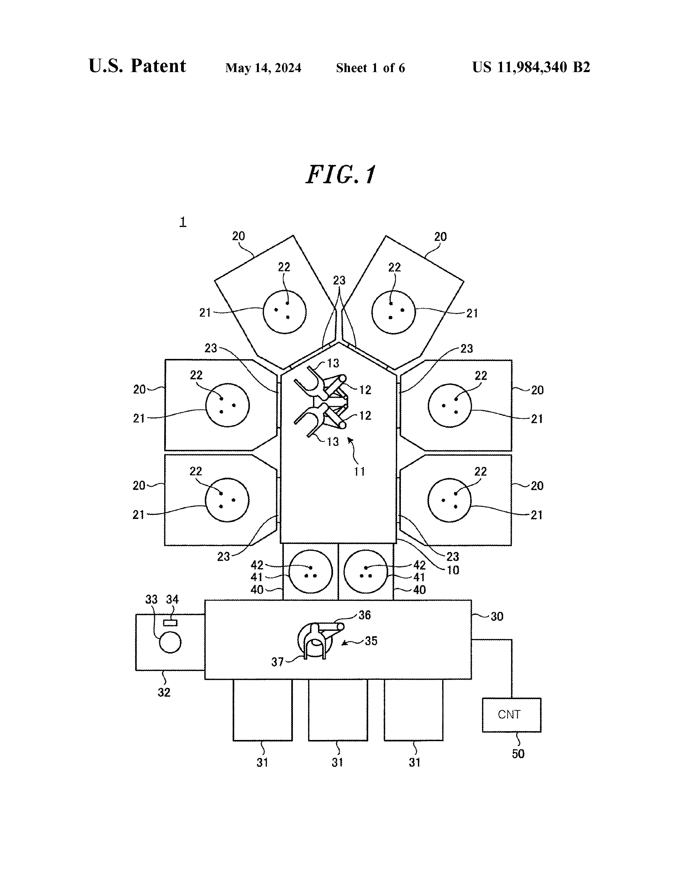
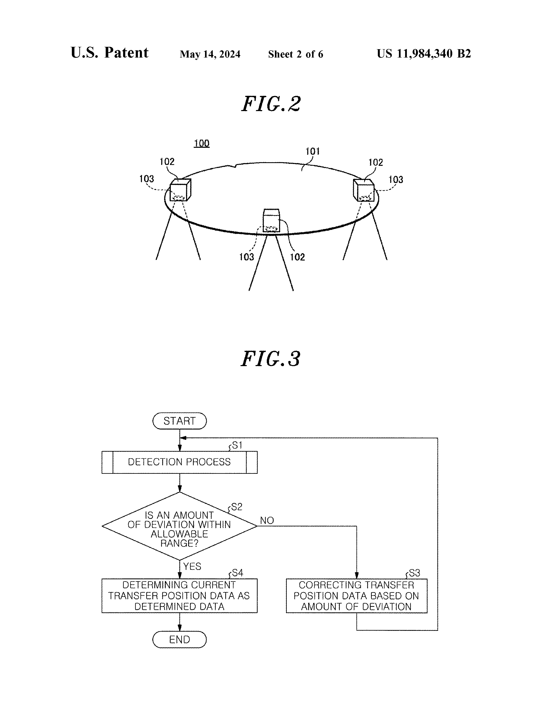
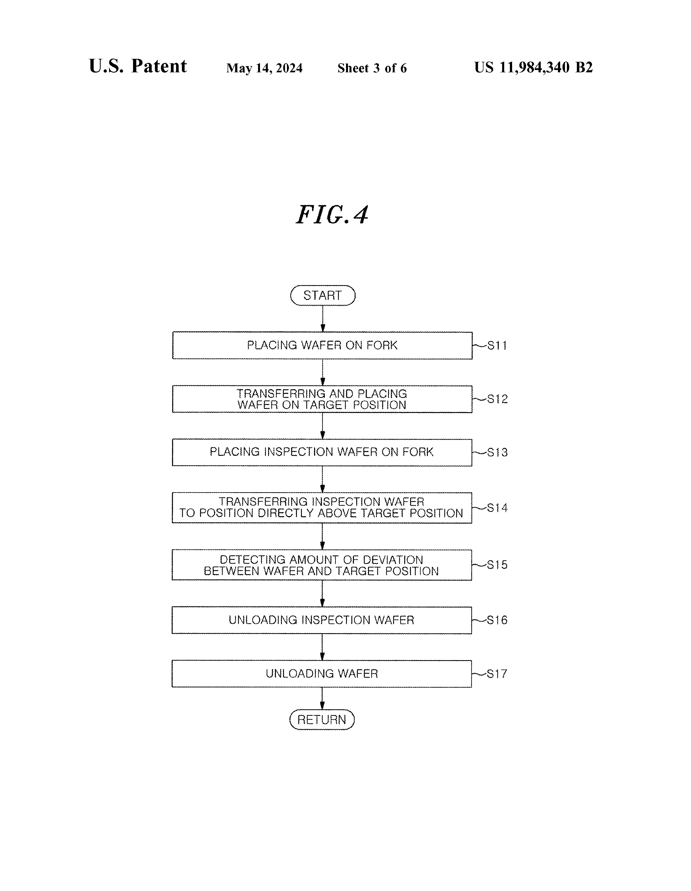
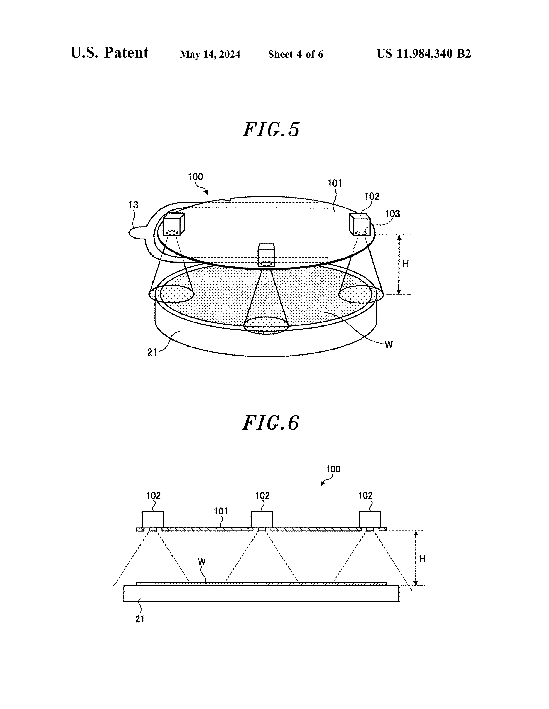
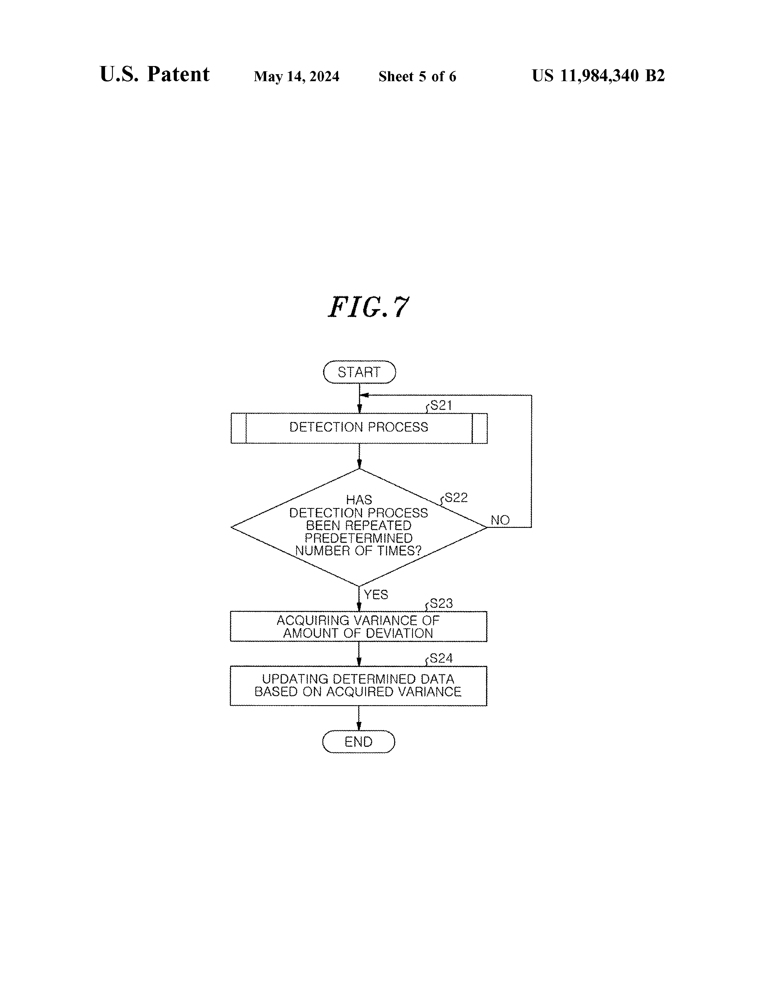
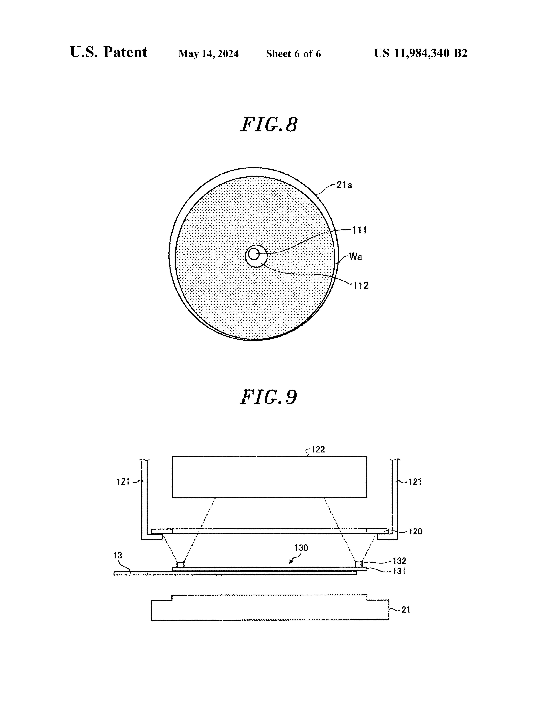

# 티칭 방법 (US11984340B2)
- 원제: Teaching method
- 원문: 같은 폴더의 PDF(`US11984340.pdf` 등록본, `US20210252695.pdf` 공개본), https://patents.google.com/patent/US11984340B2/en
- 번역 기준: USPTO 등록본 PDF의 원문을 한국어로 옮김. 조사일(2026-10-30) Google Patents 페이지가 응답하지 않아(HTTP 503), PDF 본문 쪽을 문자 인식한 뒤 쪽 이미지와 대조해 옮겼다. 원문 오기는 고치지 않았다.
- 도면: 원문 PDF 도면 시트 6장을 도면/ 폴더에 넣고 본문에서 처음 설명되는 곳에 삽입함

## 요약

이송 기구를 위한 티칭 방법이 제공된다. 이 티칭 방법은 (a) 제1 기판 또는 엣지 링을 이송 기구의 포크에 올려놓고, 제1 기판 또는 엣지 링을 목표 위치로 이송하고, 제1 기판 또는 엣지 링을 목표 위치 위에 놓는 단계; (b) 위치 검출 센서를 갖는 제2 기판을 포크에 올려놓고, 제2 기판을 목표 위치의 바로 위 또는 바로 아래의 위치로 이송하는 단계; (c) 제2 기판의 위치 검출 센서를 사용하여 제1 기판 또는 엣지 링과 목표 위치 사이의 편차량을 검출하는 단계; 및 (d) 검출된 편차량에 기초하여, 다음에 이송될 제1 기판 또는 엣지 링에 대한 이송 기구의 이송 위치 데이터를 보정하는 단계를 포함한다.

## 청구범위

청구하는 것은 다음과 같다.

1. 이송 기구를 위한 티칭 방법으로서,

(a) 제1 기판 또는 엣지 링을 상기 이송 기구의 포크에 올려놓고, 상기 제1 기판 또는 상기 엣지 링을 목표 위치로 이송하고, 상기 제1 기판 또는 상기 엣지 링을 상기 목표 위치 위에 놓는 단계;

(b) 위치 검출 센서를 갖는 제2 기판을 상기 포크에 올려놓고, 상기 제2 기판을 상기 목표 위치의 바로 위 또는 아래의 위치로 이송하는 단계;

(c) 상기 제2 기판의 상기 위치 검출 센서를 사용하여, 상기 제1 기판 또는 상기 엣지 링과 상기 목표 위치 사이의 편차량을 검출하는 단계; 및

(d) 검출된 상기 편차량에 기초하여, 다음에 이송될 상기 제1 기판 또는 상기 엣지 링에 대한 상기 이송 기구의 이송 위치 데이터를 보정하는 단계를 포함하는, 티칭 방법.

2. 제1항에 있어서,

(e) 상기 편차량이 허용 범위 내가 될 때까지 상기 (a) 내지 (d)를 반복하는 단계를 더 포함하는, 티칭 방법.

3. 제1항에 있어서,

(f) 상기 편차량이 허용 범위 내일 때 얻어진 상기 이송 위치 데이터를 확정 데이터로 결정하는 단계,

(g) 상기 확정 데이터에 기초하여 상기 (a) 내지 (c)를 반복하고, 상기 편차량의 분산을 취득하는 단계; 및

(h) 취득된 상기 분산에 기초하여 상기 확정 데이터를 갱신하는 단계를 더 포함하는, 티칭 방법.

4. 제2항에 있어서,

(f) 상기 편차량이 상기 허용 범위 내일 때 얻어진 상기 이송 위치 데이터를 확정 데이터로 결정하는 단계,

(g) 상기 확정 데이터에 기초하여 상기 (a) 내지 (c)를 반복하고, 상기 편차량의 분산을 취득하는 단계; 및

(h) 취득된 상기 분산에 기초하여 상기 확정 데이터를 갱신하는 단계를 더 포함하는, 티칭 방법.

5. 제1항에 있어서, 상기 (c)에서, 상기 편차량은 상기 제1 기판 또는 상기 엣지 링의 주연부와, 상기 제1 기판이 놓이는 기판 지지대 또는 상기 엣지 링과 마주하는 샤워 헤드의 주연부 사이에서 검출되는, 티칭 방법.

6. 제2항에 있어서, 상기 (c)에서, 상기 편차량은 상기 제1 기판 또는 상기 엣지 링의 주연부와, 상기 제1 기판이 놓이는 기판 지지대 또는 상기 엣지 링과 마주하는 샤워 헤드의 주연부 사이에서 검출되는, 티칭 방법.

7. 제1항에 있어서, 상기 제1 기판은 제1 마크를 갖고,

상기 (c)에서, 상기 편차량은 상기 제1 기판의 상기 제1 마크와, 상기 제1 기판이 놓이는 상기 기판 지지대의 제2 마크에 기초하여 검출되는, 티칭 방법.

8. 제2항에 있어서, 상기 제1 기판은 제1 마크를 갖고,

상기 (c)에서, 상기 편차량은 상기 제1 기판의 상기 제1 마크와, 상기 제1 기판이 놓이는 상기 기판 지지대의 제2 마크에 기초하여 검출되는, 티칭 방법.

9. 제7항에 있어서, 상기 제1 마크는 상기 제1 기판의 중심에 형성된 구멍이고, 상기 제2 마크는 상기 기판 지지대의 중심에 형성된 구멍인, 티칭 방법.

10. 제7항에 있어서, 상기 제1 마크는 상기 제1 기판의 주연부에 형성된 위치 맞춤용 노치이고, 상기 제2 마크는 상기 기판 지지대의 주연부에 형성되어 상기 제1 기판의 재치 위치를 규정하는 뱅크인, 티칭 방법.

11. 제1항에 있어서, 상기 위치 검출 센서는 카메라이고,

상기 (c)에서, 상기 편차량은 상기 카메라에 의해 촬영된 영상에 기초하여 검출되는, 티칭 방법.

12. 제2항에 있어서, 상기 위치 검출 센서는 카메라이고,

상기 (c)에서, 상기 편차량은 상기 카메라에 의해 촬영된 영상에 기초하여 검출되는, 티칭 방법.

## 상세한 설명

### 관련 출원의 상호 참조(CROSS-REFERENCE TO RELATED APPLICATION)

본 출원은 2020년 2월 13일 출원된 일본 특허출원 제2020-022426호에 대한 우선권을 주장하며, 그 전체 내용은 참조로 본 명세서에 포함된다.

### 기술 분야(TECHNICAL FIELD)

본 개시는 티칭 방법에 관한 것이다.

### 배경(BACKGROUND)

반도체 장치의 제조에서는 복수의 모듈 사이에서 기판을 이송하는 이송 기구를 포함하는 기판 처리 시스템이 사용된다. 기판 처리 시스템에서 이송 기구는 기판을 각 모듈로 반입하고, 각 모듈에 배치된 기판 지지대로부터 돌출된 리프트 핀에 기판을 전달한다.

이러한 기판 처리 시스템에서는 기판을 각 모듈로 정확하게 이송하기 위해, 작업자가 검사용 기판을 사용하여 각 모듈의 기판 재치 위치 등의 이송 정보를 이송 기구에 티칭한다. 또한, 검사용 기판에 설치된 카메라로 기판 지지대의 영상을 얻어, 이송 기구가 기판을 기판 지지대에 전달하는 위치를 보정하는 것이 제안되어 있다(예: 일본 특허출원 공개 제2019-102728호 참조).

### 개요(SUMMARY)

본 개시는 이송 위치의 정확도를 향상시킬 수 있는 티칭 방법을 제공한다.

본 개시의 일 측면에 따르면, 이송 기구를 위한 티칭 방법이 제공된다. 이 티칭 방법은 (a) 제1 기판 또는 엣지 링을 이송 기구의 포크에 올려놓고, 제1 기판 또는 엣지 링을 목표 위치로 이송하고, 제1 기판 또는 엣지 링을 목표 위치 위에 놓는 단계; (b) 위치 검출 센서를 갖는 제2 기판을 포크에 올려놓고, 제2 기판을 목표 위치의 바로 위 또는 아래의 위치로 이송하는 단계; (c) 제2 기판의 위치 검출 센서를 사용하여 제1 기판 또는 엣지 링과 목표 위치 사이의 편차량을 검출하는 단계; 및 (d) 검출된 편차량에 기초하여, 다음에 이송될 제1 기판 또는 엣지 링에 대한 이송 기구의 이송 위치 데이터를 보정하는 단계를 포함한다.

### 도면의 간단한 설명(BRIEF DESCRIPTION OF THE DRAWINGS)

본 개시의 목적과 특징은 첨부 도면과 함께 주어지는 다음 실시예의 설명으로부터 명백해질 것이다.

도 1은 일 실시예에 따른 기판 처리 시스템의 일례를 나타내는 수평 단면 평면도이다.

도 2는 실시예의 검사 웨이퍼의 일례를 나타낸다.

도 3은 실시예의 티칭 처리의 일례를 나타내는 흐름도이다.

도 4는 실시예의 검출 처리의 일례를 나타내는 흐름도이다.

도 5는 검사 웨이퍼가 목표 위치의 바로 위 위치로 이송된 상태의 일례를 나타낸다.

도 6은 검사 웨이퍼가 목표 위치의 바로 위 위치로 이송된 상태의 측면도이다.

도 7은 실시예의 갱신 처리의 일례를 나타내는 흐름도이다.

도 8은 제1 변형예의 웨이퍼와 스테이지의 일례를 나타낸다.

도 9는 제2 변형예에서 검사 웨이퍼가 목표 위치의 바로 아래 위치로 이송된 상태의 일례를 나타낸다.

### 상세한 설명(DETAILED DESCRIPTION)

이하, 첨부 도면을 참조하여 티칭 방법의 실시예를 상세히 설명한다. 다음 실시예는 본 개시를 한정하려는 것이 아니다.

최근 기판 처리 시스템에서는 처리 성능을 높이기 위해 장치의 이송 정확도 향상이 요구된다. 이송 정확도를 높이기 위해 이송 기구의 티칭을 수행하는 것이 알려져 있다. 그러나 장치를 대기에 개방하고 작업자가 기준 기판(이하 "웨이퍼"라고도 함)을 기판 지지대 위에 수작업으로 놓는 방법으로 이송 기구의 티칭을 수행하면, 가스 공급·배기 시간과 세정 시간 때문에 다운타임이 늘어난다. 한편, 앞서 설명한 바와 같이, 카메라 등의 센서를 구비한 검사용 기판을 작업자 없이 진공 중에서 이송 기구로 이송하여, 이송 기구가 기판을 기판 지지대에 전달하는 이송 위치를 보정하는 것이 제안되어 있다. 그러나 검사용 기판은 카메라 등을 구비하므로 제품 기판보다 무겁고, 이송 기구의 기어 백래시나 축의 비틀림에 의한 히스테리시스 때문에 이송 위치가 어긋날 수 있다. 이송 위치의 편차는 예를 들어 수십 µm 정도이지만, 최근에는 정확도 측면에서 무시할 수 없다. 따라서 이송 위치의 정확도를 향상시키는 것이 기대된다.

### 기판 처리 시스템 1의 구성(Configuration of Substrate Processing System 1)

도 1은 본 개시의 실시예에 따른 기판 처리 시스템의 일례를 나타내는 수평 단면 평면도이다. 도 1에 나타낸 기판 처리 시스템 1은 웨이퍼(예: 반도체 웨이퍼)에 대해 플라즈마 처리 등의 다양한 처리를 한 장씩 수행할 수 있다.

*도 1 — 기판 처리 시스템 1: 이송 모듈 10, 공정 모듈 20, 로더 모듈 30, 로드록 모듈 40, 얼라이너 32*

도 1에 나타낸 바와 같이, 기판 처리 시스템 1은 이송 모듈 10, 6개의 공정 모듈 20, 로더 모듈 30, 2개의 로드록 모듈 40을 포함한다.

이송 모듈 10은 평면에서 볼 때 대략 오각형이다. 이송 모듈 10은 진공 챔버를 갖고, 그 안에 이송 기구 11이 배치된다. 이송 기구 11은 가이드 레일(도시하지 않음), 2개의 암 12, 그리고 각 암 12의 선단에 배치되어 웨이퍼를 지지하는 포크 13을 포함한다. 각 암 12는 SCARA 암 형식이고, 회전 및 신축 가능하게 구성된다. 이송 기구 11은 가이드 레일을 따라 이동하며 공정 모듈 20과 로드록 모듈 40 사이에서 웨이퍼를 이송한다. 웨이퍼를 공정 모듈 20과 로드록 모듈 40 사이에서 이송할 수 있는 한, 이송 기구 11이 반드시 도 1의 구성일 필요는 없다. 예를 들어 이송 기구 11의 각 암 12는 회전, 신축, 상하 이동 가능하게 구성될 수 있다.

공정 모듈 20은 이송 모듈 10 둘레에 방사상으로 배치되어 이송 모듈 10에 연결된다. 각 공정 모듈 20은 처리 챔버를 갖고, 그 안에 원통형 스테이지 21(기판 지지대)이 배치된다. 스테이지 21에는 스테이지 21의 상면 위로 돌출하고 아래로 후퇴할 수 있는 가는 막대 모양의 리프트 핀 22가 3개 설치된다. 리프트 핀 22는 평면에서 볼 때 같은 원주 위에 배치된다. 리프트 핀 22가 스테이지 21의 상면 위로 돌출하면, 스테이지 21에 놓인 웨이퍼가 리프트 핀 22에 의해 들어 올려져 지지된다. 리프트 핀 22가 스테이지 21의 상면 아래로 후퇴하면 웨이퍼는 스테이지 21 위에 놓인다. 웨이퍼가 스테이지 21 위에 놓인 뒤, 공정 모듈 20 안의 압력을 낮추고 처리 가스를 공정 모듈 20 안으로 도입한다. 공정 모듈 20 안으로 RF 전력을 인가하여 플라즈마를 생성하고, 생성된 플라즈마로 웨이퍼에 플라즈마 처리를 수행한다. 이송 모듈 10과 공정 모듈 20은 개폐 가능한 게이트 밸브 23으로 구획된다.

로더 모듈 30은 이송 모듈 10과 마주하도록 배치된다. 로더 모듈 30은 대기압 분위기로 유지되는 직육면체 형상의 대기 이송 챔버이다. 2개의 로드록 모듈 40이 로더 모듈 30의 한쪽 긴 변에 연결된다. 로더 모듈 30의 다른 쪽 긴 변에는 3개의 로드 포트 31이 연결된다. 복수의 웨이퍼를 수용하는 용기인 FOUP(front-opening unified pod)(도시하지 않음)가 각 로드 포트 31에 놓인다. 로더 모듈 30의 한쪽 짧은 변에는 얼라이너 32가 연결된다. 로더 모듈 30 안에는 이송 기구 35가 배치된다.

얼라이너 32는 웨이퍼를 정렬한다. 얼라이너 32는 구동 모터(도시하지 않음)로 회전하는 회전 스테이지 33을 갖는다. 회전 스테이지 33은 예를 들어 웨이퍼 지름보다 작은 지름을 갖고, 웨이퍼를 상면에 올린 상태로 회전할 수 있게 구성된다. 회전 스테이지 33 근처에는 웨이퍼의 외주 에지를 검출하는 광학 센서 34가 배치된다. 얼라이너 32에서는 광학 센서 34로 웨이퍼의 중심 위치와, 웨이퍼 중심 위치에 대한 노치의 방향을 검출한다. 웨이퍼는 그 중심 위치가 소정 위치가 되고 노치 방향이 소정 방향이 되도록 후술하는 포크 37에 전달된다. 따라서 로드록 모듈 40에서 웨이퍼의 중심 위치가 소정 위치가 되고 노치 방향이 소정 방향이 되도록 웨이퍼의 이송 위치가 조정된다.

이송 기구 35는 가이드 레일(도시하지 않음), 암 36, 포크 37을 포함한다. 암 36은 SCARA 암 형식이고, 가이드 레일을 따라 이동 가능하며 회전, 신축, 상하 이동 가능하게 구성된다. 포크 37은 암 36의 선단에 배치되어 웨이퍼를 지지한다. 로더 모듈 30에서 이송 기구 35는 각 로드 포트 31에 놓인 FOUP, 얼라이너 32, 로드록 모듈 40 사이에서 웨이퍼를 이송한다. 웨이퍼를 FOUP, 얼라이너 32, 로드록 모듈 40 사이에서 이송할 수 있는 한, 이송 기구 35가 반드시 도 1의 구성일 필요는 없다.

로드록 모듈 40은 이송 모듈 10과 로더 모듈 30 사이에 배치된다. 각 로드록 모듈 40은 내부 압력을 진공 상태와 대기압 사이에서 전환할 수 있는 챔버를 갖고, 그 안에 원통형 스테이지 41이 배치된다. 웨이퍼를 로더 모듈 30에서 이송 모듈 10으로 반입하는 경우, 웨이퍼를 로더 모듈 30에서 대기압으로 유지된 로드록 모듈 40으로 이송하고, 로드록 모듈 40 안의 압력을 낮춘 뒤, 웨이퍼를 이송 모듈 10으로 반입한다. 웨이퍼를 이송 모듈 10에서 로더 모듈 30으로 반출하는 경우, 웨이퍼를 이송 모듈 10에서 진공 상태로 유지된 로드록 모듈 40으로 이송하고, 로드록 모듈 40 안의 압력을 대기압으로 높인 뒤, 웨이퍼를 로더 모듈 30으로 반입한다. 스테이지 41에는 스테이지 41의 상면 위로 돌출하고 아래로 후퇴할 수 있는 가는 막대 모양의 리프트 핀 42가 3개 설치된다. 리프트 핀 42는 평면에서 볼 때 같은 원주 위에 배치된다. 리프트 핀 42가 스테이지 41의 상면 위로 돌출하면 웨이퍼가 리프트 핀 42에 의해 들어 올려져 지지된다. 리프트 핀 42가 스테이지 41의 상면 아래로 후퇴하면 웨이퍼는 스테이지 41 위에 놓인다. 로드록 모듈 40과 이송 모듈 10은 개폐 가능한 게이트 밸브(도시하지 않음)로 구획된다. 또한 로드록 모듈 40과 로더 모듈 30도 개폐 가능한 게이트 밸브(도시하지 않음)로 구획된다.

기판 처리 시스템 1은 제어기(CNT) 50을 포함한다. 제어기 50은 예를 들어 컴퓨터이고, 중앙 처리 장치(CPU), 랜덤 액세스 메모리(RAM), 읽기 전용 메모리(ROM), 보조 기억 장치 등을 포함한다. CPU는 ROM 또는 보조 기억 장치에 저장된 프로그램에 따라 동작하며, 기판 처리 시스템 1의 각 구성 요소의 동작을 제어한다.

### 검사 웨이퍼(Inspection Wafer)

도 2는 본 실시예의 검사 웨이퍼의 일례를 나타낸다. 도 2에 나타낸 바와 같이, 검사 웨이퍼 100은 베이스 웨이퍼 101과 복수(예: 3개)의 카메라 102를 포함한다. 베이스 웨이퍼 101은 제품 웨이퍼와 같은 크기인 것이 바람직하다. 제품 웨이퍼와 같은 크기의 베이스 웨이퍼 101을 사용하면, 검사 웨이퍼 100을 제품 웨이퍼와 같은 방식으로 모듈 사이에서 이송할 수 있다. 구체적으로, 예를 들어 지름 300 mm의 제품 웨이퍼를 사용하는 경우 베이스 웨이퍼 101의 지름도 300 mm인 것이 바람직하다.

*도 2 — 카메라 102 세 대를 단 검사 웨이퍼 100, 도 3 — 티칭 처리 흐름도(편차가 허용 범위 안이 될 때까지 검출·보정 반복)*

카메라 102는 위치 검출 센서의 일례이며, 베이스 웨이퍼 101 표면의 외주부, 예를 들어 같은 원주 위에 배치된다. 예를 들어 카메라 102를 같은 원주 위에 120° 간격으로 세 곳에 설치하는 것이 바람직하다. 각 카메라 102는 베이스 웨이퍼 101에 형성된 개구 103을 통해 베이스 웨이퍼 101의 아래쪽을 촬영하도록 구성된다. 카메라 102의 수는 한정되지 않으며 하나 이상이면 된다. 예를 들어 카메라 102는 베이스 웨이퍼 101의 중심을 지나는 직교하는 두 직선과 외주부 원주가 만나는 두 곳에 배치될 수 있다. 또한 카메라 102를 베이스 웨이퍼 101 외주부의 한 곳에 배치하고, 검사 웨이퍼 100을 얼라이너 32로 옮겨 회전시킬 수도 있다. 또한 카메라 102는 촬영한 영상을 제어기 50으로 송신하는 통신 기능을 갖는다. 통신 기능은 예를 들어 Bluetooth(등록상표) 등으로 수행될 수 있다. 또한 검사 웨이퍼 100은 카메라 102로 얻은 영상을 저장하는 저장부를 가질 수 있다.

### 티칭 방법(Teaching Method)

다음으로 본 실시예의 기판 처리 시스템 1의 동작을 설명한다. 도 3은 본 실시예의 티칭 처리의 일례를 나타내는 흐름도이다. 이하의 설명에서 기판 처리 시스템 1의 각 구성 요소의 동작은 제어기 50에 의해 제어된다.

제어기 50은 제품 웨이퍼 W와 웨이퍼 W의 목표 위치 사이의 편차량을 검출하는 검출 처리를 실행한다(단계 S1). 여기서 검출 처리를 도 4를 참조하여 설명한다. 도 4는 본 실시예의 검출 처리의 일례를 나타내는 흐름도이다.

*도 4 — 검출 처리 흐름도: 웨이퍼를 목표 위치에 놓고(S11·S12), 검사 웨이퍼를 바로 위로 옮겨(S13·S14) 편차량 검출(S15) 후 반출(S16·S17)*

먼저, 로드 포트 31의 FOUP에 수용된 검사 웨이퍼 100 또는 웨이퍼 W를 이송 모듈 10의 포크 13 위에 올려놓는 동작을 웨이퍼 W를 예로 들어 설명한다. 이하의 설명에서 웨이퍼 W 또는 검사 웨이퍼 100을 포크 13 위에 올려놓는 같은 동작을 수행할 때에는 그 동작의 설명을 생략한다.

먼저, 웨이퍼 W를 수용한 FOUP를 로드 포트 31에 놓는다. 다음으로 웨이퍼 W를 위치 맞춤한다. 웨이퍼 W를 위치 맞춤하는 경우, 이송 기구 35의 포크 37이 FOUP에 진입하여 웨이퍼 W를 들어 올려 지지하고 FOUP에서 후퇴한다. 다음으로 제어기 50은 웨이퍼 W를 지지한 포크 37을 얼라이너 32에 진입시키고 하강시켜 웨이퍼 W를 회전 스테이지 33 위에 놓는다. 그 후 제어기 50은 포크 37을 얼라이너 32에서 후퇴시키고, 웨이퍼 W는 얼라이너 32에 의해 위치 맞춤된다. 웨이퍼 W의 위치 맞춤 후, 제어기 50은 포크 37을 얼라이너 32에 진입시켜 웨이퍼 W를 들어 올려 지지하게 한다. 그 후 포크 37은 얼라이너 32에서 후퇴한다. 이때 웨이퍼 W는 위치 맞춤되어 있으므로, 웨이퍼 W의 중심 위치가 소정 위치가 되고 노치 방향이 소정 방향이 되도록 포크 37에 전달된다. 웨이퍼 W의 위치 맞춤이 미리 수행되어 있으면 웨이퍼 W의 위치 맞춤은 생략할 수 있다.

다음으로 제어기 50은 웨이퍼 W를 지지한 포크 37을 대기압으로 유지된 로드록 모듈 40에 진입시키고, 3개의 리프트 핀 42가 스테이지 41의 상면 위로 돌출하여 웨이퍼 W를 포크 37에서 들어 올려 분리한다. 다음으로 제어기 50은 포크 37을 로드록 모듈 40에서 후퇴시킨 뒤 리프트 핀 42를 스테이지 41의 상면 아래로 후퇴시켜 웨이퍼 W를 스테이지 41 위에 놓는다. 이때 웨이퍼 W는 중심 위치가 소정 위치가 되고 노치 방향이 소정 방향이 되도록 포크 37에 전달되어 있으므로, 로드록 모듈 40에서 웨이퍼 W의 중심 위치는 소정 위치가 되고 노치 방향은 소정 방향이 된다.

로드록 모듈 40 안의 압력을 낮춘 뒤, 제어기 50은 3개의 리프트 핀 42를 스테이지 41의 상면 위로 돌출시켜 웨이퍼 W를 들어 올린다. 다음으로 제어기 50은 이송 기구 11의 포크 13을 로드록 모듈 40에 진입시키고, 3개의 리프트 핀 42를 하강시켜 웨이퍼 W가 포크 13에 지지되도록 한다. 다시 말해, 제어기 50은 웨이퍼 W를 이송 기구 11의 포크 13 위에 올려놓는다(단계 S11).

제어기 50은 웨이퍼 W를 지지한 포크 13을 공정 모듈 20에 진입시키고, 3개의 리프트 핀 22가 스테이지 21의 상면 위로 돌출하여 웨이퍼 W를 포크 13에서 들어 올려 분리한다. 제어기 50은 포크 37을 공정 모듈 20에서 후퇴시킨 뒤 리프트 핀을 스테이지 21의 상면 아래로 후퇴시켜 웨이퍼 W를 스테이지 21 위에 놓는다. 다시 말해, 제어기 50은 웨이퍼 W를 스테이지 21 위의 목표 위치로 이송하여 놓는다(단계 S12). 목표 위치는 웨이퍼 W가 스테이지 21 위에 놓여야 할 위치로, 예를 들어 스테이지 21의 중심과 웨이퍼 W의 중심이 일치하는 위치이다.

다음으로 제어기 50은 로드 포트 31의 FOUP에 수용된 검사 웨이퍼 100을 웨이퍼 W의 경우와 같은 방식으로 이송 모듈 10의 포크 13 위에 올려놓는다(단계 S13).

제어기 50은 검사 웨이퍼 100을 지지한 포크 13을 공정 모듈 20에 진입시켜, 검사 웨이퍼 100을 웨이퍼 W가 놓인 스테이지 21의 바로 위 위치, 즉 목표 위치의 바로 위 위치로 이송한다(단계 S14).

제어기 50은 검사 웨이퍼 100에 설치된 카메라 102에, 목표 위치의 바로 위 위치에서 웨이퍼 W의 주연부와 스테이지 21의 주연부를 포함하는 영역의 영상을 얻도록 지시한다. 카메라 102는 식별 정보(예: 카메라 ID)와 영상을 제어기 50으로 송신한다. 카메라 102에 통신 기능이 없는 경우, 검사 웨이퍼 100에 카메라 102와 별도로 통신 장치를 설치하여 카메라 102로 얻은 영상을 제어기 50으로 송신할 수 있다.

제어기 50은 카메라 102로 얻은 영상에 포함된 스테이지 21 주연부의 원호와 웨이퍼 W 주연부의 원호에 기초한 원 보간을 사용하여 웨이퍼 W와 스테이지 21의 원주 위치를 구한다. 다시 말해, 제어기 50은 원호로부터 원주의 중심 위치를 구한다. 제어기 50은 웨이퍼 W의 원주 위치와 스테이지 21의 원주 위치의 차이에 기초하여 웨이퍼 W와 목표 위치 사이의 상대 편차량을 검출한다(단계 S15). 예를 들어 카메라 102가 120° 간격으로 세 곳에 배치된 경우, 웨이퍼 W의 원주 위치와 스테이지 21의 원주 위치의 차이가 카메라 102들에서 같으면, 제어기 50이 검출하는 목표 위치로부터의 편차량은 0이다.

여기서 검사 웨이퍼 100이 목표 위치의 바로 위 위치로 이송된 상태를 도 5와 도 6을 참조하여 설명한다. 도 5는 검사 웨이퍼가 목표 위치의 바로 위 위치로 이송된 상태의 일례를 나타낸다. 도 6은 검사 웨이퍼가 목표 위치의 바로 위 위치로 이송된 상태의 측면도이다. 도 6에서 포크 13은 생략되어 있다.

*도 5·6 — 검사 웨이퍼 100이 스테이지 21 위 높이 H에서 웨이퍼 W와 스테이지의 주연부를 촬영*

도 5와 도 6에 나타낸 바와 같이, 먼저 이송된 웨이퍼 W가 스테이지 21 위에 놓여 있고, 포크 13으로 이송된 검사 웨이퍼 100이 스테이지 21의 바로 위에 위치한다. 검사 웨이퍼 100은 웨이퍼 W가 놓인 스테이지 21의 표면으로부터 위쪽으로 소정 거리 H만큼 떨어져 있다. 도 5에 나타낸 바와 같이, 검사 웨이퍼 100에 배치된 카메라 102는 스테이지 21과 웨이퍼 W의 주연부(에지) 영상을 얻는다. 카메라 102의 시야 안에 눈금이나 일정 간격의 점 같은 기준을 두면, 높이 방향의 위치 편차, 즉 소정 거리 H도 보정할 수 있다.

다시 도 4로 돌아가, 제어기 50은 검사 웨이퍼 100을 공정 모듈 20에서 반출한다(단계 S16). 다시 말해, 제어기 50은 검사 웨이퍼 100을 로드 포트 31의 FOUP 안으로 옮긴다. 여기서 검사 웨이퍼 100을 포크 13 위의 위치에서 로드 포트 31의 FOUP 안으로 옮기는 동작을 설명한다. 웨이퍼 W를 포크 13 위의 위치에서 로드 포트 31의 FOUP 안으로 옮기는 동작은 검사 웨이퍼 W를 옮기는 동작과 같으므로 그 설명은 생략한다. 이하의 설명에서는 웨이퍼 W 또는 검사 웨이퍼 100을 포크 13 위의 위치에서 로드 포트 31의 FOUP 안으로 옮기는 동작의 설명을 생략한다.

제어기 50은 검사 웨이퍼 100을 지지한 포크 13을 공정 모듈 20에서 진공 상태로 유지된 로드록 모듈 40 안으로 이송한다. 제어기 50은 3개의 리프트 핀 42를 스테이지 41의 상면 위로 돌출시켜 검사 웨이퍼 100을 포크 13에서 들어 올려 분리한다. 제어기 50은 포크 13을 로드록 모듈 40에서 후퇴시킨 뒤, 3개의 리프트 핀 42를 스테이지 41 아래로 후퇴시켜 검사 웨이퍼 100을 스테이지 41 위에 놓는다.

로드록 모듈 40 안의 압력을 대기압으로 높인 뒤, 제어기 50은 3개의 리프트 핀 42를 스테이지 41의 상면 위로 돌출시켜 검사 웨이퍼 100을 들어 올린다. 그 후 제어기 50은 이송 기구 35의 포크 37을 로드록 모듈 40에 진입시킨다. 그 후 제어기 50은 3개의 리프트 핀 42를 하강시켜 검사 웨이퍼 100이 포크 37에 지지되도록 한다. 그 후 제어기 50은 검사 웨이퍼 100을 지지한 포크 37을 FOUP에 진입시키고, 검사 웨이퍼 100은 로드 포트 31에 놓인 FOUP에 수용된다.

검사 웨이퍼 100이 로드 포트 31의 FOUP 안으로 옮겨지면, 제어기 50은 웨이퍼 W를 공정 모듈 20에서 반출한다(단계 S17). 제어기 50은 공정 모듈 20의 3개의 리프트 핀 22를 스테이지 21의 상면 위로 돌출시켜 웨이퍼 W를 들어 올린다. 제어기 50은 이송 기구 11의 포크 13을 공정 모듈 20에 진입시키고, 3개의 리프트 핀 22를 하강시켜 웨이퍼 W가 포크 13에 지지되도록 한다. 그 후 제어기 50은 검사 웨이퍼 100의 경우와 같은 방식으로 웨이퍼 W를 로드 포트 31의 FOUP 안으로 옮기고, 검출 처리를 마친 뒤 원래의 처리로 돌아간다. 검출 처리의 목적은 단계 S15에서 웨이퍼 W와 목표 위치 사이의 편차량을 검출할 수 있으면 달성되므로, 검사 웨이퍼 100이나 웨이퍼 W를 FOUP으로 옮기는 단계는 필수가 아니다.

다시 도 3으로 돌아가, 제어기 50은 검출된 웨이퍼 W와 목표 위치 사이의 편차량이 허용 범위 내인지 판정한다(단계 S2). 제어기 50은 웨이퍼 W와 목표 위치 사이의 편차량이 허용 범위 내가 아니라고 판정하면(단계 S2: 아니오), 편차량에 기초하여 다음에 이송될 웨이퍼 W에 대한 이송 기구 11의 이송 위치 데이터를 보정하고(단계 S3), 처리는 단계 S1로 돌아간다. 다시 말해, 제어기 50은 편차량이 허용 범위 내가 될 때까지 단계 S1의 검출 처리를 반복한다.

반면, 웨이퍼 W와 목표 위치 사이의 편차량이 허용 범위 내라고 판정되면(단계 S2: 예), 제어기 50은 현재의 이송 위치 데이터를 확정 데이터로 결정하고(단계 S4), 티칭 처리를 마친다. 따라서 기판 처리 시스템 1은 웨이퍼 W의 이송 위치를 티칭하여 이송 위치의 정확도를 향상시킬 수 있다.

기판 처리 시스템 1에서는 제품 웨이퍼 W를 목표 위치로 이송하므로, 티칭 때와 처리 때 사이에 이송 기구 11의 정지 위치에 차이가 없다. 또한 기판 처리 시스템 1에서는 웨이퍼를 포크 13에서 리프트 핀 22 또는 스테이지 21로 전달할 때의 편차를 고려하여 티칭을 수행하므로 이송 위치의 정확도를 향상시킬 수 있다. 또한 기판 처리 시스템 1에서는 공정 모듈 20을 대기에 개방할 필요가 없으므로 다운타임을 크게 줄일 수 있다. 기판 처리 시스템 1에서 수행하는 티칭 처리는 검사 웨이퍼 100을 이송할 수 있는 장치라면 기존 장치에도 적용할 수 있다. 또한 기판 처리 시스템 1에서는 티칭을 자동화할 수 있으므로, 작업자에 의존하지 않고 이송 위치의 정확도를 안정시킬 수 있다.

다음으로, 티칭 처리에서 얻은 확정 데이터의 정확도를 높이기 위한 갱신 처리를 설명한다. 도 7은 본 실시예의 갱신 처리의 일례를 나타내는 흐름도이다.

*도 7 — 갱신 처리 흐름도: 검출 처리를 소정 횟수 반복(S21·S22) → 편차량의 분산 취득(S23) → 분산에 기초해 확정 데이터 갱신(S24)*

제어기 50은 티칭 처리의 경우와 같은 방식으로 검출 처리를 수행한다(단계 S21). 검출 처리의 세부 내용은 티칭 처리의 단계 S1의 검출 처리와 같으므로 설명을 생략한다. 제어기 50은 검출 처리가 소정 횟수 반복되었는지 판정한다(단계 S22). 여기서 소정 횟수는 예를 들어 10~100회 정도일 수 있다. 소정 횟수 반복되지 않았다고 판정되면(단계 S22: 아니오), 제어기 50은 단계 S21로 돌아가 검출 처리를 계속 수행한다.

반면, 소정 횟수 반복되었다고 판정되면(단계 S22: 예), 제어기 50은 소정 횟수의 편차량에 기초하여 편차량의 분산을 계산하여 취득한다(단계 S23). 제어기 50은 취득한 분산에 기초하여 확정 데이터를 갱신하고(단계 S24) 갱신 처리를 마친다. 제어기 50은 예를 들어 분산의 기댓값이 편차량 허용 범위의 중심이 되도록 확정 데이터를 갱신한다. 따라서 기판 처리 시스템 1은 이송 기구 11의 이송 동작의 편차나 이송 기구 35의 이송 동작의 편차를 고려하여 웨이퍼 W의 이송 위치를 티칭할 수 있다. 또한 이송 위치의 정확도를 더욱 향상시킬 수 있다.

### 변형예 1(Modification 1)

앞서 설명한 실시예에서는 제품 웨이퍼 W를 사용하여 티칭을 수행했다. 그러나 티칭 웨이퍼를 사용할 수도 있다. 예를 들어 공정 모듈의 스테이지가 그 중심에 구멍을 가질 수 있다. 이 경우 중심에 구멍을 가진 티칭 웨이퍼를 사용하고, 구멍 사이의 편차량을 검출하여 웨이퍼 W와 목표 위치 사이의 편차량을 검출할 수 있다.

도 8은 변형예 1의 웨이퍼와 스테이지의 일례를 나타낸다. 도 8은 웨이퍼가 놓인 스테이지의 평면도이다. 도 8에 나타낸 스테이지 21a는 그 중심에 구멍 111을 갖는다. 티칭 웨이퍼인 웨이퍼 Wa는 그 중심에 구멍 112를 갖는다. 스테이지 21a와 웨이퍼 Wa를 사용하는 경우, 검사 웨이퍼 100의 중심에 카메라 102 하나를 배치하여 구멍 111과 112의 영상을 얻을 수 있다. 제어기 50은 구멍 111과 112로부터 스테이지 21a와 웨이퍼 Wa의 중심 위치를 계산하여 웨이퍼 Wa와 목표 위치 사이의 편차량을 검출할 수 있다. 카메라 102가 검사 웨이퍼 100의 주연부에 배치된 경우에도, 이송 기구 11의 암 12를 신축시켜 구멍 111과 112의 영상을 얻을 수 있다. 다시 말해, 구멍 112를 제1 마크로, 구멍 111을 제2 마크로 설정하면, 제어기 50은 웨이퍼 Wa의 제1 마크와 스테이지 21a의 제2 마크에 기초하여 웨이퍼 Wa와 목표 위치 사이의 편차량을 검출할 수 있다.

*도 8 — 중심 구멍 111(스테이지)·112(티칭 웨이퍼)를 마크로 쓰는 변형예 1, 도 9 — 들어 올린 엣지 링 120 아래로 검사 웨이퍼 130을 넣는 변형예 2*

웨이퍼 W의 제1 마크가 위치 맞춤용 노치이고 스테이지 21의 제2 마크가 웨이퍼 W의 재치 위치를 규정하는 뱅크(도시하지 않음)인 경우에도 웨이퍼 W와 목표 위치 사이의 편차량을 검출할 수 있다. 노치를 사용하는 경우, 수평 방향의 편차뿐 아니라 θ 방향(회전 방향)의 노치 위치 편차도 보정할 수 있다. θ 방향의 편차는 이송 기구 11의 포크 13의 진입 각도 또는 얼라이너 32의 θ를 티칭하여 보정할 수 있다. 웨이퍼 W 위의 특정 패턴이 스테이지 21 위의 특정 위치에 오는 경우, 그 특정 패턴을 제1 마크로 사용할 수 있다. 또한 티칭 웨이퍼는 그 어느 위치에 제1 마크 역할을 하는 위치 결정 마크를 가질 수 있다.

### 변형예 2(Modification 2)

앞서 설명한 실시예에서는 제품 웨이퍼 W의 이송 위치를 티칭했다. 그러나 이송 기구로 이송할 수 있고 교체가 필요한 엣지 링 등의 부품의 이송 위치를 티칭할 수도 있다. 도 9는 변형예 2에서 검사 웨이퍼가 목표 위치의 바로 아래 위치로 이송된 상태의 일례를 나타낸다. 도 9는 공정 모듈 20으로 이송된 엣지 링 120이 리프트 기구 121에 의해 샤워 헤드 122 쪽으로 들어 올려지고, 검사 웨이퍼 130이 놓인 포크 13이 공정 모듈 20 안으로 이송된 상태를 나타낸다. 이 경우 엣지 링 120은 리프트 기구 121에 의해 스테이지 21에서 수직 위쪽으로 들어 올려진다. 다시 말해, 엣지 링 120은 리프트 기구 121 위에 놓이고, 이 상태에서 샤워 헤드 122 쪽으로 들어 올려진 엣지 링 12의 위치가 엣지 링 120의 목표 위치로 설정된다. 다시 말해, 목표 위치는 예를 들어 엣지 링 120의 중심 위치가 샤워 헤드 122의 중심 위치와 일치하는 위치일 수 있다.

검사 웨이퍼 130에는 샤워 헤드 122와 마주하도록 베이스 웨이퍼 131 위에 배치된 복수의 카메라 132가 설치된다. 카메라 132는 엣지 링 120 내주부의 원호와 샤워 헤드 122 주연부의 원호 영상을 얻는다. 다시 말해, 검사 웨이퍼 130은 엣지 링 120의 목표 위치 바로 아래 위치로 이송되고, 제어기 50은 엣지 링 120과 샤워 헤드 122 사이의 편차량을 검출한다. 제어기 50은 검출된 엣지 링 120과 목표 위치 사이의 편차량에 기초하여 엣지 링 120의 이송 위치 데이터를 보정할 수 있다. 따라서 엣지 링 120을 교체하더라도 엣지 링 120과 웨이퍼 W 양쪽의 티칭을 수행하여 웨이퍼 W의 이송 위치 정확도를 향상시킬 수 있다. 다시 말해, 교체 후에도 웨이퍼 W를 엣지 링 120의 중심 위치에 놓을 수 있다.

앞서 설명한 실시예에서는 카메라를 위치 검출 센서로 사용했다. 그러나 본 개시는 이에 한정되지 않는다. 예를 들어 정전용량 센서, 레이저 변위계 등을 사용하여 웨이퍼 W와 스테이지 21의 단부를 검출하여 편차량을 검출할 수 있다.

또한 앞서 설명한 실시예에서는 공정 모듈 20의 스테이지 21에 대한 이송 기구 11의 위치 편차를 보정하는 경우에 티칭 방법을 적용했다. 그러나 본 개시는 이에 한정되지 않는다. 예를 들어 본 개시의 실시예에 따른 티칭 방법은 로드록 모듈 40의 스테이지 41에 대한 이송 기구 35의 위치 편차를 보정하는 경우에도 적용할 수 있다.

앞서 설명한 바와 같이, 본 실시예에 따르면 기판 처리 시스템 1의 제어기 50이 수행하는 이송 기구 11의 티칭 방법은 (a) 올려놓기, (b) 이송, (c) 검출, (d) 보정을 포함한다. 제어기 50은 (a) 제1 기판(웨이퍼 W) 또는 엣지 링 120을 이송 기구 11의 포크 13 위에 올려놓고, 제1 기판 또는 엣지 링 120을 목표 위치로 이송하고, 제1 기판 또는 엣지 링 12를 목표 위치 위에 놓는 단계; (b) 위치 검출 센서를 갖는 제2 기판을 포크 위에 올려놓고, 기판을 목표 위치의 바로 위 또는 바로 아래 위치로 이송하는 단계; (c) 제2 기판의 위치 검출 센서를 사용하여 제1 기판 또는 엣지 링과 목표 위치 사이의 편차량을 검출하는 단계; (d) 검출된 편차량에 기초하여 다음에 이송될 제1 기판 또는 엣지 링에 대한 이송 기구의 이송 위치 데이터를 보정하는 단계를 수행한다. 따라서 제1 기판(웨이퍼 W) 또는 엣지 링 120의 이송 위치를 티칭할 수 있고 이송 위치의 정확도를 향상시킬 수 있다.

또한 본 실시예에 따르면, 제어기 50은 (e) 편차량이 허용 범위 내가 될 때까지 (a) 내지 (d)를 반복하는 단계를 수행한다. 따라서 제1 기판 또는 엣지 링 120의 이송 위치를 티칭할 수 있고 이송 위치의 정확도를 향상시킬 수 있다.

또한 본 실시예에 따르면, 제어기 50은 (f) 편차량이 허용 범위 내일 때 얻은 이송 위치 데이터를 확정 데이터로 결정하는 단계; (g) 확정 데이터에 기초하여 (a) 내지 (c)를 반복하고 편차량의 분산을 취득하는 단계; (h) 취득한 분산에 기초하여 확정 데이터를 갱신하는 단계를 수행한다. 따라서 이송 기구 11의 이송 동작의 편차를 고려하여 제1 기판의 이송 위치를 티칭할 수 있다.

또한 본 실시예에 따르면, c)에서 편차량은 제1 기판 또는 엣지 링 120의 주연부와, 제1 기판 또는 엣지 링 120을 놓기 위한 기판 지지대(스테이지 21)와 마주하는 샤워의 주연부 사이에서 검출된다. 따라서 제1 기판 또는 엣지 링 120의 이송 위치를 티칭할 수 있고 이송 위치의 정확도를 향상시킬 수 있다.

또한 본 실시예에 따르면, 제1 기판은 제1 마크를 갖고, (c)에서 편차량은 제1 기판의 제1 마크와 제1 기판이 놓이는 기판 지지대의 제2 마크에 기초하여 검출된다. 따라서 제1 기판과 기판 지지대 사이의 편차량을 쉽게 검출할 수 있다.

또한 본 실시예에 따르면, 제1 마크는 제1 기판의 중심에 형성된 구멍이고, 제2 마크는 기판 지지대의 중심에 형성된 구멍이다. 따라서 제1 기판과 기판 지지대 사이의 편차량을 쉽게 검출할 수 있다.

또한 본 실시예에 따르면, 제1 마크는 제1 기판의 주연부에 형성된 위치 맞춤용 노치이고, 제2 마크는 기판 지지대의 주연부에 형성되어 제1 기판의 재치 위치를 규정하는 뱅크이다. 따라서 기존 장치로도 제1 기판과 기판 지지대 사이의 편차량을 쉽게 검출할 수 있다.

또한 본 실시예에 따르면, 위치 검출 센서는 카메라이고, (c)에서 편차량은 카메라로 얻은 영상에 기초하여 검출된다. 따라서 카메라 수가 2개 이하이더라도 편차량을 검출할 수 있다.

본 개시의 실시예는 모든 면에서 예시적이며 제한적이지 않다. 앞서 설명한 실시예는 다양한 형태로 구현될 수 있다. 또한 앞서 설명한 실시예는 첨부된 청구범위와 그 취지를 벗어나지 않고 다양한 형태로 생략, 치환, 변경될 수 있다.

또한 앞서 설명한 실시예에서는 기판이 반도체 웨이퍼인 경우를 예로 설명했다. 그러나 본 개시는 이에 한정되지 않으며, 기판은 예를 들어 유리 기판, LCD 기판 등일 수 있다.

특정 실시예를 설명했지만, 이 실시예들은 예시로만 제시된 것이며 개시의 범위를 한정하려는 것이 아니다. 실제로 본 명세서에 설명된 실시예는 다양한 다른 형태로 구현될 수 있다. 나아가 본 명세서에 설명된 실시예의 형태에 다양한 생략, 치환, 변경이 개시의 취지를 벗어나서 이루어질 수 있다. 첨부된 청구범위와 그 균등물은 개시의 범위와 취지에 속하는 그러한 형태나 변형을 포함하도록 의도된다.
