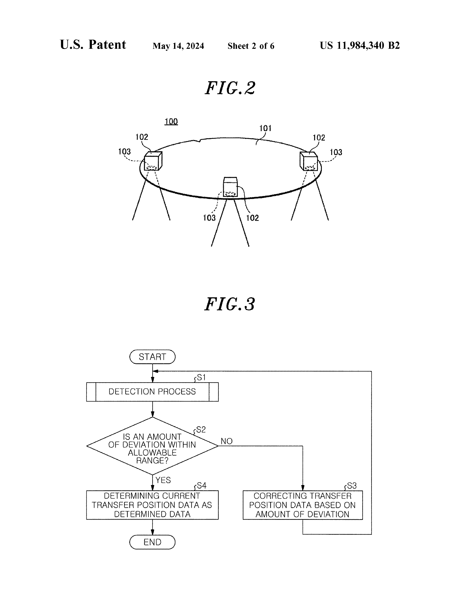
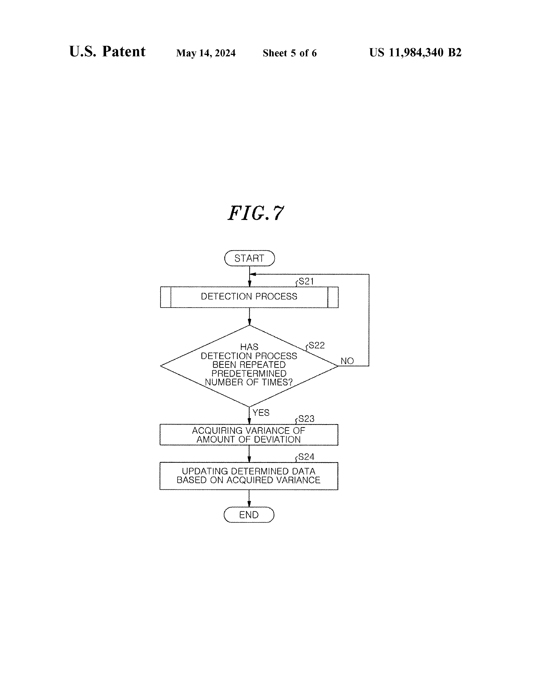

# US11984340B2 — 티칭 방법 (Tokyo Electron)

| 항목 | 내용 |
|---|---|
| 원문 | `US11984340.pdf`(등록, 2024-05-14) · `US20210252695.pdf`(공개, 2021-08-19) |
| 출원인 | Tokyo Electron Limited |
| 우선일 | 2020-02-13 (JP 2020-022426) |
| 청구항 | 12항 (독립항 1개) |
| 핵심 | 제품 웨이퍼를 목표 위치에 놓은 뒤, 카메라 3대를 단 검사 웨이퍼를 바로 위로 가져와 웨이퍼와 스테이지의 에지 원호로 편차를 잰다. 편차가 허용 범위 안이 될 때까지 "놓기 → 재기 → 다음 이송 위치 보정"을 반복하고, 확정 뒤에는 같은 측정을 10~100회 반복해 편차 분산으로 확정 데이터를 다시 갱신한다. |
| 관련도 | ◎ 문제를 직접 해결하는 구성 |
| 해결하는 P# | P4(반복 보정 종료 조건), P5(반복 측정 분산으로 확정값 재설정), P2(놓인 결과를 독립 센서로 측정), P3(백래시·히스테리시스를 원인으로 명시) |
| 링크 | [Google Patents](https://patents.google.com/patent/US11984340B2/en) |

---

## 상세 요약 (번역본 기준)

### 1. 해결하려는 문제
- 대기 개방 후 작업자가 기준 웨이퍼를 놓는 티칭은 가스 공급·배기·세정 때문에 다운타임이 길다.
- 카메라 달린 검사 기판을 진공 중에 이송해 보정하는 종래 방식은, 검사 기판이 제품 기판보다 무거워 **기어 백래시나 축 비틀림에 의한 히스테리시스로 이송 위치가 어긋날 수 있다**. 편차는 수십 µm 정도지만 무시할 수 없다.
- 즉, "측정 도구를 실어 나르는 동작"과 "제품을 실어 나르는 동작"의 정지 위치가 달라 티칭값이 틀어진다.

### 2. 핵심 구성
| 구성 | 부호 | 역할 |
|---|---|---|
| 이송 기구 | 11 (암 12, 포크 13) | 진공 이송 모듈의 SCARA 암 |
| 스테이지(기판 지지대) | 21 | 공정 모듈 안, 리프트 핀 22 |
| 검사 웨이퍼 | 100 | 제품과 같은 300 mm 베이스 웨이퍼 101 + 카메라 102 3대(120° 간격, 개구 103으로 아래 촬영), 무선 전송 |
| 제어기 | 50 | 원 보간으로 웨이퍼·스테이지 중심을 구해 상대 편차 계산 |
| 변형예 1 | 21a, Wa, 111, 112 | 스테이지와 티칭 웨이퍼 중심 구멍을 마크로 사용. 노치-뱅크로 θ 편차도 보정 |
| 변형예 2 | 120, 130 | 엣지 링을 들어 올린 위치를 목표로, 아래에서 검사 웨이퍼로 측정 |

### 3. 동작 순서
1. 검출 처리(S1 = 도 4의 S11~S17): 제품 웨이퍼 W를 포크로 목표 위치에 놓음 → 검사 웨이퍼를 같은 포크로 바로 위(높이 H)로 이송 → 카메라로 W와 스테이지 에지 촬영 → 원호에서 두 중심을 구해 편차 검출 → 반출.
2. S2: 편차가 허용 범위 안인지 판정.
3. 아니면 S3: 편차만큼 **다음에 이송할 웨이퍼의** 이송 위치 데이터를 보정하고 S1로 돌아감(허용 범위 안이 될 때까지 반복).
4. 맞으면 S4: 현재 이송 위치 데이터를 확정 데이터로 결정.
5. 갱신 처리(도 7): 확정 데이터로 검출 처리를 소정 횟수(예: 10~100회) 반복 → 편차의 분산 계산 → **분산의 기댓값이 허용 범위의 중심이 되도록** 확정 데이터 갱신.
- 시야 안에 눈금·등간격 점을 두면 높이 H의 편차도 보정 가능.

### 4. 청구항 요지
- 청구항 1: (a) 제1 기판(또는 엣지 링)을 목표 위치에 놓기, (b) 위치 검출 센서가 달린 제2 기판을 바로 위/아래로 이송, (c) 센서로 편차 검출, (d) 다음 이송의 이송 위치 데이터 보정.
- 청구항 2: 편차가 허용 범위 안이 될 때까지 (a)~(d) 반복.
- 청구항 3·4: 허용 범위 안일 때의 데이터를 확정하고, (a)~(c)를 반복해 편차 분산을 얻어 확정 데이터 갱신.
- 청구항 5·6: 엣지 링과 샤워 헤드 주연부 사이 편차. 7~10: 제1 마크(중심 구멍/노치)와 제2 마크(중심 구멍/뱅크). 11·12: 센서는 카메라.

### 5. 대표 도면

*도 2 — 카메라 102 세 대를 단 검사 웨이퍼 100, 도 3 — 편차가 허용 범위 안이 될 때까지 검출·보정을 반복하는 티칭 흐름*

*도 7 — 검출을 소정 횟수 반복해 편차 분산을 구하고 확정 데이터를 갱신*

### 6. 본 과제(Y·Θ 얼라인먼트)와 비교
- 같은 점:
  - "측정 → 허용 범위 판정 → 다음 동작 보정 → 재측정" 루프와 종료 조건을 명시한 장비 특허. 본 과제의 최대 20턴 루프와 구조가 같다.
  - 보정 결과를 **실제로 놓인 위치**에서 독립 센서로 다시 잰다(명령값이 아니라 결과를 정답으로 씀).
  - 오차 원인으로 백래시·히스테리시스를 명시하고, 측정 도구 이송과 제품 이송의 동작 차이를 문제로 본다.
- 다른 점:
  - 보정 대상은 웨이퍼 이송 위치(X·Y, 변형예에서 θ)이고, 측정 센서는 검사 웨이퍼 위 카메라다. 본 과제는 로봇에 단 카메라로 QR 판을 찍어 Y·Θ를 구한다.
  - 루프의 보정 이득(편차를 그대로 쓰는지)이나 수렴 보장은 다루지 않는다. 편차만큼 다음 이송을 보정한다고만 적혀 있다.
- 참고할 점:
  - **수렴 후 반복 측정으로 분산을 구해 확정값을 허용 범위 중심으로 옮기는 2단계 구조**를 본 과제의 "보정 종료 후 검증" 단계로 가져올 수 있다(P5: 같은 자세 반복 측정).
  - 분산을 "티칭값 품질" 지표로 쓰는 점: 본 과제도 최종 자세에서 10회 이상 재촬영해 산포를 보고하면 반복정밀도 근거가 된다.
