# 로봇 진단 방법 (US10403539B2)
- 원제: Robot diagnosing method
- 원문: 같은 폴더의 PDF(`US10403539.pdf` 등록본, `US20190043750.pdf` 공개본), https://patents.google.com/patent/US10403539B2/en
- 번역 기준: USPTO 등록본 PDF의 원문을 한국어로 옮김. 조사일(2026-10-30) Google Patents 페이지가 응답하지 않아(HTTP 503), PDF 본문 쪽을 문자 인식한 뒤 쪽 이미지와 대조해 옮겼다. 기호 "□"(턴테이블 중심), "(●)"·"(x)"(지령값에 따른 이상 위치), "●"·"x"(실제 검출 위치)는 원문 그대로 두었다. 원문 오기(예: "부착판 52", "프리얼라이너 62", "도 12a 및 12b와 마찬가지로", 중심 "n")는 고치지 않았다.
- 도면: 원문 PDF 도면 시트 13장을 도면/ 폴더에 넣고 본문에서 처음 설명되는 곳에 삽입함

## 요약

로봇 진단 방법은 로스트 모션에 의한 편차량을 검출하며, 적어도 하나의 관절부를 갖는 로봇 암을 포함하는 로봇, 로봇이 반송하는 워크, 그리고 워크의 중심 위치를 검출하도록 구성된 처리부를 포함하는 프리얼라이너를 준비하는 제1 단계; 그리고 제1 내지 제5 단계 후에, (i) 제2 단계에서 검출한 워크의 중심 위치와 제4 단계에서 로봇 제어부가 낸 지령값에 기초한 워크의 중심 위치와, (ii) 제5 단계에서 검출한 워크의 중심 위치에 기초하여 하나의 관절부에서 로스트 모션에 의한 편차량을 검출하는 제6 단계를 포함한다.

## 청구범위

청구하는 것은 다음과 같다.

1. 로스트 모션에 의한 편차량을 검출하는 로봇 진단 방법으로서,

상기 로봇 진단 방법은,

적어도 하나의 관절부를 갖는 로봇 암, 상기 로봇 암에 부착된 엔드 이펙터, 및 상기 로봇 암과 상기 엔드 이펙터를 제어하도록 구성된 로봇 제어부를 포함하는 로봇,

상기 로봇에 의해 반송되는 워크, 및

상기 워크가 놓이는 턴테이블, 상기 턴테이블을 회전시키도록 구성된 구동부, 상기 구동부에 의해 회전하는 상기 워크의 외연부를 검출하도록 구성된 센서, 및 상기 센서가 검출한 상기 외연부에 기초하여 상기 워크의 중심 위치를 검출하도록 구성된 처리부를 포함하는 프리얼라이너를 준비하는 제1 단계;

상기 엔드 이펙터에 의해 상기 워크를 상기 턴테이블 위에 놓고, 상기 프리얼라이너에 의해 상기 워크의 상기 중심 위치를 검출하는 제2 단계;

적어도 상기 제1 및 제2 단계를 수행한 후, 상기 턴테이블 위에 놓인 상기 워크를 상기 엔드 이펙터로 유지하는 제3 단계;

적어도 상기 제1 및 제2 단계를 수행한 후, 상기 로봇 제어부의 지령값에 기초하여 상기 적어도 하나의 관절부 중 하나를 제1 방향으로 소정 각도만큼 회전시키는 제4 단계;

상기 제1 내지 제4 단계를 수행한 후, 상기 엔드 이펙터에 의해 상기 워크를 상기 턴테이블 위에 놓고, 상기 프리얼라이너에 의해 상기 워크의 상기 중심 위치를 다시 검출하는 제5 단계; 및

상기 제1 내지 제5 단계를 수행한 후, (i) 상기 제2 단계에서 검출한 상기 워크의 상기 중심 위치와 상기 제4 단계에서 상기 로봇 제어부가 낸 상기 지령값에 기초한 상기 워크의 상기 중심 위치와, (ii) 상기 제5 단계에서 검출한 상기 워크의 상기 중심 위치에 기초하여, 상기 하나의 관절부에서 상기 로스트 모션에 의한 상기 편차량을 검출하는 제6 단계를 포함하는, 로봇 진단 방법.

2. 제1항에 있어서, 상기 제4 단계는 상기 제1 내지 제3 단계를 수행한 후에 수행되는, 로봇 진단 방법.

3. 제1항에 있어서,

상기 제3 단계는 상기 제1, 제2 및 제4 단계를 수행한 후에 수행되고,

상기 제5 단계에서, 상기 엔드 이펙터는 상기 제2 단계에서 상기 엔드 이펙터가 상기 워크를 상기 턴테이블 위에 놓을 때와 같은 위치로 복귀한 다음, 상기 엔드 이펙터가 상기 워크를 상기 턴테이블 위에 놓는, 로봇 진단 방법.

4. 제2항에 있어서,

상기 제1 단계에서, 상기 워크를 수용하도록 구성된 수용부가 추가로 준비되고;

상기 제2 단계에서,

상기 수용부에 수용된 상기 워크를 상기 엔드 이펙터가 유지할 수 있도록 소정의 제1 동작에 의해 상기 로봇 암과 상기 엔드 이펙터의 자세가 설정되고,

상기 엔드 이펙터가 상기 워크를 유지하고,

상기 워크를 상기 턴테이블 위에 놓을 수 있도록 소정의 제2 동작에 의해 상기 로봇 암과 상기 엔드 이펙터의 자세가 설정되고,

그 다음 상기 워크가 상기 턴테이블 위에 놓이고,

상기 프리얼라이너가 상기 워크의 상기 중심 위치를 검출하며;

상기 제1 내지 제3 단계를 수행한 후에 수행되는 상기 제4 단계에서,

상기 워크를 상기 수용부에 수용할 수 있도록 상기 소정의 제1 동작에 의해 상기 로봇 암과 상기 엔드 이펙터의 자세가 설정되고,

상기 워크가 상기 수용부에 수용되고,

그 다음 상기 로봇 제어부의 상기 지령값에 기초하여 상기 적어도 하나의 관절부 중 하나가 상기 제1 방향으로 소정 각도만큼 회전되며;

상기 제4 단계를 수행한 후에 수행되는 상기 제5 단계에서,

상기 엔드 이펙터가 상기 수용부에 수용된 상기 워크를 유지하고,

상기 워크를 상기 턴테이블 위에 놓을 수 있도록 상기 소정의 제2 동작에 의해 상기 로봇 암과 상기 엔드 이펙터의 자세가 설정되고,

그 다음 상기 워크가 상기 턴테이블 위에 놓이고,

상기 프리얼라이너가 상기 워크의 상기 중심 위치를 다시 검출하며;

상기 제1 내지 제5 단계를 수행한 후에 수행되는 상기 제6 단계에서, 상기 워크를 상기 수용부에 수용할 수 있도록 자세가 설정될 때 상기 하나의 관절부에서 상기 로스트 모션에 의한 상기 편차량이, (i) 상기 제2 단계에서 검출한 상기 워크의 상기 중심 위치와 상기 제4 단계에서 상기 로봇 제어부가 낸 상기 지령값에 기초한 상기 워크의 상기 중심 위치와, (ii) 상기 제5 단계에서 검출한 상기 워크의 상기 중심 위치에 기초하여 검출되는, 로봇 진단 방법.

5. 제1항에 있어서, 상기 제4 단계에서 상기 하나의 관절부가 회전되는 상기 제1 방향은, 상기 제2 단계에서 상기 워크를 상기 턴테이블 위에 놓기 직전에 상기 하나의 관절부가 회전된 방향과 반대인, 로봇 진단 방법.

6. 제1항에 있어서, 상기 제1 단계에서 상기 워크, 상기 로봇 및 상기 프리얼라이너는 반도체 제조 현장인 클린룸 안에 준비되는, 로봇 진단 방법.

7. 제6항에 있어서, 상기 제1 단계에서 상기 수용부는 상기 반도체 제조 현장인 상기 클린룸 안에 준비되는, 로봇 진단 방법.

8. 제1항에 있어서, 상기 워크는 반도체 웨이퍼인, 로봇 진단 방법.

## 상세한 설명

### 발명의 배경(BACKGROUND OF THE INVENTION)

#### 발명의 분야(Field of the Invention)

본 발명은 로봇 진단 방법에 관한 것으로, 특히 로스트 모션에 의한 편차량을 검출하는 로봇 진단 방법에 관한 것이다.

#### 관련 기술의 설명(Description of Related Art)

로스트 모션에 의한 편차량을 검출하는 로봇 진단 방법이 알려져 있다. 이러한 진단 방법은 일본 특허 공개 제2009-49251호 명세서에 기재된 웨이퍼 반송 장치에 사용된다.

위 공보의 웨이퍼 반송 장치는, 티칭 지령 위치로부터 오프셋된 임의 위치인 목표 위치에서 웨이퍼를 검출하는 동작을, 웨이퍼가 웨이퍼 에지 위치 검출 센서의 검출 범위를 벗어날 때까지 반복한다. 그 후 웨이퍼 반송 장치는 생성한 목표 위치와 반송 암이 실제로 이동한 위치를 저장한다. 티칭 지령 위치로부터의 X 방향과 Y 방향 위치에 관한 모든 정보를 수집한 뒤, 암 구동 제어부는 오프셋 동작의 목표 위치와, 웨이퍼 중심 위치 결과에 기초하여 결정된 반송 암의 실제 이동 위치 사이의 차이인 위치 오차에 기초하여 보정 테이블을 만든다.

### 발명의 개요(SUMMARY OF THE INVENTION)

위 공보에 따르면, 로스트 모션에 의한 편차량을 검출하려면 앞서 설명한 복잡한 절차를 수행해야 한다. 따라서 편차량 검출에 노력과 시간이 든다는 문제가 있다.

본 발명의 목적은 로스트 모션에 의한 편차량을 간단한 절차로 검출할 수 있는 로봇 진단 방법을 제공하는 것이다.

위 문제를 해결하기 위해, 본 발명에 따른 로봇 진단 방법은 로스트 모션에 의한 편차량을 검출하는 로봇 진단 방법으로서, 적어도 하나의 관절부를 갖는 로봇 암, 로봇 암에 부착된 엔드 이펙터, 로봇 암과 엔드 이펙터를 제어하도록 구성된 로봇 제어부를 포함하는 로봇, 로봇이 반송하는 워크, 그리고 워크가 놓이는 턴테이블, 턴테이블을 회전시키도록 구성된 구동부, 구동부에 의해 회전하는 워크의 외연부를 검출하도록 구성된 센서, 센서가 검출한 외연부에 기초하여 워크의 중심 위치를 검출하도록 구성된 처리부를 포함하는 프리얼라이너를 준비하는 제1 단계; 엔드 이펙터로 워크를 턴테이블 위에 놓고 프리얼라이너로 워크의 중심 위치를 검출하는 제2 단계; 적어도 제1 및 제2 단계를 수행한 후, 턴테이블 위에 놓인 워크를 엔드 이펙터로 유지하는 제3 단계; 적어도 제1 및 제2 단계를 수행한 후, 로봇 제어부의 지령값에 기초하여 적어도 하나의 관절부 중 하나를 제1 방향으로 소정 각도만큼 회전시키는 제4 단계; 제1 내지 제4 단계를 수행한 후, 엔드 이펙터로 워크를 턴테이블 위에 놓고 프리얼라이너로 워크의 중심 위치를 다시 검출하는 제5 단계; 그리고 제1 내지 제5 단계를 수행한 후, (i) 제2 단계에서 검출한 워크의 중심 위치와 제4 단계에서 로봇 제어부가 낸 지령값에 기초한 워크의 중심 위치와 (ii) 제5 단계에서 검출한 워크의 중심 위치에 기초하여, 하나의 관절부에서 로스트 모션에 의한 편차량을 검출하는 제6 단계를 포함한다.

위 구성에 따르면, (i) 제2 단계에서 검출한 워크의 중심 위치와 제4 단계에서 로봇 제어부가 낸 지령값에 기초한 워크의 중심 위치와 (ii) 제5 단계에서 검출한 워크의 중심 위치에 기초하여, 하나의 관절부에서 로스트 모션에 의한 편차량을 검출할 수 있다. 그 결과 로스트 모션에 의한 편차량을 간단한 절차로 검출할 수 있다.

제4 단계는 제1 내지 제3 단계를 수행한 후에 수행될 수 있다. 이로써 본 발명의 효과를 크게 할 수 있다.

예를 들어 로봇 진단 방법은, 제3 단계를 제1, 제2, 제4 단계를 수행한 후에 수행하고, 제5 단계에서 엔드 이펙터를 제2 단계에서 엔드 이펙터가 워크를 턴테이블 위에 놓을 때와 같은 위치로 복귀시킨 다음 엔드 이펙터가 워크를 턴테이블 위에 놓도록 설계될 수 있다.

로봇 진단 방법은 다음과 같이 설계될 수 있다. 제1 단계에서 워크를 수용하도록 구성된 수용부를 추가로 준비한다. 제2 단계에서, 수용부에 수용된 워크를 엔드 이펙터가 유지할 수 있도록 소정의 제1 동작으로 로봇 암과 엔드 이펙터의 자세를 설정하고, 엔드 이펙터가 워크를 유지하고, 워크를 턴테이블 위에 놓을 수 있도록 소정의 제2 동작으로 로봇 암과 엔드 이펙터의 자세를 설정하고, 그 다음 워크를 턴테이블 위에 놓고, 프리얼라이너가 워크의 중심 위치를 검출한다. 제1 내지 제3 단계를 수행한 후에 수행하는 제4 단계에서, 워크를 수용부에 수용할 수 있도록 소정의 제1 동작으로 로봇 암과 엔드 이펙터의 자세를 설정하고, 워크를 수용부에 수용하고, 그 다음 로봇 제어부의 지령값에 기초하여 적어도 하나의 관절부 중 하나를 제1 방향으로 소정 각도만큼 회전시킨다. 제4 단계를 수행한 후에 수행하는 제5 단계에서, 엔드 이펙터가 수용부에 수용된 워크를 유지하고, 워크를 턴테이블 위에 놓을 수 있도록 소정의 제2 동작으로 로봇 암과 엔드 이펙터의 자세를 설정하고, 그 다음 워크를 턴테이블 위에 놓고, 프리얼라이너가 워크의 중심 위치를 다시 검출한다. 제1 내지 제5 단계를 수행한 후에 수행하는 제6 단계에서, 워크를 수용부에 수용할 수 있도록 자세를 설정할 때 하나의 관절부에서 로스트 모션에 의한 편차량을, (i) 제2 단계에서 검출한 워크의 중심 위치와 제4 단계에서 로봇 제어부가 낸 지령값에 기초한 워크의 중심 위치와 (ii) 제5 단계에서 검출한 워크의 중심 위치에 기초하여 검출한다.

위 구성에 따르면, 워크를 수용부에 수용할 수 있도록 자세를 설정할 때의 로스트 모션에 의한 편차량을 검출할 수 있다.

제4 단계에서 하나의 관절부를 회전시키는 제1 방향은, 제2 단계에서 워크를 턴테이블 위에 놓기 직전에 그 하나의 관절부를 회전시킨 방향과 반대일 수 있다.

위 구성에 따르면, 로스트 모션에 의한 편차량을 정확하게 검출할 수 있다.

제1 단계에서 워크, 로봇, 프리얼라이너는 반도체 제조 현장인 클린룸 안에 준비될 수 있다.

위 구성에 따르면, 워크, 로봇, 프리얼라이너를 반도체 제조 현장인 클린룸에서 밖으로 옮기지 않고도 클린룸 안에서 로스트 모션에 의한 편차량을 검출할 수 있다. 따라서 반도체 제조 현장인 클린룸에서 본 발명의 효과를 크게 할 수 있다.

제1 단계에서 수용부는 반도체 제조 현장인 클린룸 안에 준비될 수 있다.

위 구성에 따르면, 워크, 로봇, 프리얼라이너, 수용부를 반도체 제조 현장인 클린룸에서 밖으로 옮기지 않고도, 워크를 수용부에 수용할 수 있도록 자세를 설정할 때의 로스트 모션에 의한 편차량을 클린룸 안에서 검출할 수 있다.

예를 들어 워크는 반도체 웨이퍼일 수 있다.

### 도면의 간단한 설명(BRIEF DESCRIPTION OF THE DRAWINGS)

도 1은 본 발명의 실시예 1에 따른 로봇 진단 방법의 제1 단계를 설명하기 위한 개략도이다. 도 1a는 평면도이다. 도 1b는 워크와 엔드 이펙터를 로봇 쪽에서 본 측면도이다.

도 2a 및 도 2b는 본 발명의 실시예 1에 따른 로봇 진단 방법의 제2 단계를 설명하기 위한 개략도이다. 도 2a는 평면도이다.

도 2b는 워크와 엔드 이펙터를 로봇 쪽에서 본 측면도이다.

도 3a 및 도 3b는 본 발명의 실시예 1에 따른 로봇 진단 방법의 제3 및 제4 단계를 설명하기 위한 개략도이다. 도 3a는 평면도이다. 도 3b는 워크와 엔드 이펙터를 로봇 쪽에서 본 측면도이다.

도 4a 및 도 4b는 본 발명의 실시예 1에 따른 로봇 진단 방법의 제5 및 제6 단계를 설명하기 위한 개략도이다. 도 4a는 평면도이다. 도 4b는 워크와 엔드 이펙터를 로봇 쪽에서 본 측면도이다.

도 5a 내지 도 5c는 본 발명의 실시예 1에 따른 로봇 진단 방법의 제4 내지 제6 단계를 설명하기 위한 개략도이다. 도 5a는 부분 평면도이다. 도 5b는 제4 단계에서 중심 위치들 사이의 관계를 나타내는 도면이다. 도 5c는 제5 및 제6 단계에서 중심 위치들 사이의 관계를 나타내는 도면이다.

도 6a 및 도 6b는 본 발명의 실시예 2에 따른 로봇 진단 방법의 제2 단계를 설명하기 위한 개략도이다. 도 6a는 평면도이다.

도 6b는 워크와 엔드 이펙터를 로봇 쪽에서 본 측면도이다.

도 7a 및 도 7b는 본 발명의 실시예 2에 따른 로봇 진단 방법의 제4 단계를 설명하기 위한 개략도이다. 도 7a는 평면도이다.

도 7b는 워크와 엔드 이펙터를 로봇 쪽에서 본 측면도이다.

도 8a 및 도 8b는 본 발명의 실시예 2에 따른 로봇 진단 방법의 제5 단계에서 구성 요소들이 홈 자세로 복귀한 상태를 설명하기 위한 개략도이다. 도 8a는 평면도이다. 도 8b는 워크와 엔드 이펙터를 로봇 쪽에서 본 측면도이다.

도 9a 및 도 9b는 본 발명의 실시예 2에 따른 로봇 진단 방법의 제5 및 제6 단계를 설명하기 위한 개략도이다. 도 9a는 평면도이다. 도 9b는 워크와 엔드 이펙터를 로봇 쪽에서 본 측면도이다.

도 10a 및 도 10b는 본 발명의 실시예 2에 따른 로봇 진단 방법의 제4 내지 제6 단계 중 제4 단계를 설명하기 위한 개략도이다. 도 10a는 부분 평면도이다. 도 10b는 중심 위치들 사이의 관계를 나타내는 도면이다.

도 11a 및 도 11b는 본 발명의 실시예 2에 따른 로봇 진단 방법의 제4 내지 제6 단계 중 제5 및 제6 단계를 설명하기 위한 개략도이다. 도 11a는 부분 평면도이다. 도 11b는 중심 위치들 사이의 관계를 나타내는 도면이다.

도 12는 본 발명의 실시예 3에 따른 로봇 진단 방법을 설명하기 위한 개략도로, 워크를 수용부에 수용할 수 있도록 로봇 암과 엔드 이펙터의 자세를 설정했을 때의 평면도이다.

도 13은 본 발명의 실시예 3에 따른 로봇 진단 방법을 설명하기 위한 개략도로, 워크를 턴테이블 위에 놓을 수 있도록 로봇 암과 엔드 이펙터의 자세를 설정했을 때의 평면도이다.

### 바람직한 실시예의 상세한 설명(DETAILED DESCRIPTION OF THE PREFERRED EMBODIMENTS)

### 1. 실시예 1(Embodiment 1)

이하, 첨부 도면을 참조하여 본 발명의 실시예를 설명한다. 이하의 설명과 도면에서 같거나 대응하는 구성 요소에는 같은 부호를 사용하고, 같은 설명의 반복은 피한다. 본 발명의 실시예 1에 따른 로봇 진단 방법을 도 1 내지 도 5c에 기초하여 설명한다. 본 발명의 실시예 1에 따른 로봇 진단 방법은 반도체 제조 현장인 클린룸에서 작업을 수행하도록 구성된 로봇에서 로스트 모션에 의한 편차량을 검출한다. "로스트 모션에 의한 편차량"은 로봇의 이상적 동작으로부터의 편차량을 넓게 가리킨다는 점에 유의해야 한다. "로스트 모션"은 로봇 암 각 축의 백래시, 비틀림 등에 의해 생기지만, 이에 한정되지 않는다.

도 1은 본 발명의 실시예 1에 따른 로봇 진단 방법의 제1 단계를 설명하기 위한 개략도이다. 도 1a는 평면도이다. 도 1b는 워크와 엔드 이펙터를 로봇 쪽에서 본 측면도이다. 도 2a 및 도 2b는 로봇 진단 방법의 제2 단계를 설명하기 위한 개략도이다. 도 3a 및 도 3b는 로봇 진단 방법의 제3 및 제4 단계를 설명하기 위한 개략도이다. 도 4a 및 도 4b는 로봇 진단 방법의 제5 및 제6 단계를 설명하기 위한 개략도이다. 도 5a 내지 도 5c는 로봇 진단 방법의 제4 내지 제6 단계를 설명하기 위한 개략도이다. 도 5a는 부분 평면도이다. 도 5b는 제4 단계에서 중심 위치들 사이의 관계를 나타내는 도면이다. 도 5c는 제5 및 제6 단계에서 중심 위치들 사이의 관계를 나타내는 도면이다.

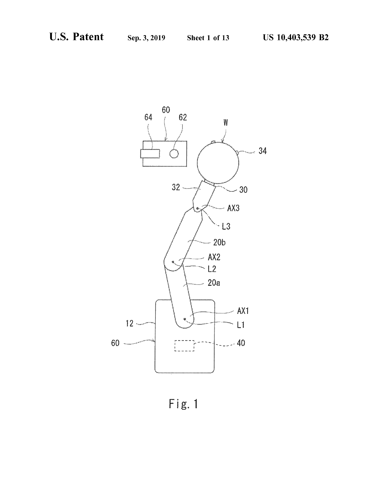
*도 1 — 제1 단계: 로봇 10(관절 AX1~AX3, 엔드 이펙터 30), 반도체 웨이퍼 W, 프리얼라이너 60(턴테이블 62, 센서 64)*

#### 제1 단계(First Step)

도 1에 나타낸 바와 같이, 먼저 반도체 제조 현장인 클린룸에서 로봇 10, 반도체 웨이퍼 W, 프리얼라이너 60을 준비하는 제1 단계를 수행한다. 반도체 웨이퍼 W는 로봇 10이 반송하고, 프리얼라이너 60은 반도체 웨이퍼 W의 중심 위치를 검출한다.

로봇 10은 적어도 하나의 관절부 AX를 포함하는 로봇 암 20; 로봇 암 20에 부착된 엔드 이펙터 30; 로봇 암 20과 엔드 이펙터 30을 제어하도록 구성된 로봇 제어부 40을 포함한다. 본 실시예에 따른 로봇 10은 이른바 수평 다관절 3축 로봇으로, 3개의 관절부(제1 관절부 AX1, 제2 관절부 AX2, 제3 관절부 AX3)를 포함한다. 로봇 10은 베이스 12와, 베이스 12의 상면에 설치되어 상하 방향으로 신축 가능한 승강축(도시하지 않음)을 더 포함한다. 승강축은 예를 들어 에어 실린더(도시하지 않음)로 신축 가능하게 구성된다. 로봇 암 20은 승강축의 상단부에 부착된다.

로봇 암 20은 제1 암 20a와 제2 암 20b를 포함하며, 각각 수평 방향으로 뻗은 긴 부재로 이루어진다.

제1 암 20a는 길이 방향 한쪽 끝부가 수직축 L1 둘레로 회전 가능하게 승강축에 부착된다. 이로써 제1 관절부 AX1이 구성된다. 제1 암 20a는 전동 모터(도시하지 않음)로 회전 가능하게 구성된다. 제2 암 20b는 제1 암 20a의 길이 방향 다른 쪽 끝부에 부착된다. 제2 암 20b는 길이 방향 한쪽 끝부가 수직축 L2 둘레로 회전 가능하게 제1 암 20a에 부착된다. 이로써 제2 관절부 AX2가 구성된다. 제2 암 20b는 전동 모터(도시하지 않음)로 회전 가능하게 구성된다.

엔드 이펙터 30은 수직축 L3 둘레로 회전 가능하게 제2 암 20b의 길이 방향 다른 쪽 끝부에 부착된다. 이로써 제3 관절부 AX3이 구성된다. 엔드 이펙터 30은 전동 모터(도시하지 않음)로 회전 가능하게 구성된다. 엔드 이펙터 30은 제2 암 20a의 상면에 회전 가능하게 부착된 부착판 32와, 부착판 32에 부착된 엔드 이펙터 본체 34를 포함한다. 엔드 이펙터 본체 34의 선단은 두 갈래로 나뉘어 평면에서 볼 때 Y자 모양으로 구성된다. 엔드 이펙터 본체 34의 기단부는 부착판 52에 고정된다.

승강축의 상하 이동과 제1 암 20a, 제2 암 20b, 엔드 이펙터 30의 회전은 로봇 제어부 40이 제어한다.

프리얼라이너 60은 반도체 웨이퍼 W가 놓이는 턴테이블 62; 턴테이블 62를 회전시키도록 구성된 구동부(도시하지 않음); 구동부에 의해 회전하는 반도체 웨이퍼 W의 외연부를 검출하도록 구성된 센서 64; 센서 64가 검출한 외연부에 기초하여 반도체 웨이퍼 W의 중심 위치를 검출하도록 구성된 처리부(도시하지 않음)를 포함한다.

프리얼라이너 60의 센서 64는 예를 들어 도 1의 지면 앞쪽에서 뒤쪽 방향으로 광선을 내보내도록 구성된 투광부와, 투광부에서 나온 광선을 받도록 구성된 수광부를 포함하는 광학 센서이다. 센서 64는 수광부가 받는 광선이 가려질 때 반도체 웨이퍼 W의 외연부를 검출한다.

반도체 웨이퍼 W는 반도체 공정에 쓰이는 얇은 판으로, 반도체 장치의 기판 재료로 정의된다. 반도체 웨이퍼 W의 형상은 임의이지만, 본 실시예에서는 반도체 웨이퍼 W가 원판 형상인 예를 설명한다.

#### 제2 단계(Second Step)

도 2a와 도 2b에 나타낸 바와 같이, 다음으로 제2 관절부 AX2(하나의 관절부)를 후술하는 제1 방향과 반대 방향(즉, 도 1과 도 2a의 평면도에서 왼쪽 방향(반시계 방향))으로 회전시키고; 그 다음 엔드 이펙터 30으로 반도체 웨이퍼 W를 턴테이블 62 위에 놓고; 프리얼라이너 60으로 반도체 웨이퍼 W의 중심 위치를 검출하는 제2 단계를 수행한다.

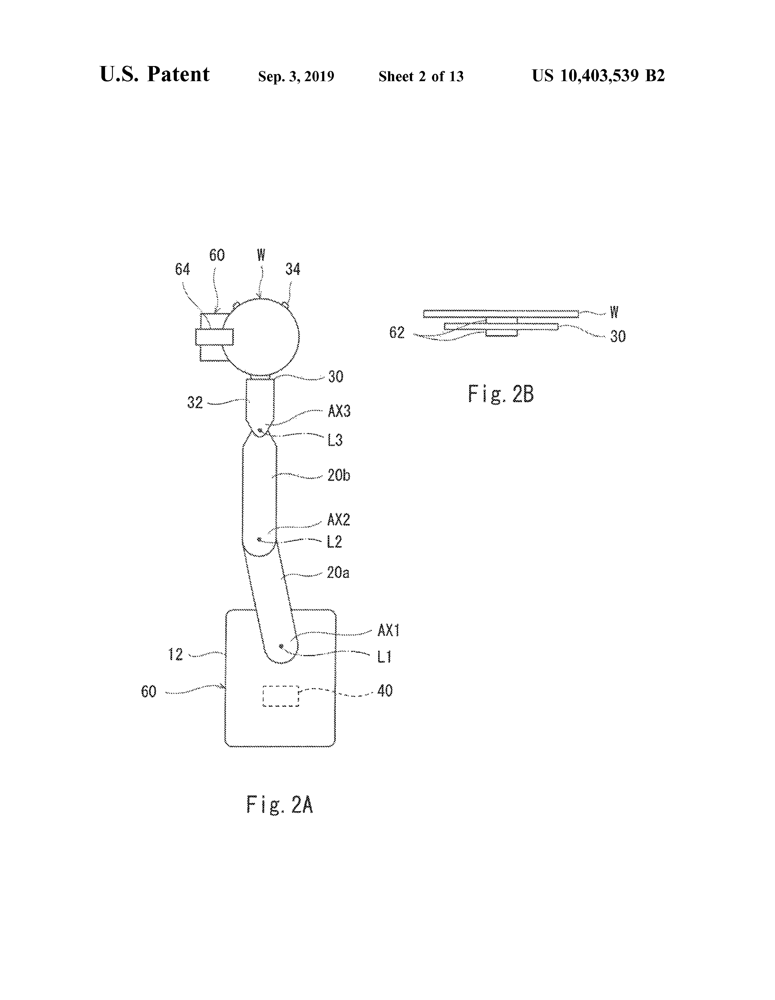
*도 2 — 제2 단계: 제2 관절부 AX2를 제1 방향과 반대로 돌린 뒤 웨이퍼 W를 턴테이블 62에 놓고 중심 검출*

제2 관절부 AX2를 제1 방향과 반대 방향으로 회전시킬 때 필요에 따라 제1 관절부 AX1과 제3 관절부 AX3을 회전시켜, 반도체 웨이퍼 W를 턴테이블 62 위에 놓을 수 있도록 로봇 암 20과 엔드 이펙터 30의 자세를 설정할 수 있다. 설명이 복잡해지지 않도록, 본 실시예에서는 제2 단계에서 검출한 반도체 웨이퍼 W의 중심 위치와 엔드 이펙터 30의 중심 위치가 각각 턴테이블 62의 중심 위치와 일치하는 경우를 설명한다. 그러나 본 실시예는 이에 한정되지 않는다. 구체적으로, 반도체 웨이퍼 W의 중심 위치와 엔드 이펙터 30의 중심 위치는 각각 턴테이블 62의 중심 위치와 일치하지 않아도 된다.

#### 제3 및 제4 단계(Third and Fourth Steps)

다음으로 턴테이블 62 위에 놓인 반도체 웨이퍼 W를 엔드 이펙터 30으로 유지하는 제3 단계를 수행한다. 여기서 "유지"라는 용어는 반도체 웨이퍼 W를 엔드 이펙터 30의 상면에 올려 반도체 웨이퍼 W를 들어 올리는 것을 뜻한다는 점에 유의해야 한다. 이로써 예를 들어 엔드 이펙터가 반도체 웨이퍼 W의 외연부에 접촉하여 반도체 웨이퍼 W를 척킹·유지하는 경우와 달리, 반도체 웨이퍼 W를 유지하는 동작에 의해 반도체 웨이퍼 W의 중심 위치가 움직이지 않는다. 그 결과 로스트 모션에 의한 편차량을 정확하게 검출할 수 있다.

본 실시예에서는 제1 내지 제3 단계를 수행한 후, 로봇 제어부 40의 지령값에 기초하여 제2 관절부 AX2를 제1 방향(즉, 도 2a와 도 3a의 평면도에서 오른쪽 방향(시계 방향))으로 소정 각도만큼 회전시키는 제4 단계를 수행한다. 이때의 상태를 도 3a와 도 3b에 나타낸다.

*도 3 — 제3·4 단계: 엔드 이펙터로 웨이퍼를 들고 지령값에 따라 AX2를 제1 방향(시계 방향)으로 소정 각도 회전*

#### 제5 단계(Fifth Step)

도 4a와 도 4b에 나타낸 바와 같이, 제1 내지 제4 단계를 수행한 후, 엔드 이펙터 30으로 반도체 웨이퍼 W를 턴테이블 62 위에 놓고 프리얼라이너 60으로 반도체 웨이퍼 W의 중심 위치를 다시 검출하는 제5 단계를 수행한다.

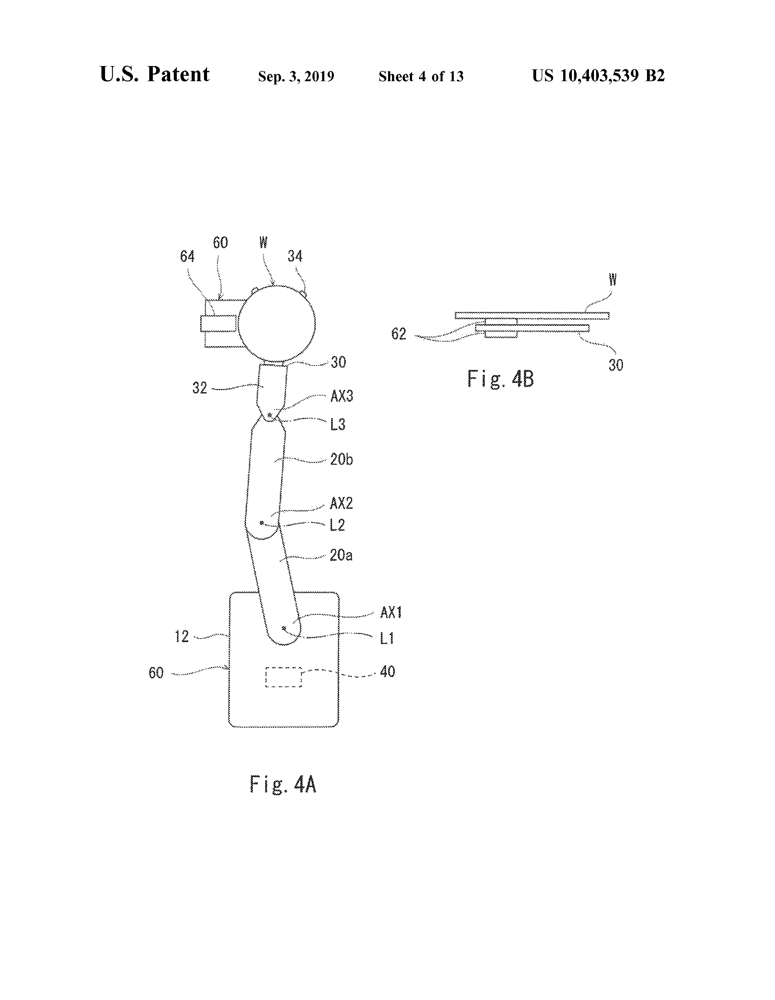
*도 4 — 제5·6 단계: 회전 후 위치에서 웨이퍼를 다시 턴테이블에 놓고 중심 재검출*

#### 제6 단계(Sixth Step)

마지막으로 로스트 모션에 의한 편차량을 검출하는 제6 단계를 수행한다. 제6 단계를 도 5a 내지 도 5c에 기초하여 상세히 설명한다.

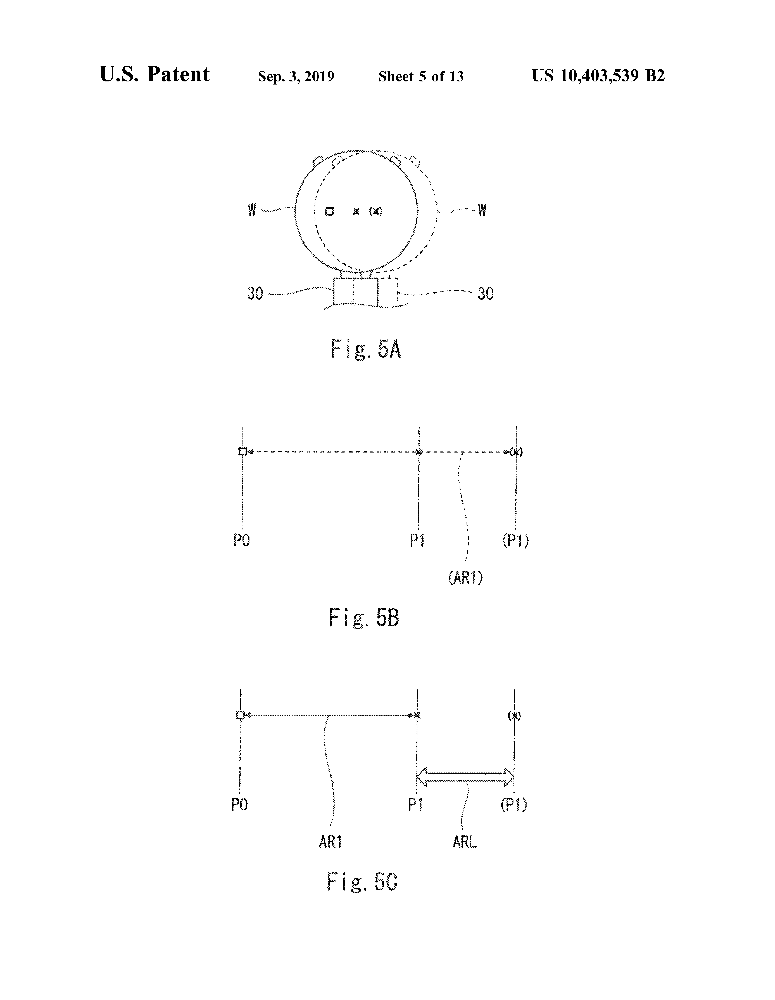
*도 5 — 중심 위치 관계: 턴테이블 중심 P0, 지령값 기준 이상 위치 (P1), 실제 검출 위치 P1, 이상 이동 (AR1), 실제 이동 AR1, 로스트 모션 편차 ARL*

도 5a 내지 도 5c에서 턴테이블 62의 중심은 "□"로 나타낸다. 턴테이블의 중심 "□"는 도 5b와 도 5c에 나타낸 위치 P0에 항상 고정되어 있다.

제4 단계에서 로봇 제어부 40의 지령값에 기초한 이상적 이동 거리는 도 5b에서 파선 화살표 (AR1)로 나타낸다. 제2 단계에서 검출한 반도체 웨이퍼 W의 중심(본 실시예에서는 턴테이블의 중심 "□"와 일치)과 제4 단계에서 로봇 제어부 40이 낸 지령값 (AR1)에 기초한 반도체 웨이퍼 W의 중심은 "(●)"로 나타내고, 이때 엔드 이펙터 30의 중심은 "(x)"로 나타낸다. 도 5a에서 중심 위치가 "(●)"인 반도체 웨이퍼 W와 중심 위치가 "(x)"인 엔드 이펙터 30은 파선으로 나타낸다.

도 5c에서 제5 단계에서 검출한 반도체 웨이퍼 W의 중심은 "●"로 나타내고, 이때 엔드 이펙터 30의 중심은 "x"로 나타낸다. 도 5a에서 중심 위치가 "●"인 반도체 웨이퍼 W와 중심 위치가 "x"인 엔드 이펙터 30은 실선으로 나타낸다.

제2 단계에서 검출한 반도체 웨이퍼 W의 중심(앞서 설명한 바와 같이 본 실시예에서는 턴테이블의 중심 "□"와 일치)에서 제5 단계에서 검출한 반도체 웨이퍼 W의 중심 "●"까지의 실제 이동 거리는 실선 화살표 AR1로 나타낸다. 또한 반도체 웨이퍼 W의 중심 "(x)"와 "x"에 기초하여 검출한 로스트 모션에 의한 편차량은 도 5c에서 윤곽 화살표 ARL로 나타낸다.

본 실시예에서는 반도체 웨이퍼 W의 중심 "(●)"와 엔드 이펙터 30의 중심 "(x)"가 같은 위치 (P1)에 있으므로 겹친 상태로 나타낸다. 마찬가지로 반도체 웨이퍼 W의 중심 "●"와 엔드 이펙터 30의 중심 "x"가 같은 위치 P1에 있으므로 겹친 상태로 나타낸다.

앞서 설명한 바와 같이, 제2 단계에서 검출한 반도체 웨이퍼 W의 중심 위치는 턴테이블 62의 중심 "□"와 같은 위치 P0에 있다. 이상적으로는 반도체 웨이퍼 W의 중심 위치가 이동 거리 (AR1)만큼 움직여 "(●)"로 나타낸 위치 (P1)에 도달한다. 그러나 실제로는 반도체 웨이퍼 W의 중심 위치가 제2 관절 AX2의 로스트 모션에 의한 편차량만큼 위치 (P1)이 아닌 위치 P1에 있다.

도 5c에 나타낸 바와 같이, 제1 내지 제5 단계를 수행한 후, (i) 제2 단계에서 검출한 반도체 웨이퍼 W의 중심 위치 P0(본 실시예에서는 항상 고정된 턴테이블 62의 중심 "□"와 같은 위치)과 제4 단계에서 로봇 제어부 40이 낸 지령값 "(AR1)"에 기초한 반도체 웨이퍼 W의 중심 위치 (P1)(즉, "(●)"가 있는 위치)과 (ii) 제5 단계에서 검출한 반도체 웨이퍼 W의 중심 위치 P1(즉, "●"가 있는 위치)에 기초하여, 제2 관절부 AX2에서 로스트 모션에 의한 편차량 ARL을 검출할 수 있다. 본 실시예에서 로스트 모션에 의한 편차량 ARL은 예를 들어 도 5b에 나타낸 파선 화살표 (AR1)의 길이와 도 5c에 나타낸 실선 화살표 AR1의 길이의 차이를 계산하여 검출할 수 있다.

#### 효과(Effects)

본 실시예에 따른 로봇 진단 방법은 (i) 제2 단계에서 검출한 반도체 웨이퍼 W(워크)의 중심 위치 P0과 제4 단계에서 로봇 제어부 40이 낸 지령값 (AR1)에 기초한 반도체 웨이퍼 W의 중심 위치 (P1)과 (ii) 제5 단계에서 검출한 반도체 웨이퍼 W의 중심 위치 P1에 기초하여, 제2 관절부 AX2(하나의 관절부)에서 로스트 모션에 의한 편차량 ARL을 검출할 수 있다. 그 결과 본 실시예에 따른 로봇 진단 방법은 로스트 모션에 의한 편차량을 간단한 절차로 검출할 수 있다.

또한 본 실시예에 따른 로봇 진단 방법에서는, 로봇 제어부 40의 지령값 (AR1)에 기초하여 제2 관절부 AX2를 제1 방향으로 소정 각도만큼 회전시키는 제4 단계를 제1 내지 제3 단계를 수행한 후에 수행한다. 이로써 예를 들어 후술하는 실시예 2와 달리 로봇 암 20과 엔드 이펙터 30의 자세를 소정의 홈 자세로 복귀시킬 필요가 없다. 따라서 본 발명의 효과를 크게 할 수 있다.

나아가 본 실시예에서, 제4 단계에서 제2 관절부 AX2(하나의 관절부)가 회전하는 제1 방향은, 제2 단계에서 반도체 웨이퍼 W를 턴테이블 62 위에 놓기 직전에 제2 관절부 AX2가 회전한 방향과 반대이다. 이로써 예를 들어 제2 관절부 AX2의 백래시에 의한 최대 편차량을 정확하게 검출할 수 있다.

그리고 본 실시예에 따른 로봇 진단 방법의 제1 단계에서 반도체 웨이퍼 W, 로봇 10, 프리얼라이너 60은 반도체 제조 현장인 클린룸 안에 준비된다. 이로써 반도체 웨이퍼 W, 로봇 10, 프리얼라이너 60을 반도체 제조 현장인 클린룸에서 밖으로 옮기지 않고도 클린룸 안에서 로스트 모션에 의한 편차량을 검출할 수 있다. 따라서 본 발명의 효과를 크게 할 수 있다.

### 2. 실시예 2(Embodiment 2)

본 발명의 실시예 2에 따른 로봇 진단 방법을 도 6a 내지 도 10b에 기초하여 설명한다. 실시예 1과 마찬가지로, 본 실시예에 따른 로봇 진단 방법은 반도체 제조 현장인 클린룸에서 반도체 웨이퍼에 대해 작업을 수행하도록 구성된 로봇에서 로스트 모션에 의한 편차량을 검출한다. 본 실시예에서 제1 단계에서 준비하는 장치 등은 실시예 1과 같다. 따라서 같은 구성 요소에는 같은 부호를 사용하고 같은 설명의 반복은 피한다. 또한 실시예 1과 같은 방식으로 실행하는 단계의 설명은 적절히 반복하지 않는다.

도 6a 및 도 6b는 본 발명의 실시예 2에 따른 로봇 진단 방법의 제2 단계를 설명하기 위한 개략도이다. 도 6a는 평면도이다. 도 6b는 워크와 엔드 이펙터를 로봇 쪽에서 본 측면도이다. 도 7a 및 도 7b는 로봇 진단 방법의 제4 단계를 설명하기 위한 개략도이다. 도 8a 및 도 8b는 로봇 진단 방법의 제5 단계에서 구성 요소들이 홈 자세로 복귀한 상태를 설명하기 위한 개략도이다. 도 9a 및 도 9b는 로봇 진단 방법의 제5 및 제6 단계를 설명하기 위한 개략도이다. 도 10a 및 도 10b는 로봇 진단 방법의 제4 내지 제6 단계 중 제4 단계를 설명하기 위한 개략도이다. 도 10a는 부분 평면도이다. 도 10b는 중심 위치들 사이의 관계를 나타내는 도면이다. 도 11a 및 도 11b는 로봇 진단 방법의 제4 내지 제6 단계 중 제5 및 제6 단계를 설명하기 위한 개략도이다. 도 11a는 부분 평면도이다. 도 11b는 중심 위치들 사이의 관계를 나타내는 도면이다.

#### 제1 단계(First Step)

실시예 1과 마찬가지로, 먼저 반도체 제조 현장인 클린룸에서 로봇 10, 반도체 웨이퍼 W, 프리얼라이너 60을 준비하는 제1 단계를 수행한다. 반도체 웨이퍼 W는 로봇 10이 반송하고, 프리얼라이너 60은 반도체 웨이퍼 W의 중심 위치를 검출한다. 로봇 10, 반도체 웨이퍼 W, 프리얼라이너 60의 세부 구조 등은 실시예 1과 같으므로 같은 설명의 반복은 피한다.

#### 제2 단계(Second Step)

실시예 1과 마찬가지로, 다음으로 제2 관절부 AX2(하나의 관절부)를 제1 방향과 반대 방향으로 회전시키고; 그 다음 로봇 암 20과 엔드 이펙터 30으로 반도체 웨이퍼 W를 턴테이블 62 위에 놓고; 프리얼라이너 60으로 반도체 웨이퍼 W의 중심 위치를 검출하는 제2 단계를 수행한다. 도 6a와 도 6b는 제2 단계를 수행한 후의 상태를 나타낸다. 실시예 1과 마찬가지로, 설명이 복잡해지지 않도록 본 실시예에서는 제2 단계에서 검출한 반도체 웨이퍼 W의 중심 위치와 엔드 이펙터 30의 중심 위치가 각각 턴테이블 62의 중심 위치와 일치하는 경우를 설명한다. 그러나 본 실시예는 이에 한정되지 않는다.

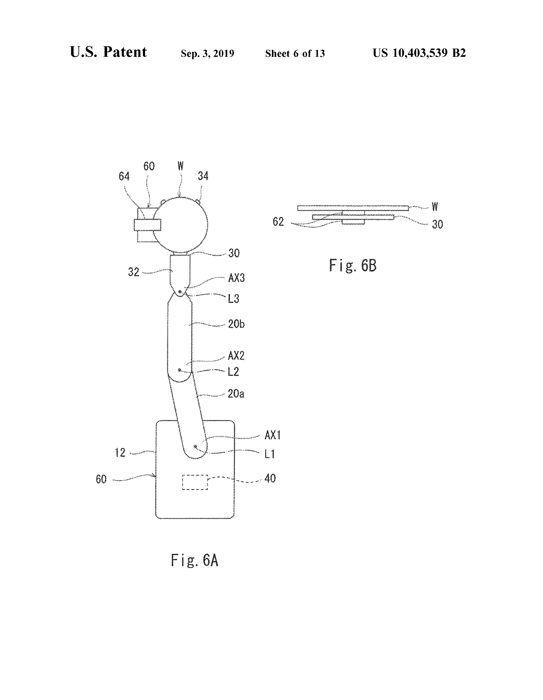
*도 6 — 실시예 2의 제2 단계 후 상태*

#### 제3 및 제4 단계(Third and Fourth Steps)

본 실시예에 따르면, 실시예 1과 달리 제3 단계는 제1, 제2, 제4 단계를 수행한 후에 수행한다. 구체적으로, 제1 및 제2 단계를 수행한 후, 로봇 제어부 40의 지령값에 기초하여 제2 관절부 AX2를 제1 방향(즉, 도 6a와 도 7a에서 오른쪽 방향(시계 방향))으로 소정 각도만큼 회전시키는 제4 단계를 수행한다. 도 7a와 도 7b는 제4 단계를 수행한 후, 제3 단계를 수행하기 전의 상태를 나타낸다. 제4 단계를 수행한 후, 턴테이블 62 위에 놓인 반도체 웨이퍼 W를 엔드 이펙터 30으로 유지하는 제3 단계를 수행한다.

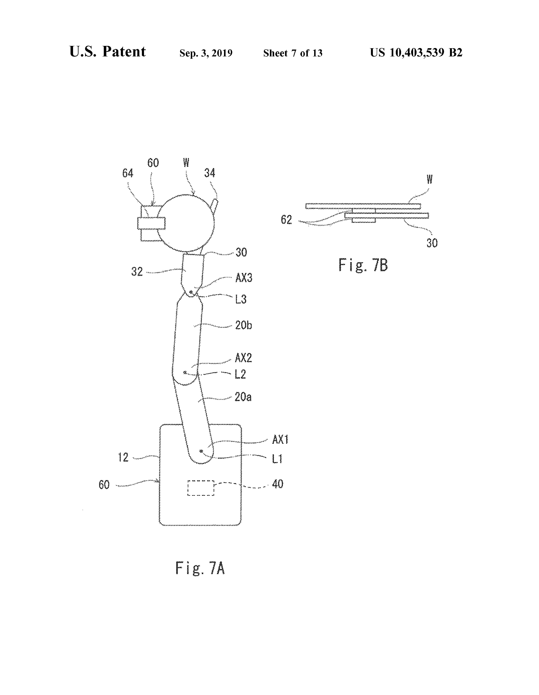
*도 7 — 실시예 2의 제4 단계: 웨이퍼를 들기 전에 빈 엔드 이펙터를 지령값만큼 회전*

#### 제5 단계(Fifth Step)

본 실시예에 따르면, 제1, 제2, 제4, 제3 단계를 이 순서로 수행한 후에 수행하는 제5 단계에서, 엔드 이펙터 30을 제2 단계에서 엔드 이펙터 30이 반도체 웨이퍼 W를 턴테이블 62 위에 놓을 때와 같은 위치로 복귀시킨다. 이를 위해 예를 들어 도 8a에 나타낸 바와 같이 로봇 암 20과 엔드 이펙터 30을 소정의 홈 자세로 복귀시킨다. "홈 자세"라는 용어는, 로봇 암 20과 엔드 이펙터 30을 홈 자세로 복귀시킨 뒤 로봇 제어부 40의 지령값에 기초하여 각각의 자세를 바꾸면 편차량을 일으키지 않고 지령값에 기초한 이상적 동작을 수행할 수 있는 자세를 뜻한다. 이로써 도 8a에 나타낸 바와 같이 홈 자세로 복귀함으로써, 도 9a와 도 9b에 나타낸 바와 같이 제2 단계의 상태와 마찬가지로 편차량을 일으키지 않고 엔드 이펙터 30의 중심 위치와 턴테이블 62의 중심 위치를 다시 일치시킬 수 있다. 이때 도 9b에 나타낸 바와 같이 반도체 웨이퍼 W의 중심 위치는 턴테이블 62의 중심 위치와 엔드 이펙터 30의 중심 위치로부터 왼쪽으로 벗어나 있다. 그 다음 제5 단계에서, 로봇 암 20과 엔드 이펙터 30을 앞서 설명한 바와 같이 소정의 홈 자세로 복귀시킨 뒤, 반도체 웨이퍼 W를 턴테이블 62 위에 놓고 프리얼라이너 62로 반도체 웨이퍼 W의 중심 위치를 다시 검출한다.

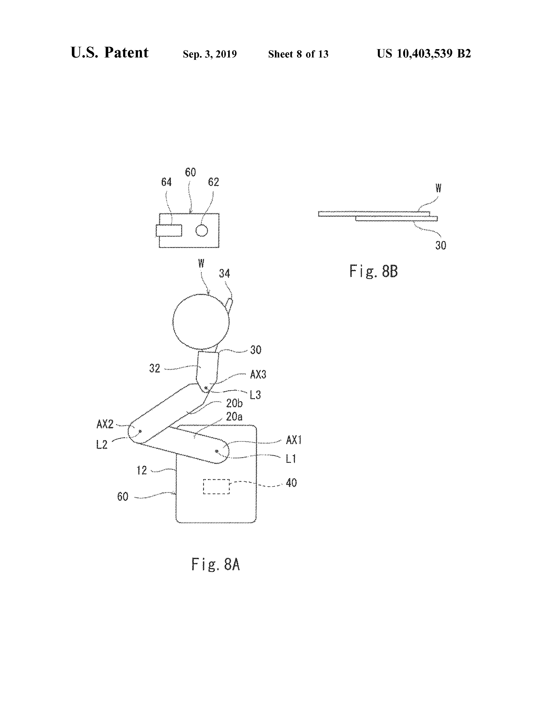
*도 8 — 실시예 2의 제5 단계: 로봇 암과 엔드 이펙터를 홈 자세로 복귀*

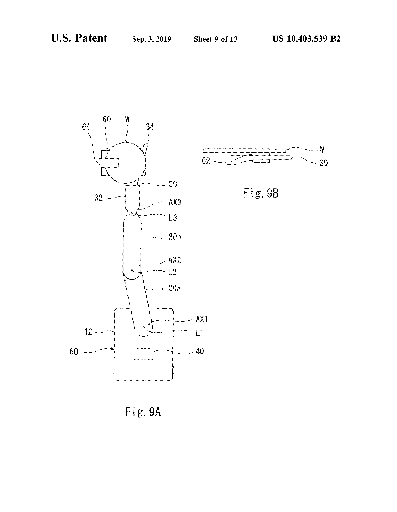
*도 9 — 실시예 2의 제5·6 단계: 엔드 이펙터 중심은 턴테이블 중심과 다시 일치하고, 웨이퍼 중심은 왼쪽으로 벗어남*

#### 제6 단계(Sixth Step)

마지막으로 로스트 모션에 의한 편차량을 검출하는 제6 단계를 수행한다. 제6 단계를 도 10a, 도 10b, 도 11a, 도 11b에 기초하여 상세히 설명한다.

도 10a와 도 10b는 제4 단계를 수행한 후의 중심들 사이의 관계를 나타내는 도면이다. 도 10a와 도 10b에서 턴테이블 62의 중심은 "□"로 나타낸다. 실시예 1과 마찬가지로 턴테이블의 중심 "□"는 도 10b에 나타낸 위치 P0에 항상 고정되어 있다.

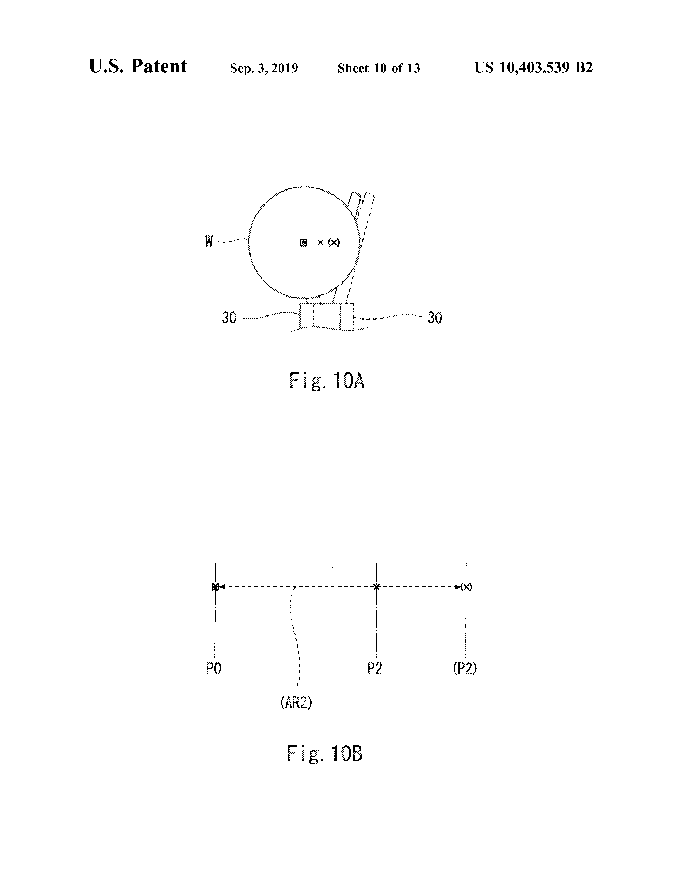
*도 10 — 실시예 2 제4 단계 후의 중심 관계: 이상 이동 (AR2), 엔드 이펙터 이상 위치 (P2)*

제4 단계에서 로봇 제어부 40의 지령값에 기초한 이상적 이동 거리는 도 10b에서 파선 화살표 (AR2)로 나타낸다. 제2 단계에서 검출한 반도체 웨이퍼 W의 중심(본 실시예에서는 턴테이블의 중심 "□"와 일치)과 제4 단계에서 로봇 제어부 40이 낸 지령값 (AR2)에 기초한 제4 단계 후의 엔드 이펙터 30의 중심은 도 10b에서 "(x)"로 나타낸다. 본 실시예에서는 반도체 웨이퍼 W를 엔드 이펙터 30으로 유지하는 제3 단계를 수행하기 전에, 로봇 제어부 40의 지령값에 기초하여 로봇 암 20의 제2 관절부 AX2를 회전시켜 엔드 이펙터 30을 움직이므로, 제4 단계를 수행한 후의 상태에서는 반도체 웨이퍼 W가 반송되지 않는다는 점에 유의해야 한다. 도 10a에서 중심 위치가 "●"인 반도체 웨이퍼 W와 중심 위치가 "x"인 엔드 이펙터 30은 실선으로 나타낸다. 또한 중심 위치가 "(x)"인 엔드 이펙터 30은 파선으로 나타낸다.

도 11a와 도 11b는 제5 단계를 수행한 후의 중심들 사이의 관계를 나타내는 도면이다. 도 11a와 도 11b에서 턴테이블의 중심 "n"은, 도 12a 및 도 12b와 마찬가지로, 도 11b에 나타낸 위치 P0에 항상 고정되어 있다.

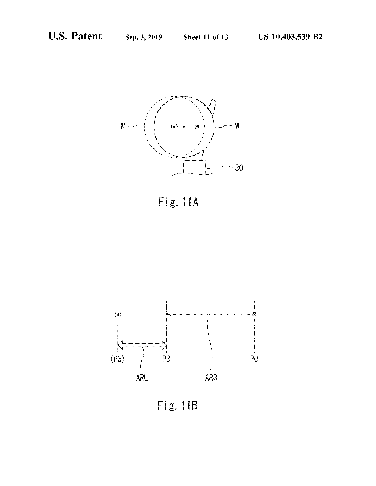
*도 11 — 실시예 2 제5 단계 후의 중심 관계: 실제 이동 AR3, 실제 검출 위치 P3, 로스트 모션 편차 ARL*

도 11a와 도 11b에서 제5 단계에서 검출한 반도체 웨이퍼 W의 중심은 "●"로 나타내고, 이때 엔드 이펙터 30의 중심은 "x"로 나타낸다. 로봇 암 20과 엔드 이펙터 30을 홈 자세로 복귀시킨 뒤, 엔드 이펙터 30의 중심 "x"는 턴테이블 62의 중심 "□"인 목표 위치로 이동한다. 따라서 엔드 이펙터 30의 중심 "x"는 편차량을 일으키지 않고 턴테이블 62의 중심 "□"와 일치한다. 도 11a에서 중심 위치가 "●"인 반도체 웨이퍼 W와 중심 위치가 "x"인 엔드 이펙터 30은 실선으로 나타낸다. 또한 중심 위치가 "(●)"인 반도체 웨이퍼 W는 파선으로 나타낸다.

제2 단계에서 검출한 반도체 웨이퍼 W의 중심(앞서 설명한 바와 같이 본 실시예에서는 턴테이블의 중심 "□"와 일치)에서 제5 단계에서 검출한 반도체 웨이퍼 W의 중심 "●"까지의 실제 이동 거리는 실선 화살표 AR3으로 나타낸다. 또한 반도체 웨이퍼 W의 중심 위치 "(x)"와 "x"에 기초하여 검출한 로스트 모션에 의한 편차량은 도 11b에서 윤곽 화살표 ARL로 나타낸다.

도 10b와 도 11b에 나타낸 바와 같이, 제1 내지 제5 단계를 수행한 후, (i) 제2 단계에서 검출한 반도체 웨이퍼 W의 중심 위치 P0(본 실시예에서는 항상 고정된 턴테이블 62의 중심 "□"와 같은 위치)과 제4 단계에서 로봇 제어부 40이 낸 지령값 "(AR1)"에 기초한 반도체 웨이퍼 W의 중심 위치 (P3)(즉, 도 11b에서 "(●)"가 있는 위치)과 (ii) 제5 단계에서 검출한 반도체 웨이퍼 W의 중심 위치 P3(즉, 도 11b에서 "●"가 있는 위치)에 기초하여, 제2 관절부 AX2에서 로스트 모션에 의한 편차량 ARL을 검출할 수 있다. 본 실시예에서 로스트 모션에 의한 편차량 ARL은 예를 들어 도 10b에 나타낸 파선 화살표 (AR2)의 길이와 도 11b에 나타낸 실선 화살표 AR3의 길이의 차이를 계산하여 검출할 수 있다.

#### 효과(Effects)

본 실시예에 따른 로봇 진단 방법의 효과는 실시예 1과 같으므로 같은 설명의 반복은 피한다.

### 3. 실시예 3(Embodiment 3)

본 발명의 실시예 3에 따른 로봇 진단 방법을 도 12와 도 13에 기초하여 설명한다. 실시예 1, 2와 마찬가지로, 본 실시예에 따른 로봇 진단 방법은 반도체 제조 현장인 클린룸에서 반도체 웨이퍼에 대해 작업을 수행하도록 구성된 로봇에서 로스트 모션에 의한 편차량을 검출한다. 본 실시예에서 실시예 1, 2와 같은 구성 요소에는 같은 부호를 사용하고 같은 설명의 반복은 피한다. 또한 실시예 1, 2와 같은 절차의 설명은 적절히 반복하지 않는다.

도 12는 본 발명의 실시예 3에 따른 로봇 진단 방법을 설명하기 위한 개략도로, 워크를 수용부에 수용할 수 있도록 로봇 암과 엔드 이펙터의 자세를 설정했을 때의 평면도이다. 도 13은 워크를 턴테이블 위에 놓을 수 있도록 로봇 암과 엔드 이펙터의 자세를 설정했을 때의 평면도이다.

#### 제1 단계(First Step)

본 실시예의 제1 단계에서는 실시예 1, 2에서 준비한 로봇 10, 반도체 웨이퍼 W, 프리얼라이너 60에 더해 반도체 웨이퍼 W를 수용하도록 구성된 수용부 80을 추가로 준비한다. 수용부 80은 서로 인접하여 배치된 제1 수용부 80a, 제2 수용부 80b, 제3 수용부 80c, 제4 수용부 80d를 포함한다. 반도체 웨이퍼 W는 미리 제1 수용부 80a, 제2 수용부 80b, 제3 수용부 80c, 제4 수용부 80d에 수용되어 있다.

#### 제2 단계(Second Step)

본 실시예에 따른 제2 단계에서는, 제1 수용부 80a에 수용된 반도체 웨이퍼 W를 엔드 이펙터 30이 유지할 수 있도록 소정의 제1 동작으로 로봇 암 20과 엔드 이펙터 30의 자세를 설정하고, 그 다음 엔드 이펙터 30이 반도체 웨이퍼 W를 유지한다. 이때의 상태를 도 12에 나타낸다. 이 상태에서 반도체 웨이퍼 W를 턴테이블 62 위에 놓을 수 있도록 소정의 제2 동작으로 로봇 암 20과 엔드 이펙터 30의 자세를 설정한다. 그 후 반도체 웨이퍼 W를 턴테이블 62 위에 놓고, 프리얼라이너 60이 반도체 웨이퍼 W의 중심 위치를 검출한다. 이때의 상태를 도 13에 나타낸다.

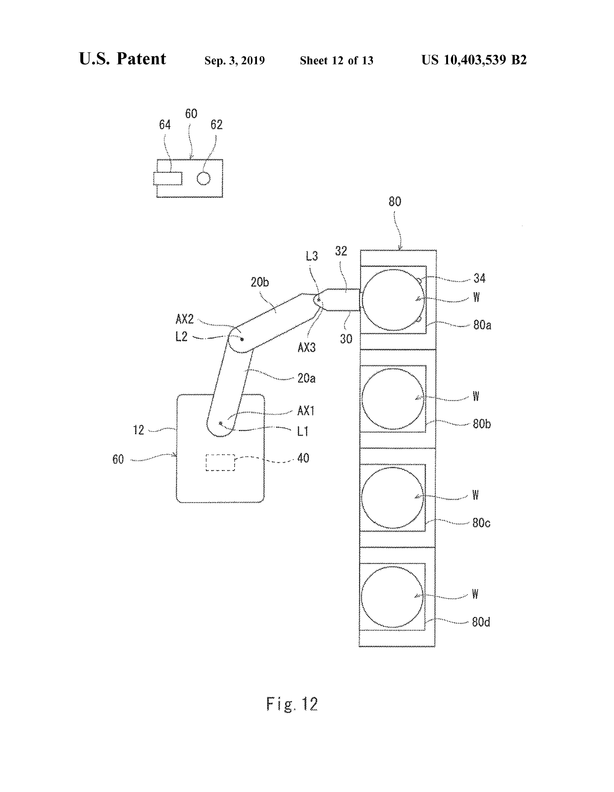
*도 12 — 실시예 3: 제1 수용부 80a의 웨이퍼를 잡는 자세(소정의 제1 동작)*

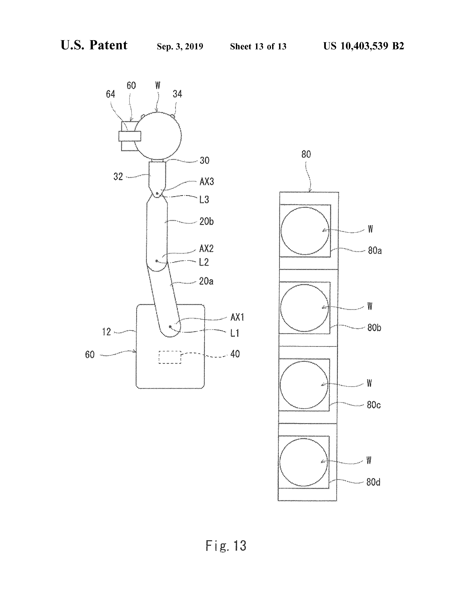
*도 13 — 실시예 3: 웨이퍼를 턴테이블 62에 놓는 자세(소정의 제2 동작)*

본 실시예에서는 제1 내지 제3 단계를 수행한 후에 수행하는 제4 단계에서, 엔드 이펙터 30이 턴테이블 62 위에 놓인 반도체 웨이퍼 W를 유지하고, 그 다음 반도체 웨이퍼 W를 제1 수용부 80a에 수용할 수 있도록 소정의 제1 동작으로 로봇 암 20과 엔드 이펙터 30의 자세를 다시 설정한다. 또한 반도체 웨이퍼 W를 제1 수용부 80a에 수용하고, 그 다음 로봇 제어부 40의 지령값에 기초하여 제2 관절부 AX2를 제1 방향으로 소정 각도만큼 회전시킨다.

#### 제5 단계(Fifth Step)

본 실시예에서는 제4 단계를 수행한 후에 수행하는 제5 단계에서, 엔드 이펙터 30이 제1 수용부 80a에 수용된 반도체 웨이퍼 W를 유지하고, 반도체 웨이퍼 W를 턴테이블 62 위에 놓을 수 있도록 소정의 제2 동작으로 로봇 암 20과 엔드 이펙터 30의 자세를 다시 설정한다. 또한 그 다음 반도체 웨이퍼 W를 턴테이블 62 위에 놓고, 프리얼라이너 60이 반도체 웨이퍼 W의 중심 위치를 다시 검출한다.

#### 제6 단계(Sixth Step)

본 실시예에서는 제1 내지 제5 단계를 수행한 후에 수행하는 제6 단계에서, 반도체 웨이퍼 W를 제1 수용부 80a에 수용할 수 있도록 자세를 설정할 때 제2 관절부 AX2에서 로스트 모션에 의한 편차량을, (i) 제2 단계에서 검출한 반도체 웨이퍼 W의 중심 위치와 제4 단계에서 로봇 제어부 40이 낸 지령값에 기초한 반도체 웨이퍼 W의 중심 위치와 (ii) 제5 단계에서 검출한 반도체 웨이퍼 W의 중심 위치에 기초하여 검출한다. 로스트 모션은 실시예 1과 같은 방식으로 계산할 수 있으므로 같은 설명의 반복은 피한다.

#### 효과(Effects)

위 절차를 수행함으로써, 본 실시예에 따른 로봇 진단 방법은 반도체 웨이퍼 W를 제1 수용부 80a에 수용할 수 있도록 자세를 설정할 때의 로스트 모션에 의한 편차량을 검출할 수 있다. 도 12와 도 13에 나타낸 바와 같이, 반도체 웨이퍼 W가 복수의 수용부(제1 수용부 80a, 제2 수용부 80b, 제3 수용부 80c, 제4 수용부 80c)에 수용되어 있을 때, 각 수용부에 반도체 웨이퍼 W를 수용할 수 있도록 자세를 설정할 때의 로스트 모션에 의한 편차량은 서로 다르다. 따라서 본 실시예에 따른 효과는 유용하다. 실시예 3에서는 반도체 웨이퍼 W를 제1 수용부 80a에 수용할 수 있도록 자세를 설정할 때의 로스트 모션에 의한 편차량을 검출한다. 그러나 본 실시예는 이에 한정되지 않는다. 반도체 웨이퍼 W를 제2 수용부 80b, 제3 수용부 80c, 또는 제4 수용부 80c에 수용할 수 있도록 자세를 설정할 때의 로스트 모션에 의한 편차량도 위와 같은 방식으로 검출할 수 있다.

### 4. 변형예(Modified Example)

위 실시예에서는 로봇 20, 반도체 웨이퍼 W, 프리얼라이너 60, 수용부 80을 반도체 제조 현장인 클린룸 안에 준비하는 경우를 설명했다. 그러나 위 실시예는 이에 한정되지 않는다. 구체적으로 로봇 20, 반도체 웨이퍼 W, 프리얼라이너 60, 수용부 80은 다른 장소에 준비될 수 있다. 이 경우 워크는 반도체 웨이퍼 W 이외의 워크일 수 있다.

위 실시예에서는 제1 관절부 AX1에서 로스트 모션에 의한 편차량을 검출하는 경우를 설명했다. 그러나 제2 관절부 AX2나 제3 관절부 AX3에서 로스트 모션에 의한 편차량도 위와 같은 절차로 검출할 수 있다. 또한 본 발명은 1축, 2축, 또는 4축 이상을 포함하는 로봇에도 적용할 수 있다.

앞의 설명으로부터 본 발명의 많은 변형과 다른 실시예가 통상의 기술자에게 명백하다. 따라서 앞의 설명은 예시로만 해석되어야 하며, 본 발명을 실시하는 최선의 형태를 통상의 기술자에게 가르칠 목적으로 제공된 것이다. 구조 및/또는 기능의 세부 사항은 본 발명의 범위 안에서 실질적으로 변경될 수 있다.
