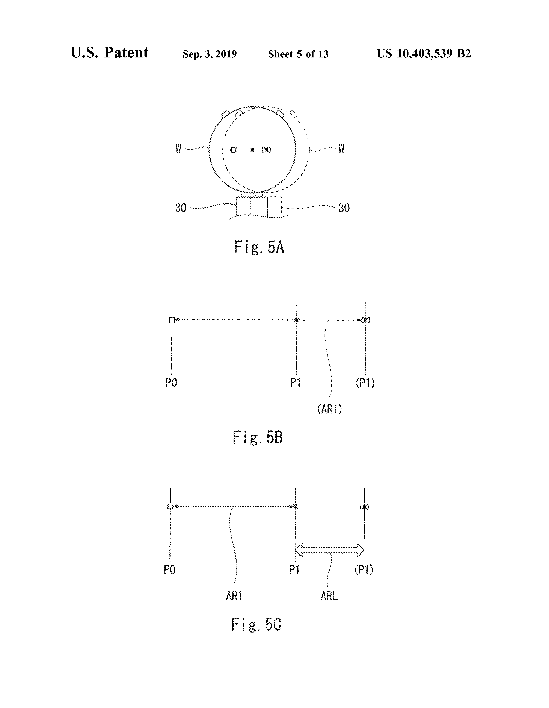
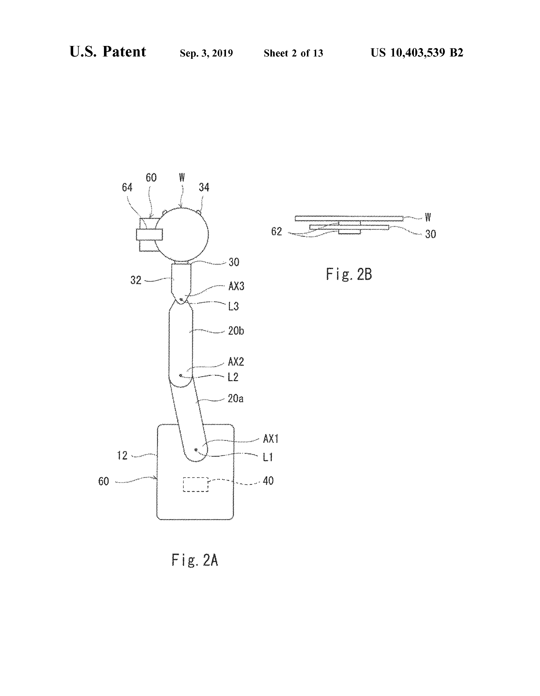

# US10403539B2 — 로봇 진단 방법 (Kawasaki)

| 항목 | 내용 |
|---|---|
| 원문 | `US10403539.pdf`(등록, 2019-09-03) · `US20190043750.pdf`(공개, 2019-02-07) |
| 출원인 | Kawasaki Jukogyo Kabushiki Kaisha, Kawasaki Robotics (USA), Inc. |
| 출원일 | 2017-08-04 (미국 출원, 외국 우선권 없음) |
| 청구항 | 8항 (독립항 1개) |
| 핵심 | 웨이퍼 반송 로봇의 한 관절을 **직전과 반대 방향으로** 지령값만큼 돌린 뒤, 프리얼라이너가 잰 웨이퍼 중심 이동과 지령값으로 계산한 이상 이동의 차이로 그 관절의 로스트 모션(백래시·비틀림) 편차량을 구한다. 클린룸 안에서 기존 프리얼라이너만으로 진단한다. |
| 관련도 | ◎ 문제를 직접 해결하는 구성 |
| 해결하는 P# | P3(방향 반전 시 영점 변동 측정), P2(지령값과 외부 측정의 차이로 실제 위치 오차 분리), P1(오차 예산의 백래시 항 크기 측정) |
| 링크 | [Google Patents](https://patents.google.com/patent/US10403539B2/en) |

---

## 상세 요약 (번역본 기준)

### 1. 해결하려는 문제
- 종래(JP 2009-49251)는 티칭 위치에서 오프셋한 여러 목표 위치로 웨이퍼를 옮기며 센서 범위를 벗어날 때까지 반복 측정하고 보정 테이블을 만든다 → 절차가 복잡하고 시간이 든다.
- 로스트 모션(로봇 암 각 축의 백래시, 비틀림 등으로 이상 동작에서 벗어나는 양)을 간단한 절차로 검출하고 싶다.

### 2. 핵심 구성
| 구성 | 부호 | 역할 |
|---|---|---|
| 로봇 | 10 | 수평 다관절 3축(AX1~AX3), 엔드 이펙터 30, 로봇 제어부 40 |
| 프리얼라이너 | 60 | 턴테이블 62 + 광센서 64로 회전하는 웨이퍼 외연을 읽어 중심 계산 |
| 워크 | W | 반도체 웨이퍼 |
| 수용부 | 80 (80a~80d) | 실시예 3: FOUP 슬롯 같은 수용 위치별 로스트 모션 측정 |

### 3. 동작 순서 (실시예 1)
1. 제1 단계: 클린룸 안에 로봇·웨이퍼·프리얼라이너 준비.
2. 제2 단계: 대상 관절 AX2를 **제1 방향과 반대(반시계)**로 돌린 자세에서 웨이퍼를 턴테이블에 놓고 중심 P0 검출.
3. 제3 단계: 엔드 이펙터로 웨이퍼를 들어 올림(척킹하지 않아 중심이 움직이지 않음).
4. 제4 단계: 지령값에 따라 AX2를 **제1 방향(시계)**으로 소정 각도 회전 → 이상 위치 (P1), 이상 이동 (AR1).
5. 제5 단계: 그 자리에서 웨이퍼를 다시 놓고 중심 P1 재검출 → 실제 이동 AR1.
6. 제6 단계: (AR1)과 AR1 길이 차 = 로스트 모션 편차량 ARL.
- 실시예 2: 빈 엔드 이펙터를 먼저 돌리고, 홈 자세로 복귀시킨 뒤 웨이퍼를 다시 놓아 같은 방식으로 계산.
- 실시예 3: 수용부별 자세(제1·제2 동작)에서의 로스트 모션을 따로 측정 — 수용부마다 편차량이 다르다.

### 4. 청구항 요지
- 청구항 1: 로봇·워크·프리얼라이너 준비, 놓고 중심 검출, 들기, 한 관절을 지령값으로 제1 방향 소정 각도 회전, 다시 놓고 중심 재검출, (i) 처음 중심 + 지령값에 의한 중심과 (ii) 재검출 중심으로 로스트 모션 편차량 검출.
- 청구항 2·3: 단계 순서 변형(실시예 1·2).
- 청구항 4: 수용부 자세별 측정(실시예 3).
- 청구항 5: **제1 방향은 직전 회전 방향과 반대** — 백래시 최대 편차를 정확히 검출.
- 청구항 6~8: 클린룸 안에서 실시, 워크는 반도체 웨이퍼.

### 5. 대표 도면

*도 5 — 턴테이블 중심 P0, 지령값 기준 이상 위치 (P1), 실제 위치 P1, 차이 ARL이 로스트 모션*

*도 2 — 반대 방향으로 돌린 뒤 웨이퍼를 놓아 기준 중심을 잡는 제2 단계*

### 6. 본 과제(Y·Θ 얼라인먼트)와 비교
- 같은 점:
  - 본 과제의 영점 변동(묶음마다 −0.85~0 px, 세션 간 0.6 px)은 마지막 이동 방향에 따른 위치 차이로 추정된다. 이 특허는 그 크기를 **방향을 일부러 뒤집어** 재는 절차를 준다.
  - "지령값으로 계산한 이상 위치"와 "외부 센서로 잰 실제 위치"를 분리한다 — 본 과제의 정답이 명령값이라는 P2 문제를 정면으로 다룬다.
- 다른 점:
  - 측정기는 프리얼라이너(광센서)이고 대상은 SCARA 관절이다. 본 과제는 Y 직선 이동과 Θ 회전 축이고, 외부 측정기가 없다.
  - 측정한 편차를 어떻게 보정에 쓰는지(보정 테이블 등)는 청구하지 않는다(진단 방법).
- 참고할 점:
  - **축마다 "반대 방향 → 지령 이동 → 재측정" 3단 절차**를 Y·Θ 각각에 적용하면 역전값(백래시)을 px 단위로 바로 잴 수 있다. 외부 기준이 없으면 같은 판의 영상 측정값을 프리얼라이너 대신 쓰되, 지령 이동량 대비 영상 이동량 차이로 계산한다.
  - 청구항 5의 "직전과 반대 방향"이 최대 편차를 준다는 점은, 본 과제의 단방향 접근 규칙(보정 명령이 반대 방향이면 지나쳐 갔다가 되돌아오기)의 근거가 된다.
  - 위치(수용부)마다 로스트 모션이 다르다는 실시예 3 → 본 과제도 Y 위치별로 영점 변동을 따로 재야 한다.
