# 제어 시스템 및 제어 방법 (US9424646B2)
- 원제: Control system and control method
- 원문: 같은 폴더의 PDF(`US9424646.pdf` 등록본, `US20140301632.pdf` 공개본), https://patents.google.com/patent/US9424646B2/en
- 번역 기준: USPTO 등록본 PDF의 원문을 한국어로 옮김. 조사일(2026-10-30) Google Patents 페이지가 응답하지 않아(HTTP 503), PDF 본문 쪽을 문자 인식한 뒤 쪽 이미지와 대조해 옮겼다. 수식은 쪽 이미지를 보고 옮겼다. 원문 오기(예: "제1 거리와 제2 거리 중 큰 값"과 "합"이 함께 쓰인 부분, dns 식의 두 번째 줄, "도 12a 및 12b")는 고치지 않았다.
- 도면: 원문 PDF 도면 시트 23장을 도면/ 폴더에 넣고 본문에서 처음 설명되는 곳에 삽입함

## 요약

제어 시스템은 제1 제어 동작을 실행한 뒤 제2 제어 동작을 실행한다. 제1 제어 동작에서 영상 처리부는 영상 데이터를 얻어 특징부의 위치를 특정한다. 제어부는 특정된 특징부의 위치에 기초하여, 대상물을 소정의 제1 속도까지 가속한 뒤 제1 속도보다 낮은 소정의 제2 속도까지 감속하여, 최종 목표 위치로부터 소정의 마진 거리만큼 떨어진 중간 목표 위치로 대상물을 이동시키는 제어 지령을 결정한다. 제2 제어 동작에서 영상 처리부는 이동 기구가 움직이는 동안 영상 데이터를 얻어 특징부의 위치를 특정하고, 제어부는 특정된 특징부의 위치에 기초하여 대상물을 최종 목표 위치에 위치 결정하는 제어 지령을 결정한다.

## 청구범위

청구하는 것은 다음과 같다.

1. 제어 시스템으로서,

위치 결정용 특징부가 설치된 대상물을 촬영하여 얻은 영상 데이터를 취득하고, 상기 영상 데이터에 포함된 상기 특징부의 위치를 특정하도록 구성된 영상 처리부; 및

특정된 상기 특징부의 위치에 기초한 제어 지령을 상기 대상물의 위치를 바꾸는 이동 기구에 주어 상기 대상물을 소정의 최종 목표 위치에 위치 결정하도록 구성된 제어부를 포함하고,

상기 제어 시스템은 제1 제어 동작을 실행한 뒤 제2 제어 동작을 실행하며, 상기 제어 시스템은 상기 대상물의 이동을 멈추지 않고 상기 제1 제어 동작을 상기 제2 제어 동작으로 전환하고,

상기 제1 제어 동작에서, 상기 영상 처리부는 상기 영상 데이터를 취득하여 상기 특징부의 위치를 특정하고, 상기 제어부는 특정된 상기 특징부의 위치에 기초하여, 상기 대상물을 소정의 제1 속도까지 가속한 뒤 상기 제1 속도보다 낮은 소정의 제2 속도까지 감속하여 상기 최종 목표 위치로부터 소정의 마진 거리만큼 떨어진 중간 목표 위치로 상기 대상물을 이동시키는 제어 지령을 결정하며,

상기 제2 제어 동작에서, 상기 영상 처리부는 상기 이동 기구가 이동하는 동안 상기 영상 데이터를 취득하여 상기 특징부의 위치를 특정하고, 상기 제어부는 특정된 상기 특징부의 위치에 기초하여 상기 대상물을 상기 최종 목표 위치에 위치 결정하는 제어 지령을 결정하며,

상기 마진 거리는, 상기 이동 기구의 속도를 상기 제2 속도로부터 허용 최대 가속도로 감속했을 때 상기 대상물이 상기 최종 목표 위치를 지나치지 않도록 결정되는, 제어 시스템.

2. 제1항에 있어서,

상기 제2 제어 동작에서, 상기 제어 시스템은 상기 영상 처리부에 의한 상기 특징부의 위치 특정과, 상기 제어부에 의한 상기 대상물을 상기 최종 목표 위치에 위치 결정하는 상기 제어 지령의 결정을 반복하여 실행하는, 제어 시스템.

3. 제1항에 있어서,

상기 마진 거리는 제1 거리와 제2 거리의 합이고, 상기 제1 거리는 상기 이동 기구의 소정 이동 후에 상기 대상물의 위치를 특정하여 상기 영상 처리부가 얻은 결과를 상기 소정 이동량과 비교하여 결정되며, 상기 제2 거리는 상기 영상 처리부가 영상 데이터를 취득한 뒤 상기 영상 처리부가 상기 특징부의 위치를 특정할 때까지 상기 이동 기구가 상기 제2 속도로 이동하고, 상기 이동 기구가 상기 제2 속도로부터 상기 허용 최대 가속도로 감속되어 정지할 때까지의 기간 동안의 상기 이동 기구의 이동량인, 제어 시스템.

4. 제1항에 있어서,

상기 제1 제어 동작의 상기 제어 지령은 상기 이동 기구를 상기 허용 최대 가속도로 가속하는 지령을 포함하는, 제어 시스템.

5. 제1항에 있어서,

상기 제2 제어 동작에서, 상기 영상 처리부에 의한 상기 특징부의 위치 특정이 정상이 아닌 경우, 상기 제어부는 상기 제어 지령의 결정을 건너뛰는, 제어 시스템.

6. 제1항에 있어서,

상기 영상 처리부는 서로 다른 시야 크기를 갖는 제1 및 제2 카메라로부터 영상 데이터를 취득하도록 구성되고,

상기 제어부는 더 큰 시야 크기를 갖는 상기 제1 카메라의 상기 영상 데이터에 기초하여 상기 제1 제어 동작에서 사용하는 상기 제어 지령을 결정하며,

상기 제1 제어 동작에서, 상기 이동 기구가 이동하는 동안, 상기 제어부는 상기 영상 데이터를 취득하는 카메라를 상기 제1 카메라에서 더 작은 시야 크기를 갖는 상기 제2 카메라로 전환하는, 제어 시스템.

7. 제1항에 있어서,

상기 제2 제어 동작에서, 상기 특징부의 위치 특정이 정상이 아닌 경우, 상기 영상 처리부는 상기 제어 지령의 결정을 건너뛰는, 제어 시스템.

8. 제1항에 있어서,

상기 영상 처리부는 서로 다른 시야 크기를 갖는 제1 및 제2 카메라 각각으로부터 영상 데이터를 취득하도록 구성되고,

상기 영상 처리부는 더 큰 시야 크기를 갖는 상기 제1 카메라의 영상 데이터에 기초하여 상기 제1 제어 동작에서 사용하는 상기 제어 지령을 결정하며,

상기 제1 제어 동작에서, 상기 이동 기구가 이동하는 동안, 상기 영상 처리부는 상기 영상 데이터를 취득하는 카메라를 상기 제1 카메라에서 더 작은 시야 크기를 갖는 상기 제2 카메라로 전환하는, 제어 시스템.

9. 제1항에 있어서,

상기 이동 기구는 상기 제1 및 제2 제어 동작에 따라 위치 결정되는 좌표계에 더하여 다른 이동 가능한 좌표계를 더 포함하고,

상기 제어부는 상기 이동 기구가 상기 다른 좌표계에서 이동할 때 생기는 오차에 따라 상기 제2 제어 동작의 제어 지령을 보정하는, 제어 시스템.

10. 제어 방법으로서,

위치 결정용 특징부가 설치된 대상물을 촬영하여 얻은 영상 데이터를 취득하고, 상기 영상 데이터에 포함된 상기 특징부의 위치를 특정하는 단계; 및

특정된 상기 특징부의 위치에 기초한 제어 지령을 상기 대상물의 위치를 바꾸는 이동 기구에 주어 상기 대상물을 소정의 최종 목표 위치에 위치 결정하는 단계를 포함하고,

상기 제어 방법에서는 제1 제어 동작을 실행한 뒤 제2 제어 동작을 실행하며, 상기 제어 방법은 상기 대상물의 이동을 멈추지 않고 상기 제1 제어 동작을 상기 제2 제어 동작으로 전환하고,

상기 제1 제어 동작에서, 상기 영상 데이터를 취득하고 상기 특징부의 위치를 특정하는 단계를 실행한 뒤, 상기 위치 결정 단계는 특정된 상기 특징부의 위치에 기초하여 상기 대상물을 소정의 제1 속도까지 가속한 뒤 상기 제1 속도보다 낮은 소정의 제2 속도까지 감속하여, 상기 최종 목표 위치로부터 소정의 마진 거리만큼 떨어진 중간 목표 위치로 상기 대상물을 이동시키는 단계를 포함하며,

상기 제2 제어 동작에서, 상기 이동 기구가 이동하는 동안 상기 영상 데이터를 취득하고 상기 특징부의 위치를 특정하는 단계를 실행한 뒤, 상기 위치 결정 단계는 특정된 상기 특징부의 위치에 기초하여 상기 대상물을 상기 최종 목표 위치에 위치 결정하는 단계를 포함하고,

상기 마진 거리는, 상기 이동 기구의 속도를 상기 제2 속도로부터 허용 최대 가속도로 감속했을 때 상기 대상물이 상기 최종 목표 위치를 지나치지 않도록 결정되는, 제어 방법.

11. 제10항에 있어서,

상기 대상물을 소정의 최종 목표 위치에 위치 결정하는 단계는, 상기 대상물과 목표 위치 사이의 거리가 상기 영상 데이터로부터 특정된 위치에 생기는 오차에 따른 거리 이하가 되었을 때 상기 제1 제어 동작을 상기 제2 제어 동작으로 전환하는 단계를 포함하고,

상기 제어 방법은,

상기 이동 기구를 소정 이동량만큼 이동시키는 단계;

이동 후 상기 대상물의 위치를 촬영하여 얻은 영상 데이터로부터 위치를 특정하는 단계; 및

상기 이동 기구를 복수 회 이동시키고, 상기 소정 이동량과 특정된 상기 대상물의 위치의 비교에 따라 상기 오차에 따른 거리를 결정하는 단계를 더 포함하는, 제어 방법.

12. 제1항에 있어서,

상기 제어 시스템은 상기 영상 처리부가 상기 영상 데이터를 취득하고 상기 특징부의 위치를 특정하여 상기 중간 목표 위치까지의 차이를 계산하는 위치 측정 동작을 실행하고,

상기 제어 시스템은 상기 제1 제어 동작을 실행하기 전에 상기 위치 측정 동작을 실행하는, 제어 시스템.

13. 제10항에 있어서,

상기 제어 방법에서는, 상기 영상 처리부가 상기 영상 데이터를 취득하고 상기 특징부의 위치를 특정하여 상기 중간 목표 위치까지의 차이를 계산하는 위치 측정 동작이 실행되고,

상기 제어 방법에서는, 상기 제1 제어 동작을 실행하기 전에 상기 위치 측정 동작이 실행되는, 제어 방법.

## 상세한 설명

### 배경(BACKGROUND)

#### 1. 분야(Field)

본 발명은 영상 처리를 이용하여 대상물을 위치 결정하는 제어 시스템 및 제어 방법에 관한 것이다.

#### 2. 관련 기술(Related Art)

종래 제조 현장에서는 다양한 자동화 기술이 개발되고 있다. 그러한 자동화 기술의 하나로 영상 처리를 이용한 자동 제어 기술이 알려져 있다.

예를 들어 JP 2000-180810A(특허문헌 1)는, 각각 위치 결정용 마크가 설치된 한 쌍의 투명 기판을 위치 결정하여 겹쳐 조립하는 액정 표시 셀 제조 장치에서, 상측 기판 로봇과 하측 기판 로봇 중 어느 하나의 테이블 반송 위치(티칭 위치)를 상하 투명 기판 사이의 위치 편차량만큼 보정하여 제어하는 구성을 개시한다.

P. Papanikolopoulos 및 Khosla P. K., "Adaptive robotic visual tracking", Theory and experiments, IEEE Transactions on Automatic Control, 38(3): 429-445, 1993년 3월에는 영상 처리 기술을 로봇 시스템에 적용한 적응 제어 방식이 개시되어 있다.

워크의 위치 결정에 관해, JP 2006-049755 A(특허문헌 2)는 스테이지의 회전 중심을 간단한 방법으로 높은 정확도로 구하여 워크의 위치 결정 정확도를 높이는 방법을 개시한다.

그러나 제조 현장에서는 더 빠른 속도와 더 높은 정확도에 대한 요구가 점점 커지고 있다. 앞서 설명한 종래 기술은 그러한 요구에 대응할 수 없다. 구체적으로, 특허문헌 1에 개시된 위치 결정 기술은 반복 위치 결정이 필요하므로 고속화 요구에 대응할 수 없다. 비특허문헌 1에 개시된 방법에서는 정확도를 높이기 위해 이동 속도를 억제해야 하므로, 일반적으로 고속화 요구에 대응하기 어렵다.

따라서 영상 처리를 이용한 위치 결정을 더 빠른 속도와 더 높은 정확도로 실현하는 것이 요구된다.

### 개요(SUMMARY)

본 발명의 일 측면에 따른 제어 시스템은 위치 결정용 특징부가 설치된 대상물을 촬영하여 얻은 영상 데이터를 취득하고 영상 데이터에 포함된 특징부의 위치를 특정하도록 구성된 영상 처리부; 그리고 특정된 특징부의 위치에 기초한 제어 지령을 대상물의 위치를 바꾸는 이동 기구에 주어 대상물을 소정의 최종 목표 위치에 위치 결정하도록 구성된 제어부를 포함한다. 제어 시스템은 제1 제어 동작을 실행한 뒤 제2 제어 동작을 실행한다. 제1 제어 동작에서 영상 처리부는 영상 데이터를 취득하여 특징부의 위치를 특정하고, 제어부는 특정된 특징부의 위치에 기초하여 대상물을 소정의 제1 속도까지 가속한 뒤 제1 속도보다 낮은 소정의 제2 속도까지 감속하여, 최종 목표 위치로부터 소정의 마진 거리만큼 떨어진 중간 목표 위치로 대상물을 이동시키는 제어 지령을 결정한다. 제2 제어 동작에서 영상 처리부는 이동 기구가 이동하는 동안 영상 데이터를 취득하여 특징부의 위치를 특정하고, 제어부는 특정된 특징부의 위치에 기초하여 대상물을 최종 목표 위치에 위치 결정하는 제어 지령을 결정한다. 마진 거리는 이동 기구의 속도를 제2 속도로부터 허용 최대 가속도로 감속했을 때 대상물이 최종 목표 위치를 지나치지 않도록 결정된다.

바람직하게, 제2 제어 동작에서 제어 시스템은 영상 처리부에 의한 특징부의 위치 특정과, 제어부에 의한 대상물을 최종 목표 위치에 위치 결정하는 제어 지령의 결정을 반복하여 실행한다.

바람직하게, 마진 거리는 제1 거리와 제2 거리 중 큰 값이다. 제1 거리는 이동 기구의 이동 후에 대상물의 위치를 특정하여 영상 처리부가 얻은 결과를 소정 이동량과 비교하여 결정된다. 제2 거리는 영상 처리부가 영상 데이터를 취득한 뒤 영상 처리부가 특징부의 위치를 특정할 때까지 이동 기구가 제2 속도로 이동하고, 이동 기구가 제2 속도로부터 허용 최대 가속도로 감속되어 정지할 때까지의 기간 동안의 이동 기구의 이동량이다.

바람직하게, 제1 제어 동작의 제어 지령은 이동 기구를 허용 최대 가속도로 가속하는 지령을 포함한다.

바람직하게, 제2 제어 동작에서 영상 처리부에 의한 특징부의 위치 특정이 정상이 아닌 경우, 제어부는 제어 지령의 결정을 건너뛴다.

바람직하게, 영상 처리부는 서로 다른 시야 크기를 갖는 제1 및 제2 카메라로부터 영상 데이터를 취득하도록 구성된다. 제어부는 더 큰 시야 크기를 갖는 제1 카메라의 영상 데이터에 기초하여 제1 제어 동작에서 사용하는 제어 지령을 결정하고, 제1 제어 동작에서 이동 기구가 이동하는 동안 영상 데이터를 취득하는 카메라를 제1 카메라에서 더 작은 시야 크기를 갖는 제2 카메라로 전환한다.

바람직하게, 제2 제어 동작에서 특징부의 위치 특정이 정상이 아닌 경우, 영상 처리부는 제어 지령의 결정을 건너뛴다.

바람직하게, 영상 처리부는 서로 다른 시야 크기를 갖는 제1 및 제2 카메라 각각으로부터 영상 데이터를 취득하도록 구성된다. 영상 처리부는 더 큰 시야 크기를 갖는 제1 카메라의 영상 데이터에 기초하여 제1 제어 동작에서 사용하는 제어 지령을 결정하고, 제1 제어 동작에서 이동 기구가 이동하는 동안 영상 데이터를 취득하는 카메라를 제1 카메라에서 더 작은 시야 크기를 갖는 제2 카메라로 전환한다.

바람직하게, 이동 기구는 제1 및 제2 제어 동작에 따라 위치 결정되는 좌표계에 더하여 다른 이동 가능한 좌표계를 더 갖는다. 제어부는 이동 기구가 그 다른 좌표계에서 이동할 때 생기는 오차에 따라 제2 제어 동작의 제어 지령을 보정한다.

본 발명의 다른 측면에 따른 제어 방법은 위치 결정용 특징부가 설치된 대상물을 촬영하여 얻은 영상 데이터를 취득하고 영상 데이터에 포함된 특징부의 위치를 특정하는 단계; 그리고 특정된 특징부의 위치에 기초한 제어 지령을 대상물의 위치를 바꾸는 이동 기구에 주어 대상물을 소정의 최종 목표 위치에 위치 결정하는 단계를 포함한다. 이 제어 방법에서는 제1 제어 동작을 실행한 뒤 제2 제어 동작을 실행한다. 제1 제어 동작에서는 영상 데이터를 취득하고 특징부의 위치를 특정하는 단계를 실행한 뒤, 위치 결정 단계가 특정된 특징부의 위치에 기초하여 대상물을 소정의 제1 속도까지 가속한 뒤 제1 속도보다 낮은 소정의 제2 속도까지 감속하여, 최종 목표 위치로부터 소정의 마진 거리만큼 떨어진 중간 목표 위치로 대상물을 이동시키는 단계를 포함한다. 제2 제어 동작에서는 이동 기구가 이동하는 동안 영상 데이터를 취득하고 특징부의 위치를 특정하는 단계를 실행한 뒤, 위치 결정 단계가 특정된 특징부의 위치에 기초하여 대상물을 최종 목표 위치에 위치 결정하는 단계를 포함한다. 마진 거리는 이동 기구의 속도를 제2 속도로부터 허용 최대 가속도로 감속했을 때 대상물이 최종 목표 위치를 지나치지 않도록 결정된다.

바람직하게, 위치 결정 단계는 대상물과 목표 위치 사이의 거리가 영상 데이터로부터 특정된 위치에 생기는 오차에 따른 거리 이하가 되었을 때 제1 제어 동작을 제2 제어 동작으로 전환하는 단계를 포함한다. 제어 방법은 이동 기구를 소정 이동량만큼 이동시키는 단계; 이동 후 대상물의 위치를 촬영하여 얻은 영상 데이터로부터 위치를 특정하는 단계; 그리고 이동 기구를 복수 회 이동시키고 소정 이동량과 특정된 대상물 위치의 비교에 따라 오차에 따른 거리를 결정하는 단계를 더 포함한다.

본 발명에 따르면, 영상 처리를 이용한 위치 결정을 더 빠른 속도와 더 높은 정확도로 수행할 수 있다.

### 도면의 간단한 설명(BRIEF DESCRIPTION OF THE DRAWINGS)

도 1은 실시예에 따른 제어 시스템의 전체 구성을 나타내는 개략도이다.

도 2는 실시예에 따른 제어 시스템에서 영상 처리 장치의 하드웨어 구성을 나타내는 개략도이다.

도 3은 실시예에 따른 제어 시스템에서 모션 컨트롤러의 하드웨어 구성을 나타내는 개략도이다.

도 4는 실시예의 관련 기술에 따른 반복 위치 결정 얼라인먼트를 설명하기 위한 도면이다.

도 5는 실시예의 관련 기술에 따른 논스톱 얼라인먼트를 설명하기 위한 도면이다.

도 6은 실시예에 관한 얼라인먼트를 설명하기 위한 도면이다.

도 7은 실시예에 따른 얼라인먼트의 속도 패턴을 설명하기 위한 도면이다.

도 8은 실시예에 따른 얼라인먼트를 실행하기 위한 시스템 파라미터를 나타내는 도면이다.

도 9는 실시예에 따른 얼라인먼트에 사용하는 논스톱 얼라인먼트 허용 최대 속도 Vns_max를 결정하는 방법을 설명하기 위한 도면이다.

도 10은 실시예에 따른 얼라인먼트의 절차를 나타내는 흐름도이다.

도 11은 실시예에 따른 얼라인먼트의 전처리로서의 캘리브레이션을 설명하기 위한 도면이다.

도 12는 실시예에 따른 얼라인먼트의 전처리로서의 캘리브레이션 원리를 설명하기 위한 도면이다.

도 13은 실시예에 따른 얼라인먼트의 전처리로서 목표 위치(회전 중심)를 결정하는 처리를 설명하기 위한 도면이다.

도 14a 내지 도 14c는 실시예에 따른 얼라인먼트의 전처리로서 목표 위치(회전 중심)를 결정하는 처리의 원리를 설명하기 위한 도면이다.

도 15는 실시예에 따른 얼라인먼트에 사용하는 논스톱 얼라인먼트 시작 거리 dns의 이론값을 결정하는 방법을 설명하기 위한 도면이다.

도 16은 실시예에 따른 얼라인먼트에 사용하는 논스톱 얼라인먼트 시작 거리를 결정하는 방법(그 1)을 설명하기 위한 도면이다.

도 17은 도 16에 나타낸 논스톱 얼라인먼트 시작 거리를 결정하는 절차를 나타내는 흐름도이다.

도 18은 실시예에 따른 얼라인먼트에 사용하는 논스톱 얼라인먼트 시작 거리를 결정하는 방법(그 2)을 설명하기 위한 도면이다.

도 19는 도 18에 나타낸 논스톱 얼라인먼트 시작 거리를 결정하는 절차를 나타내는 흐름도이다.

도 20은 실시예에 따른 얼라인먼트 실행 중 측정 처리가 실패한 경우의 처리를 설명하기 위한 도면이다.

도 21은 실시예의 제1 변형예에 따른 제어 시스템의 구성을 설명하기 위한 개략도이다.

도 22는 실시예의 제1 변형예에 따른 얼라인먼트를 설명하기 위한 도면이다.

도 23은 실시예의 제2 변형예에 따른 적용 예를 설명하기 위한 개략도이다.

도 24는 도 23에 나타낸 적용 예에서의 보정 처리를 설명하기 위한 도면이다.

도 25는 실시예에 따른 얼라인먼트에 의한 이동 시간 단축 효과를 설명하기 위한 도면이다.

### 상세한 설명(DETAILED DESCRIPTION)

본 발명의 실시예를 도면을 참조하여 상세히 설명한다. 도면에서 같거나 대응하는 부분에는 같은 부호를 붙이고 그 설명은 반복하지 않는다.

### A. 적용 예(Application Example)

먼저, 실시예에 따른 제어 시스템의 적용 예를 설명한다. 도 1은 실시예에 따른 제어 시스템 1의 전체 구성을 나타내는 개략도이다. 도 1에 나타낸 제어 시스템 1은 영상 처리를 이용하여 얼라인먼트를 수행한다. 얼라인먼트는 일반적으로 공업 제품 등의 제조 공정의 생산 라인에서 대상물(이하 "워크"라고도 함)을 올바른 위치에 배치하는 처리를 가리킨다. 이러한 얼라인먼트의 일례로, 제어 시스템 1은 액정 패널 생산 라인에서 유리 기판 위 회로 패턴의 소부 공정(노광 공정) 전에 노광 마스크 4에 대한 유리 기판 2의 위치 결정을 제어한다. 워크에는 위치 결정용 특징부로서 위치 결정 마크 12와 14가 소정 위치에 설치된다. 제어 시스템 1에서는 유리 기판 위에 미리 설치된 위치 결정 마크 12와 14를 촬영하고 얻은 영상에 영상 처리를 수행하여 정확한 위치 결정을 실현한다.

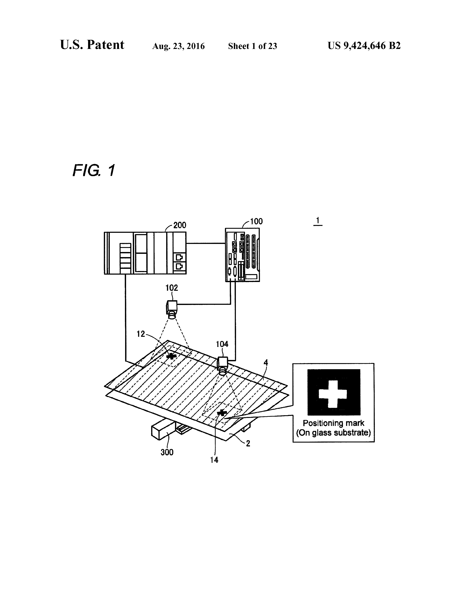
*도 1 — 제어 시스템 1: 영상 처리 장치 100, 모션 컨트롤러 200, 스테이지 300, 카메라 102·104, 유리 기판 2의 위치 결정 마크 12·14*

제어 시스템 1은 영상 처리 장치 100, 모션 컨트롤러 200, 스테이지 300을 포함한다. 영상 처리 장치 100은 하나 이상의 카메라(도 1의 예에서는 카메라 102와 104)가 촬영한 영상 데이터를 취득하고, 취득한 영상 데이터에 포함된 위치 결정 마크 12와 14의 위치로부터 워크인 유리 기판 2의 위치를 특정한다. 특정한 유리 기판 2의 위치에 기초하여, 유리 기판 2를 올바른 위치에 배치하기 위한 지령을 모션 컨트롤러 200에 출력한다. 즉, 영상 처리부에 해당하는 영상 처리 장치 100은 소정 위치에 특징부가 설치된 대상물을 촬영하여 얻은 영상 데이터를 취득하고, 영상 데이터에 포함된 특징부의 위치를 특정한다.

모션 컨트롤러 200은 영상 처리 장치 100의 지령에 따라 스테이지 300에 지령을 주어 유리 기판 2의 얼라인먼트를 실현한다. 즉, 제어부에 해당하는 모션 컨트롤러 200은 특정된 특징부의 위치에 기초한 제어 지령을 대상물의 위치를 바꾸는 이동 기구에 주어 대상물을 소정의 최종 목표 위치에 위치 결정한다.

스테이지 300은 워크인 유리 기판 2를 올바른 위치에 배치할 수 있는 기구라면 어떤 자유도를 가져도 된다. 실시예에서 스테이지 300은 유리 기판 2에 수평 방향 변위와 회전 변위를 줄 수 있다. 즉, 유리 기판 2를 X와 Y 방향 각각으로 이동시킬 수 있고, 유리 기판 2를 소정의 회전축 둘레로 회전시킬 수 있다. 스테이지 300에 대한 이러한 제어로서, 먼저 유리 기판 2를 수평 방향으로 목표 위치까지 이동시키고(이하 "XY 이동"이라고도 함), 그 다음 필요에 따라 유리 기판 2를 회전시킨다.

### B. 장치 구성(Device Configuration)

다음으로 실시예에 따른 제어 시스템 1의 장치 구성을 설명한다.

#### b1: 영상 처리 장치 100(Image Processing Device 100)

도 2는 실시예에 따른 제어 시스템 1에서 영상 처리 장치 100의 하드웨어 구성을 나타내는 개략도이다. 도 2를 참조하면, 영상 처리 장치 100은 일반적으로 범용 컴퓨터 아키텍처에 따른 구조를 갖고, 미리 설치된 프로그램을 프로세서로 실행하여 후술하는 다양한 영상 처리를 실현한다.

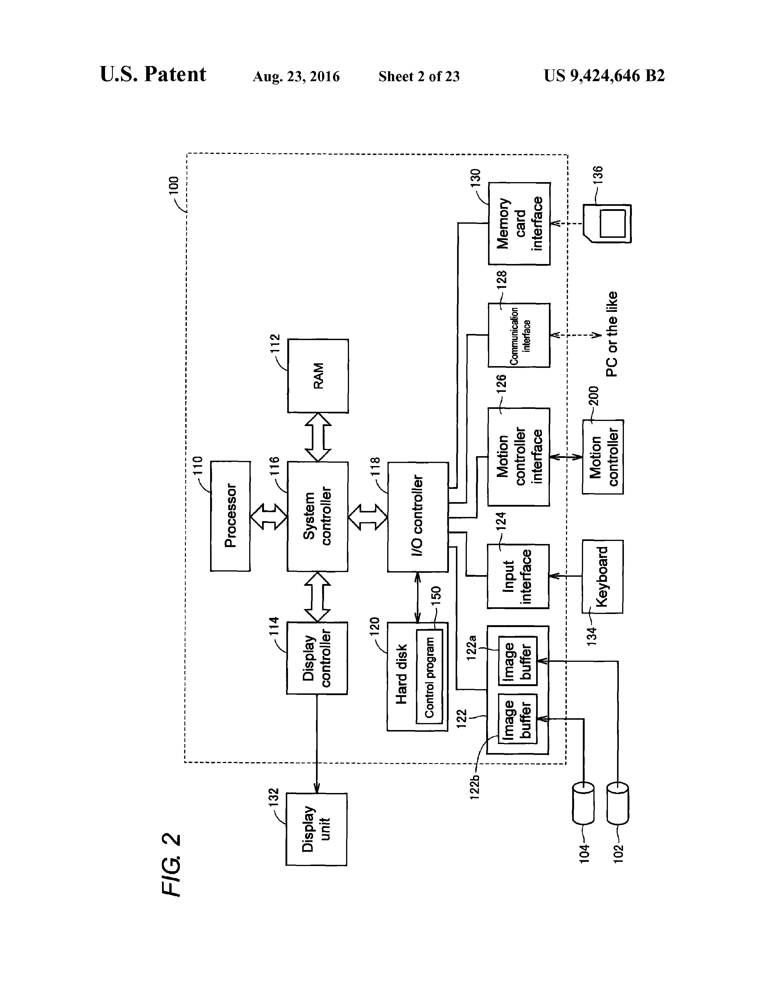
*도 2 — 영상 처리 장치 100의 하드웨어 구성*

더 구체적으로, 영상 처리 장치 100은 CPU(Central Processing Unit)나 MPU(Micro-Processing Unit) 같은 프로세서 110, RAM(Random Access Memory) 112, 표시 컨트롤러 114, 시스템 컨트롤러 116, I/O(Input/Output) 컨트롤러 118, 하드 디스크 120, 카메라 인터페이스 122, 입력 인터페이스 124, 모션 컨트롤러 인터페이스 126, 통신 인터페이스 128, 메모리 카드 인터페이스 130을 포함한다. 이 구성 요소들은 시스템 컨트롤러 116을 중심으로 서로 데이터를 주고받을 수 있게 연결된다.

프로세서 110은 시스템 컨트롤러 116과 프로그램(코드) 등을 주고받으며 이를 소정 순서로 실행하여 목적하는 연산 처리를 실현한다.

시스템 컨트롤러 116은 프로세서 110, RAM 112, 표시 컨트롤러 114, I/O 컨트롤러 118 각각과 버스로 연결되어 각 구성 요소와 데이터를 주고받으며, 영상 처리 장치 100의 전체 처리를 제어한다.

RAM 112는 일반적으로 DRAM(Dynamic Random Access Memory) 같은 휘발성 기억 장치로, 하드 디스크 120에서 읽은 프로그램, 카메라 102와 104로 얻은 카메라 영상(영상 데이터), 카메라 영상에 대한 처리 결과, 워크 데이터 등을 유지한다.

표시 컨트롤러 114는 표시부 132에 연결되어, 시스템 컨트롤러 116의 내부 명령에 따라 각종 정보를 표시하기 위한 신호를 표시부 132에 출력한다.

I/O 컨트롤러 118은 영상 처리 장치 100에 연결된 기록 매체 및 외부 장치와의 데이터 교환을 제어한다. 더 구체적으로 I/O 컨트롤러 118은 하드 디스크 120, 카메라 인터페이스 122, 입력 인터페이스 124, 모션 컨트롤러 인터페이스 126, 통신 인터페이스 128, 메모리 카드 인터페이스 130에 연결된다.

하드 디스크 120은 일반적으로 비휘발성 자기 기억 장치로, 프로세서 110이 실행하는 제어 프로그램 150에 더해 각종 설정값 등을 저장한다. 하드 디스크 120에 설치되는 제어 프로그램 150은 메모리 카드 136 등에 저장된 상태로 배포된다. 하드 디스크 120 대신 플래시 메모리 같은 반도체 기억 장치나 DVD-RAM(Digital Versatile Disk Random Access Memory) 같은 광학 기억 장치를 채용할 수도 있다.

카메라 인터페이스 122는 워크를 촬영하여 생성된 영상 데이터를 받는 입력부에 해당하며, 프로세서 110과 카메라 102·104 사이의 데이터 전송을 중개한다. 카메라 인터페이스 122는 카메라 102와 104의 영상 데이터를 일시 저장하는 영상 버퍼 122a와 122b를 포함한다. 여러 카메라에 대해 카메라들이 공유할 수 있는 단일 영상 버퍼를 둘 수도 있지만, 처리 속도를 높이려면 각 카메라 전용으로 여러 영상 버퍼를 독립적으로 배치하는 것이 바람직하다.

입력 인터페이스 124는 프로세서 110과 키보드 134, 마우스, 터치 패널, 전용 콘솔 같은 입력 장치 사이의 데이터 전송을 중개한다.

모션 컨트롤러 인터페이스 126은 프로세서 110과 모션 컨트롤러 200 사이의 데이터 전송을 중개한다.

통신 인터페이스 128은 프로세서 110과 도시하지 않은 다른 퍼스널 컴퓨터, 서버 장치 등 사이의 데이터 전송을 중개한다. 통신 인터페이스 128은 일반적으로 Ethernet(등록상표), USB(Universal Serial Bus) 등이다.

메모리 카드 인터페이스 130은 프로세서 110과 기록 매체인 메모리 카드 136 사이의 데이터 전송을 중개한다. 메모리 카드 136은 영상 처리 장치 100이 실행하는 제어 프로그램 150 등을 저장한 상태로 배포되고, 메모리 카드 인터페이스 130은 메모리 카드 136에서 제어 프로그램을 읽는다. 메모리 카드 136은 SD(Secure Digital) 같은 범용 반도체 기억 장치, 플렉시블 디스크 같은 자기 기록 매체, CD-ROM(Compact Disk Read Only Memory) 같은 광학 기록 매체 등이다. 또는 배포 서버 등에서 내려받은 프로그램을 통신 인터페이스 128을 통해 영상 처리 장치 100에 설치할 수도 있다.

위와 같이 범용 컴퓨터 아키텍처에 따른 구조를 갖는 컴퓨터를 사용하는 경우, 실시예에 따른 기능을 제공하는 애플리케이션에 더해 컴퓨터의 기본 기능을 제공하는 OS(Operating System)가 설치될 수 있다. 이 경우 실시예에 따른 제어 프로그램은 OS의 일부로 제공되는 프로그램 모듈 중 필요한 모듈을 소정 순서 및/또는 타이밍에 호출하여 처리를 실행할 수 있다.

또한 실시예에 따른 제어 프로그램은 다른 프로그램의 일부에 포함되어 제공될 수 있다. 이 경우에도 프로그램 자체는 위와 같이 결합되는 다른 프로그램에 포함된 모듈을 포함하지 않으며, 그 다른 프로그램과 협조하여 처리를 실행한다. 즉, 실시예에 따른 제어 프로그램은 다른 프로그램에 포함된 형태일 수 있다.

또는 제어 프로그램 실행으로 제공되는 기능의 일부 또는 전부를 전용 하드웨어 회로로 구현할 수 있다.

#### b2: 모션 컨트롤러 200(Motion Controller 200)

도 3은 실시예에 따른 제어 시스템 1에서 모션 컨트롤러 200의 하드웨어 구성을 나타내는 개략도이다. 도 3을 참조하면, 모션 컨트롤러 200은 주 제어 유닛 210과 복수의 서보 유닛 240, 242, 244를 포함한다. 실시예에 따른 제어 시스템 1에서는 예를 들어 스테이지 300이 3축의 서보 모터 310, 312, 314를 갖고, 축 수에 대응하는 서보 유닛 240, 242, 244가 모션 컨트롤러 200에 포함된다.

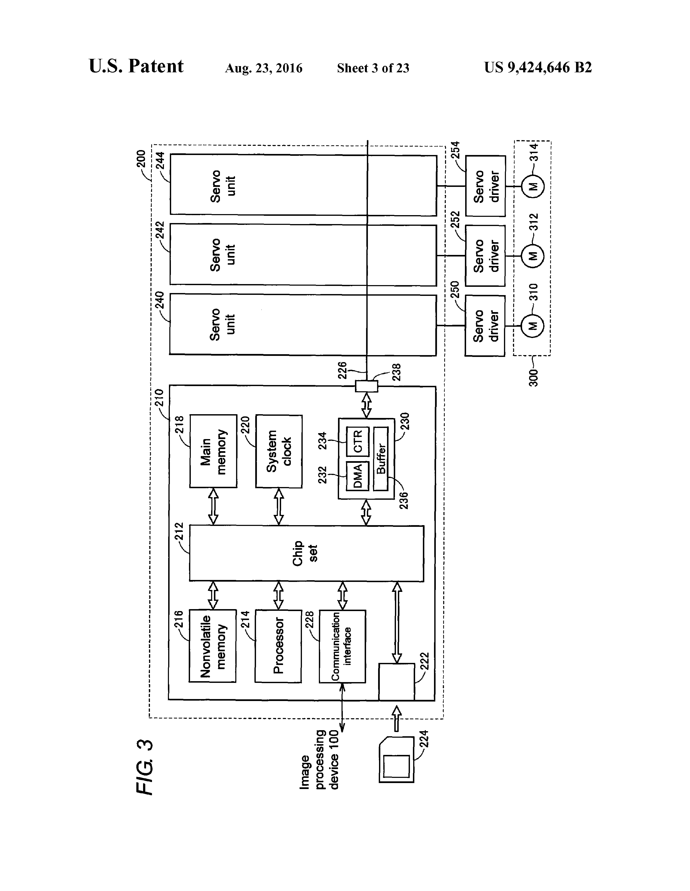
*도 3 — 모션 컨트롤러 200의 하드웨어 구성(서보 유닛 240~244, 서보 드라이버 250~254, 서보 모터 310~314)*

주 제어 유닛 210은 모션 컨트롤러 200 전체를 제어한다. 주 제어 유닛 210은 내부 버스 226을 통해 서보 유닛 240, 242, 244와 연결되어 데이터를 주고받는다. 서보 유닛 240, 242, 244는 주 제어 유닛 210의 내부 지령 등에 따라 서보 드라이버 250, 252, 254에 제어 명령(일반적으로 구동 펄스 등)을 출력한다. 서보 드라이버 250, 252, 254는 각각 연결된 서보 모터 310, 312, 314를 구동한다.

주 제어 유닛 210은 칩셋 212, 프로세서 214, 비휘발성 메모리 216, 주 메모리 218, 시스템 클록 220, 메모리 카드 인터페이스 222, 통신 인터페이스 228, 내부 버스 컨트롤러 230을 포함한다. 칩셋 212와 다른 구성 요소들은 각종 버스로 서로 결합된다.

프로세서 214와 칩셋 212는 일반적으로 범용 컴퓨터 아키텍처에 따른 구성을 갖는다. 즉, 프로세서 214는 칩셋 212에서 내부 클록에 따라 순차 공급되는 명령 코드를 해석하여 실행한다. 칩셋 212는 연결된 각종 구성 요소와 내부 데이터를 주고받으며, 프로세서 214에 필요한 명령 코드를 생성한다. 시스템 클록 220은 소정 주기의 시스템 클록을 생성하여 프로세서 214에 제공한다. 칩셋 212는 프로세서 214에서의 연산 처리 실행 결과로 얻은 데이터 등을 캐시하는 기능을 갖는다.

주 제어 유닛 210은 기억부로서 비휘발성 메모리 216과 주 메모리 218을 갖는다. 비휘발성 메모리 216은 OS, 시스템 프로그램, 사용자 프로그램, 데이터 정의 정보, 로그 정보 등을 비휘발적으로 유지한다. 주 메모리 218은 휘발성 기억 영역으로, 프로세서 214에서 실행할 각종 프로그램을 유지하며, 각종 프로그램 실행 시 작업 메모리로도 사용된다.

주 제어 유닛 210은 통신부로서 통신 인터페이스 228과 내부 버스 컨트롤러 230을 갖는다. 이 통신 회로들은 데이터를 송수신한다.

통신 인터페이스 228은 영상 처리 장치 100과 데이터를 주고받는다.

내부 버스 컨트롤러 230은 내부 버스 226을 통해 데이터를 주고받는다. 더 구체적으로 내부 버스 컨트롤러 230은 버퍼 메모리 236, DMA(Dynamic Memory Access) 제어 회로 232, 내부 버스 제어 회로 234를 포함한다.

메모리 카드 인터페이스 222는 주 제어 유닛 210에 착탈 가능한 메모리 카드 224를 프로세서 214에 연결한다.

### C. 관련 기술(Related Techniques)

다음으로 실시예에 따른 얼라인먼트에 관한 제어 방법을 이해하기 쉽도록 본 발명의 관련 기술을 설명한다.

#### c1: 반복 위치 결정(관련 기술 그 1)(Repetitive Positioning (Related Technique No. 1))

도 1에 나타낸 적용 예의 얼라인먼트에서는 높은 위치 정확도가 요구된다. 따라서 한 번의 이동으로는 요구 정확도를 만족하지 못하는 경우가 있다. 이는 주로 캘리브레이션 오차, 카메라 노이즈 등에 의한 영상 처리의 측정 오차 때문이다. 따라서 특허문헌 1에 개시된 바와 같이 위치 측정과 이동을 몇 차례 반복하여 위치 정확도를 높이는 방법을 채용할 수 있다.

도 4는 실시예의 관련 기술에 따른 반복 위치 결정 얼라인먼트를 설명하기 위한 도면이다. 도 4에 나타낸 바와 같이, 먼저 촬영을 수행하고, 워크의 목표 위치까지의 차이(벡터량)를 계산하고, 워크에 대한 XY 이동의 모션을 결정하여 실행한다(1회째 촬영). XY 이동의 모션은 일반적으로 소정 가속도로 가속한 뒤 소정 가속도(기본적으로 시스템의 허용 최대 속도)를 유지한다. 그 후 모션은 소정 감속도로 감속하여 정지한다. 정지 시점에서 다시 촬영을 수행하고, 워크의 목표 위치까지의 차이를 다시 계산한다. 워크가 목표 위치로부터 소정의 허용 오차 범위 안의 위치에 도달하지 않았으면, 워크에 대한 XY 이동의 모션을 다시 결정하여 다시 실행한다(2회째 촬영).

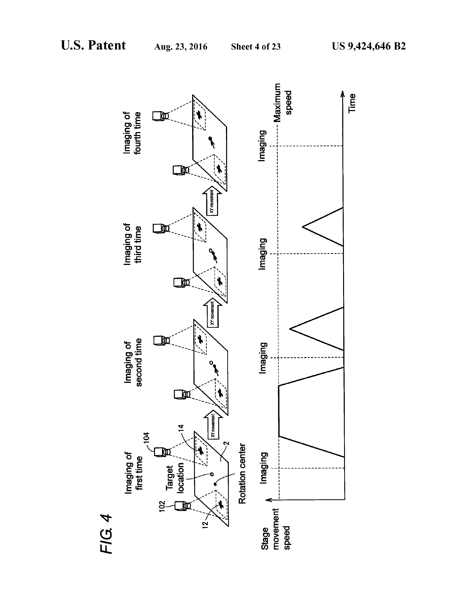
*도 4 — 관련 기술 1(반복 위치 결정): 촬영 → 가속 → 감속 → 정지 → 재촬영을 오차가 허용값 이하가 될 때까지 반복*

이후 촬영, 목표 위치까지의 차이 계산, 이동, 정지라는 일련의 처리 사이클을 오차가 소정값 이하가 될 때까지 반복한다. 즉, 워크가 목표 위치에 도달할 때까지 촬영, 가속, 감속, 정지 처리가 반복되므로, 가속과 감속에 걸리는 시간만큼 전체 이동 시간에 낭비가 생긴다. 모션을 일시 정지하는 경우에는 장치 전체의 진동이 사라질 때까지의 안정화 시간(정정 시간)이 필요하다. 이 점에서도 전체 이동 시간이 길어진다.

이동 시간을 줄이려면 스테이지 300을 멈추지 않고 일련의 이동으로 워크가 목표 위치에 도달하는 것이 요구된다.

#### c2: 논스톱 얼라인먼트(관련 기술 그 2)(Non-Stop Alignment (Related Technique No. 2))

장치의 구동 기구를 멈추지 않고 위치 결정을 수행하는 방법으로 "비주얼 서보"가 알려져 있다. "비주얼 서보"는 이동 중인 워크를 카메라로 연속 촬영하고, 영상 처리 결과로부터 워크 모션의 방향과 속도를 순간순간 조정하는 방법이다. 비특허문헌 1에 개시된 바와 같이 로봇 제어 등의 분야에서 연구가 진행되고 있다.

이러한 "비주얼 서보" 기술은 앞서 설명한 얼라인먼트에 적용할 수 있다. 이러한 얼라인먼트 방법에서는 도 4에 나타낸 바와 같이 워크가 목표 위치에 도달할 때까지 위치 측정을 위해 스테이지 300을 멈출 필요가 없다. 이하 비주얼 서보를 "논스톱 얼라인먼트" 또는 "NSA"라 한다.

도 5는 실시예의 관련 기술에 따른 논스톱 얼라인먼트를 설명하기 위한 도면이다. 도 5에 나타낸 바와 같이, 먼저 촬영을 수행하고, 워크의 목표 위치까지의 차이를 계산하고, 워크에 대한 XY 이동의 모션을 결정하여 실행한다. 이어서 스테이지 300이 이동하는 동안 다시 촬영을 수행하고, 워크의 목표 위치까지의 차이를 계산하여 모션을 보정한다. 즉, 앞선 촬영 결과에 따라 결정된 모션(목표 경로, 속도 패턴, 가속도 패턴 등)을 새로운 촬영 결과에 따라 보정한다. 촬영과 모션 보정을 연속적으로 반복하여 워크를 목표 위치로 이동시킨다.

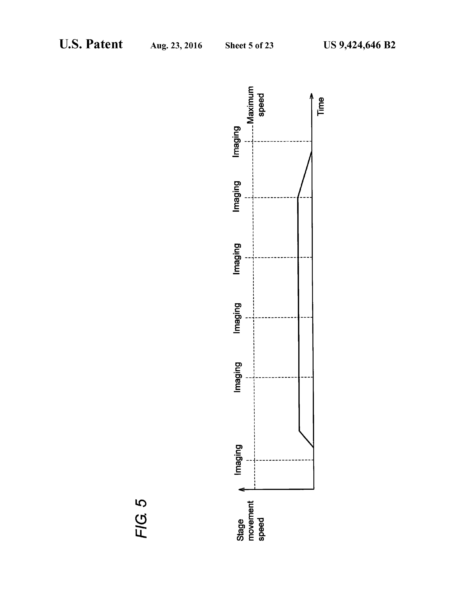
*도 5 — 관련 기술 2(논스톱 얼라인먼트): 이동 중 연속 촬영으로 모션을 보정, 속도가 낮음*

그러나 논스톱 얼라인먼트에서는 테이블을 멈추지 않는다. 따라서 초기 위치에서 목표 위치로 이동할 때 워크가 목표 위치를 지나치지 않도록 제어해야 한다. 워크가 목표 위치를 지나치면 직전 이동 방향과 반대 방향으로 이동해야 하므로 이동 기구를 반전시켜야 한다. 이동 기구의 반전 동작으로 백래시가 생기거나 관성 모멘트로 이동 기구가 손상될 가능성이 있다.

따라서 워크가 높은 정확도로 목표 위치에 도달하도록 워크의 모션을 정확하게 조정해야 한다. 이를 실현하려면 워크를 시스템의 허용 최대 속도보다 훨씬 낮은 이동 속도로 제어해야 한다. 그 결과 전체 이동에 필요한 시간을 줄일 수 없거나 오히려 길어지는 경우가 있다.

### D. 실시예에 따른 얼라인먼트의 개요(Outline of Alignment According to Embodiment)

실시예에 따른 얼라인먼트는 앞서 설명한 관련 기술보다 얼라인먼트 시작부터 끝까지 걸리는 시간을 최소화하는 것을 목표로 한다. 구체적 방법으로, 얼라인먼트 초기 단계에서는 워크가 시스템의 허용 최대 속도로 목표 위치에 접근하고, 목표 위치로부터 일정 범위에 도달하면 앞서 설명한 논스톱 얼라인먼트로 전환하여 워크가 목표 위치에 도달한다. 즉, 실시예에 따른 얼라인먼트는 이동 속도를 높일 수 있는 통상 얼라인먼트와, 스테이지 300을 멈추지 않고 목표 위치에 위치 결정할 수 있는 논스톱 얼라인먼트를 조합한 방법이다. 스테이지 300의 모션을 멈추지 않고 통상 얼라인먼트와 논스톱 얼라인먼트를 전환함으로써 전체 이동에 필요한 시간을 최소화할 수 있다.

도 6은 실시예에 따른 얼라인먼트를 설명하기 위한 도면이다. 도 6에 나타낸 바와 같이, 먼저 촬영을 수행하고, 워크의 목표 위치까지의 차이(벡터량)를 계산하고, 워크에 대한 XY 이동의 모션을 결정하여 실행한다(1회째 촬영). 즉, 1회째 촬영으로 첫 번째 목표 위치를 결정하고, 결정한 목표 위치(중간 목표 위치)를 향해 시스템의 허용 최대 속도로 스테이지 300을 이동시킨다. 스테이지 300이 목표 위치로부터 일정 거리 떨어진 위치에 도달하면 스테이지 300의 감속을 시작한다. 도 6에 나타낸 스테이지 300의 속도 패턴은 1회째 촬영 결과에 따라 처음에 결정될 수 있다. 즉, 스테이지 300의 감속 시작 위치(또는 경과 시간)를 미리 결정할 수 있다.

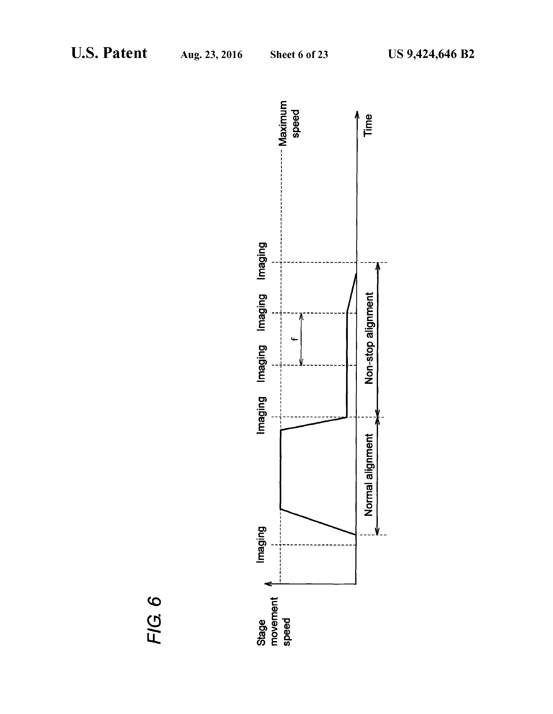
*도 6 — 실시예의 얼라인먼트: 통상 얼라인먼트(최대 속도 접근·감속) 후 멈추지 않고 논스톱 얼라인먼트로 전환*

그 후 스테이지 300의 속도가 소정 속도까지 낮아지면 논스톱 얼라인먼트를 시작하고, 오차가 소정 범위 안의 값이 될 때까지 촬영과 모션 보정을 연속 반복하여 워크를 목표 위치로 이동시킨다. 이때 촬영은 논스톱 얼라인먼트 제어 주기 "f"로 실행된다. 스테이지 300이 목표 위치에 충분히 가까운 경우에는 한 번의 촬영으로 스테이지 300이 목표 위치에 도달할 수 있다.

통상 얼라인먼트와 논스톱 얼라인먼트를 조합하면 워크를 목표 위치에 위치 결정하는 데 필요한 시간을 줄일 수 있다. 즉, 실시예에 따른 제어 시스템 1은 제1 제어 동작(통상 얼라인먼트)을 실행한 뒤 제2 제어 동작(논스톱 얼라인먼트)을 실행한다. 제1 제어 동작에서 영상 처리부(영상 처리 장치 100)는 영상 데이터를 취득하여 특징부의 위치를 특정한다. 제어부(모션 컨트롤러 200)는 특정된 특징부의 위치에 기초하여 대상물을 소정의 제1 속도까지 가속한 뒤 제1 속도보다 낮은 소정의 제2 속도까지 감속하여, 최종 목표 위치로부터 소정의 마진 거리만큼 떨어진 중간 목표 위치로 대상물을 이동시키는 제어 지령을 결정한다. 제2 제어 동작에서 영상 처리부(영상 처리 장치 100)는 이동 기구가 이동하는 동안 영상 데이터를 취득하여 특징부의 위치를 특정한다. 제어부(모션 컨트롤러 200)는 특정된 특징부의 위치에 기초하여 대상물을 최종 목표 위치에 위치 결정하는 제어 지령을 결정한다. 이때 마진 거리는 이동 기구의 속도를 제2 속도로부터 허용 최대 가속도로 감속했을 때 대상물이 최종 목표 위치를 지나치지 않도록 결정된다.

많은 경우, 제2 제어 동작에서 제어 시스템 1은 영상 처리부(영상 처리 장치 100)에 의한 특징부의 위치 특정과, 제어부(모션 컨트롤러 200)에 의한 대상물을 최종 목표 위치에 위치 결정하는 제어 지령의 결정을 반복하여 실행한다.

제2 제어 동작의 1회째 촬영과 측정은 중간 목표 위치에 도달하기 전(예를 들어 제1 속도에서 제2 속도로 감속하는 동안)에 실행할 수 있다.

### E. 실시예에 따른 얼라인먼트의 설정(Setting of Alignment According to Embodiment)

다음으로 실시예에 따른 얼라인먼트를 실행하기 위한 설정을 설명한다.

도 7은 실시예에 따른 얼라인먼트의 속도 패턴을 설명하기 위한 도면이다. 도 8은 실시예에 따른 얼라인먼트를 실행하기 위한 시스템 파라미터를 나타내는 도면이다.

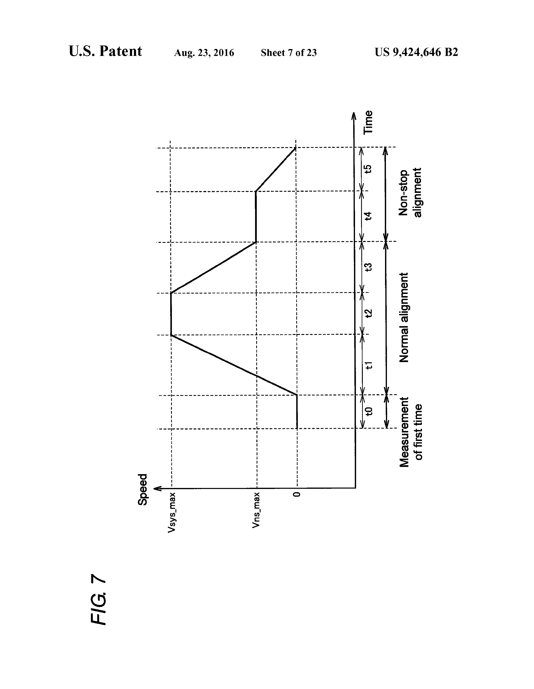
*도 7 — 속도 패턴: t0 초기 측정, t1~t3 통상 얼라인먼트(가속·최고속·감속), t4·t5 논스톱 얼라인먼트(Vns_max 등속·감속)*

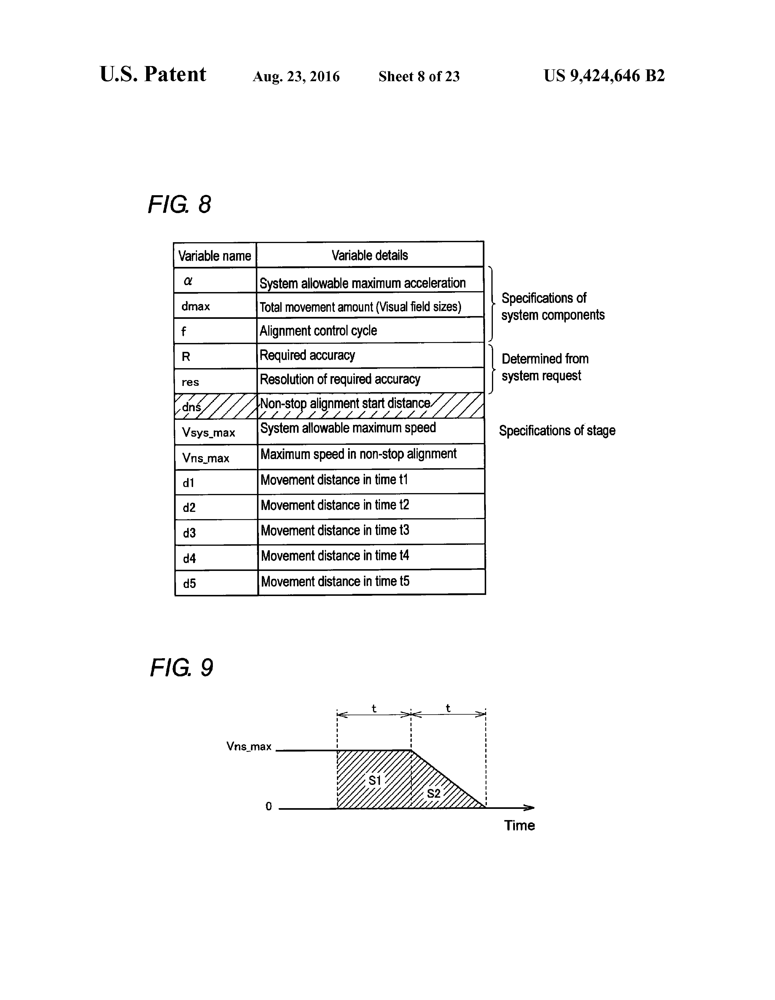
*도 8 — 시스템 파라미터(α, dmax, f, R, res, dns, Vns_max, d1~d5), 도 9 — Vns_max 결정: 한 제어 주기 지연 동안의 이동(S1+S2)이 요구 정확도 R보다 작아야 함*

도 7을 참조하면, 실시예에 따른 얼라인먼트의 모션은 시간 t0부터 t5까지 모두 여섯 구간으로 나눌 수 있다.

시간 t0은 영상 처리 장치 100이 워크를 촬영하고, 워크의 목표 위치까지의 차이(벡터량)를 계산하고, 워크에 대한 XY 이동의 모션을 결정하는 데(초기 측정) 필요한 시간이다. 시간 t0에서 통상 얼라인먼트 등에 따른 속도 패턴이 결정된다.

시간 t1~t3은 통상 얼라인먼트 기간에 해당한다. 시간 t1은 통상 얼라인먼트의 가속 기간에 해당한다. 시간 t1에서 스테이지 300은 시스템의 허용 최대 가속도로 가속한다. 시간 t2는 스테이지 300이 최고 속도로 목표 위치에 접근하는 기간에 해당한다. 시간 t2에서 스테이지 300은 시스템의 허용 최대 속도 Vsys_max로 등속 이동한다. 시간 t3은 통상 얼라인먼트의 감속 기간에 해당한다. 시간 t3에서 스테이지 300은 시스템의 허용 최대 속도로 감속한다.

이어서 시간 t4와 t5는 논스톱 얼라인먼트 기간에 해당한다. 시간 t4에서는 촬영과 모션 보정이 연속 반복되고, 스테이지 300이 워크를 목표 위치 가까이로 이동시킨다. 시간 t4에서 스테이지 300은 기본적으로 논스톱 얼라인먼트의 허용 최대 속도 Vns_max로 등속 이동한다. 시간 t5는 논스톱 얼라인먼트의 감속 기간에 해당한다. 시간 t5가 경과한 시점에서 워크는 목표 위치에 위치 결정된다.

시간 t1~t5의 길이와 대응하는 이동 거리 d1~d5는 도 8에 나타낸 시스템 파라미터를 사용하여 다음 식 (1)~(6)으로 계산할 수 있다. 도 8에 나타낸 시스템 파라미터는 시스템 구성 요소의 사양과 시스템 요구를 포함한다.

식 1

V_ns_max = R / (res × f), t0 = f … (1)

t1 = V_sys_max / α, d1 = α × t1² / 2 … (2)

t2 = d2 / V_sys_max, d2 = (d_max − d_ns) − d1 − d3 = (d_max − d_ns) − α × t1² / 2 − {V_sys_max × t3 − α × t3² / 2} … (3)

t3 = (V_sys_max − V_ns_max) / α, d3 = {V_sys_max × t3 − α × t3² / 2} … (4)

t4 = d4 / V_ns_max, d4 = d_ns − d5 = d_ns − α × t5² / 2 … (5)

t5 = V_ns_max / α, d5 = α × t5² / 2 … (6)

전체 이동 시간을 줄이려면 다음 요건이 중요하다.

(a) 통상 얼라인먼트의 감속 시작 타이밍: 시작 타이밍이 늦을수록 바람직하다

(b) 논스톱 얼라인먼트 시작 타이밍: 시작 타이밍이 늦을수록 바람직하다

즉, 시간 t2를 길게, 시간 t4를 짧게 설정하는 것이 바람직하다. 앞서 설명한 식 (3)과 (5)를 참조하면, 논스톱 얼라인먼트 시작 거리 dns(이하 "NSA 시작 거리 dns"라고도 함)를 더 줄이면 앞서 설명한 요건 (a)와 (b)가 만족됨을 알 수 있다.

NSA 시작 거리 dns는, 캘리브레이션 오차, 카메라 노이즈 등에 의한 영상 처리의 측정 오차의 영향이 있더라도, 제어 모드가 논스톱 얼라인먼트로 바뀌는 시점(도 7에 나타낸 논스톱 얼라인먼트 시작 타이밍(시간 t4의 시작 시점))에서 워크가 목표 위치를 지나치지 않도록 하기 위한 마진 거리에 해당한다. 즉, 마진 거리(NSA 시작 거리 dns)를 시스템에 맞게 최적화하면 전체 이동 시간을 줄일 수 있다. NSA 시작 거리 dns를 결정하는 방법과 거리 dns를 최적화하는 방법은 뒤에서 설명한다.

논스톱 얼라인먼트 허용 최대 속도 Vns_max는 NSA 시작 거리 dns와 함께 최적화하는 것이 바람직하다.

도 9는 실시예에 따른 얼라인먼트에 사용하는 논스톱 얼라인먼트 허용 최대 속도 Vns_max를 결정하는 방법을 설명하기 위한 도면이다. 먼저, 논스톱 얼라인먼트의 제어성을 유지하려면 스테이지 300을 논스톱 얼라인먼트 제어 주기 "f" 한 번 안에 정지시킬 수 있어야 한다. 즉, 논스톱 얼라인먼트 제어 주기 "f" 안에 감속을 마쳐야 한다. 따라서 시스템 허용 최대 가속도를 α라 하면, 이 요구를 만족하는 조건은 다음과 같이 나타낼 수 있다.

Vns_max ≤ α × f … (1)

제어 시스템 1에서는 영상 처리 장치 100이 얻은 위치 정보에 기초하여 모션 컨트롤러 200에서 서보 유닛으로 지령을 주므로, 최대 논스톱 얼라인먼트 제어 주기 "f" 한 번만큼의 지연이 생긴다. 따라서 스테이지 300이 두 주기 동안 이동하는 거리(도 9의 면적 S1과 S2의 합에 해당)만큼 오차가 생긴다. 생길 수 있는 오차는 요구 정확도 R보다 작아야 한다. 따라서 이 요구를 만족하는 조건은 다음과 같이 나타낼 수 있다.

S = S1 + S2 = Vns_max × f + Vns_max × f / 2 = Vns_max × f × 3 / 2 ≤ R

식을 정리하면 다음 조건이 유도된다.

Vns_max ≤ 2R / 3f … (2)

논스톱 얼라인먼트 허용 최대 속도 Vns_max는 식 (1)과 (2)를 동시에 만족하도록 결정된다.

앞서 설명한 바와 같이, 대상물과 목표 위치 사이의 거리가 영상 처리 장치 100이 특정한 위치에 생기는 오차에 따른 거리 이하가 되면, 제1 제어 동작(통상 얼라인먼트)에서 제2 제어 동작(논스톱 얼라인먼트)으로의 전환이 실행된다. 오차에 따른 거리를 결정하는 절차는 뒤에서 설명한다.

제1 제어 동작(통상 얼라인먼트)의 제어 지령은 이동 기구(스테이지 300)를 허용 최대 가속도로 가속하는 지령을 포함한다.

### F. 실시예에 따른 얼라인먼트의 절차(Procedure of Alignment According to Embodiment)

다음으로 실시예에 따른 얼라인먼트의 절차를 설명한다. 도 10은 실시예에 따른 얼라인먼트의 절차를 나타내는 흐름도이다. 도 10에 나타낸 단계들은 기본적으로 영상 처리 장치 100과 모션 컨트롤러 200의 협조로 실행된다. 실시예에서는 두 처리 주체(영상 처리 장치 100과 모션 컨트롤러 200)를 사용하는 구성을 예로 설명한다. 그러나 처리 주체를 통합한 형태도 채용할 수 있다. 이 경우 다음 단계들은 통합된 처리 주체가 실행한다. 즉, 실시예에 따른 얼라인먼트를 수행하기 위한 각 처리는 영상 처리 장치 100과 모션 컨트롤러 200의 협조로 실행되거나, 영상 처리 장치 100과 모션 컨트롤러 200 중 하나가 단독으로 실행한다. 처리의 분담은 일종의 설계 사항으로, 시스템 요구와 각종 제약에 따라 적절히 선택된다.

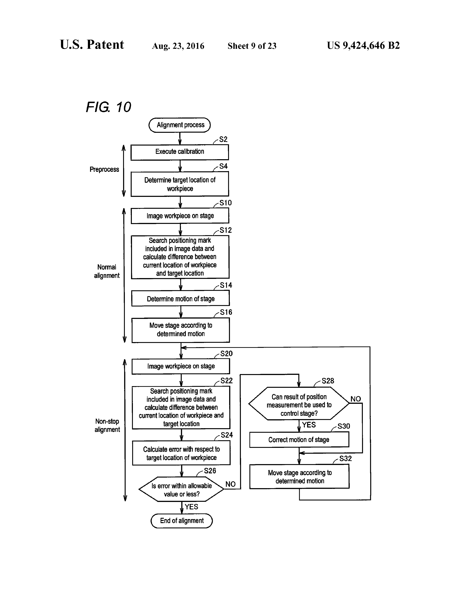
*도 10 — 얼라인먼트 절차: 전처리(캘리브레이션 S2, 목표 위치 결정 S4) → 통상 얼라인먼트(S10~S16) → 논스톱 얼라인먼트(S20~S32, 오차가 허용값 이하이면 종료, 측정 결과를 쓸 수 없으면 보정 생략)*

도 10을 참조하면, 영상 처리 장치 100은 카메라 102·104의 시야와 스테이지 300의 좌표 사이의 위치 관계를 특정하는 캘리브레이션을 실행한다(단계 S2). 캘리브레이션에 의해 카메라 102와 104로 촬영한 위치 결정 마크 12와 14의 위치(화소 위치)로부터 스테이지 300의 이동량을 계산할 수 있다.

이어서 영상 처리 장치 100은 카메라 102와 104로 워크 위의 위치 결정 마크 12와 14를 각각 촬영하여 워크의 목표 위치를 결정한다(단계 S4). 단계 S2와 S4는 얼라인먼트에 관한 전처리이다. 단계 S2와 S4를 한 번 실행하면, 전처리에서 얻은 파라미터는 대상 워크가 바뀔 때까지 사용할 수 있다. 따라서 두 번째 이후의 얼라인먼트를 실행할 때에는 단계 S2와 S4의 실행을 건너뛸 수 있다.

이어서 얼라인먼트할 워크를 스테이지 300 위에 배치한 뒤 단계 S10 이후의 처리를 실행한다. 더 구체적으로, 먼저 영상 처리 장치 100이 스테이지 300 위의 워크를 촬영한다(단계 S10). 이어서 영상 처리 장치 100은 카메라 102와 104로 워크를 촬영하여 생성한 영상 데이터에 포함된 위치 결정 마크 12와 14를 탐색하고, 탐색 결과에 기초하여 워크의 현재 위치와 목표 위치 사이의 차이를 계산한다(단계 S12). 즉, 영상 처리 장치 100은 카메라 102와 104로 워크 위의 위치 결정 마크 12와 14를 촬영하여 워크의 좌표를 측정한다. 즉, 영상 처리 장치 100은 워크에 대해 위치 측정을 실행한다. 측정 결과는 영상 처리 장치 100에서 모션 컨트롤러 200으로 전송된다.

모션 컨트롤러 200은 목표 위치까지의 차이에 기초하여 스테이지 300이 이동해야 할 거리(이동량)를 계산하고, 스테이지 300의 모션(목표 경로, 속도 패턴, 가속도 패턴 등)을 결정한다(단계 S14). 이때 계산되는 차이는 벡터량이다. 예를 들어 현재 위치에서 목표 위치까지의 거리와 각도가 계산된다. 모션 컨트롤러 200은 결정된 모션에 따라 서보 드라이버에 지령을 주어 스테이지 300을 이동시킨다(단계 S16). 단계 S14에서 결정되는 모션은 통상 얼라인먼트 구간에 해당하며, 논스톱 얼라인먼트 구간의 모션은 단계 S20 이후에서 순차적으로 결정된다.

모션 컨트롤러 200이 결정하거나 보정하는 모션을 정의하는 데이터 구조로는 어떤 데이터 구조를 사용해도 된다. 즉, 도 7에 나타낸 바와 같이 스테이지 300을 이동시킬 수 있으면 충분하다.

단계 S14에서 결정된 모션에 따른 스테이지 300의 이동이 완료되면, 즉 도 7에 나타낸 시간 t1~t3의 이동 처리가 완료되면 논스톱 얼라인먼트를 시작한다. 다시 말해, 단계 S10~S16의 처리는 통상 얼라인먼트의 처리에 해당하고, 단계 S20~S32의 처리는 논스톱 얼라인먼트의 처리에 해당한다.

논스톱 얼라인먼트가 시작되면, 영상 처리 장치 100은 스테이지 300 위의 워크를 촬영한다(단계 S20). 이어서 영상 처리 장치 100은 카메라 102와 104로 워크를 촬영하여 생성한 영상 데이터에 포함된 위치 결정 마크 12와 14를 탐색하고, 탐색 결과에 기초하여 워크의 현재 위치와 목표 위치 사이의 차이를 계산한다(단계 S22). 영상 처리 장치 100에 의한 워크 위치 측정 결과는 영상 처리 장치 100에서 모션 컨트롤러 200으로 전송된다.

모션 컨트롤러 200은 워크의 목표 위치에 대한 오차를 계산하고(단계 S24), 계산된 오차가 미리 지정된 허용값 이하인지 판정한다(단계 S26). 계산된 오차가 허용값 이하인 경우(단계 S26에서 YES), 얼라인먼트를 마친다. 즉, 모션 컨트롤러 200은 워크의 현재 위치와 목표 위치 사이의 차이가 허용값 이하가 되도록 스테이지 300을 이동시킨다.

계산된 오차가 허용값을 넘는 경우(단계 S26에서 NO), 모션 컨트롤러 200은 영상 처리 장치 100에서 얻은 위치 측정 결과를 스테이지 300의 제어에 사용할 수 있는지 판정한다(단계 S28). 즉, 영상 처리 장치 100에서 워크의 위치 측정이 적절히 실행되었는지 판정한다.

영상 처리 장치 100에서 얻은 위치 측정 결과를 스테이지 300의 제어에 사용할 수 있다고 판정된 경우(단계 S28에서 YES), 모션 컨트롤러 200은 스테이지 300이 이동할 거리(이동량)를 계산하고 스테이지 300의 모션(목표 경로, 속도 패턴, 가속도 패턴 등)을 보정한다(단계 S30). 그 후 모션 컨트롤러 200은 결정된 모션에 따라 서보 드라이브에 지령을 주어 스테이지 300을 이동시킨다(단계 S32).

반대로 영상 처리 장치 100에서 얻은 위치 측정 결과를 스테이지 300의 제어에 사용할 수 없다고 판정된 경우(단계 S28에서 NO), 단계 S30의 처리를 건너뛴다. 즉, 앞서 결정/보정된 모션을 그대로 사용한다.

단계 S32를 실행한 뒤 소정 시간이 지나면 단계 S20 이후의 처리를 다시 실행한다.

위와 같은 절차로 실시예에 따른 얼라인먼트가 실행된다. 워크에 대한 얼라인먼트가 완료되면 위치 결정된 워크는 다음 공정으로 반송되고 새 워크를 받는다. 새 워크에 대해 단계 S10 이후의 처리가 반복 실행된다.

이하, 위 단계 중 일부의 처리 내용을 더 구체적으로 설명한다.

단계 S28의 처리는 선택 사항이며 필수 처리가 아니다. 즉, 단계 S28의 판정을 수행하지 않고 단계 S30을 실행할 수 있다.

### G. 캘리브레이션(Calibration)

도 10의 절차 중 단계 S2의 캘리브레이션을 설명한다. 캘리브레이션은 스테이지 300의 좌표계와 카메라 102·104의 좌표계를 맞추는 처리를 가리킨다. 즉, 카메라 102와 104로 워크를 촬영하여 얻은 위치 정보와 실제 워크(또는 스테이지 300)의 위치 정보 사이의 관계를 결정하는 처리이다.

도 11은 실시예에 따른 얼라인먼트의 전처리로서의 캘리브레이션을 설명하기 위한 도면이다. 도 12는 실시예에 따른 얼라인먼트의 전처리로서의 캘리브레이션 원리를 설명하기 위한 도면이다.

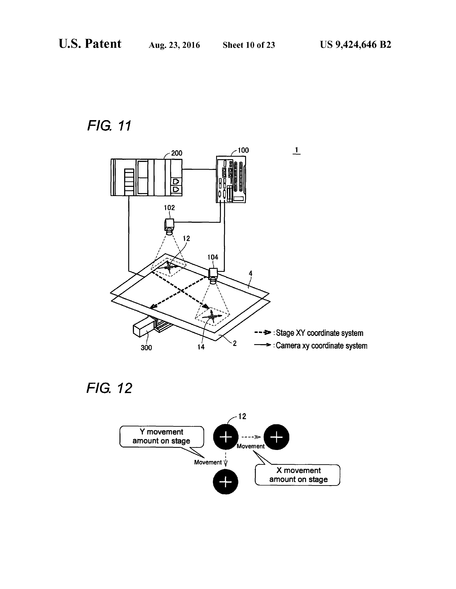
*도 11 — 스테이지 XY 좌표계와 카메라 xy 좌표계의 불일치, 도 12 — X·Y 방향 소정 이동 전후의 마크 위치로 캘리브레이션*

도 11을 참조하면, 워크(유리 기판 2) 위의 위치 결정 마크 12와 14를 카메라 102와 104로 촬영할 때, 실제 스테이지 300의 좌표계인 스테이지 XY 좌표계와 카메라 102·104가 인식하는 카메라 xy 좌표계(영상 데이터의 화소 위치에 해당)는 일치하지 않는다. 따라서 캘리브레이션에서 좌표계를 맞춘다.

더 구체적으로, 도 12에 나타낸 바와 같이 위치 결정 마크 12와 14가 설치된 워크를 이동시키고, 스테이지 XY 좌표계의 이동량과 카메라 xy 좌표계의 이동량을 비교하여 후술하는 캘리브레이션 파라미터(일반적으로 아핀 변환 파라미터)를 최적화 계산한다.

더 구체적으로, 워크 위의 위치 결정 마크(도 12의 예에서는 십자 마크)를 촬영한다. 그 후 워크를 스테이지 300의 X 방향을 따라 소정 거리(이동량 ΔX)만큼 이동시키고(Y 방향으로는 이동시키지 않음), 이동 후의 위치 결정 마크를 다시 촬영한다. 마찬가지로 워크를 초기 위치에서 스테이지 300의 Y 방향을 따라 소정 거리(이동량 ΔY)만큼 이동시키고(X 방향으로는 이동시키지 않음), 이동 후의 위치 결정 마크를 다시 촬영한다.

각 좌표계에서 도 12에 나타낸 세 위치 결정 마크의 계산된 위치(좌표)를 사용하여 캘리브레이션 파라미터를 결정할 수 있다. 더 구체적으로, 스테이지 XY 좌표계의 세 좌표와 이에 대응하는 카메라 xy 좌표계의 세 좌표를 사용하여 다음 식의 아핀 변환 파라미터 "a"~"f"를 계산한다.

식 2

[X, Y, 1]ᵀ(스테이지 좌표계) = [[a, b, c], [d, e, f], [0, 0, 1]](아핀 변환 파라미터) × [x, y, 1]ᵀ(카메라 좌표계)

아핀 변환 파라미터에 의해 카메라 xy 좌표계의 좌표값과 스테이지 XY 좌표계의 좌표값을 서로 변환할 수 있다.

### H. 목표 위치의 결정(Determination of Target Location)

#### 회전 중심(Rotation Center)

도 10의 절차 중 단계 S4의 워크 목표 위치 결정 처리를 설명한다. 실시예에 따른 제어 시스템 1에서 스테이지 300은 XY 방향으로 이동하고 θ 방향으로 회전할 수 있다. 스테이지 300에 의한 워크의 회전 중심을 목표 위치로 설정하면, 워크의 XY 방향 이동과 θ 방향 회전이 정합된 위치 결정을 스테이지 300으로 수행할 수 있다. 따라서 실시예에서는 전처리로서 스테이지 300의 회전 중심을 미리 특정하여 목표 위치로 결정한다.

도 13은 실시예에 따른 얼라인먼트의 전처리로서 목표 위치(회전 중심)를 결정하는 처리를 설명하기 위한 도면이다. 도 14a 내지 도 14c는 실시예에 따른 얼라인먼트의 전처리로서 목표 위치(회전 중심)를 결정하는 처리의 원리를 설명하기 위한 도면이다.

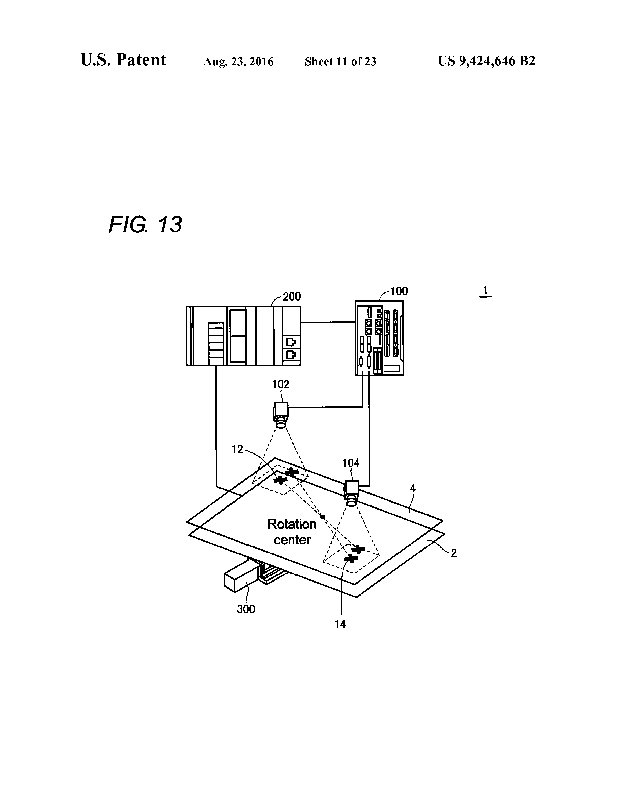
*도 13 — 목표 위치(회전 중심) 결정: 전용 지그와 마스터 워크를 올바른 위치에 두고 두 카메라로 마크 촬영*

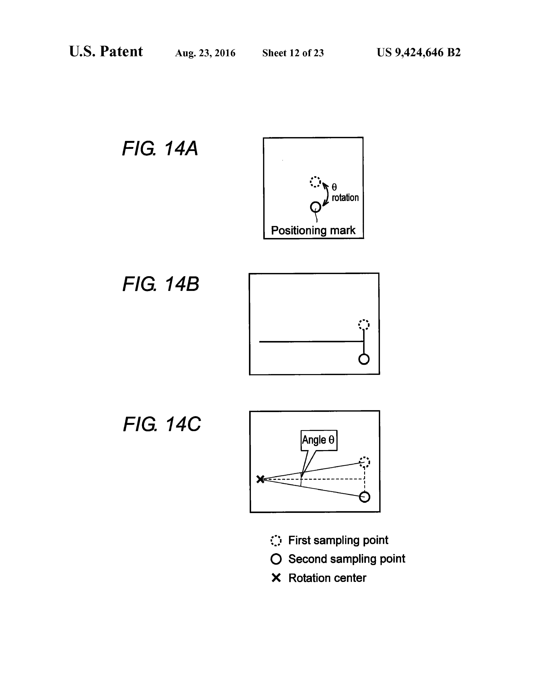
*도 14 — 회전 중심 추정 원리: 각도 θ 회전 전후 마크(제1·제2 샘플링 점)를 잇는 직선의 수직 이등분선 위에서 회전 중심 계산*

도 13을 참조하면, 먼저 워크(유리 기판 2)를 스테이지 300 위의 올바른 위치에 배치한다. 이때 워크 배치의 위치 정확도가 중요하므로 전용 지그와 정확한 치수를 갖는 마스터 워크를 사용한다.

영상 처리 장치 100은 카메라 102와 104로 워크 위의 위치 결정 마크 12와 14를 촬영하여 워크의 좌표(회전 중심의 좌표와 회전 각도)를 측정한다. 회전 중심의 좌표가 목표 위치로 설정된다. 즉, 시야가 서로 떨어진 두 카메라 102와 104로 촬영한 위치 결정 마크 12와 14의 좌표로부터 워크(스테이지 300)의 회전 중심 좌표를 계산한다.

도 14a 내지 도 14c에 나타낸 바와 같이, 스테이지 300을 각도 θ만큼 돌리고, 돌리기 전후의 위치 결정 마크 위치 변화에 기초하여 회전 중심을 추정한다. 더 구체적으로, 도 14a에 나타낸 바와 같이, 위치 결정 워크가 설치된 워크를 스테이지 300으로 각도 θ만큼 돌린다. 회전 전후의 위치 결정 마크를 각각 "제1 샘플링 점"과 "제2 샘플링 점"으로 나타낸다. 도 14b에 나타낸 바와 같이, 각도 θ 회전 전후 두 위치 결정 마크의 좌표점을 지나는 직선을 정의하고, 도 14c에 나타낸 바와 같이 그 직선의 수직 이등분선 위에서 두 위치 결정 마크가 이루는 각이 각도 θ가 되는 좌표를 계산한다. 계산된 좌표를 스테이지 300의 회전 중심 좌표로 결정한다.

자세한 내용은 JP 2006-049755 A(특허문헌 2)를 참조한다.

### I. 논스톱 얼라인먼트 시작 거리 dns의 결정 방법(Method of Determining Non-Stop Alignment Start Distance Dns)

앞서 설명한 바와 같이 논스톱 얼라인먼트 시작 거리(NSA 시작 거리) dns를 더 줄이면 전체 이동 시간을 줄일 수 있다. 즉, 실시예에 따른 얼라인먼트를 빨리 마치려면 NSA 시작 거리 dns가 짧을수록, 즉 NSA 시작 거리(논스톱 얼라인먼트 시작 위치)가 목표 위치에 가까울수록 바람직하다.

한편 NSA 시작 거리 dns는 워크가 목표 위치를 지나치지 않도록 하기 위한 마진 거리에 해당하며, 제어 안정성 측면에서는 NSA 시작 거리 dns가 길수록 바람직하다. 따라서 NSA 시작 거리 dns를 적절히 결정해야 한다.

도 15는 실시예에 따른 얼라인먼트에 사용하는 논스톱 얼라인먼트 시작 거리 dns의 이론값을 결정하는 방법을 설명하기 위한 도면이다. 도 15를 참조하면, 영상 처리 장치 100이 워크를 촬영한 뒤 모션 컨트롤러 200에 지령을 줄 때까지 논스톱 얼라인먼트 제어 주기 "f" 한 번에 해당하는 낭비 시간이 생기고, 또한 스테이지 300은 감속 기간(시간 t5)에도 이동한다. 이러한 미끄럼 거리를 고려하여 NSA 시작 거리 dns는 다음 식으로 계산할 수 있다.

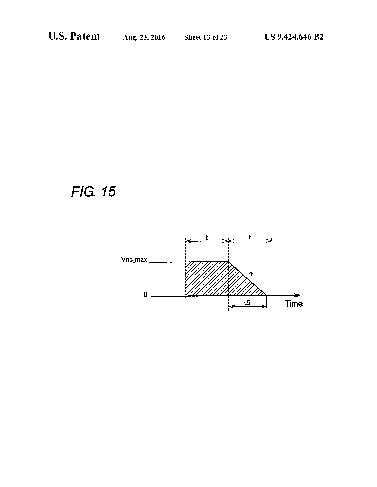
*도 15 — dns 이론값: 한 제어 주기 f 동안 Vns_max로 진행한 거리 + 감속 기간 t5 동안의 거리*

dns = Vns_max × f + α × t5² / 2

= Vns_max × Vns_max² / 2α

이론값의 고려에 더해, 논스톱 얼라인먼트 시작 거리 dns는 동적으로 변동하는 각종 오차를 고려하여 결정해야 한다. 구체적으로, NSA 시작 거리 dns의 최솟값은 1회째 촬영의 영상 처리 결과로부터 계산한 이동량에 포함되는 오차의 최댓값에 해당한다. 이러한 오차의 원인은 (a) 카메라 노이즈에 의한 측정 오차와 (b) 스테이지와 광학계의 특성으로 분류할 수 있다. 원인 (a)는 측정할 때마다 바뀌고, 원인 (b)는 측정 위치에 따라 달라지며 측정할 때마다 바뀌지는 않는다.

원인 (a)는 카메라에 쓰인 영상 센서의 통계 데이터를 이용하여 어느 정도 추정할 수 있다. 원인 (b)는 후술하는 절차로 미리 실험적으로 측정하여 추정할 수 있다.

워크를 실제로 이동시켰을 때 생기는 오차를 실험적으로 측정하면 NSA 시작 거리를 실험적으로 결정할 수 있다.

최종적으로, 위와 같이 결정한 NSA 시작 거리의 이론값과 실험값의 합을 NSA 시작 거리 dns로 결정한다. 즉, 마진 거리(NSA 시작 거리 dns)는 제1 거리와 제2 거리의 합이다. 제1 거리는 이동 기구의 이동 후에 대상물의 위치를 특정하여 영상 처리부가 얻은 결과를 소정 이동량과 비교하여 결정된다. 제2 거리는 영상 처리부가 영상 데이터를 취득한 뒤 영상 처리부가 특징부의 위치를 특정할 때까지 이동 기구가 제2 속도로 이동하고, 이동 기구가 제2 속도로부터 허용 최대 가속도로 감속되어 정지할 때까지의 기간 동안의 이동 기구의 이동량이다.

이하, NSA 시작 거리를 실험적으로 결정하는 방법을 설명한다.

#### i1: 결정 방법 그 1(Determining Method No. 1)

도 16은 실시예에 따른 얼라인먼트에 사용하는 논스톱 얼라인먼트 시작 거리 dns를 결정하는 방법(그 1)을 설명하기 위한 도면이다. 도 16에 나타낸 방법에서는 워크의 이동량(벡터량)을 무작위로 정하고, 무작위로 정한 이동량만큼 워크를 이동시켰을 때 생기는 오차를 실험적으로 구한다. 도 17은 도 16에 나타낸 논스톱 얼라인먼트 시작 거리 dns를 결정하는 절차를 나타내는 흐름도이다.

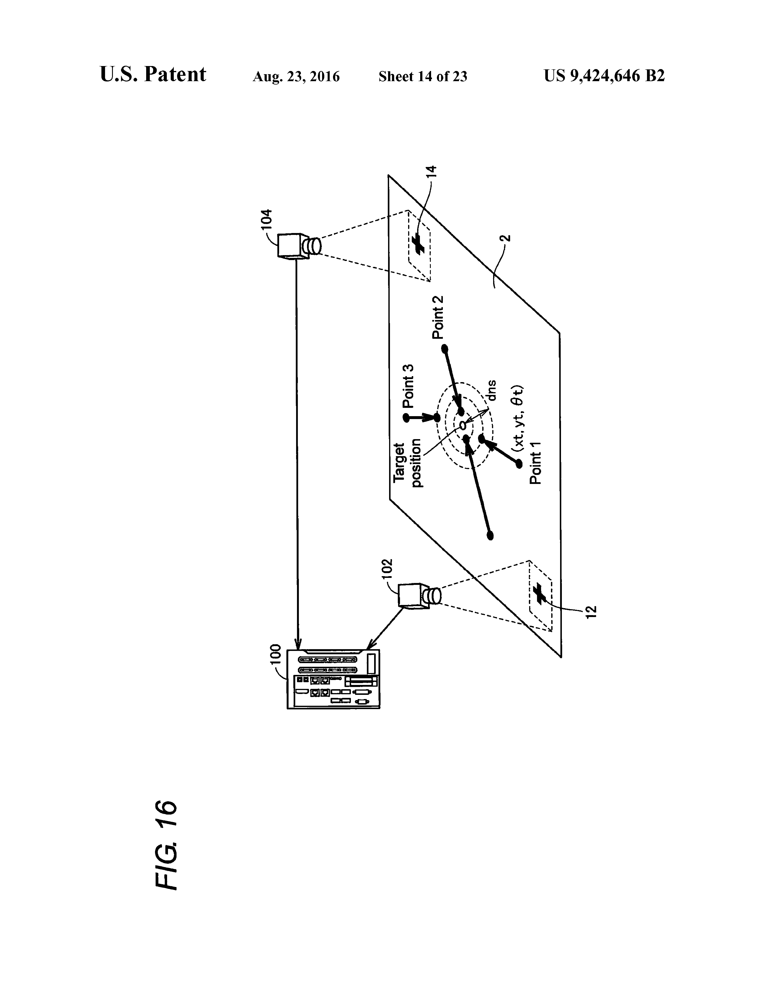
*도 16 — 결정 방법 그 1: 무작위 이동량 (xt, yt, θt)으로 이동한 뒤 목표 위치로 복귀시켜 측정 좌표와 목표 좌표 사이의 거리 d 측정*

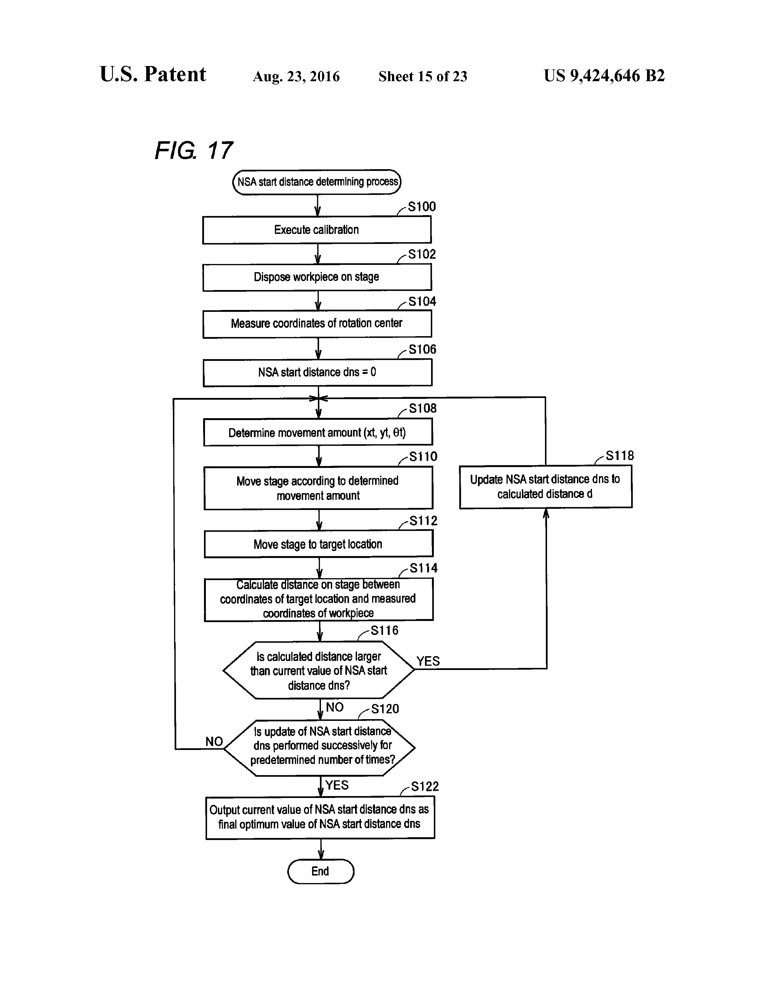
*도 17 — 결정 방법 그 1의 흐름도: d가 현재 dns보다 크면 dns 갱신, 소정 횟수 연속 갱신이 없으면 현재 dns를 최적값으로 출력*

도 16과 도 17을 참조하면, 영상 처리 장치 100은 카메라 102·104의 시야와 스테이지 300의 좌표 사이의 위치 관계를 특정하는 캘리브레이션을 실행한다(단계 S100). 즉, 스테이지 300의 좌표계와 카메라 102·104의 좌표계를 맞춘다. 이어서 워크(유리 기판 2)를 스테이지 300 위의 소정 위치에 둔다(단계 S102). 이때 워크 배치의 위치 정확도가 중요하므로 전용 지그와 정확한 치수를 갖는 마스터 워크를 사용한다.

영상 처리 장치 100은 카메라 102와 104로 워크 위의 위치 결정 마크 12와 14를 각각 촬영하고, 워크의 좌표(회전 중심의 좌표와 회전 각도)를 측정한다(단계 S104). 회전 중심의 좌표 (X0, Y0, θ0)를 목표 위치로 설정한다.

이렇게 NSA 시작 거리를 결정하기 위한 전처리가 완료된다. 영상 처리 장치 100은 NSA 시작 거리 dns의 초기값으로 0을 설정한다(단계 S106). 이어서 모션 컨트롤러 200은 위치 결정 마크 12와 14가 각각 카메라 102와 104의 시야 안에 들어오도록 이동량 (xt, yt, θt)를 무작위로 정하고(단계 S108), 정한 이동량에 따라 서보 드라이버에 지령을 주어 스테이지 300을 이동시킨다(단계 S110).

스테이지 300을 이동시킨 뒤, 모션 컨트롤러 200은 스테이지 300을 다시 목표 위치로 이동시킨다(단계 S112). 즉, 이동 기구(스테이지 300)를 소정 이동량만큼 이동시키는 처리가 실행된다. 영상 처리 장치 100은 카메라 102와 104로 워크 위의 위치 결정 마크 12와 14를 각각 촬영하여 워크의 좌표 (X1, Y1, θ1)를 측정하고, 목표 위치의 좌표와 측정된 워크 좌표 사이의 스테이지 300 위의 거리 d를 계산한다(단계 S114). 구체적으로 거리 d는 목표 위치의 좌표 (X0, Y0)와 측정된 워크 좌표 (X1, Y1) 사이의 거리에 해당한다. 즉, 이동 후의 대상물 위치를 촬영하여 얻은 영상 데이터로부터 위치를 특정하는 처리가 실행된다.

그 후 영상 처리 장치 100은 NSA 시작 거리 dns의 현재값과 계산된 거리 d를 비교하여, 계산된 거리 d가 NSA 시작 거리 dns의 현재값보다 큰지 판정한다(단계 S116). 계산된 거리 d가 NSA 시작 거리 dns의 현재값보다 큰 경우(단계 S116에서 YES), 영상 처리 장치 100은 NSA 시작 거리 dns를 계산된 거리 d로 갱신한다(단계 S118). 그 후 단계 S108 이후의 처리를 반복한다.

반면 계산된 거리 d가 NSA 시작 거리 dns의 현재값보다 작은 경우(단계 S116에서 NO), 영상 처리 장치 100은 NSA 시작 거리 dns의 갱신이 소정 횟수 연속으로 수행되었는지 판정한다(단계 S120). 즉, NSA 시작 거리 dns의 현재값이 생길 수 있는 오차의 최댓값인지 판정한다. 최근 소정 횟수 안에 NSA 시작 거리 dns의 갱신이 수행된 경우(단계 S120에서 NO), 단계 S108 이후의 처리를 반복한다.

반면 NSA 시작 거리 dns의 갱신이 복수 회 연속으로 수행되지 않은 경우(단계 S120에서 YES), 영상 처리 장치 100은 NSA 시작 거리 dns의 현재값을 최종 NSA 시작 거리 dns의 최적값으로 출력한다(단계 S122). 그 후 처리를 마친다.

이처럼 이동 기구(스테이지 300)를 복수 회 이동시키고, 이동량과 특정된 대상물 위치의 비교에 따라 오차에 따른 거리(NSA 시작 거리 dns)를 결정하는 처리가 실행된다.

#### i2: 결정 방법 그 2(Determining Method No. 2)

도 18은 실시예에 따른 얼라인먼트에 사용하는 논스톱 얼라인먼트 시작 거리 dns를 결정하는 방법(그 2)을 설명하기 위한 도면이다. 도 16에 나타낸 방법에서는 워크의 이동량을 무작위로 정해 NSA 시작 거리 dns를 계산하는 방법을 설명했다. 도 18에 나타낸 방법에서는 규칙적으로 배치된 각 좌표에서 오차를 평가하여 NSA 시작 거리 dns를 계산하는 방법을 설명한다. 도 19는 도 18에 나타낸 논스톱 얼라인먼트 시작 거리 dns를 결정하는 절차를 나타내는 흐름도이다.

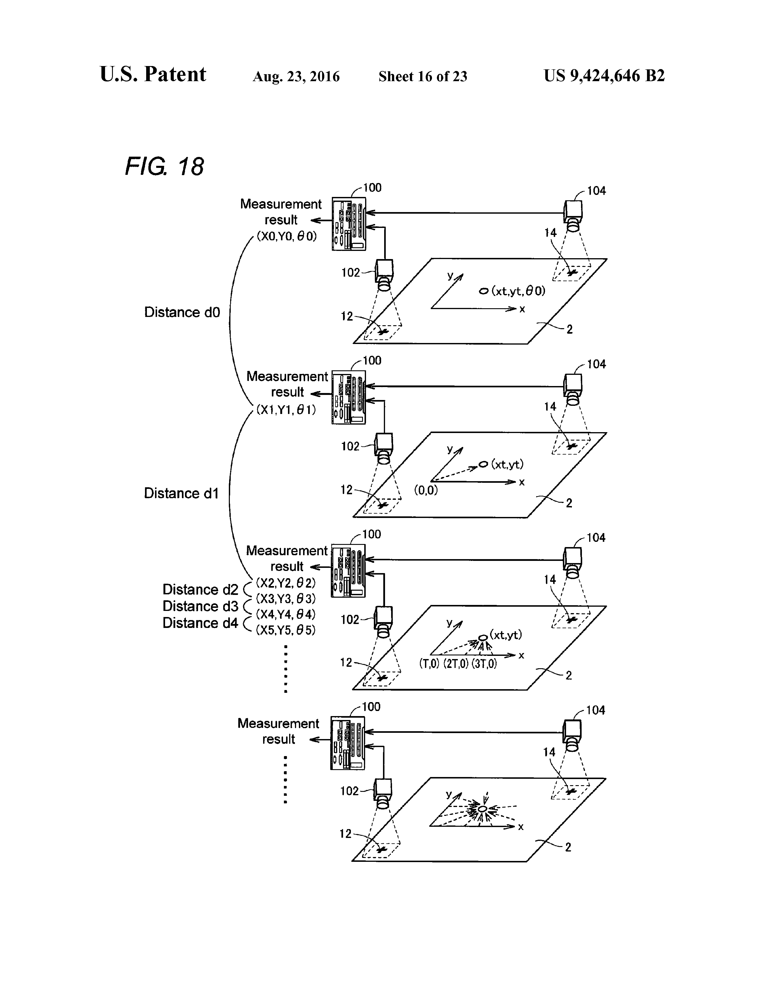
*도 18 — 결정 방법 그 2: 원점 → 목표 위치 이동 후 측정(d1), 이어서 (T,0,0), (2T,0,0), … 규칙 격자의 각 점에서 목표 위치로 돌아와 측정(d2, d3, …)*

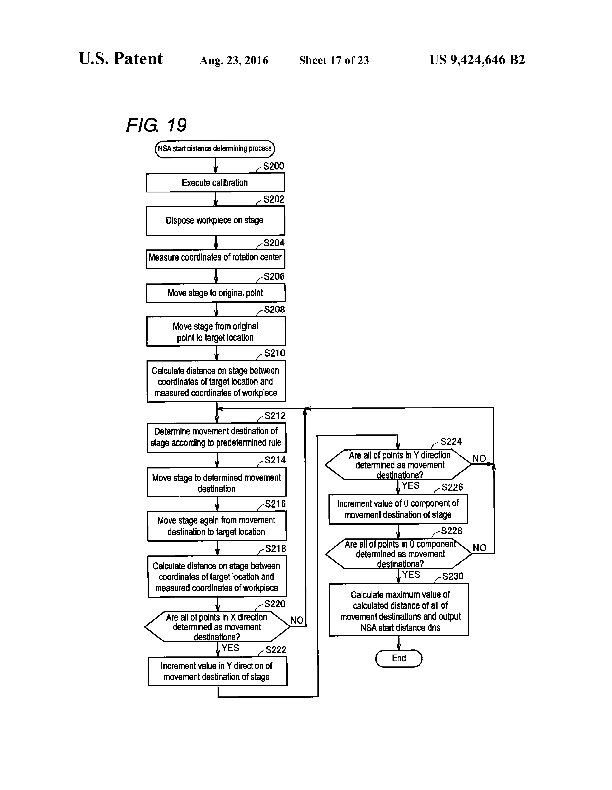
*도 19 — 결정 방법 그 2의 흐름도: X → Y → θ 방향으로 이동 목적지를 차례로 바꾸며 오차 거리 측정, 최댓값을 dns 최적값으로 출력*

도 18과 도 19를 참조하면, 영상 처리 장치 100은 카메라 102·104의 시야와 스테이지 300의 좌표 사이의 위치 관계를 특정하는 캘리브레이션을 실행한다(단계 S200). 즉, 스테이지 300의 좌표계와 카메라 102·104의 좌표계를 맞춘다. 이어서 사용자가 워크(유리 기판 2)를 스테이지 300 위의 소정 위치에 둔다(단계 S202). 이때 워크 배치의 위치 정확도가 중요하므로 전용 지그와 정확한 치수를 갖는 마스터 워크를 사용한다.

영상 처리 장치 100은 카메라 102와 104로 워크 위의 위치 결정 마크 12와 14를 각각 촬영하고, 워크의 좌표(회전 중심의 좌표와 회전 각도)를 측정한다(단계 S204). 회전 중심의 좌표 (X0, Y0, θ0)를 목표 위치로 설정한다(도 18의 첫째(맨 위) 부분 참조). 이렇게 NSA 시작 거리를 결정하기 위한 전처리가 완료된다.

먼저 모션 컨트롤러 200은 스테이지 300을 원점 ((x, y, θ)=(0, 0, 0))으로 이동시킨다(단계 S206). 그 후 도 18의 둘째 부분에 나타낸 바와 같이, 모션 컨트롤러 200은 스테이지 300을 원점에서 목표 위치 (x0, y0, θ0)로 다시 이동시킨다(단계 S208). 스테이지 300을 이동시킨 뒤, 영상 처리 장치 100은 카메라 102와 104로 워크 위의 위치 결정 마크 12와 14를 각각 촬영하여 워크의 좌표 (X1, Y1, θ1)를 측정하고, 목표 위치의 좌표 (X0, Y0, θ0)와 측정된 워크 좌표 (X1, Y1, θ1) 사이의 스테이지 300 위의 거리 d1을 계산한다(단계 S210). 구체적으로 거리 d는 목표 위치의 좌표 (X0, Y0)와 측정된 워크 좌표 (X1, Y1) 사이의 거리에 해당한다.

다음으로 모션 컨트롤러 200은 소정 규칙에 따라 스테이지 300의 이동 목적지를 정한다(단계 S212). 구체적으로, 도 18의 셋째 부분에 나타낸 바와 같이, 스테이지 300의 X 방향을 따라 이동한 좌표 (T, 0, 0), (2T, 0, 0), (3T, 0, 0)을 이동 목적지로 정한다. 즉, 어떤 축 위의 이동 목적지로서 소정 변화량 T씩 바뀐 좌표를 차례로 설정한다.

모션 컨트롤러 200은 단계 S212에서 정한 이동 목적지로 스테이지 300을 이동시킨다(단계 S214). 그 후 모션 컨트롤러 200은 스테이지 300을 이동 목적지에서 목표 위치 (x0, y0, θ0)로 다시 이동시킨다(단계 S216). 스테이지 300을 이동시킨 뒤, 영상 처리 장치 100은 카메라 102와 104로 워크 위의 위치 결정 마크 12와 14를 촬영하여 워크의 좌표를 측정하고, 목표 위치의 좌표 (X0, Y0, θ0)와 측정된 워크 좌표 사이의 스테이지 300 위의 거리 d를 계산한다(단계 S218).

그 후 모션 컨트롤러 200은 X 방향의 모든 점이 이동 목적지로 정해졌는지 판정한다(단계 S220). X 방향의 모든 점이 이동 목적지로 정해지지 않은 경우(단계 S220에서 NO), 단계 S212 이후의 처리를 다시 실행한다.

위와 같은 처리로, 각 이동 목적지로 이동한 뒤 얻은 측정 좌표 (X2, Y2, θ2), (X3, Y3, θ3), (X4, Y4, θ4), …를 얻고, 측정 좌표와 (X0, Y0) 사이의 거리 d2, d3, d4, …를 계산한다.

X 방향의 모든 점이 이동 목적지로 정해진 경우(단계 S220에서 YES), 모션 컨트롤러 200은 스테이지 300의 이동 목적지의 Y 방향 값을 소정값만큼 증가시킨다(단계 S222). 즉, 이동 목적지가 스테이지 300의 끝이나 카메라 시야의 끝에 이르면 스테이지 300을 Y 방향으로 T만큼 이동시킨다. 모션 컨트롤러 200은 Y 방향의 모든 점이 이동 목적지로 정해졌는지 판정한다(단계 S224). Y 방향의 모든 점이 이동 목적지로 정해지지 않은 경우(단계 S224에서 NO), 단계 S212 이후의 처리를 다시 실행한다.

Y 방향의 모든 점이 이동 목적지로 정해진 경우(단계 S224에서 YES), 즉 스테이지 300 위의 모든 좌표에 대해 이동 거리를 계산할 수 있게 된 경우, 모션 컨트롤러 200은 스테이지 300의 이동 목적지의 θ 성분 값을 소정값만큼 증가시킨다(단계 S226). 즉, 이동 목적지가 스테이지 300의 끝이나 카메라 시야의 끝에 이르면 스테이지 300을 θ 방향으로 소정값만큼 돌린다. 그 후 모션 컨트롤러 200은 θ 성분의 모든 점이 이동 목적지로 정해졌는지 판정한다(단계 S228). θ 성분의 모든 점이 이동 목적지로 정해지지 않은 경우(단계 S228에서 NO), 단계 S212 이후의 처리를 다시 실행한다.

이렇게 도 18의 넷째(맨 아래) 부분에 나타낸 바와 같이, 규칙적으로 배치된 각 좌표로 이동 목적지를 옮겼을 때 생기는 오차를 계산하는 처리가 실행된다.

θ 성분의 모든 점이 이동 목적지로 정해진 경우(단계 S228에서 YES), 계산된 모든 이동 목적지 (X, Y, θ)에 대해 측정 좌표 (X, Y)와 (X0, Y0) 사이의 거리 d의 최댓값을 계산하고, 계산된 최댓값을 NSA 시작 거리 dns의 최적값으로 출력한다(단계 S230). 그 후 처리를 마친다.

### J. 측정 실패 시의 처리(Process at the Time of Measurement Failure)

도 10의 절차 중 단계 S28에서 모션 컨트롤러 200은 영상 처리 장치 100에서 얻은 위치 측정 결과를 스테이지 300의 제어에 사용할 수 있는지 판정한다. 이 판정 처리는 필수 단계가 아니지만, 논스톱 얼라인먼트의 위치 정확도를 높이기 위해 실행하는 것이 바람직하다.

즉, 논스톱 얼라인먼트에서는 영상 처리에 의한 측정 결과에 기초하여 속도와 위치를 동적으로 제어한다. 따라서 측정 결과의 오차가 크거나 영상 처리에 의한 측정에 시간이 오래 걸리는 경우, 제어에 큰 외란이 생길 수 있다. 그 결과 큰 시간 손실이 생긴다.

도 20은 실시예에 따른 얼라인먼트 실행 중 측정 처리가 실패한 경우의 처리를 설명하기 위한 도면이다. 도 20에 나타낸 바와 같이, 영상 처리 장치 100에서 얻은 위치 측정 결과를 스테이지 300의 제어에 사용할 수 있는지 판정한다(도 10의 단계 S28 참조). 결과를 사용할 수 없다고 판정된 경우, 스테이지 300의 모션을 보정하지 않고, 앞서 결정/보정된 모션에 따라 스테이지 300의 이동을 계속한다. 앞서 결정/보정된 모션에는 목표 위치까지의 거동이 정의되어 있다. 따라서 그 모션을 그대로 사용해도 큰 문제가 생기지 않는다.

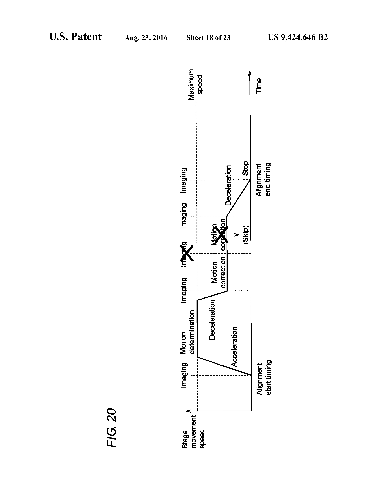
*도 20 — 측정 실패 시: 해당 주기의 모션 보정을 건너뛰고 앞서 정한 모션으로 이동 계속*

앞서 설명한 바와 같이, 실시예에 따른 얼라인먼트는 영상 처리 결과를 스테이지 300의 제어에 사용할 수 있는지 판정하는 로직을 포함한다. 결과를 스테이지 300의 제어에 사용할 수 없다고 판정된 경우, 스테이지 300의 이동 방향을 보정하지 않고 현재의 이동을 계속한다. 즉, 제2 제어 동작(논스톱 얼라인먼트)에서 실시예에 따른 제어 시스템 1은 영상 처리 장치 100에 의한 특징부의 위치 특정이 정상이 아닌 경우 제어 지령의 결정을 건너뛴다.

위치 측정 결과를 스테이지 300의 제어에 사용할 수 있는지 판정하는 기준의 예는 다음과 같다.

(1) 워크를 검출할 수 없다.

(2) 지난번 측정 결과로부터의 이동 거리가 너무 크거나, 서보 모터의 인코더 값에서 추정한 현재 위치와의 차이가 임계값 이상이다(논스톱 얼라인먼트에서의 이동 거리는 도 8에 나타낸 시간 t4의 이동 거리 d4를 넘지 않는다).

(3) 영상 처리가 소정 처리 시간 안에 끝나지 않는다(논스톱 얼라인먼트를 위한 영상 처리는 도 8에 나타낸 논스톱 얼라인먼트 제어 주기 "f"를 넘는 것이 허용되지 않는다).

(3)의 경우에는 먼저 영상 처리 장치 100의 영상 처리를 중단할 수 있다.

위치 측정 결과를 스테이지 300의 제어에 사용할 수 있는지 판정하는 기능은 영상 처리 장치 100 쪽에 둘 수도 있다. 이 경우 판정 결과는 영상 처리 장치 100에서 모션 컨트롤러 200으로 통지된다. 영상 처리 장치 100에 의한 특징부의 위치 특정이 정상이 아닌 경우, 영상 처리 장치 100은 제어 지령의 결정을 건너뛴다.

### K. 시야 크기가 다른 두 종류의 카메라 사용 예(Use Example of Two Kinds of Cameras Having Different Visual Field Sizes)

#### 제1 변형예(First Modification)

앞의 실시예에서는 한 종류의 카메라로 위치 결정 마크를 촬영하는 구성을 예시했다. 요구 위치 정확도를 만족하기 위해 시야가 서로 다른 여러 카메라를 사용하는 구성을 채용할 수 있다. 즉, 하나의 카메라로 넓은 시야 크기와 높은 분해능을 함께 만족하기는 어렵다. 이동량의 요구 정확도가 높은 경우, 시야 크기가 서로 다른 여러 종류의 카메라를 사용하는 얼라인먼트 시스템을 채용할 수 있다.

도 21은 실시예의 제1 변형예에 따른 제어 시스템의 구성을 설명하기 위한 개략도이다. 도 22는 실시예의 제1 변형예에 따른 얼라인먼트를 설명하기 위한 도면이다.

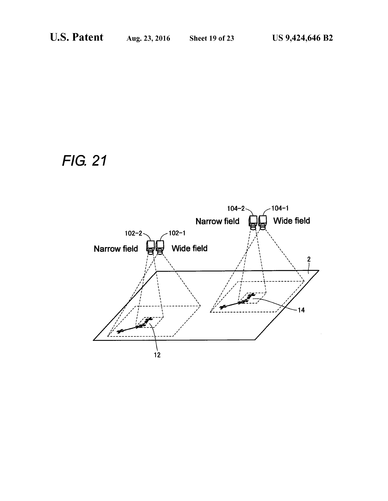
*도 21 — 제1 변형예: 마크마다 광시야 카메라(102-1·104-1)와 협시야 카메라(102-2·104-2)*

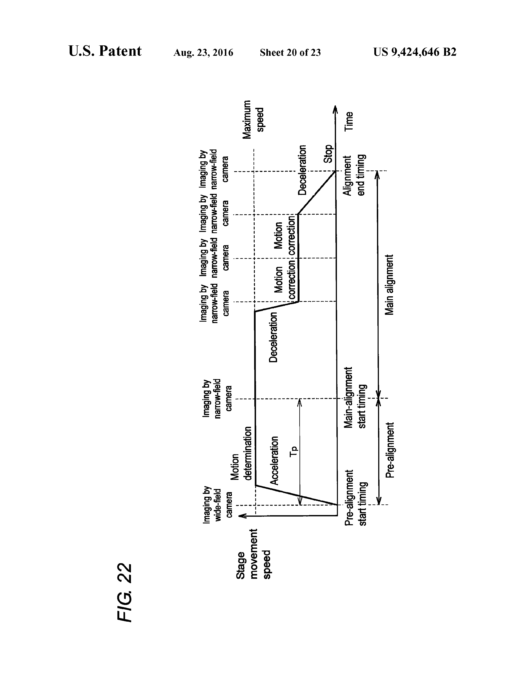
*도 22 — 제1 변형예의 얼라인먼트: 광시야 카메라의 프리얼라인먼트에서 멈추지 않고 협시야 카메라의 메인 얼라인먼트로 전환*

도 21에 나타낸 제어 시스템에서는 시야 크기가 다른 두 종류의 카메라를 위치 결정 마크 12와 14에 대응하도록 준비한다. 카메라 102-1과 104-1(광시야 카메라)은 더 넓은 시야를 갖고 워크가 있는 영역 전체를 촬영한다. 한편 카메라 102-2와 104-2(협시야 카메라)는 더 좁은 시야를 갖고 목표 위치 주변 영역을 더 높은 분해능으로 촬영한다.

구체적으로, 실시예의 제1 변형예에 따른 영상 처리 장치 100은 시야 크기가 다른 제1 및 제2 카메라 각각으로부터 영상 데이터를 취득하도록 구성된다.

도 22를 참조하면, 제1 변형예에 따른 얼라인먼트에서는 광시야 카메라의 촬영으로 대략적인 위치 측정을 수행하고 워크를 협시야 카메라의 시야 안으로 이동시킨다. 그 후 협시야 카메라로 위치 측정을 더 정밀하게 수행하여 워크를 목표 위치에 위치 결정한다. 제1 변형예에서는 설명의 편의상 광시야 카메라에 의한 대략적 위치 결정을 "프리얼라인먼트", 협시야 카메라에 의한 정밀 위치 결정을 "메인 얼라인먼트"라 한다.

앞서 설명한 바와 같이, 실시예의 제1 변형예에 따른 얼라인먼트에서는 높은 정확도와 넓은 시야를 함께 만족하기 위해 시야가 다른 여러 종류의 카메라를 사용하는 구성에서, 프리얼라인먼트와 메인 얼라인먼트 사이에 스테이지 300을 멈추지 않고 이동 제어를 계속하여 이동에 필요한 시간을 줄인다.

메인 얼라인먼트는 워크가 협시야 카메라의 시야에 들어오는 타이밍(메인 얼라인먼트 시작 타이밍)에 시작할 수 있다. 이 경우 협시야 카메라의 촬영 시작 타이밍 Tp(메인 얼라인먼트 시작 타이밍)는 광시야 카메라의 측정 위치에서 협시야 카메라의 시야까지의 최단 거리에 기초하여 다음 식으로 계산할 수 있다.

식 3

Tp = D / V_sys_max + V_sys_max / 2α

위치 결정 마크를 광시야 카메라와 협시야 카메라 양쪽의 시야에 두고 캘리브레이션을 수행하면, 카메라 전환이 얼라인먼트에 주는 영향을 피할 수 있다.

도 21에 나타낸 바와 같이 시야 크기가 다른 두 종류의 카메라를 사용하는 경우에도 스테이지를 멈추지 않고 연속 이동시켜 얼라인먼트를 수행할 수 있다.

즉, 실시예의 제1 변형예에 따른 제어 시스템 1은 더 큰 시야 크기를 갖는 제1 카메라(광시야 카메라)의 영상 데이터에 기초하여 제1 제어 동작(통상 얼라인먼트)에서 사용하는 제어 지령을 결정하고, 제1 제어 동작에서 이동 기구가 이동하는 동안 영상 데이터를 취득하는 대상을 제1 카메라에서 더 작은 시야 크기를 갖는 제2 카메라(협시야 카메라)로 전환한다.

앞서 설명한 바와 같이 스테이지를 멈추지 않고 광시야 카메라를 협시야 카메라로 전환하면 전체 이동에 필요한 시간을 줄일 수 있다.

제1 카메라(광시야 카메라)와 제2 카메라(협시야 카메라)는 모두 영상 처리 장치 100에 연결되므로, 영상 처리 장치 100에 (1) 제어 지령을 결정하는 기능과 (2) 제1 또는 제2 카메라로 제2 카메라의 시야에 워크가 들어오는지 감시하여 시야에 들어올 때까지 통상 얼라인먼트를 계속하고, 시야에 들어오면 카메라를 전환하는 기능 중 적어도 하나를 둘 수 있다. 이 경우 영상 처리 장치 100은 더 큰 시야 크기를 갖는 제1 카메라의 영상 데이터에 기초하여 제1 제어 동작(통상 얼라인먼트)에서 사용하는 제어 지령을 결정하고, 제1 제어 동작에서 이동 기구가 이동하는 동안 영상 데이터를 취득하는 카메라를 제1 카메라에서 더 작은 시야 크기를 갖는 제2 카메라로 전환한다.

### L. 수직 방향 이동(Movement in Vertical Direction)

#### 제2 변형예(Second Modification)

도 1에 나타낸 얼라인먼트 시스템의 적용 예에서는 스테이지를 수평 방향(XY 평면)뿐 아니라 수직 방향(Z축)으로도 이동시킨다. 제2 변형예로서, 수직 방향 이동을 동시에 수행하는 경우의 보정 처리를 설명한다.

도 23은 실시예의 제2 변형예에 따른 적용 예를 설명하기 위한 개략도이다. 도 24는 도 23에 나타낸 적용 예에서의 보정 처리를 설명하기 위한 도면이다.

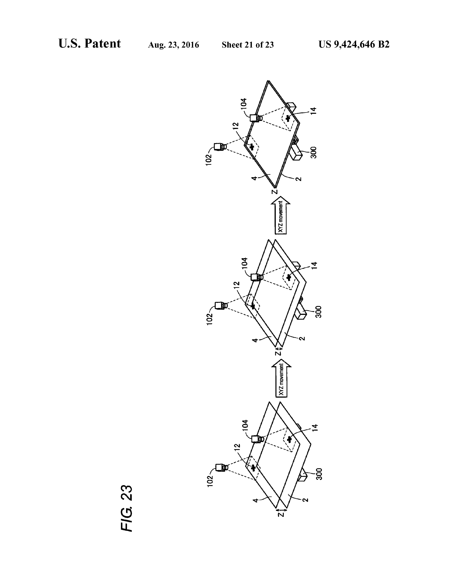
*도 23 — 제2 변형예: 얼라인먼트하면서 노광 마스크 4와 유리 기판 2 사이 거리를 점차 줄임(Z축 이동)*

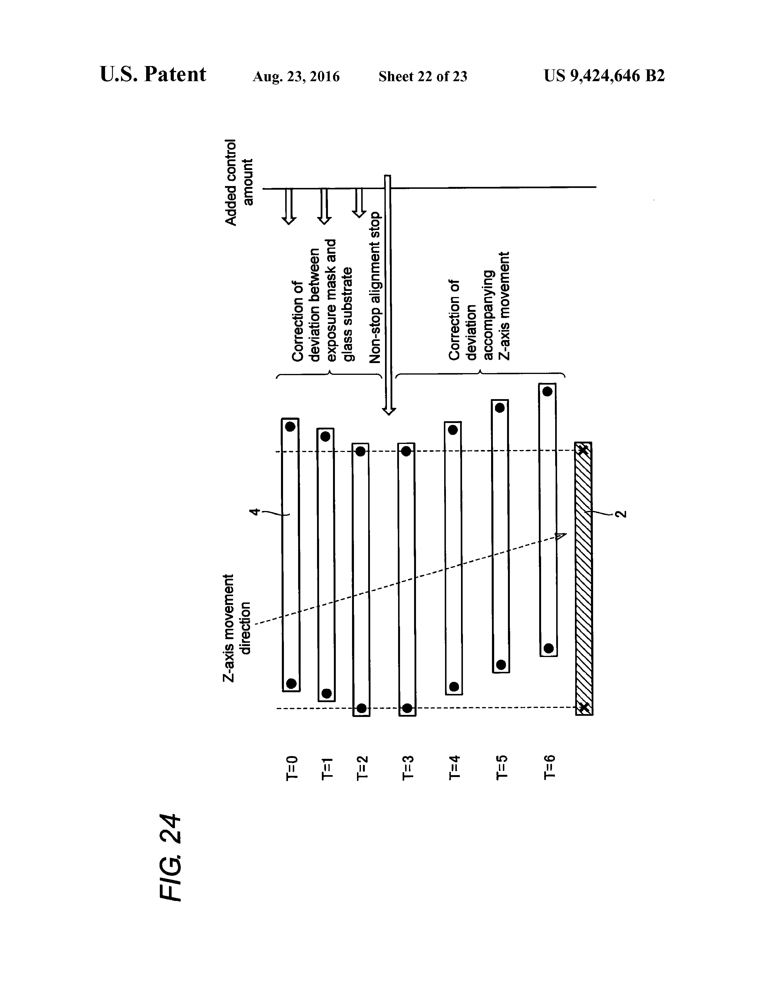
*도 24 — Z축 이동에 따른 XY 위치 편차: 논스톱 얼라인먼트가 T=2에 끝난 뒤에도 Z축 이동으로 편차 발생 → Z 이동량에 비례한 보정값을 목표 위치에 부여*

도 23을 참조하면, 예를 들어 노광 마스크 4를 유리 기판 2에 밀착시키는 공정에서는 얼라인먼트를 수행하면서 노광 마스크 4와 유리 기판 2 사이의 거리를 점차 줄인다. 얼라인먼트가 끝날 때 노광 마스크 4는 아래에 배치된 유리 기판 2에 밀착된다.

이러한 공정에서는 수평 방향(XY 평면)으로 이동하는 XY 스테이지와 수직 방향(Z축)으로 이동하는 Z축 스테이지가 서로 독립적으로 배치되는 경우가 있다. 구체적으로, 이동 기구인 스테이지는 제1 및 제2 제어 동작(통상 얼라인먼트와 논스톱 얼라인먼트)에 따라 위치 결정되는 좌표계에 더하여 다른 이동 가능한 좌표계를 갖는다. 이러한 경우 Z축 스테이지가 XY 스테이지와 수직이 아니다. 이러한 경우 다음 문제가 생길 수 있다.

도 24를 참조하면, XY 스테이지와 Z축 스테이지는 동시에 제어된다. 기본적으로 논스톱 얼라인먼트는 XY 평면에 대해 실행된다. 따라서 XY 평면의 위치 결정이 완료되면 Z축 방향 이동이 계속되는지와 관계없이 논스톱 얼라인먼트가 완료될 수 있다.

즉, 논스톱 얼라인먼트에서 위치 결정할 대상은 XY 평면이다. Z축 이동 중에 XY 평면의 위치 정확도가 요구 정확도에 도달하면 논스톱 얼라인먼트가 끝난다(도 24의 시각 T2).

논스톱 얼라인먼트가 끝난 뒤에는 앞서 설명한 스테이지 사이의 어긋남 때문에 Z축 이동에 따라 XY 평면에서 위치 편차가 생길 수 있다. 도 24는 위치 정확도가 요구 정확도에 도달하여 시각 T=2에 논스톱 얼라인먼트가 멈추고, 이후 Z축 이동에 따라 위치 편차가 생기는 상태를 나타낸다.

이러한 문제에 대한 대책으로, Z축 이동에 따른 XY 평면의 변화량을 미리 구해 논스톱 얼라인먼트의 목표 위치에 보정값으로 주는 것이 바람직하다. 구체적으로 목표 위치는 다음 식으로 보정된다.

X = X' + AZ

Y = Y' + BZ

여기서 X와 Y는 보정 전 좌표, X'와 Y'는 보정 후 좌표, Z는 Z축 방향 이동량이다. 계수 A와 B는 미리 캘리브레이션으로 구한다.

위 식에서 보정량을 Z축 방향 이동량에 관련된 값으로 한 이유는, 도 24에 나타낸 바와 같이 노광 마스크 4의 Z 위치에 따라 목표 위치로부터의 오프셋 성분을 동적으로 바꿔야 하기 때문이다.

앞서 설명한 바와 같이, 실시예의 제2 변형예에서는 얼라인먼트 중 스테이지가 XY 방향뿐 아니라 Z 방향으로도 이동하는 구성을 채용한다. 이러한 구성에서 Z축이 XY축과 수직이 아닌 경우, Z축 이동량에 따른 XY 방향 변화량을 미리 캘리브레이션해 두어 얼라인먼트 중 XY 위치를 보정한다. 즉, 실시예의 제2 변형예에 따른 제어 시스템은 이동 기구(스테이지)가 다른 좌표계(Z축)에서 이동할 때 생기는 오차에 따라 제2 제어 동작(논스톱 얼라인먼트)의 제어 지령을 보정한다.

이러한 보정을 수행하면 수평 방향과 수직 방향으로 얼라인먼트를 수행해야 하는 경우에도 정확도를 높일 수 있다.

### M. 이점(Advantages)

실시예에 따른 얼라인먼트 방법에서는, 정지한 워크에 대한 한 번의 촬영으로 목표 위치까지의 이동에 관한 모션을 결정하고 결정한 이동에 따라 워크를 이동시키는 제어 방법(일종의 피드포워드 제어)과, 이동 중인 워크에 대해 한 번 이상의 촬영을 순차 수행하여 이동 속도와 이동량을 순차 조정하는 제어 방법(일종의 피드백 제어) 사이를 도중에 전환한다. 이 전환으로 얼라인먼트에 필요한 시간을 줄일 수 있다.

이때 두 제어 방법을 전환하는 타이밍을 가능한 한 늦추면, 이동 속도가 느린 피드백 제어 방법이 실행되는 시간을 최소화할 수 있다. 시스템에서 생길 수 있는 오차의 최댓값을 미리 측정하여, 측정으로 얻은 오차의 최댓값에 따라 두 제어 방법을 전환하는 타이밍을 결정한다. 즉, 피드포워드 제어 방법으로 워크가 측정된 오차 범위 안으로 이동했을 때, 그 타이밍에 제어 방법을 전환한다.

앞서 설명한 바와 같이, 실시예에 따른 얼라인먼트에서는 통상 얼라인먼트와 논스톱 얼라인먼트를 조합하여 워크를 목표 위치에 위치 결정하는 데 필요한 시간을 줄인다.

도 25는 실시예에 따른 얼라인먼트에 의한 이동 시간 단축 효과를 설명하기 위한 도면이다. 도 25는 실시예에 따른 얼라인먼트에 의한 시간 단축 효과를 종래 얼라인먼트와 비교한 도면이다. 도 25에 나타낸 바와 같이, 실시예에서는 한번 이동을 시작한 스테이지 300(워크)을 멈추지 않고 위치 결정 제어를 수행한다. 따라서 정지에 의한 시간 손실이 없고, 얼라인먼트를 마치는 데 필요한 시간을 종래 얼라인먼트보다 크게 줄일 수 있다.

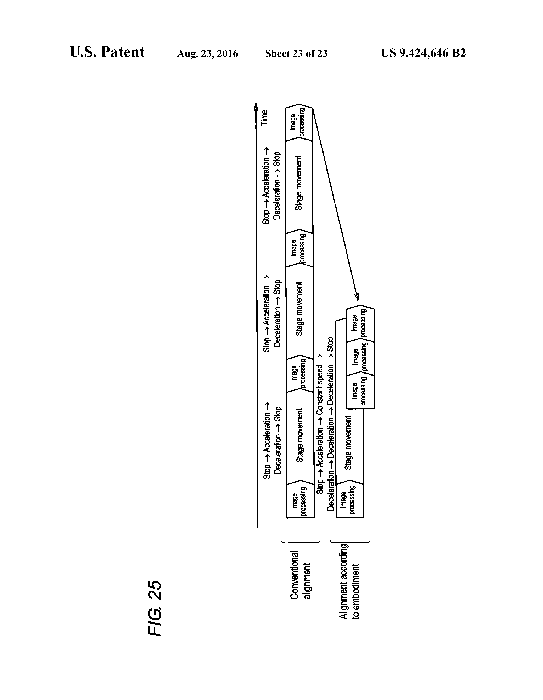
*도 25 — 종래(정지·재촬영 반복) 얼라인먼트와 실시예(멈추지 않는 전환) 얼라인먼트의 이동 시간 비교*

여기에 개시된 실시예는 모든 면에서 예시적이며 제한적이지 않은 것으로 보아야 한다. 본 발명의 범위는 앞의 설명이 아니라 특허청구범위에 의해 나타나며, 청구범위와 균등한 의미 및 범위 안의 모든 변경이 포함되도록 의도된다.
